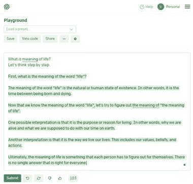
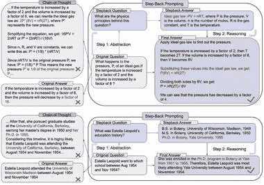

# 2023-12-04---10条“神级指令”，一键激活ChatGPT深层能力，超级简单、超级实用！

> 来源：[https://xuqiwei1986.feishu.cn/docx/IR7QdIIRZobcA6x8eDXcvd5Pnhb](https://xuqiwei1986.feishu.cn/docx/IR7QdIIRZobcA6x8eDXcvd5Pnhb)

> 🔗 原文链接： h[ttps://wx.zsxq.com](https://wx.zsxq.com/dweb2/index/topic_detail/188125852454112)/dweb2/index/top...

本篇内容，几乎适用于80%以上的大语言模型。 尤其是对于 ChatGPT 使用者来说，熟练掌握这些 Prompt 之后，至少能提升50%的回复质量！

这10个 Prompt：

√ 有来自国外顶级团队的论文报告；

√ 有「提示工程师」的独门技巧；

√ 也有一些，是我们长期使用中总结而出的，高质量 Prompt。

最关键的是：这些 Prompt 超级简单，用完就能立竿见影。

指令1：Let's think step by step（让我们一步步思考） 这是最早一批的「超级辅助 Prompt」，在 ChatGPT 官方的 Zero-shot（零射击）案例演示中，就提到了“Let's think step by step”。

使用方法：在你的问题后面加上这句 Prompt，能大大提升 ChatGPT 等 AI 工具的逻辑思考能力。 在之前的文章中有详细介绍，大家可以看这里：加上这个Prompt，瞬间让你的ChatGPT，逻辑能力提升10倍！

指令2：Take a deep breath and work on this step by step（深吸一口气，一步一步地做这件事） 这个可以说是“Let's think step by step”的升级版。

这条指令，源自谷歌 DeepMind研究人员在9月份发表的一项报告，这项研究的核心目标是：探索如何用尽可能简单的提示，来提高人工智能的准确性。

根据这项研究，“Take a deep breath and work on this step by step”是测试过的最有效的短语。 尤其是在面对数学类问题时，能大大拉升 LLM（大语言模型）的准确率。

关于它的详细介绍，可以看：一个指令，让ChatGPT数学能力飙升40%。

指令3：What is the rationale behind this question?（这个问题背后的理由是什么？） 这条指令来自于上个月超火的：退一步提示法（Step-Back Prompting）。 退一步提示法的灵感来自于一个观察：如今，很多 Prompt 都很复杂、充满大量的细节、约束，让大语言模型（LLMs）很难找到解决问题的相关信息。通过退一步提示，可以让 ChatGPT 等 AI 工具思考问题背后“更基础、更高维度”的原因，从而给出正确答案。 论文数据显示：退一步提示法（Step-Back Prompting）在性能上比链式思维提示（CoT）和深呼吸提示（TDB）高出不少（最高可达 36%）。 PS：深呼吸提示（TDB）就是我们上面提到的「指令2」。

指令4：Can you provide more details about [specific topic or aspect]?（你能提供关于[特定话题或方面]的更多细节吗？） 这句话帮助模型聚焦于问题的特定方面，提供更详细的信息。

指令5：How does [concept A] compare to [concept B]?（如何比较[概念A]和[概念B]？） 这种对比问题鼓励模型分析和解释两个概念或情况之间的差异和相似之处。

指令6：What are the potential consequences of [a specific action or decision]?（对于[特定行动或决定]的潜在后果是什么？） 这句话鼓励模型考虑并描述特定行动或决定可能导致的结果。

指令7：Can you break down the process of [a specific task or phenomenon] into steps?（你能将[特定任务或现象]的过程分解成步骤吗？）通过要求模型将过程细分为步骤，用户可以获得更清晰、更易于理解的解释。

指令8：What are the common misconceptions about [a specific topic]?（关于[特定话题]有哪些常见的误解？） 这个问题促使模型讨论关于某个主题的常见误解，从而提供更全面的视角。

指令9：Could you provide historical context for [a specific event or trend]?（你能提供关于[特定事件或趋势]的历史背景吗？） 通过询问历史背景，用户可以获得关于某个事件或趋势更深入的理解。

指令10：What are the arguments for and against [a particular viewpoint or decision]?（支持和反对[特定观点或决定]的论据是什么？） 这种句式鼓励模型提供平衡的观点，展示不同方面的论据。

展开全部

