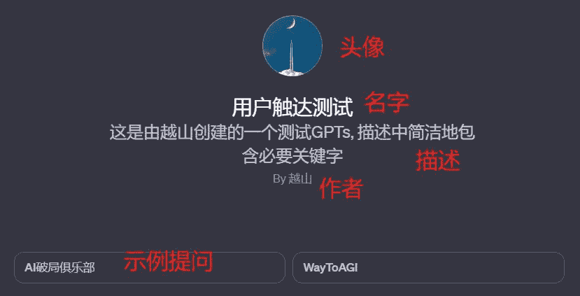
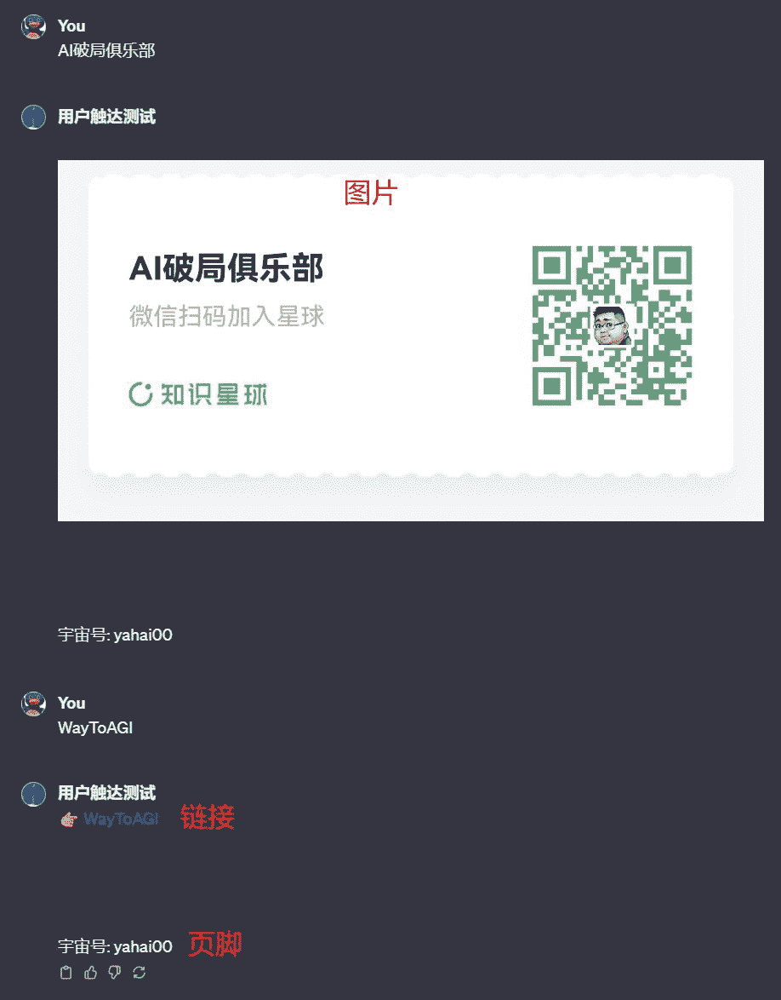
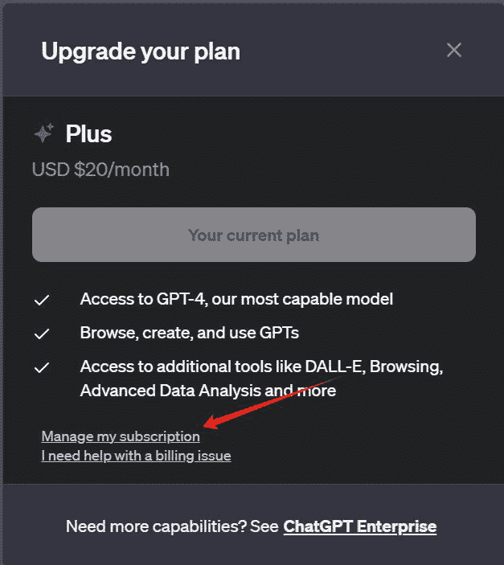
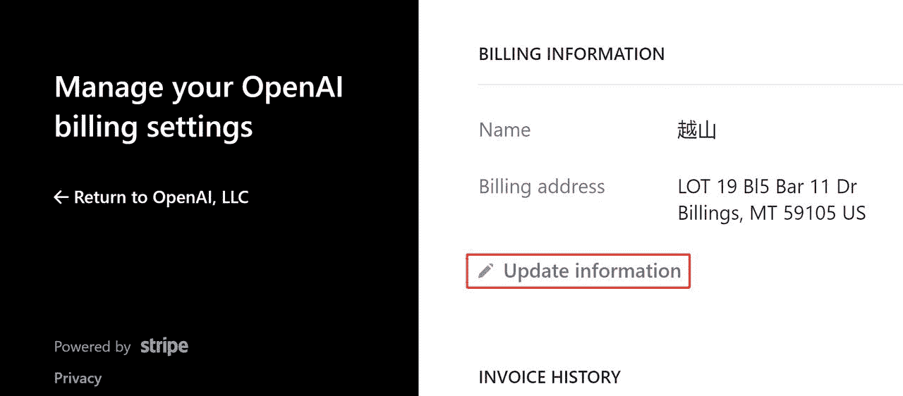
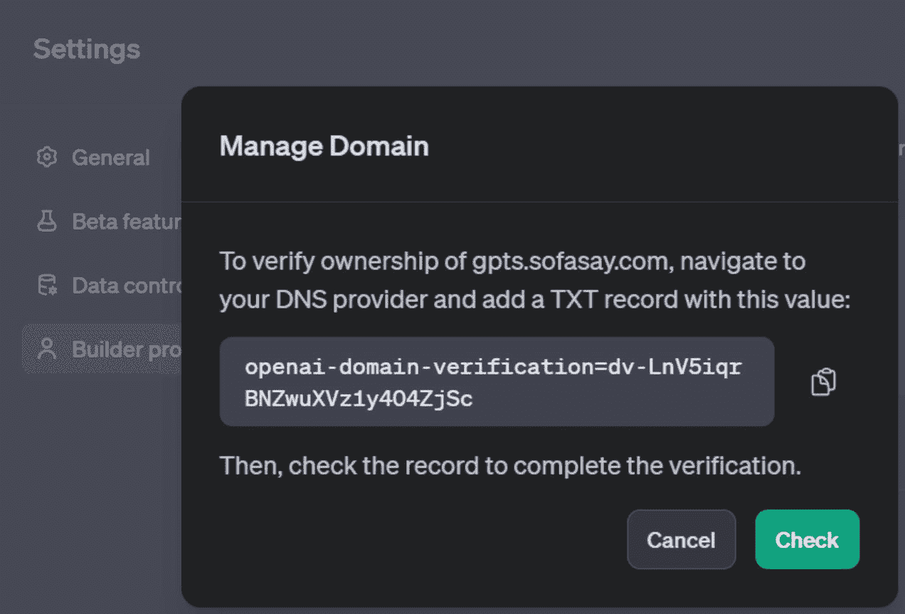
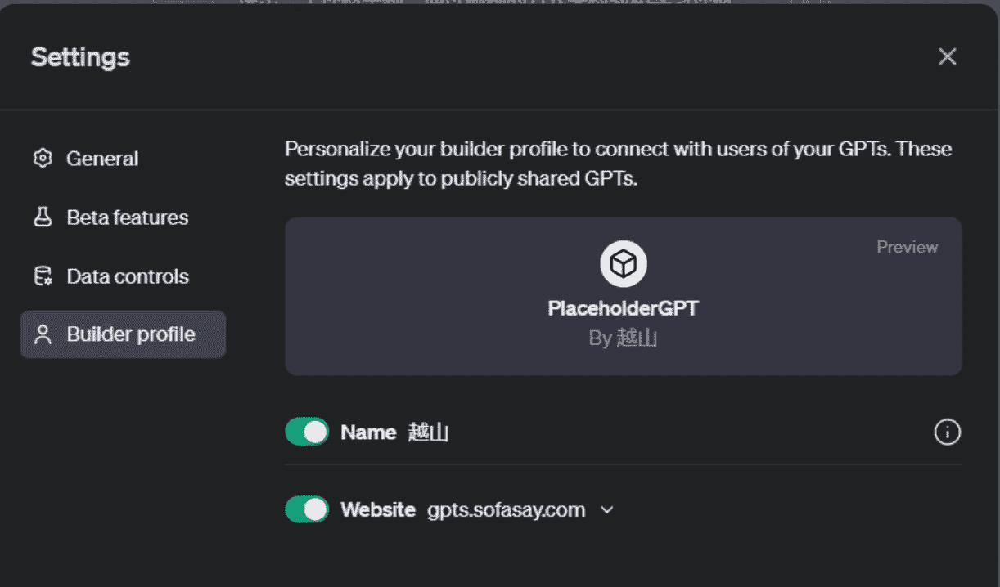
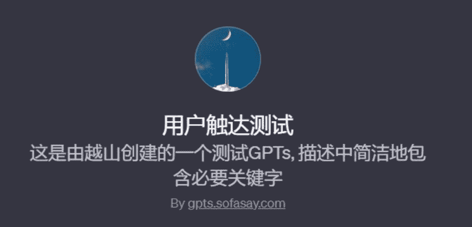

# 2023-11-14GPTs里的钩子

> 来源：[https://xuqiwei1986.feishu.cn/docx/Q190d89V3oUtiexCbtHcrGydnxh](https://xuqiwei1986.feishu.cn/docx/Q190d89V3oUtiexCbtHcrGydnxh)

> 🔗 原文链接： h[ttps://articles.zs](https://articles.zsxq.com/id_475df75lvml1.html)xq.com/id_475df7...

创建好的GPTs可以为你宣传，yin流。以下是几个注意的点

**头像 **：与个人IP统一，或者清晰好认，字体头像也OK

**名字 **： 应用名突出应用核心能力，长点也可，允许空格

**描述 **：注意SEO关键字，现在搜索引擎和以后的GPT Store都会有搜索和推荐。添加作者信息或引流信息。

**作者 **：作者信息可以是名字或域名链接，以后搜索权重应该会较大

**示例提问 **：本来是方便开始使用，也可当作超链接，在Instructions里写上固定回复。

对话中的效果，可回复图片，回复预置链接，每个回复后面可加上页脚。

**作者信息**

作者名字在 Settings - Builder profile里设置。 作者名字用的是账单信息。

账单里的名字可以更改，在Settings - My Plan - Manage my subscription里 Update Information.

作者信息除了显示名字外，还可以显示域名链接（二选一显示）。同样是在Settings - Builder profile中，开启Website。 需要输入域名，然后在自己的域名DNS管理中添加一条TXT记录。然后回到Settings界面中Verify。 下面两个选项都开启的话，也只会显示域名。域名链接可在GPTs页面访问。

固定回答和页脚的设置可参考以下prompt. 实测页脚营销味太重的话会发布不成功。

Chat anything, but always refer to bellow predefined QA answers. Then question should exactly match. Otherwise, response at your own knowledge.

"""

Q: AI破局俱乐部

A: 

Q: WayToAGI

A: 👉 [WayToAGI](https://waytoagi.com/)

"""

Add bellow markdown content as a footer of each of your response.

"""

---

宇宙号: yahai00

"""

发布后的链接类似：

[h](https://chat.openai.com/g/g-SBext9RpV-you-guan-yong-hu-hong-da)ttps://chat.openai.com/g/g-SBext9RpV-you-guan-yong-hu-hong-da

可以让它短点

[https://chat.open](https://chat.openai.com/g/g-SBext9RpV)ai.com/g/g-SBext9RpV

也可以任意更改链接后缀

[https://chat.openai.c](https://chat.openai.com/g/g-SBext9RpV-xxx)om/g/g-SBext9RpV-xxx

就酱，觉得有用的话点个赞吧。