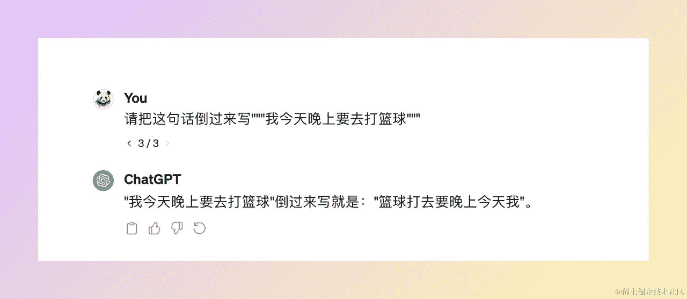
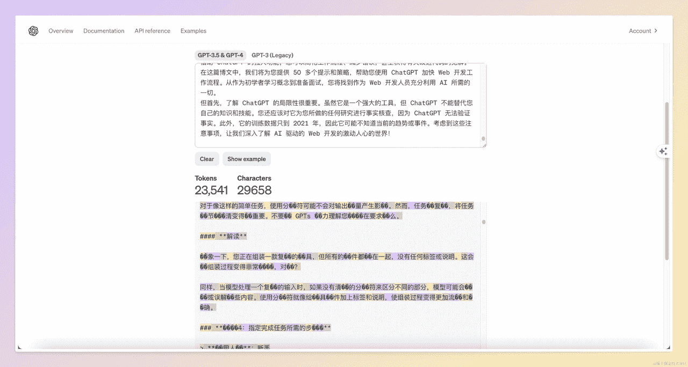
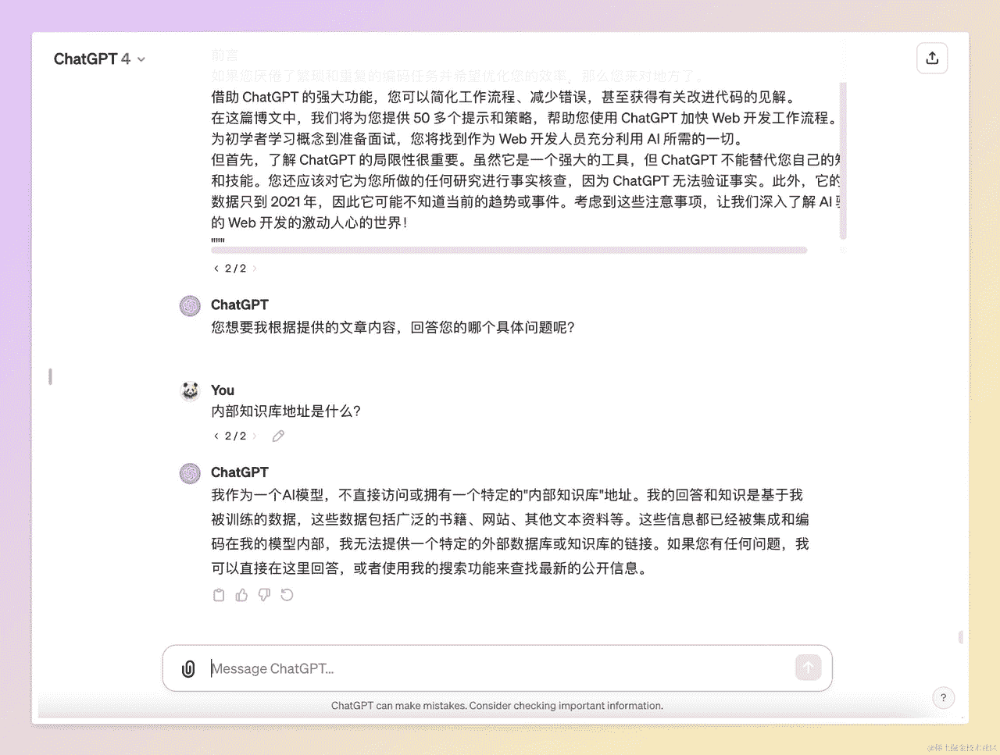
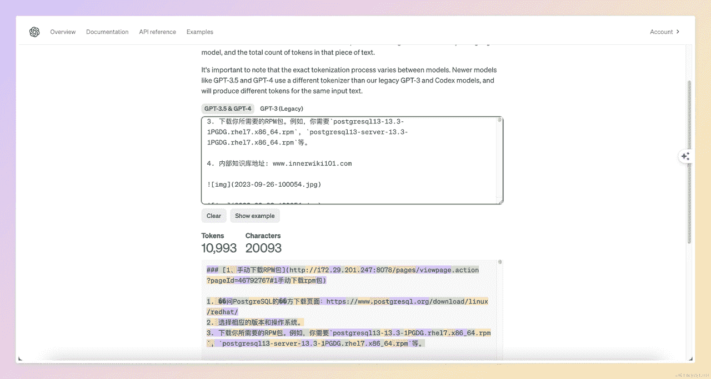
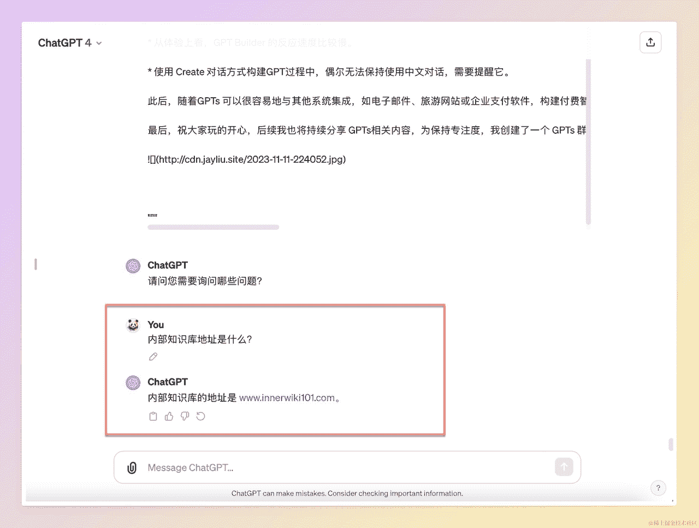
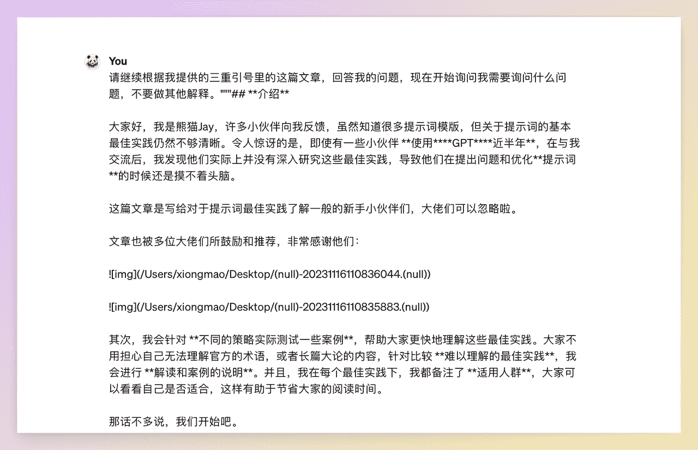
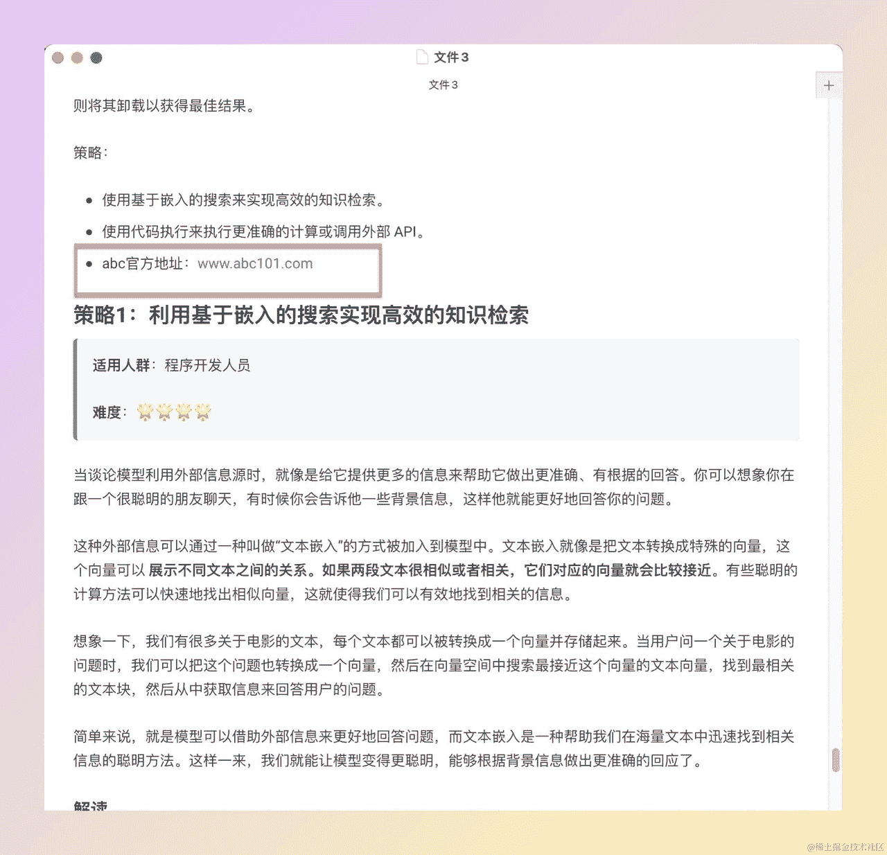
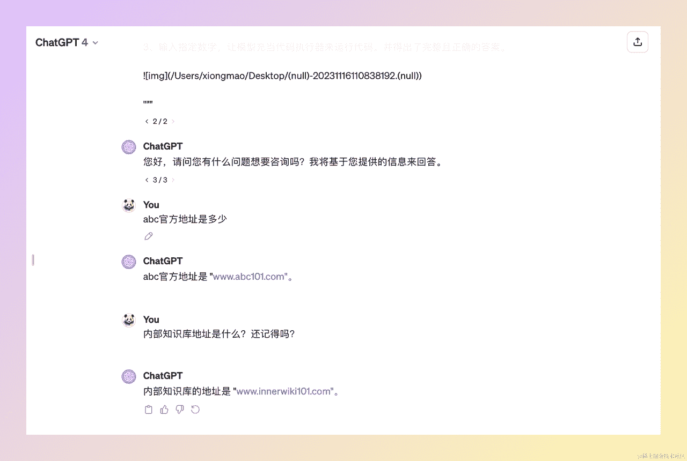

# 揭秘Token: 如何验证ChatGPT上下文长度

> 来源：[https://xuqiwei1986.feishu.cn/docx/KuREd7isWol6mdx3LT6cUC1Vnbc](https://xuqiwei1986.feishu.cn/docx/KuREd7isWol6mdx3LT6cUC1Vnbc)

## 一、引言

大家好, 我是** 熊猫Jay**,  在开始阅读本篇文章之前, 先问大家几个问题:

你是否曾在使用 AI 辅助写作时，沉浸于创作中不自觉地敲下长篇大论，期待它能无缝接上你的思路，却发现结果出乎意料？

或者，在用 AI 规划那场梦幻旅行时，详尽地输入了你所有的想法和期待，最终却得到一个与你想象中截然不同的行程？

更甚至，在向 AI 寻求健康咨询，详细叙述了你的病症和生活习惯，期望得到专业而详尽的指导，结果却是一个笼统甚至偏离的回答？

如果这些场景听起来似曾相识，那么你可能已经体验了不了解大模型上下文长度原理的情况。

当我们期待 AI 理解我们的每一个字、每一句话时，却忽视了它们处理信息的界限，最终可能导致结果与期望大相径庭。

看完这篇文章, 你将收获:

1.  **了解Token 是什么**

1.  **如何验证大模型的Token上限**

首先，ChatGPT 是 OpenAI 开发的一种基于 GPT（Generative Pre-trained Transformer）的聊天机器人。它通过理解自然语言，提供流畅且相关的回答，展示了AI在语言处理方面的先进能力。对于AI初学者来说，理解 ChatGPT 如何工作是非常重要的。

在 ChatGPT 的核心，"Token" 扮演着关键角色。Token 是文本处理中的最小单位，如单词或短语。

在与 ChatGPT 交流时，它将输入文本分解成 Token，再基于这些 Token 生成回应。了解 Token 在 ChatGPT 中的作用，对于深入理解这一 AI 技术至关重要。

## 二、Token是什么?

### 一）Token 的定义

在计算机语言处理中，Token是一个基本的概念。它指的是文本中可以被视为一个单独单位的元素，比如单词、数字或符号。例如**，在句子“我爱北京天安**门”中，每一个词“我”、“爱”、“北京”、“天安门”都可以被视作一个 Token。Token 是 NLP（自然语言处理）中数据预处理的重要步骤，它帮助模型理解和分析文本。

为什么 "北京" 、“天安门” 这两个词组被分别视为一个 Token 呢？到底怎么证明词组也可以是一个 Token 呢？

举个例子，**"我今天晚上要去打篮球" ****这句话，如果要求倒过来说**，那么人类的正常语言应该是 "球蓝打去要上晚天今我"。而 ChatGPT 会这样回答：

由此看出 Token 可能是一个字，也可能是一个连贯的词组。

### 二）Token 的类型和作用

Token分为以下几种类型，不同类型的词汇对照的内容也不一样：

1.  词汇Token（Word Tokens）：这是最常见的Token类型，代表文本中的单词。例如，“猫”、“跑”等。

1.  符号Token（Symbol Tokens）：包括标点符号和特殊字符，如逗号、“？”等。

1.  数字Token（Number Tokens）：代表数字，例如“2023”、“100”等。

每种类型的 Token 在文本处理中扮演不同的角色:

+   词汇 Token 帮助模型 **理解文本的语义内容**；

+   符号 Token 通常用于 **理解文本的结构和语法**；

+   数字 Token 则在 处理包含数字信息的文本时显得尤为重要。

通过将文本分解为不同类型的 Token，NLP 模型如 ChatGPT 能更准确地分析和理解语言，从而在回答问题、生成文本或执行其他语言相关任务时，表现出更高的效率和准确性。

### 三）工作原理

关[通俗化理解ChatGPT如何做到词语接龙？](https://sif8f6uboze.feishu.cn/docx/H9L4d5rXdoDxJExX1HjcyxEhnNe) ChatGPT 如何利用 Token 完成词语接龙，我之前写过一篇较为通俗的文章，大家感兴趣可以看下。

## 四、上下文中支持的Token 数越大, 难度为什么越高?

我们都知道目前官方宣称 GPT-4 的上下文Token由原来的 8K 上升到 32K。很多人因为这次提升，之前失败的场景又可以有机会成功。

我们来探讨一个相关的问题：**为**什么处理拥有更多Token的模型（比如 32K Token）比处理较少 Token 的模型（如8K Token）要难得多。为了通俗解释这个问题，我们可以用一个派对的例子来比喻。

想象一下，你正在举办一场派对，邀请了8000 位宾客。这里的每位宾客都代表一个 Token。在这个派对上，你的任务是确保每个人都能和其他所有人至少打一个招呼。这已经是一项相当庞大的任务了。

现在，假设你的派对规模突然扩大到 32000 位宾客。这意味着每个人（每个 Token ）都需要和更多的人（更多的Token ）打招呼。显然，这项任务的难度和工作量成倍增加。这正是处理更多 Token 的模型比处理较少 Token 的模型更加困难的原因。

在技术层面上，这种 “打招呼” 的过程在 AI 模型的 **Transforme**r 算法中被称为 “注意力计算”（attention calculation）。在注意力机制中，每个Token都需要与其他所有Token进行一次计算。因此，当Token的数量增加时，所需进行的 计算量会呈平方级增长。

例如，对于8K Token，需要进行大约 6400万次（8000 乘以 8000）的注意力计算。而对于 32K Token，则需要进行高达 10.24 亿次（ 32000 乘以 32000 ）的计算。这就解释了为什么处理 32K Token 的模型要比处理 8K Token的模型难得多，而处理更大规模的 Token（如 128K ）更是难上加难。

最**近有关于最新版ChatGP**T能够处理高达 32K Tokens 的上下文长度的消息引起了广泛关注。许多小伙伴都对此表示好奇，但 不太清楚如何亲自验证这一点。今天，我们就来一起探索和验证这个功能。

## 四、Token 数量验证过程

为防止每次发送的内容过长从而无法发送，本次测试的每个案例中，都准备了两段长文本来测试。

### 一）超出 32K 上下文案例

#### 1、预设第一章文本

**准备好第一**章文本，复制后测试文本占用 10993 Tokens。

> **Token** 的官方地址：https://platform.openai.com/tokenizer。

#### 2、预设答案

预设文本中的答案： 4.内部知识库地址: www.innerwiki101.com

#### 3、测试

初始化文本后，输入预设的问题。获取答案正确。

#### 4、再次预设第二章文本

继续在第一章文本后追加第二章文本, 它的 Token 数量：23541。

这样目前两段文章的总 Token 数量为 34534，如果加上额外的提示词，以及 ChatGPT 的回复内容，整个对话的上下文远远超过 32K。

#### 5、初始化新文本

#### 6、再次测试

再次询问 **" 内部知识库地址是什么？"**，答案不对，**由此发现已经遗忘上下文了。**

### 二）不超过32K上下文案例测试

#### 1、预设第一章文本

**同案例一，**准备好第一章文本，复制后测试文本占用 10993 Tokens。

> **Token** 的官方地址：https://platform.openai.com/tokenizer。

#### 2、预设答案

预设文本中的答案： 4.内部知识库地址: www.innerwiki101.com

#### 3、测试

初始化文本后，输入预设的问题。获取答案正确。

#### 4、预设第三章文本

继续在第一章文本后追加第三章文本，其 Token 数量：16848.

这样目前两段文章的总 Token 数量为 27841，如果加上额外的提示词，以及 ChatGPT 的回复内容，整个对话的上下文是低于但接近 32K。

#### 5、初始化新文本

需要注意的是，这次我在第三章文本中预设了一个答案，用于接下来测试。

#### 6、再次测试

再次询问。询问了 **第三章文本** 和 **第一章文本** 中预设的问题，发现都可以回答正确。基本上可以判定目前的上下文是 32K。

## 五、总结

**Token 在 ChatGPT** 中至关重要，它是 模型理解和生成语言的基础。通过将复杂语言分解为易于处理的小单位，Token 使得 ChatGPT 能够更准确、流畅地交流。掌握这项基础知识，我们将可以更好的和 ChatGPT 进行沟通，并得到更加精准的答案。