# 2023-09-10大模型深呼吸prompt提升数学题能力？再看知识图谱与大模型如何结合：ChatRule-基于大模型进行知识推理规则挖掘方法

> 来源：[https://xuqiwei1986.feishu.cn/docx/VKctdEDLaonGvgx3ZKmc3QjznLh](https://xuqiwei1986.feishu.cn/docx/VKctdEDLaonGvgx3ZKmc3QjznLh)

> 🔗 原文链接：https://mp.weixin.qq.com/s/NCCoEQs8GKOctx7eMBJy7w

原创 刘焕勇 老刘说NLP 2023-09-10 13:14 发表于 北京

收录于合集

#知识图谱 125 个

#预训练模型 151 个

今天是2023年9月10日，星期日，北京天气阴，今天是教师节，祝各位老师节日快乐。

在昨天的文章中，我们介绍了大模型幻觉的一个很好的综述工作，从中可以看到幻觉产生的原因、种类以及不同阶段的缓解策略，我们可以在此基础上做成脑图【完整版和编辑版可在社区获取】。

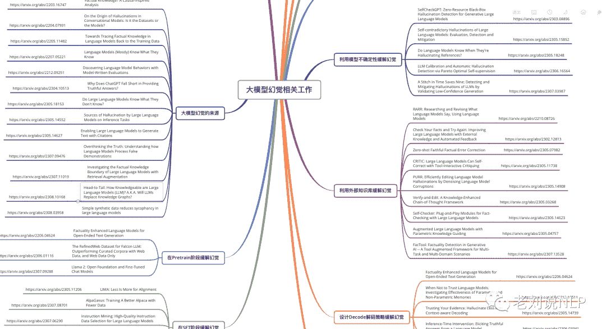

而昨天又看到一个十分有趣的工作：谷歌DeepMind团队 https://arxiv.org/abs/2309.03409《LARGE LANGUAGE MODELS AS OPTIMIZERS》提出了"提示优化"（OptimizationbyPROmpting，简称OPRO），利用大型语言模型（LLM）作为优化器的简单而有效的方法，其中的优化任务是用自然语言描述。

其在每个优化步骤中，LLM会从包含先前生成的解决方案及其值的提示中生成新的解决方案，然后对新解决方案进行评估，并将其添加到下一个优化步骤的提示中，其目标是找到能最大限度提高任务准确性的指令。

通过各种LLM，证明OPRO优化后的最佳提示在GSM8K上优于人类设计的提示达8%，在Big-BenchHard任务上优于人类设计的提示达50%。

例如，用这`Take a deep breath`结合大家已经熟悉的`Let’s think step by step`，大模型在GSM8K数据集上的成绩就从71.8提高到80.2分。

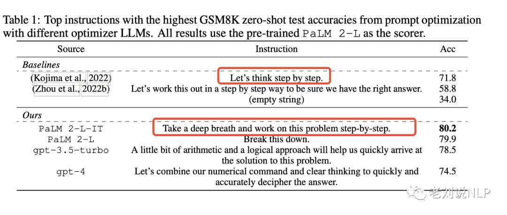

这感觉大模型越来越玄学，但从直觉上来说，这种效果应该本质上与其所使用的训练数据有直接关系。

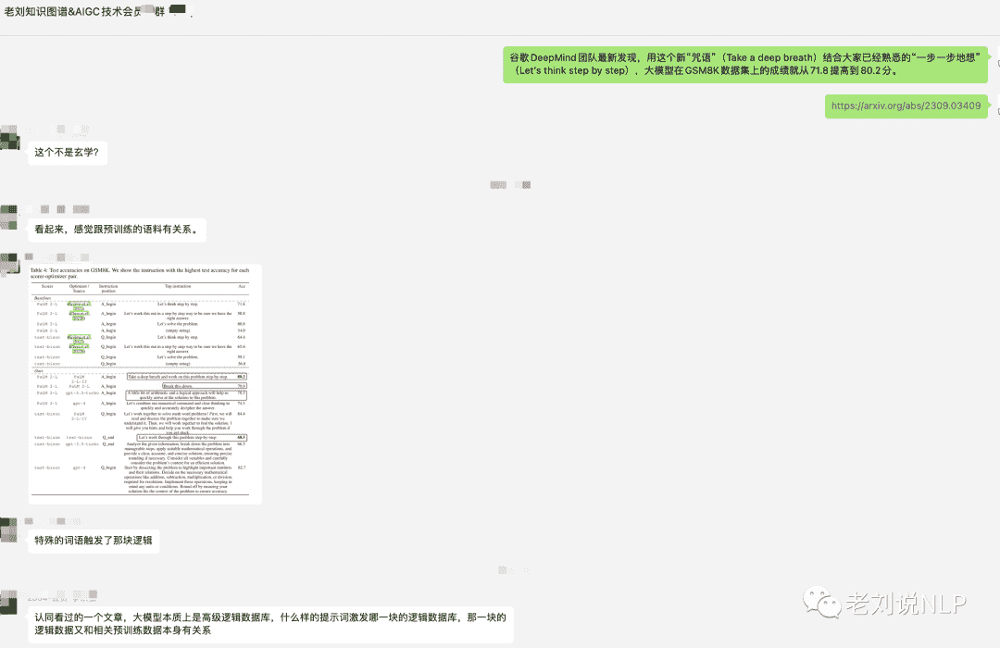

因此，我们更对大模型这种不可解释的黑盒现象表示十分的无奈。

所以，我们再来看看知识图谱与大模型的结合工作，我们知道，在大模型黑盒化的今天，人们越来越需要可解释的KG推理，它可以帮助用户理解推理过程，并提高高风险场景中的可信度，如医疗诊断和法律判断。

而知识图谱推理从现有事实中推断出新知识，是知识图谱中一项有趣的任务，也是许多应用所必需的，例如知识图谱补全、问题解答和推荐。

例如，可以确定一个逻辑规则`GrandMather(X,Y)←Mother(X,Z)∧Father(Z,Y)`来预测关系"Grand-Mather"的缺失事实。

进行知识图谱推理规则挖掘，基本思想很简单，给定种子规则，针对规则来生成进一步的规则候选，然后利用打分函数对规则进行打分排序，最终形成最终的挖掘结果。

最近的工作：《ChatRule: Mining Logical Rules with Large Language Models for Knowledge Graph Reasoning》（https://arxiv.org/pdf/2309.01538.pdf）这篇文章将两者进行结合，利用大模型挖掘知识图谱上的逻辑规则，利用LLM的重读能力和KG的结构信息进行规则生成、规则排序和规则验证。

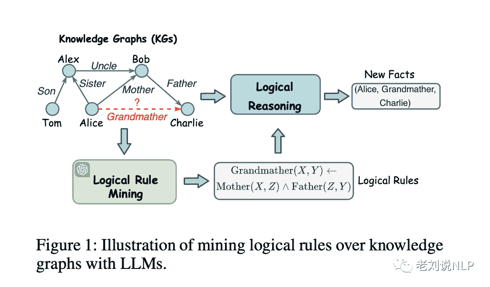

为了验证该方法的有效性，ChatRule在四个KG数据集上进行了评估，声称取得了不错的效果，本文对该工作进行介绍，其关于知识图谱挖掘的一些工作也具备参考意义，供大家一起思考。

## 一、现有知识图谱规则挖掘方法及大概思想

进行知识图谱推理规则挖掘，基本思想很简单，给定种子规则，针对规则来生成进一步的规则候选，然后利用打分函数对规则进行打分排序，最终形成最终的挖掘结果。

为了从KG中自动发现有意义的推理规则，逻辑规则挖掘在研究界获得了极大的关注。

早期关于逻辑规则挖掘的研究通常通过发现KG结构中频繁出现的模式来找到逻辑规则。然而，它们通常需要枚举KG上所有可能的规则，并根据估计的重要性对其进行排序。

尽管最近的研究提出使用深度学习方法对规则进行排序。这些方法仍然受限于对规则的穷举，无法扩展到大规模KG。

也就是说，传统方法的核心在于列举候选规则，然后通过计算权重分数来判断规则的质量。

例如：

`AIME`，一种传统的逻辑规则挖掘方法，它通过归纳逻辑编程从KG中发现规则；

`NeuralLP`，一种归纳逻辑编程方法，它以端到端的差分方式学习逻辑规则；

`DRUM`，利用LSTM和注意力机制扩展了`NeuralLP`，以挖掘可变长度的规则；

随着深度学习的发展，研究人员探索了以不同方式同时学习逻辑规则和权重的想法，然而，这些方法仍然要对规则空间进行大量优化，这限制了它们的可扩展性。

最近，研究人员提出了从KG中抽样路径并训练模型来学习逻辑连接的方法。`RLvLR`从子图中采样规则，并提出一种基于嵌入的分数函数来估计每条规则的重要性。

`RNNLogic`将规则生成和规则加权分开，这可以相互促进，减少搜索空间。

`R5`提出了一种强化学习框架，可启发式地搜索KG并挖掘底层逻辑规则。`RLogic`和`NCRL`可预测规则体的最佳构成，是该领域最先进的方法。

`RNNLogic`，一种规则生成器和逻辑规则推理预测器，它开发了一种基于EM的算法，用于优化和学习高质量的推理规则；

`Rlogic`，引入了一个在采样路径上训练的评分模型，并使用演绎推理来估计每个规则的质量；

`NCRL`，通过反复合并规则体中的成分来推导规则，从而检测出规则体中表达规则头的最佳成分结构。

最近一些方法解决了这一问题，它们从KG中抽取路径，并对其进行模型训练，以捕捉形成规则的逻辑联系。但是，他们通常忽略了关系语义对表达逻辑联系的贡献。

例如：

我们知道一个人的`"父亲"`的`"母亲"`是他的`"祖母"`，据此以定义一条规则，如`GrandMather(X,Y)←Mother(X,Z)∧Father(Z,Y)`来表达逻辑联系。然而，由于KG中的关系数量众多，要求领域专家为每个关系注释规则可能会造成负担。因此，必须自动结合关系的结构和语义来发现KG中的逻辑规则。

最近，大型语言模型（LLM）凭借其突现能力和泛化能力，在自然语言处理领域和各种应用中表现出了令人印象深刻的性能。经过大规模语料库的训练，LLMs存储了大量常识性知识，可用于促进KG推理，但LLMs并非为理解KG的结构而设计，因此很难直接应用它们来挖掘KG的逻辑规则。此外，公认的幻觉问题也会使LLM生成毫无意义的逻辑规则。

`ChatRule`的路线也类似，该框架利用KG的语义和结构信息促使LLM生成逻辑规则。具体的：

首先提出一种基于LLM的规则生成器，为每个关系生成候选规则，从KG中抽取一些路径来表示结构信息，然后将其用于精心设计的提示中，从而利用LLM的能力进行规则挖掘。

为了减少幻觉问题，设计了一个逻辑规则排序器来评估生成规则的质量，并通过囊括KG中观察到的事实来过滤无均值规则。在逻辑推理阶段进一步使用质量分数，以减少低质量规则的影响。

最后，为了去除由KG支持但逻辑上不正确的虚假规则，利用LLM的逻辑推理能力，通过思维链（CoT）推理用规则验证器验证规则的逻辑正确性。

整个框架如图2所示：

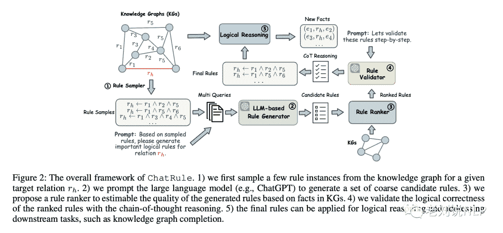

其中：

每一步实现步骤包括以下几步：

1) 首先针对给定的目标关系`rh`从知识图谱中抽取一些规则实例。

2) 促使大型语言模型（如ChatGPT）生成一组粗略的候选规则。

3) 提出一个规则排序器，根据知识图谱中的事实来估算生成规则的质量。

4) 通过思维链推理验证排序规则的逻辑正确性。

5) 最终规则可用于逻辑推理和处理下游任务，如完成知识图谱。

## 二、问题的定义

知识图谱（KnowledgeGraphs，KGs）表示三元组`G={(e,r,e′)⊆E×R×E}`中的事实集合，其中`e,e′∈E`和`r∈R`分别表示实体和关系的集合。

逻辑规则是一阶逻辑的特例，它有助于对KG进行可解释的推理，逻辑规则`ρ`以如下形式说明逻辑蕴涵

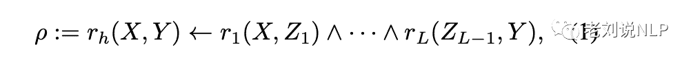

其中`body(ρ):=r1(X,Z1)∧---∧rL(ZL-1,Y)`表示一系列关系的连接，称为规则体，`rh(X,Y)`表示规则头，`L`表示规则长度。如果满足规则体的条件，那么规则头的声明也成立。

用KG中的实际实体替换变量`X`、`Y`、`Z∗`，就可以实现规则的实例。例如，给定一条规则`GrandMather(X,Y)←Mother(X,Z1)∧Father(Z1,Y)`，规则实例`δ`可以是

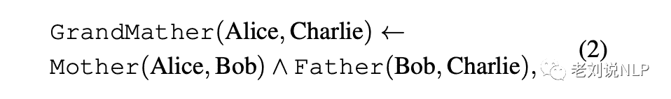

这意味着如果Alice是Bob的母亲，而Bob是Charlie的父亲，那么Alice就是Charlie的祖母。

那么，规则挖掘的定义则是：给定一个目标关系`rh∈R`作为规则头，逻辑规则挖掘的目标是找到一组有意义的规则`Prh={ρ1,---,ρK}`，这些规则捕捉其他关系的逻辑联系，用KGs表达目标关系`rh`。

## 三、具体实现细节

### 1、基于LLM的规则生成

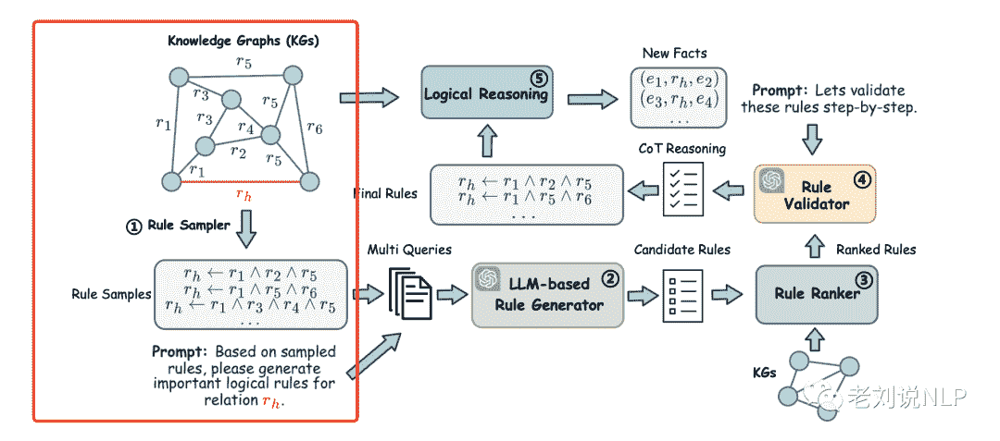

入上图所示，对于通过规则采样器从 `S rh = { ρ }` 中获得的目标关系`rh`的每一条规则，将其口头化为自然语言句子，去除关系名称中的特殊符号，因为这些符号可能会降低LLMs的语义理解能力。

对于原始关系的逆关系，通过添加`inv`符号将其口头化。然后，将口头化的规则样本放入提示模板，并将其输入LLM（如ChatGPT）以生成规则。关系`"丈夫（X,Y）"`的规则生成提示和LLM生成结果示例如下图3所示。

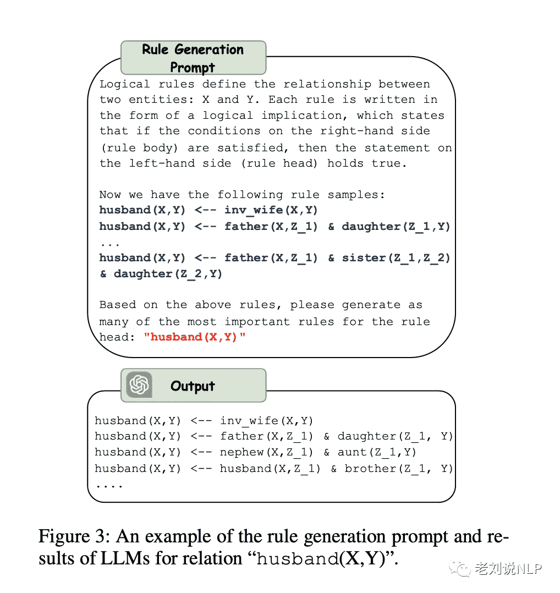

其对应的规则生成提示prompt如下：

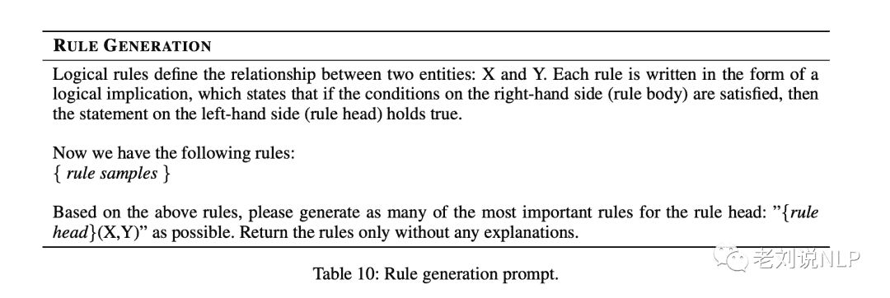

### 2、逻辑规则摘要

由于规则样本数量庞大，无法同时将所有规则样本输入LLM，否则就会超出上下文限制。因此，将规则样本分成多个查询，以促使LLM生成规则。然后，收集LLMs的回复，并要求LLMs对结果进行总结，得到一组可生成的规则`Crh={ρ}`。

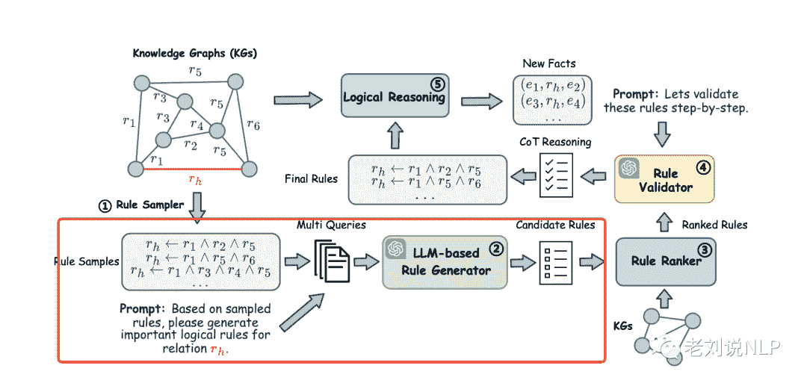

这一步也通过Prompt来控制，对应的prompt如下：

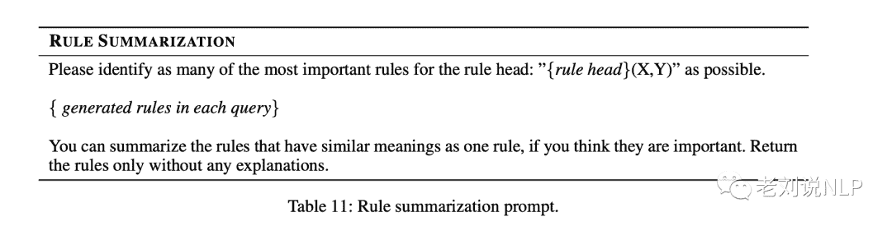

### 3、逻辑规则排序

由于LLM存在幻觉问题，可能会生成错误的结果，如图3结果中显示的生成规则`husband(X,Y)←husband(X,Z1)&brother(Z1,Y)`就是不正确的。因此，可以开发一种规则排序器来检测幻觉，并根据KG中的事实来估计生成规则的质量。

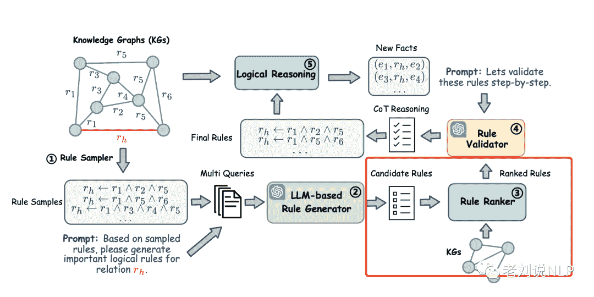

规则排序器旨在为候选规则集`Crh`中的每条规则`ρ`指定一个质量分数`s(ρ)`。

在这里采用四种方法来评估规则的质量，即支持度、覆盖率、置信度和PCA置信度【这是一种打分函数】，其中：

支持度表示KG中满足规则`ρ`的事实数量，其定义为：

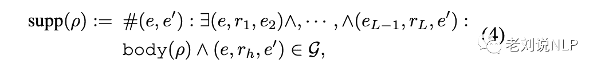

其中`(e1,r1,e2),---,(eL-1,rL,e′)`表示KG中满足规则`body(ρ)`的一系列事实，`(e,rh,e′)`表示满足规则头`rh`的事实。然而，支持度是一个绝对数，对于KG中事实较多的关系，支持度可能会更高，从而导致排序结果有偏差。

因此可以采用覆盖率，即通过KG中每个关系的事实数来规范支持率，其定义为：

而为了进一步考虑规则的错误预测，可以进一步引入置信度和PCA置信度来估计规则的质量。

置信度被定义为在KG中满足规则`ρ`的事实数量与满足规则主体`body(ρ)`的次数之比，其定义为：

置信度假定从规则正文导出的所有事实都应包含在KG中。然而，在实践中，KG通常是不完整的，这可能会导致证据事实的误判。因此，我们引入PCA置信度来选择能更好地概括未见事实的规则。

PCA置信度定义为在部分完成的KG中，满足规则`ρ`的事实数量与满足规则主体`body(ρ)`的次数之比，其定义为：

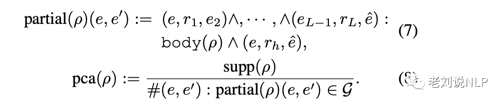

PCA置信度的分母并不是从规则主体导出的整个事实集的大小，而是基于已知为真和假定为假的事实数量。因此，PCA置信度更适合用来估计不完整KG中规则的质量和通用性。

### 4、用于规则验证的CoT推理

逻辑规则排序之后，可以得到目标关系`rh`的排序规则集`Rrh={(ρ,s(ρ))}`。

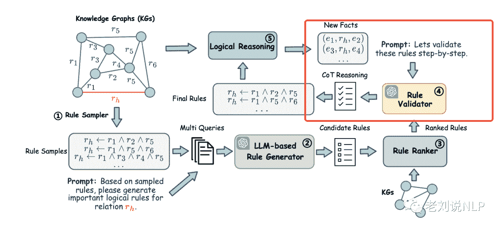

虽然可以剪除支持度为零的规则来提高生成规则的质量，但是，KG中可能存在噪音，这会导致虚假规则的存在。这些规则看似得到KG中事实的支持，但在逻辑上却是不正确的，这可能会导致下游任务中出现错误的预测。因此，可以利用LLM的推理能力，通过思维链（CoT）推理来验证规则的逻辑正确性。

对于每条规则`ρ∈Rrh`，将其输入CoT提示模板，并要求LLM验证其逻辑正确性。对应的prompt提示如下：

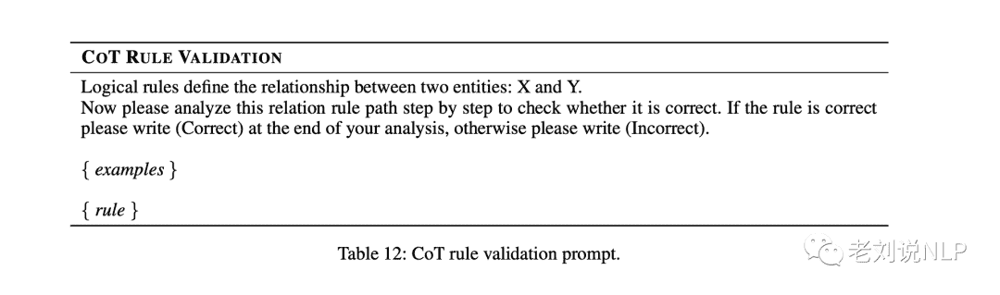

### 5、基于规则的逻辑推理

最终规则可用于逻辑推理，并通过应用现有算法解决下游任务，如完成知识图谱。

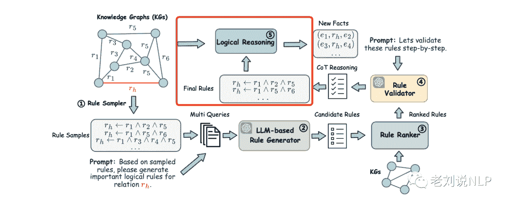

给定一个查询`(e,rh,?)`，让`A`成为候选答案集。对于每个`e′∈A`，我们可以应用`Prh`中的规则来获得得分：

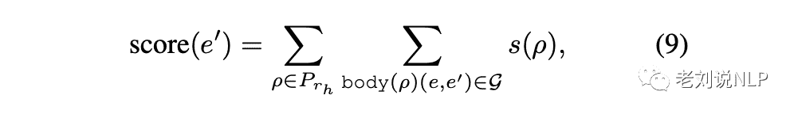

其中，`body(ρ)(e,e′)`表示KG中满足规则主体的路径，`s(ρ)`表示规则的质量得分，可以是收敛、置信度和PCA置信度。然后，可以根据得分对候选答案`A`进行排序，选出前N个答案作为最终结果。

## 四、实验设置与具体效果

### 1、实验数据

Family：一个定义家庭成员关系的知识图谱，例如`"父亲"`、`"母亲"`和`"姑姑"`。

WN18RR：一个英语词汇知识图谱，旨在根据词汇的语义关系组织词汇。单词通过一系列关系连接起来，包括`"hypernym（超义词）"`、`"deriva-tion（派生词）"`等。

FB15K-237：从Freebase中提取的知识图谱子集，其中包含各种主题和237种不同关系的数据。

YAGO3-10：从维基百科、WordNet和地名等多个数据源构建的大规模知识图谱，其中包含许多关系，如`"出生在"`、`"生活在"`和`"政治家"`等。

### 2、对比 基线

`AIME`、`NeuralLP`、`DRUM`、`RNN-Logic`、`RLogic`、`NCRL`

### 3、评测指标

在知识图谱补全任务（通过基于规则的逻辑重构来预测缺失的事实）中，屏蔽了每个测试三元组的尾部或头部实体，并使用每种方法生成的规则对其进行预测，使用平均倒数等级（MRR）和命中率@N作为评价指标，并将N设为1和10。

对于`ChatRule`，分别使用`ChatGPT1`和`GPT-43`作为规则生成和验证的LLM，选择PCA置信度作为最终的规则排序指标。

### 4、 知识图谱补全效果

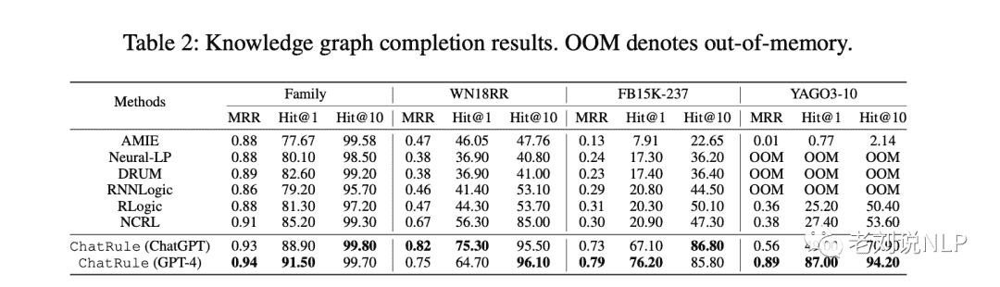

从结果中可以看出，`ChatRule`在所有数据集上的表现较好。特别是传统的`AIME`方法，它只利用结构信息进行归纳逻辑编程，已经取得了相对较好的性能。

但是，由于关系和三元的数量不断增加，`AIME`在大规模KG（如`FB15K-237`和`YAGO3-10`）中失效。最近基于深度学习的方法（如`Neural-LP`、`DRUMP`和`RNNLogic`）利用神经网络的能力实现了更好的性能。然而，由于规则搜索空间非常大，这些方法在处理大型KG时很容易超出内存。

### 5、规则质量评估效果

为了进一步证明规则排序中采用的四项指标（即支持度、覆盖度、置信度和PCA置信度）的有效性，我们使用它们来评估每种方法生成的规则。结果如表3所示。

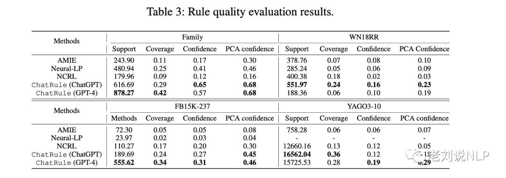

从结果中可以看出，与基线方法相比，`ChatRule`能生成支持度、覆盖率和置信度更高的规则。

值得注意的是，即使`ChatRule（Chat-GPT）`在`YAGO3-10`的支持度和覆盖率方面获得了更高的分数，其知识图谱完成结果仍然被`ChatRule（GPT-4）`击败。原因是`ChatRule(GPT-4)`生成的规则具有更好的PCA置信度，更适合评估完整知识图谱中的规则。

较高的PCA置信度得分表明，`ChatRule（GPT-4）`可以生成具有更好普适性的规则，而不是仅仅依赖于提示中提供的抽样规则。因此，`ChatRule(GPT-4)`在完成知识图谱任务时可以获得更好的性能。

### 6、消融实验

首先，`ChatRule`中每个组件的有效性。使用`GPT-4`作为LLM，使用PCA置信度作为规则排名指标，结果如表4所示：

`GPT`（zero-shot）表示直接使用`GPT-4`生成规则，不需要任何规则样本。规则样本、总结、排名和验证分别表示`ChatRule`中提出的组件。

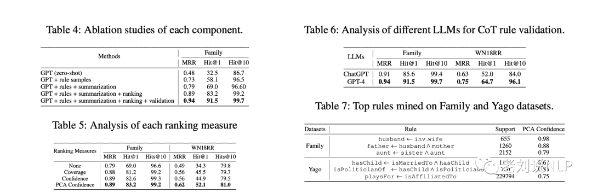

从结果中可以看出，`ChatRule`的性能随着各个组件的增加而逐渐提高，即 加入规则样本后，`ChatRule`的性能得到了显著提高，这说明了在规则挖掘中加入图结构信息的重要性。通过应用求和、排序和验证，聊天规则的性能得到了进一步提高。这说明这些组件可以进一步完善规则并提高`ChatRule`的性能。

### 其次，规则排序所采用的各项指标（即覆盖率、置信度和`PCA`置信度）的有效性。

所有规则都是在`Family`和`WN18RR`数据集上由`GPT-4`生成的。结果如表5所示。

从结果可以看出，与无排序措施（即无）相比，采用排序措施后，聊天规则的所有性能都得到了提高。这说明排序措施可以有效降低低质量规则的影响。

在所有排序方法中，`PCA`置信度的性能最好。这表明`PCA`置信度能够量化不完整`KG`中规则的质量，并选出具有更好普适性的规则，这也被选为最终的排序指标。

### 最后，`CoT`验证分析。

在实验中，评估了使用不同`LLM`（如`ChatGPT`和`GPT-4`）进行`CoT`规则验证的性能。所有规则都是由`GPT-4`在`Family`和`WN18RR`数据集上生成的，结果如表6所示，从结果可以看出，`GPT-4`的性能比`ChatGPT`更好。这表明`GPT-4`具有更好的逻辑推理能力，可以识别隐含的逻辑联系并检查规则的有效性。

## 总结

本文主要介绍了《`ChatRule: Mining Logical Rules with Large Language Models for Knowledge Graph Reasoning`》这一工作，这个工作给了一个较好的思路，也将知识图谱规则挖掘的思路进行了一些重温，里面所提到的一些方法可以进一步地去拓展。

进行知识图谱推理规则挖掘，基本思想很简单，给定种子规则，针对规则来生成进一步的规则候选，然后利用打分函数对规则进行打分排序，最终形成最终的挖掘结果。其核心就是采样以及规则的打分。

不过，尽管 `ChatRule` 工作在某些任务上取得了较好结果，但严重依赖于关系的语义。即使可以提供抽样规则来促使`LLM`理解图结构，但如果关系的语义没有明确给出，`LLM`仍然无法生成高质量的规则。

针对本文说的那个提示问题，我们将从下一个文章中进行介绍。

## 参考文献

1、`https://arxiv.org/pdf/2309.01538.pdf`

2、`https://arxiv.org/abs/2309.03409`

## 关于我们

老刘，刘焕勇，`NLP`开源爱好者与践行者，主页：`https://liuhuanyong.github.io`。

老刘说`NLP`，将定期发布语言资源、工程实践、技术总结等内容，欢迎关注。

对于想加入更优质的知识图谱、事件图谱、大模型`AIGC`实践、相关分享的，可关注👸号，在后台菜单栏中点击会员社区->会员入群加入。
