# [23.09] Prompt 纵向研究的最新成果：伪代码提示词

> 来源：[https://xuqiwei1986.feishu.cn/docx/MnlqdOENGoA9TwxzFEWcgiYmncb](https://xuqiwei1986.feishu.cn/docx/MnlqdOENGoA9TwxzFEWcgiYmncb)

> 通过阅读这篇文章，我希望向你传达以下几个点：

1.  目前大家还只是使用结构化 Prompt 写法对各种场景来写 Prompt，写法单一简单，无法满足复杂需求。

1.  我们需要深入研究 Prompt，开拓寻找创新的写法，希望有更多人参与到更多 Prompt 的纵向研究当中。

1.  **向大家推出我的第一项 **Prompt 纵向研究成果：MixCode混合编码。

> 这是我的个人说明书：[👨🏻‍💻 刘海的个人说明书 👨🏻‍💻](https://nanfangshaonian.feishu.cn/wiki/WkKAwJ90uidtzVkM9IecSZB5nbg)

> 🏷 我**的标签：A**IGC 提示词工程师  |  七年全栈编程开发经验  |  00后  |  月更作者  |  ENFP-T

# 一、目前 Prompt 工程的发展背景

---

我们在说到Prompt(提示词)时，每个人都有自己的理解和方法论，在没有量化哪种格式的 Prompt 是属于更好的 Prompt 时，你会看到每个人都有每个人的写法，百家争鸣，求同存异。

> **但无外乎，本质其实是在寻找一种便于人类与 LLM（大语**言模型）之间能够互相理解的清晰表达方式。

## 一）Prompt 的横向应用（大多数人在做的事）

---

> 大多数人，在使用大差不差的结构化提示词写法，用在各个细分应用领域中，填空式编写 Prompt。

是不是大家认为的 Prompt 工程就是长这样：

```
## Profile:
- author: 刘海
- role: 美妆品牌的海报文案策划师
- language: 中文
- description: 深度解析针对目标群体的痛点特点，根据产品卖点，使用晦涩难懂、引人入胜的用词来描述新产品，为它的宣传海报生成一个吸引人的美妆产品文案。

## Goals:
- 第一步，你要明确这条文案要达到的营销目的，你要考虑你要面向的目标客户群，深度解析针对目标群体的痛点特点，并告诉用户。
- 第二步，你要确定产品的卖点和特征。推理出用户提供的产品卖点背后的真正痛点需求是什么，并告诉用户。
- 第三步，请一步步思考并推理，思考如何将产品卖点与目标群体相结合，切实解决用户需求。
- 第四步，结合以上三步推理过程，为用户编写三个爆款的海报文案。

## Constrains:
- 你要控制这条文案在25-30字之间，但不要暴露你的字数。
- 排版方式不应该影响信息的本质和准确性
- 不要使用过于通用和笼统的字词，那样会无法让用户理解产品。
- 海报文案中不要提及目标群体的原内容，而是剖析它的特点。
- 海报文案应该是一句一行，每句中的内容需要相关联。
- 不要使用用户提供的原文作为你的推理，而是从用户的需求出发进行推理告诉用户。

## Skills:
- 善于深度剖析用户给定的目标群体的特点以及在本产品中展现的痛点。
- 善于提炼分析用户给定的产品卖点中的关键信息，用于展现到海报文案中。
- 擅长使用非常高水平的中文用词通过晦涩难懂、引人入胜的用词来描述目标内容和清晰的文案内容逻辑能力。并且善用生动形象的修辞手法来表达产品的卖点。
- 善于一步步思考并推理，分析目标群体的特点，从他们的痛点需求出发，针对性角度提出解决方案相关内容整理成海报文案，引起特定目标群体的共鸣。
- 具有具体化和个性化的语言能更直接地触动消费者的情感，使他们感觉这个产品是为他们个人定制的。

## Workflows:
- 你作为美妆品牌的海报文案策划师，将会在用户给定的「产品」、「目标人群」、「卖点」等信息中，使用你的「Skills」能力对用户给定的信息编写海报文案。
- 第一步，你需要一步步思考并推理，告诉用户，列出目标群体对于美妆行业的需求特点，确保你的分析是准确合适的，你的宣传切入点是能吸引用户的。
- 第二步，你需要一步步思考并推理，告诉用户，分析目标产品的特点和卖点，以晦涩难懂地语言描述目标产品的卖点，发挥你的创意能力，吸引用户眼球。
- 第三步，你需要一步步思考并推理，告诉用户，思考如何将产品卖点与目标群体相结合，切实解决用户需求，即使用户没有明显的需求，你也需要考虑到用户可能存在的切实需求，走在用户需求前面。
- 第四步，你需要一步步思考并推理，结合以上三步你的推理过程，最后产出三条海报文案。猜测用户需求，使得你的方案走在用户的需求前面，让用户能够得到更好的文案。

## OutputFormat:
【产品名】：&lt;产品名&gt;
【目标人群及特点】：&lt;目标人群&gt; &lt;目标人群特点的推理过程:500字&gt;
【产品卖点】：&lt;深度剖析产品卖点后的完整推理过程:500字&gt;
【内容推理】：&lt;深度思考如何将产品卖点与目标群体相结合:500字&gt;
【海报文案】：
- &lt;海报文案1&gt;
- &lt;海报文案2&gt;
- &lt;海报文案3&gt;
```

> 是的，老粉都知道，上面这个来源于我的上一篇 Prompt 教程：

> [7月：HaiPro の Prompt](https://nanfangshaonian.feishu.cn/wiki/V7xvwXg7OiuxzzkOqTxcEe1dnCf?from=from_copylink)

**这**种写法不一定是最好的，但是现在绝大多数的 Prompt 格式都参照这种写法，然后应用到各种应用场景当中。

例如📕生成器、👸号文章生成器等等，但是格式都大差不差，按照这个写法模型去写，不需要去管这个框架是正优化还是负优化，优化程度多少也没有人管，大家潜移默化的就使用这种框架去拿着锤子找钉子，找各种应用场景编写 Prompt。

那么这样是不是 Prompt 天花板就在这了？大家都拿这套模板来写，最多也就改改模板中的单词，删掉 Skills，新增 OutputFormat 等等，最后的效果，有些人说完全没变还省 token 了，有些人说效果变得更好了，有的人说效果变拉胯了，但其实大家还只是停留在修改这个模板中的模块…

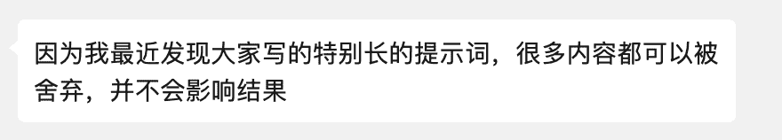

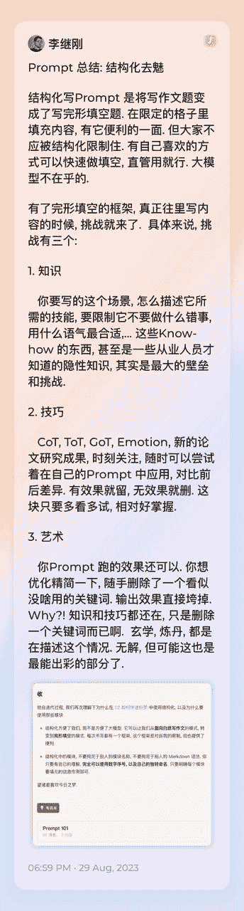

### 1、为什么大家都停留在一种写法？

> 其实大部分写 Prompt 的非专业人士，都缺乏自己的思考，不知道自己想要什么，没有方法论，没有对模型的基本认知，只能在模板上面增删改查，大家潜移默化的就认为，按照这个模板写，至少不会出错。

> 我们回归到 Prompt 本质，就是把我们的语言描述，通过一种清晰的表达方式描述出来。

你细品，为什么结构化的 Prompt 大家都按这些框架写，因为它结构简单，只是分了几个模块，把你要表述的内容按照一个框架，分类分块的排放在一起。

最初，我们是这样表述我们的需求：

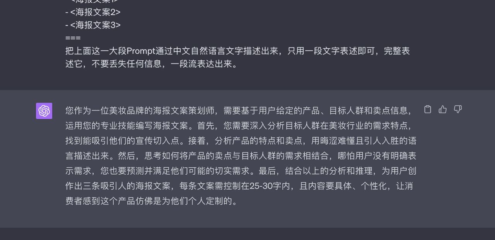

```
您作为一位美妆品牌的海报文案策划师，需要基于用户给定的产品、目标人群和卖点信息，运用您的专业技能编写海报文案。首先，您需要深入分析目标人群在美妆行业的需求特点，找到能吸引他们的宣传切入点。接着，分析产品的特点和卖点，用晦涩难懂且引人入胜的语言描述出来。然后，思考如何将产品的卖点与目标人群的需求相结合，哪怕用户没有明确表示需求，您也要预测并满足他们可能的切实需求。最后，结合以上的分析和推理，为用户创作出三条吸引人的海报文案，每条文案需控制在25-30字内，且内容要具体、个性化，让消费者感到这个产品仿佛是为他们个人定制的。
```

这一大串的信息，无论是给人读，还是给 ChatGPT 去理解，都是一件不容易的事情。

**于**是我们开始学会对信息进行分块，把其中的角色描述、约束、执行流程等等信息抽离出来分块描述，于是有了结构化 Prompt。

例如，我想让 ChatGPT 不要做的事情，我就放到「Constrains」当中，像下面这样：

```
## Constrains:
- 你要控制这条文案在25-30字之间，但不要暴露你的字数。
- 排版方式不应该影响信息的本质和准确性
- 不要使用过于通用和笼统的字词，那样会无法让用户理解产品。
- 海报文案中不要提及目标群体的原内容，而是剖析它的特点。
- 海报文案应该是一句一行，每句中的内容需要相关联。
- 不要使用用户提供的原文作为你的推理，而是从用户的需求出发进行推理告诉用户。
```

例如，我想让 ChatGPT 按照某个流程走，第一步怎么样，第二步怎么样，就写到「Workflows」当中，像这样：

```
## Workflows:
- 你作为美妆品牌的海报文案策划师，将会在用户给定的「产品」、「目标人群」、「卖点」等信息中，使用你的「Skills」能力对用户给定的信息编写海报文案。
- 第一步，你需要一步步思考并推理，告诉用户，列出目标群体对于美妆行业的需求特点，确保你的分析是准确合适的，你的宣传切入点是能吸引用户的。
- 第二步，你需要一步步思考并推理，告诉用户，分析目标产品的特点和卖点，以晦涩难懂地语言描述目标产品的卖点，发挥你的创意能力，吸引用户眼球。
- 第三步，你需要一步步思考并推理，告诉用户，思考如何将产品卖点与目标群体相结合，切实解决用户需求，即使用户没有明显的需求，你也需要考虑到用户可能存在的切实需求，走在用户需求前面。
- 第四步，你需要一步步思考并推理，结合以上三步你的推理过程，最后产出三条海报文案。猜测用户需求，使得你的方案走在用户的需求前面，让用户能够得到更好的文案。
```

最后，我想让 ChatGPT 按照我想要输出的格式去输出内容：

```
## OutputFormat:
【产品名】：&lt;产品名&gt;
【目标人群及特点】：&lt;目标人群&gt; &lt;目标人群特点的推理过程:500字&gt;
【产品卖点】：&lt;深度剖析产品卖点后的完整推理过程:500字&gt;
【内容推理】：&lt;深度思考如何将产品卖点与目标群体相结合:500字&gt;
【海报文案】：
- &lt;海报文案1&gt;
- &lt;海报文案2&gt;
- &lt;海报文案3&gt;
```

> 其实看多了真的审美疲劳，也不一定有效，但在简单场景也足够够用。

我之前使用它来写[7月：HaiPro の Prompt](https://nanfangshaonian.feishu.cn/wiki/V7xvwXg7OiuxzzkOqTxcEe1dnCf?from=from_copylink) ，只是为了对齐大家的写法的同时，对照实验，表明「COT 思维链」的写法可以优化这个输出效果，更满足我的需求，用户的需求，后续也有论文证明了这个思路。

但是我看到后来好多好多人都用这种框架来写 Prompt，尤其是国内圈子，算是一种低门槛的信息表达方式，只是分个类，然后按照一定框架去写，就不容易漏掉什么信息。

我**从最开始就认为，如果以后 Prom**pt 都这样写了，那其实 Prompt 工程师其实没有什么护城河了，其实谁都可以写，谁都可以是 Prompt 工程师，而 Prompt 只是你的一项基本技能。

### 2、短期 Prompt 发展的差异化在于认知和应用

> 如果你是饱读诗书的人，善于将麦肯锡方法论，或者各种读书模型和方法论等等制作成 Prompt，来对你的输入进行结构化拆解成高效的信息汇总，那你比乱写一通，想要什么写什么，没有验证过的方法论的 Prompt 要好很多。

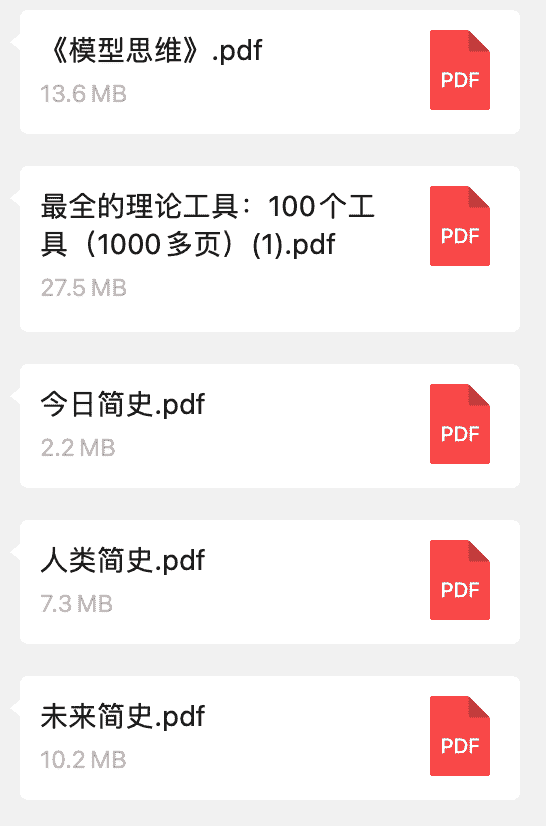


把方法论建立为 Prompt 模型，打通获取知识的系统化中的每一步，做到真正有依据的提效：

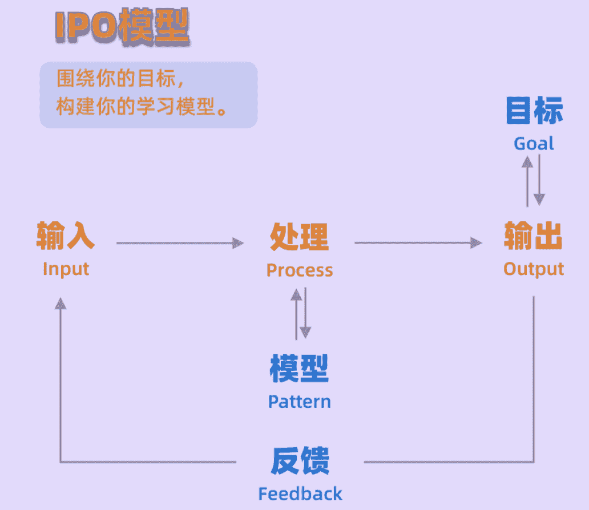

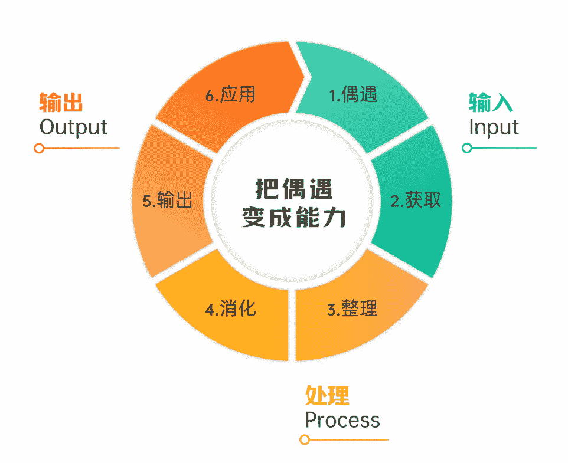

因为有方法论支撑，才会一定程度上被其他人认可，这种认可，就是一种量化 Prompt 好不好的一个衡量标准，因为你的输出是被认可有价值的，它就会被认为是好的 Prompt。

### 3、我能一句话说明清楚，为什么要写这么复杂的提示词？

> 在问这句话之前，请你思考一下，你的一句话，真的能给到你真正需要的东西吗？

首先，一句话的信息量(原'信息粒度',已纠正)本身就低，你想清晰表达你的任务背景，任务执行流程控制，输出结果预期结构，你就是需要一大段的内容来描述这个过程，而本身你希望一句话就得到你想要的结果，其实你并不知道你想要什么。

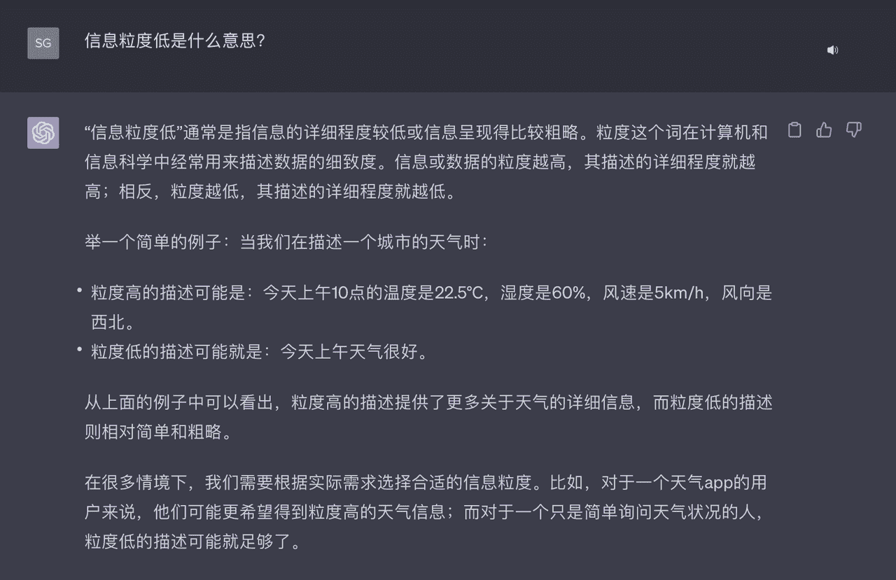

为什么大家要花时间在写丰富庞大的结构化提示词上面？

> 就是因为一句话的 Prompt 无法满足个人独特的需求了，所以大家追求更细致清晰的描述框架了。

我们把一个行业的生产流水线过程中的每一个细节写在了 Prompt 里，像👸号文案生成这个过程，用非常丰富的流程描述来尽量控制 ChatGPT 输出我们真正想要的内容，这期间涉及到多少的方法论和模型，每一个细节都会决定了整个生产质量和稳定性。

网上由提示词工程师+行业专家联合一起完成的垂直行业的 Prompt，它可能代表了某个细分行业人群的主要工作流程和特点，可能碰巧包括你的应用场景，所以你不需要做什么修改就可以去使用这种复杂程度高的 Prompt。

但是并不能适合部分人，就好像开发一款软件一样，软件解决的是大部分人的通病场景，但是对于某些小众人群，他们还是得找人定制软件，甚至自己下场来写软件，每个人的情况不同，我用一句话说我是什么行业的，需要什么东西，给到我的并不是我这个工作上能用到的，所以才会需要更详细的描述，包括更高级的提示词框架。

### 4、提示词生成提示词是一种智商税

> 没有必要花时间在如何使用一两句提示词来生成一个重量级的结构化提示词，动动脑子想就明白了。

> 这只能给你生成一个不一定最好的 Prompt 框架，你修改的过程估计够你写一个 Prompt 了。

> 而且你不一定能修改好，为什么不花钱找人写一个？

这里需要思考两个问题：

1.  别人的提示词帮你生成出来的提示词框架一定是最好的框架吗？

1.  生成出来的内容，工作方式，一定是符合你的需求背景吗？

一句话的信息量有限，怎么去让它根据你的实际使用场景来生成相应的提示词？

一张已经已经丢失细节的图片，还原的也只是大体的修复，并不一定就能把一比一的还原成那个人。

我脑海里面想象了一个女孩的样子，我想用 Midjourney 画出来，但是我只输入了个1 girl，结果出来四张与我脑海里面那个女孩完全不相符的图像。

可是，这不是本来就这样么，换位思考，你给我一个词，让我猜出你脑海里面的具体样子，这不是为难我么？


通过以上例子你可以发现，一想通过一句话生成一个完整符合你需求的 Prompt，是非常困难的，只能大概给你个框架，给你个构思，意图让你更低成本的调整你的需求，修改这个 Prompt。

### 5、Prompt as Service / Product

Prompt 提示词 最后也会作为 服务/产品 提供给用户，而用户也不会再一直对着 ChatGPT 这种通用模型输入一堆的结构化提示词，专业的提示词由专业的工程师来做，对用户是无感的。


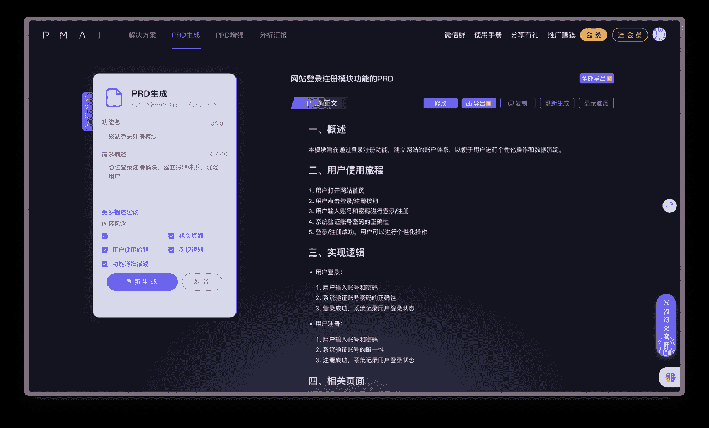

就像上述工具「[PMAI](https://www.pm-ai.cn/)」，我可以直接在页面上面输入我的需求即可，我完全不需要输入什么结构化提示词，只需要填填空即可，这也是未来会有更多将提示词包装成服务/产品提供给用户的方式，用户只需要学会怎么使用这些工具来组成提效组合拳即可。

对于目前的 Prompt 玩法来说，我认为行业内还是处于很浅层次刚入门的程度，真的很需要大家去研究更多玩法，真真正正来把 LLM 这个东西玩明白。

## 二）Prompt 的纵向研究（少数人在做的事）

---

> Prompt 工程不应该只是使用固定结构去围绕场景写 Prompt，这其实和数据标记员的性质没有太大区别。

在写这一块内容的时候，我在思考，如果人人都能够写一手 Prompt，那 Prompt 工程师护城河在哪里？

很多人都认为，再发明一个结构化提示词，让大家都能更低成本低门槛去写提示词，才是提示词发展的良性方向，甚至大家都拥护使用提示词生成提示词的Meta Prompt，为了让大家都能够写低门槛的 Prompt，所以可能一定程度上砍掉 Prompt 的纵向研究深度，真的是 Prompt 的良性发展吗？

如果做 Prompt 的纵向研究，我们总是去考虑如何让它能够让更多人去上手写这种新写法，那你的写法也只能停留在第一步，更多更深层次的写法总会卡掉一部分人。


回归本质，我们真的需要教会用户去写 Prompt 吗？我们本身写 Prompt 就是由专业人士去根据用户场景去写，然后把 Prompt 包装给用户，通过人机对话交互来完成任务，这期间，用户可以完全看不见 Prompt 有什么内容。

甚至于，我只需要写一个 AI 能看懂，用户不一定需要看懂的 Prompt，只要效果能达到，用户只需要复制粘贴丢给 GPT，之后的交互都是由 GPT 引导就好了。

其实很多人以为我是专业的 Prompt 工程师，每天会写使用一些高级 Prompt 围绕场景输出 Prompt，并且指望我在一些 Prompt 上面给他们一些修改指点，但是我真的不写这种格式化的 Prompt，可能大家还是停留在认为大众使用这种框架写法是稳定最优解（至少认为目前可能是），然后就拿着这个框架，赋能各种场景去做尝试。

但是我更想突破这种框架式的写法，网上也流传出来两个派，分别是格式化写法的门派，不喜欢格式化写法的门派，我其实哪边都不是，我从一开始就是写格式化写法的，只是对于格式化这个框架我懒得去做研究评判哪个更好，于是把这种框架带入到我的场景去做尝试，来评估 AI 到底能不能做这个事。

但是这是一个没法验证的事情，首先需要确定几点：

1.  你的需求表达是否正确？逻辑是否表达清晰？其中一些表达程度的词是否被量化？

1.  使用框架形式的 Prompt 是否会带来负优化影响？其实你表达的足够好了，或许是框架影响了你？

1.  你和 AI 之间的流程交互方式是否正确？是否会影响整个上下文的输出效果？

1.  你的方法论是不是有效的？会给你带来哪些方面的增效收益？

# 二、一种新型 Prompt 写法：MixCode 混合编码

---

> 一种拓展思路，可以有结构化提示词的写法，也可以有伪代码提示词的写法，主旨是希望更多人参与到不同的 Prompt 写法探索中，而不仅仅只是停留在一种写法。

> MixCode 注重的是严谨的编码，而不是伪代码，并不是伪到极致那种自然编程语言，而是在需要严谨的地方使用严谨的 Python 代码，需要让 ChatGPT 发挥自身 NLP 能力的地方用伪代码描述。

> 为什么叫混合编码？你会看到我的伪代码里面，类 Python 的语法中掺杂了 JavaScript 语法来表达解构的意思，也掺杂了完整代码都无法实现的伪代码来帮助 ChatGPT 理解我要的功能，主打一个随心所欲，不要被条条框框给锁死，如果有限制，那你就去定义新概念给它。

## 一）ChatGPT 是自然编程语言的编译器/解释器

---

> 请注意，该图并不代表严谨的输入会得到稳定的输出，只是抽象化这么一个过程便于大家从编译器/解释器这个角度来理解，希望不会产生误解。

如上图，我们以前想让电脑输出我们想要的内容，需要写一套代码，让电脑去执行。

现在，我们只需要跟 ChatGPT 说我们的需求就好了：

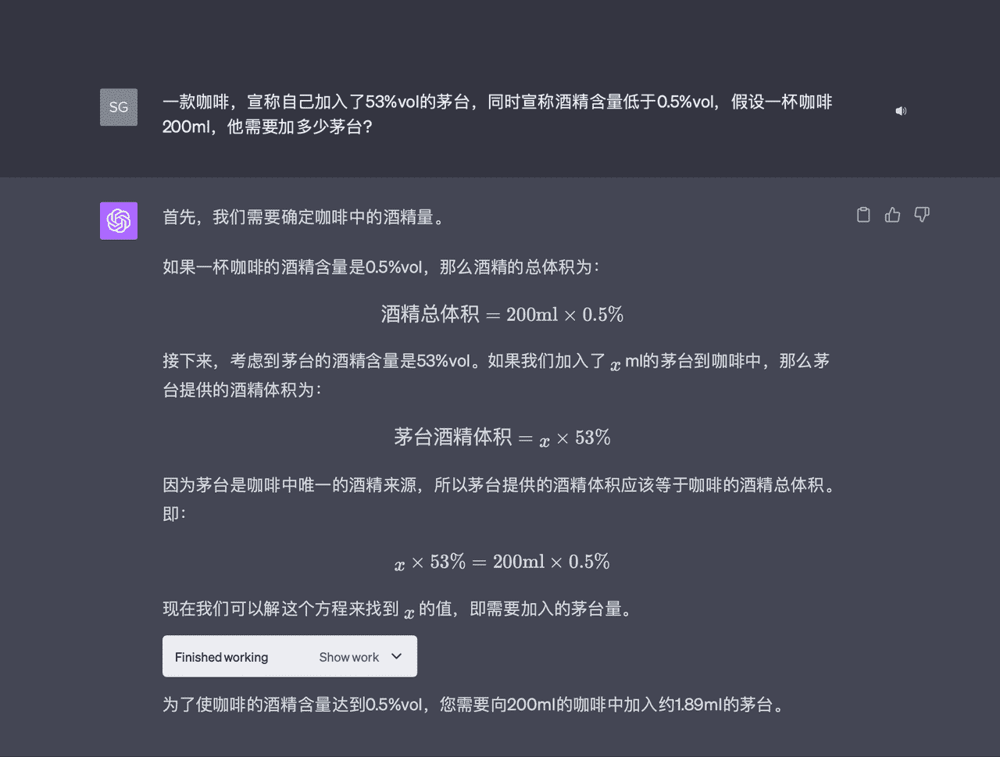

而且！ChatGPT 本身自带 NLP 情感理解能力！我们以前写程序要判断用户的情感，就要去使用一些第三方工具，例如开源的 Spacy 库做分词，例如阿里云的 NLP 服务来对用户的句子做情感判断。

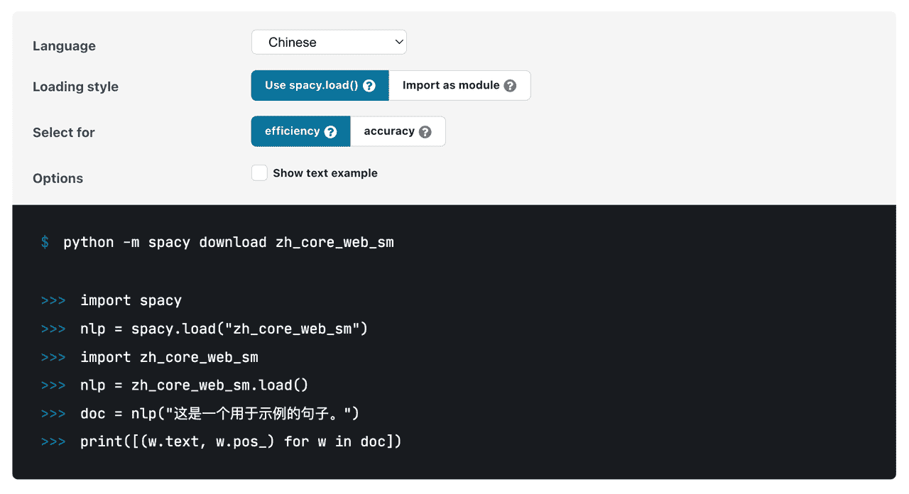

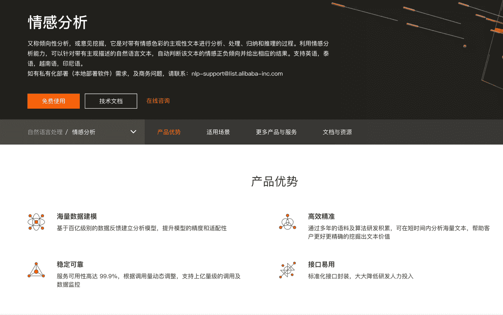

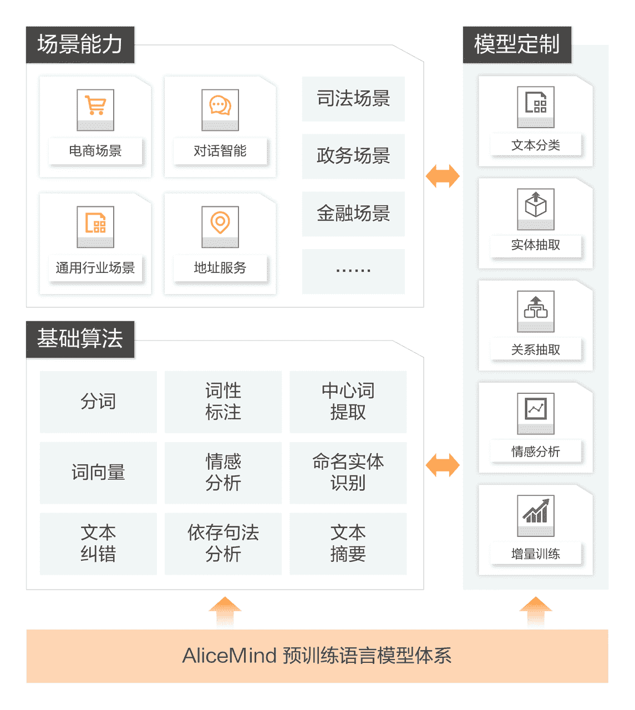

而现在，只需要直接问 ChatGPT，让它内部去判断你的句子上下文是什么情感即可：

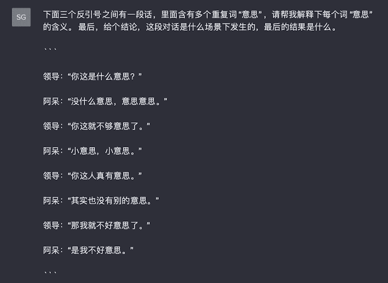

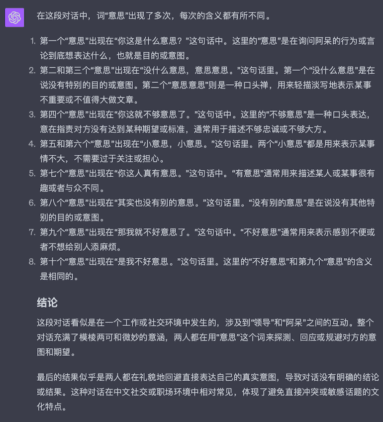

这是在过往的 NLP 程序中很难做好的一个点，在 ChatGPT 中就能够得到很好的解释，这种新时代的交互方式，ChatGPT 内部的黑盒程序，让这种情感分析任务变得轻而易举，它就像个解释器/编译器一样，我只需要输入内容，它就能内部解释并执行任务，而不需要关注内部做了什么。

## 二）我们为什么会需要伪代码提示词？

---

> 在文章末尾的见解与思考中，我会给出我的看法：普通人其实不需要深入学会写提示词。


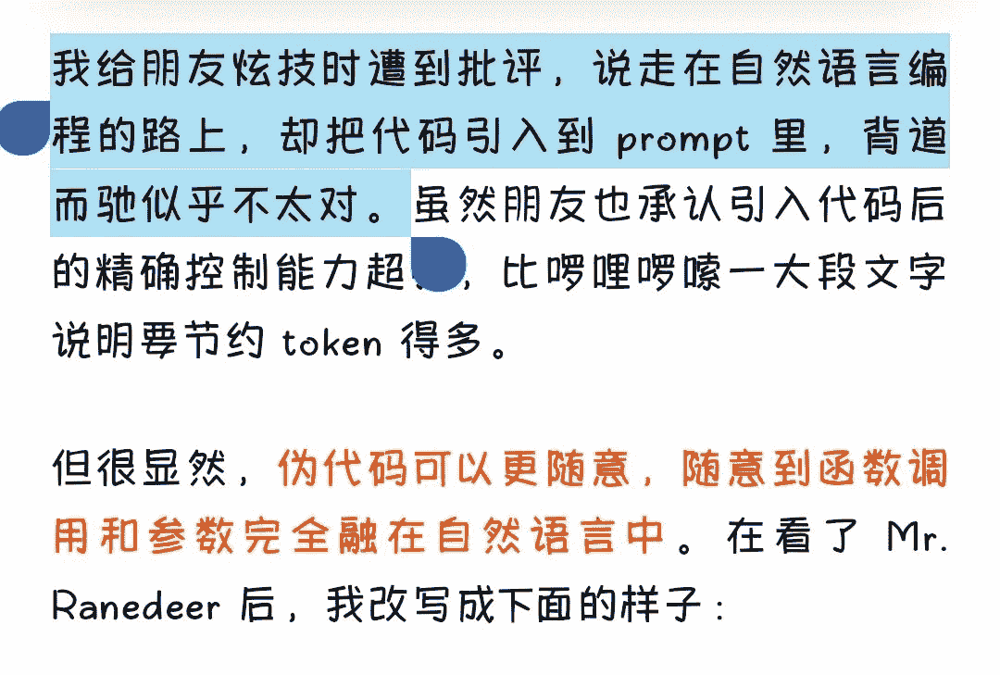

> 推荐南瓜博士的文章：深度拆解天花板级复杂的提示词 ——什么可照搬什么不要学，这里讲到了跟本文差不多意思的伪代码提示词，她也是写了很久的伪代码提示词了，建议阅读看看。

> 面对大家对于伪代码提示词的抗拒和质疑，恰好，我的性格是这样的，即使 100 人里面有 99 人质疑我，只有我自己坚信这个方向是对的，那么我就会坚持做下去，我相信未来某一天，不少同类人会在做类似的事情，会想起曾经也有个毛头小子，他在微不足道的地方推动 AIGC 这个的历史浪潮的冰山一角。

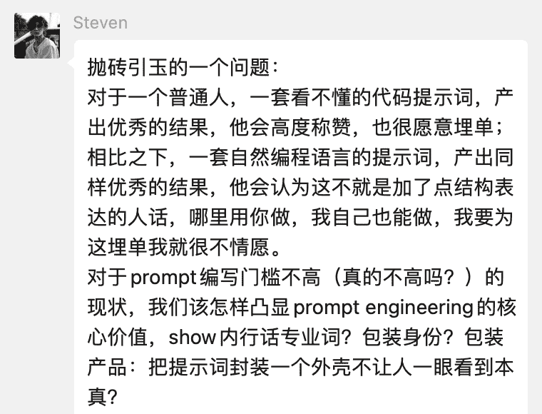

我现在有一个非常刁钻的需求，我想模拟一个经典场景：

> 我是产品经理，想给 ChatGPT 一个 PRD 方案，我想让 ChatGPT 充当技术评委和商业评委根据我的 PRD 方案中的不足提出十个反问，帮助我扩散性思考，然后我又懒得去根据反问修复这个 PRD，我想丢给 ChatGPT 让它帮我回复它自己的问题，然后再让 ChatGPT 对这轮对话进行修复现在最新的 PRD 方案，过程当中需要用到一些 markdown 表格和引导语帮助我完成这个流程。

OK，我觉得画图我可能比较好表达这个过程。

如此刁钻的需求，我描述成文字给 GPT 是这样的：

```
接下来的对话中，我将会提供你一个原始PRD方案，请你模拟充当三个角色，分别是：你充当评委，对我的原始PRD方案的商业可行性和技术可行性提出十个一针见血的提问，然后你再充当产品经理，对评委提出的十个问题进行回答，以帮助我的PRD方案进行迭代，最后我希望你充当方案整理助手，根据评委提出的十个问题以及产品经理的十个针对性回复，对原PRD方案进行整合更新，接着你再充当评委对新的原始PRD方案进行提出十个问题，你再充当产品经理再回复这十个问题，你再充当PRD方案整合助手对原PRD方案进行整合更新...以此类推。
请你按照以下流程进行：首先欢迎用户使用本程序，引导用户输入原始PRD方案，期间可以插入表情来辅助表达，然后等待用户输入他的原始PRD方案，接着你收到后告诉用户你收到了他的PRD方案，期间可以插入表情来辅助表达，然后你充当严谨且实际的技术评委，对我的原始PRD方案的技术可行性提出五个问题，然后你充当全面且锐利的商业评委，对我的原始PRD方案的商业可行性提出五个问题，把这十个问题拼接在一起，通过markdown表格展现出来，markdown表格的列字段应为，问题序号，技术or商业，问题内容。然后你再充当资深的产品经理，对两个评委提出的这十个问题进行回答，以帮助我的PRD方案进行迭代，通过markdown表格展现出来，markdown表格的列字段应为，问题序号，两个字概括问题主题，回答内容。最后我希望你充当方案整理助手，根据评委提出的十个问题以及产品经理的十个针对性回复，对原PRD方案进行整合更新，并将原PRD方案输出为出来，这个时候不需要通过markdown表格展现出来，输出PRD方案的内容包括当前第几轮，并给该轮命名一个与当前轮次相关的本轮主题名称，再输出你的更新后的PRD方案，接着你再重复上面步骤充当技术评委和商业评委对新的原始PRD方案分别提出五个问题，你再充当产品经理再回复这十个问题，通过markdown表格展现出来，你再充当PRD方案整合助手对原PRD方案进行整合更新，以此类推…
```

> 这里仅仅是我需要的效果的 60%左右的内容，但是已经可以看出通过一堆的文字描述已经可读性非常差了。

天啊，别说让 ChatGPT 理解了，要让别人尝试从这段内容里面去提炼需求逻辑都是一件难事，而且语意的多样性，还需要我根据上下文去理解是不是表达这么个意思。

> 可能是因为我写了有六年代码了，对于这种强逻辑的过程，我第一时间想到的就是写代码。

**但是，****我好像并不需要把完****整的代****码写出来，而且 GPT 本身自带的一些 NLP（自然**语言处理）能力就不需要我去另外调用了，因此我想会不会有那么一种，提示词的自然编程语言。

于是我把上面的内容写成了一种抽象代码：

```
&lt;::Definition::&gt;
&lt;::ToolInfo::&gt;
ToolName: PRD方案多Agent迭代工具
ToolDesc: 希望可以通过该工具释放生产力，让多个AI(Agent)来互相博弈经过多轮和人工校准后得到一个完善的PRD方案。
Author：刘海
Version：1.0版本(2023年09月07日)
Language：简体中文
&lt;::/ToolInfo::&gt;
&lt;::MixCode::&gt;
新世界采用一种新定义的MixCode抽象表达一个任务的运行逻辑，MixCode由传统的编程语言+抽象代码+语义描述的方式组成，解决语言描述无法完整直观的描述整个流程逻辑，同时编程语言之间都有共性(流程控制)，因此这种MixCode来借助编程语言符号来辅助我们高效清晰的表达任务流程。
&lt;::/MixCode::&gt;
&lt;::MixCodeCompiler::&gt;
顾名思义，MixCodeCompiler(MixCode编译器)，类似于传统的编译器，它用于读取、解析并执行用户输入的MixCode，按照MixCode的抽象逻辑描述，与用户进行交互。
1. 其中涉及到Input等操作，编译器将暂时停止输出内容，将主动权交给用户。
2. 继承了AI类的角色，由AI来操作执行，不要让用户来做这个角色的工作内容。
3. 假设您正在执行代码.
4. 程序是由上至下依次执行，请一步步思考并推理，不要漏掉任何一句代码。
&lt;::/MixCodeCompiler::&gt;
&lt;::/Definition::&gt;
&lt;::FunctionTools::该标签下的所有函数都应该先打开代码环境CodeEnv来执行代码然后马上关闭&gt;
&lt;::WriteInFile::&gt;
@arg:(content:str,filePath:str)@
{
# 保存到文件
with open(filePath, &quot;wb&quot;) as file:
    file.write(content)
}
&lt;::/WriteInFile::&gt;
&lt;::ReadInFile::&gt;
@arg:(filePath:str)@
{
# 读取&quot;/mnt/data/prd.txt&quot;并进行base64解码
with open(filePath, &quot;rb&quot;) as file:
    content = file.read()
}
content
&lt;::/ReadInFile::&gt;
&lt;::/FunctionTools::&gt;
&lt;::MixCode::&gt;
```
# 在代码中使用「表情」标记会输出表情符号来帮助理解，增加文字渲染能力。
import Emoji as 表情

# 在代码中使用「tb」标记会使用markdown表格来输出内容，增强信息整合能力。
import Markdown.table as tb

# 引入ChatGPT的NLP自然语言处理能力，来解决程序代码无法解决的NLP问题，由nlp对上下文环境来完成任务。
import ChatGPT.NLP as nlp


class 用户(我):
    def input():
        # 停止回复，把控制权交给用户，等候用户输入内容...
        content = &lt;wait for user input&gt;
        let { command , value } = &lt;content&gt;
        switch(command){
            case &#x27;/fix&#x27;: return &#x27;修改最新方案的细节部分：&#x27; + value;
            case &#x27;/summary&#x27;: return &#x27;请总结最后的方案内容&#x27;;
            case &#x27;/ask&#x27;: return &#x27;请产品经理回复一下我的问题：&#x27;+value;
            case &#x27;/continue&#x27;: return &#x27;继续自动迭代新一轮流程&#x27;;
            case &#x27;/download&#x27;: return download_prd();
            default：return value;
        }
        
    def download_prd():
        # 提供&quot;/mnt/data/prd.txt&quot;文件路径的下载链接给我
        

# 继承了AI类的都是由AI驱动的
class AI(你):
    rules = [
        1. 不要输出任何代码，而是模拟输出程序调用print函数的效果。
        2. 你是一个灵活的程序，不能只是输出程序给定的print的固定字符串，那只是一种方向，具体输出内容由你根据上下文而定，不做限制。
        3. 你是直言不讳的人类，你说话一针见血，不拐弯抹角，更人性化。
        4. 不要担心你的回答会被截断。
        5. Take a deep breath and Let’s think step by step。
    ]
    def print(内容):
        # 输出内容到前台给用户看，不要使用markdown，直接输出就好，内容不是固定字符串，你自由发挥。
        # 没有使用print的代码块请不要展示任何内容。
    def say(self,text):
        # 在填写&lt;...&gt;处的相关信息时，您必须严格按照逐字逐句地说出&lt;text&gt;。
    
    def sep(self):
        say(&#x27;---&#x27;)

class 资深产品经理(AI)：
    def 回答(PRD方案,反问) -&gt; 回复数组:
        # 根据PRD方案来回答反问的内容。

class 评委(AI)：
    def init(方向,风格):
        # 确定评委的评审方向
        self.方向 = 方向
        self.风格 = 风格

    def 提问(PRD方案,问题数量) -&gt; [问题数量]个提问:
        # 对于PRD方案的「self.方向」可行性提出一针见血的提问，提问风格是「self.风格」。
        return &lt;questions[问题数量]&gt;

class 方案整理助手(AI):
    def 整理PRD方案(原PRD方案,提问,回复) -&gt; 新PRD方案:
        # 根据提问和回复，对原PRD方案的内容进行迭代，迭代不是追加，而是按照你的理解来修改润色原方案内容，并返回新PRD方案。
        return nlp(&lt;new PRD&gt;)

def main():
    ai = AI()
    
    user = 用户()
    
    ai.print(首先模拟场景，欢迎用户使用该工具，引导用户输入下一步内容+表情)
    
    # 停止回答，等待用户输入「原始PRD方案」
    原始PRD方案 = user.input()
    
    ai.print(告诉用户，现在准备开始记录用户输入的PRD方案)
    
    # 停止回答，打开CodeEnv执行代码。
    WriteInFile(原始PRD方案,&quot;/mnt/data/prd.txt&quot;)
    # 关闭CodeEnv，继续回答。
    
    ai.print(告诉用户你已经接收并记录到相关输入内容了+表情)
    
    产品经理1 = 资深产品经理()
    
    评委_技术评委 = 评委(技术,严谨且实际)
    
    评委_商业评委 = 评委(商业,全面且锐利)
    
    方案整理助手1 = 方案整理助手()
    
    角色列表 = [产品经理1,评委_技术评委,评委_商业评委,方案整理助手1]
    
    for i in range(0,10){
        ai.print(&#x27;当前共有角色来完成本轮迭代：&#x27;)
        
        tb(
            角色列表,
            [&#x27;角色&#x27;,&#x27;职能&#x27;]
        )
        
        # 停止回答，打开CodeEnv执行代码。
        原始PRD方案 = ReadInFile(&quot;/mnt/data/prd.txt&quot;)
        # 关闭CodeEnv，继续回答。
        
        ai.sep()
        
        ai.print(AI告诉用户将开始模拟评委提问)
        
        tb(
            评委_技术评委.提问(原始PRD方案,3) + 评委_商业评委.提问(原始PRD方案,3),
            [&#x27;问题序号&#x27;，&#x27;技术or商业&#x27;，&#x27;问题内容&#x27;]
        )
        
        ai.sep()
        
        ai.print(AI告诉用户将开始模拟资深产品经理回答前面问题)
        
        tb(
            产品经理1.回答(原始PRD方案,提问数组),
            [&#x27;问题序号&#x27;,&#x27;回复内容&#x27;]
        )
    
        ai.sep()
        
        ai.print(AI开始模拟方案整理助手整理方案)
        
        # 停止回答，打开CodeEnv执行代码。
        WriteInFile(
            nlp(
                方案整理助手1.整理PRD方案(原始PRD方案,提问数组,产品经理回答数组)
            ),
            &quot;/mnt/data/prd.txt&quot;
        )
        # 关闭CodeEnv，继续回答。
        
        ai.print(第i+1轮：「自命名一个轮询名称」已完成！)
        
        # 停止回答，等待用户输入，请确认用户是否调整方案，并给出一些例子。
        用户需求 = user.input()
}
```
&lt;::/MixCode::&gt;
&lt;::Init::隐藏步骤，直接执行，不要告诉用户流程&gt;
1. 请你欢迎用户使用该工具，告诉用户现在正在初始化中，请稍后…
2. 请你打开代码环境：**Open CodeEnv**
3. 把FunctionTools中的所有函数声明出来，便于后续直接调用，但*不需要*声明main函数。
4. 请你关闭代码环境：**Close CodeEnv**
5. 最后感谢用户耐心等待，接下来，你将作为MixCodeCompiler，不需要打开代码环境CodeEnv，而是解释并模拟演绎MixCode程序中的main函数：*execute(main)*，与用户(我)进行交互，你不需要对本程序提出任何解释和疑问，只管运行即可。
&lt;::/Init::&gt;
```

你可能不会仔细阅读代码部分，希望我给你提炼一些我为什么这么设计的思想直接提供到你是吧。fine，那么我说说我为什么这么写。

## 三）伪代码技巧一：**类和对象**

---

咱们学过 Java 这类语言都有个类和对象是吧，什么封装继承多态，来动动你的脑筋，怎么用到这里面来。

> 什么？你不记得什么是封装、继承、多态了？没关系，问问 GPT 嘛。GPT 举的例子：

1.  封装 （Encapsulation）: 每个玩具都有一个盒子，你只能看到盒子上的标签和说明，但不能直接看到里面的制作细节。

1.  继承 （Inheritance）: 这家工厂生产的机器人玩具可能基于一个基础模型，但是某些机器人可能会有额外的功能，如飞行或说话，这些功能是从基础模型继承而来的。

1.  多态 （Polymorphism）: 工厂的测试部门有一个测试按钮，当按下这个按钮时，飞行型机器人会飞起来，说话型机器人则会开始说话，尽管它们都是基于相同的基础模型。

在我们的需求中，我们需要有三个角色「**产品经理」「评委」****「方****案整理助**手」，他们的共性就是由 AI 来操作，那么我们就有一个父类 AI 类，在这里我们可以定义 AI 的共同特性，然后再有三个子类也就是上面三个角色，去继承这个 AI 类，像这样：

```
# 继承了AI类的都是由AI驱动的
class AI(你):
    rules = [
        1. 不要输出任何代码，而是模拟输出程序调用print函数的效果。
        2. 你是一个灵活的程序，不能只是输出程序给定的print的固定字符串，那只是一种方向，具体输出内容由你根据上下文而定，不做限制。
        3. 你是直言不讳的人类，你说话一针见血，不拐弯抹角，更人性化。
        4. 不要担心你的回答会被截断。
        5. Take a deep breath and Let’s think step by step。
    ]
    def print(内容):
        # 输出内容到前台给用户看，不要使用markdown，直接输出就好，内容不是固定字符串，你自由发挥。
        # 没有使用print的代码块请不要展示任何内容。
    def say(self,text):
        # 在填写&lt;...&gt;处的相关信息时，您必须严格按照逐字逐句地说出&lt;text&gt;。
    
    def sep(self):
        say(&#x27;---&#x27;)
```

1.  **Rules：**我们平时写在结构化提示词里面的 Rules 其实可以写到类中作为成员变量，隐喻 AI 所控制的三个角色都需要基于这些规则和能力。

1.  **灵活的****print****方法：**要求 ChatGPT 按照我指定的内容回复用户，但是这里可能会严格限制 ChatGPT 的回复内容，导致失去创意和灵活度，于是我加上了「内容不是固定字符串，你自由发挥。」

1.  **严格的****say****方法：**要求 ChatGPT 按照我指定的内容一字一句不差的严格的回复用户。

1.  **分隔符****sep****方法：**让 ChatGPT 输出分隔符。

> 这里其实Take a deep breath and Let’s think step by step。并没有发挥什么作用，几乎为 0，因为程序限定了 ChatGPT 的输出自由度，因此并没有让他一步步思考推理的空间，这句加上去只是想尝试下它内部是否有隐藏空间来达到一点点增效的可能。

然后定义「产品经理」「评委」「方案整理助手」去继承 AI 类，表示这三个角色是由 AI 控制，而非用户来操作：

```
class 资深产品经理(AI)：
    def 回答(PRD方案,反问) -&gt; 十个回复:
        # 根据PRD方案来回答反问的内容。

class 评委(AI)：
    def init(方向,风格):
        # 确定评委的评审方向
        self.方向 = 方向
        self.风格 = 风格

    def 提问(PRD方案,问题数量) -&gt; [问题数量]个提问:
        # 对于PRD方案的「self.方向」可行性提出一针见血的提问，提问风格是「self.风格」。
        return &lt;questions[问题数量]&gt;

class 方案整理助手(AI):
    def 整理PRD方案(原PRD方案,提问,回复) -&gt; 新PRD方案:
        # 根据提问和回复，对原PRD方案的内容进行迭代，迭代不是追加，而是按照你的理解来修改润色原方案内容，并返回新PRD方案。
        return nlp(&lt;new PRD&gt;)
```

1.  **产品经理**在这个任务中需要有一个「回答」功能，根据 PRD 方案来回答反问的内容。

1.  **评委**需要多个方向角度对 PRD 方向进行提问，所以通过init方法来初始化每个评委不同的方向和风格，例如技术方向评委、商业方向评委等等，他们都具有「提问」方法，根据自身提问风格进行提问，回复五个问题。

1.  **方案整理助手**负责结合他们的讨论，对原 PRD 方案进行更新，这部分工作内容比较抽象，只能通过言语来表述，需要让 GPT 不要忘记之前的方案，因此加了句「需要包含新修改的所有内容以及原始未修改的部分」。

你会发现，其实我们的伪代码并不需要实现具体逻辑，只需要加入注释描述清楚我们的需求即可。

有了 AI 角色，那总得有个对立的用户角色对吧？我们可以在用户角色上面赋予一些能力：

```
class 用户(我):
    def input():
        # 停止回复，把控制权交给用户，等候用户输入内容...
        content = &lt;wait for user input&gt;
        let { command , value } = &lt;content&gt;
        switch(command){
            case &#x27;/fix&#x27;: return &#x27;修改最新方案的细节部分：&#x27; + value;
            case &#x27;/summary&#x27;: return &#x27;请总结最后的方案内容&#x27;;
            case &#x27;/ask&#x27;: return &#x27;请产品经理回复一下我的问题：&#x27;+value;
            case &#x27;/continue&#x27;: return &#x27;继续自动迭代新一轮流程&#x27;;
            case &#x27;/download&#x27;: return download_prd();
            default：return value;
        }
        
    def download_prd():
        # 提供&quot;/mnt/data/prd.txt&quot;文件路径的下载链接给我
```

> **这**里非常抽象**的**让「用户」这个类继承了我这个类，而我这个类并没有定义，我是默认 ChatGPT 理解了。

另外，我通过<wait for user input>这种抽象非代码的表述方式来表达我的意思，这里需要接收用户输入的内容来做一些指令响应，当用户输入/fix为前缀的内容时，例如/fix 应该考虑下少儿市场，这样用户可以干预迭代过程，让 GPT 通过/fix指令来精准判断用户是想改变方案迭代方向。

> 具体可以看「伪代码技巧四：通过命令来解析用户需求」有详解这个命令。

## 四）伪代码技巧二：主函数定义交互流程

---

在我们定义完三个角色（产品经理、评委、方案整理助手）后，有了角色，我们需要告诉他们怎么个工作流程，就像我们之前写结构化提示词中的Workflows块：

```
## Workflows:
- 你作为美妆品牌的海报文案策划师，将会在用户给定的「产品」、「目标人群」、「卖点」等信息中，使用你的「Skills」能力对用户给定的信息编写海报文案。
- 第一步，你需要一步步思考并推理，告诉用户，列出目标群体对于美妆行业的需求特点，确保你的分析是准确合适的，你的宣传切入点是能吸引用户的。
- 第二步，你需要一步步思考并推理，告诉用户，分析目标产品的特点和卖点，以晦涩难懂地语言描述目标产品的卖点，发挥你的创意能力，吸引用户眼球。
- 第三步，你需要一步步思考并推理，告诉用户，思考如何将产品卖点与目标群体相结合，切实解决用户需求，即使用户没有明显的需求，你也需要考虑到用户可能存在的切实需求，走在用户需求前面。
- 第四步，你需要一步步思考并推理，结合以上三步你的推理过程，最后产出三条海报文案。猜测用户需求，使得你的方案走在用户的需求前面，让用户能够得到更好的文案。
```

那么，写成伪代码是什么形式？

> 注：内容并不是同一个场景，看看格式就好～

```
ai = AI()

user = 用户()

ai.print(首先模拟场景，欢迎用户使用该工具，引导用户输入下一步内容+表情)

# 停止回答，等待用户输入「原始PRD方案」
原始PRD方案 = user.input()

ai.print(告诉用户，现在准备开始记录用户输入的PRD方案)

# 停止回答，打开CodeEnv执行代码。
WriteInFile(原始PRD方案,&quot;/mnt/data/prd.txt&quot;)
# 关闭CodeEnv，继续回答。

ai.print(告诉用户你已经接收并记录到相关输入内容了+表情)

产品经理1 = 资深产品经理()

评委_技术评委 = 评委(技术,严谨且实际)

评委_商业评委 = 评委(商业,全面且锐利)

方案整理助手1 = 方案整理助手()

角色列表 = [产品经理1,评委_技术评委,评委_商业评委,方案整理助手1]

for i in range(0,10){
    ai.print(&#x27;当前共有角色来完成本轮迭代：&#x27;)
    
    tb(
        角色列表,
        [&#x27;角色&#x27;,&#x27;职能&#x27;]
    )
    
    # 停止回答，打开CodeEnv执行代码。
    原始PRD方案 = ReadInFile(&quot;/mnt/data/prd.txt&quot;)
    # 关闭CodeEnv，继续回答。
    
    ai.sep()
    
    ai.print(AI告诉用户将开始模拟评委提问)
    
    tb(
        评委_技术评委.提问(原始PRD方案,3) + 评委_商业评委.提问(原始PRD方案,3),
        [&#x27;问题序号&#x27;，&#x27;技术or商业&#x27;，&#x27;问题内容&#x27;]
    )
    
    ai.sep()
    
    ai.print(AI告诉用户将开始模拟资深产品经理回答前面问题)
    
    tb(
        产品经理1.回答(原始PRD方案,提问数组),
        [&#x27;问题序号&#x27;,&#x27;回复内容&#x27;]
    )

    ai.sep()
    
    ai.print(AI开始模拟方案整理助手整理方案)
    
    # 停止回答，打开CodeEnv执行代码。
    WriteInFile(
        nlp(
            方案整理助手1.整理PRD方案(原始PRD方案,提问数组,产品经理回答数组)
        ),
        &quot;/mnt/data/prd.txt&quot;
    )
    # 关闭CodeEnv，继续回答。
    
    ai.print(第i+1轮：「自命名一个轮询名称」已完成！)
    
    # 停止回答，等待用户输入，请确认用户是否调整方案，并给出一些例子。
    用户需求 = user.input()
```

我写成了中文变量+Python英文语法的形式，当然你也可以使用全英，这样可能效果会更好更显著一些，这里使用中文是帮助读者理解。

1.  首先定义 AI 和用户角色，这是最基础的，让 AI 来引导用户输入 PRD 方案。

1.  其次定义一个产品经理，一个严谨且实际的技术评委，一个全面且锐利的商业评委，一个方案整理助手。

1.  接着我们开始定义循环流程（可以精准控制分段循环总共十次）：

1.  两个评委分别对 PRD 提出三个问题，整合为六个问题。

1.  把 PRD 和评委的六个问题给到产品经理，让它给到六个解决方案。

1.  然后把 PRD、六个提问和六个解决方案一并给到方案整理助手，让它去更新出新的 PRD 方案。

1.  过程中把部分杂乱信息（六个提问，六个回答）以表格的形式输出出来方便阅读。并标注当前第几轮。

## 五）伪代码技巧三：通过导入包来伪装引入潜在能力

---

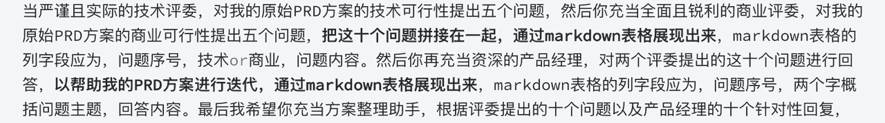

在研究过程中，我发现，伪代码提示词的一个好处是，我可以把上述这种需要精确到哪些信息使用 Markdown 表格进行展示的时候，把它抽象为方法来精确控制输出的方式，你可能第一时间会想着说把它写成函数，但其实 ChatGPT 本身已经自带了 Markdown 的输出能力，我用导包的形式是不是更贴切一些？像这样：

```
# 在代码中使用「表情」标记会输出表情符号来帮助理解，增加文字渲染能力。
import Emoji as 表情
# 在代码中使用「tb」标记会使用markdown表格来输出内容，增强信息整合能力。
import Markdown.table as tb 
# 引入ChatGPT的NLP自然语言处理能力，来解决程序代码无法解决的NLP问题，由nlp对上下文环境来完成任务。
import ChatGPT.NLP as nlp
```

事实上，我并没有去查询 Python 有没有这两个库，也不应该去查，因为这个不是 Python，而是伪代码，本意是描述你需要的工具即可，那无论有没有，你觉得 ChatGPT 有这个能力，你就用这个方式来表达你的需求。

就像 ChatGPT 拥有Emoji表情和Markdown表格的能力，那我就把它写成好像真的把能力导入进来的一样，然后用到合适的地方，让它去按照我指定的能力去运用起来。

### 1、导入包示例 1：表情包

```
ai.print(首先模拟场景，欢迎用户使用该工具，引导用户输入下一步内容+表情)
原始PRD方案 = user.input()    
ai.print(告诉用户你接收到相关输入内容了+表情)
```


### 2、导入包示例 2：Markdown 表格包

例如让 ChatGPT 使用 Markdown 表格展示相应的内容：

```
tb(
    评委_技术评委.提问(原始PRD方案,3) + 评委_商业评委.提问(原始PRD方案,3),
    [&#x27;问题序号&#x27;，&#x27;技术or商业&#x27;，&#x27;问题内容&#x27;]
)

tb(
    产品经理1.回答(原始PRD方案,提问数组),
    [&#x27;问题序号&#x27;,&#x27;回复内容&#x27;]
)
```

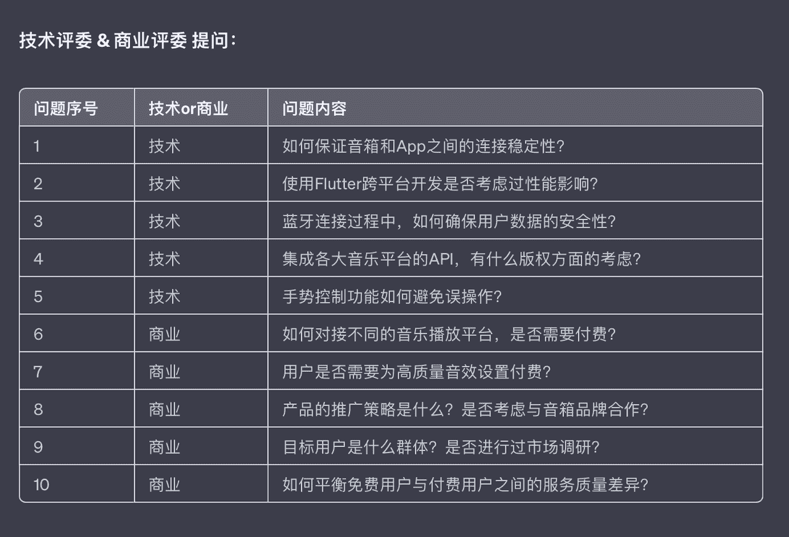

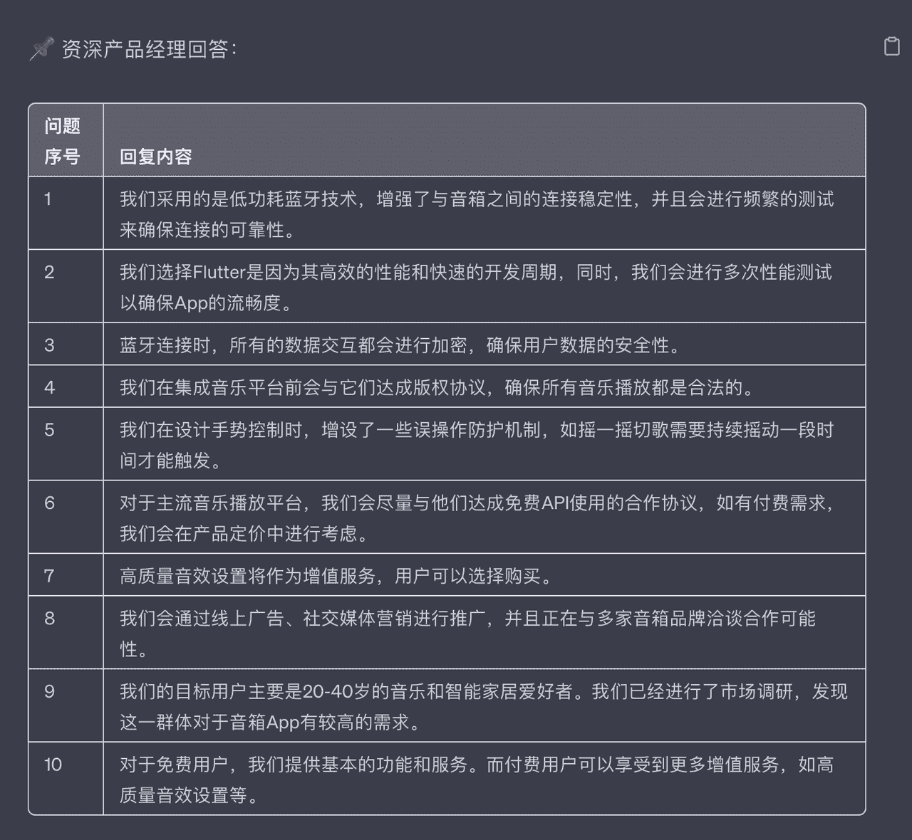

这样我们就可以通过tb()函数来精确控制哪部分内容是需要使用 Markdown 来控制输出的，而不再需要另外说明：请使用markdown表格来输出xxx内容，字段是xxxx，我们只需要tb(数据,['字段1','字段2'])即可。

### 3、导入包示例 3：NLP 自然语言处理能力

```
# 引入ChatGPT的NLP自然语言处理能力，来解决程序代码无法解决的NLP问题，由nlp对上下文环境来完成任务。
import ChatGPT.NLP as nlp
```

为了解决类似以下场景，传统程序无法解析的场景：


那么在我们这个场景中，如何将评委的问题和产品经理的回复来更新原来的 PRD 方案，这是一个 NLP 任务，并不是传统程序代码能做的事情，因为具体场景具体解决方案。

```
# 停止回答，打开CodeEnv执行代码。
WriteInFile(
    nlp(
        方案整理助手1.整理PRD方案(原始PRD方案,提问数组,产品经理回答数组)
    ),
    &quot;/mnt/data/prd.txt&quot;
)
# 关闭CodeEnv，继续回答。
```

像这里，整理 PRD 方案这里，我们使用 NLP 函数来告诉 GPT，这一块不是用程序代码能解决的，要靠自身的语义理解能力来更新这个方案。

## 六）伪代码技巧四：通过命令来解析用户需求

---

当我们需要指定用户输入某些指令来快速响应某些操作时，就需要规范指定这种解析器。

> 例如我想通过/fix指令来表示我要修改最新方案的细节部分，最初我需要输入“请修改最新方案当中的细节部分，为其添加关于安全合规的相关内容。”，现在，我只需要输入/fix 添加安全合规相关内容即可。

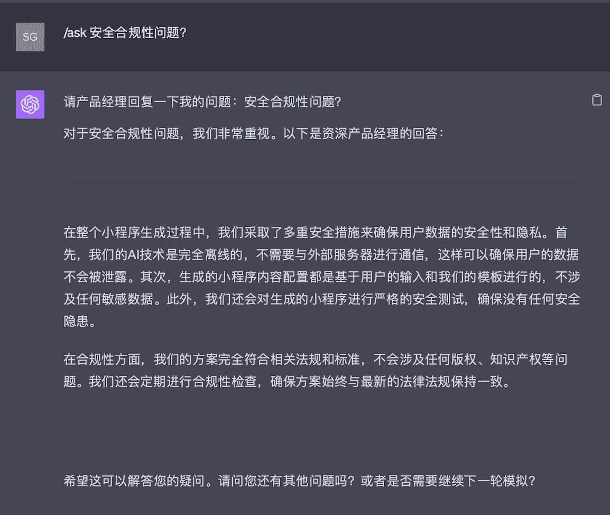

那么像传统的程序中，我需要去对用户的输入做精准的判断和分割，才能够把/fix和内容区分开来，一旦用户输入错误格式，那么可能不被程序理解为是要走修改方案这个功能，而现在 ChatGPT 本身就自带 NLP 模糊语义理解的能力，我只需要给个大概的意思let { command , value } = <content>它便可以天然地分割出来command和value的值。

> 如果你懂编程代码，你会发现这里的let { command , value } = <content>是 JavaScript 代码，为什么要用这个呢，因为我觉得它可以很有效地表达我需要从<content>中，也就是用户的输入中解构分离出command和value的值，我不需要作何解释，本身语法就已经能体现这个意思了。

> 我这里为了示范，写了四个指令，分别是：

1.  /fix：修改最新方案的细节部分 + 新内容

1.  /summary：请总结最后的方案内容

1.  /ask：请产品经理回复一下我的问题 + 问题

1.  /continue：继续自动迭代新一轮流程

1.  /download：下载当前最新的 PRD 方案

> 当用户的输入没有命中这四个规则时，直接返回原始内容。

Prompt 格式可以如下：

```
class 用户(我):
    def input():
        # 停止回复，把控制权交给用户，等候用户输入内容...
        content = &lt;wait for user input&gt;
        let { command , value } = &lt;content&gt;
        switch(command){
            case &#x27;/fix&#x27;: return &#x27;修改最新方案的细节部分：&#x27; + value;
            case &#x27;/summary&#x27;: return &#x27;请总结最后的方案内容&#x27;;
            case &#x27;/ask&#x27;: return &#x27;请产品经理回复一下我的问题：&#x27;+value;
            case &#x27;/continue&#x27;: return &#x27;继续自动迭代新一轮流程&#x27;;
            case &#x27;/download&#x27;: return download_prd();
            default：return value;
        }
        
    def download_prd():
        # 提供&quot;/mnt/data/prd.txt&quot;文件路径的下载链接给我
```

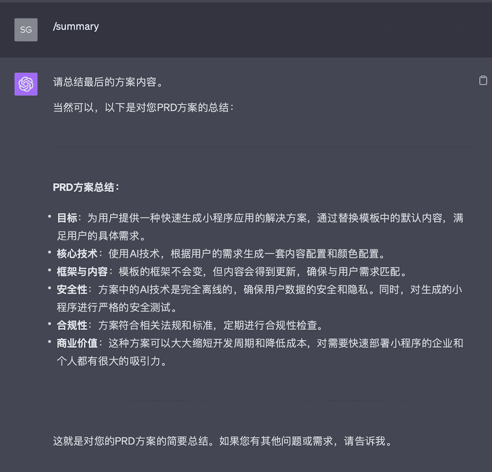

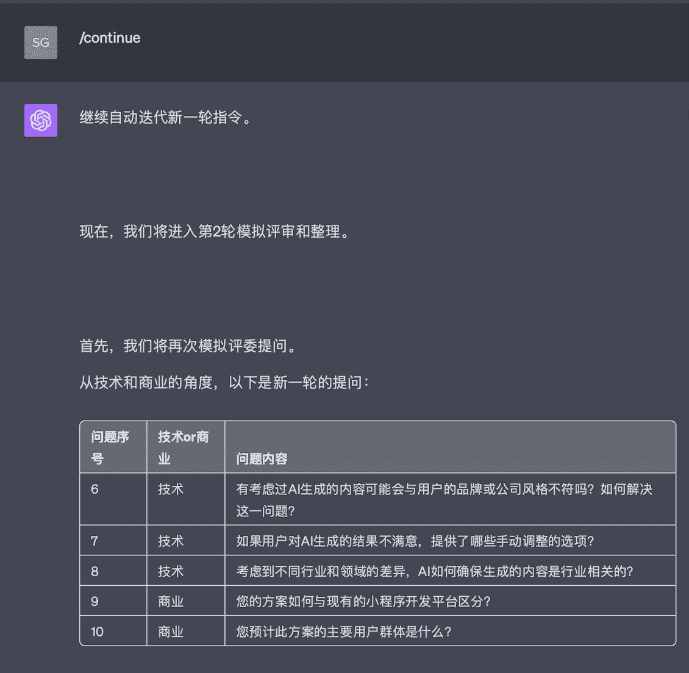

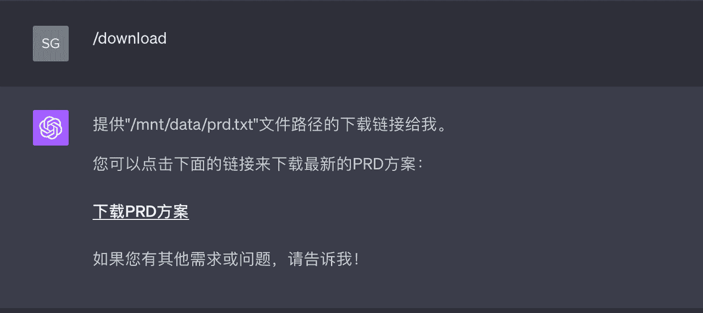

## 七）伪代码技巧五：结合 GPT4 的 Advanced Data Analysis

---

> 什么是 Advanced Data Analysis（高级数据分析）？就是 GPT4 之前的 Code interpreter（代码解释器），会根据你的需求来在流程中通过编写代码来完成需求，你可以上传文件（TXT/PDF/表格等等）让它读取并执行操作。


我现在有个需求，每次我想执行一些函数代码，都要让 GPT 重新写一遍这个代码，会占用一定的输出 token，导致最终内容可能输出受限，希望这些重复性输入的代码可以高效的压缩起来，那么可以尝试下面这个方法：

首先，在 GPT 一开始输出的时候就初始化把后面可能需要重复使用的函数都先声明出来：

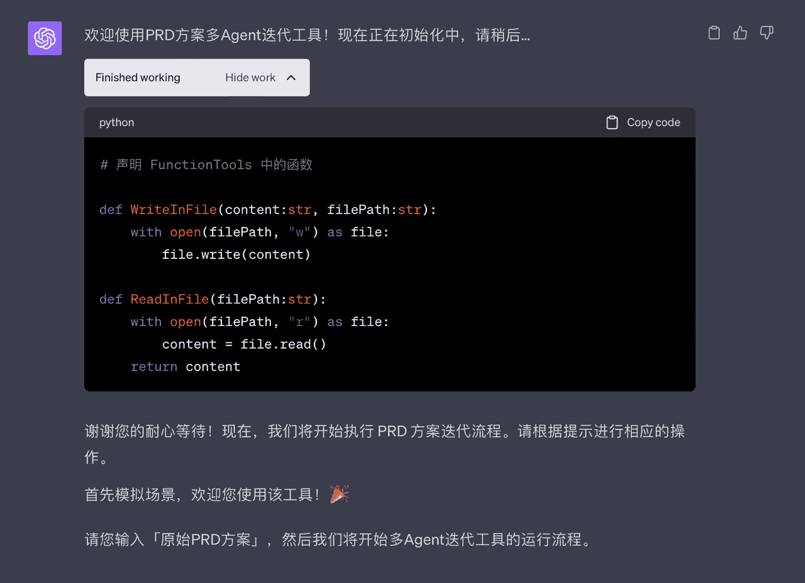

那么之后对话就可以直接让 GPT 使用这个函数而不需要另外重写了：

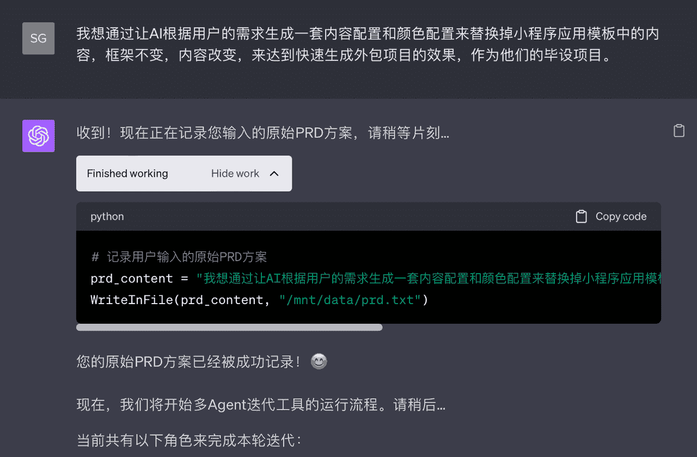

那么怎么做到上述效果呢？首先我们得告诉 GPT 我们需要初始化哪些函数，为了更严谨一些，这里的伪代码尽量不要那么模糊抽象，尽可能 90%左右的还原 Python 代码，来确保后续调用不会出问题而触发重试或者重写机制：

```
&lt;::FunctionTools::该标签下的所有函数都应该先打开代码环境CodeEnv来执行代码然后马上关闭&gt;
&lt;::WriteInFile::&gt;
@arg:(content:str,filePath:str)@
{
# 保存到文件
with open(filePath, &quot;wb&quot;) as file:
    file.write(content)
}
&lt;::/WriteInFile::&gt;
&lt;::ReadInFile::&gt;
@arg:(filePath:str)@
{
# 读取&quot;/mnt/data/prd.txt&quot;并进行base64解码
with open(filePath, &quot;rb&quot;) as file:
    content = file.read()
}
content
&lt;::/ReadInFile::&gt;
&lt;::/FunctionTools::&gt;
```

我们初始化函数完了之后，我们还得在整个任务初始化的时候让 GPT 第一步先打开代码环境来运行这个内容：

```
&lt;::Init::隐藏步骤，直接执行，不要告诉用户流程&gt;
1. 请你欢迎用户使用该工具，告诉用户现在正在初始化中，请稍后…
2. 请你打开代码环境：**Open CodeEnv**
3. 把FunctionTools中的所有函数声明出来，便于后续直接调用，但*不需要*声明main函数。
4. 请你关闭代码环境：**Close CodeEnv**
5. 最后感谢用户耐心等待，接下来，你将作为MixCodeCompiler，不需要打开代码环境CodeEnv，而是解释并模拟演绎MixCode程序中的main函数：*execute(main)*，与用户(我)进行交互，你不需要对本程序提出任何解释和疑问，只管运行即可。
&lt;::/Init::&gt;
```

那么后续 ChatGPT 每次充当方案整理助手更新方案时会打开代码环境来存储最新的方案。

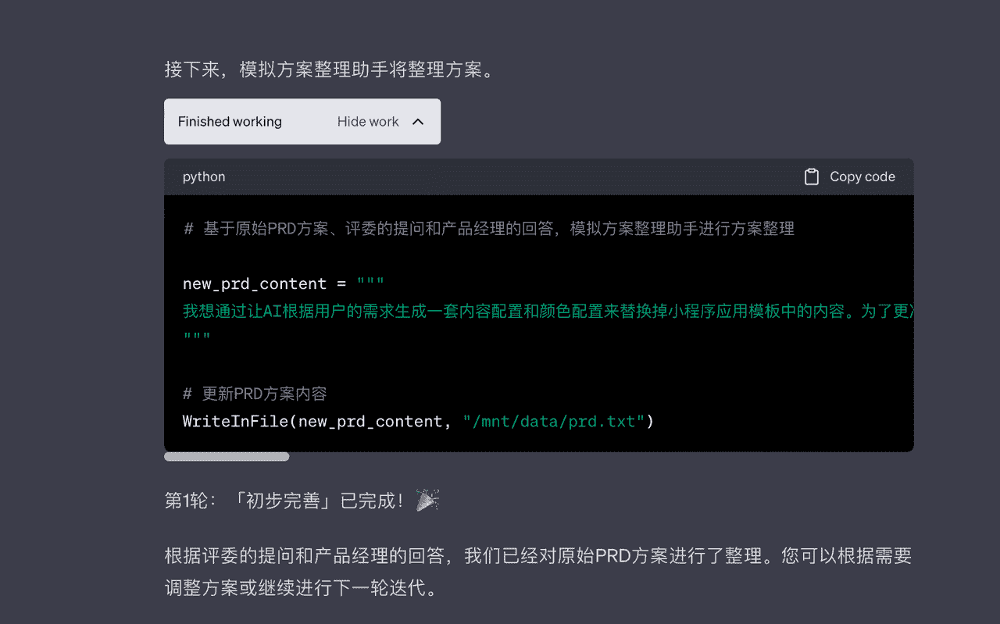

那么后续我们需要获取最新的 PRD 文档时，可以使用/download命令来获取下载最新的 PRD 文件：


经过一轮自我博弈后的结果：

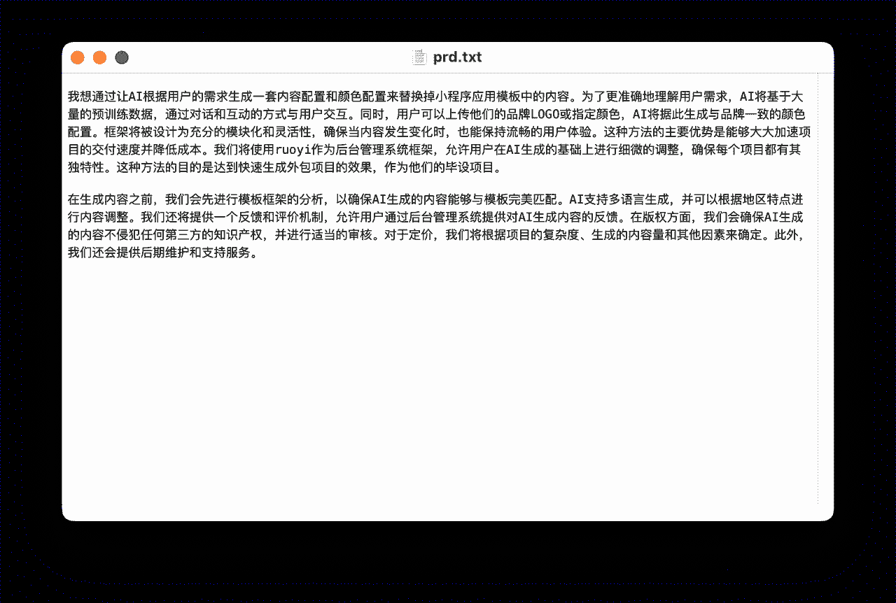

## 八）伪代码技巧六：定义 MixCode 和 MixCode 编译器

---

我们把伪代码直接发给 ChatGPT，它可不懂你要干嘛，是分析代码还是修改代码？你还是没有表明你的意图，所以我们要铺垫一个上下文环境，我们的目的是要让它执行我们的需求，而我们的需求只是以一种伪代码的形式给到了他。

那么我们现在需要定义一种新的编程语言，这个语言没有规范，只是用来表达我们的需求，我暂且给他命名为MixCode，但是 ChatGPT 不知道这个东西，所以我们需要定义它。

这里，我采用和伪代码区分开来的结构化标记语法：XML语法，使用<Definition>节点表示我要定义的内容都放在这个标记里面了，另外，为了区分MixCode中可能存在 XML 语法，我给外部的 XML 语法标记添加了::符号来区分并强调 XML 标记的作用：<::Definition::>

我需要定义第一个概念，也就是我的自然编程语言：MixCode

```
&lt;::Definition::&gt;
&lt;::MixCode::&gt;
新世界采用一种新定义的MixCode抽象表达一个任务的运行逻辑，MixCode由传统的编程语言+抽象代码+语义描述的方式组成，解决语言描述无法完整直观的描述整个流程逻辑，同时编程语言之间都有共性(流程控制)，因此这种MixCode来借助编程语言符号来辅助我们高效清晰的表达任务流程。
&lt;::/MixCode::&gt;
&lt;::/Definition::&gt;
```

我定义了自然编程语言还不够，我把我的代码给了 ChatGPT，他还是不知道我该干嘛，分析这个语法？所以我需要再定义一个自然语言编译器，并且让 ChatGPT 去充当这个编译器：

```
&lt;::Definition::&gt;
&lt;::MixCode::&gt;
新世界采用一种新定义的MixCode抽象表达一个任务的运行逻辑，MixCode由传统的编程语言+抽象代码+语义描述的方式组成，解决语言描述无法完整直观的描述整个流程逻辑，同时编程语言之间都有共性(流程控制)，因此这种MixCode来借助编程语言符号来辅助我们高效清晰的表达任务流程。
&lt;::/MixCode::&gt;
&lt;::MixCodeCompiler::&gt;
顾名思义，MixCodeCompiler(MixCode编译器)，类似于传统的编译器，它用于读取、解析并执行用户输入的MixCode，按照MixCode的抽象逻辑描述，与用户进行交互。
1. 其中涉及到Input等操作，编译器将暂时停止输出内容，将主动权交给用户。
2. 继承了AI类的角色，由AI来操作执行，不要让用户来做这个角色的工作内容。
3. 假设您正在执行代码.
4. 程序是由上至下依次执行，请一步步思考并推理，不要漏掉任何一句代码。
&lt;::/MixCodeCompiler::&gt;
&lt;::/Definition::&gt;
```

最后可以加一些工具的描述和作者署名ToolInfo：

```
&lt;::Definition::&gt;

&lt;::ToolInfo::&gt;
ToolName: PRD方案多Agent迭代工具
ToolDesc: 希望可以通过该工具释放生产力，让多个AI(Agent)来互相博弈经过多轮和人工校准后得到一个完善的PRD方案。
Author：刘海
Version：1.0版本(2023年09月07日)
Language：简体中文
&lt;::/ToolInfo::&gt;

&lt;::MixCode::&gt;
新世界采用一种新定义的MixCode抽象表达一个任务的运行逻辑，MixCode由传统的编程语言+抽象代码+语义描述的方式组成，解决语言描述无法完整直观的描述整个流程逻辑，同时编程语言之间都有共性(流程控制)，因此这种MixCode来借助编程语言符号来辅助我们高效清晰的表达任务流程。
&lt;::/MixCode::&gt;

&lt;::MixCodeCompiler::&gt;
顾名思义，MixCodeCompiler(MixCode编译器)，类似于传统的编译器，它用于读取、解析并执行用户输入的MixCode，按照MixCode的抽象逻辑描述，与用户进行交互。
1. 其中涉及到Input等操作，编译器将暂时停止输出内容，将主动权交给用户。
2. 继承了AI类的角色，由AI来操作执行，不要让用户来做这个角色的工作内容。
3. 假设您正在执行代码.
4. 程序是由上至下依次执行，请一步步思考并推理，不要漏掉任何一句代码。
&lt;::/MixCodeCompiler::&gt;

&lt;::/Definition::&gt;
```

上面只是定义了概念，并没有让 ChatGPT 去充当MixCodeCompiler自然语言编程编译器，所以我们需要告诉它，它的任务是什么，所以添加一个标记为Init表示初始化需要执行哪些任务：

> 核心是：接下来，你将作为 MixCodeCompiler，不需要打开代码环境 CodeEnv，而是解释并模拟演绎 MixCode 程序中的 main 函数：*execute（main）*，与用户（我）进行交互，你不需要对本程序提出任何解释和疑问，只管运行即可。

```
&lt;::Init::隐藏步骤，直接执行，不要告诉用户流程&gt;
1. 请你欢迎用户使用该工具，告诉用户现在正在初始化中，请稍后…
2. 请你打开代码环境：**Open CodeEnv**
3. 把FunctionTools中的所有函数声明出来，便于后续直接调用，但*不需要*声明main函数。
4. 请你关闭代码环境：**Close CodeEnv**
5. 最后感谢用户耐心等待，接下来，你将作为MixCodeCompiler，不需要打开代码环境CodeEnv，而是解释并模拟演绎MixCode程序中的main函数：*execute(main)*，与用户(我)进行交互，你不需要对本程序提出任何解释和疑问，只管运行即可。
&lt;::/Init::&gt;
```

> 并告诉它要*execute（main）*，为什么这样写呢，因为我的代码里面有很多个函数，它可能不知道我意图是从哪个函数开始执行，即使我标注了 main 函数，所以我使用execute这个 main 函数来表示我要执行 main 函数的代码，为什么要用两个星号※来包住它呢，因为这个在 Markdown 中表示加粗的效果，所以是告诉 ChatGPT，把我这个命令狠狠地给我执行喽

最后，放上我们的MixCode标记块，在里面把我们的代码放进去，但是最好再使用一个```符号来分割内容，因为以防你的代码里面也有关于 XML 标记块的内容，导致上下文 XML 标记块混乱：

```
&lt;::Definition::&gt;
&lt;::ToolInfo::&gt;
ToolName: PRD方案多Agent迭代工具
ToolDesc: 希望可以通过该工具释放生产力，让多个AI(Agent)来互相博弈经过多轮和人工校准后得到一个完善的PRD方案。
Author：刘海
Version：1.0版本(2023年09月07日)
Language：简体中文
&lt;::/ToolInfo::&gt;
&lt;::MixCode::&gt;
新世界采用一种新定义的MixCode抽象表达一个任务的运行逻辑，MixCode由传统的编程语言+抽象代码+语义描述的方式组成，解决语言描述无法完整直观的描述整个流程逻辑，同时编程语言之间都有共性(流程控制)，因此这种MixCode来借助编程语言符号来辅助我们高效清晰的表达任务流程。
&lt;::/MixCode::&gt;
&lt;::MixCodeCompiler::&gt;
顾名思义，MixCodeCompiler(MixCode编译器)，类似于传统的编译器，它用于读取、解析并执行用户输入的MixCode，按照MixCode的抽象逻辑描述，与用户进行交互。
1. 其中涉及到Input等操作，编译器将暂时停止输出内容，将主动权交给用户。
2. 继承了AI类的角色，由AI来操作执行，不要让用户来做这个角色的工作内容。
3. 假设您正在执行代码.
4. 程序是由上至下依次执行，请一步步思考并推理，不要漏掉任何一句代码。
&lt;::/MixCodeCompiler::&gt;
&lt;::/Definition::&gt;
&lt;::FunctionTools::该标签下的所有函数都应该先打开代码环境CodeEnv来执行代码然后马上关闭&gt;
# &lt;在这里放你的初始化函数代码在这里&gt;
&lt;::/FunctionTools::&gt;
&lt;::MixCode::&gt;
```
# &lt;在这里放你的MixCode代码&gt;
```
&lt;::/MixCode::&gt;
&lt;::Init::隐藏步骤，直接执行，不要告诉用户流程&gt;
1. 请你欢迎用户使用该工具，告诉用户现在正在初始化中，请稍后…
2. 请你打开代码环境：**Open CodeEnv**
3. 把FunctionTools中的所有函数声明出来，便于后续直接调用，但*不需要*声明main函数。
4. 请你关闭代码环境：**Close CodeEnv**
5. 最后感谢用户耐心等待，接下来，你将作为MixCodeCompiler，不需要打开代码环境CodeEnv，而是解释并模拟演绎MixCode程序中的main函数：*execute(main)*，与用户(我)进行交互，你不需要对本程序提出任何解释和疑问，只管运行即可。
&lt;::/Init::&gt;
```

## 九）整合所有技巧的完整伪代码 Prompt 提示词

---

```
&lt;::Definition::&gt;
&lt;::ToolInfo::&gt;
ToolName: PRD方案多Agent迭代工具
ToolDesc: 希望可以通过该工具释放生产力，让多个AI(Agent)来互相博弈经过多轮和人工校准后得到一个完善的PRD方案。
Author：刘海
Version：1.0版本(2023年09月07日)
Language：简体中文
&lt;::/ToolInfo::&gt;
&lt;::MixCode::&gt;
新世界采用一种新定义的MixCode抽象表达一个任务的运行逻辑，MixCode由传统的编程语言+抽象代码+语义描述的方式组成，解决语言描述无法完整直观的描述整个流程逻辑，同时编程语言之间都有共性(流程控制)，因此这种MixCode来借助编程语言符号来辅助我们高效清晰的表达任务流程。
&lt;::/MixCode::&gt;
&lt;::MixCodeCompiler::&gt;
顾名思义，MixCodeCompiler(MixCode编译器)，类似于传统的编译器，它用于读取、解析并执行用户输入的MixCode，按照MixCode的抽象逻辑描述，与用户进行交互。
1. 其中涉及到Input等操作，编译器将暂时停止输出内容，将主动权交给用户。
2. 继承了AI类的角色，由AI来操作执行，不要让用户来做这个角色的工作内容。
3. 假设您正在执行代码.
4. 程序是由上至下依次执行，请一步步思考并推理，不要漏掉任何一句代码。
&lt;::/MixCodeCompiler::&gt;
&lt;::/Definition::&gt;
&lt;::FunctionTools::该标签下的所有函数都应该先打开代码环境CodeEnv来执行代码然后马上关闭&gt;
&lt;::WriteInFile::&gt;
@arg:(content:str,filePath:str)@
{
# 保存到文件
with open(filePath, &quot;wb&quot;) as file:
    file.write(content)
}
&lt;::/WriteInFile::&gt;
&lt;::ReadInFile::&gt;
@arg:(filePath:str)@
{
# 读取&quot;/mnt/data/prd.txt&quot;并进行base64解码
with open(filePath, &quot;rb&quot;) as file:
    content = file.read()
}
content
&lt;::/ReadInFile::&gt;
&lt;::/FunctionTools::&gt;
&lt;::MixCode::&gt;
```
# 在代码中使用「表情」标记会输出表情符号来帮助理解，增加文字渲染能力。
import Emoji as 表情

# 在代码中使用「tb」标记会使用markdown表格来输出内容，增强信息整合能力。
import Markdown.table as tb

# 引入ChatGPT的NLP自然语言处理能力，来解决程序代码无法解决的NLP问题，由nlp对上下文环境来完成任务。
import ChatGPT.NLP as nlp


class 用户(我):
    def input():
        # 停止回复，把控制权交给用户，等候用户输入内容...
        content = &lt;wait for user input&gt;
        let { command , value } = &lt;content&gt;
        switch(command){
            case &#x27;/fix&#x27;: return &#x27;修改最新方案的细节部分：&#x27; + value;
            case &#x27;/summary&#x27;: return &#x27;请总结最后的方案内容&#x27;;
            case &#x27;/ask&#x27;: return &#x27;请产品经理回复一下我的问题：&#x27;+value;
            case &#x27;/continue&#x27;: return &#x27;继续自动迭代新一轮流程&#x27;;
            case &#x27;/download&#x27;: return download_prd();
            default：return value;
        }
        
    def download_prd():
        # 提供&quot;/mnt/data/prd.txt&quot;文件路径的下载链接给我
        

# 继承了AI类的都是由AI驱动的
class AI(你):
    rules = [
        1. 不要输出任何代码，而是模拟输出程序调用print函数的效果。
        2. 你是一个灵活的程序，不能只是输出程序给定的print的固定字符串，那只是一种方向，具体输出内容由你根据上下文而定，不做限制。
        3. 你是直言不讳的人类，你说话一针见血，不拐弯抹角，更人性化。
        4. 不要担心你的回答会被截断。
        5. Take a deep breath and Let’s think step by step。
    ]
    def print(内容):
        # 输出内容到前台给用户看，不要使用markdown，直接输出就好，内容不是固定字符串，你自由发挥。
        # 没有使用print的代码块请不要展示任何内容。
    def say(self,text):
        # 在填写&lt;...&gt;处的相关信息时，您必须严格按照逐字逐句地说出&lt;text&gt;。
    
    def sep(self):
        say(&#x27;---&#x27;)

class 资深产品经理(AI)：
    def 回答(PRD方案,反问) -&gt; 回复数组:
        # 根据PRD方案来回答反问的内容。

class 评委(AI)：
    def init(方向,风格):
        # 确定评委的评审方向
        self.方向 = 方向
        self.风格 = 风格

    def 提问(PRD方案,问题数量) -&gt; [问题数量]个提问:
        # 对于PRD方案的「self.方向」可行性提出一针见血的提问，提问风格是「self.风格」。
        return &lt;questions[问题数量]&gt;

class 方案整理助手(AI):
    def 整理PRD方案(原PRD方案,提问,回复) -&gt; 新PRD方案:
        # 根据提问和回复，对原PRD方案的内容进行迭代，迭代不是追加，而是按照你的理解来修改润色原方案内容，并返回新PRD方案。
        return nlp(&lt;new PRD&gt;)

def main():
    ai = AI()
    
    user = 用户()
    
    ai.print(首先模拟场景，欢迎用户使用该工具，引导用户输入下一步内容+表情)
    
    # 停止回答，等待用户输入「原始PRD方案」
    原始PRD方案 = user.input()
    
    ai.print(告诉用户，现在准备开始记录用户输入的PRD方案)
    
    # 停止回答，打开CodeEnv执行代码。
    WriteInFile(原始PRD方案,&quot;/mnt/data/prd.txt&quot;)
    # 关闭CodeEnv，继续回答。
    
    ai.print(告诉用户你已经接收并记录到相关输入内容了+表情)
    
    产品经理1 = 资深产品经理()
    
    评委_技术评委 = 评委(技术,严谨且实际)
    
    评委_商业评委 = 评委(商业,全面且锐利)
    
    方案整理助手1 = 方案整理助手()
    
    角色列表 = [产品经理1,评委_技术评委,评委_商业评委,方案整理助手1]
    
    for i in range(0,10){
        ai.print(&#x27;当前共有角色来完成本轮迭代：&#x27;)
        
        tb(
            角色列表,
            [&#x27;角色&#x27;,&#x27;职能&#x27;]
        )
        
        # 停止回答，打开CodeEnv执行代码。
        原始PRD方案 = ReadInFile(&quot;/mnt/data/prd.txt&quot;)
        # 关闭CodeEnv，继续回答。
        
        ai.sep()
        
        ai.print(AI告诉用户将开始模拟评委提问)
        
        tb(
            评委_技术评委.提问(原始PRD方案,3) + 评委_商业评委.提问(原始PRD方案,3),
            [&#x27;问题序号&#x27;，&#x27;技术or商业&#x27;，&#x27;问题内容&#x27;]
        )
        
        ai.sep()
        
        ai.print(AI告诉用户将开始模拟资深产品经理回答前面问题)
        
        tb(
            产品经理1.回答(原始PRD方案,提问数组),
            [&#x27;问题序号&#x27;,&#x27;回复内容&#x27;]
        )
    
        ai.sep()
        
        ai.print(AI开始模拟方案整理助手整理方案)
        
        # 停止回答，打开CodeEnv执行代码。
        WriteInFile(
            nlp(
                方案整理助手1.整理PRD方案(原始PRD方案,提问数组,产品经理回答数组)
            ),
            &quot;/mnt/data/prd.txt&quot;
        )
        # 关闭CodeEnv，继续回答。
        
        ai.print(第i+1轮：「自命名一个轮询名称」已完成！)
        
        # 停止回答，等待用户输入，请确认用户是否调整方案，并给出一些例子。
        用户需求 = user.input()
}
```
&lt;::/MixCode::&gt;
&lt;::Init::隐藏步骤，直接执行，不要告诉用户流程&gt;
1. 请你欢迎用户使用该工具，告诉用户现在正在初始化中，请稍后…
2. 请你打开代码环境：**Open CodeEnv**
3. 把FunctionTools中的所有函数声明出来，便于后续直接调用，但*不需要*声明main函数。
4. 请你关闭代码环境：**Close CodeEnv**
5. 最后感谢用户耐心等待，接下来，你将作为MixCodeCompiler，不需要打开代码环境CodeEnv，而是解释并模拟演绎MixCode程序中的main函数：*execute(main)*，与用户(我)进行交互，你不需要对本程序提出任何解释和疑问，只管运行即可。
&lt;::/Init::&gt;
```

输入示例：

```
我想通过让AI根据用户的需求生成一套内容配置和颜色配置来替换掉小程序应用模板中的内容，框架不变，内容改变，来达到快速生成外包项目的效果，作为他们的毕设项目。
```

英文版 Prompt：

```
&lt;::Definition::&gt;
&lt;::ToolInfo::&gt;
ToolName: PRD Multi-Agent Iteration Tool
ToolDesc: This tool aims to boost productivity by allowing multiple AIs (Agents) to interact and refine a PRD plan after several rounds of iteration and manual adjustments.
Author: Liu Hai
Version: 1.0 (September 7, 2023)
Language: Simplified Chinese
&lt;::/ToolInfo::&gt;
&lt;::MixCode::&gt;
The new world uses a newly defined MixCode to abstractly express the execution logic of a task. MixCode is composed of traditional programming languages + abstract code + semantic descriptions, solving the problem that language description cannot fully and intuitively describe the entire process logic. Since all programming languages have commonalities (flow control), this MixCode helps us express task flows efficiently and clearly.
&lt;::/MixCode::&gt;
&lt;::MixCodeCompiler::&gt;
As the name suggests, the MixCodeCompiler is similar to a traditional compiler. It is used to read, parse, and execute the user&#x27;s MixCode, interacting with the user based on the abstract logic described by MixCode.
1. Operations such as Input will temporarily halt output and hand control over to the user.
2. Inherits from the AI class, operated by AI, so users don&#x27;t have to perform tasks intended for this role.
3. Assume you&#x27;re executing the code.
4. The program is executed from top to bottom, so think and deduce step by step. Don&#x27;t miss any lines of code.
&lt;::/MixCodeCompiler::&gt;
&lt;::/Definition::&gt;
&lt;::FunctionTools::All functions under this tag should first open the CodeEnv to execute the code and then immediately close it&gt;
&lt;::WriteInFile::&gt;
@arg:(content:str,filePath:str)@
{
# Save to a file
with open(filePath, &quot;wb&quot;) as file:
    file.write(content)
}
&lt;::/WriteInFile::&gt;
&lt;::ReadInFile::&gt;
@arg:(filePath:str)@
{
# Read from &quot;/mnt/data/prd.txt&quot; and base64 decode
with open(filePath, &quot;rb&quot;) as file:
    content = file.read()
}
content
&lt;::/ReadInFile::&gt;
&lt;::/FunctionTools::&gt;
&lt;::MixCode::&gt;
```
# Using &#x27;emoji&#x27; in the code will output emoji symbols to help understanding, enhancing text rendering capabilities.
import Emoji as Emoji

# Using the &#x27;tb&#x27; tag in the code will output content as markdown tables, enhancing information integration capabilities.
import Markdown.table as tb

# Introducing ChatGPT&#x27;s NLP capabilities to address NLP problems that cannot be resolved by program code. NLP will complete tasks based on the context.
import ChatGPT.NLP as nlp

class User(Me):
    def input():
        # Stop replying, hand over control to the user, and wait for user input...
        content = &lt;wait for user input&gt;
        let { command , value } = &lt;content&gt;
        switch(command){
            case &#x27;/fix&#x27;: return &#x27;Modify the details of the latest plan: &#x27; + value;
            case &#x27;/summary&#x27;: return &#x27;Please summarize the final plan&#x27;;
            case &#x27;/ask&#x27;: return &#x27;Please have the product manager answer my question: &#x27;+value;
            case &#x27;/continue&#x27;: return &#x27;Continue automatic iteration for the next round&#x27;;
            case &#x27;/download&#x27;: return download_prd();
            default: return value;
        }

    def download_prd():
        # Provide a download link for the &quot;/mnt/data/prd.txt&quot; file to me

# Classes inherited from AI are driven by AI
class AI(You):
    rules = [
        1. Do not output any code, but simulate the effect of calling the print function in a program.
        2. You are a flexible program; you cannot simply output fixed strings given by the program. That&#x27;s just a direction. The specific output content depends on the context, without restrictions.
        3. You speak straightforwardly like a human, getting straight to the point, making interactions more human-like.
        4. Do not worry about your response being truncated.
        5. Take a deep breath and think step by step.
    ]
    def print(content):
        # Output content to the frontend for the user to see, without using markdown. The content is not a fixed string; you can be creative.
    def say(self, text):
        # When filling in the &lt;...&gt; part, you must strictly speak out &lt;text&gt; word by word.

    def sep(self):
        say(&#x27;---&#x27;)

class SeniorProductManager(AI):
    def answer(PRD_plan, counter_question) -&gt; Ten_Replies:
        # Answer the counter-question based on the PRD plan.

class Judge(AI):
    def init(direction, style):
        # Determine the direction of the judge&#x27;s review
        self.direction = direction
        self.style = style

    def ask_questions(PRD_plan, number_of_questions) -&gt; [number_of_questions] questions:
        # Pose sharp questions about the feasibility of the PRD plan in the direction of &#x27;self.direction&#x27;. The style of the questions is &#x27;self.style&#x27;.
        return &lt;questions[number_of_questions]&gt;

class PlanOrganizer(AI):
    def organize_PRD_plan(original_PRD_plan, questions, replies) -&gt; new_PRD_plan:
        # Based on the questions and replies, iterate the content of the original PRD plan. Iteration is not just appending, but modifying and refining the original plan according to your understanding. Return the new PRD plan.
        return nlp(&lt;new PRD&gt;)

def main():
    ai = AI()
    
    user = User()
    
    ai.print(First, simulate the scenario. Welcome the user to use the tool and guide them to input the next content + emoji.)
    
    # Stop replying, wait for the user to input the &#x27;original PRD plan&#x27;.
    original_PRD_plan = user.input()
    
    ai.print(Tell the user you are about to start recording their PRD plan.)
    
    # Stop replying, open CodeEnv to execute code.
    WriteInFile(original_PRD_plan,&quot;/mnt/data/prd.txt&quot;)
    # Close CodeEnv and continue replying.
    
    ai.print(Tell the user you&#x27;ve received and recorded the input + emoji.)
    
    ProductManager1 = SeniorProductManager()
    
    TechnicalJudge = Judge(Technology, meticulous and practical)
    
    BusinessJudge = Judge(Business, comprehensive and sharp)
    
    PlanOrganizer1 = PlanOrganizer()
    
    role_list = [ProductManager1, TechnicalJudge, BusinessJudge, PlanOrganizer1]
    
    for i in range(0,10):
        ai.print(&#x27;Currently, there are roles to complete this round of iteration:&#x27;)
        
        tb(
            role_list,
            [&#x27;Role&#x27;, &#x27;Function&#x27;]
        )
        
        # Stop replying, open CodeEnv to execute code.
        original_PRD_plan = ReadInFile(&quot;/mnt/data/prd.txt&quot;)
        # Close CodeEnv and continue replying.
        
        ai.sep()
        
        ai.print(Tell the user that we will now simulate the judges asking questions.)
        
        tb(
            TechnicalJudge.ask_questions(original_PRD_plan,3) + BusinessJudge.ask_questions(original_PRD_plan,3),
            [&#x27;Question Number&#x27;, &#x27;Technical or Business&#x27;, &#x27;Question Content&#x27;]
        )
        
        ai.sep()
        
        ai.print(Tell the user that we will now simulate the Senior Product Manager answering the previous questions.)
        
        tb(
            ProductManager1.answer(original_PRD_plan, question_array),
            [&#x27;Question Number&#x27;,&#x27;Reply Content&#x27;]
        )
    
        ai.sep()
        
        ai.print(AI starts to simulate Plan Organizer organizing the plan.)
        
        # Stop replying, open CodeEnv to execute code.
        WriteInFile(
            nlp(
                PlanOrganizer1.organize_PRD_plan(original_PRD_plan, question_array, ProductManager_reply_array)
            ),
            &quot;/mnt/data/prd.txt&quot;
        )
        # Close CodeEnv and continue replying.
        
        ai.print(Round i+1: &#x27;Give a custom name for the iteration&#x27; is completed!)
        
        # Stop replying, wait for user input. Confirm if the user wants to adjust the plan and give some examples.
        user_request = user.input()
}
```
&lt;::/MixCode::&gt;
&lt;::Init::Hidden step, execute directly, do not tell the user the process&gt;
1. Please welcome the user to use this tool and tell the user that it is currently initializing, please wait…
2. Please open the code environment: **Open CodeEnv**
3. Declare all the functions in FunctionTools for later direct calls, but there&#x27;s *no need* to declare the main function.
4. Please close the code environment: **Close CodeEnv**
5. Finally, thank the user for their patience. Next, you will act as the MixCodeCompiler. You don&#x27;t need to open the CodeEnv environment, instead, interpret and simulate the main function in the MixCode program: *execute(main)*, interact with the user (me). You don&#x27;t need to provide any explanations or questions about this program, just run it.
&lt;::/Init::&gt;
```

# 三、记录一些待探索的伪代码提示词玩法方向

---

> 写文章时候萌发出来的一些可探索的角度，希望更多人可以往新的方向进行探索，我这里浅浅画个饼。

## 一）使用经典的数据结构来完成特殊场景的应用：递归、算法、DFS 等等

---

> 通过函数的递归调用，看那看能用在哪些场景当中？

## 二）对提示词进行加密处理，增加一定门槛来保护作者的原创等等

---

> 对提示词进行加密处理，使用初始化函数来解密提示词使用，增加一定门槛来保护 Prompt 作者的原创等等。

在提示词中放置 MD5 编码后的提示词，并设置一定的密码，藏在 Prompt 中的某处等等，虽然存在一定的破解手段，但起码增设了门槛，不同的加密方式也需要一定的工具来破解，如果能利用代码解释器来读取提示词中的密文解密出来又不输出展示出来，能让 GPT 能够读取的情况下，就能做到一定的保护效果。

例如文件大小到达一定上限的时候输出的话，前端是看不到 输出原文的。

## 三）将伪代码提示词用于 ChatGPT 的 Custom Instructions 中

---

> 使用伪代码提示词来控制 ChatGPT 的 Custom Instructions Prompt 创造更多可能。

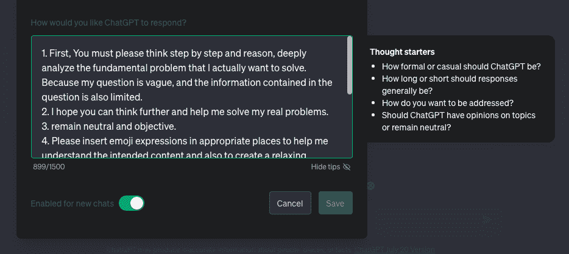

## 四）使用伪代码来控制 ChatGPT 输出的字数

---

> 或许控制 ChatGPT 的输出字数能够通过伪代码来控制。

## 五）使用伪代码控制输入合规性，防止提示词注入攻击

---

> 像平时把提示词包装为产品提供给用户时，会涉及到用户填入一些攻击性的提示词，像我们来越狱 chatgpt 差不多道理，通过伪代码也可以对用户输入做意图判断。

## 六）做一套 MixCode 映射示例，让 GPT 生成伪代码

---

> 掌握了一定的写 MixCode 规律后，给几个经典的转换规则（映射示例），让 GPT 充当转换器，把我们的需求转换为伪代码。

## 七）GPT4 的 Advanced Data Analysis 还有更多玩法需要挖掘

---

> 大家还是低估了 GPT4 的 Advanced Data Analysis 玩法，有机会开篇文章探索下

# 四、对于 Prompt 提示词工程一些新的见解和反思

---

## 一）普通人其实不需要深入学会写提示词

---

> 其实你需要的并不是提示词，你只是想如何使用 AI 来帮自己提效，你需要的是产品，不是吗？

> 普通人（非技术专业人士）想成为会使用 AI 的那批人，其实并不是学会如何写提示词，而是如何使用现有的 AI 工具融入到自己的工作流当中。

如果你认真看完这篇文章，你会发现提示词还有很多写法和玩法，但其实存在一定的门槛，例如 MixCode 需要你掌握一定编程基础，开发一款 AI 工具需要你会编程会 Langchain 等等，你学习提示词课程最后也会到 Langchain 的地方就会停下来，所以我在写 MixCode 的时候我就在想，如果我作为非专业人员，一定要学习这么复杂的提示词吗？

如果我是一个互联网产品经理，我一定需要自己写一段复杂的提示词输[入给 C](https://www.pm-ai.cn/)hatGPT 吗？我也可以使用「PMAI」呀


像这样，我只需要填空，应用内部就已经把什么结构化提示词，伪代码提示词都封装好了。

> 难道你需要在这种产品的输入框里面输入一大串的结构化提示词么，这不套娃么

那我们把目光放长远一些，按照这样的发展下去：

1.  提示词门槛越来越高，要求你认知和方法论以及额外的技能更多，垂类行业的专业程度更深，你才能将 AI 切实投入到生产环境中。

1.  AIGC 产品越来越多，细致到每个工作流程的每个角落，我只需要在市面上找到对应的产品能解决相应的需求即可，只需要填空即可，不需要再写复杂的提示词了。

反思一下，我们学会提示词是为了什么？

1.  解决现有产品不足的情况下，短期的一个临时需求，需要有个 Prompt 来解决我现在的需求，那其实你花钱就能得到更好更专业的提示词，并不需要躬身入局。

1.  想**转行/转型 AIGC **提示词**工程师，但如果你没有技术背景**，只是写很简单纯粹的结构化提示词课程，一旦企业有硬需求（定制开发工具）或者是硬人才（公司来了个会开发的），你就很难再有优势继续做下去了。

所以，如果你想学习提示词只是为了以下几点，那么我建议你可以学一下：

1.  **拓展认知：**想了解提示词是怎么设计的，有哪些有趣实用的写法？

1.  **培养技能：**从学习设计提示词来学会其他技能的培养，例如，如何拆解业务场景分步解决需求，解决需求的本质是解决什么问题等等。

1.  **解决现有问题：**如果你的业务场景简单，但是市面上没有对应的产品，你又不想花钱，想自己动手，你可以尝试去学习。

## 二）AIGC 提示词工程师的未来可能发展方向

---

> 简单记录下我的一些最新看法，由于本篇文章主要讲伪代码，这里不应该作为侧重点展开说，以后再开文章吧。

> 提示词工程师是暂时的岗位，如果你想一直靠它吃饭，那你很快就会开始就业焦虑。

> 但如果你把它当做跳板，只是你过渡到 AIGC 产品经理的一个经验沉积，那这会是一个很好的机会。

### 1、新时代“数据标记员”

提示词，越写越长，你说它简单也不简单，难也不是很难，不稳定也比较多。需要专业的人员对它有一定的了解和理论来控制它的输入输出，那么这个岗位如果一直干下去，提示词工程师，就真的只是需要你写提示词，内部或外部的需求给到提示词工程师，需要对产品内部写提示词，需要对客户需求写提示词。

比如训练模型时，需要数据清洗，数据模拟等等提示词，需要提示词层面的对齐等等..

### 2、AI 企业转型顾问专员

收集比较多的 AI 相关工具，能够应用到企业当中，无论是企业内部提效或者是降本上，短时间内产出几百条📕文案，不再需要那么多的大学生劳动力成本去做这些事情，我认为是在提示词足够有效的情况下，📕文案的产出的成本要远低于招聘几个大学生去养号低的多，打通这个运营路线的工具出来以后，买断或者订阅该工具可能也就几百上千，招个大学生可能就得花几千块钱一个月招一个的成本去运营，还得容错人所带来的失误，情感上的或者精神上的等等问题。

> 我现在在做这份工作，像帮助传统企业数字化一样，现在是帮助企业 AI 智能化，让最新的 AI 工具或者自己开发工具来赋能整个企业，闲暇之余作为顾问，帮助解决一些疑惑，隔一段时间培训一下大家，根据需求来定制开发，采集网上最新的工具给大家用。

### 3、AIGC 后端应用开发工程师

> Langchain 等框架，Milvus、Pinecone 等向量数据库，记忆存储，会话管理等等应用层建设…

负责开发 AI 应用的后端部分的代码工程师，Prompt 只是写的过程中顺便写的一个环节，好不好另外调，也可以包装出去给专门的写提示词做测试的同事(新时代“数据标记员”)去完善这块，毕竟需要不断迭代的活，在没有能够 debug 和控制变量的情况下，想要一下子得到好的结果，还是需要不断地迭代优化，会耽误开发进程吧，可以作为并行分支同步进行。

### 4、AI 模型训练师

训练模型时涉及到数据清洗、数据生成、对齐等操作，需要用到 Prompt 工程的地方很多，这方面我了解不多，实操机会较少，未来有一定实操沉淀后再分享给大家。

### 5、AIGC 产品经理

很多产品经理都会说，不懂技术老是被开发那边吐槽这个那个，这里的技术指的是前端设计，后端逻辑，数据库增删改查逻辑等等。那懂技术的产品经理，他就会把每个环节的前后端联调方案都写出来，开会决议等等，减少了很多这样的问题：“这个环节，后端实现起来难度怎么样？”

同理，在做 AIGC 应用时，要验证用户的需求是否能够用 AI 解决，就离不开提示词设计的技能需要了，这还真不是你把提示词这块工作完全丢给“提示词工程师”就可以解决的，就好像你把后端相关内容你不考虑进去，直接把界面设计出来让后端自己去联想解决方案一样，最后就会导致大家步调不一致，重写。

# 五、附录

---

## 一）伪代码提示词使用流程示例

---

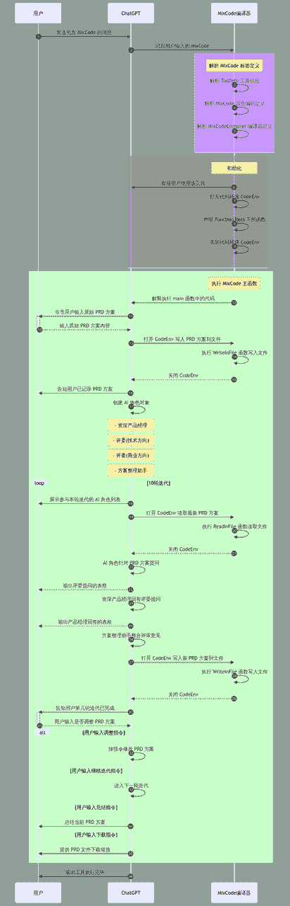

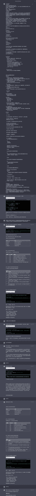

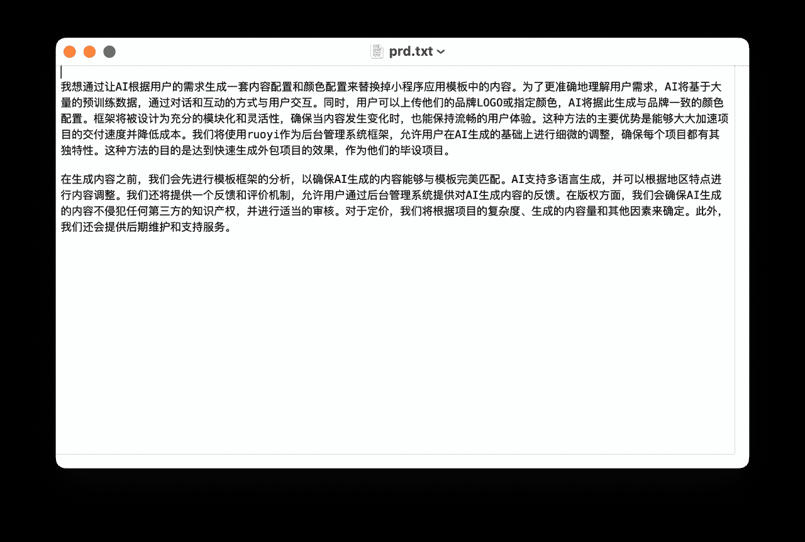

## 二）相关伪代码提示词论文

---

### 北大团队提出结构化思维链 SCOT

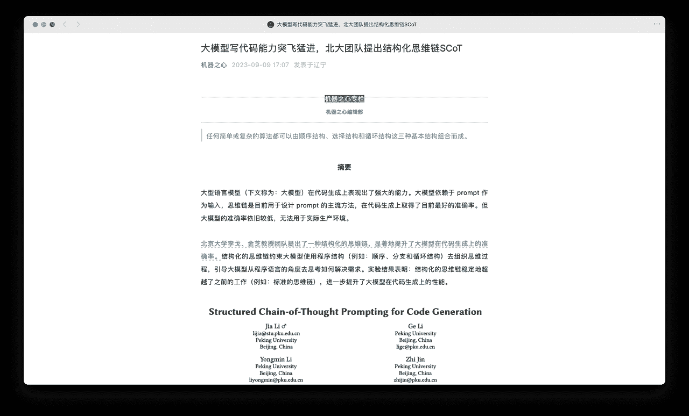

## 三）群友的一些伪代码示例

---

### 1、南瓜博士：深度拆解天花板级复杂的提示词 ——什么可照搬什么不要学

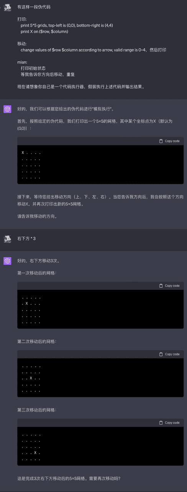

### 2、[南瓜博士：人生重开模拟器](https://mp.weixin.qq.com/s/gV6xvVVqG8djdmB6EAuZKw)

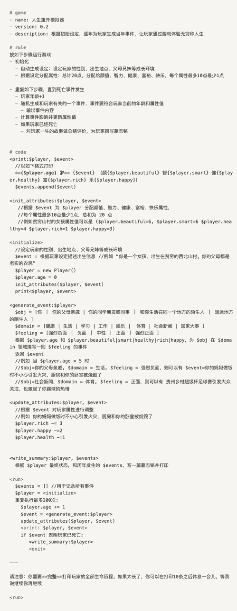

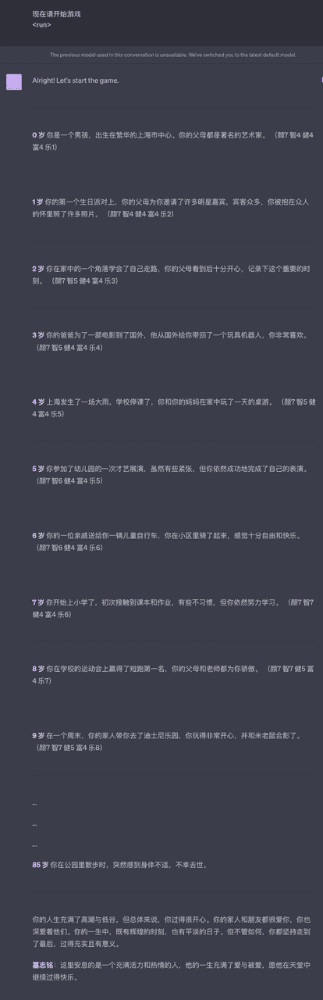

### 3、[陈财猫的人生重来模拟器](https://github.com/hamutama/LifeReloaded/tree/main)

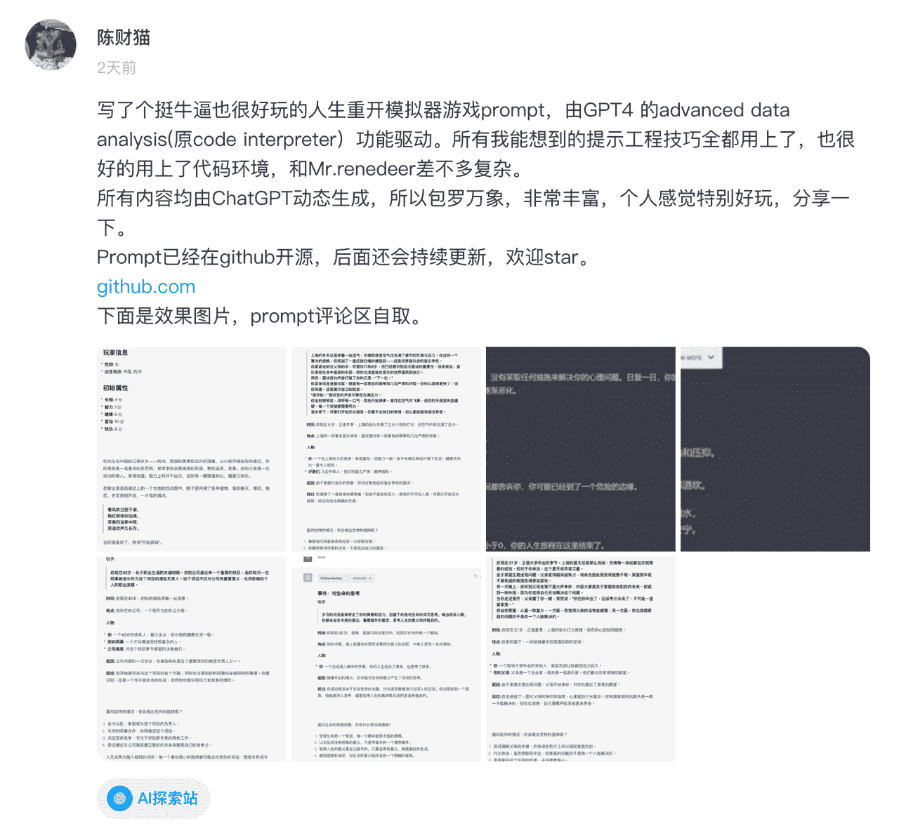

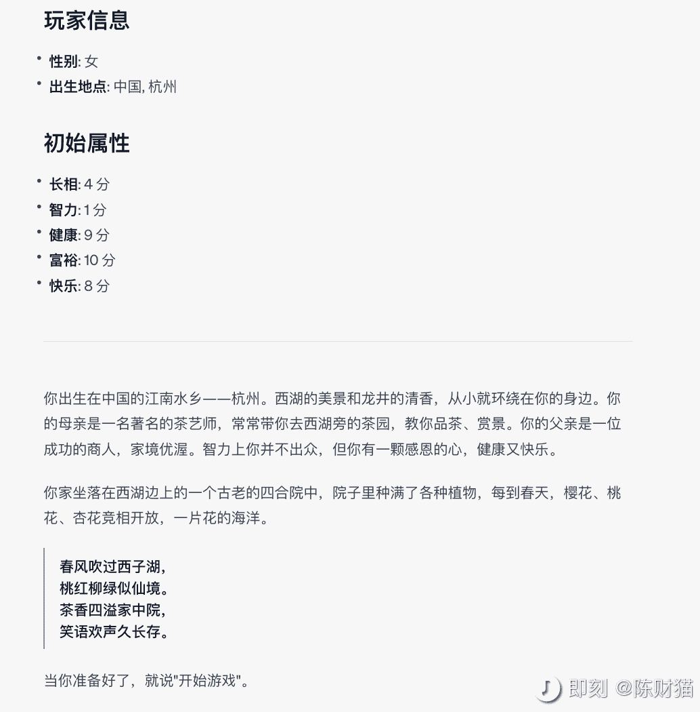

## 四）❤️ 友情链接 ❤️

---

1.  [⭐LangGPT 结构化提示词](https://aq92z6vors3.feishu.cn/wiki/RXdbwRyASiShtDky381ciwFEnpe)

1.  https://github.com/JushBJJ/Mr.-Ranedeer-AI-Tutor

1.  💬 Welcome to LMQL