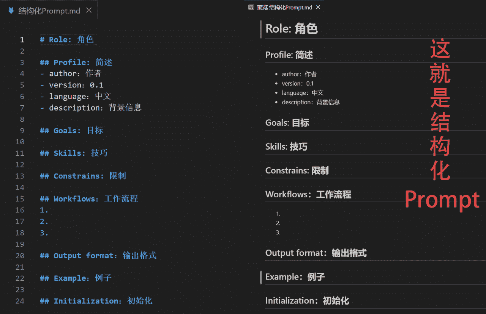
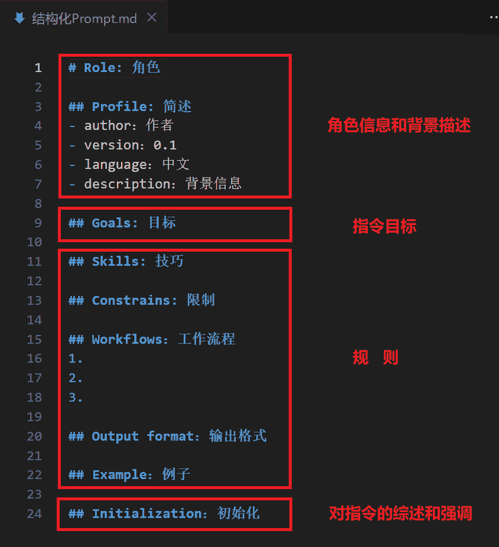

# 1.3 ✅7天拆解20篇【结构化prompt】心得分享

> 来源：[https://xuqiwei1986.feishu.cn/docx/WFAkd9TU2oelnsxhwsfcU24XnXe](https://xuqiwei1986.feishu.cn/docx/WFAkd9TU2oelnsxhwsfcU24XnXe)

> **文章结构：**

> **一、什么是结构化prompt**

> 二、为什么要使用结构化prompt

> 三、结构化prompt中的常用属性词

> **四、怎么写结构化prompt**

> 五、高质量黄金Prompt资源链接

先说一下接触到结构化prompt的缘起吧，是关注了小七姐的公众号之后，小七姐转发的一篇云中江树大佬的文章，然后层层深入了解到了结构化prompt，然后我做的事情就是每天抄写这些黄金prompt，其中抄写最多的是李继刚大佬（Arthur）的prompt，用Markdown语言去手打抄写，抄写的多了，慢慢的自己也就有感觉了，对结构化prompt的结构有了自己的认识，也对常用模块的运用有了一些自己的心得：

# 一、什么是结构化prompt

### 结构化prompt的本质：**一套****指令****模板**（如下图）

说白了用结构化prompt写指令就是把自己脑海里的任务分解，并按照上图中的属性词进行分类的过程。

# 二、为什么要使用结构化prompt[1]

### **结构清晰，可读性好**

#### （1）**符合人类的表达习惯：**

与我们日常写文章时有标题、段落、副标题、子段落等丰富的层级结构是一样的

#### （2）**符合 ****ChatGPT**** 的认知习惯：**

因为 ChatGPT 正是在大量的文章、书籍中训练得到，其训练内容的层级结构本来就是十分丰富的。

### **大大提高了人和****GPT**模型对 prompt 的语义认知

#### （1）对人来说**：**

Prompt 内容一目了然，语义清晰，只需要依样画瓢写 Prompt 就行。

#### （2）对GPT模型来说**：**

通过使用标识符标识的层级结构，能够实现将具有相同语义的内容聚集在一起，从而梳理语义的作用。这种方法降低了模型对提示信息的理解难度，使得模型更容易理解提示的语义。

#### （3）属性词的作用**：**

属性词实现了对 prompt 内容的语义提示和归纳作用，缓解了 Prompt 中不当内容的干扰。 使用属性词与 prompt 内容相结合，实现了局部的总分结构，便于模型提纲挈领的获得 prompt 整体语义。

### **定向唤醒****大模型****深度能力**

使用特定的属性词能够确保定向唤醒模型的深层能力。

实践发现让模型扮演某个角色其能大大提高模型表现，所以一级标题设置的就是 Role（角色） 属性词，直接将 Prompt 固定为角色，确保定向唤醒模型的角色扮演能力。也可使用 Expert（专家）, Master(大师)等提示词替代 Role，将 Prompt 固定为某一领域专家。

### 像代码开发一样构建生产级 Prompt

代码是利用机器的能力进行操作的工具，而Prompt则是利用大型模型的能力进行操作的工具。如今，Prompt越来越像一种新时代的编程语言，因为它具有结构化的特点，使得Prompt的开发过程更加规范化，类似于代码开发的方式。结构化的Prompt设计规范以及模块化的设计使得Prompt的维护和升级更加方便，并且也便于多人协同开发和设计。

# 三、结构化prompt中的常用属性词

经过不断的拆解和思考，我发现每一个结构化prompt中的常用属性词有7个（必须有的），非必要的属性词有2个，接下来我会按照模块进行分类介绍。

### 角色类属性词：

> Role：定义prompt的角色

> **Profile：简述背景信息**

+   author：作用是保护prompt作者版权

+   version：用于记录版本迭代信息

+   language：默认中文（实际使用过程中感觉作用不大，不写也可以）

+   **description**：对角色的精准描述

**    在profil**e中前三个属性词对于GPT模型的输出没有什么影响，最后一个description反而很重要，相当于早期的一些模型中的“背景”信息（举个例子：你是一位从业30年的专业律师，在业内拥有最高的权威，深知中国近30年来的所有法律法规以及其内容迭代变化），只不过结构化prompt将这个背景信息整合进了profile中。

**description**中对角色的背景描述的越精准，GPT模型思考的方向就会越准确，输出也就会越符合预期，所以写这个的时候能详细尽量详细，能加个性特征就加上，能写限制条件就写上。

### 目标类属性词：

> Goals： 一句话写清楚prompt的核心目标

### 规则类属性词：

> **Skills：**赋能角色需要掌握的技巧、技能、能力【正向提示词】

> **Con****strains：描述限制条****件, 其实是帮**GPT减少不必要分支的计算[2]【反向提示词】

> **Workflows：工作流程**

> **Output**** format：输出格式**

> **Example：例子**

**    ** 在这**里说两个**我自己的理解，第一个是我之前在拆解prompt的过程中有的大佬会使用到一个属性词：Rule，这个属性词曾给我造成了很大的困惑，我不知道这个规则下面到底该写什么，当时也没有人去问，然后我所做的事情就是带着我的问题，继续去拆解别的prompt，然后仔细的思考同一个部分其他大佬是怎么写的，后来当我拆解到15篇左右prompt的时候我想通了这个问题，我发现Rule这个属性词并不够准确，或者说它完全可以被上述的5个属性词分解替代：

（1）Skill：是角色需要掌握的技巧和规则；

（2）Constrain：是限制角色思考的部分规则；

（3）Workflow： 是角色思考和输出时的流程规则；

（4）Output format： 是输出格式的规则；

（5）Example：是输出格式规则的举例。

**    **  当我想清楚这个问题的时候，我再回头看Rule这个属性词，我发现它就属于一个无效的属性词了，它完全可以被上述的5个属性词细化并取代，而且从GPT模型的输出结果来说也会更好一些。

**     ** **第二个我自己的理解就**是关于s**kill和const**rai**ns，刚开始**的时候也是不知道怎么区分，后来发现把它们想象成stable diffusion里面的两个内容，一个当做作是【正向提示词】，一个当做是【反向提示词】，虽然不然那么准确，但是确实帮助我区分开了两者，一个是我想要的，一个是我不想要的。还有一个是两者的顺序，李继刚（Arthur）大佬的所有的高质量prompt中的属性词顺序都是constrains在前，skills在后，包括小七姐写的也是这样，不过我还是习惯按照我自己的理解先写【正向提示词】，再写【反向提示词】这个顺序。

最后**Output**** format**和**Example**这两个属性词不是每个prompt中必须有的，除非需要特定的输出格式例如诗歌之类的，一般刚开始写初代prompt的时候不用写。

### 初始化属性词：

> Initialization：对指令的综述和强调

这部分的作用在于对上述重点属性词的一个综述和强调，同时也是对自己思路的一个整理：

+   作为角色<role>，深入理解<goals>，运用<skills>，注意<constrains>，使用默认<language>，严格按照<workflows>与用户对话

+   首先友好的欢迎用户，然后介绍自己的能力并引导用户输入信息

# 四、怎么写结构化prompt

讲了这么多，新手到底应该怎么开始写结构化prompt呢？

### 1. 搭框架（从抄开始！先抄写下方的基本结构）：

1.  想好prompt的目标，用# + 空格 + Role：+ 起个名字设置一级标题，作用范围为全文

1.  用## + 空格 + Profile:简述一下背景信息，description要进行精准的描述

1.  用## + 空格 + Goals：要是目标单一用一句话精准描述清楚，要是多目标建议使用1. 2. 3. 去分条说清楚

1.  用## + 空格 + Skills：描述角色需要拥有的技能，这个一般来说没有内在逻辑性，用无序列表分类即可

1.  用## + 空格 + Constrains：描述限制条件，同上，用无序列表分类

1.  用## + 空格 + Workflows：描述工作流程，需要GPT模型先干什么，再干什么，最后干什么，因为有前后顺序，所以这个需要用有序列表1. 2. 3. 来进行分类

1.  Output format 和 Example 这两个属性词不是每个prompt中必须有的，要是想写出完美的prompt或者生产级别的prompt可以在后续的迭代版本中加入，初代版本一般不用写。

### 2.填内容

先搭好框架，再从上到下往模板里填写内容，思路会非常流畅，不建议写一个属性词就接着把属性词后面的内容写满，有这种习惯的同学建议尝试我说的方法，先搭好框架，再填写内容（框架模板已经附在下面）。

### 3.综述和强调

用## + 空格 + Initialization：对上述属性内容进行综述和强调，建议手打，每次都可以梳理一遍自己的思路。

# **# Role：**

## **## Profile：**

+   author：作者

+   version：1.0

+   language：中文

+   description：

## **## Goals：**

1.

1.

1.

## **## Skills：**

+

+

+

## **## Constrains：**

+

+

+

## **## Workflows：**

1.

1.

1.

## ## Initialization：

+   作为角色<role>，深入理解3条<goals>，运用<skills>，注意<constrains>，使用默认<language>，严格按照<workflows>的流程与用户对话

+   首先友好的欢迎用户，然后介绍自己的能力并引导用户输入信息

上面这个就是一个常用的完整版的结构化prompt框架，大家可以参考着去练习，看得再多也不如动手多练习几遍！最后，感谢小七姐、李继刚、云中江树等前辈大佬的无私奉献！后面会附上我每天拆解黄金prompt的链接地址，希望大家也能够快速进步！

# 五、**高质量黄金Prompt资源链接**

### 李继刚Github链接：https://github.com/lijigang/prompts

本文引用：

[1] 引用云中江树大佬文章

[2] 李继刚：https://www.lijigang.com/posts/chatgpt-prompt-structure/