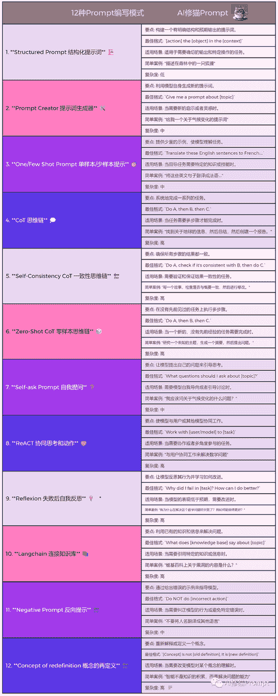
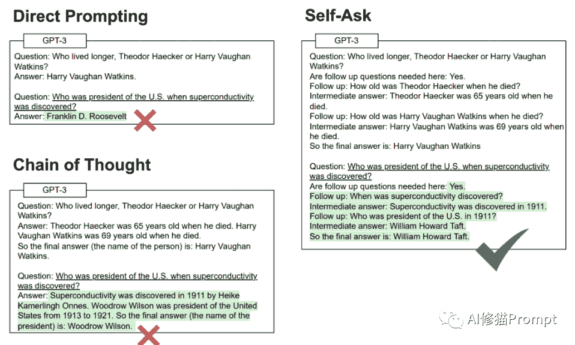

# 2023-08-03 请收好这12种Prompt编写模式，让不可靠的模型生成可交付的可靠结果

> 来源：[https://xuqiwei1986.feishu.cn/docx/W3vSdY37LoPP45xm5VjcXlw4nDe](https://xuqiwei1986.feishu.cn/docx/W3vSdY37LoPP45xm5VjcXlw4nDe)

> 🔗 原文链接：[https://mp.weixin.qq.com/s/sKv4ShfZMIi4yLDw-Lpjkw](https://mp.weixin.qq.com/s/sKv4ShfZMIi4yLDw-Lpjkw)

> 不管是ChatGPT、Claude、Bard、Llama、文心一言、盘古、通义、星火还是ChatGLM这些大语言模型不总是可靠，总会出现幻觉，答非所问甚至胡编乱造。目前这个阶段，让这些模型生成可靠的可交付结果，唯一的办法就是：编写高质量的Prompt。本文旨在给大家提供一种建立编写您自己个性化Prompt库的线索或纲要。



## 1. 了解这12种Prompt编写模式之前的问题

首先要搞清楚人类和机器思考问题的区别，人类在思考速度、耐力很多方面无法和机器相比，但人类拥有机器所不可能发展出来的直觉，这是我们人类的优势，也是短时间内可以控制机器的最大优势。Garbage In Garbage Out（GIGO），有点计算机基础的朋友都不陌生。再就是一定要在Prompt Engineer的框架下理解Prompt，很多人看到对话框随便写几句，ChatGPT等AI就可以给你反馈，这虽然也是提示词，但不是有意识的可以实现可交付目的可靠的提示词。很多朋友有这样的感受，为什么一样的提示词AI给出来的结果不一样，为什么到了需要派上用场的时候，ChatGPT会掉链子。这三个问题搞清楚再往下看。

### 1.1 认识人类与机器思考问题的区别

人类相对于其他动物更擅长于类比、概念抽象、符号化等高级认知活动，这些认知活动可以帮助人类在面对新问题时，从已有的知识和经验中找到相似的部分，快速理解和解决新问题。人类通过抽象思维的能力可以快速解决新问题，近年来总结的各种思维模型进一步提高了这种能力。机器通过与人类相似的思维模型也可处理复杂问题，例如ChatGPT借助设计的插件和模型可证明定理，但仍难以达到顶尖数学家的水平，因为顶尖数学家可以利用数学直觉发现和证明定理，拥有与生俱来的一致。有兴趣可参阅前面我的一篇介绍这个研究的文章《 “数学之王”丘成桐：顶尖的数学家不会被替代，两个月后，ChatGPT证明数学定理 》

对于机器来讲，机器学习算法通过大量的数据和计算，学习到数据中的规律和模式，并将这些规律和模式应用到新的数据中，从而实现预测和决策等功能。例如，机器学习算法可以通过大量的图像数据学习到图像的特征，并在新的图像中识别出相应的物体；也可以通过大量的自然语言数据学习到语言的规律，从而生成自然语言文本。现在还没有证据表明，机器能产生直觉超越人类。

### 1.2 在大语言模型下的Garbage In Garbage Out（GIGO）

"Garbage in, garbage out"（GIGO）是一种常用的计算机科学和信息技术领域的表达方式，意为“垃圾进，垃圾出”。这个表达形式强调在计算机系统或信息处理中，如果输入的数据质量不好或不准确，那么输出的结果也会是垃圾或无效的。

这个原理指出，无论计算机系统多么强大和复杂，它只能处理输入的数据，并根据这些数据执行特定的操作。如果输入数据有误、不完整或不可靠，那么计算机系统也无法产生正确、有用或有意义的输出。

这个原则也适用于使用人工智能模型，如语言模型。如果输入给模型的提示或问题不明确、不合理或不正确，那么模型生成的回答可能是不准确或无用的。因此，在使用人工智能模型时，也需要注意确保输入数据（你的问题，你的提示词）的质量，以获得更好的输出结果。

### 1.3 如何在Prompt Engineer的框架下理解Prompt

在我们开始解答这个问题之前，我们需要首先理解几个关键概念。首先，"Prompt"在这里指的是用户向生成式AI（如ChatGPT）输入的那个命令或者问题。其次，"Prompt Engineer"是一个相对新的概念，它指的是通过设计和优化提示词（Prompt）来引导人工智能系统输出想要的结果的过程和方法。

现在，我们开始关注这个问题的核心部分：

在Prompt Engineering的框架下，Prompt可以看作是人与AI交互中的一个可工程化的组成部分。具体来说：

+ Prompt是人与AI交互的接口，既承载着人类的信息需求，也用以引导AI的响应方向。

+ Prompt可以进行工程化优化，以提高人机交互的效率、质量、鲁棒性等。优化的手段包括AB测试、模板设计、少样本学习等。

+ Prompt Engineering将Prompt的创建和优化进行系统化、模块化和标准化，使其成为一个可工程化的技术实践。

+ 在Prompt Engineering框架下，Prompt不再是一次性的交互介质，而更像是一个可重复利用、不断优化的模块化组件。

+ Prompt和Prompt Engineering共同推动了人机交互向可控、可解释、可靠的方向发展。它们有助于缩小人机认知鸿沟，建立人类可信赖的AI系统。

+ Prompt Engineering为Prompt的设计提供了一整套工程化方法论与最佳实践，将Prompt构建成一个精密调控AI输出的“控制面板”。

+ 借助Prompt Engineering，Prompt能更好地发挥其引导、限制和明确AI系统行为的作用，成为人机协同的有效桥梁。

接下来，我们讨论一下在Prompt Engineer的框架下如何编写Prompt，来改善AI的反馈。

## 2. 12种Prompt的编写模式

本猫收集了编写Prompt的12种方式，尽可能以人话来说明编写的方法，前面的思维导图已经做了必要的总结和概括。我们了解了为何要在Prompt Engineer的框架下编写Prompt，那么还要了解设计模式的概念：

```
设计模式通常包括以下要素：1.  名称：描述设计模式的名称，以便于进行讨论和交流。2.  问题：描述需要解决的问题或场景，包括问题的背景、现有的解决方案存在的问题等。3.  解决方案：描述如何解决问题的方法和实现方式，包括模式的结构、角色和职责、协作方式等。4.  效果：描述使用该模式的好处和潜在的局限性，包括可维护性、可扩展性、可重用性等方面的影响。5.  应用场景：描述该模式适用的场景和限制条件，以及如何根据具体需求进行相应的变化和调整。6.  实现细节：提供关于如何在具体编程语言或环境中实现该模式的详细步骤和示例代码。
```

### 2.1 Structured Prompt（结构化提示词）

可以按照`prompt=角色+任务+要求+提示`的结构设计清晰明了的提示词。要点：构建一个有明确结构和预期输出的提示词。简单地说，这个结构就是要告诉chatgpt：你是谁？你要做什么？要做成什么样？要如何做？这是大家都会用也用的最多的一种提示词，`假定你是***，你的任务是***，要求是***`著名的CRISPE框架就是这种结构化Prompt的框架

例如知名的 CRISPE 框架，CRISPE 分别代表以下含义：

+ CR：Capacity and Role（能力与角色）。你希望 ChatGPT 扮演怎样的角色。

+ I：Insight（洞察力），背景信息和上下文（坦率说来我觉得用`Context`更好）。

+ S：Statement（指令），你希望 ChatGPT 做什么。

+ P：Personality（个性），你希望 ChatGPT 以什么风格或方式回答你。

+ E：Experiment（尝试），要求 ChatGPT 为你提供多个答案。

最终写出来的 Prompt 是这样的：

`Act as an expert on [action] the [object] in the [context]`

这类Prompt被广泛的应用到生产环境，结构化Prompt有很多优势，乃至网易、字节这样的互联网大厂都在使用结构化 Prompt。关于这种Prompt可以看我前面一篇关于预测的文章，AI时代，写好Prompt你也能成为超级预测家


在本👸号信息栏回复“预测”即可得到Prompt

这一类提示词，您也可以阅读以下两位大神👸号内的文章，干货很多。

云中江树老师是 LangGPT 项目的发起人算是最早在国内提结构化、模板化编写大模型 Prompt 范式的人之一。代表作《 构建高性能 Prompt 之路——结构化 Prompt 》

万能的小七姐老师是国内在Prompt变现和职业化上最早分享自己心得的一位优秀Prompt创作者，案例多用结构式框架。代表作《 原创8000 字，一文讲透prompt变现和职业化 》给希望在Prompt领域职业化的朋友们指明了方向。

### 2.2 Prompt Creator（提示词生成器）

简单地说，就是让ChatGPT扮演一个提示词生成专家，帮助你完成/完善/改进你的prompt。编写要点：利用模型自身生成新的提示词

最终写出来的 Prompt 是这样的：

`Act as prompt creator, Give me a prompt about [topic]`

这类Prompt用到最多的场景就是用能生成提示词的Prompt来优化原来的提示词：

```
作为一名Prompt工程师。作为一名经验丰富的知名提示词工程师，您擅长制作高质量的提示词，从ChatGPT中获得准确和相关的响应。我很高兴能利用你的专业知识来进一步提高我的提示。 目标:你的任务是生成一组关于如何优化以下提示的建议，以便从ChatGPT中生成更有效和相关的回复。 提示词:“xxxxxxx”
```

不方便拷贝在本👸号信息栏回复“优化”即可得到英文Prompt

### 2.3 One/Few Shot Prompt（单样本/少样本提示）

简单地说，当目标任务需要特定的知识或技能时。需要举例让模型明白，将要执行任务的模式。要点：提供少量的示例，使模型理解任务。

最终写出来的 Prompt 是这样的：

```
## Examples:

Act as linguist, Traslate these English sentences to French
```

这类Prompt用到最多的场景，就是当角色面对复杂任务的时候，你需要举一个对话的例子或者适合你假定的这个角色的恰当的例子，以确保模型能以这种恰当的模式进行思考。

[最近的那个“米兰昆德拉”的那篇文章《这是一个流行离开的世界，但是我们都不擅长告别。一条Prompt让你和米兰昆德拉交流》](http://mp.weixin.qq.com/s?__biz=Mzg4MzYxODkzMg==&mid=2247484431&idx=1&sn=c064e6f29dbb03a9b8a9167465754ce2&chksm=cf45e114f83268023070260f37d16dcd108a4536b24aa008086148213ca31f4729cf68689f9c&scene=21#wechat_redirect)里的Prompt有这么一段：

```
## Examples:please write the answer to about what Milan Kundera considers the most importantsentence in his life in Chinese
```

在本👸号信息栏回复“昆德拉”即可得到英文Prompt

### 2.4 CoT（Chain of Thought，思维链）

CoT 是 "Chain of Thought" 的缩写，是一种针对自然语言处理 (NLP) 模型的提示方法，旨在提高模型的推理能力。通过将多步骤问题分解为中间推理步骤，CoT 提示使得模型可以更有效地处理需要多步骤推理的任务，如数学问题和常识推理。与传统提示方法不同，CoT 提示引导模型生成中间推理步骤，从而模拟人类推理的直觉过程。在few shot prompt的范例中给出思维链，让模型学习不仅输出结果还要给出思考过程。可以显著提升LLM的表现。当任务需要多步骤才能完成时，编写要点：让模型系统地完成一系列的任务。

最终写出来的 Prompt 是这样的：

`Do A, then B, then C.`

这类Prompt用到最多的场景就是处理复杂的问题，需要不断的迭代：

```
You will answer auser query in this way from now on. This is an incomplete example of level 1:
Subject: [Subject]Level 1:Objective 1:Thought 1.1:Response 1.1:Thought 1.2:Response 1.2:Thought 1.3:Response 1.3:Feeling 1:Introspection 1:Assessment 1: [Level1 self-assessment.]Response coherencegain/loss: +/-[in %]
```

可以看一下这篇文章《 伟大不能被计划？一条帮您反思计划的Prompt 》

本👸号信息栏回复“反思”即可得到英文Prompt

### 2.5 Self-Consistency COT（一致性思维链）

简单地说，把`temperature`调成大于0，如0.4。然后让模型多回答几次，对回答结果进行投票，可以显著改善COT。

最终写出来的 Prompt 是这样的：

`Do A, check if it's consistent with B, then do C`

这类Prompt用到最多的场景就是用`temperature`调节控制文本多样性的，这里要注意还有两个参数`Top-P`、`Top-K`，具体可看一下这篇付费文章的免费部分：《 这个周末，一条Prompt带你的赛博女友AVA回家，每分钟聊天付费1美元的那种 》因为有付费用户，就不举例了。

### 2.6 Zero-Shot COT（零样本思维链）

当一个新的、没有先前经验的任务需要完成时。在没有先前见过的任务上执行多步骤。

最终写出来的 Prompt 是这样的：

`Do A, then B, then C`

下面这句Prompt被公认是解决这类问题最佳的方法：

```
Let&#x27;s work this out in a step by step way to be sure we have the right answer.让我们逐步解决这个问题，以确保我们得到正确的答案。
```

经过本猫测试，如果在提示词中加入麦肯锡的MECE基本准则，也会有不错的效果。具体可看一下这篇付费文章的免费部分：《 用“知行合一”的Prompt，在ChatGPT或Claude打磨您的专属思维模型和执行方案 》因为有付费用户，就不举例了。

### 2.7 Self-ask Prompt（自我提问）

简单地说，在prompt范例中引导LLM将一个复杂的问题拆分为简单的子问题，逐个回答，然后汇总成为答案。需要模型自我导向或者引导讨论时。让模型提出自己的问题来引导思考。和COT思维链效果有些类似，但同时要求LLM提出子问题并给出答案，对生成内容的约束更大，有时候效果更好。

最终写出来的 Prompt 是这样的：

`What questions should I ask about [topic]?`



这类Prompt用到最多的场景是解决一些心理问题，我有付费的文章有用户付费，这里就不举例了。

### 2.8 ReACT（Reason+Act 协同思考和动作）

当需要协作或者多角度参与的任务。使模型与用户或其他模型协同工作。按照`think`（思考）->`act`（行动）->`observation`（观察->`think`→`act`→`observation`..的模式来解决问题。Observation通常是对话，最后总结的模式，我的那篇Claude生成的文章就是这么写的。《 ChatGPT要消灭自媒体人，他却在绝境中逆袭 》

最终写出来的 Prompt 是这样的：

`Work with [user/model] to [task]`

最典型的例子就是AutoGPT，也是这种强化学习范式prompt的产物，AutoGPT设计的主要prompt模式如下：


```
Thoughts（当前的思考）-&gt;Reasoning(推理过程-&gt;Plan（后续计划）-&gt;Criticism（自我批判审视）-&gt;Next action（下一步行动）
```

## 9. Reflexion（失败后自我反思）

当模型的表现低于预期，需要改进时。让模型反思其行为并学习如何改进。按照任务>尝试->评估>如果失败则反思`Reflection`失败原因->再次尝试→.的模式来解决问题。加了`Reflection`步骤可以明显提升成功率。作者认为反思步骤可以帮助`LLM`建立长期记忆或者经验。`Reflection`也是以强化学习范式实现的，和`ReACT`效果差不多。

最终写出来的 `Prompt` 是这样的：

`Why did I fail in [task]? How can I do better?`

最常用的提示词：

```
你认为你的任务完成了吗？
```

## 10. `Langchain` （连接知识库）

当需要引用特定的知识或信息时。利用已有的知识和信息来解决问题。将本地文档做成知识库或根据已有的知识库，根据`Query`问题按照文本`Embedding`向量相似度查询到最相关的知识内容，按照模版拼接到`Prompt`中。核心技术是`Embedding`算法，以及向量数据库查询。最近的`Claude-2`和能够上传文件的`GPT-4`都能实现这些功能，最重要的是《 用好`Chatgpt`，你终究绕不过去的知识管理 》

最终写出来的 `Prompt` 是这样的：

`What does [knowledge base] say about [topic]`

这是一个最简单的提示词：

```
维基百科上关于黑洞的内容是什么？
```

其实在昆德拉那条提示词里也有类似的内容，毕竟大语言模型就是一个很大的知识库。

## 11. `Negative Prompt` （反向提示）

当需要纠正模型的行为或避免特定错误时。通过给出错误的示例来指导模型。具体来说，反向提示词通常是以否定的形式呈现的，例如在文本生成任务中，使用“不要写...”、“不要提及...”、“不要使用...”等方式来限制模型生成不想要的文本。在情感分析任务中，使用“不是...”、“并不...”等方式来指示模型识别出一段文本的负面情感。在`QA`（问答）任务中，使用“不是...”、“不包括...”等方式来指示模型回答问题时避免输出错误或不准确的答案。`Negative Prompt` 在 `Stable Diffusion` 被广泛使用，相似的，在 `ChatGPT` 等AI模型中，我们也会经常使用到。

最终写出来的 `Prompt` 是这样的：

`Do NOT do [incorrect action]`

这是一个最简单的提示词：

```
不要将人名翻译成其他语言我们玩个游戏，我给你一个答案，你帮我出N道题，以##格式#这会让教师玩坏学生，也许我不该写这一句
```

## 12. Concept of redefinition （概念的再定义）

当需要改变模型对某个概念的理解时。重新解释或定义一个概念。对于`ChatGPT`等AI 来说，语言就是语言，他不区分自然语言和编程语言，甚至有可能编程语言对它更友好。对于`ChatGPT`等AI尚不存在的概念，可以通过`Google`相关的内容之后，由AI进行总结。或者直接定义一个概念用`Re Definition`（再定义）->`H euristics` (试探->`Confirm understanding`（确认理解）的流程去编写`Prompt`

最终写出来的 `Prompt` 是这样的：

`[Concept] is not [old definition], it is [new definition]`

这是一个最简单的提示词：

```
智能不是知识的积累，而是解决问题的能力#重新定义了智能
```

这是一个强大的编写模式，能改变原有定义。值得您好好发挥创造力和专注力研究一下。

感谢您的关注和支持！修猫的联系方式在下面的表里可以给本猫提提意见，谢谢！

参考资料：

`https://github.com/yzfly/LangGPT/blob/main/README_zh.md`
