# 在用了两个云平台后，终于决定在Mac上部署Stable Diffusion了！（保姆级教程，含踩坑点）

> 来源：[https://xuqiwei1986.feishu.cn/docx/BjUHdfj6yo8LwxxbYpAceRTlnde](https://xuqiwei1986.feishu.cn/docx/BjUHdfj6yo8LwxxbYpAceRTlnde)

> 终于实现 Stable Diffusion 自由了！Mac 本地部署 Stable Diffusion，坑挺多，但都已帮大家填平了！想在 Mac 上部署 Stable Diffusion 的同学，拿着这份保姆级教程，直接冲就完事！已将部署过程中踩过的坑一一记录了下来，应该涵盖了大部分同学都会遇到的问题。

## 一、引言

这周工作不是很饱和（嘘），所以相继在两个云平台 Kaggle 和 AutoDL 上部署了 Stable Diffusion 后，决定再在 Mac 本地部署一下 Stable Diffusion！

其实看 Stable Diffusion WebUI 的 Github 官网，步骤还是比较清晰简单的。


但实际部署过程中，确实还是遇到了不少问题，所以顺便将踩过的坑一一记录了下来，应该涵盖了大部分同学都会遇到的问题，是的，全帮你们填平了，有的问题还给出了多种解决方案。

所以，Mac 党的朋友，想在本地部署 Stable Diffusion，拿着这份保姆级教程，直接冲就完事！

由于我的 Mac 太渣了（2015 年款），于是抢了男朋友的 Mac 来搞一下。

## 二、Mac 的配置

MacBook Pro（2021 年）

**芯片**：Apple M1 Pro

**核总数**：8 + 14

**内存**：16GB

**存储**：512GB

**macOS**：Ventura 13.3.1

这个配置下，`出图的效率`怎么样呢？

文章的第五部分「性能测试」中，基于同一模型、不同采样方法，在进行了多组测试后，出图效率简单记录了一下，大家可以做一个大致的参考~

## 三、安装步骤

### 安装 `Homebrew`

#### 方式一：官方安装（可能会因网络问题导致失败）

```
/bin/bash -c "$(curl -fsSL https://raw.githubusercontent.com/Homebrew/install/HEAD/install.sh)"
```


输入 `brew -v` 验证 `Homebrew` 是否安装成功：出现版本号说明 `Homebrew` 已经安装成功了。


> **补充知识：**

- `Homebrew` 官网：`https://brew.sh/`

- 通过官网方式安装的，卸载 `Homebrew` 的方式如下（注意：如果是国内镜像安装的，不用这个命令卸载）：

```
/bin/bash -c "$(curl -fsSL https://raw.githubusercontent.com/Homebrew/install/master/uninstall.sh)"
```

#### 方式二：国内镜像安装

如果用第一种方式输入命令没有反应，或者是安装过程中出错了，多数是因为网络问题。可以用国内镜像进行 `Homebrew` 的安装。

```
/bin/bash -c "$(curl -fsSL https://gitee.com/cunkai/HomebrewCN/raw/master/Homebrew.sh)"
```


`Core`、`Cask`、`services` 是 `Homebrew` 的其他组件，应该不是部署 Stable Diffusion WebUI 必须的。为了保险起见，这里直接都装了。


有些电脑 `xcode` 和 `git` 混乱，再运行一次，此处如果有 error 正常。


安装成功后，需要**重启终端**或者运行 `source /Users/your_user_name/.zprofile` 才能生效。

输入 `brew -v` 验证 `Homebrew` 是否安装成功：出现版本号说明 `Homebrew` 已经安装成功了。


> **补充知识：**

- 如果之前安装过 `Homebrew`，会将之前的 `Homebrew` 备份在桌面的 `Old_Homebrew` 文件夹里。如果里面没有你需要的可以删除。

- **常用命令：**

- 查看版本：`brew -v`

- 更新 `brew` 版本：`brew update`

- 查找：`brew search xxx`（其中 `xxx` 替换为要查找的关键字）

- 安装：`brew install xxx`

- 查看本地软件库列表：`brew ls`

- **卸载 `Homebrew`：**如果是通过国内镜像安装的 `Homebrew`，用这个命令 `/bin/zsh -c "$(curl -fsSL https://gitee.com/cunkai/HomebrewCN/raw/master/HomebrewUninstall.sh)"` 卸载。

- **安装位置：**在 Mac M1 上，`Homebrew` 的安装位置不是在以前的 `/usr/local/`，而是在 `/opt/homebrew`，这个大家注意。

- 如果安装过程中还遇到了其他问题，可以看文章的第四部分「可能会遇到的问题」，看看有没有解释。

### 安装 Python 等环境依赖

`cmake`、`protobuf`、`rust`、`python@3.10`、`git`、`wget`，这些都是在后面安装 Stable Diffusion WebUI 时需要用到的依赖，这里通过一条命令直接安装了。

```
brew install cmake protobuf rust python@3.10 git wget
```

Stable Diffusion WebUI 的 github 中建议使用 3.10.6，因为高版本的 `Python` 不支持 `torch`：

> Install `Python 3.10.6` (Newer version of Python does not support `torch`), checking "Add Python to `PATH`".

文章写于 2023 年 7 月，后续应该会支持吧~

### 克隆

上一步执行成功后，我们进行 Stable Diffusino WebUI 的克隆。

```
git clone https://github.com/AUTOMATIC1111/stable-diffusion-webui
```

这一步可能会遇到下载不下来，或者下载过程中出错的问题，可以看文章的第四部分「可能会遇到的问题」，看看有没有解释。

[如果依然没有解决，直接，干](https://github.com/AUTOMATIC1111/stable-diffusion-webui)脆，进到 SDW Github 主页，直接下载 Zip 到本地，然后解压就好了。


### 下载模型

这里包括三大类：大模型、`Lora` 模型以及 `VAE` 模型。（当然还有其他细分小模型，后续介绍）

这一步可以先扔一个大模型上去，后续有需要可以再慢慢下载其他的。

> 这里为什么建议先放一个大模型上去呢？

>

> 因为在下一步执行 `./webui.sh` 时，如果它检测到没有大模型，那么它会自动帮我们下载一个默认的模型。

>

> 因为大模型一般都好几个 GB，下起来非常慢，所以推荐大家还是在这一步中自己先将模型下载下来（至少放一个大模型进去，这样下一步就不会再自动去下模型了）。

> 大模型一般都比较大，如果不想自己下载的话，可以看之前小潘大佬写的《Stable Diffusion 模型推荐》，里面有各种模型的网盘链接，喜欢哪个直接下载就好。

**大模型：**

放在 `stable-diffusion-webui/models/Stable-diffusion` 下面

文件后缀：`ckpt` 或者 `safetensors`

**`Lora` 模型：**

放在 `stable-diffusion-webui/models/Lora` 下面（在没有执行 `./webui.sh` 前，是没有 `Lora` 这个目录的，可以先不放）

**`VAE` 模型：**

`Variational Auto Encoder`

可以简单理解为滤镜

放在 `stable-diffusion-webui/models/VAE` 下面

#### 下载方式一：从 `C 站`（`https://civitai.com/`）下载（需要特殊网络）

选中「Models」-「筛选」- 选择「Model types」（是大模型、还是 `LoRA`、还是 `VAE`等） - 然后选择一个模型点进去。

如果知道要下载的模型的名称的话，也可以直接在搜索框搜索模型名字，然后点进模型。


直接点「Download」按钮进行下载。


#### 下载方式二：从 `huggingface`（`https://huggingface.co/models?pipeline_tag=text-to-image&sort=downloads`）下载

如果登不上 `C 站`，可以试试 `huggingface`，方式也比较简单。

选择「Text-to-Image」，按下载量排序，我们选第一个下载量最多的，然后点进去。


切换到「Files and versions」，下面四个后缀为 `satetensors` 或 `ckpt` 的就是大模型了，随意下载一个就好。

其中 `v1-5-pruned-emaonly` 比较小，4 个多 GB，需要的显存少，适合于推理。

`v1-5-pruned` 比较小，7个多 GB，需要的更多的显存，适合于微调。


### 启动 WebUI

进到 Stable Diffusion WebUI 对应的安装目录：

```
cd stable-diffusion-webui
```

启动 Stable Diffusion WebUI：

```
./webui.sh
```

第一次启动，会下载一些组件库和依赖，可能会比较慢，大家耐心等待。

当然出错最多的也是在启动 WebUI 这个过程。这个过程中会遇到各种各样的报错。我们需要多次停下、解决、再重新执行 `./webui.sh`。

**不过不用担心之前的安装都白费了，因为它会从你上次安装到的地方接着往下安装。**

如果安装过程中报错了，可以看文章的第四部分「可能会遇到的问题」，看看有没有相应的解释。

当出现 `Running on local URL: http://127.0.0.1:7860` 的时候，说明 Stable Diffusion WebUI 已经启动好了。


在浏览器中输入 `http://127.0.0.1:7860` 就可以看到 Stable Diffusion WebUI 的界面了。


> **温馨提示：**

1. 在运行过程中，不要关闭 `Terminal`，否则页面就打不开了。

1. 下次再启动，进到 Stable Diffusion WebUI 对应的目录，执行 `./webui.sh` 即可。

1. 如果安装过程中报错了，可以看文章的第四部分「可能会遇到的问题」，看看有没有解释。

## 四、可能会遇到的问题

### 用国内镜像安装 `Homebrew` 可能出现的问题


**问题描述：**

```
fatal: detected dubious ownership in repository at '/opt/homebrew/Library/Taps/homebrew/homebrew-core'

To add an exception for this directory, call:

git config --global --add safe.directory /opt/homebrew/Library/Taps/homebrew/homebrew-core

Homebrew/homebrew-core (no Git repository)

fatal: detected dubious ownership in repository at '/opt/homebrew/Library/Taps/homebrew/homebrew-cask'

To add an exception for this directory, call:

git config --global --add safe.directory /opt/homebrew/Library/Taps/homebrew/homebrew-cask

Homebrew/homebrew-cask (no Git repository)
```

**解决：**

大概翻译一下，意思是说，在 `/opt/homebrew/Library/Taps/homebrew/homebrew-core` 的仓库中检测到可疑的所有权，若要为此目录添加异常，请调用：

```
git config --global --add safe.directory /opt/homebrew/Library/Taps/homebrew/homebrew-core
```

下面另一个错误，也是类似的意思。

所以我们只需要按照上面的提示，在命令行中输入这两行，就完美解决了。当再执行 `brew -v` 就不报错了！

```
git config --global --add safe.directory /opt/homebrew/Library/Taps/homebrew/homebrew-core
git config --global --add safe.directory /opt/homebrew/Library/Taps/homebrew/homebrew-cask
```


### `HTTP/2 stream 1 was not closed cleanly before end of the underlying stream`

**问题描述：**

在 `git clone` 的时候报：

致命错误：无法访问 `https://github.com/AUTOMATIC1111/stable-diffusion-webui/`：`HTTP/2 stream 1 was not closed cleanly before end of the underlying stream`

解决：将通信协议改成 `http/1.1`

```
git config --global http.version HTTP/1.1
```

将通信协议改成 `http/1.1` 之后，发现可以正常下载了。

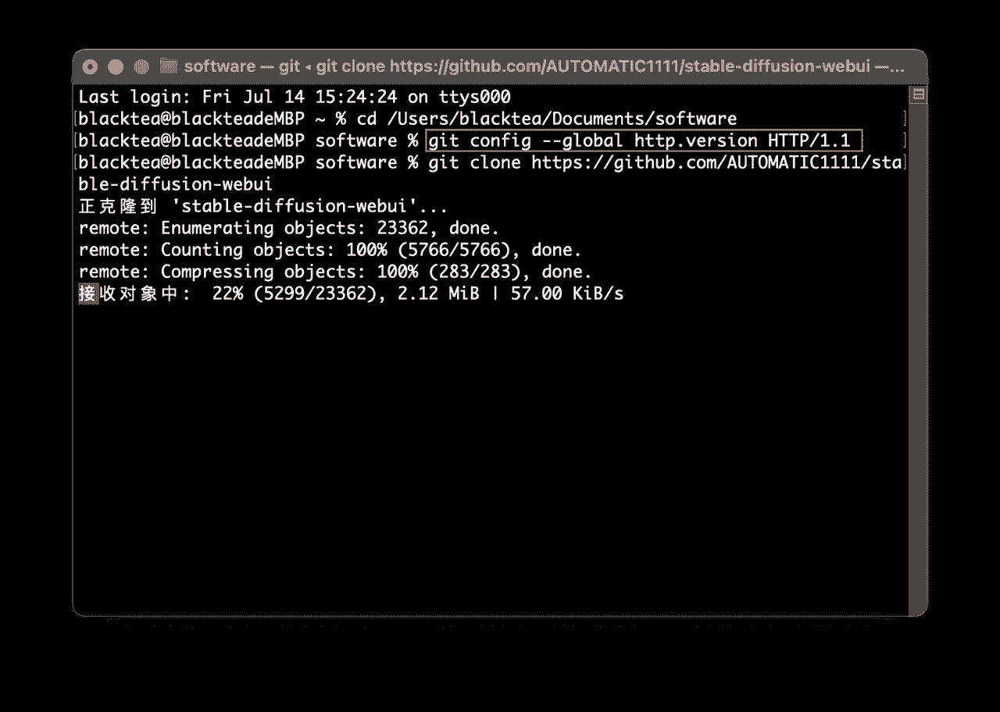

### `Couldn't install torch.`

在执行完 `./webui.sh` 后报 `RuntimeError: Couldn't install torch.`

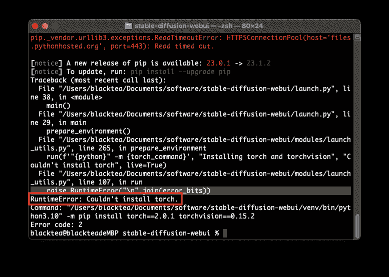

完整错误如下：

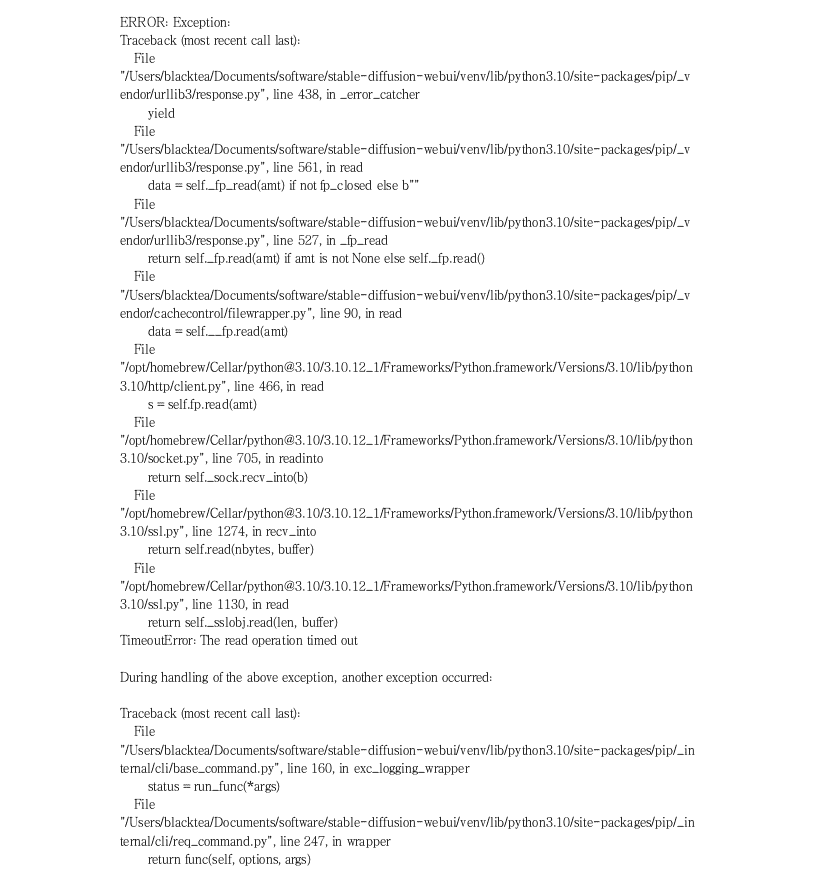

[`torch_err.txt`](https://internal-api-drive-stream.feishu.cn/space/api/box/stream/download/all/Sz9pbBVYIor3cBx2p55cOYHpniJ)

在 `modules/launch_utils.py` 中看到了这段注释：

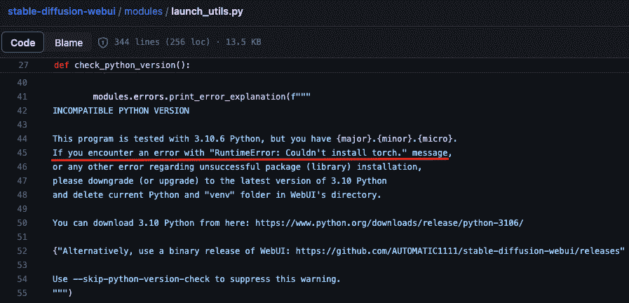

这段注释是说，如果遇到了 `RuntimeError: Couldn't install torch.` 或者其他问题，可能是 Python 版本的问题，升级或者降级到 `Python 3.10` 的最新版本，然后删掉 WebUI 目录下的 `venv` 目录再重试。

但是上面我们明明执行过 `brew install cmake protobuf rust python@3.10 git wget` 这个命令，其中安装了 `Python 3.10` 呀。按理说不应该呀。

怀着怀疑的态度我在命令行里输入 `python3 -V` 进行查看。

咦，一看不得了，这版本咋是 `3.9.6`？

这个 `3.9` 的 `Python` 版本，应该是 Mac 自带的 `Python`。可能就是因为这个原因导致启动时下载库出错。


# 四、安装与配置

## 4.4 Python 环境安装

于是又从 [Python 官网](https://www.python.org/downloads/macos/) 下载了 Python 3.10.10 这个版本。按提示傻瓜式安装就好了。之后还配置了一下环境变量。

```
# 编辑 ~/.bash_profile
vim ~/.bash_profile
```

```
PATH="/opt/homebrew/bin/:${PATH}"
export PATH=${PATH}
alias python="/opt/homebrew/bin/python3.10"
```

```
# 使配置生效
source ~/.bash_profile
```

这时版本就成 3.10.10 了。

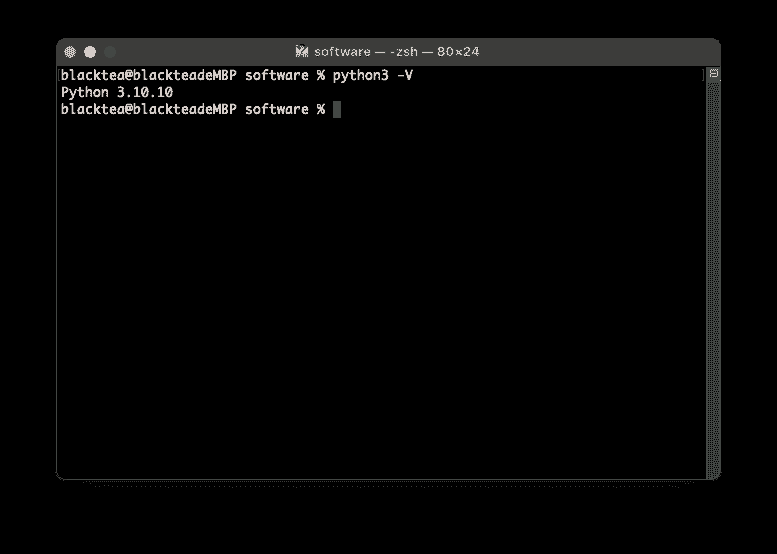

然后删掉 WebUI 目录下的 `venv` 目录，再执行 `./webui.sh`，终于不报错了！就是下的有些慢～

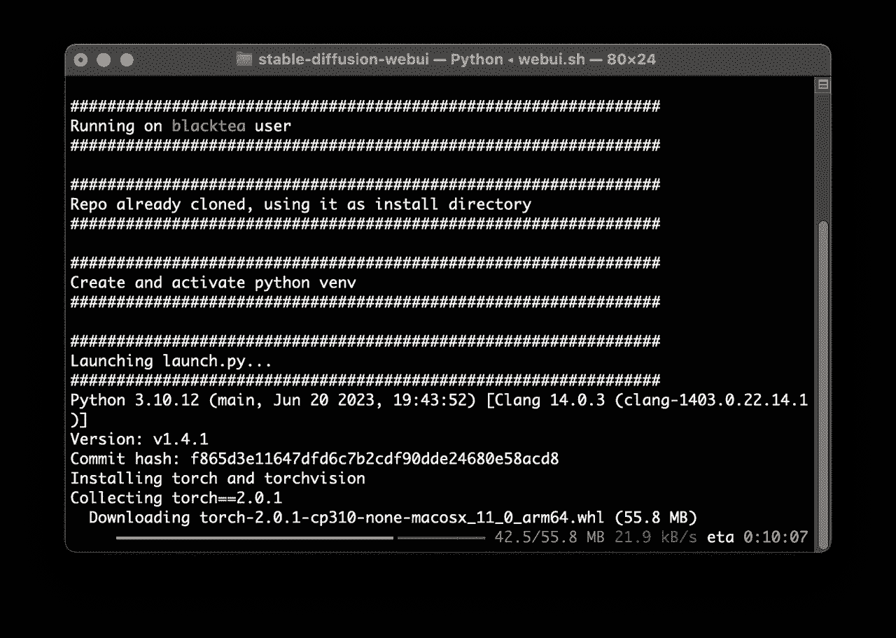

## 4.5 常见依赖安装失败

### Couldn't install gfpgan

在执行完 `./webui.sh` 后报 `RuntimeError: Couldn't install gfpgan.`

完整错误如下：

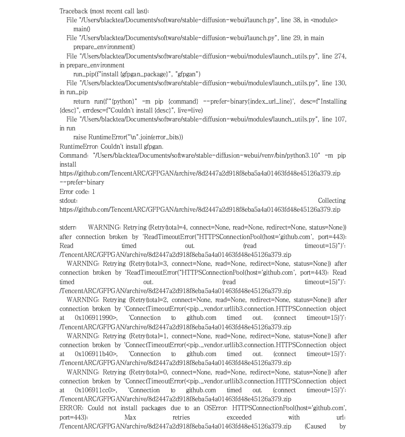

[`gfpgan_err.txt`](https://internal-api-drive-stream.feishu.cn/space/api/box/stream/download/all/Ksb8bLLSfoABUTxfHJ0czXBhnTd)

其实是因为没有下载下来 `gfpgan`。我们可以从报错信息中找到下载链接，如下图中横线部分，然后 copy 这个链接到浏览器中进行下载，然后将下载好的 zip 文件加压，并将目录名改成 `GFPGAN`，然后拖到 `stable-diffusion-webui` 这个目录下就好了。当再次执行 `./webui.sh` 时，发现已经跨过 `GFPGAN`，继续下载其他依赖了。完美解决！

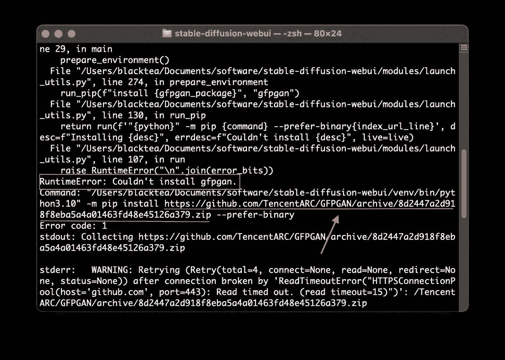

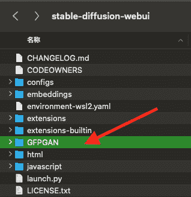

### Couldn't install clip

在执行完 `./webui.sh` 后报 `RuntimeError: Couldn't install clip.`

完整错误如下：

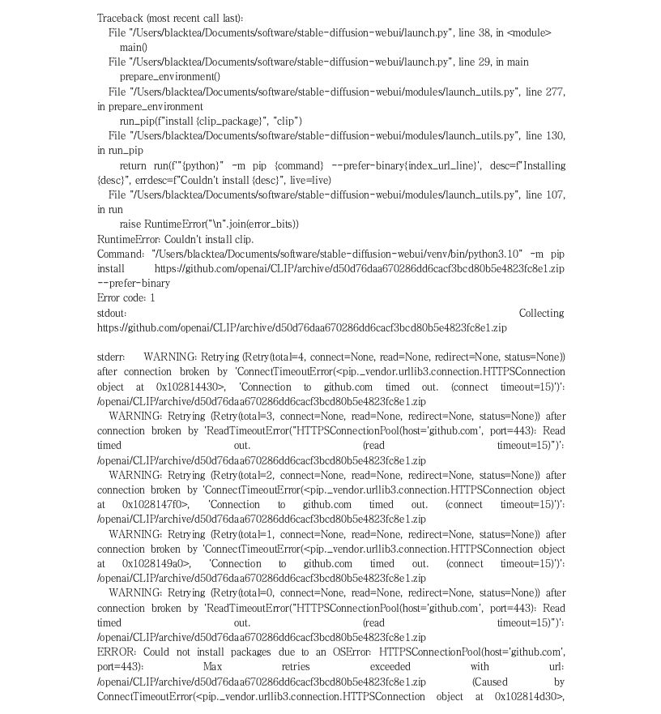

[`clip_err.txt`](https://internal-api-drive-stream.feishu.cn/space/api/box/stream/download/all/H5hvbmkvFoG9JwxyMKecUAh9npf)

可以手动下载后安装，就像解决 `Couldn't install gfpgan` 这个问题一样。但是这里我们换一种解决方式。

打开 `modules/launch_utils.py`，搜索 `https://github.com/`，每一处前面都加上 `https://ghproxy.com/`，加完后是这样的 `https://ghproxy.com/https://github.com/xxxxx`，如下图。

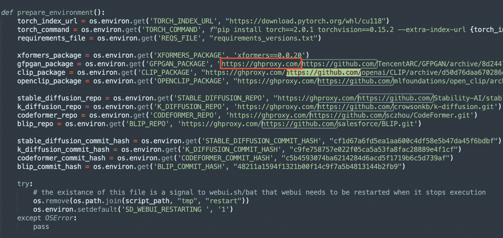

一共是 7 处，修改完成后保存。再执行 `./webui.sh`，就没有问题了。

> 思考一下：为什么这里不用上面解决 gfpgan 的手动下载的方式呢？

看上图 `prepare_environment()` 这个方法！

在这个方法里，一共定义了 7 处下载地址，如果不用添加代理的方式，大概率接下来在下载 `K-diffusion`、`CodeFormer`、`BLIP` 的时候，也是会报错的。所以这里一起改掉，万事大吉！

这种方法也可以解决以下报错：

`Couldn't install K-diffusion`

`Couldn't install CodeFormer`

`Couldn't install BLIP`

## 4.6 Couldn't install K-diffusion

见 4.5 解决方法。

## 4.7 Couldn't install CodeFormer

见 4.5 解决方法。

## 4.8 Couldn't install BLIP

见 4.5 解决方法。

## 4.9 不显示 VAE 模型、CLIP 终止层数

WebUI 起来了之后，发现貌似少了一些东西。这是起来的画面：

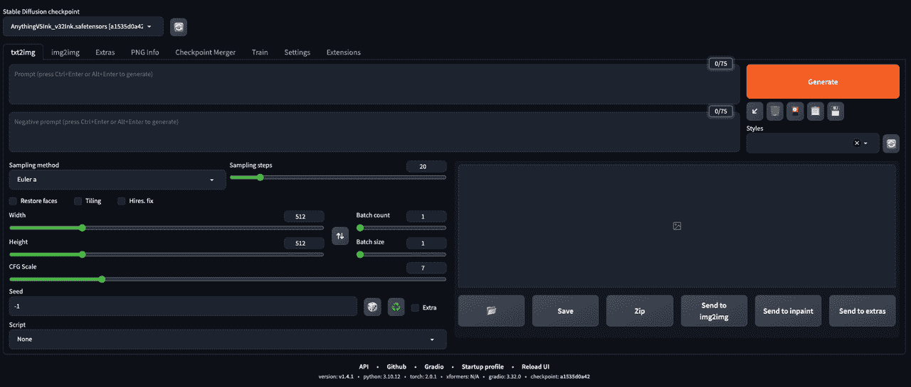

Windows 的小伙伴用秋叶大佬或者星空大佬的部署包起来之后，可比这个丰富多了。比如外挂 `VAE` 模型、`CLIP` 终止层数等。

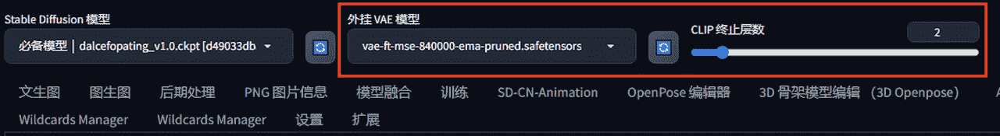

别急，Windows 小伙伴有的，咱们 Mac 小伙伴也都要有！

这就开搞！很简单，一分钟迅速解决！

选择 `Settings`

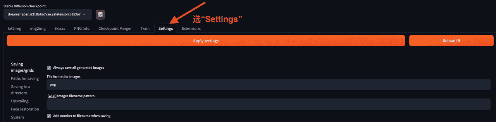

拖到最下面会看到 `Show all pages`

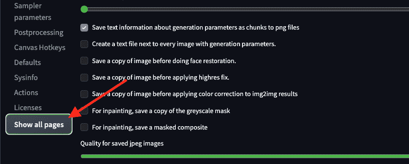

配置比较多，不太容易找。所以在浏览器中搜 `quick`，会定位到 `Quicksettings list` 这一配置。在这一栏中，目前只有 `sd_model_checkpoint`，也就是大模型，所以在我们的界面上只有大模型的下拉框。

如果已经汉化了，就在浏览器中搜 `快捷`，会定位到 `快捷设置列表` 这一配置。

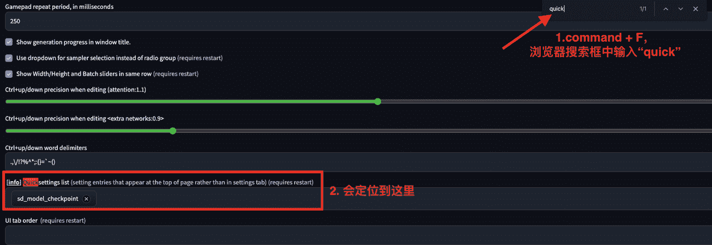

在 `Quicksettings list` 里再添加两项：`sd_vae`、`CLIP_stop_at_last_layers`

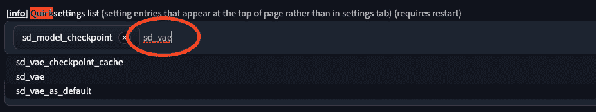

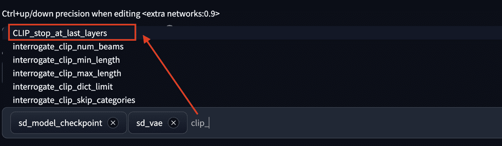

加好后点 `Apply settings`，再点击 `Reload UI`。

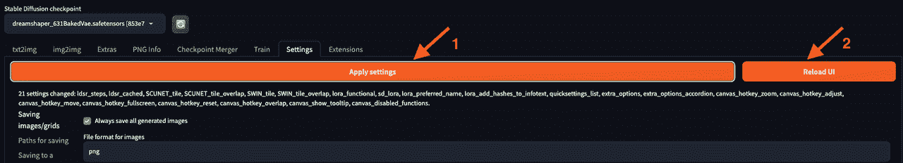

发现 `VAE`、`Clip skip` 已经显示在 Stable Diffusion WebUI 上了。

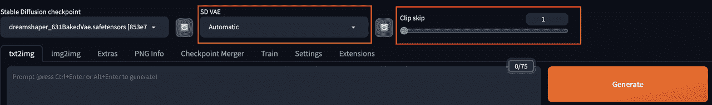

# 五、性能测试

出图效率简单记录了一下，大家可以做一个大致的参考~

> 大模型：`dreamshaper`

> `Euler`：出一张 512 * 512 的图，约 20 ~ 30 s

> `DPM++ SDE Karras`：出一张 512 * 512 的图，约 1 ~ 1.5 min

# 六、结束语

Stable Diffusion 本地部署相对于云部署，最大的两个优点就是：

**更自由（懂的都懂）！**

**不花钱，完全免费！**

Kaggle 虽然每月可白嫖 30 个小时的算力，但太容易被封，稍微画得上头一些，就被封了。我的账号就被祭了。

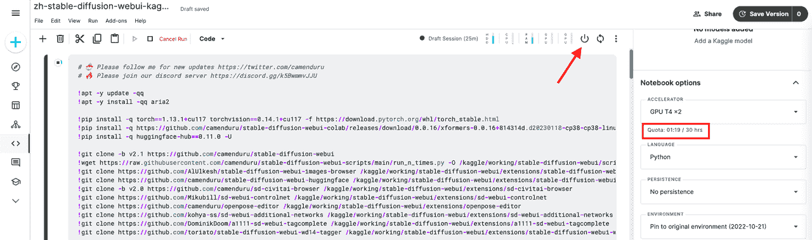

Kaggle 被封后，又转战到了 AutoDL，用小潘大佬的镜像，安装部署贼简单。而且相比于 Kaggle 来说，不那么容易被封，但是租实例需要花钱。大部分机器实例在 1～2 元 / 小时，也不算贵，但是用完后一旦忘记给实例关机，一天几十就出去了。

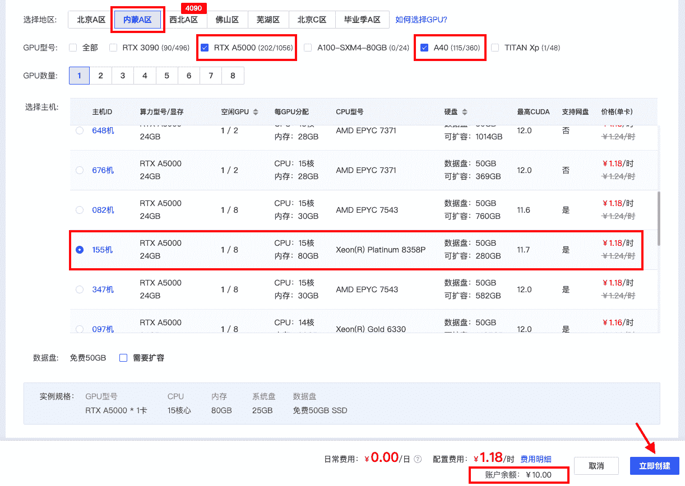


所以这周，一顿操作猛如虎，终于在 Mac 上成功部署了 Stable Diffusion，实现了 Stable Diffusion 自由！也将所有踩过的坑，一一填平并记录了下来。希望可以帮到想在 Mac 上部署 Stable Diffusion 的同学。

其实在 Mac 本地部署 Stable Diffusion 遇到的大部分问题，基本都是网络造成的。每个人的电脑配置及网络环境都不一样，所以有时会遇到试了好几个解决方案都无法解决的情况。其实我也是！网友说他这么改成功了，而我那么改，依然不起作用。

> 所以最后想对大家说的是，耐心一点，再耐心一点，方法总是有的，问题总会解决。

> 这里也贴出另外两位圈友之前写的 Mac 本地部署 Stable Diffusion 的经验分享，写的也是非常详细。如果大家没有在这篇文章中找到某个问题的解决办法，可以去看看下面这两篇：

>

> 星辰大海：各种设备上安装 Stable Diffusion（https://t.zsxq.com/106N3nhS7）

>

> AX.墨墨：Mac部署 Stable Diffusion，含报错整理以及用 GPT 解决问题的思路（https://t.zsxq.com/10pLgGSUR）

大家加油！也希望这篇教程可以真的帮到大家啦！
