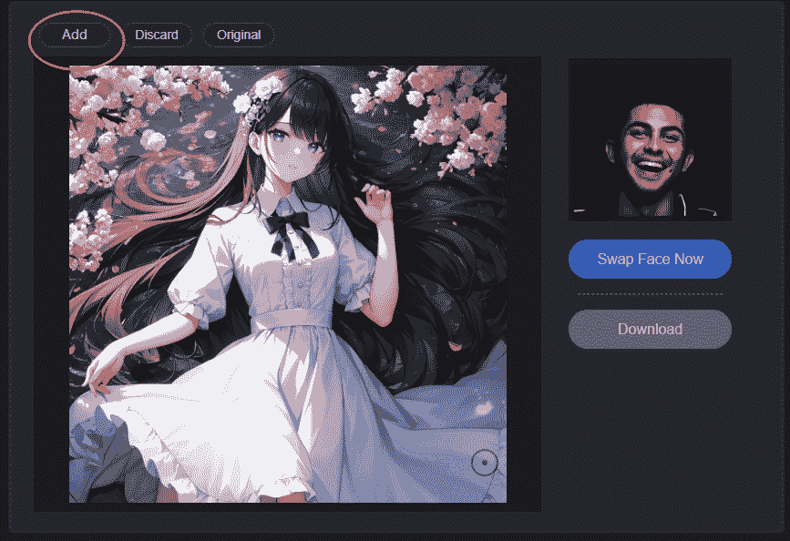
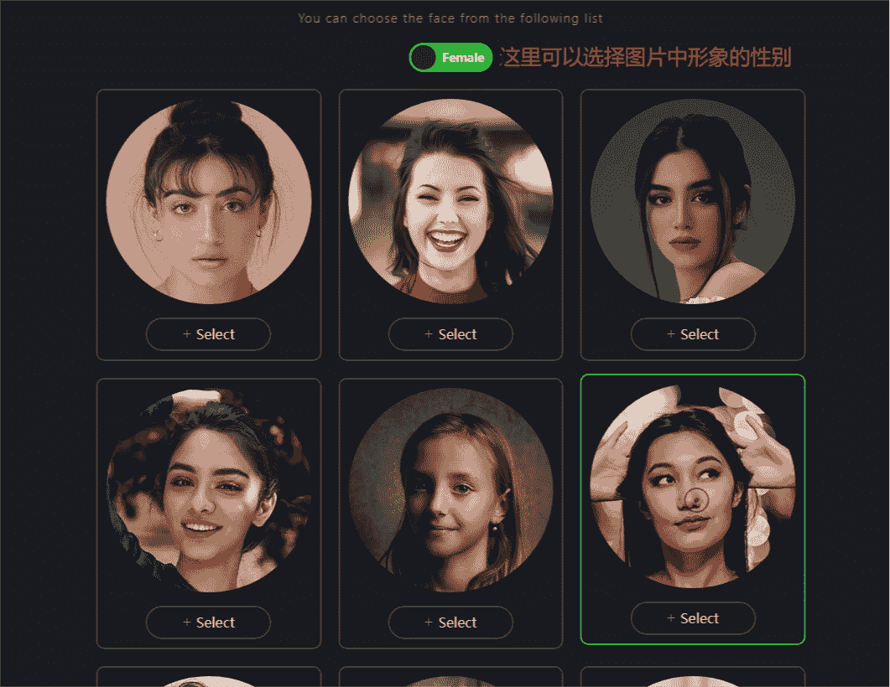
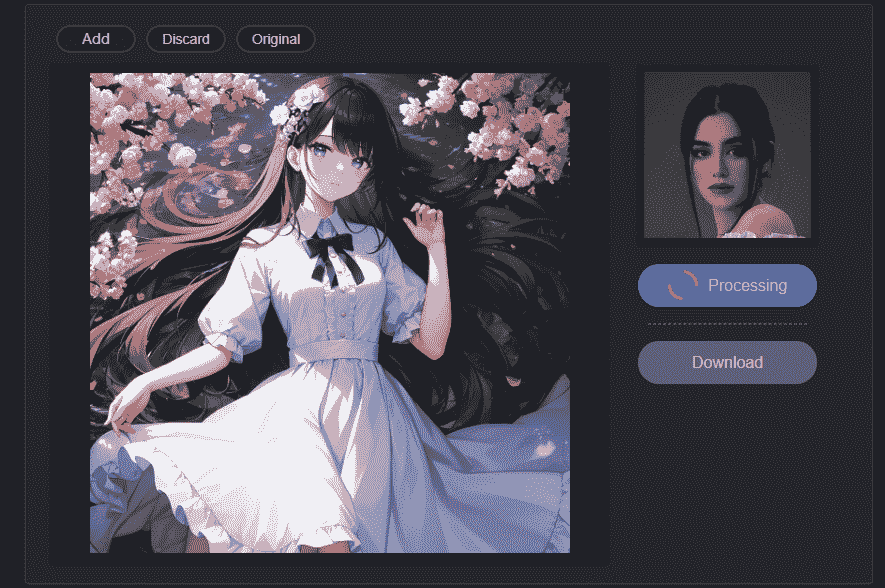
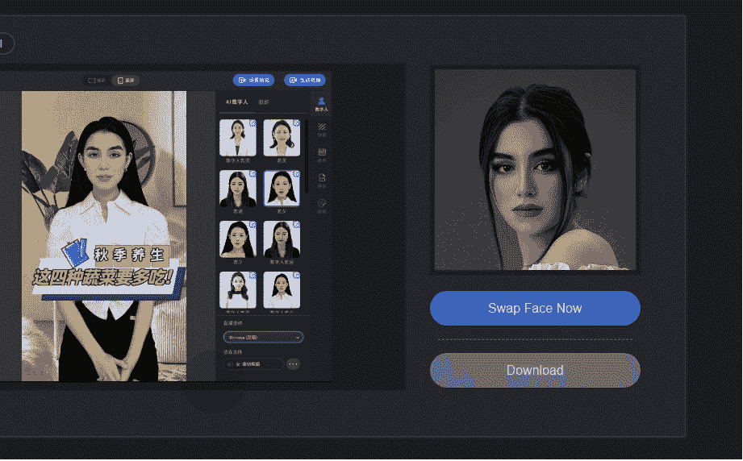
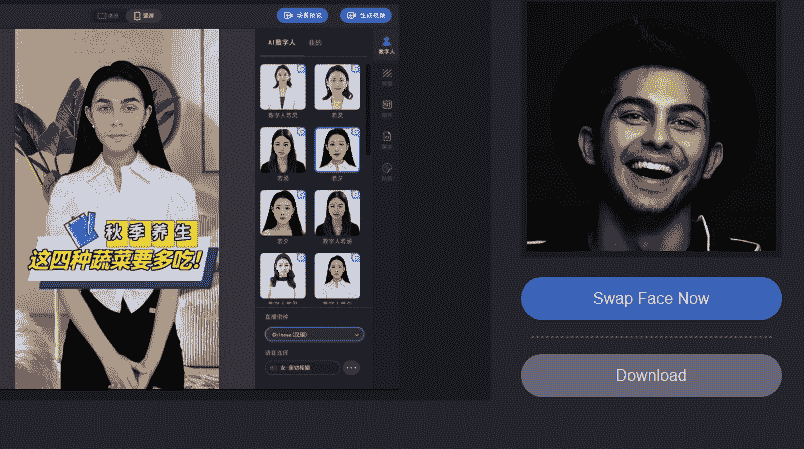

# 2023-07-06AI图片换脸教程 使用faceswep实现AI一键换脸

> 来源：[https://xuqiwei1986.feishu.cn/docx/OLIwdkVKNoIgiCxwnancK2g2n4b](https://xuqiwei1986.feishu.cn/docx/OLIwdkVKNoIgiCxwnancK2g2n4b)

> 🔗 原文链接： h[ttps://mp.weixin.q](https://mp.weixin.qq.com/s/OFgN8dyIcRxJh_6vu61u1Q)q.com/s/OFgN8dyI...

>

2023-07-06 13:23:25

精确发文时间由壹伴提供

2023-07-06 13:23 发表于 湖北

手机阅读

在 AI 盛行的当下，越来越多的人工智能产品被制造了出来。其中的 AI 智能换脸技术在当下可谓是火遍全网，许多博主都在展示手机端上的一键换脸具体操作步骤。但如果是在电脑上呢？又应该如何操作 AI 换脸呢？小编苦苦搜寻，终于为大家找到了在 PC 端上进行 AI 换脸的方法步骤。

1. 打开 faceswap （即智能换脸）网页

2. 准备你想要进行换脸的图片

在换脸时可以选择任意图片进行换脸，小编这张照片就是一张由 AI 软件进行合成的人物图，换脸之后看看效果如何。（如果追求效果的话最好选择真人图片）

3. 点击 add ，将你想要换脸的图片添加进去

4. 在页面下方可以选择人脸进行替换（既有系统提供的人脸替换也可以自己上传图片进行换脸）

小编在这里选择的是系统自带的人像进行换脸（系统图像还贴心设置了男女，能够让 AI 一键换脸更加准确）这里小编就随机选择几个人像进行换脸测试。（点击 select 键就可以选择人像作为换脸源）

5. 点击 swap face now ，即刻开始换脸

大概要等待 30 秒左右才能够看到换脸后的成果，请耐心等待。

6. 换脸成功，一起来看看成果如何

最后的成果看起来还是不错的，就适合原图的适配度有点低，但是基本还是可以看出换脸的不同点。怎么样，要不要尝试一下一键 AI 换脸。

以上就是换脸的所有步骤了， AI 换脸其实并不是很难，不是吗？不过以上换脸的成果还有待加强，希望以后能够看到更成熟的换脸技术。换脸的对象也可以更加多样（因为现在的换脸大多数还是以人像为主），当然最重要的还是提高 AI 换脸后和原图片的适配程度，以上的换脸结果还是有待改进。