# AI赛博训练营手册

> 来源：[https://xuqiwei1986.feishu.cn/docx/DaS4dGu5novJxNxmQvdcwli6nrh](https://xuqiwei1986.feishu.cn/docx/DaS4dGu5novJxNxmQvdcwli6nrh)

学习部分分为五个板块：资料、视频教程、网盘链接、路线图

问题部分分为六个板块：账号、出图、内容、引流、变现、SD

# 学习部分

## 1.**资料**

SD基础：[《Stable Diffusion终极宝典》](https://ry5hwpuf7b.feishu.cn/docx/HYrZdLBMRorB0qxKqFFcQ075nWf)

ControlNet基础：[《ControlNet终极攻略》](https://ry5hwpuf7b.feishu.cn/docx/NeqIdWC9PovqQ6xruAJcErqHnxc)

AI赛博机车图文字教程：[《AI赛博机车图异常值》](https://ry5hwpuf7b.feishu.cn/docx/WZxLdRYwZoX7kpxtH7qcCmMFnne)

## 2.**视频教程**

[AI赛博教程第一课.mp4](https://internal-api-drive-stream.feishu.cn/space/api/box/stream/download/all/Bo36bSfHboq1fyxRyTVcEKaKnSe)

第一课内容：完整跑一遍流程 + 宽高比插件安装 + 图片高清讲解（图片高清很重要，没看的这部分要看一下）

[AI赛博教程第二课.mp4](https://internal-api-drive-stream.feishu.cn/space/api/box/stream/download/all/I4I7bL5sXoeLqaxJ4rwcO8t2nsh)

第二课内容：PNG信息提取 + 提示词讲解 + 爆款内容分析 + 图片素材获取 +创新内容思路（这节课很重要，大家要记得看一下）

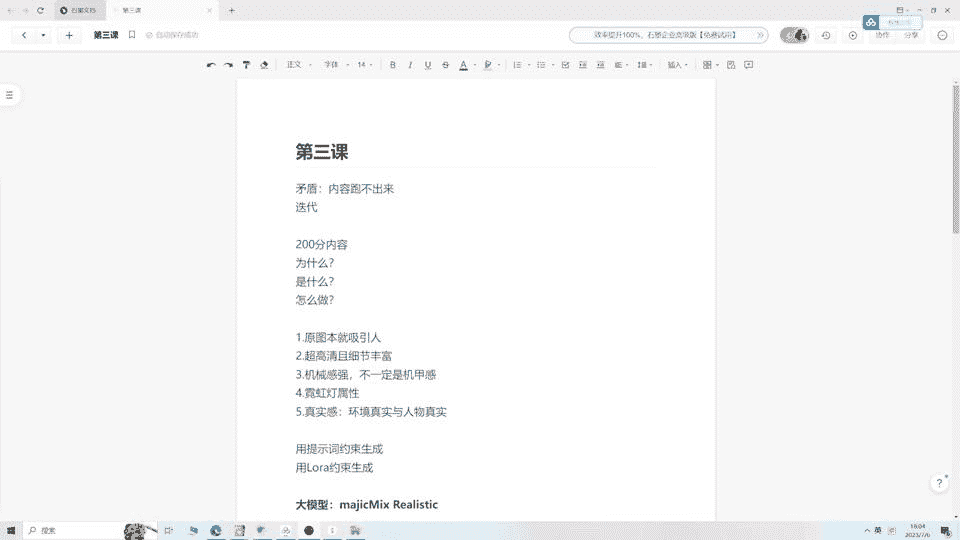

[AI赛博教程第三课.mp4](https://internal-api-drive-stream.feishu.cn/space/api/box/stream/download/all/Sln2bbMEloRSGVx2E9gcjH0XnIf)

第三课内容：如何做出200分内容！（这节课把现有的出图风格迭代了，一定要看！）

**后续待更新**

## 3.**网盘链接**

百度云大模型、ControlNet模型：https://pan.baidu.com/s/1baNTCe9wGEN0sHYPvRabmA?pwd=wdz6

提取码：wdz6

## 4.路线图

# 一、账号问题

## 1.老账号能不能用？新账号需要养号嘛？以前发过视频有没有影响？以前视频需要删掉还是隐藏？等等这些账号问题

一句话回答完：只要账号没有违规过，不管什么账号都可以发，绝大概率情况下不会出问题，万一出问题了你换个新号发不就解决了嘛

**因为你不是做**1-2天，是做半个月以上，意味着至少10-20期视频。在内容质量是好的情况下，一个账号不可能一点效果都看不到。如果看不到，内容又没问题，就是账号问题了。这时候再换个新号，原账号视频删掉，换新账号再发即可

绝大多数数据不行都不是账号问题，而是内容问题（得从观众视角去判断，这个内容是不是他们真的会看的）

只有说你发了10条内容左右了，数据还是在1-99两位数之间徘徊的，那就是账号不行，换个账号即可

完全全新注册的账号，可以稍微养养号：用流量数据模式，刷1-2天抖音，让账号看起来像个正常人就可以

以前发过的无关的视频，隐藏和删掉都可以，不隐藏也没大问题，隐藏会给观众看起来定位清晰一点

## 2.账号主页怎么包装

参考破局圈友【刘驴】驴哥团队的简介

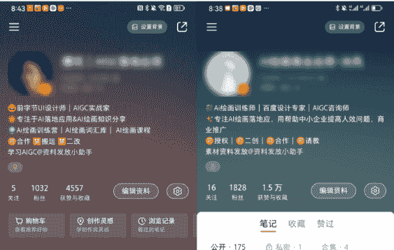

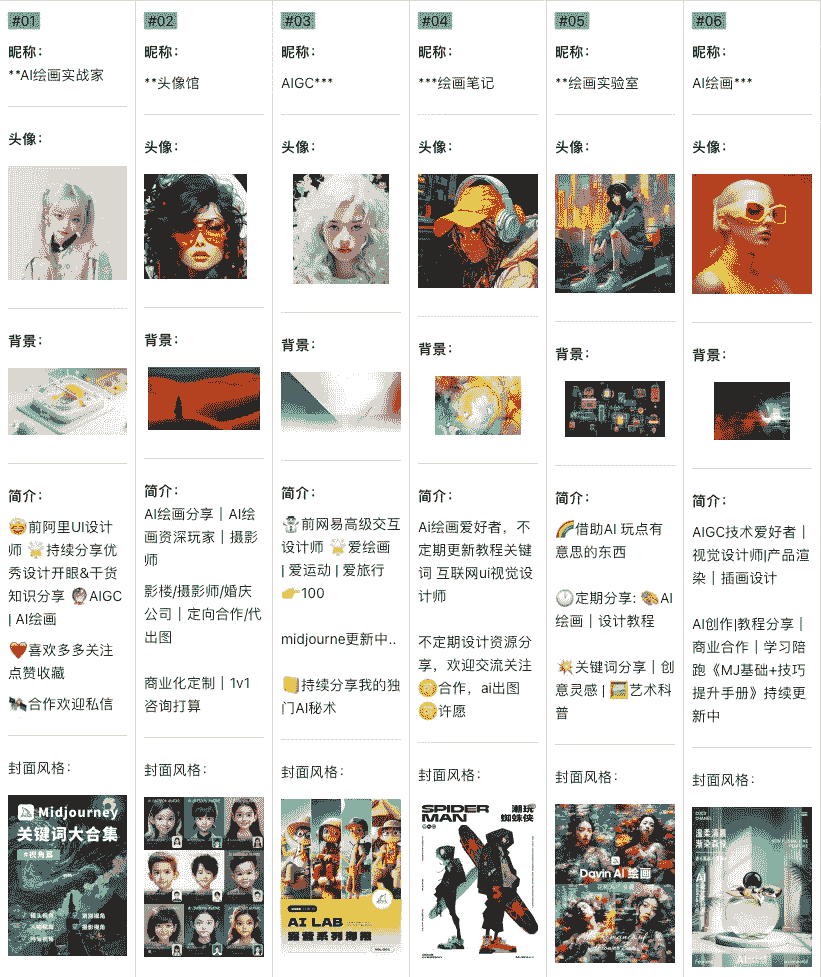

①头像元素尽量少，让小图时也能看清即可

②壁纸清晰可见

③名称不要太营销属性即可

④简介例子：

⭐️AI探索家｜机车爱好者

🉑️制作｜学习｜合作

## 3.视频需要同步什么平台？

抖音、📕、视频号，这三个平台比较合适

建议选择一个平台专心运营最好，其他平台可以同步分发，但不放过多精力

## 4.视频发布多久才有流量？

不要去纠结于刚开始发1-2期的流量，一天做个3-5期，先发个10期等几天再看看

把重心和精力放在怎么让你的内容更好上，这才是最重要的

# 二、出图问题

## 1.是关键词、大模型、ControlNet完全照抄就可以了吗？

不是，现有提供的只是为了给大家快速的入门，至少你能实现出AI赛博的风格出来了

因为每一张原图的不一样的，如果想做出真正好看，适配的AI赛博图，需要自己去多多测试

不同的关键词、大模型、ControlNet都会出来不一样的效果，自己多去试一下，才能更深刻感受到每一种的区别在哪里，之后才能更好的迭代

## 2.用文生图还是图生图？

都可以，最好的答案是都试试

## 3.出来的图片和上传的没有半毛钱关系，以及用不了ControlNet

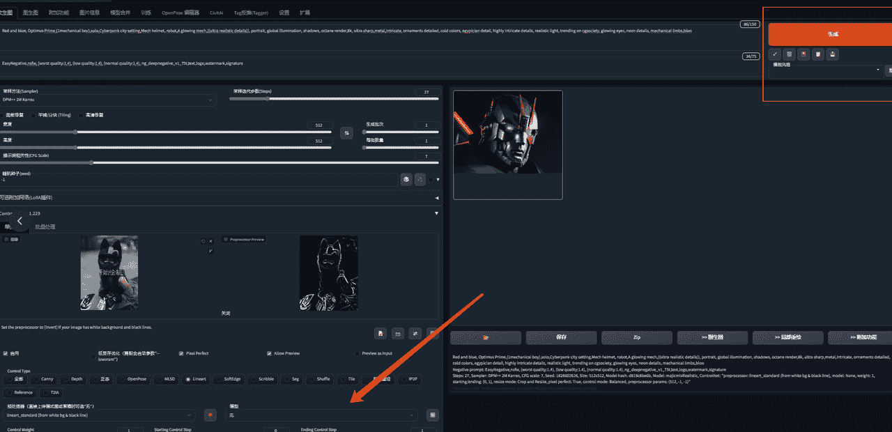

虽然有ControlNet，但是没有装ControlNet的模型，需要把模型和预处理器都装上

## 4.Lora使用方法

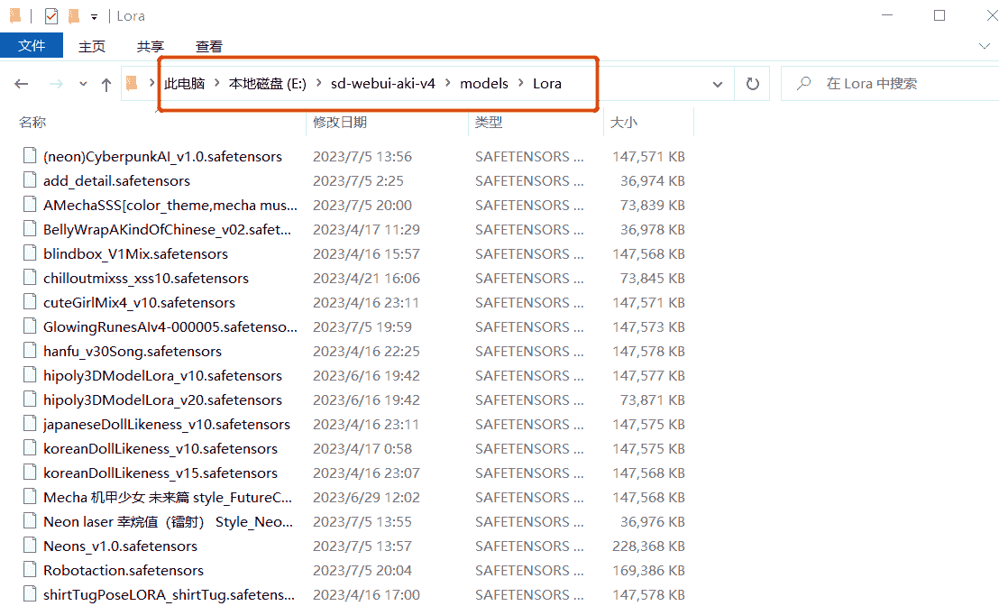

①放到这个文件夹里

②web ui里点击这个📕

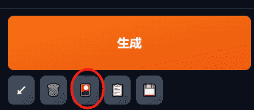

③点击刷新，就可以用Lora了

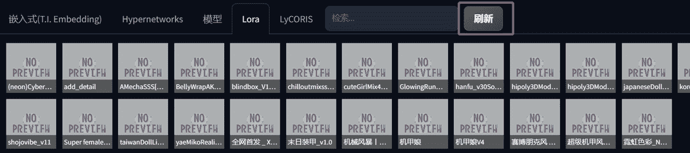

提示词里：<lora:GlowingRunesAIv4:1>

注意最后这个1的参数可以调节，过强了就调成0.5，弱了就1.3，<lora:GlowingRunesAIv4:1.3>

## 5.出的头盔图露脸怎么办？

试试头盔护目镜这个词

# 三、内容问题

## 1.什么内容是好内容

## 2.如何选素材？

## 3.为什么【一秒出镜】剪映模板自动生成漫画风了？

因为有很多个一秒出镜模板，有一些是用了配套的“AI生成”的，会自动生成机甲漫画风

需要找到没有带“AI生成”的一秒出镜模板就可以用了

## 4.剪映模板都已经能一件生成了，这个项目是不是就没有门槛了？

不是，你用过剪映生成就知道出来的图有多离谱，完全达不到内容的成分，用户也不会为此买单

对比一下原图、剪映、SD，应该能看出来吧hh

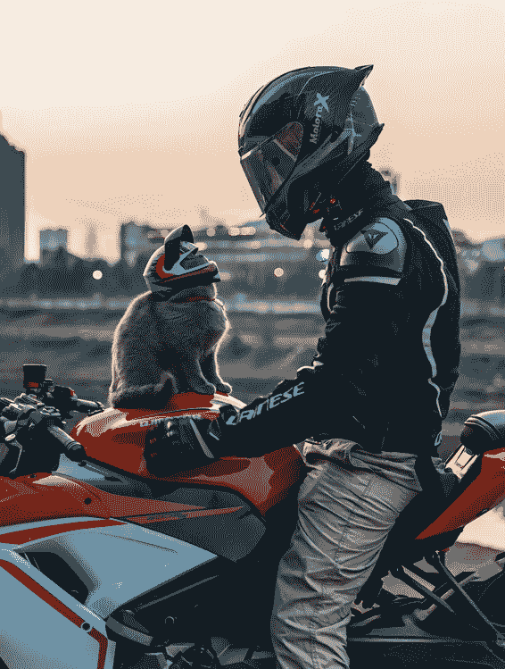

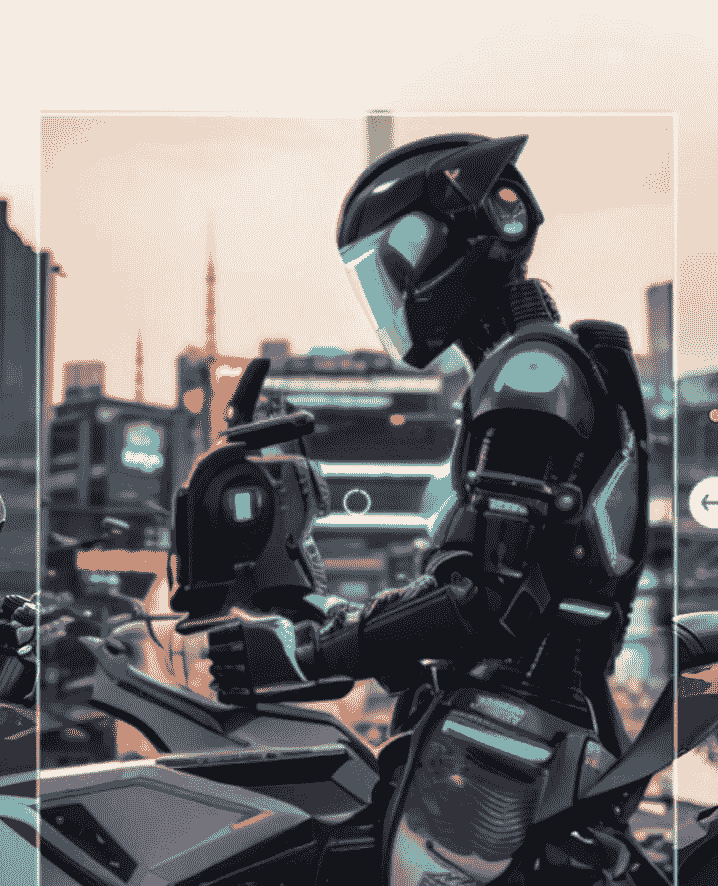

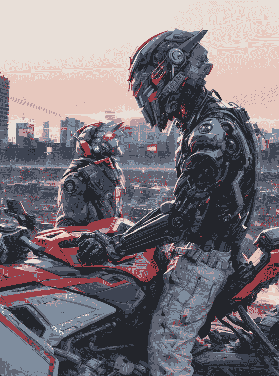

## 5.剪映模板有推荐的吗？

①一秒出镜全框版

> 剪映，轻而易剪新的故事 夏天和你｜#玩法 #界面 https://lv.ulikecam.com/activity/lv/sharevideo?template_id=7249025953911950604&sec_uid=MS4wLjABAAAAkR2OxCv1nxHPiWsHeci6Brf9-TtY-c6u8OWMxDQFcNt34oN_-AaRoEuO1LEdjdaY 复制此链接，打开【剪映】，热门视频抢先剪

②一秒出镜小框版

> 剪映，轻而易剪导入两张同场景照片，第一张可以是一个人，第二张两个人｜#一秒出镜挑战 #卡点 https://lv.ulikecam.com/activity/lv/sharevideo?template_id=7053036033767640331&sec_uid=MS4wLjABAAAAkR2OxCv1nxHPiWsHeci6Brf9-TtY-c6u8OWMxDQFcNt34oN_-AaRoEuO1LEdjdaY 复制此链接，打开【剪映】，热门视频抢先剪

③压迫感拉镜横屏版

> 剪映，轻而易剪女子桀骜起来 亦可扫六合 主天下 | 犯我中华者虽远必诛#压迫感 #关键帧 #卡点 #滤镜 https://lv.ulikecam.com/activity/lv/sharevideo?template_id=7235896419435957564&sec_uid=MS4wLjABAAAAkR2OxCv1nxHPiWsHeci6Brf9-TtY-c6u8OWMxDQFcNt34oN_-AaRoEuO1LEdjdaY 复制此链接，打开【剪映】，热门视频抢先剪

④压迫感拉镜竖屏版

> 剪映，轻而易剪可惜梅花各心事 南枝向暖北枝寒 | 关键帧拉镜#王者 #滤镜 #王者荣耀 #关键帧 #压迫感 https://lv.ulikecam.com/activity/lv/sharevideo?template_id=7235264616488553785&sec_uid=MS4wLjABAAAAkR2OxCv1nxHPiWsHeci6Brf9-TtY-c6u8OWMxDQFcNt34oN_-AaRoEuO1LEdjdaY 复制此链接，打开【剪映】，热门视频抢先剪

## 6.抖音📕如何无水印下载视频或者图文

🛰️小程序搜索“去水印助手无损”，每天看一次广告可以无限下载

有其他工具也欢迎推荐

# 四、引流问题

## 1.怎么引流，引流有哪些方式？

注意！

### **1）群聊引流**

抖音或者📕都可以建群聊，通过群公告、群消息、小卡片来引流

抖音群聊直播一次就可以创建，不过直播需要实名，然后1万粉才能显示在主页

📕群聊都可以创建，点击底部“消息”，右上角＋号，即可创建群聊

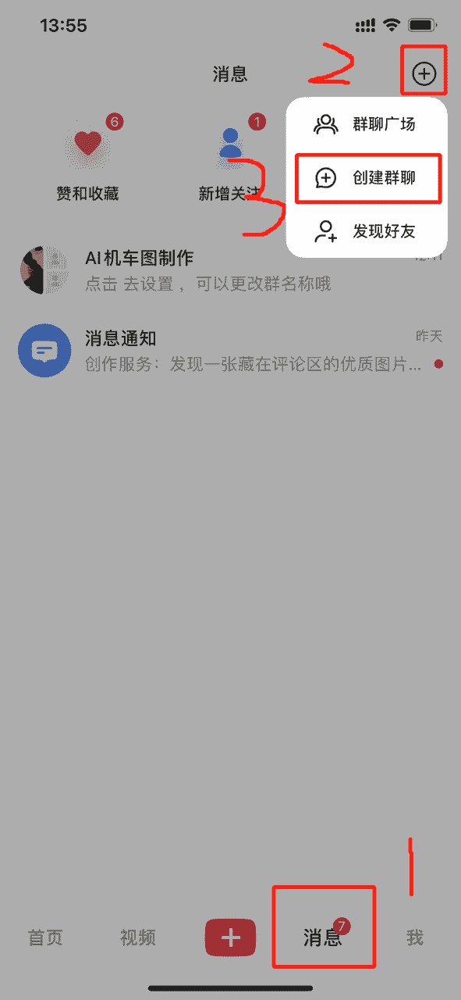

### **2）简介小号引流**

主页艾特小号账号，小号置顶图文联系方式

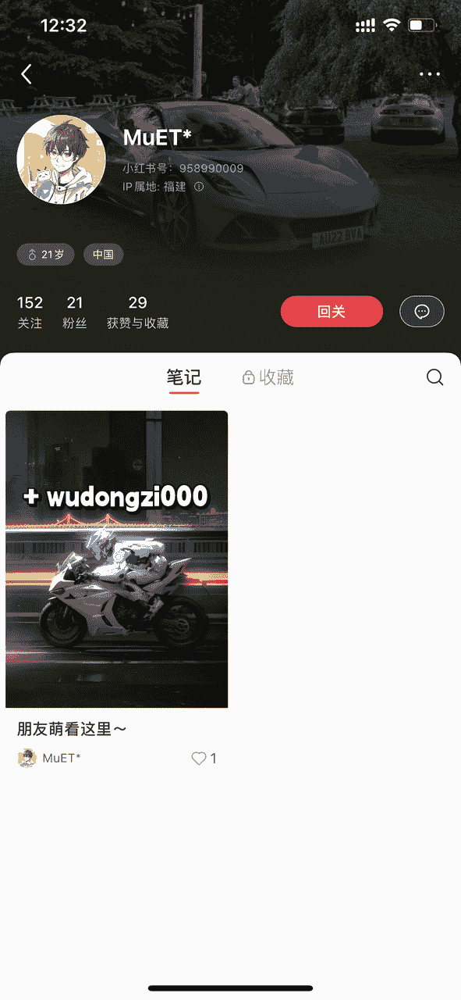

### **3）直播引流**

通过直播现场做图片，有观众的话可以让他们加粉丝群发图，你现场做

第1单免费，第2单收费

或者第1单免费，要拿高清图加V进私域

需要注意自己电脑配置能不能支持“直播+SD生图”

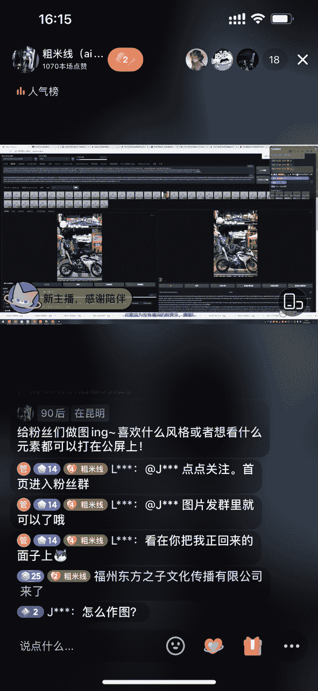

## 2.引流话术

①可参考破局圈友【大东】的话术，说得非常好，既不得罪客户，又把付费意思表达了

> 但引流方式尽量换一个，直接发🛰️的话风险有点大

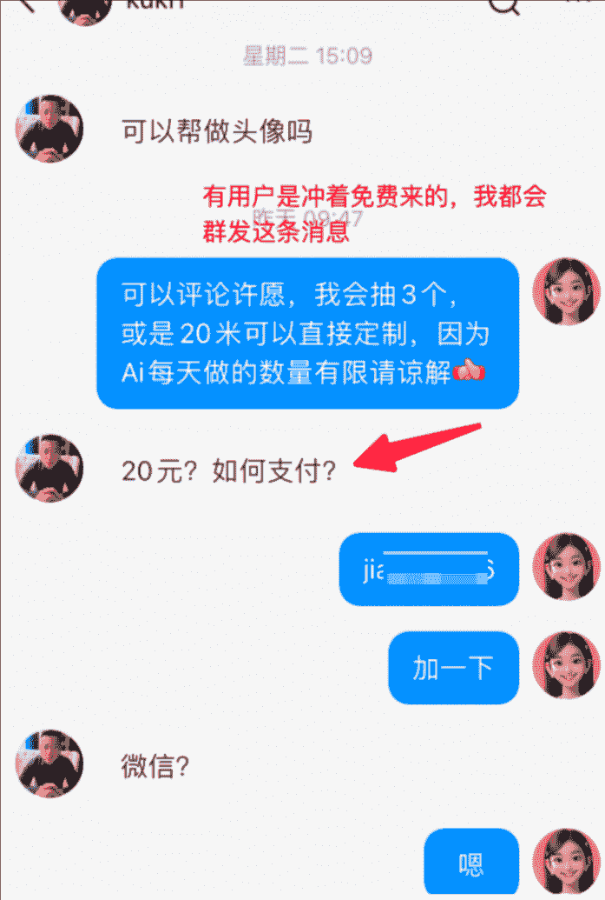

②圈友【sky陈天】的话术，把情况都阐明了

> 这种发图的方式比较容易形成成交，但被检测到的概率也会大一些，前期小小引流可以，后期建议还是用更隐蔽的方式

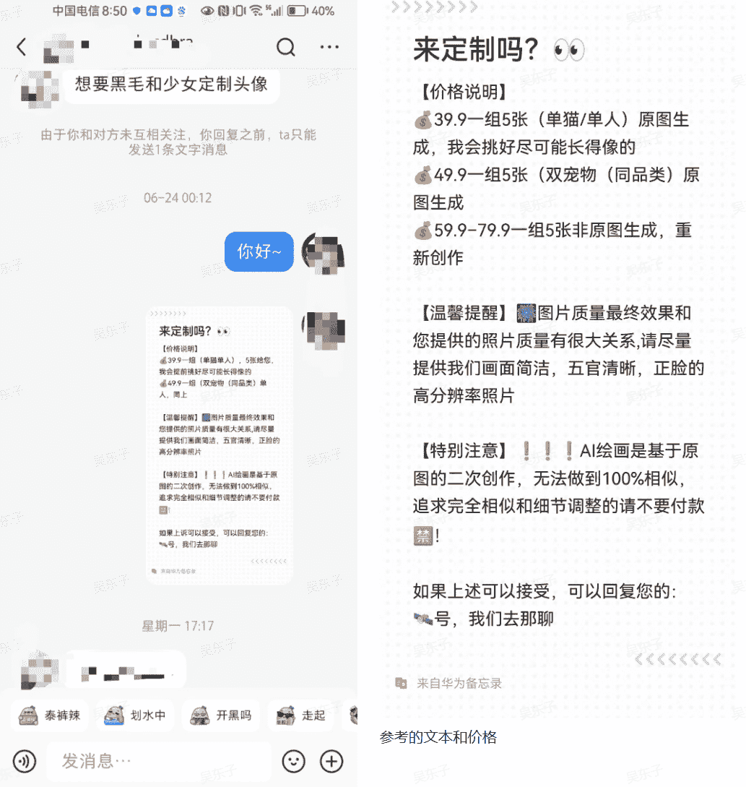

# 五、变现问题

## 1.怎么去定价比较合适？

如果你的视频流量很大，出的图质量很高，别人认定了你这个人话，定价可以高一点，因为有议价权，99元一张都会有客户买单

如果你还在刚起号阶段，其实就有很多探索的方式了

现在就已经有3种方式了

①因为AI做的数量有限，每人限量免费一张，想要更多可以19.9直接定制

②发图可以免费排队制作，18.88可以插队

③免费做图，但是给有点模糊的图（嘴上说因为平台压缩），如果要高清原图可以加v进私域给，这样后续再去做营销

④和机车博主合作，你帮他们做，他们发共创视频带上你，这样可以吸一点流量

核心还得是靠爆款，爆款做出来了，需求就来了，到时候选择哪种变现方式都可以

## 2.如何做到超预期交付！MJ机车图

小米发家主要靠口碑传播，之前在雷军的一本书上学到“用户需要的不是性价比，而是超预期”

很多人认为，好产品就会有口碑，或者便宜的产品有口碑，或者又好又便宜的产品有口碑

如果你这么想，可能会很失望，为何你做了但是没效果。什么产品有口碑呢？最重要的是“超越用户的预期”，超过客户的心理期待，这个产品才会产生真正的口碑

同理我们做的这个机车项目虽小，但却是跑通了一个从公域做内容流量，引流转化到私域销售，的一套完整闭环，这个其实已经有点商业模式的雏形了，剩下无非是换成更高客单价的产品，或者更有效率的流量打法

所以我就想我们的AI赛博机车项目如何做到超预期，对客户来说超预期了，他可能还会复购，还会把你推荐给他的朋友，1个公域流量转进来，就可能会带来2-3个私域潜在客户，让大家慢慢感受商业的魅力

这里可以用到的工具是Midjoueny，因为MJ的特点就是简单高效，只需要输入提示词就能输出很精美的图片，不需要像SD搞这个大模型，那个ControlNet之类的

试想这样一个场景：

**你**给客户定制完SD图片，她本身很满意的收货了，这时你再给她一张专属的MJ二次元画风机车头像，又可爱又酷，她肯定就超开心了。

**即便你之前定制的SD图她如果没有特别满意，你这一通操作下来**，她也会觉得你很真诚，也会把口碑打出来！

具体怎么使用MJ这里我就不多说了，大家看我之前的文章或者网上搜一搜都有

我直接把我拆解好的提示词分享出来，大家只需要根据客户图片去描述一下翻译成英文再替换上去就可以

### 关键词拆解：

**A** little boy wears a helmet on his head and rides a motorcycle,Cute,handsome,full body, anime style, chibi,motion blur, cyberpunk,the best quality --niji 5 --s 200

> 一个小男孩头上戴着头盔，骑着摩托车，可爱，帅气，全身，动漫风格，赤壁，运动模糊，赛博朋克，最好的质量--niji 5 --s 200

加粗字体可以随意更换

### 横向思考：

**A** girl in a black jacket and a helmet rides a pink motorcycle,cute,handsome,full body, anime style, chibi,motion blur, cyberpunk,the best quality --niji 5 --s 200

> 穿着黑色夹克和头盔的女孩骑着粉色摩托车，可爱，帅气，全身，动漫风格，赤壁，运动模糊，赛博朋克，最好的品质--niji 5 --s 200

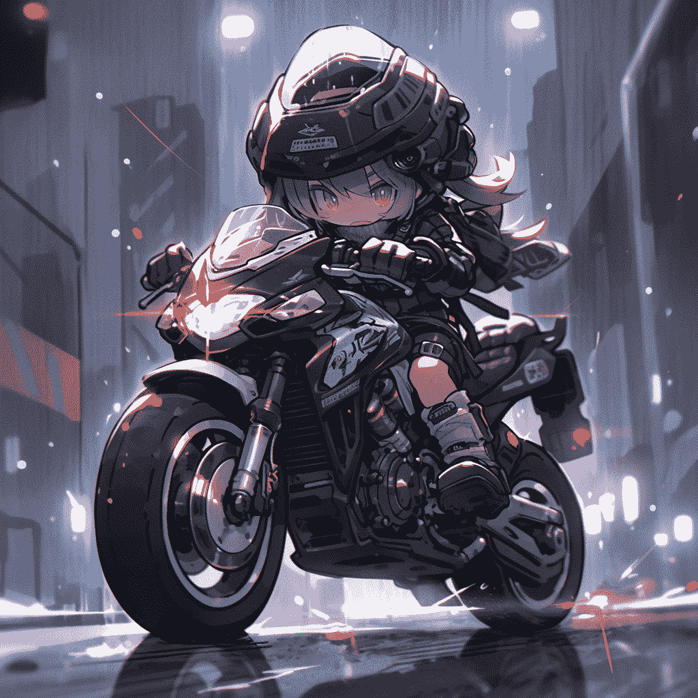

# 六、SD问题

## 1.A卡、Mac系统、配置低如何用云部署安装SD？

https://articles.zsxq.com/id_k49zpbq9db5v.html小潘老师的最新文章——用AutoDL镜像配置AI赛博朋克出图环境

> 云平台的用户全部可以看小潘老师这篇文章

破局俱乐部【小潘】的零基础搭建Stable Diffusion云平台教程

https://articles.zsxq.com/id_hctce3ujh0rv.html

https://articles.zsxq.com/id_5lugofq6vaua.html

## 2.Stable Diffusion怎么安装

①可以看我这篇文章学习，也可以网上搜索引擎搜一搜都能找到解决办法

②如果是A卡、mac系统、电脑配置低等情况，可以考虑用AutoDL云平台来操作SD

## 3.大模型怎么安装？

这里的SD根目录就是大家在下载时，存放SD的那个文件夹

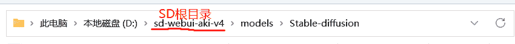

## 4.宽高比插件怎么安装？

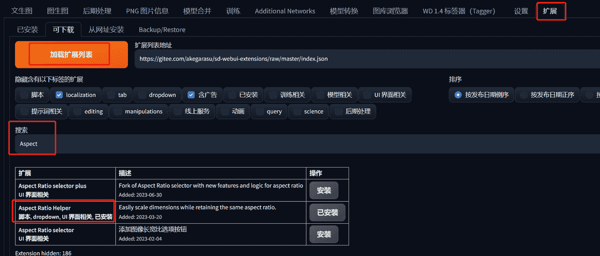

①找到【扩展】选项

②点击加载扩展列表

③搜索【Aspect】

④安装【Aspect Ratio Helper】

云平台用户也可自行安装

https://github.com/thomasasfk/sd-webui-aspect-ratio-helper.git

## 5.ControlNet怎么安装？

> [《ControlNet终极攻略》](https://ry5hwpuf7b.feishu.cn/docx/NeqIdWC9PovqQ6xruAJcErqHnxc)**o**ntrolNet的教程可以看这篇文章：

**①下载预处理器**

下载网盘里的《1.预处理器》文件夹

里面有一个“downloads”文件夹

把**整个文件夹**复制到SD的文件夹里面

**具**体位置：SD文件 > extensions > sd-webui-controlnet > annotator

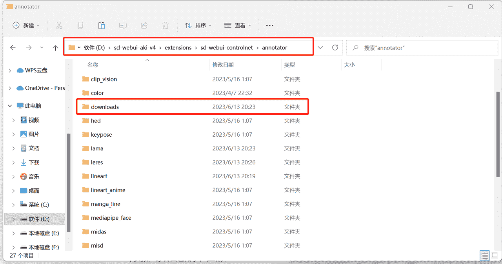

**②下载模型**

下载网盘里的《2.模型》文件夹

里面有14个模型，把这些模型复制到SD文件夹里

具体位置：SD文件 > models > ControlNet

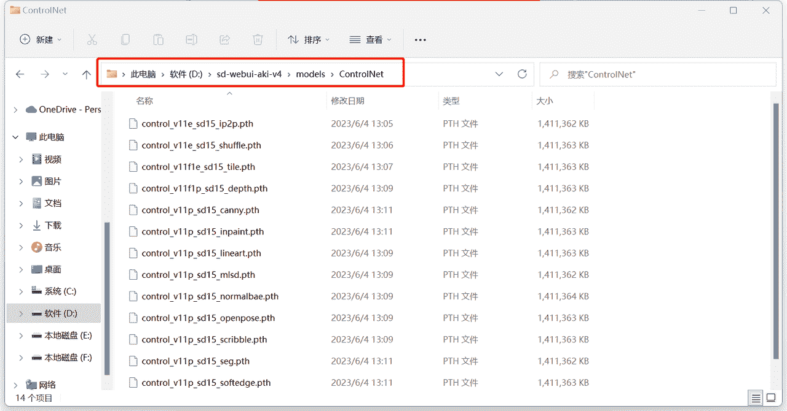

# 七、结尾

好了，以上就是我们这篇文章的全部内容

如果你对AI感兴趣的话，可以关注我的👸号：吴东子AI，也欢迎分享给你身边想学AI技术的朋友

里面有我之前发过的所有文章，之后也会持续给大家更新实用的AI干货教程

我是吴东子，用奶奶都能听懂的方式，分享可以落地实操的干货，我们下篇文章再见！