# 保姆级教程：阿里云免费服务器 5分钟搭建Stable Diffusion

> 来源：[https://xuqiwei1986.feishu.cn/docx/JHU3d7R4yoF0tkx8oDdcPxy4n7c](https://xuqiwei1986.feishu.cn/docx/JHU3d7R4yoF0tkx8oDdcPxy4n7c)

大家好，我是一个拥有8年经验的全栈开发者，安全爱好者，AI破局合伙人，AIGC探索者，创业者。

专注于AI技术的研究，擅长AI项目的解决方案和落地，同时也在运营自己的全平台自媒体。

今天，我想和大家分享一个项目：阿里云免费服务器 5分钟搭建Stable Diffusion，并看到它们在实际应用中的效果。

# 白嫖300多小时，V100， A10显卡 随时暂停，有效期3个月，AI绘画一键启动

显卡显存又崩了？跑不动大图，不够训练？** ****目前****我**电脑配置是RTX 3060，虽然低配跑图能跑起来，但是速度方面还是很感人，动不动就报错。咱破局合伙人东子哥说电脑配置要支持SD，低配的我感觉这会影响自己的追逐效率，解决办法之一：那咱不得上云嘛，对比了几家平台，选择了阿里云免费3个月，薅羊毛还是要得的。

# 第一步：准备环境和资源

## 注册登陆阿里云官网，试用中心，机器学习平台PAI，交互式建模PAI-DSW，免费领取3个月，每天10点开始限量领取，需要的小伙伴请秀一波自己的手速吧。

https://free.aliyun.com/?product=9602825&crowd=personal&spm=a2c6h.28221549.J_8189905000.1.3369699bVfGsYi&scm=20140722.M_981091._.V_1

## 点击立即试用

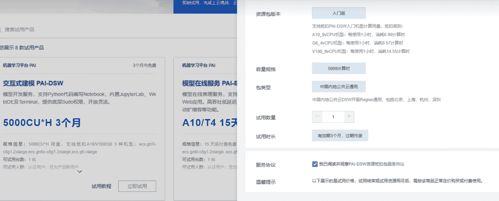

## 前往控制台，免费开通创建默认工作空间（建议选择北京区域，下面列出的示例镜像URL为北京区域，需要保持一致）

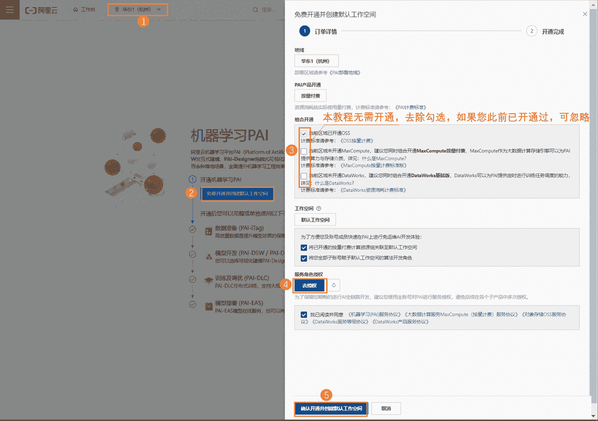

机器学习PAI控制台地址：

https://pai.console.aliyun.com/?regionId=cn-beijing&spm=5176.14094288.J_8006650780.4.c04b33a7sRZdQ7&workspaceId=97231#/workspace/detail

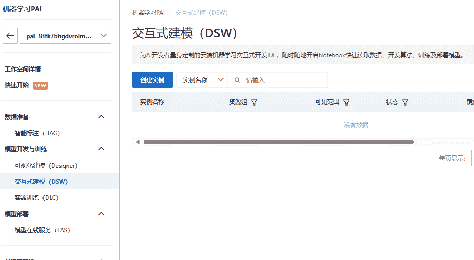

## 在前面我们免费领取5000点的计算资源。当你创建实例的时候，可以选择两种显卡，V100约15点每小时，大家可以自己抉择。

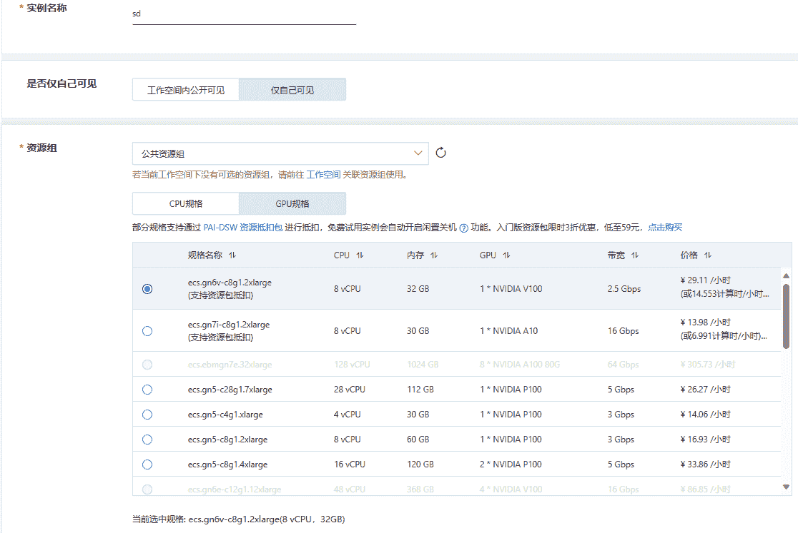

我这里用V100作为示例，下面的文件存储是可选的。

如果选择了，可以把存储挂在我们的实例上，用来保存额外的文件，大家可以自行决定是否需要。

# 镜像选择上可以参考官方指导：阿里云快速启动Stable Diffusion WebUI

https://help.aliyun.com/document_detail/2261127.html?spm=a2c4g.2261126.0.0.49c71d2dftSYKO

## **PAI官方公开镜像**

在**PAI官方公开镜像**页签，您可以查看PAI联邦学习镜像及PAI-DLC中使用的训练镜像详情。

1.  进入**镜像管理列表**页面。

1.  登录[PAI控制台](https://pai.console.aliyun.com/)。

1.  在左侧导航栏单击**工作空间列表**，在工作空间列表页面中单击待操作的工作空间名称，进入对应工作空间内。

1.  在左侧导航栏，选择**AI****资产管理 > 镜像**。

1.  单击**PAI官方公开镜像**页签，即可查看PAI提供的官方公开镜像，如下图所示。

选择**官方镜像**中的**s**table-diffusion-webui-env:pytorch1.13-gpu-py310-cu117-ubuntu22.04。

输入镜像URL地址：

例如-北京区域：   dsw-registry-vpc.cn-beijing.cr.aliyuncs.com/cloud-dsw/eas-service:aigc-torch113-cu117-ubuntu22.04-v0.2.1_accelerated

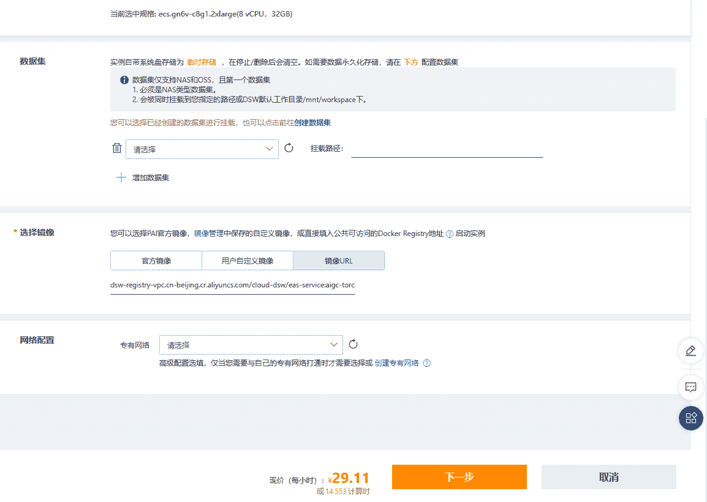

## 如果想用别的官方镜像 可以从下面入口进去镜像管理列表选择

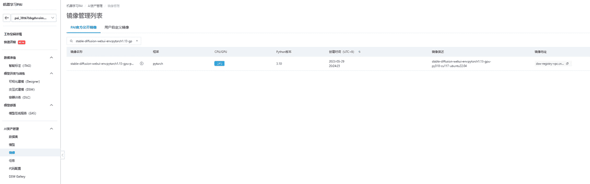

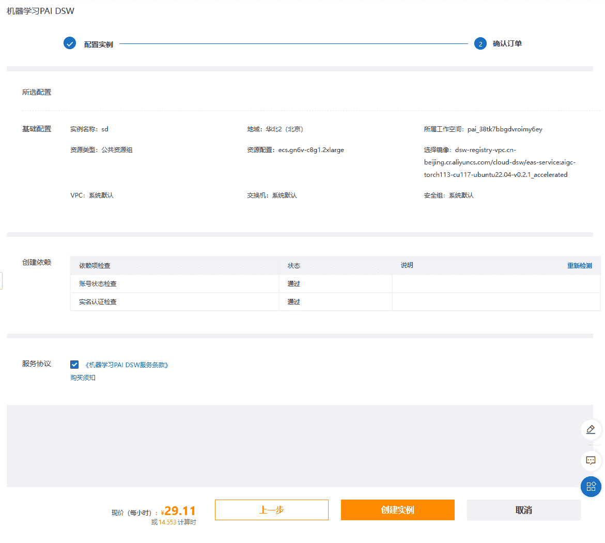

都确定好了就可以直接提交了，然后耐心等待创建完成即可。这个创建还是比较慢的，需要等个几分钟。

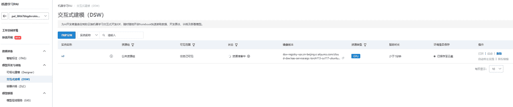

# 第二步：在DSW中打开教程文件

## **经过**漫长的**等待**，机器开机，然后单击需要打开的实例操作列下的打开，进入PAI-DSW实例开发环境。

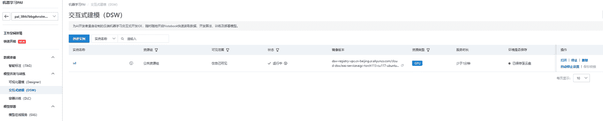

在**JupyterLab**页签的**Launcher**页面，单击**快速开始**区域**Tool**下的**DSW Gallery**，打开DSW Gallery页面。

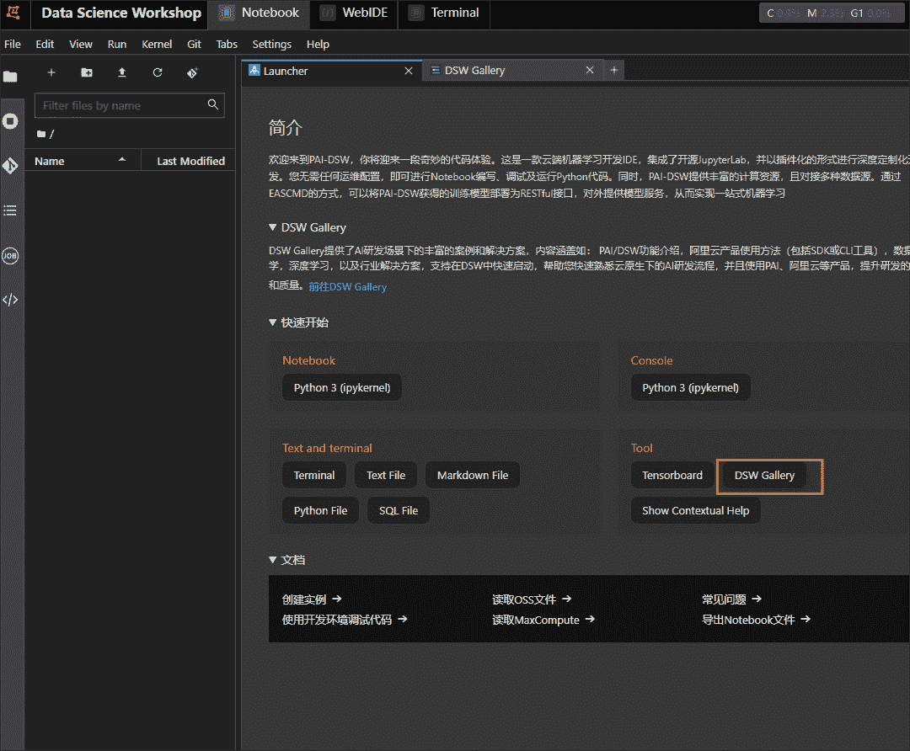

在DSW Galler**y页面中，搜索**并找到Stable Diffusion WebUI使用示例教程，单击教程卡片中的在DSW中打开。

单击后即会自动将官方教程所需的资源和教程文件下载至DSW实例中，并在下载完成后自动打开教程文件。

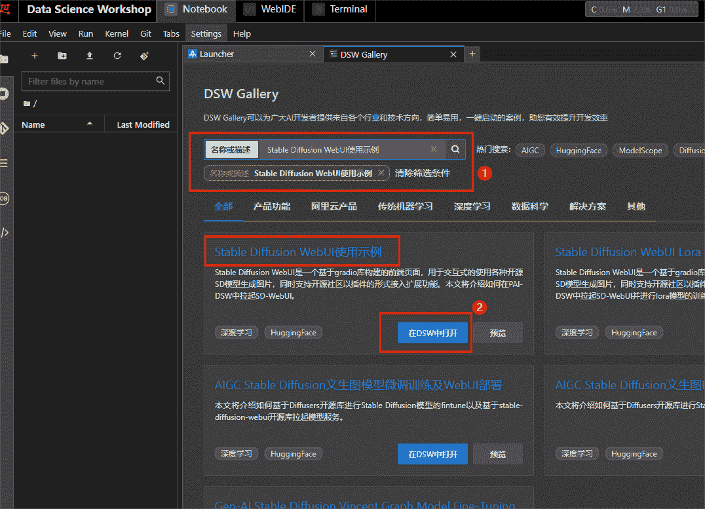

# 第三步：运行教程文件

## 在打开的教程文件stable_diffusion_webui.ipynb文件中，您可以直接看到官方教程文本，您可以按照官网教程在教程文件中直接运行。（repositories资源是2个月前的版本） 也可以按我的方法使用最新V2版本，本教程一共5个运行步骤：

为什么我另外写个V2的版本，因为官方的教程 版本太低了，加装插件的时候 会运行报错。

https://pan.baidu.com/s/1927YDtCAa3Ggrd4wh1i6mQ?pwd=yseq

### 点击/根目录，把我提供的stable_diffusion_webui_v2.ipynb文件下载好丢进去，并且删除demos文件夹。

很多小伙伴反馈删除不了demos文件夹。

教大家用命令行的方式去删除。(切换到 Terminal)

rm -rf  /mnt/workspace/demos    (删除命令 谨慎使用)

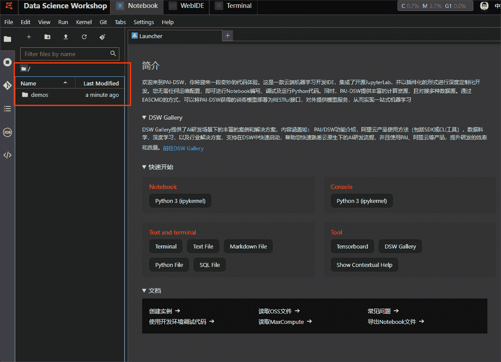

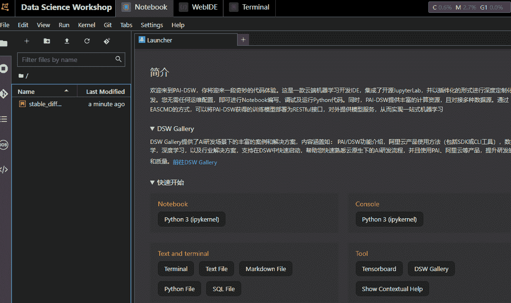

我们点击脚本具体的操作步骤，我们一步一步跟着走。

### 下载stable-diffusion-webui开源库及其它依赖

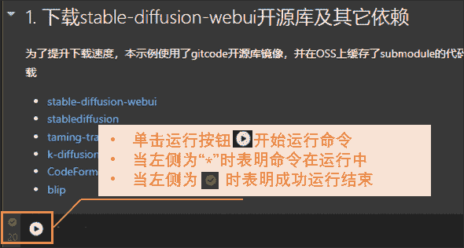

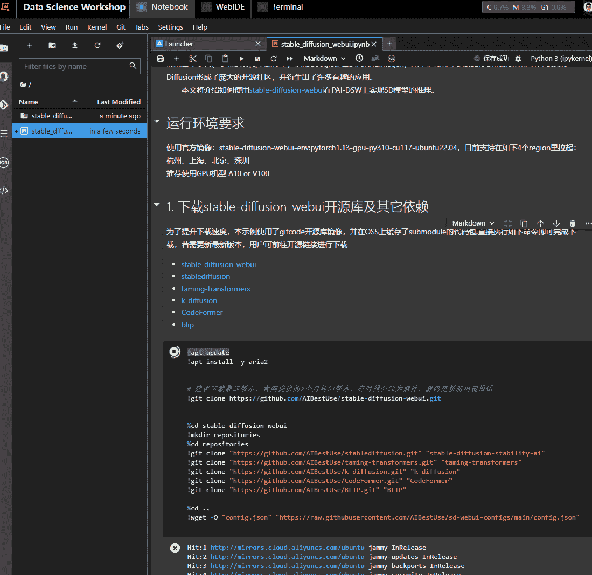

> **  **这段代码主要做了几件事情：

1.  使用 ! 运行了一些 shell 命令，用于更新软件包列表（apt update）和安装一个名为 aria2 的软件（apt install -y aria2）。aria2 是一个轻量级的多协议和多源的命令行下载工具。

1.  使用 git clone 命令从 GitHub 克隆了一个项目到当前目录。

1.  切换到克隆的项目的目录，并在其中创建了一个名为 repositories 的新目录。

1.  切换到 repositories 目录，并从 GitHub 克隆了一些其他的项目到这个目录。这些项目被克隆到了它们各自的子目录中。

1.  切换回了原来的目录，并从一个 URL 下载了一个名为 config.json 的文件。

> 这段代码的主要目的是设置环境，包括安装必要的软件，从 GitHub 克隆项目，并下载配置文件。

以下为repositories 内的资源

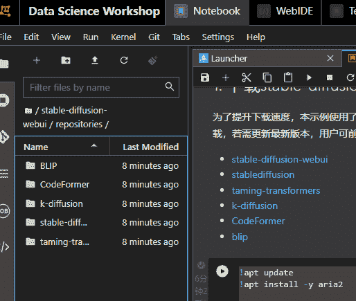

### 安装常用插件

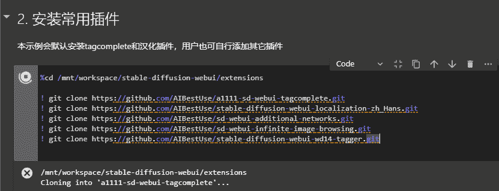

### 下载大模型

我们可以自己填入这里的模型链接，下载就可以了。模型链接之后来下载VAE, 然后就可以运行了。首次启动会有些慢，多等会儿就好了。

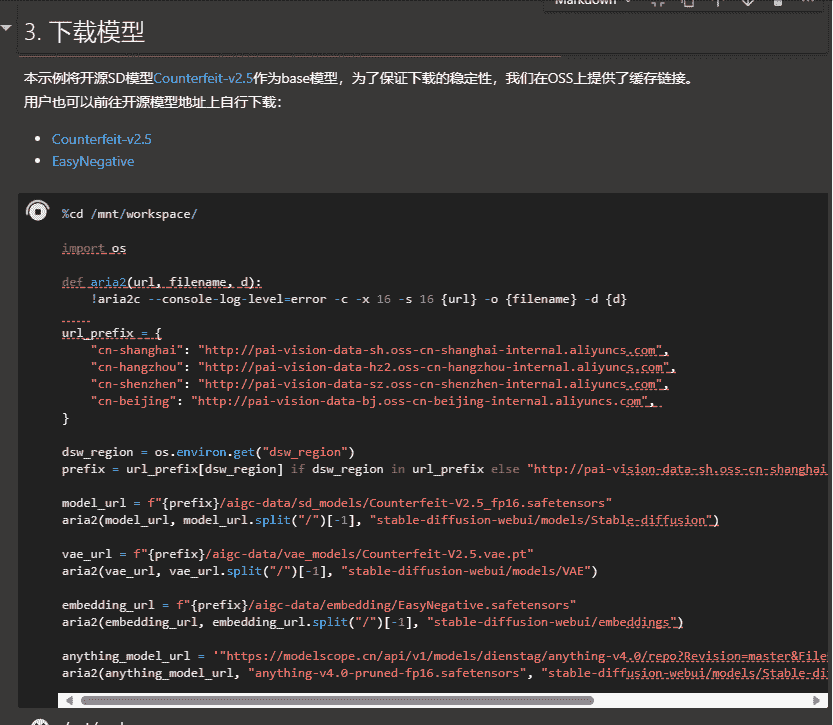

> 这段代码在之前基础上增加了一些新的操作：

1.  使用%cd命令切换到/mnt/workspace/目录。

1.  导入Python的os模块，然后定义了一个名为aria2的函数。这个函数使用aria2c命令（一个命令行下载工具）从指定的URL下载文件，然后将文件保存到指定的目录。函数的参数包括：url（文件的URL），filename（保存的文件名），和d（文件保存的目录）。

1.  定义了一个名为url_prefix的字典，它将几个地区的名称映射到相应的URL前缀。

1.  从环境变量中获取dsw_region的值。如果dsw_region的值在url_prefix字典的键中，就将prefix设置为相应的URL前缀，否则将prefix设置为默认的URL前缀。

1.  使用aria2函数从指定的URL下载三个文件，然后将这些文件保存到stable-diffusion-webui/models/Stable-diffusion，stable-diffusion-webui/models/VAE，和stable-diffusion-webui/embeddings目录中。

1.  最后，从一个名为anything_model_url的URL下载一个文件，然后将这个文件保存到stable-diffusion-webui/models/Stable-diffusion目录中。

> 这段代码的主要目的是下载一些模型和数据文件

> 

> 在Python中，f或F前缀代表了格式化字符串（f-string）。这是从Python 3.6版本开始引入的一种新的字符串格式化方法，它在字符串内部使用花括号 {} 包含的表达式，这些表达式在运行时会被其值替换。

> 例如，在代码中，f"{prefix}/aigc-data/sd_models/Counterfeit-V2.5_fp16.safetensors"会被替换为prefix变量的值后面跟着字符串/aigc-data/sd_models/Counterfeit-V2.5_fp16.safetensors。

> 如果prefix的值为http://example.com，那么整个表达式的值就会是http://example.com/aigc-data/sd_models/Counterfeit-V2.5_fp16.safetensors。

> f-string是一种非常方便的方式来插入和格式化字符串。

>

有[需要下载阿里云PAI-DSW Contr](https://nwy2ldgmy4q.feishu.cn/docx/UrdAdt3Nror7tGxyXlrcOoTsnQc)olNet模型安装（省空间版） 14个模型的，可以看看大聖得 云服务器安装safetensors格式的Controlnet模型，节省11G空间

### 启动WebUI

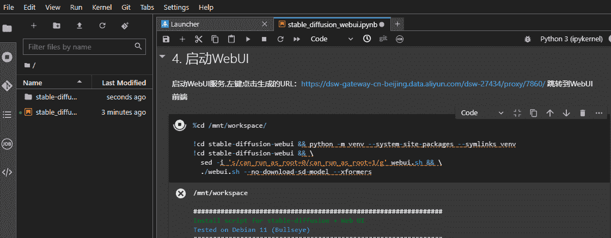

1.  使用 %cd 命令将当前工作目录切换到 /mnt/workspace/。

1.  使用 python -m venv 命令在 stable-diffusion-webui 目录中创建了一个新的虚拟环境。--system-site-packages 参数表示新的虚拟环境将可以访问系统级别的 site-packages，--symlinks 参数表示会尽可能使用符号链接来保存空间。

1.  使用 sed 命令修改了 webui.sh 文件中的一行内容，将 can_run_as_root=0 改为了 can_run_as_root=1。这可能是为了允许以 root 用户身份运行这个脚本。

1.  执行了 webui.sh 脚本。--no-download-sd-model 参数表示不下载 SD 模型。

> 这段代码的主要目的是在 stable-diffusion-webui 目录中设置一个新的 Python 虚拟环境，并修改并运行了一个 shell 脚本。

Running on local URL:  http://127.0.0.1:7860

等到我们看到这个链接就可以点进去直接使用了，进入界面就可以看到汉化自动股权都配置好了，可以直接使用。

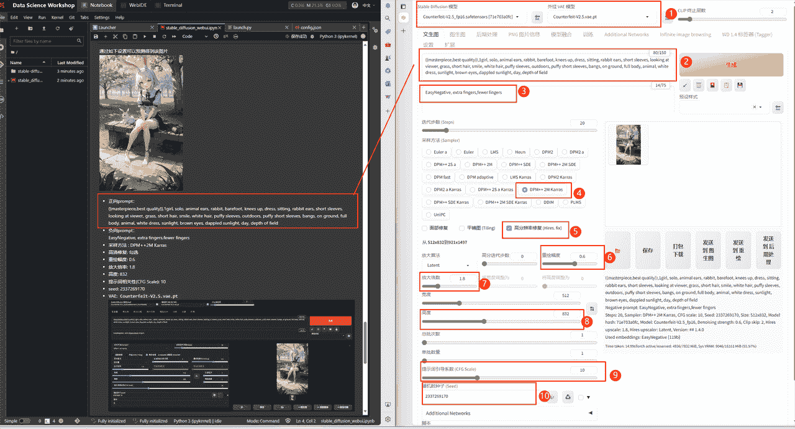

当图片生成成功，你可以在 /mnt/workspace/stable-diffusion-webui/outputs/txt2img-images/ 看到，也可以选择在浏览器界面上打包下载。

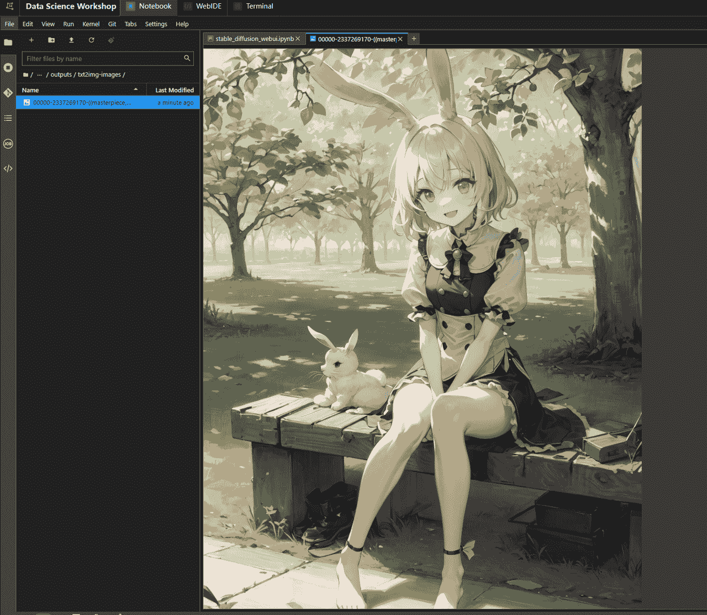

第一次生成图片的时候会比较慢，之后就好。大家用完了记得及时停掉实例哦。

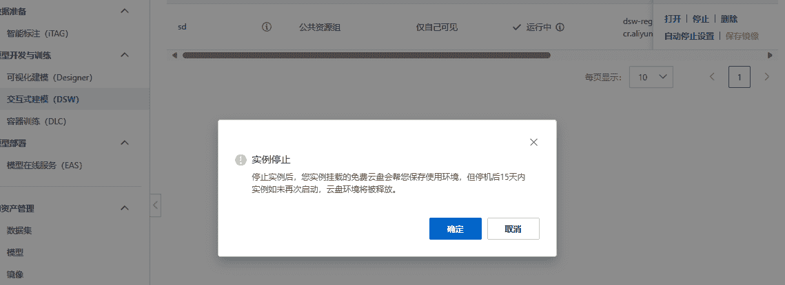

现如今AI技术发展中，云计算早已不再是简简单单的买了一些服务器等等，而是有很多专业有趣的应用场景。阿里云在机器学习方面为我们开发者乃至是小白用户都有非常大的帮助。

阿里云带来了一系列模型的SDK, 同时也拥有完善的AI资产管理。从数据集的模型镜像等等，切实的解决了在训练模型时，数据管理模型存储痛点，也提供了最重要的镜像服务。从开发到部署，生产只需一步。除了今天介绍的这个机器学习，还有着非常多的好玩的、好用的视频项目，大家都可以自己来尝试下。

## 感谢**每**一位阅读到结尾的小伙伴，如果你感觉这篇文章对你有帮助，有收获，欢迎关注、点赞、评论一下，让更多的朋友们看到！先谢过各位了！

微信ID:aigc6868 欢迎链接。

以下是群内大佬们发布的一些教程：

[阿里云SD全程无代码部署最短路径+赛博出图坑点排雷](https://e0tolnpfkgm.feishu.cn/docx/Q4SidCDBPomevuxym3Mcjc38nqg) write by @卡尔

[云平台一键部署SD整合包](https://hwfcqqoti4r.feishu.cn/docx/P3yIde24BoNnUFxKYRHcxUJGnJP)  write by @李鑫

[云服务器安装safetensors格式的](https://nwy2ldgmy4q.feishu.cn/docx/UrdAdt3Nror7tGxyXlrcOoTsnQc)Controlnet模型，节省11G空间     write by @大聖

必看推荐：下一期 阿里云国外模型插件下载

[干货教程：阿里云国外模型插件下载](https://j01prtrgjwv.feishu.cn/wiki/OT0CwzJOhinXgXknZ0kcwbv6nNC)

[阿里云代码 列表 请自取复制 交互式建模（DSW）](https://j01prtrgjwv.feishu.cn/docx/IRIodKOzWow2q7xKUnHchLlHnrV)