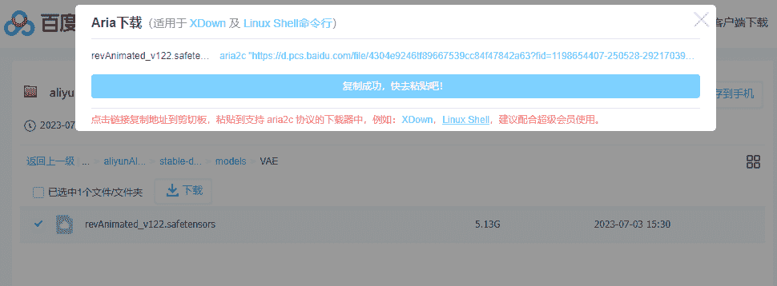
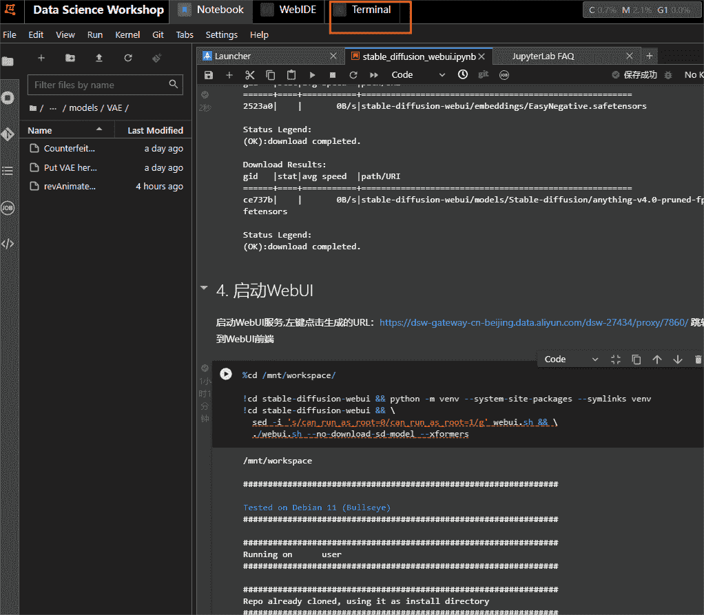
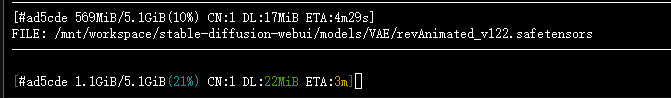
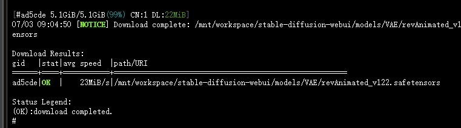
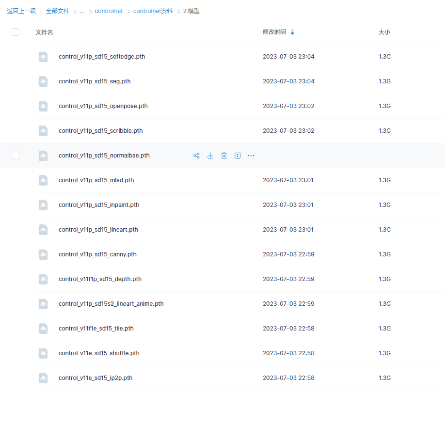

# 干货教程：阿里云国外模型插件下载

> 来源：[https://xuqiwei1986.feishu.cn/docx/QA31dXC0co8tW0xzTZucZN5Pn9S](https://xuqiwei1986.feishu.cn/docx/QA31dXC0co8tW0xzTZucZN5Pn9S)

大家好，我是一个拥有8年经验的全栈开发者，安全爱好者，AI破局合伙人，AIGC探索者，创业者。

专注于AI技术的研究，擅长AI项目的解决方案和落地，同时也在运营自己的全平台自媒体。

之前写了一篇[保姆级教程：阿里云免费服务器 5分钟搭建Stable Diffusion](https://j01prtrgjwv.feishu.cn/wiki/QLVnw7VE7iQ8BjkFaSyccfF1nVg)，小伙伴们都在尝试，但是碰到很多现实问题，比如国外模型资源的下载被拒，基本是只能用国内站点去下载，建议大家有国外hugging face资源或者C站资源需要下载的时候，优先搜一下国内镜像站。

不过国内网站上有的资源能搜到，有的搜不到，比如：`SD5-Brightness`。

还有个版本问题，不知道大家注意到没有，国内站点有的资源同步更新的比较慢，比如`revAnimated_v122.safetensors`，C站目前版本已经是`V1.2.2`，国内站点上的版本还是`v1.1`。

针对版本问题，我一般都是选择直接从国外站点下载一手资源，存到百度云盘和本地，再从本地上传到阿里云，但是小伙伴普遍反应，本地上传到阿里云速度巨慢，针对这个问题，我就在想解决办法，到底要如何在阿里云上下载百度云盘的资源。

以下为相关解决方案教程：

针对百度网盘分享链接，怎么获取网盘直链，并在阿里云上用`aria2c`下载。

## 第一步 浏览器 安装扩展 脚本管理器 篡改猴测试版

https://www.tampermonkey.net/


### 欢迎来到 Greasy Fork，这里是一个提供用户脚本的网站

https://greasyfork.org/zh-CN

搜索 网盘直链下载助手（这个脚本支持文件（压缩包）直链，不支持文件夹）


安装


### 🔧 插件功能

- ✅ 支持多种网盘：百度网盘、阿里云盘、天翼云盘、迅雷云盘、夸克网盘、移动云盘
- ✅ 支持多种操作系统：Windows、Linux、Mac
- ✅ 支持多种下载协议：HTTP、`JSON-RPC`、`cURL`
- ✅ 支持多种下载器：`IDM`、`XDown`、`Aria2`、`NDM`、`Motrix`、终端
- ✅ 支持批量获取网盘文件下载链接
- ✅ 可以通过`JSON-RPC`协议发送下载链接至本地或远程下载
- ✅ 支持更换皮肤，自动更新，新版网盘界面

安装网盘直链下载助手 黑色油猴非测试版（已经安装红色油猴测试版请忽略） 官方教程参考

https://www.youxiaohou.com/zh-cn/windows.html#_2-%E5%AE%89%E8%A3%85%E8%84%9A%E6%9C%AC%E3%80%90%E7%BD%91%E7%9B%98%E7%9B%B4%E9%93%BE%E4%B8%8B%E8%BD%BD%E5%8A%A9%E6%89%8B%E3%80%91


按照网盘直链下载助手官方文档完成安装就可以，愿意捣鼓的可以自己试试，打开百度网盘浏览器版本，会看到下载助手，点击`ARIA`下载。（链接有效期8小时，及时下载哦，`expires=8h`）


### 点击复制





### 针对阿里云交互式建模（DSW）切换到`Terminal`

（不同模型的存放文件夹不一样，请一定要注意存放路径）（链接有效期8小时，及时下载哦，`expires=8h`）

[阿里云代码列表请自取复制 交互式建模（DSW）](https://j01prtrgjwv.feishu.cn/docx/IRIodKOzWow2q7xKUnHchLlHnrV)

```
# pwd
/mnt/workspace
# cd /mnt/workspace/stable-diffusion-webui/models/VAE
```

切换到资源指定文件夹之后，把刚才复制的代码贴上去

```
aria2c "https://d.pcs.baidu.com/file/4304e9246tf89667539cc84f47842a63?fid=1198654407-250528-29217039560799&dstime=1688371628&rt=sh&sign=FDtAERVJouK-DCb740ccc5511e5e8fedcff06b081203-oe5VnCFdu82ypOxO%2BDbAbJ4dHnI%3D&expires=8h&chkv=1&chkbd=0&chkpc=&dp-logid=8871549557332727517&dp-callid=0&shareid=27344216727&r=850676206&resvsflag=1-12-0-1-1-1&vuk=1198654407&file_type=0" --out "revAnimated_v122.safetensors" --header "User-Agent: pan.baidu.com" --header "Cookie: BDUSS=HFmWG5GVXpSV3V0bzVBfkFWUngwd2tZSjhFSDFDY01PMWV3ZDNnQ2RxZGdDY3BrRVFBQUFBJCQAAAAAAAAAAAEAAABNRxh2YWlnYzY4NgAAAAAAAAAAAAAAAAAAAAAAAAAAAAAAAAAAAAAAAAAAAAAAAAAAAAAAAAAAAAAAAAAAAAAAAAAAAGB8omRgfKJkT"
```



`revAnimated_v122.safetensors` 5.13G 5分钟下载完了，愉快的使用吧。



## 示范例子

`2023.6.18白城主综合机甲F32_V1.safetensors`

```
# cd /mnt/workspace/stable-diffusion-webui/models/Stable-diffusion

aria2c "https://d.pcs.baidu.com/file/e07933a3fu0386a0bfdbf0d0cf510dc4?fid=1198654407-250528-177645241877987&rt=pr&sign=FDtAER-DCb740ccc5511e5e8fedcff06b081203-AqF2ka2xqaam1V5Nje%2BchIkEczQ%3D&expires=8h&chkbd=0&chkv=0&dp-logid=3337679266665621970&dp-callid=0&dstime=1688599767&r=827184769&origin_appid=15195230&file_type=0" --out "2023.6.18白城主综合机甲F32_V1.safetensors" --header "User-Agent: pan.baidu.com" --header "Cookie: BDUSS=HFmWG5GVXpSV3V0bzVBfkFWUngwd2tZSjhFSDFDY01PMWV3ZDNnQ2RxZGdDY3BrRVFBQUFBJCQAAAAAAAAAAAEAAABNRxh2YWlnYzY4NgAAAAAAAAAAAAAAAAAAAAAAAAAAAAAAAAAAAAAAAAAAAAAAAAAAAAAAAAAAAAAAAAAAAAAAAAAAAGB8omRgfKJkT"
```

`comix_v3.1_科幻plus_3.1.safetensors`

```
aria2c --console-log-level=error -c -x 16 -s 16 https://liblibai-online.liblibai.com/web/model/960ba4b63da093823b364d27a034eb38aab65d1be6e4178c9c3638ef2ae483d6.safetensors -o comix_v3.1_科幻plus_3.1.safetensors -d /mnt/workspace/stable-diffusion-webui/models/Stable-diffusion
```

`majicmixRealistic_v6.safetensors`

```
# cd /mnt/workspace/stable-diffusion-webui/models/Stable-diffusion

aria2c "https://d.pcs.baidu.com/file/e296347e9ke1b1d56e8eb3beded708d0?fid=1198654407-250528-107657111721578&rt=pr&sign=FDtAER-DCb740ccc5511e5e8fedcff06b081203-rnbWLCud4wNyHf6GTGqqtXE0ZJU%3D&expires=8h&chkbd=0&chkv=0&dp-logid=379393434208657601&dp-callid=0&dstime=1688398385&r=609300974&origin_appid=15195230&file_type=0" --out "majicmixRealistic_v6.safetensors" --header "User-Agent: pan.baidu.com" --header "Cookie: BDUSS=HFmWG5GVXpSV3V0bzVBfkFWUngwd2tZSjhFSDFDY01PMWV3ZDNnQ2RxZGdDY3BrRVFBQUFBJCQAAAAAAAAAAAEAAABNRxh2YWlnYzY4NgAAAAAAAAAAAAAAAAAAAAAAAAAAAAAAAAAAAAAAAAAAAAAAAAAAAAAAAAAAAAAAAAAAAAAAAAAAAGB8omRgfKJkT"
```

`vaeFtMse840000Ema_v100.pt`

```
cd /mnt/workspace/stable-diffusion-webui/models/VAE

aria2c "https://d.pcs.baidu.com/file/27e9b3171he8aa30346e0891f3e53a45?fid=1198654407-250528-827045511284544&rt=pr&sign=FDtAER-DCb740ccc5511e5e8fedcff06b081203-g7fFN%2FKhw2tKXp%2B1W9fujX7qfpE%3D&expires=8h&chkbd=0&chkv=0&dp-logid=1158830650371304988&dp-callid=0&dstime=1688406179&r=185926914&origin_appid=15195230&file_type=0" --out "vaeFtMse840000Ema_v100.pt" --header "User-Agent: pan.baidu.com" --header "Cookie: BDUSS=HFmWG5GVXpSV3V0bzVBfkFWUngwd2tZSjhFSDFDY01PMWV3ZDNnQ2RxZGdDY3BrRVFBQUFBJCQAAAAAAAAAAAEAAABNRxh2YWlnYzY4NgAAAAAAAAAAAAAAAAAAAAAAAAAAAAAAAAAAAAAAAAAAAAAAAAAAAAAAAAAAAAAAAAAAAAAAAAAAAGB8omRgfKJkT"
```

## controlNet 预处理器

切换到`Terminal`，12个文件夹的内容，一个个下载咯


# 使用 aria2c 批量下载 ControlNet 模型

## 切换至下载目录

```bash
cd /mnt/workspace/stable-diffusion-webui/extensions/sd-webui-controlnet/annotator/downloads
```

## 使用说明

切换到总目录下之后，`aria2c` 命令行后面 `-d xxx` 文件夹名字，会自动创建或下载进相关的文件夹内，请参考下面代码的例子，对应上面的图片。

## 下载命令示例

```
aria2c "https://d.pcs.baidu.com/file/eb34e5c1fma88de4663f975ce31a2e9b?fid=1198654407-250528-424531556290654&rt=pr&sign=FDtAERV-DCb740ccc5511e5e8fedcff06b081203-sm4SpWNEso7oSZZuM9WjOBf8qHs%3D&expires=8h&chkbd=0&chkv=3&dp-logid=530222594335101691&dp-callid=0&dstime=1688399889&r=264676668&origin_appid=15195230&file_type=0" --out "ControlNetHED.pth" --header "User-Agent: pan.baidu.com" --header "Cookie: BDUSS=HFmWG5GVXpSV3V0bzVBfkFWUngwd2tZSjhFSDFDY01PMWV3ZDNnQ2RxZGdDY3BrRVFBQUFBJCQAAAAAAAAAAAEAAABNRxh2YWlnYzY4NgAAAAAAAAAAAAAAAAAAAAAAAAAAAAAAAAAAAAAAAAAAAAAAAAAAAAAAAAAAAAAAAAAAAAAAAAAAAGB8omRgfKJkT"  -d "hed";

aria2c "https://d.pcs.baidu.com/file/7d6a167cdp1314afe154031943f03cee?fid=1198654407-250528-1066148225403393&rt=pr&sign=FDtAER-DCb740ccc5511e5e8fedcff06b081203-sKrjQTxz8s5%2FbwXFmMmBp%2Fb6eQw%3D&expires=8h&chkbd=0&chkv=0&dp-logid=564222183759664676&dp-callid=0&dstime=1688400235&r=471023352&origin_appid=15195230&file_type=0" --out "latest_net_G.pth" --header "User-Agent: pan.baidu.com" --header "Cookie: BDUSS=HFmWG5GVXpSV3V0bzVBfkFWUngwd2tZSjhFSDFDY01PMWV3ZDNnQ2RxZGdDY3BrRVFBQUFBJCQAAAAAAAAAAAEAAABNRxh2YWlnYzY4NgAAAAAAAAAAAAAAAAAAAAAAAAAAAAAAAAAAAAAAAAAAAAAAAAAAAAAAAAAAAAAAAAAAAAAAAAAAAGB8omRgfKJkT" -d "leres";

aria2c "https://d.pcs.baidu.com/file/05e9ec6ecnf30a630aced470eacbb2be?fid=1198654407-250528-720371925989577&rt=pr&sign=FDtAER-DCb740ccc5511e5e8fedcff06b081203-no4WREFj033DDsLYGHrfsKbAWH4%3D&expires=8h&chkbd=0&chkv=0&dp-logid=564222095767890153&dp-callid=0&dstime=1688400235&r=471023352&origin_appid=15195230&file_type=0" --out "res101.pth" --header "User-Agent: pan.baidu.com" --header "Cookie: BDUSS=HFmWG5GVXpSV3V0bzVBfkFWUngwd2tZSjhFSDFDY01PMWV3ZDNnQ2RxZGdDY3BrRVFBQUFBJCQAAAAAAAAAAAEAAABNRxh2YWlnYzY4NgAAAAAAAAAAAAAAAAAAAAAAAAAAAAAAAAAAAAAAAAAAAAAAAAAAAAAAAAAAAAAAAAAAAAAAAAAAAGB8omRgfKJkT" -d "leres";

aria2c "https://d.pcs.baidu.com/file/5bfdbd4f9m24f1a6328287019ff00329?fid=1198654407-250528-154957549335835&rt=pr&sign=FDtAERV-DCb740ccc5511e5e8fedcff06b081203-QeFetyG1dX6UcIWd1%2FtB9nC93Js%3D&expires=8h&chkbd=0&chkv=3&dp-logid=625634842196626748&dp-callid=0&dstime=1688400844&r=531500288&origin_appid=15195230&file_type=0" --out "sk_model.pth" --header "User-Agent: pan.baidu.com" --header "Cookie: BDUSS=HFmWG5GVXpSV3V0bzVBfkFWUngwd2tZSjhFSDFDY01PMWV3ZDNnQ2RxZGdDY3BrRVFBQUFBJCQAAAAAAAAAAAEAAABNRxh2YWlnYzY4NgAAAAAAAAAAAAAAAAAAAAAAAAAAAAAAAAAAAAAAAAAAAAAAAAAAAAAAAAAAAAAAAAAAAAAAAAAAAGB8omRgfKJkT" -d "lineart";

aria2c "https://d.pcs.baidu.com/file/138ddac64o768f69b6f419eed4e6dd33?fid=1198654407-250528-296015330912190&rt=pr&sign=FDtAERV-DCb740ccc5511e5e8fedcff06b081203-4eZbQMpZfgE2XiUqdsJJ0i0cOO0%3D&expires=8h&chkbd=0&chkv=3&dp-logid=625634912760484452&dp-callid=0&dstime=1688400844&r=531500288&origin_appid=15195230&file_type=0" --out "sk_model2.pth" --header "User-Agent: pan.baidu.com" --header "Cookie: BDUSS=HFmWG5GVXpSV3V0bzVBfkFWUngwd2tZSjhFSDFDY01PMWV3ZDNnQ2RxZGdDY3BrRVFBQUFBJCQAAAAAAAAAAAEAAABNRxh2YWlnYzY4NgAAAAAAAAAAAAAAAAAAAAAAAAAAAAAAAAAAAAAAAAAAAAAAAAAAAAAAAAAAAAAAAAAAAAAAAAAAAGB8omRgfKJkT" -d "lineart";

aria2c "https://d.pcs.baidu.com/file/4a61ff4e5i3c90951fea27277f95a97d?fid=1198654407-250528-45575035891032&rt=pr&sign=FDtAER-DCb740ccc5511e5e8fedcff06b081203-O08auL%2BGNjAA3VauGF%2F%2FP6klLqM%3D&expires=8h&chkbd=0&chkv=0&dp-logid=634043967271464675&dp-callid=0&dstime=1688400929&r=162194651&origin_appid=15195230&file_type=0" --out "150_16_swin_l_oneformer_coco_100ep.pth" --header "User-Agent: pan.baidu.com" --header "Cookie: BDUSS=HFmWG5GVXpSV3V0bzVBfkFWUngwd2tZSjhFSDFDY01PMWV3ZDNnQ2RxZGdDY3BrRVFBQUFBJCQAAAAAAAAAAAEAAABNRxh2YWlnYzY4NgAAAAAAAAAAAAAAAAAAAAAAAAAAAAAAAAAAAAAAAAAAAAAAAAAAAAAAAAAAAAAAAAAAAAAAAAAAAGB8omRgfKJkT" -d "oneformer";

aria2c "https://d.pcs.baidu.com/file/8a5f88538v8a792f4c0420b089e5bc2e?fid=1198654407-250528-114088287222770&rt=pr&sign=FDtAER-DCb740ccc5511e5e8fedcff06b081203-GC1M91Z7S%2F2v3W5nrOY%2BByXuqus%3D&expires=8h&chkbd=0&chkv=0&dp-logid=634044051946868376&dp-callid=0&dstime=1688400929&r=162194651&origin_appid=15195230&file_type=0" --out "250_16_swin_l_oneformer_ade20k_160k.pth" --header "User-Agent: pan.baidu.com" --header "Cookie: BDUSS=HFmWG5GVXpSV3V0bzVBfkFWUngwd2tZSjhFSDFDY01PMWV3ZDNnQ2RxZGdDY3BrRVFBQUFBJCQAAAAAAAAAAAEAAABNRxh2YWlnYzY4NgAAAAAAAAAAAAAAAAAAAAAAAAAAAAAAAAAAAAAAAAAAAAAAAAAAAAAAAAAAAAAAAAAAAAAAAAAAAGB8omRgfKJkT" -d "oneformer";

aria2c "https://d.pcs.baidu.com/file/7c13632d8qe29d4a29e27568aa62f064?fid=1198654407-250528-1032698449400180&rt=pr&sign=FDtAER-DCb740ccc5511e5e8fedcff06b081203-TXTJi4h7PVGDpUQNcxSz2rhd7m4%3D&expires=8h&chkbd=0&chkv=0&dp-logid=645509167577126450&dp-callid=0&dstime=1688401040&r=724332011&origin_appid=15195230&file_type=0" --out "netG.pth" --header "User-Agent: pan.baidu.com" --header "Cookie: BDUSS=HFmWG5GVXpSV3V0bzVBfkFWUngwd2tZSjhFSDFDY01PMWV3ZDNnQ2RxZGdDY3BrRVFBQUFBJCQAAAAAAAAAAAEAAABNRxh2YWlnYzY4NgAAAAAAAAAAAAAAAAAAAAAAAAAAAAAAAAAAAAAAAAAAAAAAAAAAAAAAAAAAAAAAAAAAAAAAAAAAAGB8omRgfKJkT" -d "lineart_anime";

aria2c "https://d.pcs.baidu.com/file/d8ef73ed3j5cd92e35c94ed0931be452?fid=1198654407-250528-757982114924327&rt=pr&sign=FDtAER-DCb740ccc5511e5e8fedcff06b081203-1%2B1Iq5GfQA2H22tyhRSr3RRIHVo%3D&expires=8h&chkbd=0&chkv=0&dp-logid=650677772895820640&dp-callid=0&dstime=1688401095&r=568630364&origin_appid=15195230&file_type=0" --out "erika.pth" --header "User-Agent: pan.baidu.com" --header "Cookie: BDUSS=HFmWG5GVXpSV3V0bzVBfkFWUngwd2tZSjhFSDFDY01PMWV3ZDNnQ2RxZGdDY3BrRVFBQUFBJCQAAAAAAAAAAAEAAABNRxh2YWlnYzY4NgAAAAAAAAAAAAAAAAAAAAAAAAAAAAAAAAAAAAAAAAAAAAAAAAAAAAAAAAAAAAAAAAAAAAAAAAAAAGB8omRgfKJkT" -d "manga_line";

aria2c "https://d.pcs.baidu.com/file/7317565b8v582efb4e8b1c6590799d13?fid=1198654407-250528-1003431047342327&rt=pr&sign=FDtAERV-DCb740ccc5511e5e8fedcff06b081203-D%2FfCRgzgTC2ohk0%2B4%2B2hepan4e8%3D&expires=8h&chkbd=0&chkv=3&dp-logid=654262230562912917&dp-callid=0&dstime=1688401136&r=274173180&origin_appid=15195230&file_type=0" --out "mlsd_large_512_fp32.pth" --header "User-Agent: pan.baidu.com" --header "Cookie: BDUSS=HFmWG5GVXpSV3V0bzVBfkFWUngwd2tZSjhFSDFDY01PMWV3ZDNnQ2RxZGdDY3BrRVFBQUFBJCQAAAAAAAAAAAEAAABNRxh2YWlnYzY4NgAAAAAAAAAAAAAAAAAAAAAAAAAAAAAAAAAAAAAAAAAAAAAAAAAAAAAAAAAAAAAAAAAAAAAAAAAAAGB8omRgfKJkT" -d "mlsd";

aria2c "https://d.pcs.baidu.com/file/954f592e1t893307be8a07fed6c69914?fid=1198654407-250528-356940417328014&rt=pr&sign=FDtAER-DCb740ccc5511e5e8fedcff06b081203-uG8UgUcQM0qU2xKn3UpEcszY8Ew%3D&expires=8h&chkbd=0&chkv=0&dp-logid=657787960347683557&dp-callid=0&dstime=1688401167&r=893808260&origin_appid=15195230&file_type=0" --out "scannet.pt" --header "User-Agent: pan.baidu.com" --header "Cookie: BDUSS=HFmWG5GVXpSV3V0bzVBfkFWUngwd2tZSjhFSDFDY01PMWV3ZDNnQ2RxZGdDY3BrRVFBQUFBJCQAAAAAAAAAAAEAAABNRxh2YWlnYzY4NgAAAAAAAAAAAAAAAAAAAAAAAAAAAAAAAAAAAAAAAAAAAAAAAAAAAAAAAAAAAAAAAAAAAAAAAAAAAGB8omRgfKJkT" -d "normal_bae";

aria2c "https://d.pcs.baidu.com/file/e5ccc162dre537b8b97a6f8767ef6c34?fid=1198654407-250528-1095853003233314&rt=pr&sign=FDtAER-DCb740ccc5511e5e8fedcff06b081203-SyCik5z8B6B9r1QrX%2BoZ1fadF7U%3D&expires=8h&chkbd=0&chkv=0&dp-logid=732016476353933358&dp-callid=0&dstime=1688401910&r=517175707&origin_appid=15195230&file_type=0" --out "body_pose_model.pth" --header "User-Agent: pan.baidu.com" --header "Cookie: BDUSS=HFmWG5GVXpSV3V0bzVBfkFWUngwd2tZSjhFSDFDY01PMWV3ZDNnQ2RxZGdDY3BrRVFBQUFBJCQAAAAAAAAAAAEAAABNRxh2YWlnYzY4NgAAAAAAAAAAAAAAAAAAAAAAAAAAAAAAAAAAAAAAAAAAAAAAAAAAAAAAAAAAAAAAAAAAAAAAAAAAAGB8omRgfKJkT" -d "openpose";

aria2c "https://d.pcs.baidu.com/file/411a5f2e9g9dd06886a285f4857f6766?fid=1198654407-250528-480631606563733&rt=pr&sign=FDtAER-DCb740ccc5511e5e8fedcff06b081203-TRCaqQYB%2Fr%2BKJp60LdXyzayMDRQ%3D&expires=8h&chkbd=0&chkv=0&dp-logid=732016425824441129&dp-callid=0&dstime=1688401910&r=517175707&origin_appid=15195230&file_type=0" --out "facenet.pth" --header "User-Agent: pan.baidu.com" --header "Cookie: BDUSS=HFmWG5GVXpSV3V0bzVBfkFWUngwd2tZSjhFSDFDY01PMWV3ZDNnQ2RxZGdDY3BrRVFBQUFBJCQAAAAAAAAAAAEAAABNRxh2YWlnYzY4NgAAAAAAAAAAAAAAAAAAAAAAAAAAAAAAAAAAAAAAAAAAAAAAAAAAAAAAAAAAAAAAAAAAAAAAAAAAAGB8omRgfKJkT" -d "openpose";

aria2c "https://d.pcs.baidu.com/file/acf0a7a6djc6e835ef355ce7b0b9ebf3?fid=1198654407-250528-108338989989560&rt=pr&sign=FDtAER-DCb740ccc5511e5e8fedcff06b081203-Xu8CpLI9X2t%2FjcrqlX%2FV0gx0bvk%3D&expires=8h&chkbd=0&chkv=0&dp-logid=732016359421445719&dp-callid=0&dstime=1688401910&r=517175707&origin_appid=15195230&file_type=0" --out "hand_pose_model.pth" --header "User-Agent: pan.baidu.com" --header "Cookie: BDUSS=HFmWG5GVXpSV3V0bzVBfkFWUngwd2tZSjhFSDFDY01PMWV3ZDNnQ2RxZGdDY3BrRVFBQUFBJCQAAAAAAAAAAAEAAABNRxh2YWlnYzY4NgAAAAAAAAAAAAAAAAAAAAAAAAAAAAAAAAAAAAAAAAAAAAAAAAAAAAAAAAAAAAAAAAAAAAAAAAAAAGB8omRgfKJkT" -d "openpose";

aria2c "https://d.pcs.baidu.com/file/da36755f5r47842b6b7a357982f90e62?fid=1198654407-250528-347650963497115&rt=pr&sign=FDtAER-DCb740ccc5511e5e8fedcff06b081203-MCnmAqINhRu9VOvHcY5tlQFvr4M%3D&expires=8h&chkbd=0&chkv=0&dp-logid=738842818181199625&dp-callid=0&dstime=1688401981&r=883961680&origin_appid=15195230&file_type=0" --out "upernet_global_small.pth" --header "User-Agent: pan.baidu.com" --header "Cookie: BDUSS=HFmWG5GVXpSV3V0bzVBfkFWUngwd2tZSjhFSDFDY01PMWV3ZDNnQ2RxZGdDY3BrRVFBQUFBJCQAAAAAAAAAAAEAAABNRxh2YWlnYzY4NgAAAAAAAAAAAAAAAAAAAAAAAAAAAAAAAAAAAAAAAAAAAAAAAAAAAAAAAAAAAAAAAAAAAAAAAAAAAGB8omRgfKJkT"  -d "uniformer";

aria2c "https://d.pcs.baidu.com/file/bc8d2e2f3j5642015ad72a492c278b9f?fid=1198654407-250528-221411858442598&rt=pr&sign=FDtAERV-DCb740ccc5511e5e8fedcff06b081203-7H8Hy9Izmt%2Fy3%2Fj%2B9DZixFWS5i4%3D&expires=8h&chkbd=0&chkv=3&dp-logid=742309413453882613&dp-callid=0&dstime=1688402014&r=444675922&origin_appid=15195230&file_type=0" --out "table5_pidinet.pth" --header "User-Agent: pan.baidu.com" --header "Cookie: BDUSS=HFmWG5GVXpSV3V0bzVBfkFWUngwd2tZSjhFSDFDY01PMWV3ZDNnQ2RxZGdDY3BrRVFBQUFBJCQAAAAAAAAAAAEAAABNRxh2YWlnYzY4NgAAAAAAAAAAAAAAAAAAAAAAAAAAAAAAAAAAAAAAAAAAAAAAAAAAAAAAAAAAAAAAAAAAAAAAAAAAAGB8omRgfKJkT" -d "pidinet";

aria2c "https://d.pcs.baidu.com/file/5b13e4077g198d34874653d0878e0739?fid=1198654407-250528-578904186747371&rt=pr&sign=FDtAER-DCb740ccc5511e5e8fedcff06b081203-nGJg%2FzLWKM38T5VVVTNxtFvSBXo%3D&expires=8h&chkbd=0&chkv=0&dp-logid=745940999431502447&dp-callid=0&dstime=1688402045&r=996703954&origin_appid=15195230&file_type=0" --out "ZoeD_M12_N.pt" --header "User-Agent: pan.baidu.com" --header "Cookie: BDUSS=HFmWG5GVXpSV3V0bzVBfkFWUngwd2tZSjhFSDFDY01PMWV3ZDNnQ2RxZGdDY3BrRVFBQUFBJCQAAAAAAAAAAAEAAABNRxh2YWlnYzY4NgAAAAAAAAAAAAAAAAAAAAAAAAAAAAAAAAAAAAAAAAAAAAAAAAAAAAAAAAAAAAAAAAAAAAAAAAAAAGB8omRgfKJkT"  -d "zoedepth";
```


## `controlNet` 14个模型

### 切换到 `Terminal`

有[需要下载阿里云`PAI-DSW` Contr](https://nwy2ldgmy4q.feishu.cn/docx/UrdAdt3Nror7tGxyXlrcOoTsnQc)`olNet`模型安装（省空间版）14个模型的，可以看看大聖得云服务器安装`safetensors`格式的`Controlnet`模型，节省11G空间 感谢@大聖



## 宝宝苦 宝宝累 宝宝打算找时间都放到一键安装里面去。


```
cd /mnt/workspace/stable-diffusion-webui/models/ControlNet
```

切换到总目录下之后，`aria2c` 命令行后面 `-d xxx` 文件夹名字，会自动创建或下载进相关的文件夹内，请参考下面代码的例子，对应上面的图片。

```
aria2c "https://d.pcs.baidu.com/file/c9dd1b720p79d856d2771ffbd4db02ac?fid=1198654407-250528-1003905278076829&rt=pr&sign=FDtAER-DCb740ccc5511e5e8fedcff06b081203-wX2QmkGfIztZyVNr6UzFcjkUsBg%3D&expires=8h&chkbd=0&chkv=0&dp-logid=853091625506677723&dp-callid=0&dstime=1688403119&r=925473099&origin_appid=15195230&file_type=0" --out "control_v11e_sd15_ip2p.pth" --header "User-Agent: pan.baidu.com" --header "Cookie: BDUSS=HFmWG5GVXpSV3V0bzVBfkFWUngwd2tZSjhFSDFDY01PMWV3ZDNnQ2RxZGdDY3BrRVFBQUFBJCQAAAAAAAAAAAEAAABNRxh2YWlnYzY4NgAAAAAAAAAAAAAAAAAAAAAAAAAAAAAAAAAAAAAAAAAAAAAAAAAAAAAAAAAAAAAAAAAAAAAAAAAAAGB8omRgfKJkT"

aria2c "https://d.pcs.baidu.com/file/724e9b052n5d4111305ddc81ade4be61?fid=1198654407-250528-421556532686162&rt=pr&sign=FDtAER-DCb740ccc5511e5e8fedcff06b081203-47uTKt0ipoh1N5DeaBwTSUIjtVQ%3D&expires=8h&chkbd=0&chkv=0&dp-logid=853091211497414739&dp-callid=0&dstime=1688403119&r=925473099&origin_appid=15195230&file_type=0" --out "control_v11e_sd15_shuffle.pth" --header "User-Agent: pan.baidu.com" --header "Cookie: BDUSS=HFmWG5GVXpSV3V0bzVBfkFWUngwd2tZSjhFSDFDY01PMWV3ZDNnQ2RxZGdDY3BrRVFBQUFBJCQAAAAAAAAAAAEAAABNRxh2YWlnYzY4NgAAAAAAAAAAAAAAAAAAAAAAAAAAAAAAAAAAAAAAAAAAAAAAAAAAAAAAAAAAAAAAAAAAAAAAAAAAAGB8omRgfKJkT"

aria2c "https://d.pcs.baidu.com/file/11d9e8590t1e70888626620b16f24430?fid=1198654407-250528-408960723619406&rt=pr&sign=FDtAER-DCb740ccc5511e5e8fedcff06b081203-JsOih5BzTyGHD2pyDLkbkjpGBns%3D&expires=8h&chkbd=0&chkv=0&dp-logid=853091146727261056&dp-callid=0&dstime=1688403119&r=925473099&origin_appid=15195230&file_type=0" --out "control_v11f1e_sd15_tile.pth" --header "User-Agent: pan.baidu.com" --header "Cookie: BDUSS=HFmWG5GVXpSV3V0bzVBfkFWUngwd2tZSjhFSDFDY01PMWV3ZDNnQ2RxZGdDY3BrRVFBQUFBJCQAAAAAAAAAAAEAAABNRxh2YWlnYzY4NgAAAAAAAAAAAAAAAAAAAAAAAAAAAAAAAAAAAAAAAAAAAAAAAAAAAAAAAAAAAAAAAAAAAAAAAAAAAGB8omRgfKJkT"

aria2c "https://d.pcs.baidu.com/file/6547dc5d1m22d395ac7599f02018889e?fid=1198654407-250528-912451433371954&rt=pr&sign=FDtAER-DCb740ccc5511e5e8fedcff06b081203-F3J%2F5W1Gx24A1qaNDw3d1pnewdg%3D&expires=8h&chkbd=0&chkv=0&dp-logid=853091406457356054&dp-callid=0&dstime=1688403119&r=925473099&origin_appid=15195230&file_type=0" --out "control_v11f1p_sd15_depth.pth" --header "User-Agent: pan.baidu.com" --header "Cookie: BDUSS=HFmWG5GVXpSV3V0bzVBfkFWUngwd2tZSjhFSDFDY01PMWV3ZDNnQ2RxZGdDY3BrRVFBQUFBJCQAAAAAAAAAAAEAAABNRxh2YWlnYzY4NgAAAAAAAAAAAAAAAAAAAAAAAAAAAAAAAAAAAAAAAAAAAAAAAAAAAAAAAAAAAAAAAAAAAAAAAAAAAGB8omRgfKJkT"

aria2c "https://d.pcs.baidu.com/file/6fad76e70p5cb52b7825d63155161735?fid=1198654407-250528-134377121870223&rt=pr&sign=FDtAER-DCb740ccc5511e5e8fedcff06b081203-s7VdAyBmlmK2kVPKeZlE4uT%2BEKE%3D&expires=8h&chkbd=0&chkv=0&dp-logid=853091010654244066&dp-callid=0&dstime=1688403119&r=925473099&origin_appid=15195230&file_type=0" --out "control_v11p_sd15_canny.pth" --header "User-Agent: pan.baidu.com" --header "Cookie: BDUSS=HFmWG5GVXpSV3V0bzVBfkFWUngwd2tZSjhFSDFDY01PMWV3ZDNnQ2RxZGdDY3BrRVFBQUFBJCQAAAAAAAAAAAEAAABNRxh2YWlnYzY4NgAAAAAAAAAAAAAAAAAAAAAAAAAAAAAAAAAAAAAAAAAAAAAAAAAAAAAAAAAAAAAAAAAAAAAAAAAAAGB8omRgfKJkT"

aria2c "https://d.pcs.baidu.com/file/78f80edc2n2a91193429f1d3b03cf404?fid=1198654407-250528-30625780672523&rt=pr&sign=FDtAER-DCb740ccc5511e5e8fedcff06b081203-22tp00xtI5bekqc8ODdVbvmg%2BAM%3D&expires=8h&chkbd=0&chkv=0&dp-logid=853090792124906398&dp-callid=0&dstime=1688403119&r=925473099&origin_appid=15195230&file_type=0" --out "control_v11p_sd15_inpaint.pth" --header "User-Agent: pan.baidu.com" --header "Cookie: BDUSS=HFmWG5GVXpSV3V0bzVBfkFWUngwd2tZSjhFSDFDY01PMWV3ZDNnQ2RxZGdDY3BrRVFBQUFBJCQAAAAAAAAAAAEAAABNRxh2YWlnYzY4NgAAAAAAAAAAAAAAAAAAAAAAAAAAAAAAAAAAAAAAAAAAAAAAAAAAAAAAAAAAAAAAAAAAAAAAAAAAAGB8omRgfKJkT"

aria2c "https://d.pcs.baidu.com/file/0e909a93bu387c34915db538a4082cfd?fid=1198654407-250528-52906497555677&rt=pr&sign=FDtAER-DCb740ccc5511e5e8fedcff06b081203-CEabkDk7Qdu8EuJ2yqA1vxHOG%2F8%3D&expires=8h&chkbd=0&chkv=0&dp-logid=853090885364472748&dp-callid=0&dstime=1688403119&r=925473099&origin_appid=15195230&file_type=0" --out "control_v11p_sd15_lineart.pth" --header "User-Agent: pan.baidu.com" --header "Cookie: BDUSS=HFmWG5GVXpSV3V0bzVBfkFWUngwd2tZSjhFSDFDY01PMWV3ZDNnQ2RxZGdDY3BrRVFBQUFBJCQAAAAAAAAAAAEAAABNRxh2YWlnYzY4NgAAAAAAAAAAAAAAAAAAAAAAAAAAAAAAAAAAAAAAAAAAAAAAAAAAAAAAAAAAAAAAAAAAAAAAAAAAAGB8omRgfKJkT"

aria2c "https://d.pcs.baidu.com/file/e6d5c2aafh1143a8ca0cb101355f350b?fid=1198654407-250528-390060437787680&rt=pr&sign=FDtAER-DCb740ccc5511e5e8fedcff06b081203-DyFbn%2FsGwqlXCRNcvJSrcAKYsDA%3D&expires=8h&chkbd=0&chkv=0&dp-logid=853091079763885825&dp-callid=0&dstime=1688403119&r=925473099&origin_appid=15195230&file_type=0" --out "control_v11p_sd15_mlsd.pth" --header "User-Agent: pan.baidu.com" --header "Cookie: BDUSS=HFmWG5GVXpSV3V0bzVBfkFWUngwd2tZSjhFSDFDY01PMWV3ZDNnQ2RxZGdDY3BrRVFBQUFBJCQAAAAAAAAAAAEAAABNRxh2YWlnYzY4NgAAAAAAAAAAAAAAAAAAAAAAAAAAAAAAAAAAAAAAAAAAAAAAAAAAAAAAAAAAAAAAAAAAAAAAAAAAAGB8omRgfKJkT"

aria2c "https://d.pcs.baidu.com/file/124765fcat55a6d48d2229cd03f54b20?fid=1198654407-250528-97171445557253&rt=pr&sign=FDtAER-DCb740ccc5511e5e8fedcff06b081203-eGuvubHQhFKBsWFRRNyjQmC6BnU%3D&expires=8h&chkbd=0&chkv=0&dp-logid=853090949369848451&dp-callid=0&dstime=1688403119&r=925473099&origin_appid=15195230&file_type=0" --out "control_v11p_sd15_normalbae.pth" --header "User-Agent: pan.baidu.com" --header "Cookie: BDUSS=HFmWG5GVXpSV3V0bzVBfkFWUngwd2tZSjhFSDFDY01PMWV3ZDNnQ2RxZGdDY3BrRVFBQUFBJCQAAAAAAAAAAAEAAABNRxh2YWlnYzY4NgAAAAAAAAAAAAAAAAAAAAAAAAAAAAAAAAAAAAAAAAAAAAAAAAAAAAAAAAAAAAAAAAAAAAAAAAAAAGB8omRgfKJkT"

aria2c "https://d.pcs.baidu.com/file/fa57d7b2ft58bc8bead6825a2378c707?fid=1198654407-250528-819354844836731&rt=pr&sign=FDtAER-DCb740ccc5511e5e8fedcff06b081203-0fTPpiuVK4uJh4Miyi%2BHY%2FInwao%3D&expires=8h&chkbd=0&chkv=0&dp-logid=853091340688580219&dp-callid=0&dstime=1688403119&r=925473099&origin_appid=15195230&file_type=0" --out "control_v11p_sd15_openpose.pth" --header "User-Agent: pan.baidu.com" --header "Cookie: BDUSS=HFmWG5GVXpSV3V0bzVBfkFWUngwd2tZSjhFSDFDY01PMWV3ZDNnQ2RxZGdDY3BrRVFBQUFBJCQAAAAAAAAAAAEAAABNRxh2YWlnYzY4NgAAAAAAAAAAAAAAAAAAAAAAAAAAAAAAAAAAAAAAAAAAAAAAAAAAAAAAAAAAAAAAAAAAAAAAAAAAAGB8omRgfKJkT"

aria2c "https://d.pcs.baidu.com/file/f3f7243a6kdcc19a26e2bb774bb30d25?fid=1198654407-250528-984841020484319&rt=pr&sign=FDtAER-DCb740ccc5511e5e8fedcff06b081203-%2FAl8jfQiPSd1zvtruVvXgIXtjHE%3D&expires=8h&chkbd=0&chkv=0&dp-logid=853091493886362015&dp-callid=0&dstime=1688403119&r=925473099&origin_appid=15195230&file_type=0" --out "control_v11p_sd15_scribble.pth" --header "User-Agent: pan.baidu.com" --header "Cookie: BDUSS=HFmWG5GVXpSV3V0bzVBfkFWUngwd2tZSjhFSDFDY01PMWV3ZDNnQ2RxZGdDY3BrRVFBQUFBJCQAAAAAAAAAAAEAAABNRxh2YWlnYzY4NgAAAAAAAAAAAAAAAAAAAAAAAAAAAAAAAAAAAAAAAAAAAAAAAAAAAAAAAAAAAAAAAAAAAAAAAAAAAGB8omRgfKJkT"

aria2c "https://d.pcs.baidu.com/file/ef1c8638ck28503ec1a0112461b7ce9e?fid=1198654407-250528-477095550111416&rt=pr&sign=FDtAER-DCb740ccc5511e5e8fedcff06b081203-rJ5j9Yxc2toNEOl9q%2B9rSvy7eOo%3D&expires=8h&chkbd=0&chkv=0&dp-logid=853091277212347326&dp-callid=0&dstime=1688403119&r=925473099&origin_appid=15195230&file_type=0" --out "control_v11p_sd15_seg.pth" --header "User-Agent: pan.baidu.com" --header "Cookie: BDUSS=HFmWG5GVXpSV3V0bzVBfkFWUngwd2tZSjhFSDFDY01PMWV3ZDNnQ2RxZGdDY3BrRVFBQUFBJCQAAAAAAAAAAAEAAABNRxh2YWlnYzY4NgAAAAAAAAAAAAAAAAAAAAAAAAAAAAAAAAAAAAAAAAAAAAAAAAAAAAAAAAAAAAAAAAAAAAAAAAAAAGB8omRgfKJkT"

aria2c "https://d.pcs.baidu.com/file/220d6bd71k02412675a52dd6f381f8c2?fid=1198654407-250528-1043262398906962&rt=pr&sign=FDtAER-DCb740ccc5511e5e8fedcff06b081203-RBjRh4d%2Ff79YgKYEby3gvxTxxYI%3D&expires=8h&chkbd=0&chkv=0&dp-logid=853091689473275040&dp-callid=0&dstime=1688403119&r=925473099&origin_appid=15195230&file_type=0" --out "control_v11p_sd15_softedge.pth" --header "User-Agent: pan.baidu.com" --header "Cookie: BDUSS=HFmWG5GVXpSV3V0bzVBfkFWUngwd2tZSjhFSDFDY01PMWV3ZDNnQ2RxZGdDY3BrRVFBQUFBJCQAAAAAAAAAAAEAAABNRxh2YWlnYzY4NgAAAAAAAAAAAAAAAAAAAAAAAAAAAAAAAAAAAAAAAAAAAAAAAAAAAAAAAAAAAAAAAAAAAAAAAAAAAGB8omRgfKJkT"

aria2c "https://d.pcs.baidu.com/file/70bfb748dmaa19b89bdc7ff6275027f5?fid=1198654407-250528-993439718619153&rt=pr&sign=FDtAER-DCb740ccc5511e5e8fedcff06b081203-%2FhTC4EvalEhwWMCe85K3dq4rzjY%3D&expires=8h&chkbd=0&chkv=0&dp-logid=853091564516099360&dp-callid=0&dstime=1688403119&r=925473099&origin_appid=15195230&file_type=0" --out "control_v11p_sd15s2_lineart_anime.pth" --header "User-Agent: pan.baidu.com" --header "Cookie: BDUSS=HFmWG5GVXpSV3V0bzVBfkFWUngwd2tZSjhFSDFDY01PMWV3ZDNnQ2RxZGdDY3BrRVFBQUFBJCQAAAAAAAAAAAEAAABNRxh2YWlnYzY4NgAAAAAAAAAAAAAAAAAAAAAAAAAAAAAAAAAAAAAAAAAAAAAAAAAAAAAAAAAAAAAAAAAAAAAAAAAAAGB8omRgfKJkT"
```


## 针对Centos的服务器

```
sudo yum install aria2 -y
cd 到你需要下载的文件夹下面
复制粘贴下载命令
```

不愿意捣鼓的可以链接我，看看有什么资源需要我帮忙c站下载的，填写下表格，有空的时候我就帮忙下载上传并生成相关代码。不过建议还是自己上手浏览器操作哦。

## 感谢**每**一位阅读到结尾的小伙伴，如果你感觉这篇文章对你有帮助，有收获，欢迎关注、点赞、评论一下，让更多的朋友们看到！先谢过各位了！

🛰️ID:aigc6868 欢迎链接。
