# 《AI赛博机车图异常值》

> 来源：[https://xuqiwei1986.feishu.cn/docx/WZxLdRYwZoX7kpxtH7qcCmMFnne](https://xuqiwei1986.feishu.cn/docx/WZxLdRYwZoX7kpxtH7qcCmMFnne)

《AI赛博机车图项目，1个极早期的机会，集“流量、需求、变现”于一体的异常值分享》

大家好，我是吴东子

`AI` 风口从 2 月份以来已经有一段时间了，期间大大小小的变现机会一直在不断涌现

从最早期的卖账号，到后来的 `AI` 头像壁纸号，`AI` 小说推文号，宝宝四维彩超等等案例数不胜数

这里面有人赚到了真金白银的钱，有人只拿到了小成绩，有人积累了失败的经验

但无一例外的是，更早期下场的人，成功的概率以及量级都会比后来的人大得多

而就在这两天，我发现了一个还在极早期的项目——`AI` 赛博机车图

现在开始下场的话，是有概率能取得成绩的

以往我发现异常值和机会，都只是写篇文章教程分享出来就结束了

而这次，我专门找到洋哥，预约了他半小时的时间来聊这个事

因为我是觉得真的能帮到很多人，切切实实地在 `AI` 领域取得成绩，并且变现第一桶金的

所以这次不是只写文章，而是打算做一个快闪群，带一部分人去把这个事落地，搞下来！

没想到和洋哥说完之后，洋哥非常认可，我们直接一拍即合

真的特别感谢洋哥给了我非常大的肯定与支持，也给这次快闪分享提供了特别大的帮助

希望这次活动我们大家真的能取得成绩

接下来就是这次 `AI` 赛博机车图的项目拆解

正文分为以下几部分：

- **一.`AI` 赛博机车图的异常值**
- **二.变现方式、量级、周期**
- 三.其他变现空间——`AI` 赛博 x 万物
- **四.项目可行性以及适合人群**
- **五.`SD` 制作赛博图教程**

（文中所有模型、提示词、`ControlNet` 模型都在末尾的网盘链接里）

**末尾的共创手册是重中之重！！！**

## 一、`AI` 赛博机车图的异常值

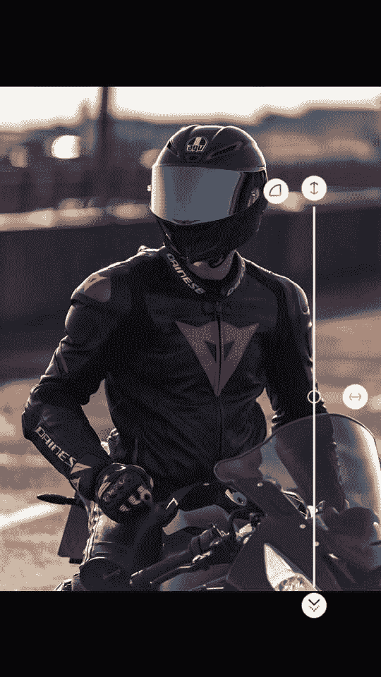

[WeChat_20230629161608.mp4](https://internal-api-drive-stream.feishu.cn/space/api/box/stream/download/all/DoVMbsE7FoekOQxuvebcN5zYn0f)

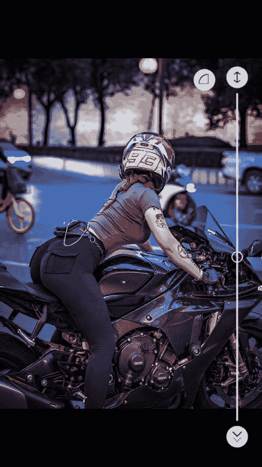

[WeChat_20230629161611(2).mp4](https://internal-api-drive-stream.feishu.cn/space/api/box/stream/download/all/Mb3PbggWAoOcfrxl0qVcDiEDn5A)

大家先看上面两个视频

一句话来说就是：用 `SD` 技术生成 赛博朋克机甲风 图片，实现超酷的“变装”效果

> `SD` 指的是 AI 绘画工具 `Stable Diffusion`，东子我之前也分享过教程

因为加上 BGM 卡点，让整个视频视觉效果很好，本就符合短视频平台的调性，可以获得比较大的流量

> 以上两个视频在抖音都有上万赞，而且后续肯定会有几十万赞的视频出来

但如果只是流量大，还不足以引起我的重视，让我真正觉得异常的地方，在于评论区

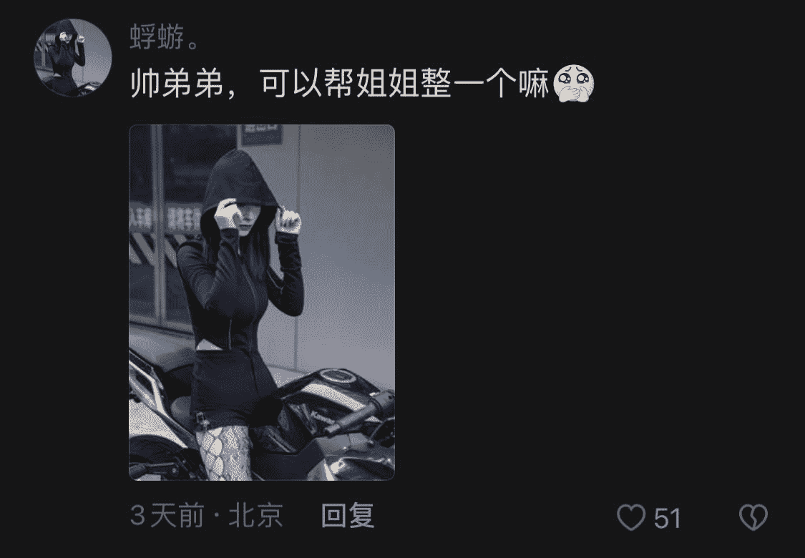

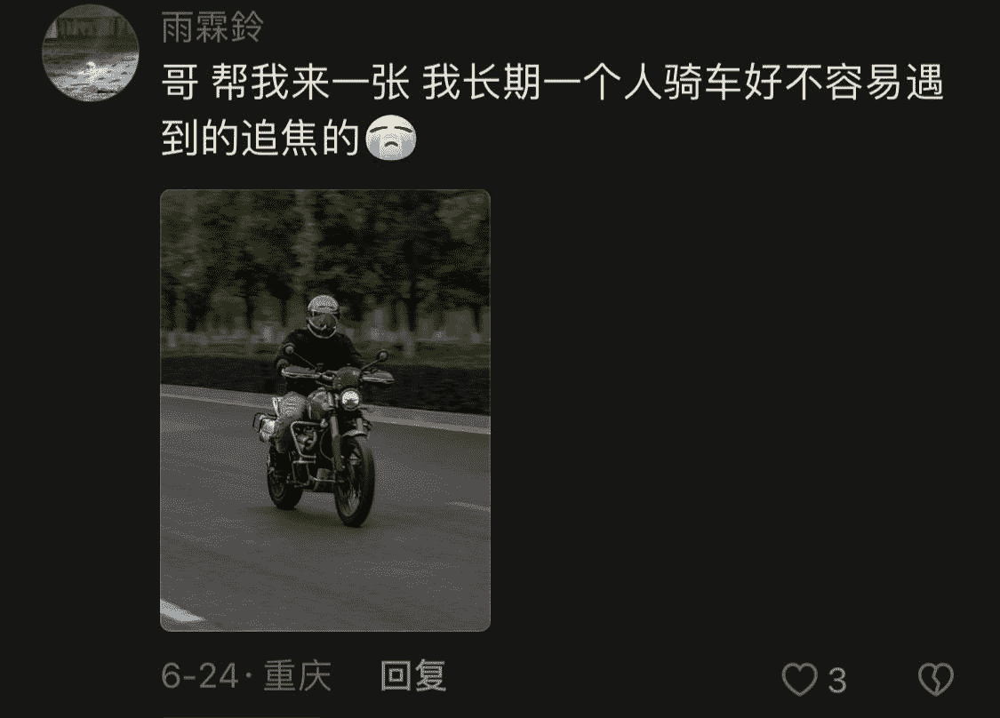

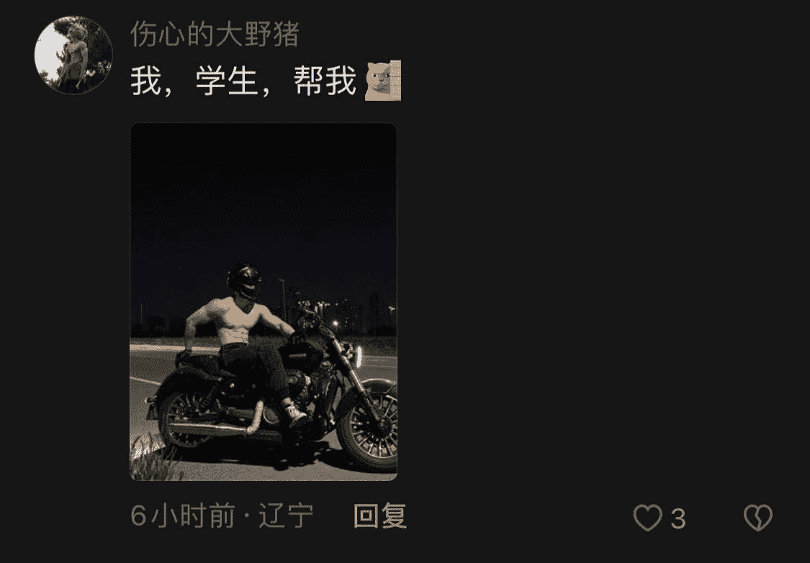

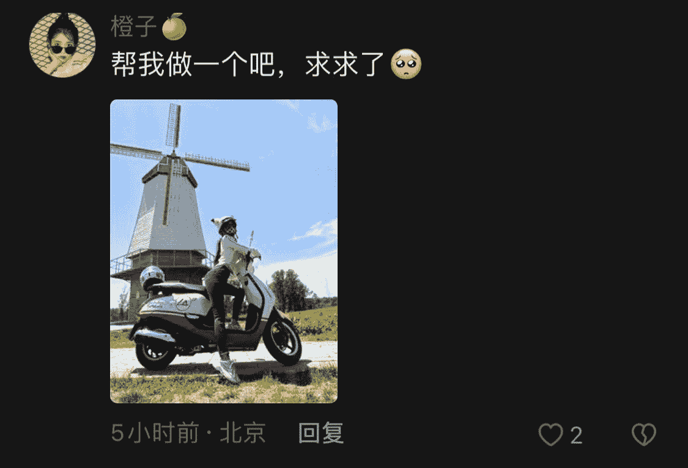

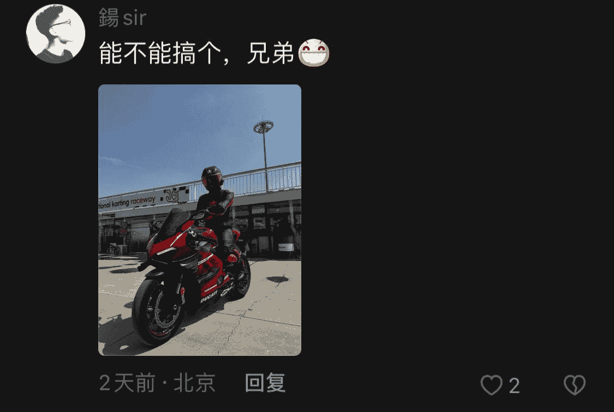

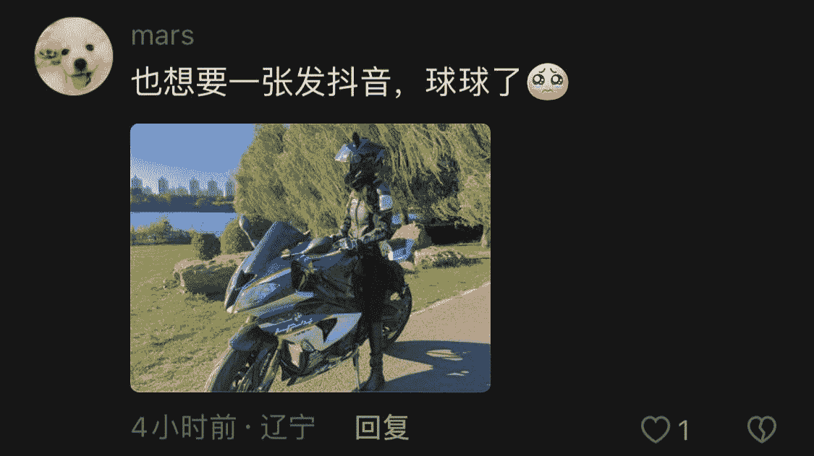

1000 条评论里面基本有一大半都是发图请求帮忙做的，这意味着什么？

意味着需求存在，而且量不少

接着我又挖掘到了一条更加说明异常值的案例

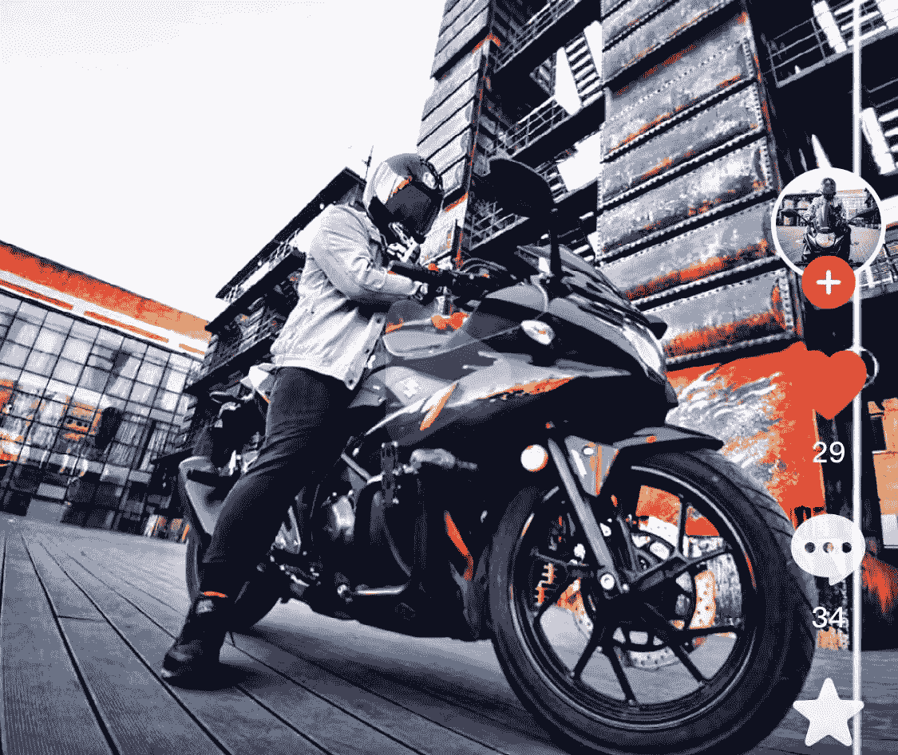

这是一条只有 29 赞的视频，做过抖音的朋友都知道 29 赞是非常低的了

但这条视频的评论，却有 34 条

而在这 34 条评论里，有近 10 条是这样发图的需求

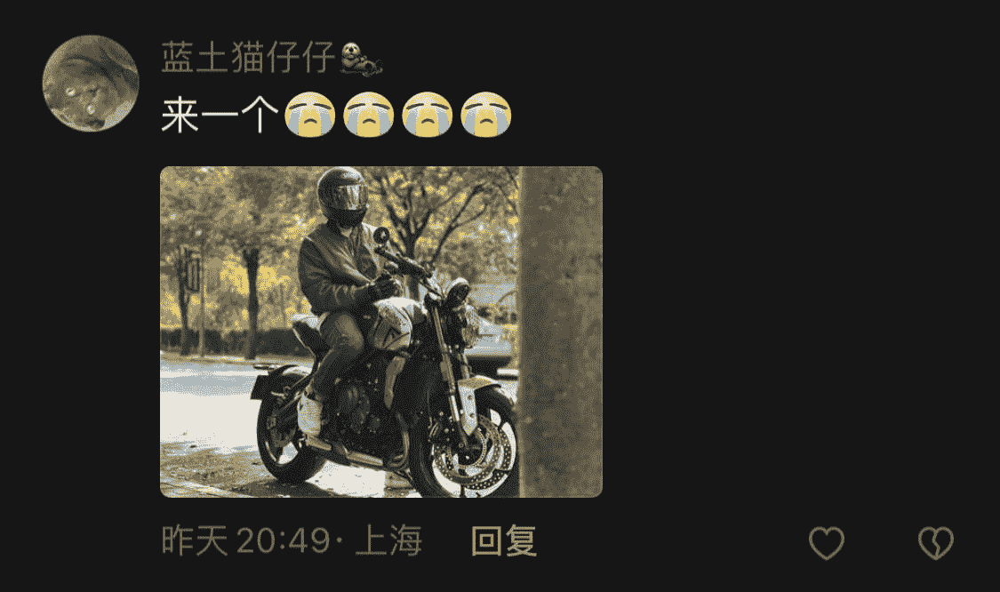

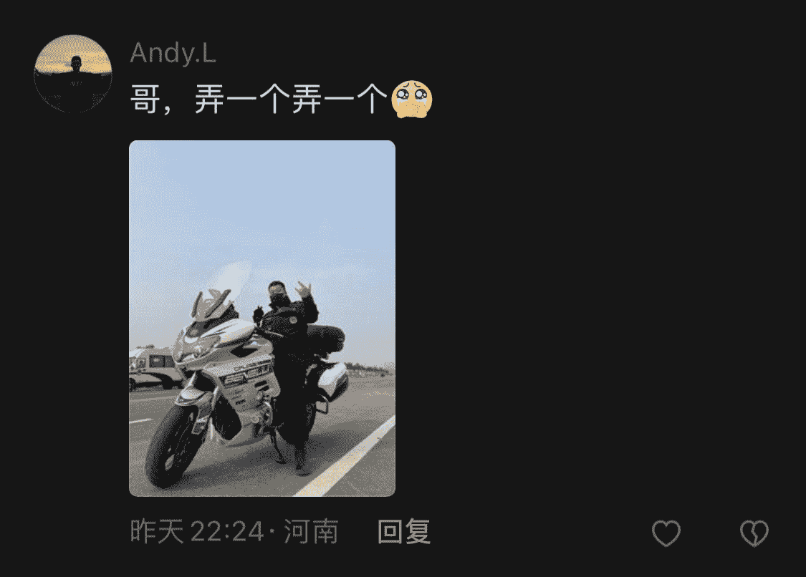

再来看一个非常离谱的异常值例子，这个视频一定要看！！！

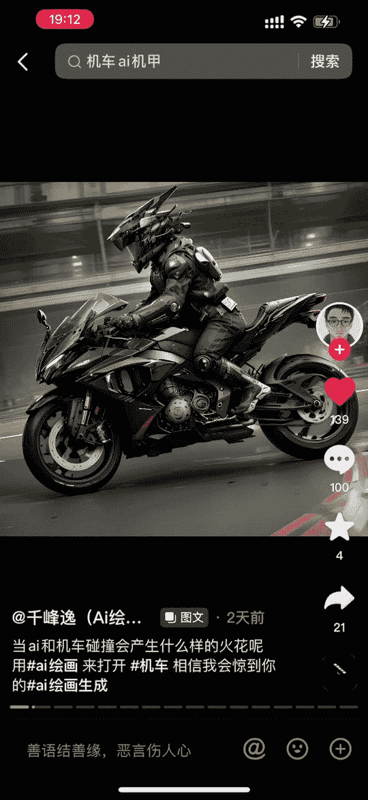

[WeChat_20230702163538(2).mp4](https://internal-api-drive-stream.feishu.cn/space/api/box/stream/download/all/PRnobQup1oRQvPxAVMjceugHnuf)

评论区的需求，刷都刷不完……

而这，竟然是在一个 139 赞的视频里出现的

139 赞，100 条评论，几乎全是需求

> 在这里我必须要先声明，我自己还没有从 0-1 跑过整个流程，我只跑通了制作流程

> 当我发现我有能力做出来和视频一样，甚至更好的效果后

> 我就赶紧拉洋哥交流，并且把这个项目拆解文章写下来，想尽早地把这个异常值分享给大家，让大家吃到红利

> 所以我没法百分百给大家保证这个项目一定有前途，做了一定能赚到钱，但其实这也正侧面反应了这个项目确实是属于极早期的阶段

> 我更推荐大家把我的话当作信息，你自己去思考，【一个 139 赞的视频，有 100 条评论，并且几乎全是需求】是什么概念，值不值得为这个项目付出一些努力

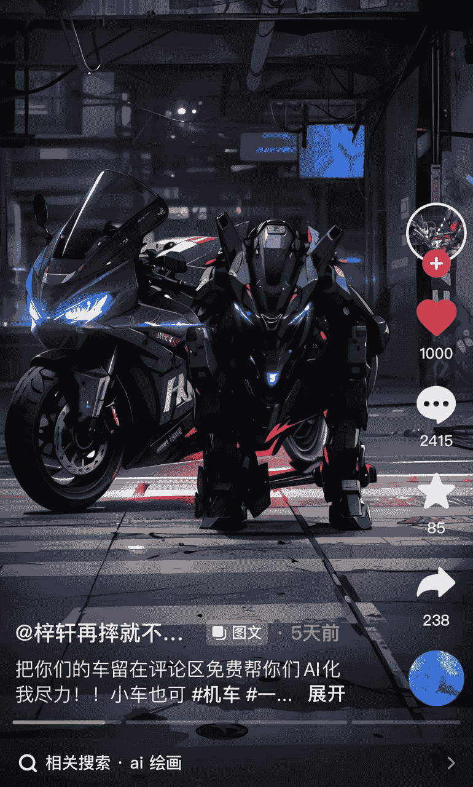

这个也是 1000 赞 2400 评论

意味着什么？朋友们，意味着这里也许有非常好的机会

要知道最重要的一点，很多时候流量不一定有用，如果流量群体没有付费能力，那流量的价值其实是不高的

> 我自己公司是做动画账号的，有好几个全网千万粉账号，但因为面向的群体是小孩子居多，真的是空有流量却难以变现

而需求 `AI` 机车图的客户呢，基本都是成年人，本身自己已经愿意为机车这种比较酷的东西付费，再为一张 `AI` 机车图付费基本也不会抗拒

因为对大众来说实在是太酷了，买一张照片或者定制一个视频用来发到自己的社交圈，朋友圈，多酷啊！

我通过一点小套路，得知了一位目前在做 `AI` 机车账号的博主（只有 2000 粉丝），一张图是 150 块，每天至少能接 20-30 单往上

> 对于普通人来说，利润其实很可观了

另外一位博主说（只有几百粉丝），刚开始做，现在私信已经被刷爆了，每天消息根本回不过来，单单一天免费的做了 300 张往上，付费的有 100 张往上，他的单价是 25 一张

当然这种数据一定是有水分所在，把整个收入对半砍一下，或者按 30% 去算可能会更接近真实数据

除此之外，因为现在做这个项目的大多都是杂鱼，不太会互联网引流变现那套方法，所以淘宝闲鱼 `SEO` 也许也能吃到一定份额，目前无论搜 `AI` 机车，`AI` 摩托，都没有人占领

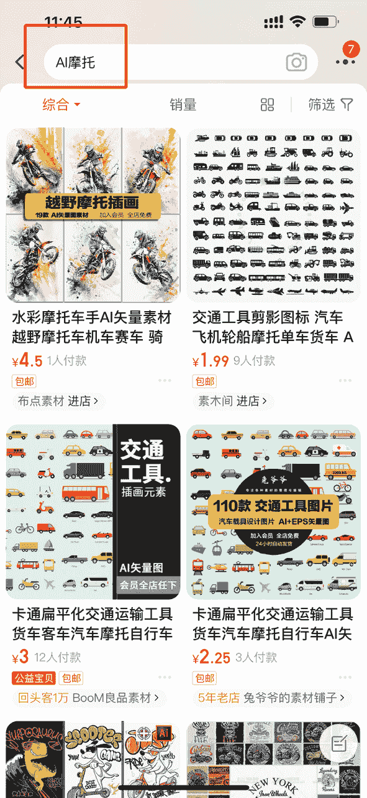

可见赚钱之道就在其中

更重要的是，我这两天看下来，虽然有一定的人在发图，但真正下场把这个当成项目变现去做的人其实寥寥无几

第一是还没多少人知道

第二是别人不一定能意识到这是异常值

第三是本身需要具备 `SD` 技术，有一定门槛

而恰巧，东子三者都具备 hh（这人真 tm 不要脸）

于是赶紧把这个异常值分享出来

所以现在下场去做的话，大概率是能吃到红利的

## 二、变现方式、量级、周期

### 1.变现方式

变现方式有很多种，但最大头的其实和之前的 `AI` 头像号一样

1. 通过公域平台做内容，引流私域卖图变现

2. 知识付费/分销社群

需要注意的就是各个平台的引流手段，不要太过分被平台封号了

> 这点星球很多朋友都已经做过分享，大家可以先去看看，后续我也会分享出我自己觉得比较好的的引流方式

除此之外，我还想到 其实可以直接去混机车圈，加各种贴吧，社群，圈子

在机车圈分享视频引流，也是一个非常高效的方法，客户很精准

### 2.定价与成本

单张图定价：20-99 元

这个只是我预估的价格，虽然那位博主卖 150 元 1 张，但就我自己来说，超过 100 块去买 1 张图是有点贵了

所以如果是我的话会定价 19.9 或者 66.6 一张，具体得看市场接受度反应，用来做信任产品

因为很多人肯定不止想做一张的，所以做低价一点卖信任，之后客户还会找，这样就不会不划算了

但肯定是不止于信任产品的，还要有更高的利润产品

可以通过给客户定制化出图，做得更精细，做更多种风格，而且做多张给你任选，甚至再帮你把视频都做好，让你直接能发出去装逼

这样再去收 99—199 的价格，客户相对就能接受很多

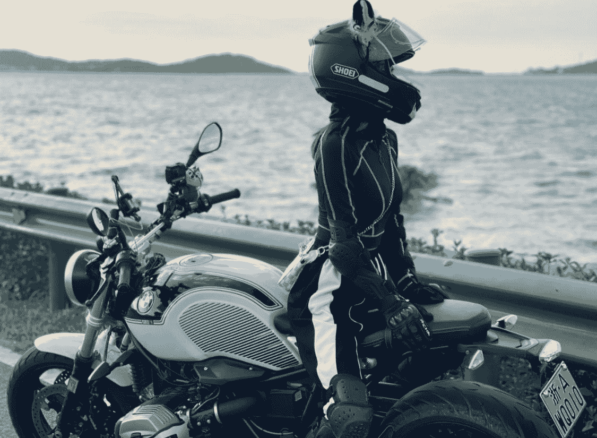

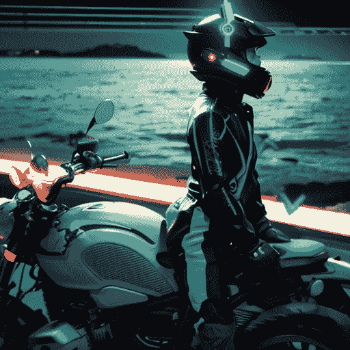

定价讲完了，那成本呢？

成本其实只有时间成本，先花几个小时把教程学了，然后尝试制作，一开始可能慢一些

后面基本出一套精细化的图只需要半小时，如果只是单张简单的图，5 分钟足够了

套上剪映模板做成视频，一共就 10 分钟

### 3.变现量级

> 这里我们只是为了计算一个大概的数额，计算方式并不严谨，但会有一定指导意义

我们按最低 20 块一张图算，一天发 3 条视频，能引进来 20 单的情况下，一天变现就是 400，一个月就是 12000

当然这么算非常不严谨啊，还有很多因素没有考虑进去

但也是有一定指导意义的，1 个人 1 个号得考虑一些因素

但如果 1 个人弄多个号呢？

在我看，做这类互联网项目最有效的手段就是以量取胜

你 1 人搞个 5 个号，每天发 5 条视频，全平台分发，一天 25 条视频

这个量一铺下去，成功率就会非常高，一天接 20 单不太可能做不到

万一哪条视频爆了，接单甚至都接不过来

但我们只做保守估计

1 人 1 号的情况下，当成副业可以赚点小钱

1 人 5 号，甚至 10 号的情况下，月入 1w 在我来看不是太难

当然了，我说到这里大家一定一定要当我是在口嗨

再次强调因为我自己还没来得及去跑通整个流程，发现这个异常值后就赶紧写文章给大家分享了

洋哥那边后续也会配人去把这个项目玩起来，但更重要的还是大家自己的理解

把我的话只当成是信息，不一定是事实，你自己现在看到这些信息了，怎么去判断项目的可行性？这才是正确的

### 4.项目周期

那这个 `AI` 赛博机车项目能做多久呢？

首先单拿目前的情况来看，只是做几个月是没问题的

天涯神帖这个这么吃风口的项目都持续了两个月以上

`AI` 头像号出来这么久，目前也还算在红利期

所以 `AI` 赛博机车号做 2 个月往上肯定是可以的

但如果这个客户群体只有机车一族的话，那肯定还是要再斟酌斟酌，圈子本身是相对小众的，即使互联网能放大，我们也需要更大的增长空间

所以我又去挖掘了其他的变现空间

## 三、`AI` 赛博 x 万物

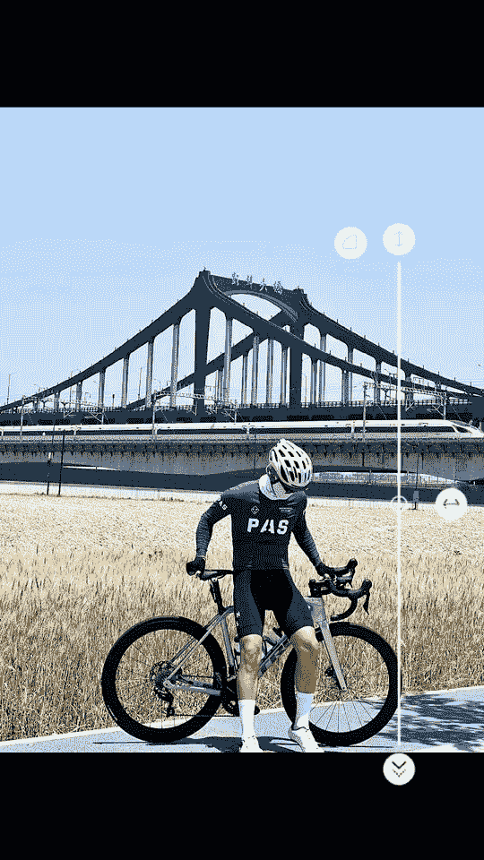

[WeChat_20230702163700.mp4](https://internal-api-drive-stream.feishu.cn/space/api/box/stream/download/all/T9hvbnd8RoAs53xrtviczSKOnWE)

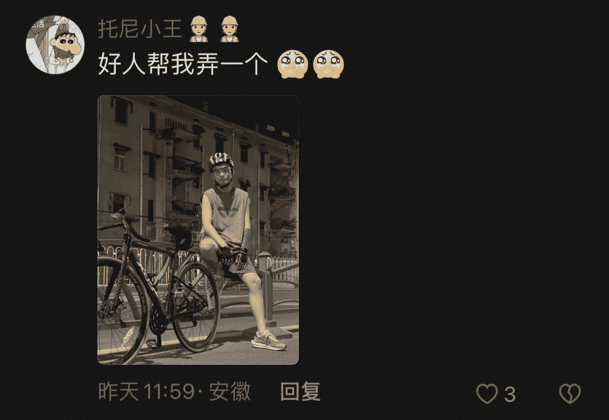

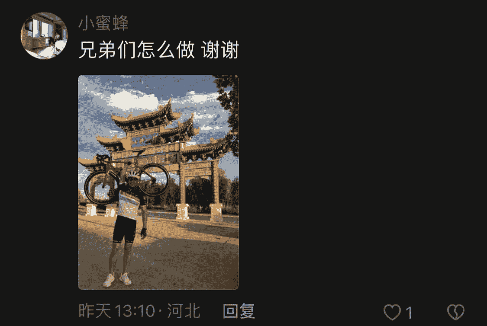

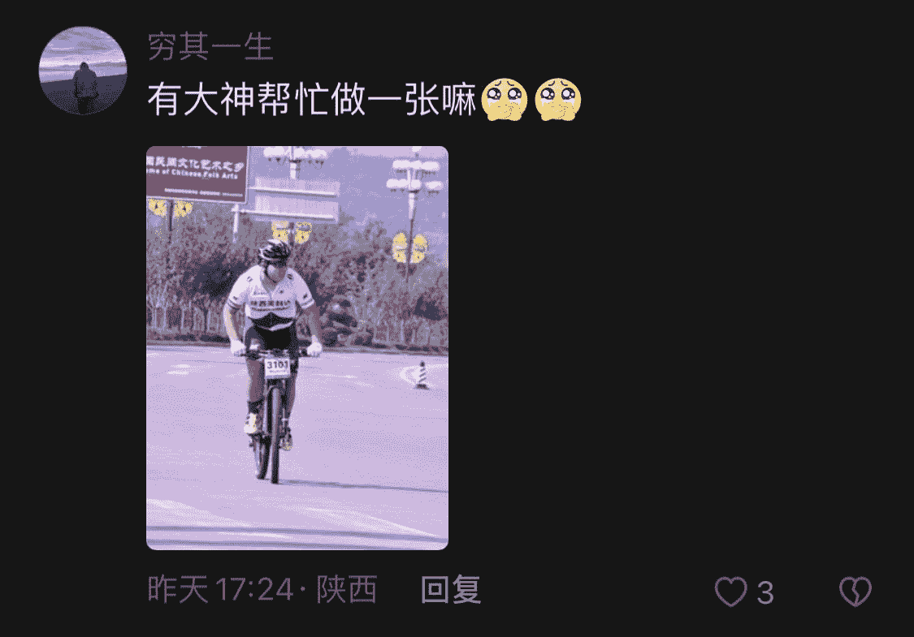

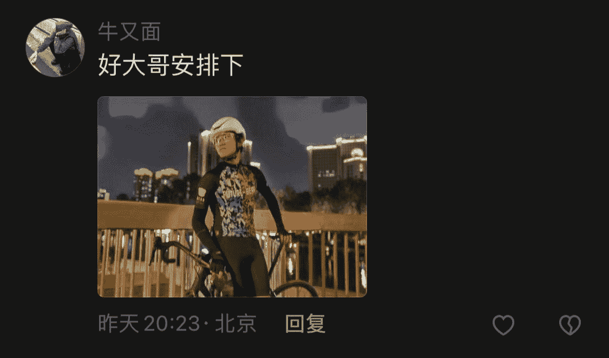

`AI` 赛博自行车图也一样可以

这个视频获得了 2w 赞，并且评论区自行车一族也是有这个需求的

而且我觉得这个方式其实不一定非得是骑行的图片，仅仅是拿照片来做也是非常有吸引力的

所以不用担心受众小的问题，大前天 `AI` 动漫人物火，前天瞬息全宇宙火，昨天穿越之旅火，今天机车火，每段时期都有能火的，只要技术能顺利承接，就一直有市场

在内容方向上，短视频平台一直都会有爆款 BGM 和爆款模板出来，把这些新爆款的东西结合 `AI` 赛博图，就能做出又是新的爆款内容来

## 四、项目可行性以及适合人群

### 项目可行性

① 流量：内容本身符合短视频平台的调性，出图足够酷的话，播放量不会低

② 产品：有需求，需求量目前来看还很大，而且现在早期阶段，现有的供给完全跟不上

③ 变现：变现路径简单清晰，把引流渠道搭建好，就可以直接获客了

④ 交付：不同人群可以有不同定价的产品，还会有复购，交付也很轻松，最坏的情况无非是退款

### 适合人群

① 执行力强

② 心态好

③ 愿意直面困难

④ 每天能抽出时间做内容

⑤ 需要有一台配置不错的电脑

#### 电脑配置需求

`NVDIA` 显卡，2060 以上最好

#### 做这个项目最大的难点

1. 执行力

2. 心态

大多数人做了几个视频发现没数据，得不到反馈就立马放弃了，其实这无论做哪个项目也做不起来的

做内容本就需要有很强的执行力，大胆试错，不断迭代，以量取胜

给自己定一个目标，至少坚持一个月，或者 30 期视频

因为要么起不来，一旦起来了后面都是顺的

心态端正好，先判断自己的内容是否做到位了，是自己觉得到位了，还是观众也觉得到位了

如果内容到位了，剩下就是等平台打标签，数据差不一定是内容差，有可能只是没推送到精准的人群，没打上标签

一旦之后有一期跑出来了，标签打上了，流量就来了

#### 做出 `AI` 赛博图需要掌握 2 个技术

1. `Stable Diffusion` 技术

2. 剪辑技术

其中 `SD` 技术不难！不难！不难！但是会繁琐

看到一堆复杂的界面以及复杂的流程，内心本能会抗拒和逃避

但其实只要耐下心来一步一步跟着我的路子，一定可以学会

因为这个只是繁琐的事情，而不是困难的事情

需要开头两天每天抽出 2 个小时以上学习，学完自己再花几个小时熟练掌握就可以了

剪辑技术基本不用学，直接套剪映模板就行了

## 五、`SD` 制作 `AI` 赛博图教程

[`AI` 赛博训练营共创手册](https://ry5hwpuf7b.feishu.cn/docx/DaS4dGu5novJxNxmQvdcwli6nrh) 共创手册在这里，更多的细节问题包括视频教程在这里查阅！！！

### 【说明 1】

制作 `AI` 赛博图有 `Stable Diffusion` 基础最好，如果没有，无脑跟着步骤操作也可以制作出来

教程主要在讲解如何操作上，不会对某个 `SD` 功能做过多的原理讲解

[《`Stable Diffusion` 终极宝典》](https://ry5hwpuf7b.feishu.cn/docx/HYrZdLBMRorB0qxKqFFcQ075nWf) 如果想详细学习 `SD` 基础可以看这篇文章

### 【说明 2】

因为项目在早期阶段，我所作的探索也没那么深

所以在大家把我的方法论学会之后，一定不要止步于此

在这个基础上去迭代，才更有可能拿到成绩

目前还需要迭代的三个部分

一、出图的质量

二、内容的创作

三、变现的方式

### 【1】完整流程

接下来教程正式开始

制作 `AI` 赛博图由以下 6 部分组成

1. 模型

2. 提示词

3. 基础参数

4. `ControlNet`

5. 图片高清处理

6. 剪映制作成视频

所用到的模型、提示词等资料全部在网盘链接里都可以找到

#### 1.模型

模型我最推荐的是 `comix v3.1`

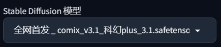

除此之外，白城主综合机甲、`majicmixRealistic`、`revAnimated`，这三个模型也可以

每种不同的大模型都会产生不同的效果，没有哪个是最正确的答案，需要大家多多尝试

就像我前面说的，完全照抄我的做法，至少可以有 60 分，但如果要更好，需要我们大家一起探索

#### 2.提示词

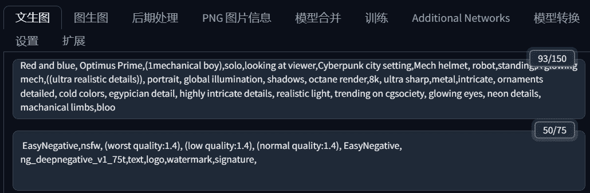

通用提示词如图，精细化的话需要根据图中的元素再添加其他提示词

已放到网盘链接里了，还是那句话，我给出的不一定是最好的，需要大家一起来探索

#### 3.基础参数

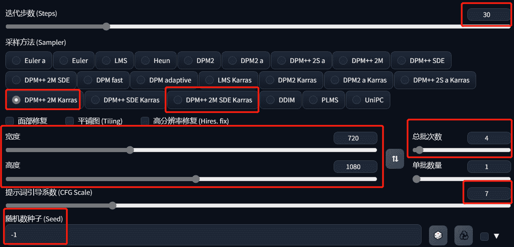

① 迭代步数：30（28-32 都可以试试看）

② 采样方法：`DPM++ 2M Karras` 或者 `DPM++ 2M SDE Karras`

③ 宽高比不用设置，后面会自动调节的

④ 总批数设置 4 批，抽卡概率高些

⑤ 随机数种子：-1

#### 4.`ControlNet`

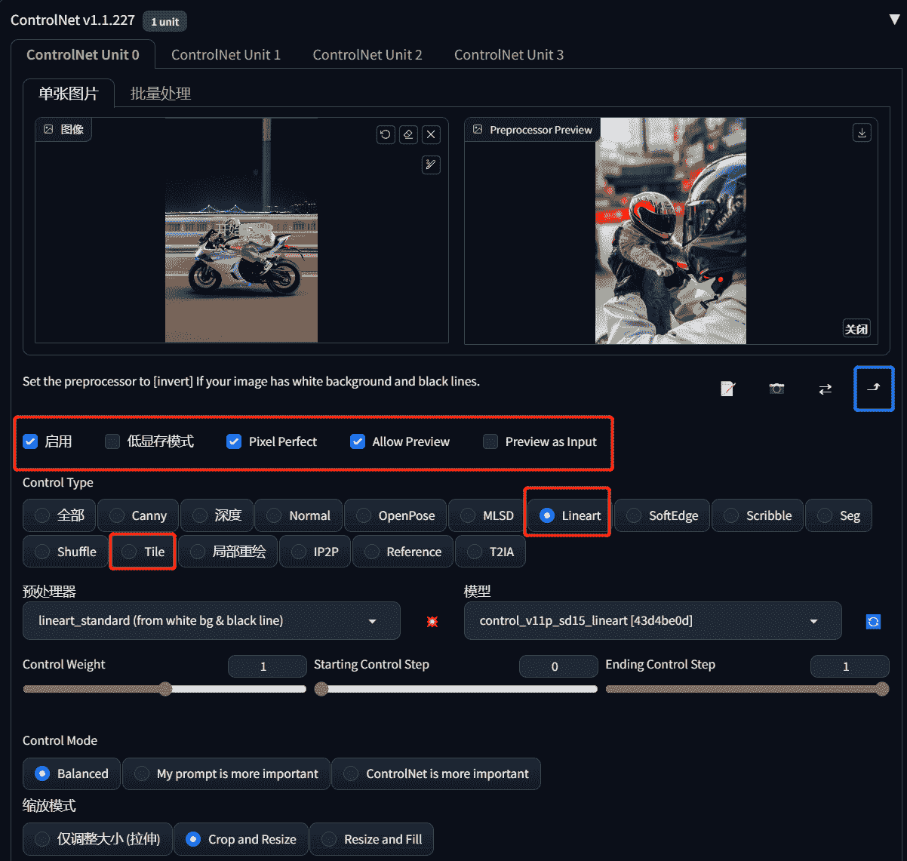

① 把启用、`Pixel Perfect`（完美像素）、`Allow Preview`（允许预览）打开

② `ControlNet` 模型选择：`Lineart` 或者 `Tile`，前者的采样方法是线稿，后者的是先模糊再放大

两种会出来完全不一样的风格，一般是两个都试一下，看哪个效果好

③ 弄完点击蓝色框框可以把图片尺寸替换上去，但是要注意会不会过大，如果过大就要长和宽都除以 2

最后点击生成就能出图了，具体的方式可以看后面的视频教程会更好理解一些

#### 5.图片高清处理

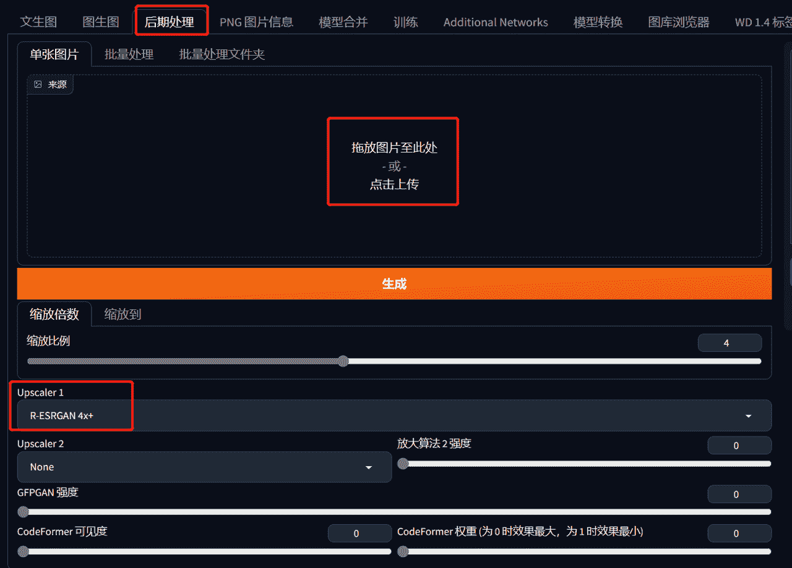

找到【后期处理】选项

放大使用 `R-ESRGAN 4x+`，点击生成，即可把图片变高清

### 【2】问题解决

#### 1.`Stable Diffusion` 怎么安装

① 可以看我这篇文章学习，也可以网上搜索引擎搜一搜都能找到解决办法

② 如果是 `A` 卡、`mac` 系统、电脑配置低等情况，可以考虑用 `AutoDL` 云平台来操作 `SD`

#### 2.大模型怎么安装

这里的 `SD` 根目录就是大家在下载时，存放 `SD` 的那个文件夹

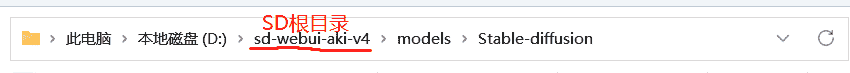

#### 3.宽高比插件怎么安装

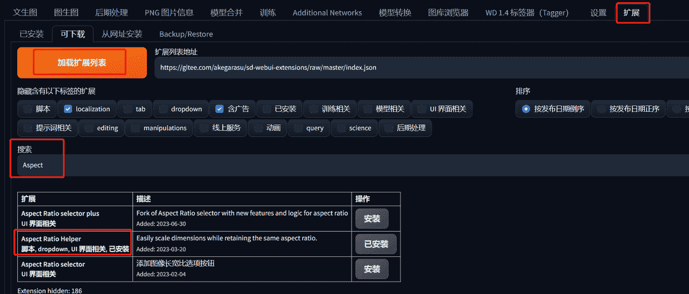

① 找到【扩展】选项

② 点击加载扩展列表

③ 搜索【`Aspect`}

# ④安装【`Aspect Ratio Helper`】

云平台用户也可自行安装

https://github.com/thomasasfk/sd-webui-aspect-ratio-helper.git

## 4.`ControlNet`怎么安装

> [《`ControlNet`终极攻略》](https://ry5hwpuf7b.feishu.cn/docx/NeqIdWC9PovqQ6xruAJcErqHnxc) `ControlNet`的教程可以看这篇文章：

### ①下载预处理器

下载网盘里的 `1.预处理器` 文件夹

里面有一个 `downloads` 文件夹

把整个文件夹复制到SD的文件夹里面

**具体位置**：`SD文件 > extensions > sd-webui-controlnet > annotator`

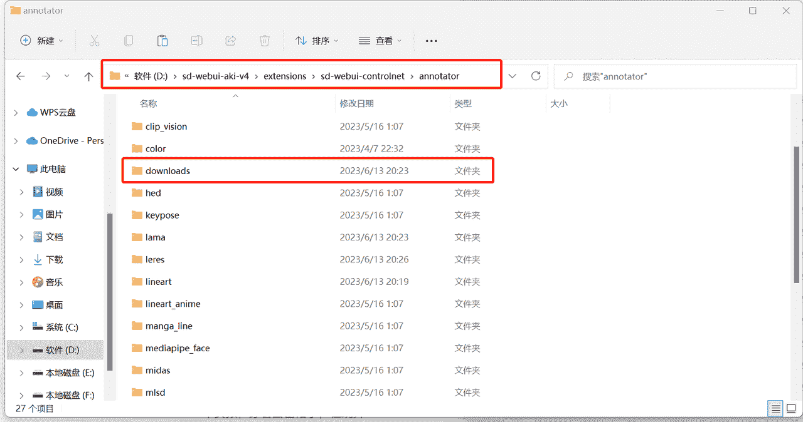

### ②下载模型

下载网盘里的 `2.模型` 文件夹

里面有14个模型，把这些模型复制到SD文件夹里

**具体位置**：`SD文件 > models > ControlNet`

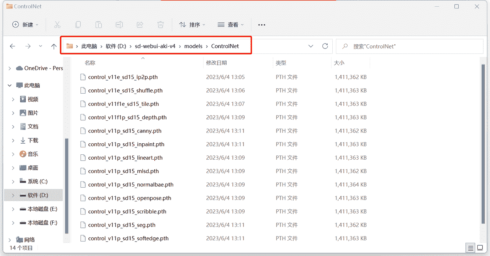

快闪分享PPT

[`AI赛博机车图.pptx`](https://internal-api-drive-stream.feishu.cn/space/api/box/stream/download/all/PX7AbFsTPoo1tlxexdXcTAegntl)

快闪直播回放在这https://swnvq.h5.xeknow.com/sl/4i1ur4

网盘链接：https://pan.baidu.com/s/1baNTCe9wGEN0sHYPvRabmA?pwd=wdz6

提取码：wdz6

[`AI赛博训练营共创手册`](https://ry5hwpuf7b.feishu.cn/docx/DaS4dGu5novJxNxmQvdcwli6nrh)共创手册在这里，更多的细节问题包括视频教程在这里查阅！！！

最后再次感谢破局俱乐部，感谢洋哥！！！

# 结尾

好了，以上就是我们这篇文章的全部内容

如果你对AI感兴趣的话，可以持续关注，也欢迎分享给你身边想学AI技术的朋友

我是吴东子，用奶奶都能听懂的方式，分享可以落地实操的干货，我们下篇文章再见！

吴东子AI账号简介：https://ry5hwpuf7b.feishu.cn/wiki/space/7283841978071072772?ccm_open_type=lark_wiki_spaceLink
