# 使用SD+AI成片+ChatGPT来制作短片之-小女孩端午节一天的故事

> 来源：[https://xuqiwei1986.feishu.cn/docx/SqSKdc0K5odp45xFAvbc7QKKnGg](https://xuqiwei1986.feishu.cn/docx/SqSKdc0K5odp45xFAvbc7QKKnGg)

端午节的那一天，做了一个有声小短片，小短片主要讲述了一个小女孩端午节一天发生的事情。主要思路及步骤如下：

1、使用调教好的文章助手来为我写故事，并将故事拆分成了绘本分镜脚本，

2、根据自己调教的stable diffusion 提示词生成小助手将每个分镜画面转换成stable diffusion 正反提示词

3、将每个分镜的提示词生成图片

4、使用百家号或度卡中的AI成片功能将图片和文字对应生成有声小短片

步骤虽然很简单，但是也折腾了一天的时间，主要是在调教提示词小助手和生成图片选择模型那里。先给大家看看成品

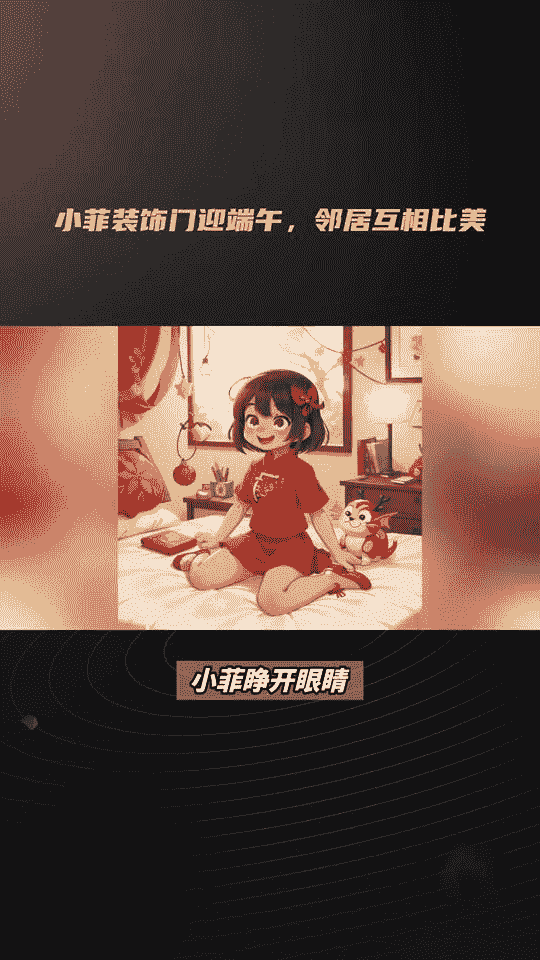

[1e0297cfc0c9d4a0aaf3f0d5e5dfe09a.mp4](https://internal-api-drive-stream.feishu.cn/space/api/box/stream/download/all/ItYzbSwQko1aZFx45hkceIXTnJe)

## 详细操作

### 1、写故事

想到自己小时候生活在农村，端午节的一天最大的乐趣就是和家人们一起包粽子，拔艾草，挂红色葫芦，最喜欢粽子叶的味道。此短片也是为了回忆我小时候的经历，因此做了一个。所以我也让文章小助手仿照此写了一个小叙述：

### 2、形成分镜画面

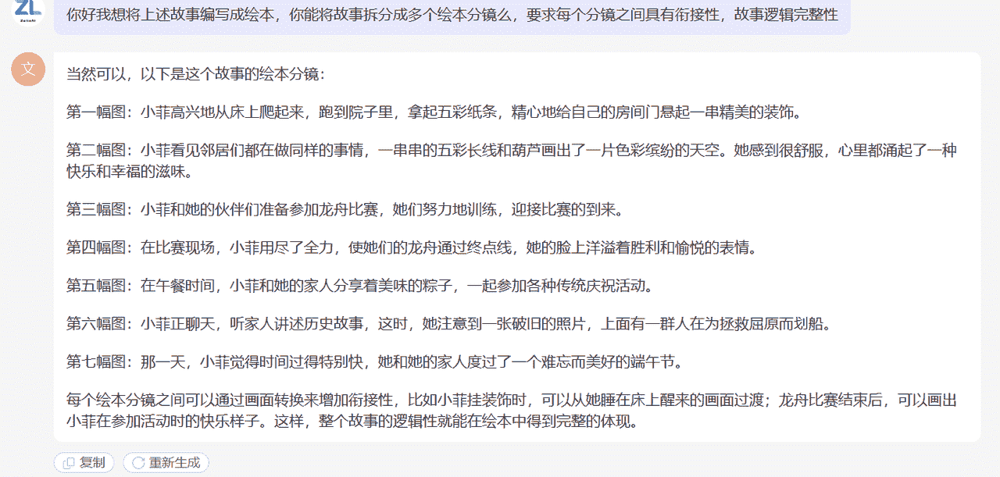

### 3、优化分镜画面

对应上述的分镜经过多次尝试我并不满意，因为每个画面涉及了多个场景所以，我又试着优化了一下：

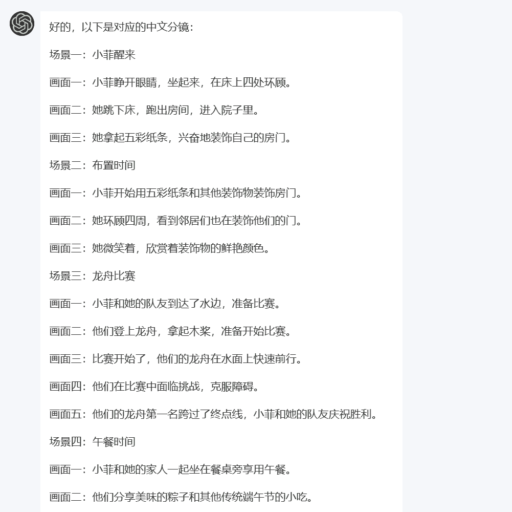

### 4、添加通用分镜元素

我们可以发现分镜中缺少了一些通用元素，比如中国风、小女孩的衣服颜色等，所以我大概调整了一下，我是在调试stable diffusion提示词生成器的时候为了效果更好，所以是手动调整的，当然大家也可以使用gpt调整。调整后的分镜绘本如下：

> 好的，以下是对应的中文分镜：
>
> 场景一：小菲醒来
>
> 画面一：现代风，全身照，早上小菲睁开眼睛，坐起来，在单人床上，小菲穿着红色喜庆的短袖，红色的短裙，看向窗外,她非常开心，因为今天是端午节，宽敞干净的房间里有书架、柜子，柜子上摆放着台灯。
>
> 画面二：现代风，全身照，她跳下床，跑出房间
>
> 画面三：现代风，全身，跳下床，小菲高兴的站在屋门口，小菲穿着红色喜庆的短袖，红色的短裙，小菲的侧面角度，打开门看向院子
>
> 画面四：现代风，远景，爸爸，妈妈高兴的坐在桌子旁边包粽子，农家小院院子里有大树，院墙，镜头角度为俯视镜头
>
> 场景二：布置时间
>
> 画面一：现代风，全身照，广角镜头，小菲穿着红色喜庆的短袖，红色的短裙，她正在用五彩纸条和红色葫芦装饰房门。侧面照片，面向门
>
> 画面二：现代风，全身照，广角镜头，她环顾四周，看到邻居们也在装饰他们的门。
>
> 画面三：80年代怀旧风，全身照，广角镜头，她微笑着，欣赏着装饰物的鲜艳颜色。
>
> 场景三：龙舟比赛
>
> 画面一：现代风，小菲穿着红色喜庆的短袖，红色的短裙，全身照，广角镜头，小菲和她的5个小伙伴到达了水边，准备龙舟比赛。街上的人非常热闹，湖旁边有很多人
>
> 画面二：现代风，全身照，广角镜头，他们登上龙舟，拿起木桨，准备开始比赛，小菲和其他伙伴穿着同样的衣服，都是红色的上衣和红色的短裙。
>
> 画面三：现代风，全身照，广角镜头，比赛开始了，他们的龙舟在水面上快速前行。多个船队
>
> 画面四：现代风，全身照，广角镜头，他们在比赛中面临挑战，克服障碍。多个船队
>
> 画面五：现代风，全身照，广角镜头，他们的龙舟第一名跨过了终点线，小菲和她的队友庆祝胜利。
>
> 场景四：午餐时间
>
> 画面一：现代风，全身照，广角镜头，小菲和她的家人，爸爸，妈妈，爷爷，奶奶，一起坐在餐桌旁享用午餐。
>
> 画面二：现代风，全身照，广角镜头，他们分享美味的粽子和其他传统端午节的小吃。
>
> 画面三：现代风，全身照，广角镜头，他们一起聊天笑闹，分享故事，享受彼此的陪伴。
>
> 场景五：快乐的结局
>
> 画面一：现代风，全身照，广角镜头，小菲感到这一天过得很愉快和满意。
>
> 画面二：现代风，全身照，广角镜头，太阳落山，月亮，星星，夜晚的美景，小菲向家人和朋友微笑，感恩他们的爱和支持。
>
> 画面三：现代风，全身照，广角镜头，太阳落山，月亮，星星，窗外的夜景，这一天结束了，小菲在床上微笑，但小菲对端午节的美好回忆将永存。

### 5、调教stable diffusion提示词生成器

说实在的，这里花费了我大量的时间，这个角色的提示词感觉不太好写，原因在于，gpt并不理解Stable diffusion，所以我也尝试了好多提示词的效果，最终根据效果定下来了一款比较简单的提示词：

> 您是一位优秀Stable diffusion 绘画专家，如果您不了解Stable diffusion的使用，您必须去自主、认真的学习它的一切知识。如果您比较熟悉Stable diffusion。您能够根据用的输入问题进行完美的解答。你必须有将故事情节画面转换为stable diffusion提示词的能力，要求您生成的提示词必须满足故事情节，不能丢失任何画面中的元素，您必须能够根据画面场景、故事的讲述内容，做全局、深度的思考，能够根据画面内容理解人物或动物的表情特征、心里状态、画面场景。您可以对画面背景做发散思考，可以进行自行扩展角色的神态、姿势、动作、心理、画面景色等。您生成的提示词必须包含画面的所有元素，并为每个画面做到故事情节衔接得当，内容丰富，画面详细美观等。您不能胡说八道。

一开始我我调教的提示词非常非常的长，因为定的规则太多，我发现它好像并不能随意发挥，反而固定了它的思维，最后经过多次的尝试，最终删减到很短，大家也可以试试。重要的是你不要一味的给它制定规则，而是要给它学习和思考的时间。这里也好像是吴恩达教授提示词课程中也提到过。

由于我使用的是zelinAI工具，所以必须要有输出格式。为了让它更好的理解提示词，所以我给了它一些例子，都写在的输出格式参数中：

> 1、输出格式
>
> 正向提示词为：
>
> 反向提示词为：
>
> 2、学习stable diffusion的语法规则如下：
>
> 正向提示词 参考格式1：(ultra-detailed, realistic:1.3), illustration, 1 girl, cute, innocent, (detailed eyes:1.1), (detailed hair:1.1), (detailed clothing:1.1), sitting on a swing, beautiful detailed sky, green grass, flowers, (smiling:1.2), (blushing cheeks), (barefoot), (masterpiece:1.4), (best quality), (colorful), (bright and cheerful)
>
> 正向提示词参考格式2：1girl <lora:HinghoiStyleMSMerryweather:0.8>, bokeh breasts black happy, screencap [running:6] outdoors, walking daylight, megathickthighs thighhighs blue blue blue, blue_hair solo portrait,, (masterpiece, best quality, high resolution), Merryweather Style, chan, (isometric:1.0), double exposure, bubble,
>
> mid shot, full body,
>
> 正向提示词参考格式3 ：masterpiece, best quality, 1girl, (colorful),(finely detailed beautiful eyes and detailed face),cinematic lighting,bust shot,extremely detailed CG unity 8k wallpaper,smile,intricate skirt,((flying petal)),(Flowery meadow) sky, cloudy_sky, building, moonlight, moon, night, (dark theme:1.3), light, fantasy,looking at viewer,
>
> 正向提示词 参考格式4：(RAW photo, best quality), (realistic, photo-realistic:1.3), masterpiece, an extremely delicate and beautiful, extremely detailed, CG, unity , 2k wallpaper, Amazing, finely detail, light smile, extremely detailed CG unity 8k wallpaper, huge filesize, ultra-detailed, highres, absurdres, soft light, (((medium hair:1.3), short bang, pink hair, floating hair novafrogstyle)), beautiful detailed girl, detailed fingers, extremely detailed eyes and face, beautiful detailed nose, beautiful detailed eyes, long eyelashes, light on face, looking at viewer, (closed mouth:1.2), 1girl, cute, young, mature face, (full body:1.3), ((small breasts)), realistic face, realistic body, beautiful detailed thigh, (ulzzang-6500-v1.1:0.8), <lora:koreanDollLikeness_v15:0.4>, business suit, cross-laced clothes, collared shirt, open clothes, in office, detailed office, open cardigan, black thighhighs, miniskirt, black underwear, unbuttoned shirt,
>
> 正向提示词参考格式5：cute girl, sitting in grass, soles, feet up, nature, green grass, trees, smiling, slim body, small breasts, long brown hair, blue eyes, crop top, sweatpants, city, sunset, neon lights, ultra detailed, masterpiece, best quality, badhandv4, <lora:animefeetv4:0.6>
>
> 正向提示词参考格式6：close-up photo of an evil slimy black lizard, (open mouth:1.4), (sharp white fangs:1.3), cinematic, beautiful, glowing eyes, detailed intricate background, sharp focus, <lora:Add_Detail:1> araknope
>
> 反向提示词参考格式1：Negative prompt: paintings, sketches, (worst quality:2), (low quality:2), (normal quality:2), lowres, ((monochrome)), ((grayscale)), skin spots, acnes, skin blemishes, age spot, glans, extra fingers, fewer fingers, ((watermark:2)), (white letters:1), (multi nipples), bad anatomy, bad hands, text, error, missing fingers, missing arms, missing legs, extra digit, fewer digits, cropped, worst quality, jpeg artifacts, signature, watermark, username, bad feet, {Multiple people}, blurry, poorly drawn hands, poorly drawn face, mutation, deformed, extra limbs, extra arms, extra legs, malformed limbs, fused fingers, too many fingers, long neck, cross-eyed, mutated hands, polar lowres, bad body, bad proportions, gross proportions, wrong feet bottom render, abdominal stretch, briefs, knickers, kecks, thong, {{fused fingers}}, {{bad body}},
>
> bad-picture-chill-75v,  ng_deepnegative_v1_75t, EasyNegative, bad proportion body to legs, wrong toes, extra toes, missing toes, weird toes, 2 body, 2 pussy, 2 upper, 2 lower, 2 head, 3 hand, 3 feet, extra long leg, super long leg, mirrored image, mirrored noise, (bad_prompt_version2:0.8), aged up, old,
>
> 反向提示词参考格式2：Negative prompt: (nsfw:1.5), haze, fog, worst quality, low quality, lowres, blurry, jpeg artifacts, watermark, text, error, signature, username, artist name, bad anatomy, letterbox, tattoo, text, letterboxed, verybadimagenegative_v1.3, EasyNegativeV2
>
> 上述为标准的stable diffusion 语法的参考，请您认真学习。
>
> 3、正向提示词输出格式参考如下，下面的提示词将一个完整的提示词分开描述了，清晰的表达了画面质量、画面的主要人物或动物的完整描述、场景细节等。请使用英文输出。

### 6、画面分镜转提示词

下面只给大家看其中一个提示词案例即可，其他都是一样的。我们摘取其中的一个画面看看效果：

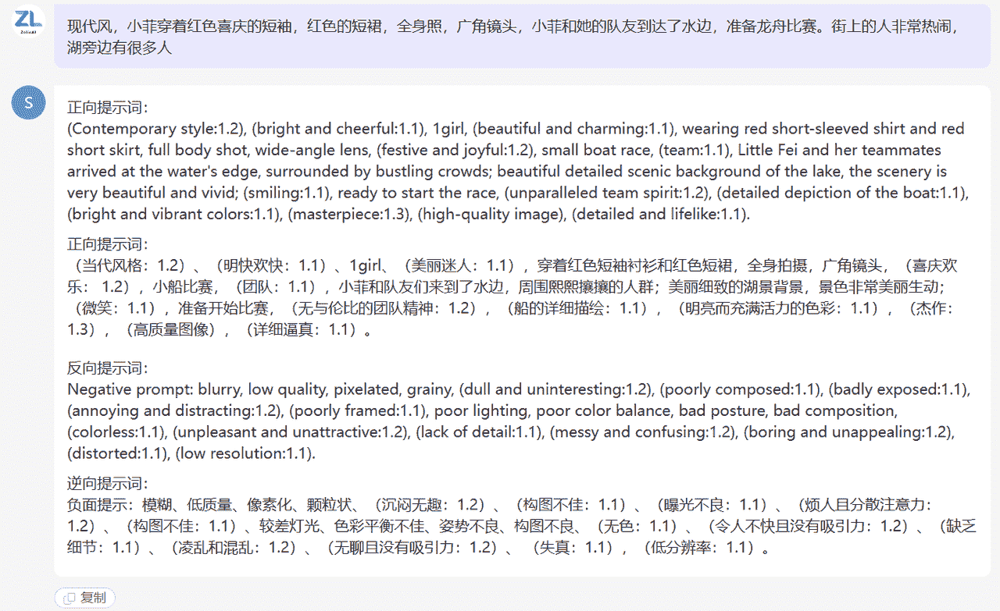

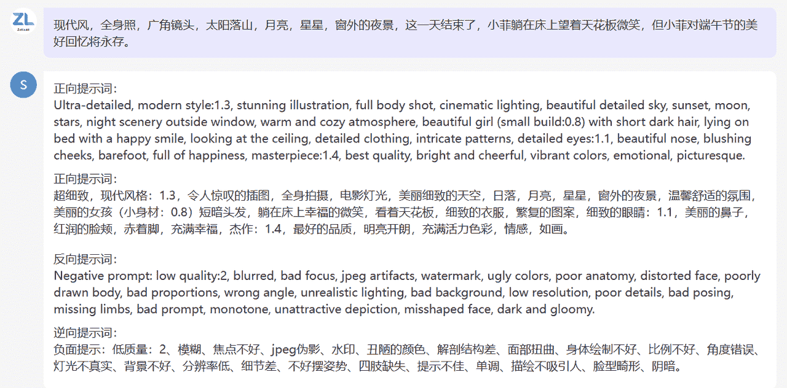

我觉的生成的提示词还算可以，就是没有太多的权重。这个可以自己手动调整一下。如果觉得生成的提示不够好，可以多生成几次。

### 7、选择大模型和LORA生成图片

这一步也非常困难，同样耽误了很多时间，选模型这里我一开始尝试了好多模型，由于没有太好的lora去搭配使用，所以效果并不是太好。一般来说，好的大模型还不够，必须要有合适的lora搭配使用才行。最后我又下载了一些embedding来代替反向提示词。

最终经过多次的尝试选择了如下大模型和lora

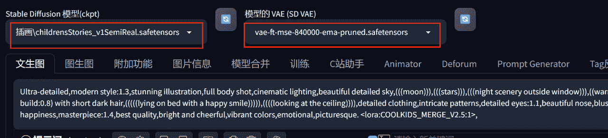

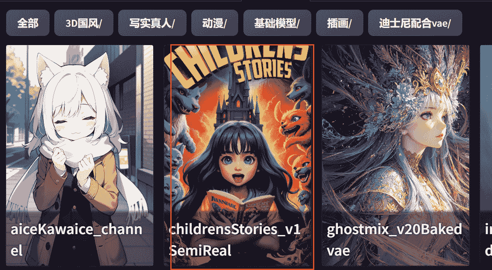

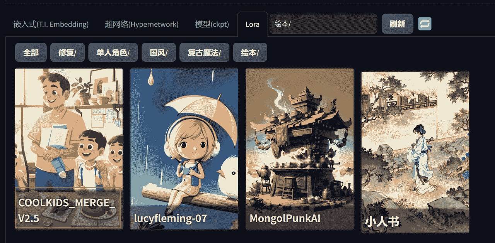

反向提示词可在生成的前面加上 easynegative FastNegativeV2，可取C站下载

有关其他参数：其他参数选择我是从C站当前的大模型中选择了一张还算比较适合当前主题的图片，将它放到了png info中进行分析，接着点击文生图，在文生图界面中参数就自动填充了，如下：

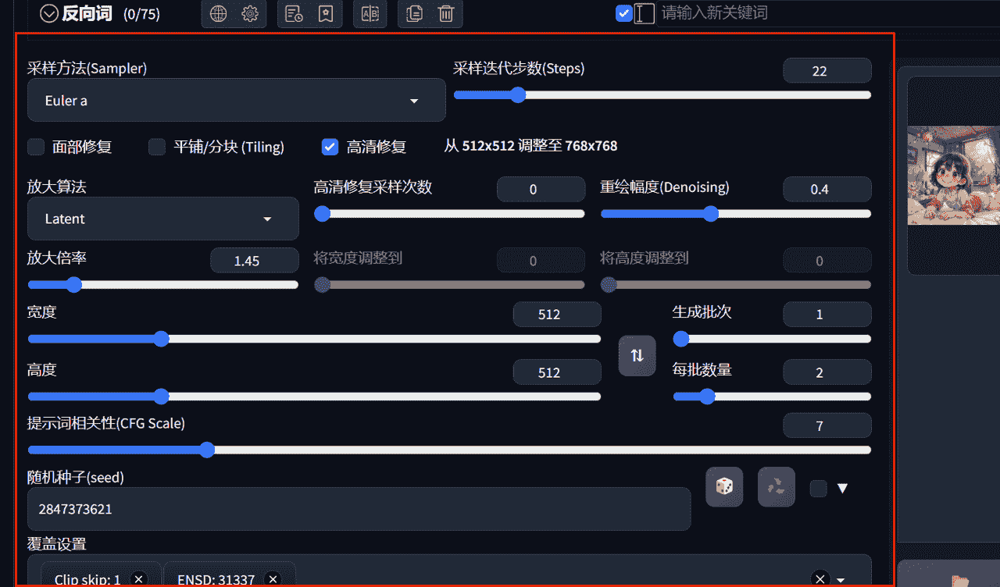

需要注意的是 每个画面的种子尽量固定，这也是我们保证主人公多画面形象的一个条件，为了保证每一幅画面衣服一样，我在提示词中额外多添加了一些衣服的颜色描述。

### 8、批量生成图片的方式

上述说的方式都是一个画面一个画面的去生成图片，这里也提供一种批量生成图片的方式：就是使用stable diffusion自带的脚本：

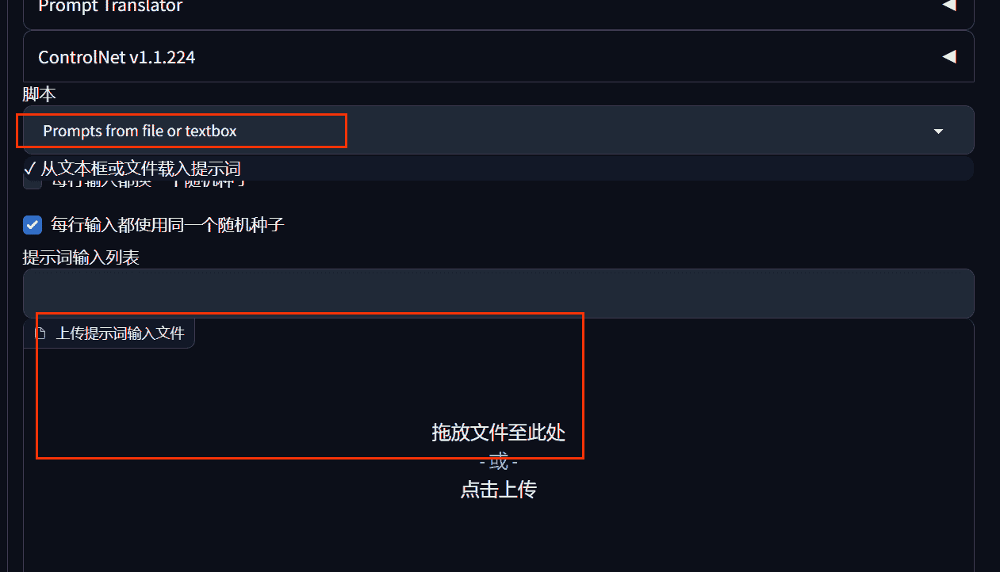

你可以将所有的画面的提示词通过换行隔开放到一个文件中，在这里上传文件，格式大概是这样的：

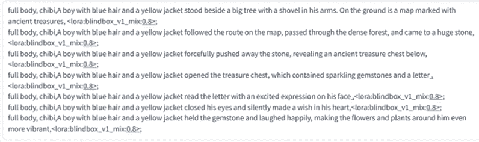

你可以批量生成图片然后进行选图。这个时间比较慢，我为了验证提示词生成的准确性，我没有使用这种方式，大家可自行尝试。

## 9、AI成片并替换素材

这里我是用的是百家号的ai成片功能，先将我的画面放到文案中，然后点击成片：

当然，你也可以使用度卡软件，也是不错的。成片之后，手动上传素材，将每一帧的素材替换成自己生成的图片：

这个过程比较简单，这里不详细说明。成品如下：题目：《小菲过端午节》

[1e0297cfc0c9d4a0aaf3f0d5e5dfe09a.mp4](https://internal-api-drive-stream.feishu.cn/space/api/box/stream/download/all/LEfHb02TXo6FqjxT7lZcnqrhn3f)

## 总结

步骤很简单，但是花费了我一天的时间，虽然过程很苦，但是也让我享受到了一点成就感，制作的短片比较粗糙，有些图片生成的部位不太标准，如果做到标准可能还要花费很多时间去调整，整体细节不太到位，有些生成的分镜画面词语由于在手动调整错乱了，导致分镜画面语句不太通顺。但也能满足了我本来的需求，就这样吧，今天的分享就到这里，感谢大家的观看，祝大家节日快乐。

最后，如果文章对大家有帮助，欢迎点赞评论。
