# 01、Stable Diffusion 本地化部署详细攻略

> 来源：[https://xuqiwei1986.feishu.cn/docx/ADXcdkyL9oLR1hxlDiMcdeNoneh](https://xuqiwei1986.feishu.cn/docx/ADXcdkyL9oLR1hxlDiMcdeNoneh)

哈喽，大家好，我是Stable Diffusion爱好者李岳，

今天给大家分享一下Stable Diffusion的本地化部署。

# **一、硬件要求**

内存：至少16GB

硬盘：至少60GB以上的磁盘空间，推荐SSD固态硬盘

显卡：推荐NVIDIA显卡

显存：至少4GB

Stabl Diffusion因为是在本地部署，对显卡的要求比较高，如果经济能力可以的话，建议购买一块性能较好的显卡。

我的电脑配置如下：

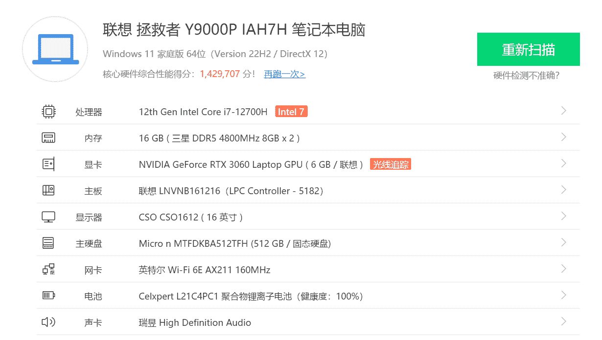

# ** 二、环境部**署

在安装Stable Diffusion之前我们需要先安装Python和Git两个工具

这些安装包和Stable Diffusion整合包我已经为大家打包好，有需要可以直接在我的网盘下载：

百度网盘：

链接：https://pan.baidu.com/s/1p2FAeFdwEN9NuFcsvUeWhg?pwd=1024

提取码：1024

夸克网盘：

链接：https://pan.quark.cn/s/aca68291e67d

## 1、安装Python

Python必须是3.10.6版本及以上才能正常运行stable diffusion，安装过程中务必勾选Add Python to PATH（这是将Python添加到系统环境变量，随时可以在命令窗口调用Python命令）注意：如果已经安装了Python 3.10.6以下版本，请先卸载后再重新安装Python 3.10.6

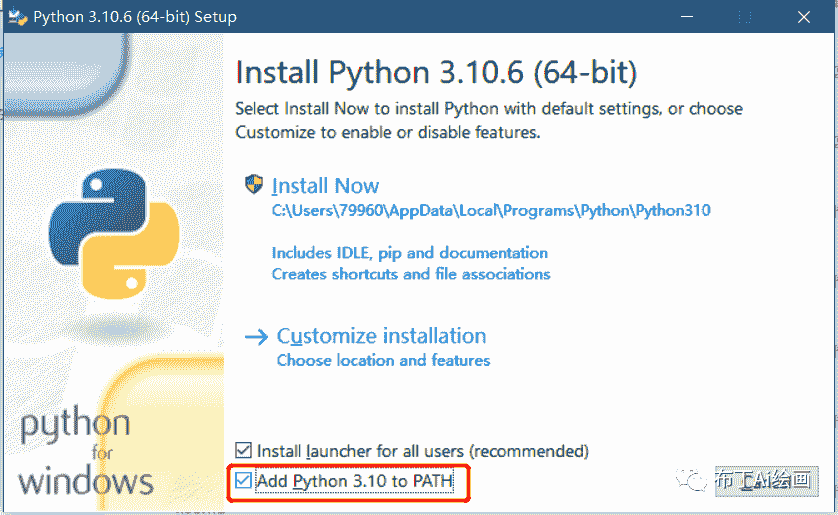

## 2、安装Git

git主要是用来下载和更新stable diffusion里面需要的一些内容，安装包与Python安装包在一起，大家下来后直接安装到默认路径即可。

##  3、部署stable diffusion

这里为大家准备的是B站大佬**秋叶的整合包**，下载下来后直接解压到一个磁盘空间较大的地方，这个整合包做了很多优化，即使你的显卡性能比较弱或者显存比较低也能运行，只是出图会比较慢。

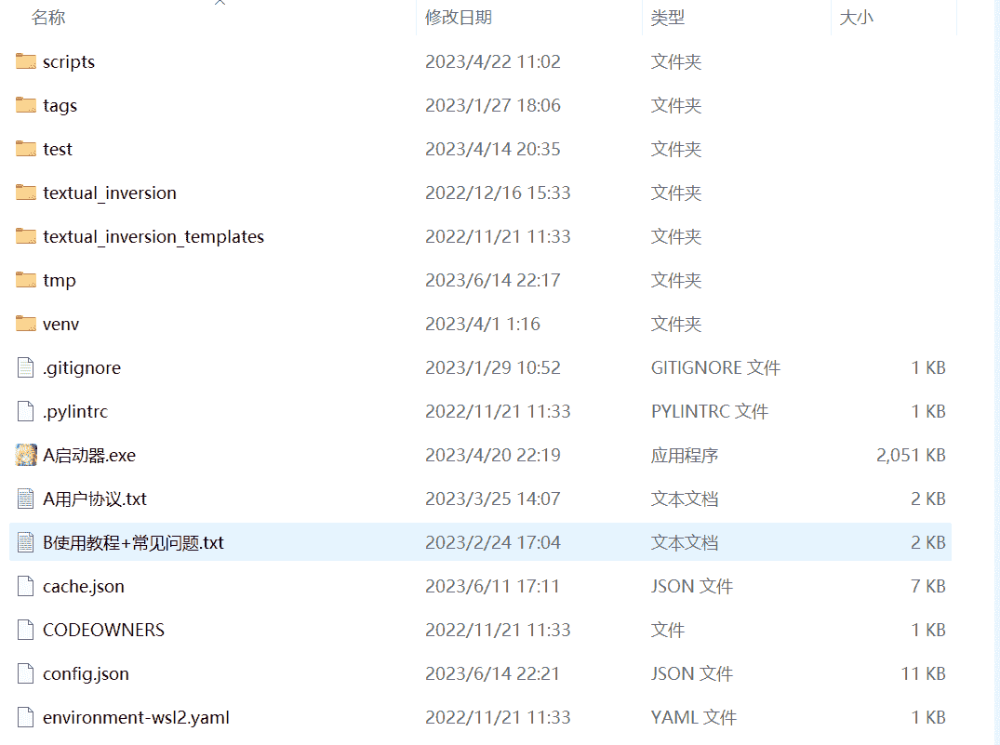

**我们在解压整合包**后，会看到如上的界面，双击A启动器.exe会弹出一个用户协议，大家手动输入协议内容保存即可。之后会提示你安装一个.Net的依赖控件，在我分享的下载链接里有对应的.Net安装包，默认安装即可。安装完之后我们就可以看到如下启动器的界面了。

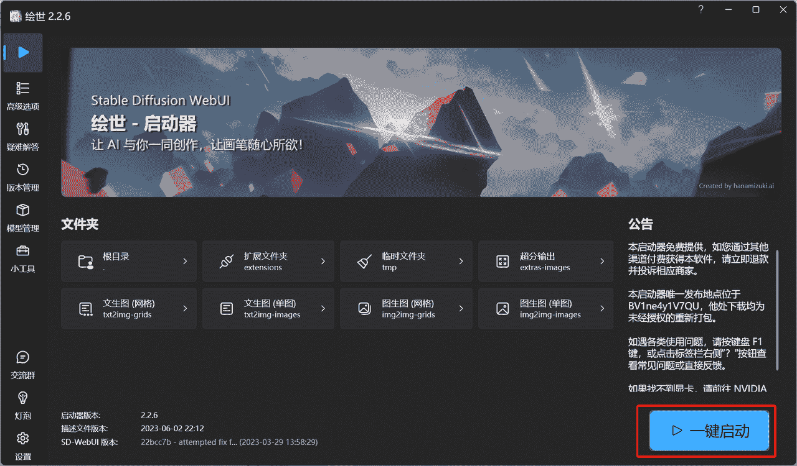

点击一键启动就可以启动stable diffusion了，首次启动会比较慢，看个人电脑性能。

## 4、整合包界面介绍

如果你还有其它配置需求，特别是你的电脑配置比较低的话，可以勾选其中的参数进行配置

### 1）、显存优化

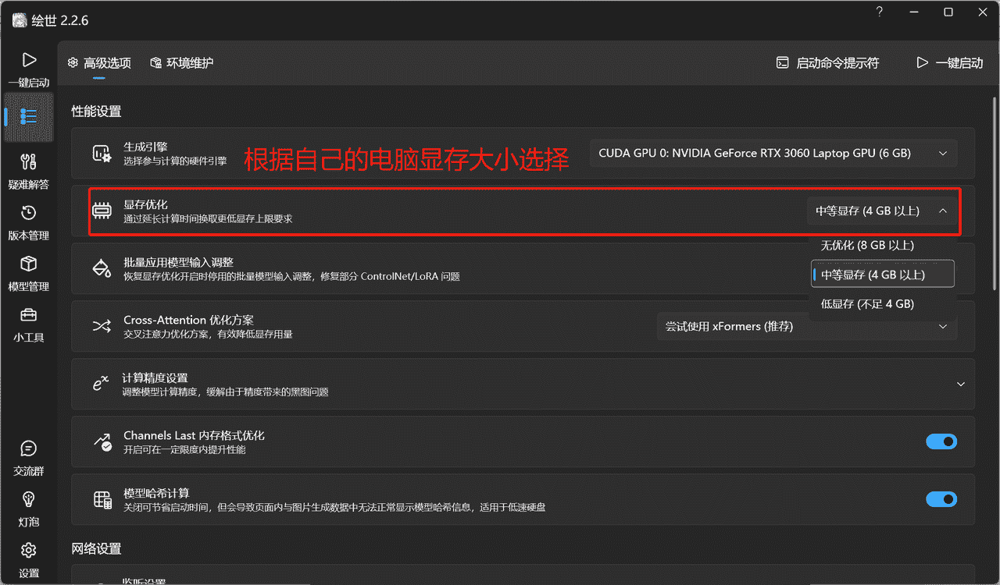

显存优化根据显卡实际显存选择，不要超过当前显卡显存。不过并不是指定了显存优化量就一定不会超显存，在出图时如果启动了过多的优化项（如高清修复、人脸修复）时，依然有爆显存的几率。xFormers 能极大地改善了内存消耗和速度，建议开启。

### 2）、WebUI深色模式

还有这里的WebUI界面设置，可以将界面设置为深色模式

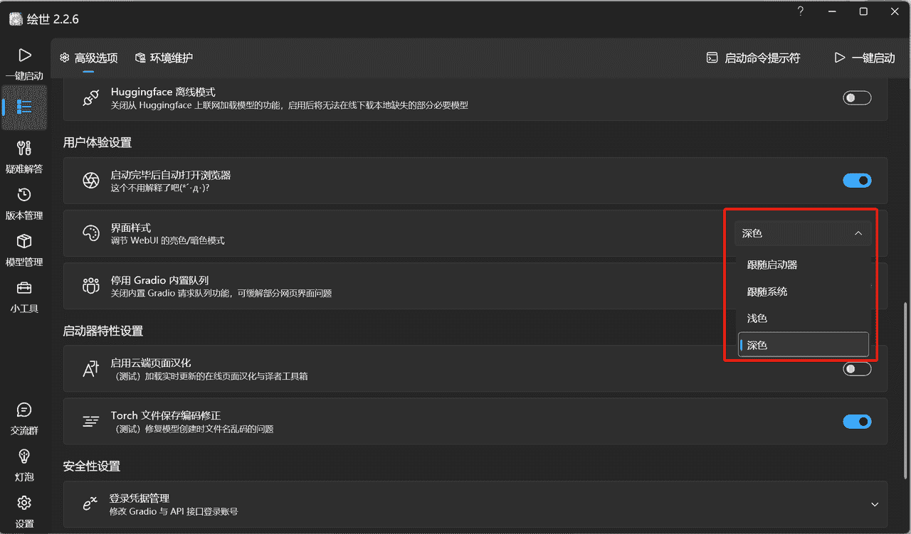

### 3）、版本管理

可以获取某个模型或插件早期的版本，随时都可以切换到新旧版本，因为有些插件对Stable Diffusion有一些兼容性的问题，新版本的插件可能不支持Stable Diffusion 1.5版本，所以这时候你可以将插件的版本切换到更早期的版本解决这种兼容性问题。

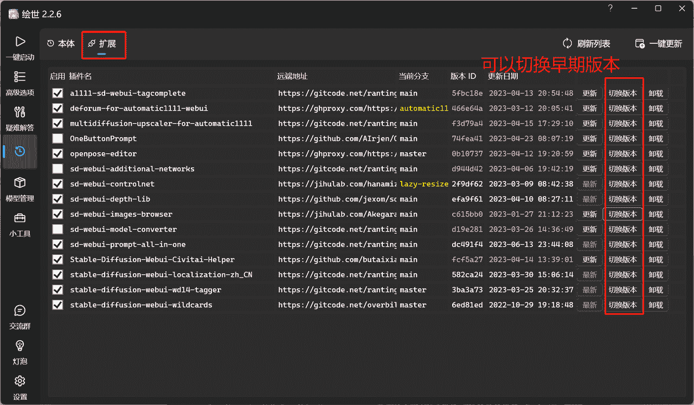

### 4）、模型管理

模型管理则是管理你当前本地下载的模型，包括基础大模型，embeddings，Lora模型，VAE等

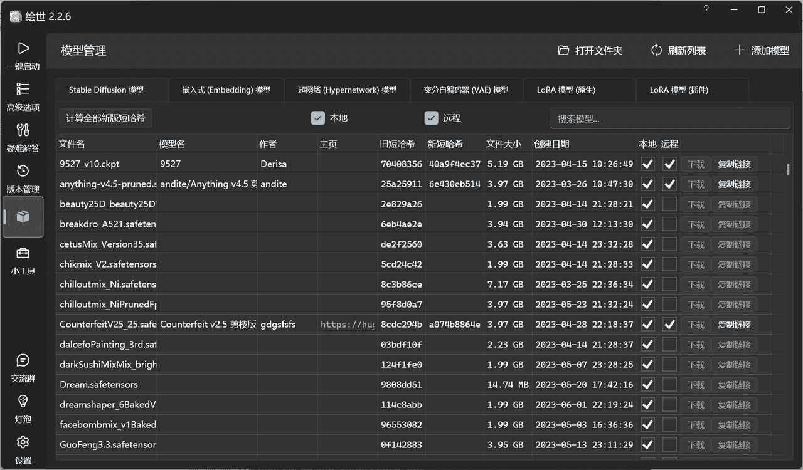

具体每一个的文件路径如下（以下是我本地的文件路径，大家可以根据自己本地存盘目录查找对应文件）

#### a、基础模型和资源

基础大模型的路径如下：

D:\novelai-webui-aki-v3\models\Stable-diffusion

这里主要存储的是我们绘图的各种基础模型

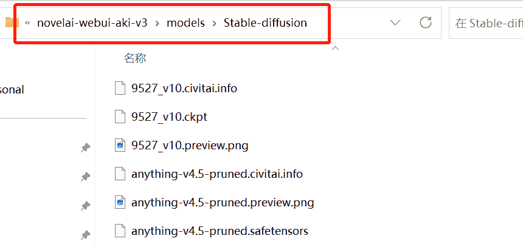

这里给大家提供我常用的基础模型：

百度网盘：

链接：https://pan.baidu.com/s/12Onfqh4F96xHW9sC0pxt5w?pwd=1024

提取码：1024

夸克网盘：

链接：https://pan.quark.cn/s/abce26b4cddb

#### b、embeddings文件和资源

embeddings文件路径如下：

D:\novelai-webui-aki-v3\embeddings

这里通常存储的是一些嵌入式的Textual Inversion 类型的文件，主要用来优化正反提示词的。

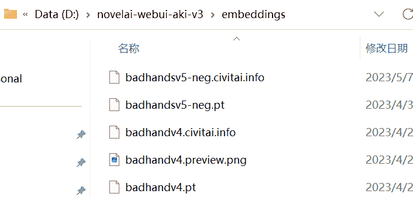

这里给大家提供我常用的embeddings文件：

百度网盘：

链接：https://pan.baidu.com/s/1UoEupwQMIHtSf1kYQRSL0Q?pwd=1024

提取码：1024

夸克网盘：

链接：https://pan.quark.cn/s/e59bd8c01a23

#### c、Lora模型和资源

Lora模型文件路径如下：

D:\novelai-webui-aki-v3\models\Lora

这里是用来存储各种风格化的模型，其中Lora目录下面可以根据自己需要新建文件夹存储不同类型的Lora模型。

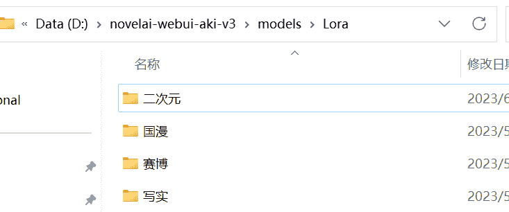

这里分享我常用的Lora模型：

百度网盘：

链接：https://pan.baidu.com/s/1ytzgL9E7NFQpCb2aVaNKOA?pwd=1024

提取码：1024

夸克网盘：

链接：https://pan.quark.cn/s/2e664ce71f16

#### d、VAE模型和资源

VAE模型文件路径如下：

D:\novelai-webui-aki-v3\models\VAE

这里主要是用来存放滤镜文件的地方，因为部分基础模型没有带VAE文件，通过加载不同的VAE我们可以得到不同滤镜的图片，一般二次元图片发灰就是因为没有加载VAE文件所致。

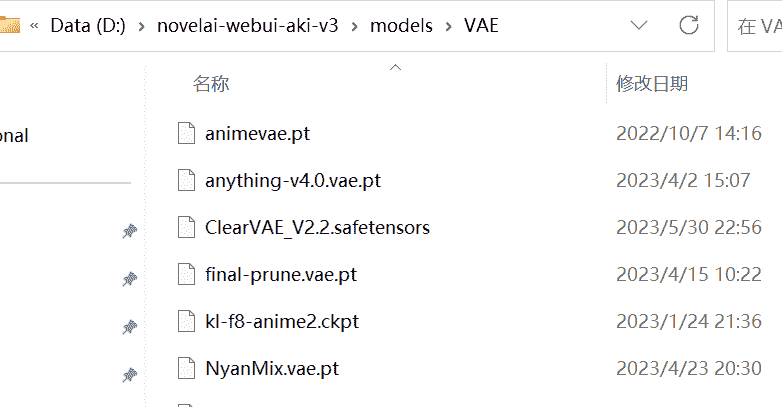

这里分享我常用的VAE文件：

百度网盘：

链接：https://pan.baidu.com/s/1vUfW8V5ULd2Og6dWe8UGIA?pwd=1024

提取码：1024

夸克网盘：

链接：https://pan.quark.cn/s/cd9e8d2fd49b

#### e、常用资源网站推荐

当然，以上这些资源只是我个人收集，数量有限，如果你想下载更多资源可以去这两个网站下载：

C站：https://civitai.com/    （需要科学上网，自己想办法）

抱脸网：https://huggingface.co/   （可正常访问）

## 5、启动Stable Diffusion

在了解这些知识后，我们点击一键启动，程序就开始自动加载，当看到一个地址

http://127.0.0.1:7860

就表示Stable Diffusion正常启动了

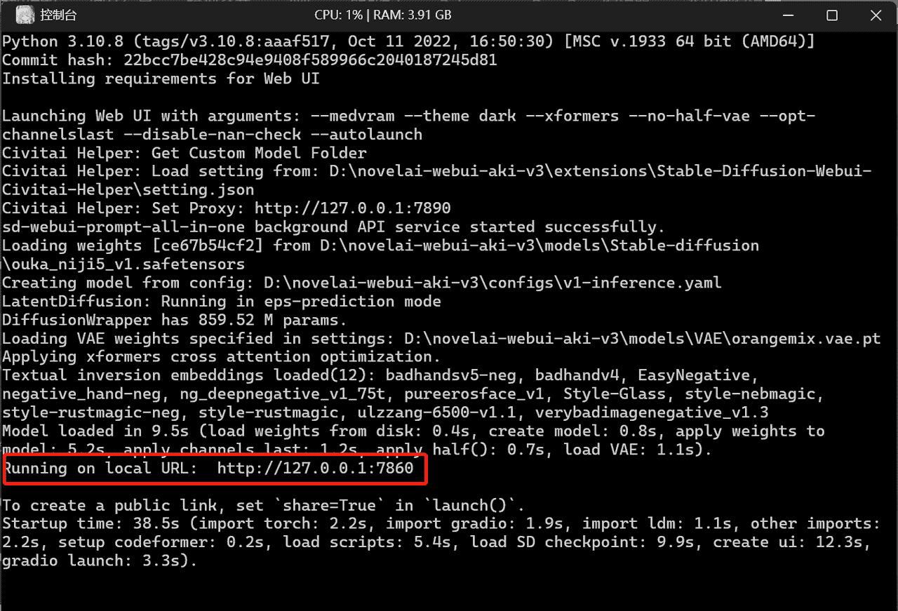

启动完成后我们会看到一个深色背景的UI界面，如下图：

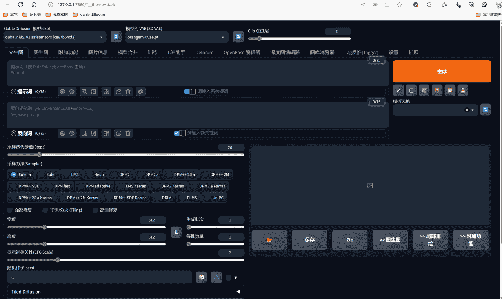

关于这个界面上的一些内容，我们在下一篇的《Stable Diffusion Web界面介绍》里会给大家进一步的详细介绍。

## 6、关于报错

如果报错提示缺少 Pytorch，则需要在启动器中点击配置：

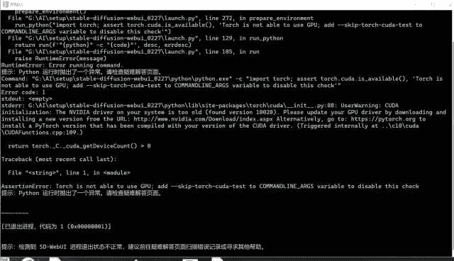

具体界面如下：

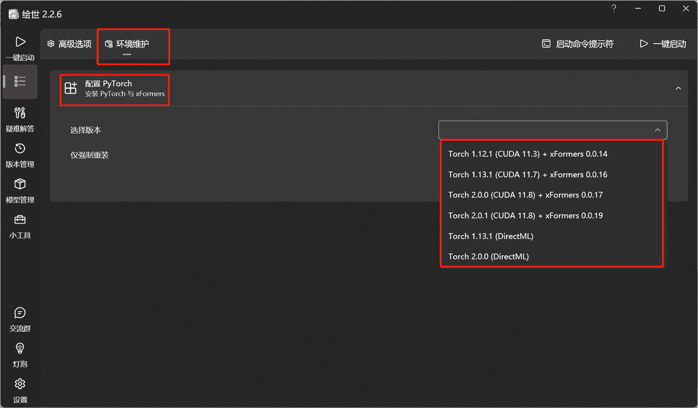

至此，我们的AI绘画平台stable diffusion就部署完成了，如果在部署过程中还有什么问题，欢迎大家在留言区留言，觉得有帮助记得帮忙点个赞。