# ControlNet v1.1：完整指南

> 来源：[https://xuqiwei1986.feishu.cn/docx/WlTHdWiLjoLQktxbzgBcmJ0onyb](https://xuqiwei1986.feishu.cn/docx/WlTHdWiLjoLQktxbzgBcmJ0onyb)

## 一、什么是 ControlNet（内控网）？

广义：

+ `ControlNet` 是一种稳定的扩散模型，可让您从参考图像复制构图或人体姿势。
+ 借助 `ControlNet`，`Stable Diffusion` 用户终于可以精确地控制对象的位置和外观！

狭义：

`ControlNet` 是一种用于控制 `Stable Diffusion` 模型的神经网络模型。

您可以将 `ControlNet` 与任何稳定扩散模型（例如：文生图）一起使用。（融合性）

`ControlNet` 可以采用多种不同的形式来更好地适应不同的扩散模型。

## 二、Diffusion ControlNet 安装教程

### 安装 Diffusion ControlNet

`ControlNet` 项目地址：https://github.com/lllyasviel/ControlNet

`ControlNet` 的 WebUI 扩展：https://github.com/Mikubill/sd-webui-controlnet#examples

模型下载：https://huggingface.co/lllyasviel/ControlNet/tree/main/models

B站下载教学（Nenly同学）：

百度网盘：https://pan.baidu.com/s/10rzgzIjzad7AKmj-w8zO_w?pwd=nely

### 更新 Diffusion ControlNet

选项 1：从 Web UI 更新

选项 2：命令行（终端代码执行）

检测安装的 `ControlNet` 扩展是否已经完备：

按右侧的插入符号以展开 `ControlNet` 面板。它显示了控制旋钮的完整部分和图像上传画布。

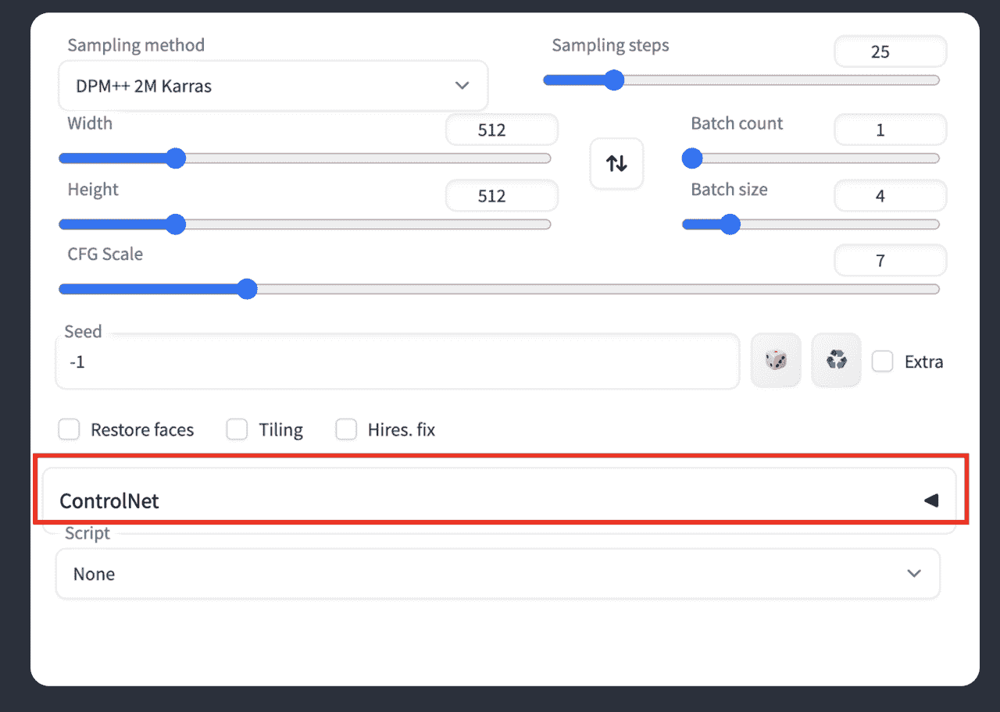

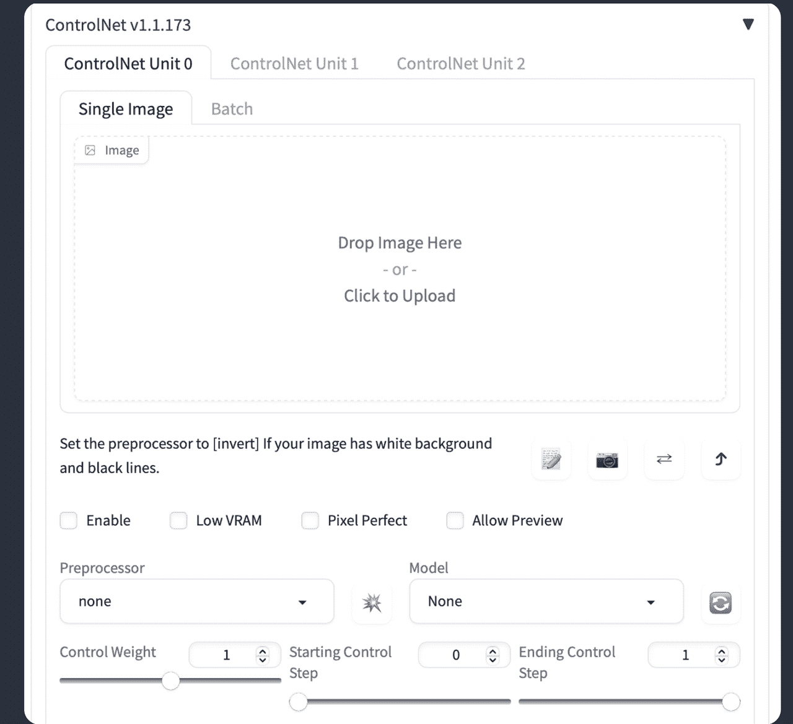

## 三、ControlNet 的不同方法的使用

### （1）Preprocessors and models 预处理器和模型

使用 `ControlNet` 的第一步是选择预处理器。打开预览很有帮助，这样您就知道预处理器在做什么。

预处理完成后，原始图像将被丢弃，只有预处理后的图像将用于 `ControlNet`。

要打开预览的方式：

1. Select `Allow Preview`. 选择允许预览。或者选择 `Pixel Perfect`。

1. `ControlNet` 将使用您在文本到图像中指定的图像高度和宽度来生成预处理图像。

1. 单击预处理器下拉菜单旁边的爆炸图标。

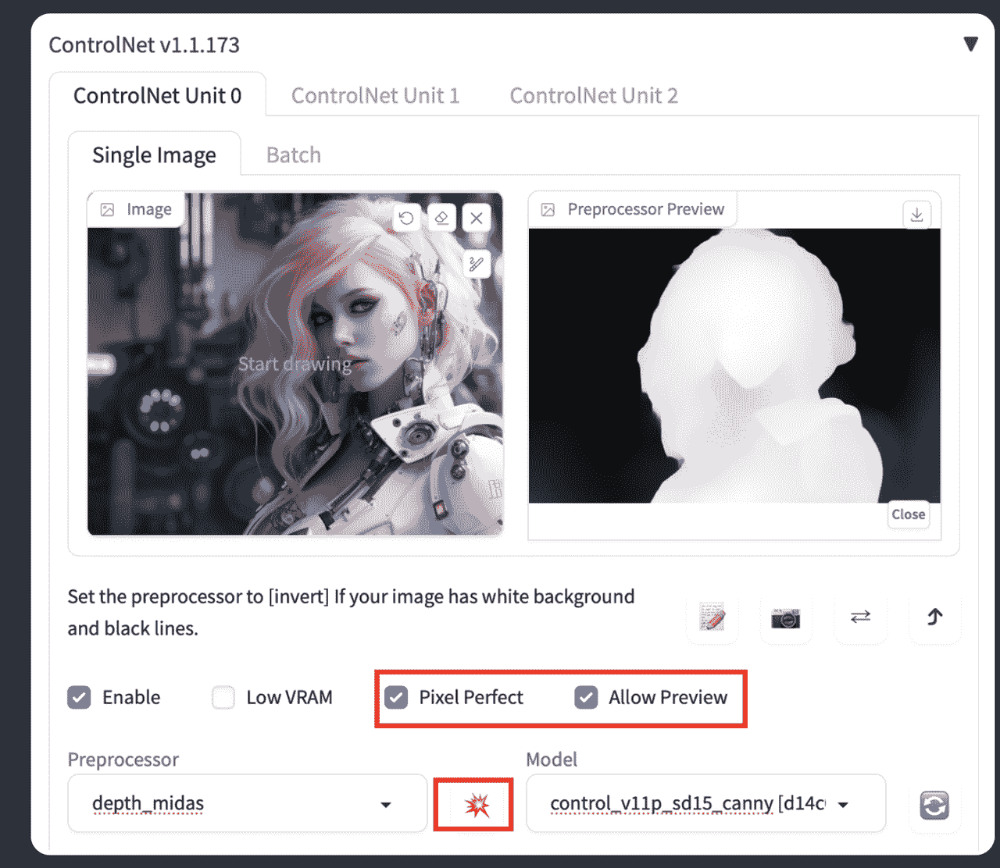

某些控制模型可能会过多地影响图像。如果您发现颜色问题或其他伪像，请降低控制权重

### （2）选择合适的型号

选择预处理器后，您必须选择正确的模型。

很容易分辨出在 v1.1 中使用哪个模型是正确的。您需要做的就是选择与预处理器具有相同起始关键字的模型。

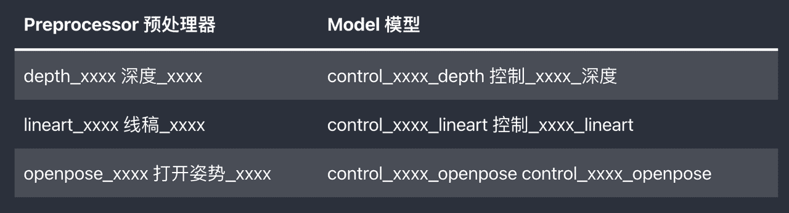

### （3）OpenPose 打开姿势

`OpenPose` ：用于检测人体关键点，例如头部、肩部、手部等的位置。

它对于复制人体姿势非常有用，而无需复制服装、发型和背景等其他细节。

有多个 `OpenPose` 预处理器。

+ `OpenPose`: eyes, nose, eyes, neck, shoulder, elbow, wrist, knees, and ankles.

`OpenPose`：眼、鼻、眼、颈、肩、肘、腕、膝、踝。

+ `OpenPose_face`: `OpenPose` + facial details

`OpenPose_face`：`OpenPose` + 面部细节

+ `OpenPose_hand`: `OpenPose` + hands and fingers

`OpenPose_hand`：`OpenPose` + 手和手指

+ `OpenPose_faceonly`: facial details only

`OpenPose_faceonly`：仅面部细节

+ `OpenPose_full`: All of the above

`OpenPose_full`：以上所有

注意：

所有 `openpose` 预处理器都需要与 `ControlNet` 模型下拉菜单中的 `openpose` 模型一起使用。

一幅图生成骨架图后直接利用骨架图结构绘画即可；无需重复导入

骨架图一般无法保存下载，因此很可能会导致生成图的第一幅（全组合图）无法保存下载；

pose 骨架图一般在与二次元风格的模型一起调用时需要注意画面比例问题；（一般与真人模型调用最好）

#### OpenPose 打开姿势

`OpenPose` 是基本的 `OpenPose` 预处理器，可检测眼睛、鼻子、眼睛、颈部、肩部、肘部、腕部、膝盖和脚踝的位置。

如图所示：

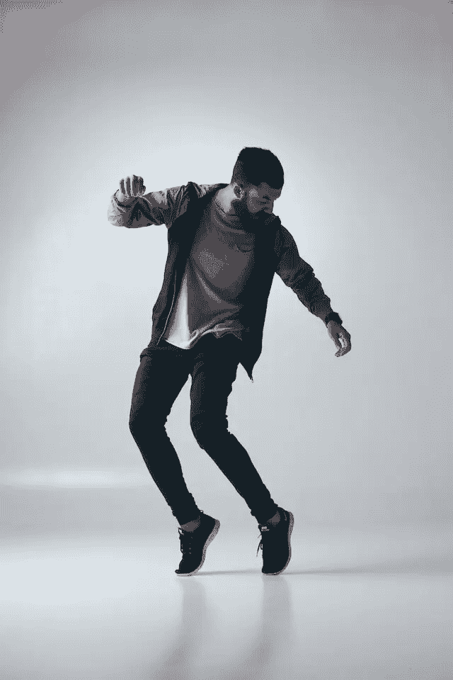

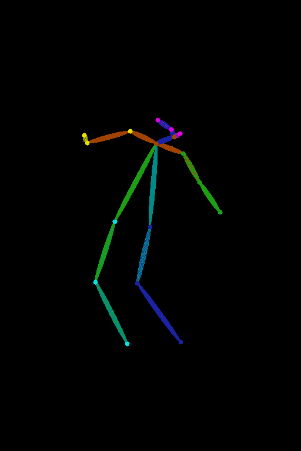

#### OpenPose_face OpenPose_face

`OpenPose_face` 执行 `OpenPose` 处理器执行的所有操作，但会检测其他面部细节。

它对于复制面部表情很有用

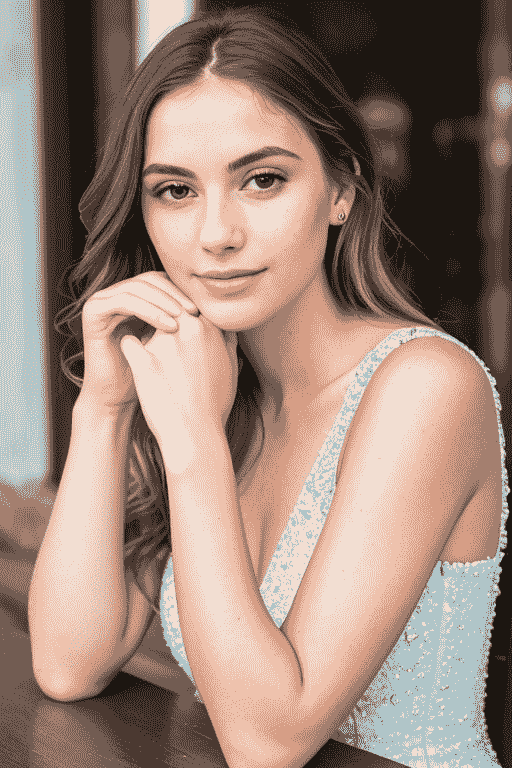

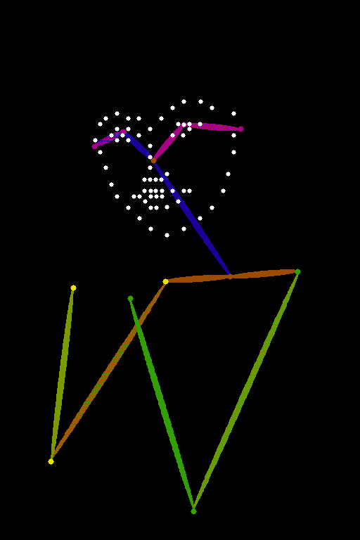

Sample images: 示例图像：

#### OpenPose_faceonly OpenPose_faceonly

`OpenPose` 人脸只检测人脸而不检测其他关键点。这对于仅复制面部而不是其他关键点很有用。

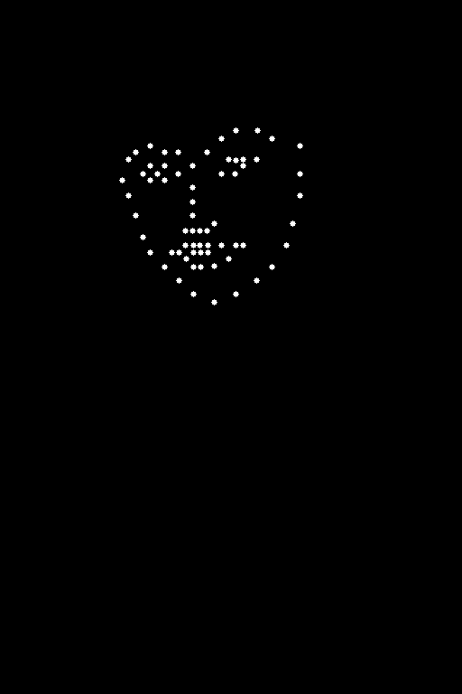

Sample images: 示例图像：

#### OpenPose_hand OpenPose_hand

`OpenPose_hand` 将关键点检测为 `OpenPose` 以及手和手指。

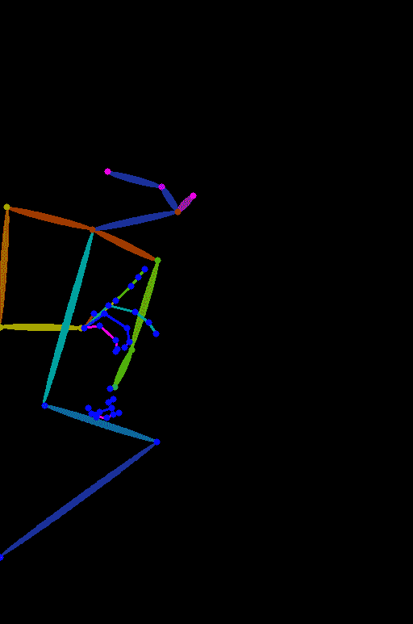

Sample images: 示例图像：

#### OpenPose_full OpenPose_full

`OpenPose` full 检测 `openPose` 面部和 `openPose` 手所做的一切。

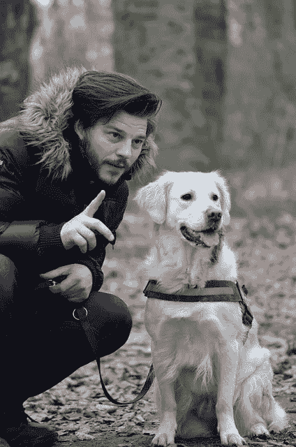

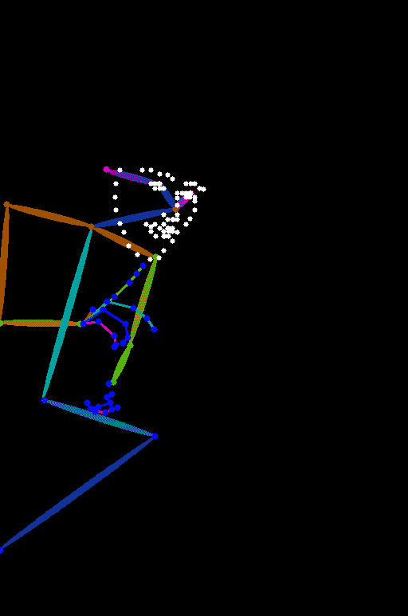

Sample images: 示例图像：

#### Tile resample 瓷砖重采样

`Tile resample` 模型用于向图像添加细节。它通常与放大器一起使用以同时放大图像。

#### Reference 参考

`Reference` 是一组新的预处理器，可让您生成与参考图像相似的图像。图像仍会受到稳定扩散模型和提示的影响。

参考预处理器不使用控制模型。您只需要选择预处理器而不是模型。（实际上，模型下拉菜单将在选择参考预处理器后隐藏。）

##### 有 3 个参考预处理器：（多选一）

1. [`Reference adain`](https://github.com/Mikubill/sd-webui-controlnet/discussions/1280)：

参考 `adain`：通过自适应实例规范化进行样式转换。（纸）

1. [`Reference only`](https://github.com/Mikubill/sd-webui-controlnet/discussions/1236)：

仅参考：将参考图像直接链接到注意力层。

1. `Reference adain+attn`:

参考 `adain+attn`：以上的组合。

下面是一个例子

使用 `CLIP` 询问器猜测提示。

> a woman with pink hair and a robot suit on, with a sci – fi, Artgerm, cyberpunk style, cyberpunk art, retrofuturism

> 一个粉红色头发的女人，穿着机器人套装，带有科幻、Artgerm、赛博朋克风格、赛博朋克艺术、复古未来主义

> disfigured, ugly, bad, immature

> 毁容的，丑陋的，坏的，不成熟的

Model: `Protogen v2.2` 型号：`Protogen v2.2`

[`Reference adain`](https://github.com/Mikubill/sd-webui-controlnet/discussions/1280):

##### Reference only

##### Reference adain

结论：

目前来说三者无太大区别；

### Canny

`Canny` 边缘检测器是一种通用的老式边缘检测器。它提取图像的轮廓。

它对于保留原始图像的构图很有用。

适用场景：

1、相比于 `Dpeth` 生成的图像线条性更好、更不容易变形；

2、主要适用将相关字体嵌入到不同的背景中；（如果效果不明显可以尝试调整上下阀值）

3、线上稿色（如果是黑白色稿底的需选用 `Invert` 反转器）

4、`Canny` 预处理器可以相关模型组合使用（基于动漫风格的线稿实现上色处理的预处理器与模型组合）

局限性：

1、线条不宜过多、会导致画面凌乱；

样例：

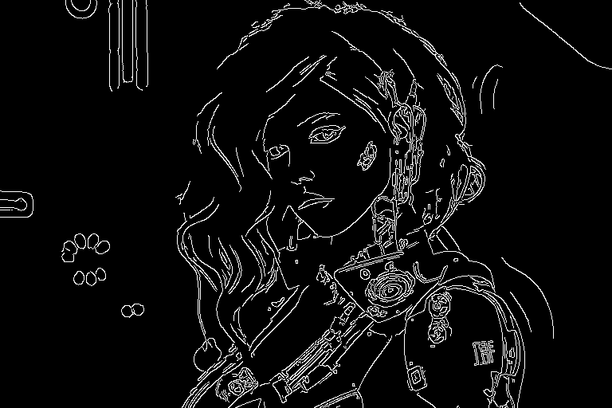

生成的图像将遵循轮廓。

### Holistically-Nested-Edge Detection（整体边缘线条检测）-HED

替代名：`Soft Edge`（柔和边缘）

相比于 `Canny` 整体的细节把控、`HED` 更侧重于把图形大致轮廓保存下来；

整体的融合性相对于 `Canny` 要好一点；

预处理器型号：

`Softedge_hed`

`Softedge_hedsafe`

`Softedge_pidinet`

`Softedge_pisafe`

特点：

带 `hed` 的质量要比 `pid` 的程度高，带 `safe` 的整体精细化程度更高；

带 `safe` 的型号会导致需要电脑的现存和处理时间要求也越高；

### Depth 深度

深度预处理器根据参考图像猜测深度信息。

适用场景：

1、对场景的描绘还原尤其是富有多层次的空间图形；

2、距离越近越白，越远阴影越深；

局限性：

人物和背景间的深度差异会限制人物形象的发挥空间；（限制人物绘画发挥）

+ `Depth Midas`: [A classic depth estimator](https://stable-diffusion-art.com/depth-to-image/). Also used in the Official v2 depth-to-image model.

`Depth Midas`：经典的深度估计器。也用于 Official v2 depth-to-image 模型。

+ `Depth Leres`: More details but also tend to render background.

`Depth Leres`：更多细节但也倾向于渲染背景。

+ `Depth Leres++`: Even more details.

`Depth Leres++`：更多细节。

+ `Zoe`: The level of detail sits between `Midas` and `Leres`.

`Zoe`：细节水平介于 `Midas` 和 `Leres` 之间。

Reference Image: 参考图片：

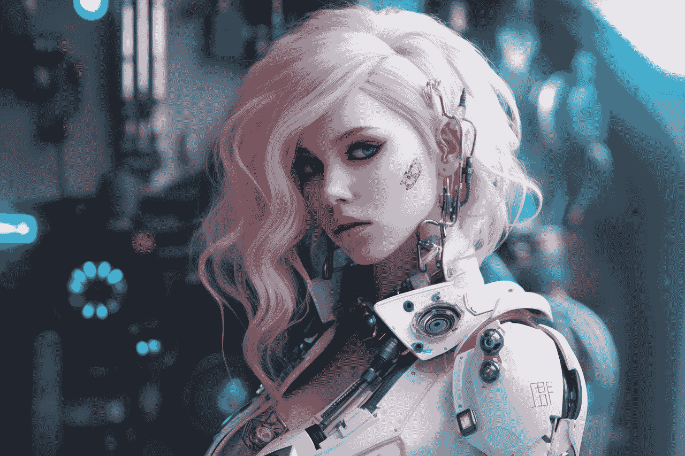

Prompt and negative prompt:

提示与否定提示：

> a woman retrofuturism 女人复古未来主义

> disfigured, ugly, bad, immature

> 毁容的，丑陋的，坏的，不成熟的

您可以看到生成的图像跟随深度图 (`Zoe`)。与更详细的 `Leres++` 对比：

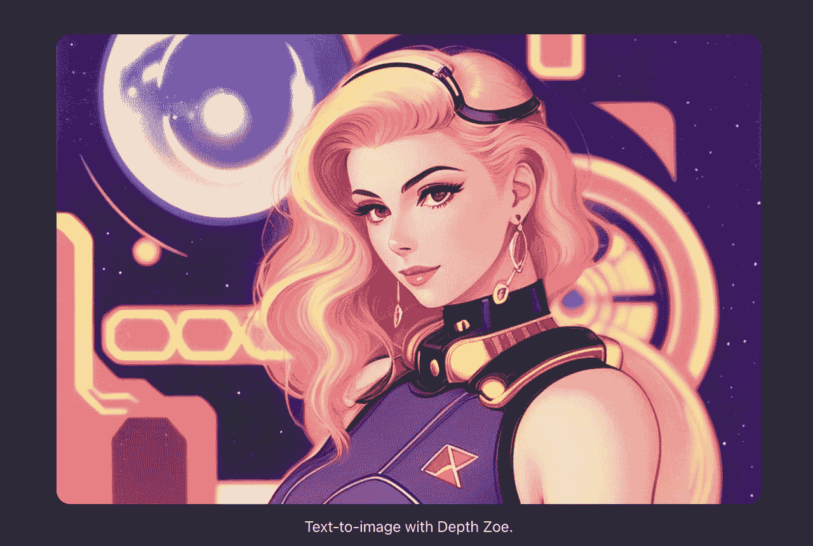

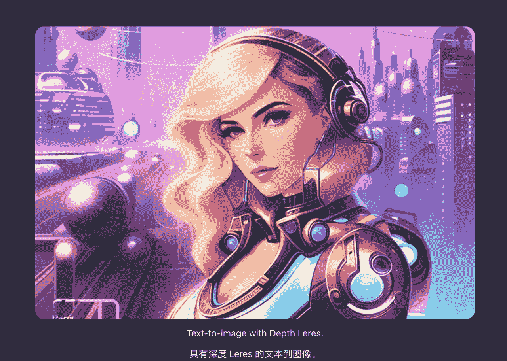

### Line Art 线条艺术

`Line Art` 渲染图像的轮廓。它试图将其转换为简单的绘图。

常见的一些线条艺术预处理器：

`Line art anime`: Anime-style lines

线条艺术动漫：动漫风格的线条

`Line art anime denoise`: Anime-style lines with fewer details.

线条艺术动漫降噪：动漫风格的线条，细节较少。

`Line art realistic`: Realistic-style lines.

`Line art realistic`：写实风格的线条。

`Line art coarse`: Realistic-style lines with heavier weight.

粗线条：写实风格的粗线。

Use with the `lineart` control model.

与线性控制模型一起使用。

Images below are generated with `Control Weight` setting to 0.7.

下面的图像是在控制权重设置为 0.7 的情况下生成的。

#### Line Art Anime 线条艺术动漫

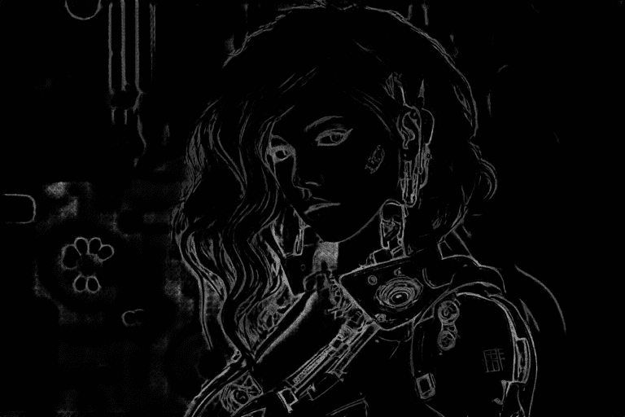

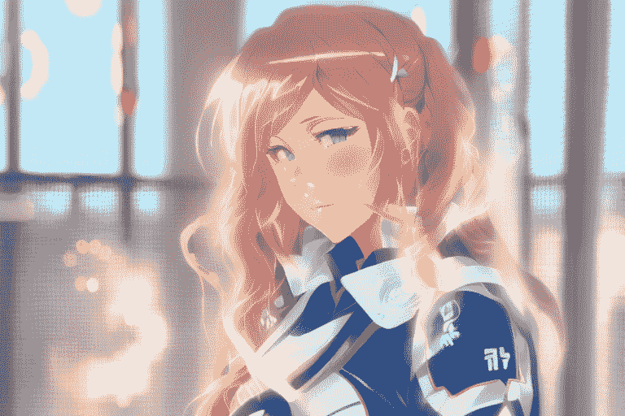

#### Line Art Anime Denoise 线条艺术动漫降噪

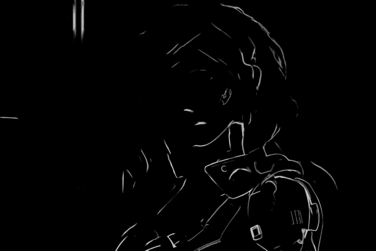

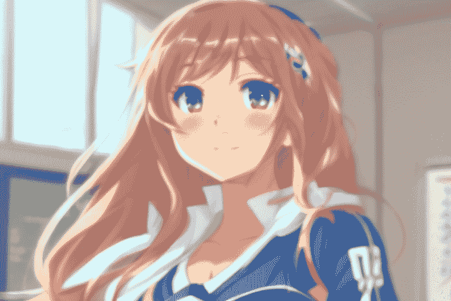

#### Line Art Realistic 线条艺术写实

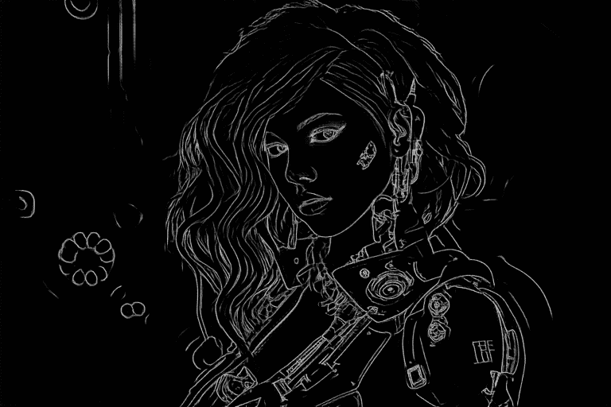

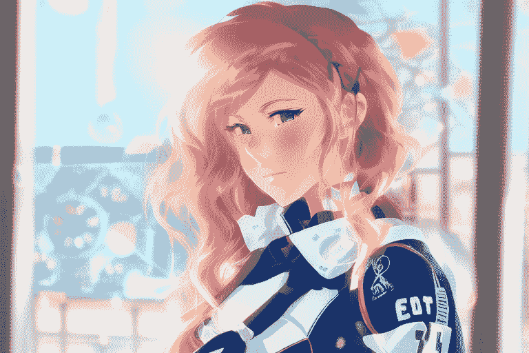

#### Line Art Coarse 粗线艺术

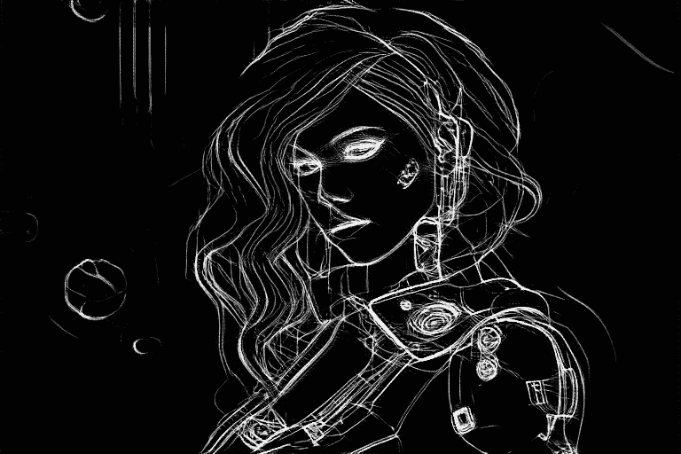

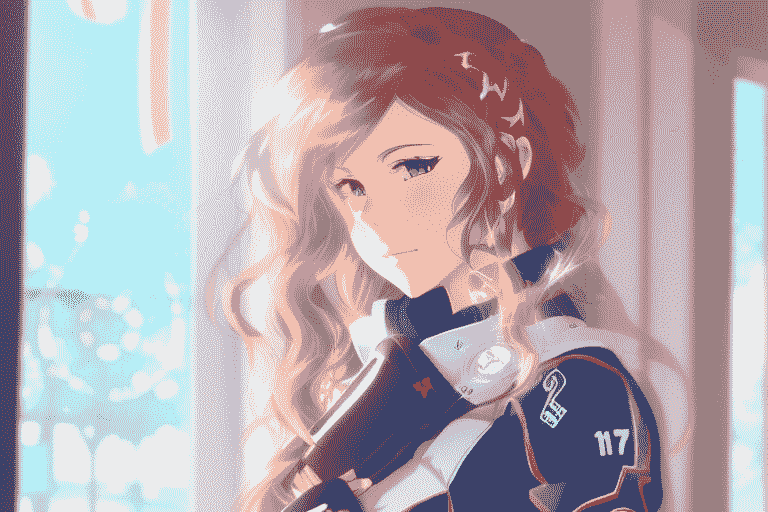

### MLSD：

`M-LSD`（`Mobile Line Segment Detection`）是一种直线检测器。它对于提取具有直边的轮廓非常有用，例如室内设计、建筑物、街景、相框和纸张边缘。（曲线将被忽略）

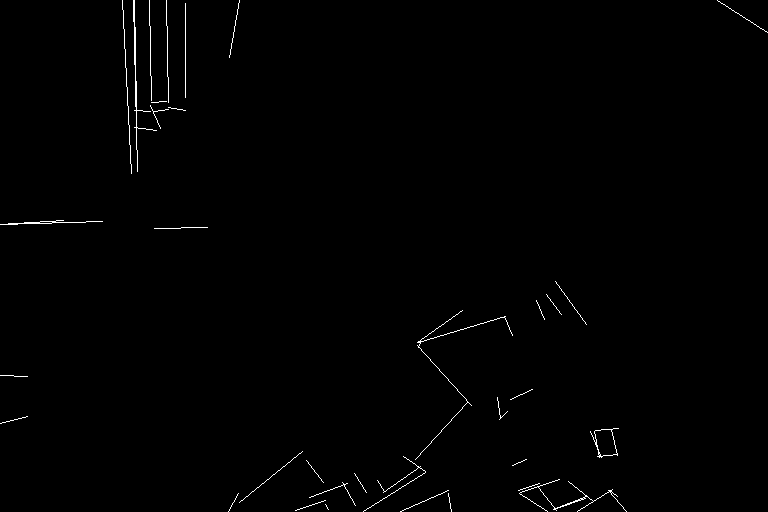

### Normal maps 法线贴图

法线贴图指定表面的方向。对于 `ControlNet`，它是一个图像，指定每个像素所在表面的方向。

图像像素代表表面所面对的方向，而不是颜色值。

法线贴图的使用类似于深度贴图。它们用于传输参考图像的 3D 合成。

Normal map preprocessors:

法线贴图预处理器：

+ `Normal Midas`: [Estimate the normal map from the `Midas` depth map.](https://github.com/isl-org/MiDaS)

`Normal Midas`：从 `Midas` 深度图估计法线图。

+ `Normal Bae`: Estimate the normal map using the normal uncertainty method proposed by Bae et al.

`Normal Bae`：使用 Bae 等人提出的法线不确定性方法估计法线图。

`Normal Midas`：

与 `Midas` 深度贴图一样，`Midas` 法线贴图非常适合将主体与背景隔离开来。

#### Normal Bae

法线贴图倾向于在背景和前景中渲染细节。

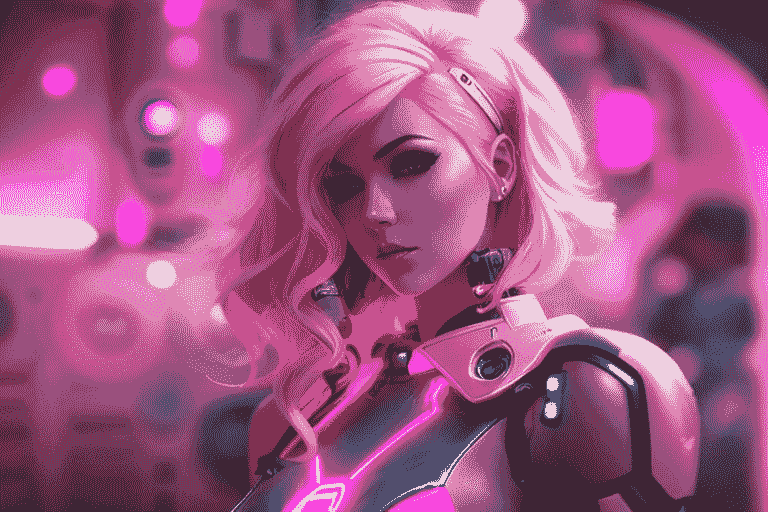

### Scribbles 涂鸦

涂鸦预处理器将图片变成涂鸦，就像手绘的一样。

`Scribble HED`：整体嵌套边缘检测 (`HED`) 是一种边缘检测器，擅长像真人一样生成轮廓。根据 `ControlNet` 的作者，`HED` 适用于重新着色和重新设计图像。

`Scribble Pidinet`：像素差网络（`Pidinet`）检测曲线和直边。其结果类似于 `HED`，但通常会产生更清晰的线条和更少的细节。

`Scribble xdog`：高斯扩展差分 (`XDoG`) 是一种边缘检测方法技术。调整 `xDoG` 阈值并观察预处理器输出非常重要。

所有这些预处理器都应该与涂鸦控制模型一起使用。

#### Scribble HED

`HED` 产生粗糙的涂鸦线条。

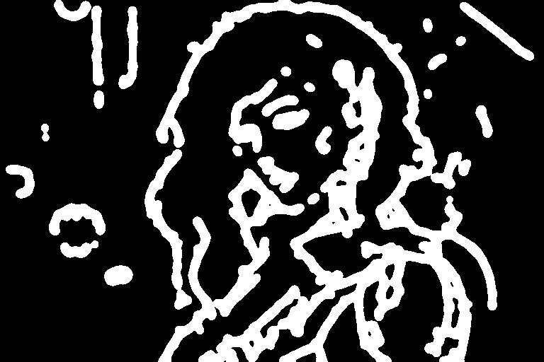

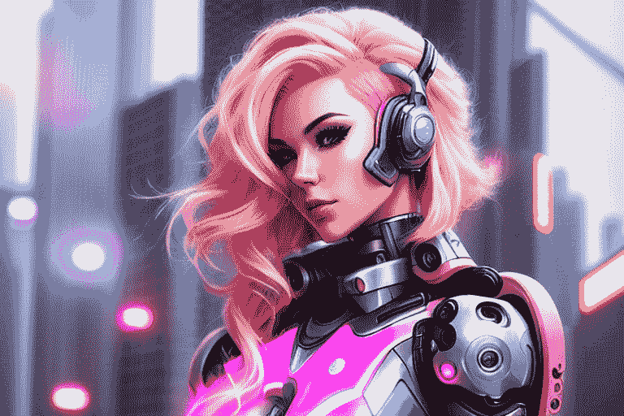

#### Scribble Pidinet

## Pidinet

Pidinet 倾向于生成细节很少的粗线条。这对于复制没有精细细节的电路板轮廓很有用。

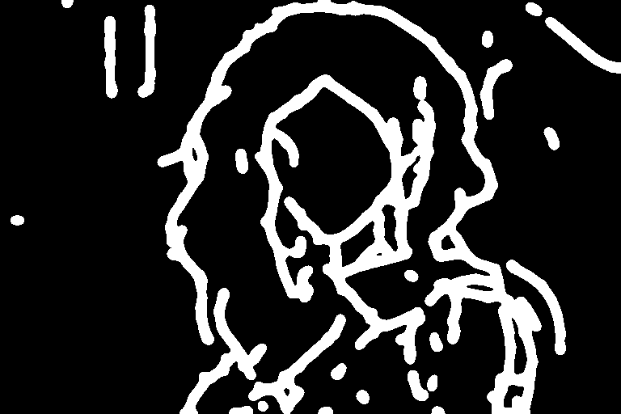

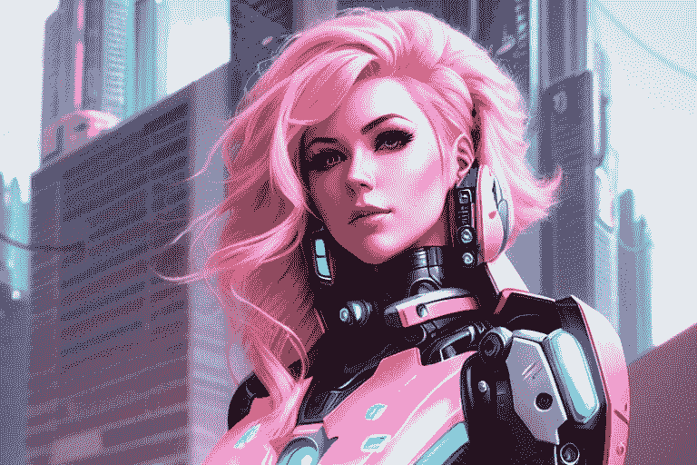

## Scribble xDoG

通过调整 XDoG 阈值可以控制细节级别，使 xDoG 成为创建涂鸦的多功能预处理器。

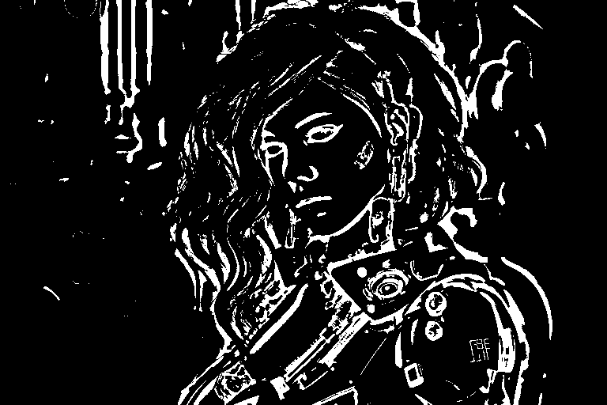

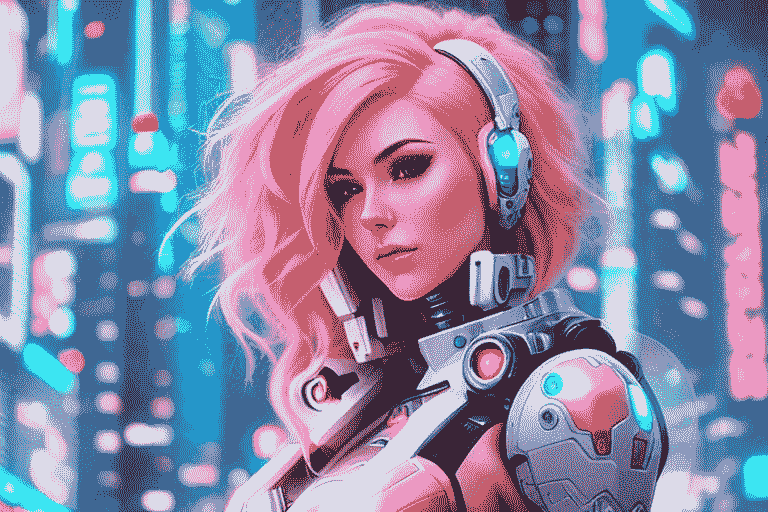

## Segmentation 分割

分割预处理器标记参考图像中的对象类型。

下面是一个正在运行的分段处理器。

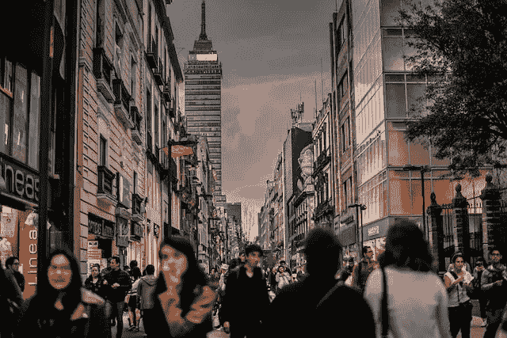

建筑物、天空、树木、人和人行道都标有不同的预定义颜色。

您可以在此处的颜色图中找到 `ufade20k` 和 `ofade20k` 的对象类别和颜色。

### 有几个细分选项

+   `ufade20k`: [`UniFormer`](https://github.com/Sense-X/UniFormer) [`(uf)`](https://groups.csail.mit.edu/vision/datasets/ADE20K/) segmentation trained on ADE20K dataset.

ufade20k：在 ADE20K 数据集上训练的 UniFormer (uf) 分割。

+   `ofade20k`: [`OneFormer`](https://github.com/SHI-Labs/OneFormer) (of) segmentation trained on ADE20k dataset.

ofade20k：在 ADE20k 数据集上训练的 OneFormer (of) 分割。

+   `ofcoco`[: On](https://cocodataset.org/)Former segmentation trained on COCO dataset.

ofcoco：在 COCO 数据集上训练的 OnFormer 分割。

+   请注意，ADE20k 和 COCO 分割的颜色图是不同的。

您可以使用分段预处理器来传输对象的位置和形状。

下面是使用具有相同提示和种子的预处理器。

> Futuristic city, tree, buildings, cyberpunk

`UniFormer` ADE20k (`ufade20k`)

`UniFormer` ADE20k (`ufade20k`)

在此示例中，`Uniformer` 准确地标记了所有内容。

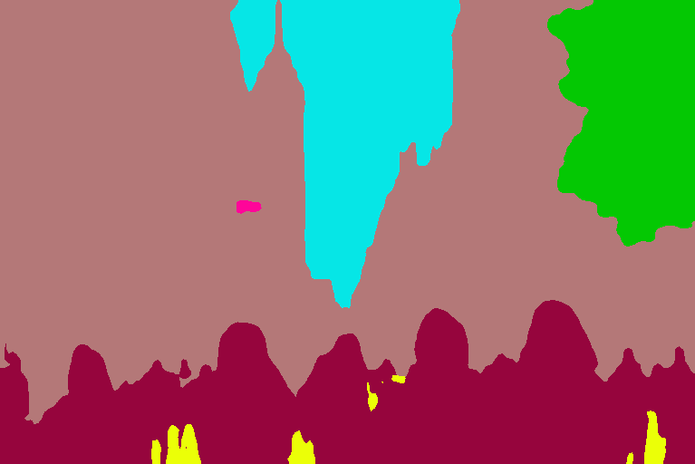

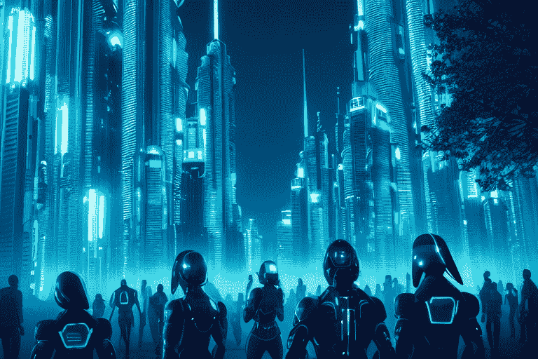

总结：

分段是一种强大的技术。您可以进一步操作分割图以将对象放置在精确位置。使用 ADE20k 的颜色图。

### OneFormer ADE20k (`ofade20k`)

`OneFormer` 在这种情况下有点嘈杂，但不会影响最终图像。

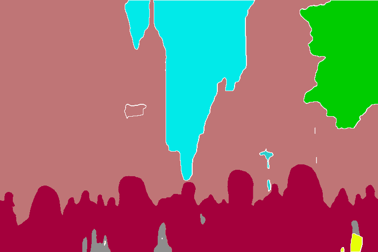

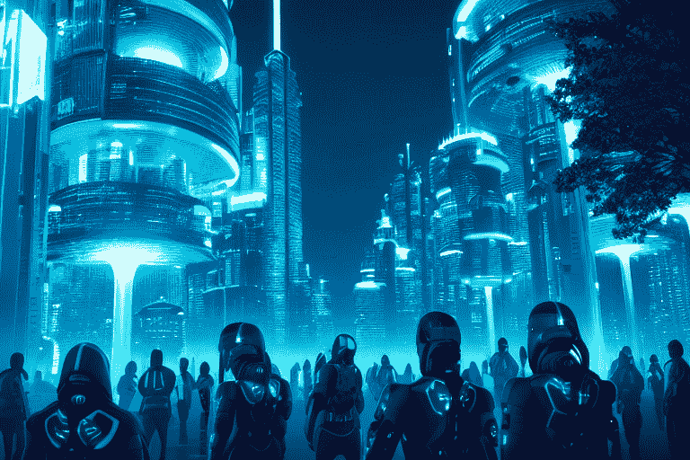

### OneFormer COCO (`ofcoco`)

`OneFormer COCO` 表现类似，但有一些标签错误。

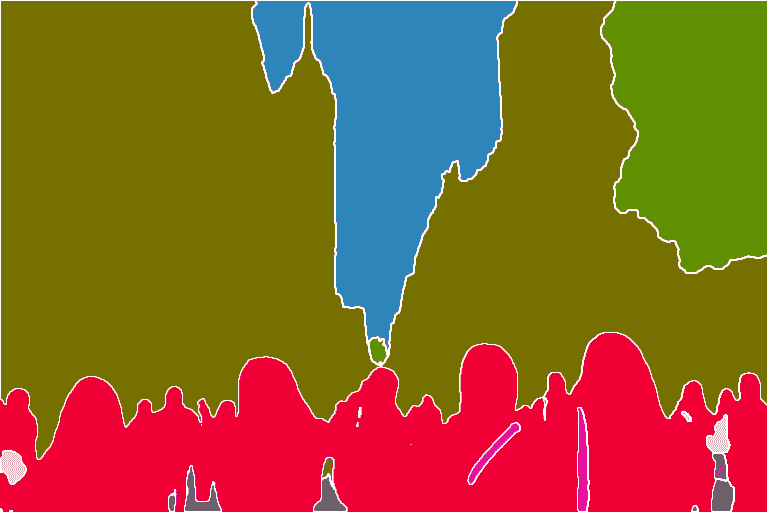

## Shuffle 洗牌/转换

`Shuffle` 预处理器搅动输入图像。让我们看看 `shuffle` 的实际效果。

与 `Shuffle` 控制模型一起，`Shuffle` 预处理器可用于传输参考图像的配色方案。

Input image:

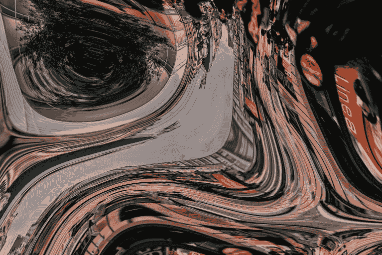

`Shuffle` preprocessor: 洗牌预处理器：

与其他预处理器不同，`Shuffle` 预处理器是随机的。它会受到您的种子值的影响。

将 `Shuffle` 预处理器与 `Shuffle` 控制模型一起使用。 `Shuffle` 控制模型可与或不与 `Shuffle` 预处理器一起使用。

（1）下图是 ControlNet `Shuffle` 预处理器和 `Shuffle` 模型（与上一节提示相同）。配色方案大致遵循参考图像。

（2）下图仅适用于 ControlNet `Shuffle` 模型（预处理器：无）。构图更接近原作。配色方案类似于洗牌。

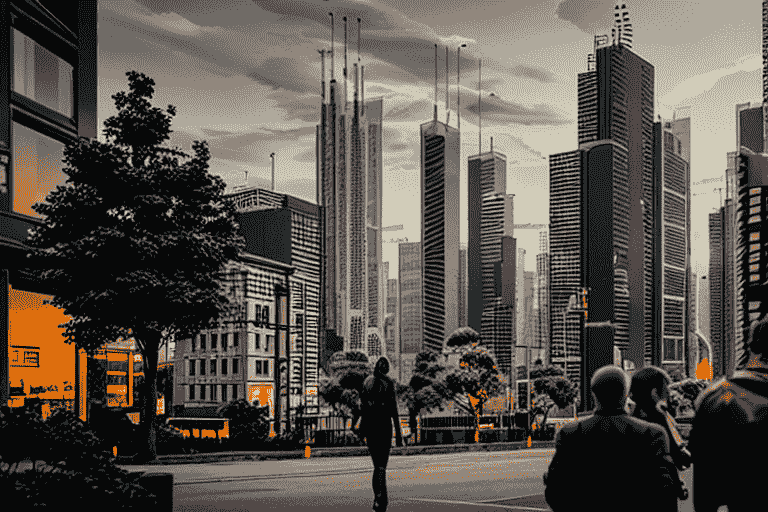

供您参考，下图是没有 ControlNet 的相同提示。配色方案截然不同。

## Color grid T2I adapter 彩格T2I适配器

彩色网格 `T2i` 适配器预处理器将参考图像缩小 64 倍，然后将其扩展回原始大小。净效果是局部平均颜色的网格状补丁。

原始参考图像：

使用 `t2ia_color_grid` 预处理：

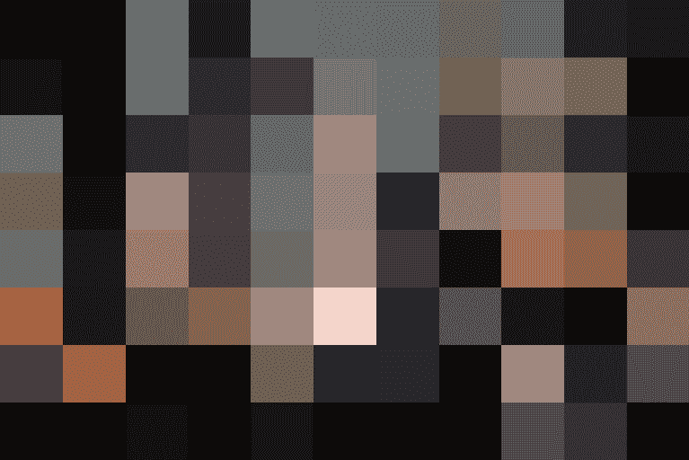

然后可以将预处理图像与 `T2I` 颜色适配器 (`t2iadapter_color`) 控制模型一起使用。

图像生成将在空间上松散地遵循配色方案。

现代客厅：

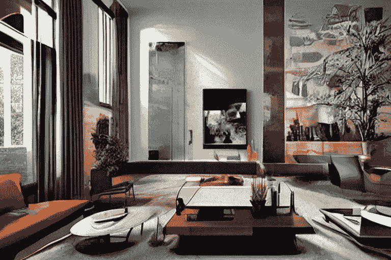

增加 ControlNet 权重以使其更紧密地跟随。

您也可以为此 `T2I` 颜色模型使用预处理器 `None`。

在我看来，它与图像到图像非常相似。

## Clip vision style T2I adapter（Clip vision 型 T2I 适配器）

`t2ia_style_clipvision` 将参考图像转换为 CLIP 视觉嵌入。这种嵌入包含有关图像内容和风格的丰富信息。

您将需要使用控制模型 `t2iadapter_style_XXXX`。

看看这个惊人的风格转换：

Reference image: 参考图片：

`T2I` adapter – CLIP vision:

`T2I` 适配器 – CLIP 视觉：

> sci-fi girl 科幻女孩

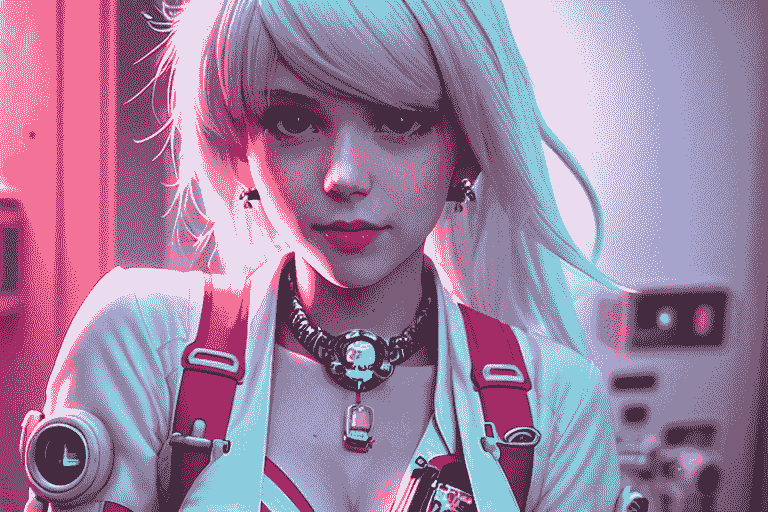

如果关闭 ControlNet，此提示将生成以下内容。

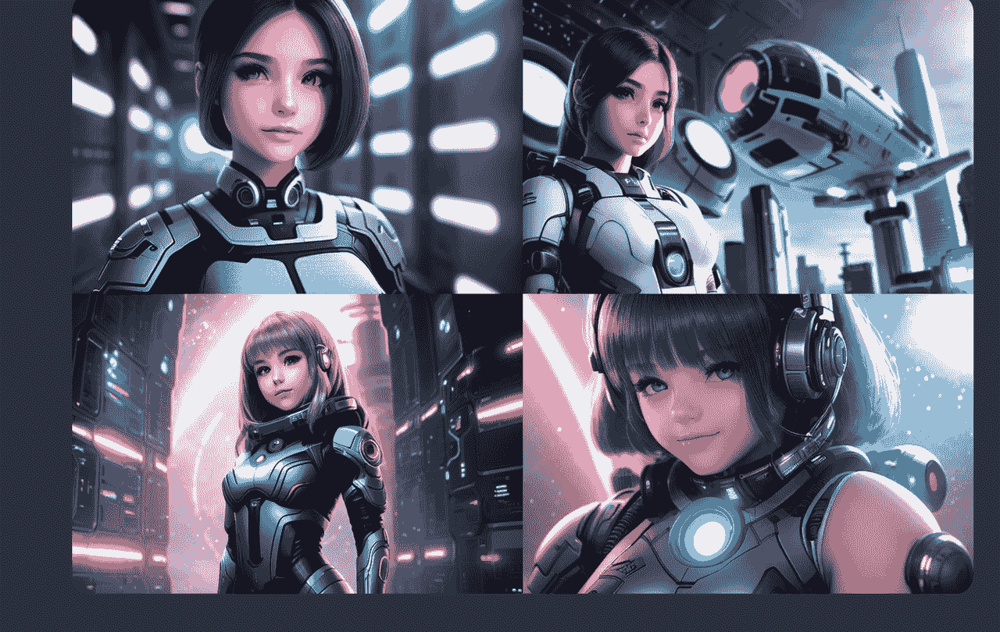

该功能与 Reference ControlNet 非常相似，但 `T2IA CLIP vision` 效果更好。

## ControlNet Inpainting ControlNet 修复

`ControlNet` 修复让您可以在修复中使用高去噪强度来生成较大的变化，而不会牺牲与整个图片的一致性。

例如，我为现实的人使用了提示。

Model: [`HenmixReal v4`](https://civitai.com/models/20282) 型号：`HenmixReal v4`

> photo of young woman, highlight hair, sitting outside restaurant, wearing dress, rim lighting, studio lighting, looking at the camera, dslr, ultra quality, sharp focus, tack sharp, dof, film grain, Fujifilm XT3, crystal clear, 8K UHD, highly detailed glossy eyes, high detailed skin, skin pores

> 年轻女子的照片，突出头发，坐在餐厅外面，穿着裙子，边缘照明，工作室照明，看着相机，数码单反相机，超高品质，清晰对焦，粘性锐利，自由度，胶片颗粒，`Fujifilm XT3`，晶莹剔透，`8K UHD` , 高度详细的有光泽的眼睛, 高度详细的皮肤, 皮肤毛孔

Negative prompt 提示否定

> disfigured, ugly, bad, immature, cartoon, anime, 3d, painting, b&w

> 毁容，丑陋，糟糕，不成熟，卡通，动漫，`3d`，绘画，黑白

我有这张图片，想通过修复来重新生成脸部。

如果我仅用高去噪强度（> 0.4）修复面部，结果可能会全局不一致。下面是去噪强度为 1 的未绘制图像。

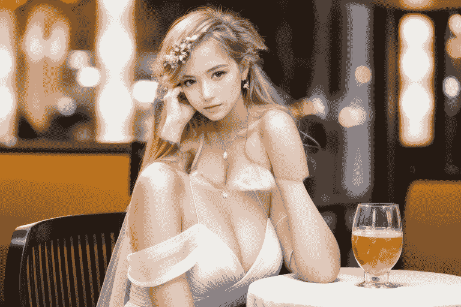

`ControlNet` 修复可以解决此类问题：

要使用 `ControlNet` 修复：

最好使用与生成图像相同的模型。

1.  在`txt2img`页面生成图片后，点击`Send to Inpaint`，将图片发送到`Img2img`页面的`Inpaint`选项卡。

1.  使用画笔工具在要重新生成的区域上创建一个蒙版。如果您不熟悉它，请参阅有关修复的初学者教程。

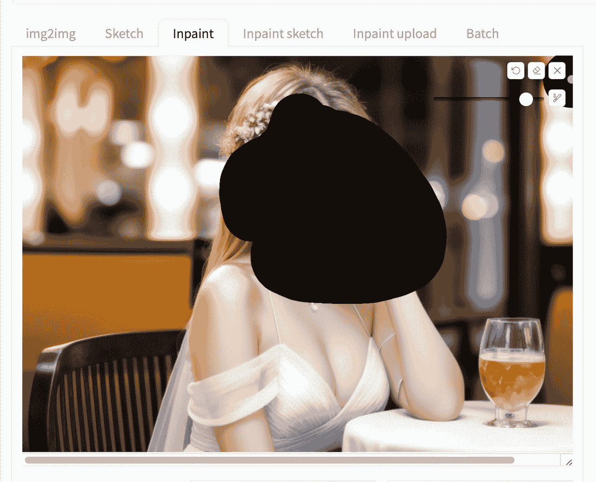

1.  将`Inpaint` 区域设置为`Only masked`。（全图也可以）

1.  将降噪强度设置为 1。（如果没有 `ControlNet`，您通常不会将其设置这么高。）

1.  在 `ControlNet` 部分设置以下参数。您不需要上传参考图片。

`Enable`: Yes  启用：是

`Preprocessor`: `Inpainting_global_harmonious`

预处理器：`Inpainting_global_harmonious`

Model: `ControlNet`  型号：控制网

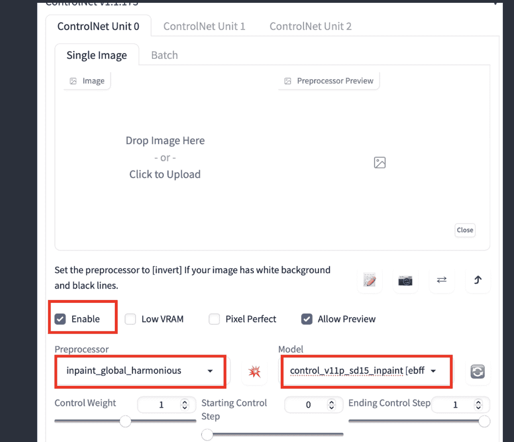

1.  按生成开始修复。

现在我得到了与全局图像一致的新面孔，即使在最大去噪强度 (`1`) 下也是如此！

## 四、ControlNet的界面介绍

### Input controls 输入控件

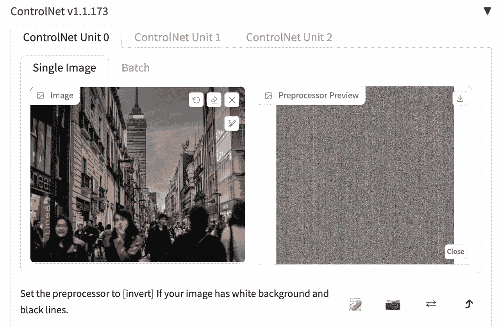

图像画布：您可以将输入图像拖放到此处。您还可以单击画布并使用文件浏览器选择一个文件。输入图像将由预处理器下拉菜单中选定的预处理器进行处理。将创建一个控制图。

`Write icon`:

写入图标：创建一个带有白色图像的新画布，而不是上传参考图像。它用于直接创建涂鸦。

`Camera icon`:

相机图标：使用设备的相机拍照并将其用作输入图像。您需要授予浏览器访问相机的权限。

### Model selection 选型

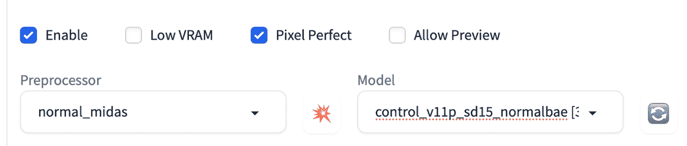

`Enable`:

启用：是否启用`ControlNet`。（一定要启用；不然无法使用`ControlNet`！！！）

`Low VRAM`:

低 `VRAM`：适用于 `VRAM` 低于 8GB 的 `GPU`。这是一项实验性功能。检查您是否用完了 `GPU` 内存，或者想要增加处理的图像数量。

`Allow Preview`:

允许预览：选中此选项可在参考图像旁边启用预览窗口。建议选择此选项。使用预处理器下拉菜单旁边的爆炸图标来预览预处理器的效果。

`Preprocessor`:

`Preprocessor`：预处理器（研究文章中称为注释器），用于对输入图像进行预处理，例如检测边缘、深度和法线贴图。 `None` 使用输入图像作为控制图。

`Model`:

模型：要使用的 `ControlNet` 模型。如果您选择了预处理器，您通常会选择相应的模型。 `ControlNet` 模型与在 `AUTOMATIC1111 GUI` 顶部选择的稳定扩散模型一起使用。

### Control Weight 控制权重

在预处理器和模型下拉菜单下方，您将看到三个滑动条，可让您调整控制效果：控制重量、开始和结束控制步骤。

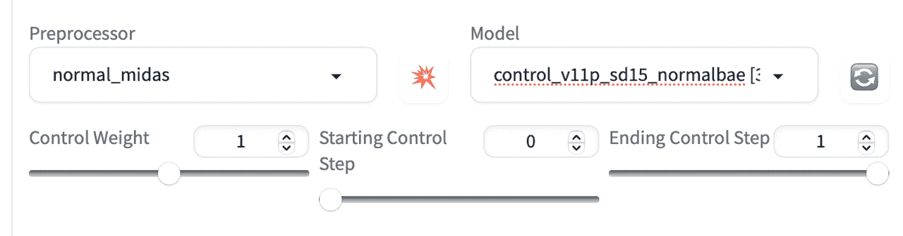

我会用下图来说明控制权重的效果。这是一个女孩坐下的图像。

但在提示中，我会要求生成一个站着的女人。

> full body, a young female, highlights in hair, standing outside restaurant, blue eyes, wearing a dress, side light

> 全身，年轻女性，头发上的亮点，站在餐厅外，蓝眼睛，穿着裙子，侧光

`Weight`:

权重：相对于提示给予控制图的强调程度。它类似于提示中的关键字权重，但适用于控制图。

The following images are generated using `ControlNet` `OpenPose` 预处理器和 `OpenPose` 模型。

Weight `1`

Weight `0.3`

Weight `1`

Weight `0.1`

如图所见，`ControlNet` 权重控制相对于提示遵循控制映射的程度。权重越低，`ControlNet` 对图像遵循控制图的要求就越少。

`Starting ControlNet step`: The step `ControlNet` first applies. `0` means the very first step.

启动 `ControlNet` 步骤：首先应用 `ControlNet` 步骤。 `0` 表示第一步。

`Ending ControlNet step`: The step `ControlNet` ends. `1` means the last step.

结束 `ControlNet` 步骤：`ControlNet` 步骤结束。 `1` 表示最后一步。

让我们将开始步骤固定为 `0`，并更改结束 `ControlNet` 步骤以查看会发生什么

Ending ControlNet step `1`

Ending ControlNet step `0.2`

Ending ControlNet step `0.3`

Ending ControlNet step `0.1`

由于初始步骤设置了全局组成（采样器在每个步骤中去除了最大量的噪声，并且它从潜在空间中的随机张量开始），即使您仅将 `ControlNet` 应用于少至 20% 的部分，姿势也会被设置第一个采样步骤。

相比之下，更改结束 `ControlNet` 步骤的影响较小，因为全局组合是在开始步骤中设置的。

### Control Mode 控制方式

`Balanced`:

平衡：`ControlNet` 应用于采样步骤中的调节和非调节。这是标准的操作模式。

My prompt is more important: The effect of `ControlNet` is gradually reducing over the instances of `U-Net` injection (There are 13 of them in one sampling step). The net effect is your prompt has more influence than the `ControlNet`.

我的提示更重要：`ControlNet` 的效果在 `U-Net` 注入的实例中逐渐减少（一个采样步骤中有 13 个）。最终效果是您的提示比 `ControlNet` 具有更大的影响力。

`ControlNet` is more important:

`ControlNet` 更重要：在未调节时关闭 `ControlNet`。实际上，`CFG` 规模也可以作为 `ControlNet` 效果的乘数。

### Resize mode 调整模式

调整大小模式控制当输入图像或控制图的大小与要生成的图像的大小不同时要做什么。

如果它们的纵横比相同，则无需担心这些选项。

我将通过设置文本到图像生成横向图像来演示调整大小模式的效果，而输入图像/控制图是纵向图像。

`Just Resize`: Scale the width and height of the control map independently to fit the image canvas. This will change the aspect ratio of the control map.（拉伸）

`Just Resize`：独立缩放控制图的宽度和高度以适合图像画布。这将改变控制图的纵横比。

这个女孩现在需要身体前倾，这样她仍然在画布内。您可以使用此模式创建一些有趣的效果。

Crop and Resize: Fits the image canvas to be within the control map. Crop the control map so that it is the same size as the canvas.（裁减）

裁剪和调整大小：使图像画布适合控制地图。裁剪控制图，使其与画布大小相同。

因为控制图在顶部和底部被裁剪了，所以我们的女孩也是如此。

裁剪和调整大小使得图像画布合适并裁减控制图

Resize and fill: Fit the whole control map to the image canvas. Extend the control map with empty values so that it is the same size as the image canvas.

调整大小和填充：使整个控制图适合图像画布。使用空值扩展控制图，使其与图像画布大小相同。

与原始输入图像相比，侧面有更多空间：

# 进阶玩法：Multiple ControlNets 多个控制网

常用组合类型：

`OpenPose+Depth`

组合特点：

1、可以有效的弥补`OpenPose`因图片前后位置遮挡无法准确有效显示的问题；

2、有效的结合人物姿势和背景图

你可以多次使用 `ControlNet` 来生成图像。让我们来看一个例子。

## （1）`OpenPose+Depth`

`Model`: `Protogen v2.2` 型号：`Protogen v2.2`

`Prompt`: 迅速的：

> An astronaut sitting, alien planet
>
> 一位宇航员坐着，外星球

`Negative prompt`: 否定提示：

> disfigured, deformed, ugly
>
> 毁容的，畸形的，丑陋的

This prompt generates images with varieties of composition.

此提示生成具有多种构图的图像。

假设我想独立控制宇航员和背景的构图。为此，我们可以使用多个（在本例中为 2 个）

我将使用此参考图像来固定宇航员的姿势。

Settings for `ControlNet 0`:

`ControlNet 0` 的设置：

+   `Enable`: Yes 启用：是

+   `Preprocessor`: `OpenPose` 预处理器：`OpenPose`

+   `Model`: `control_xxxx_openpose`

型号：`control_xxxx_openpose`

+   `Resize mode`: `Resize and Refill` (Since my original reference image is in portrait)

调整大小模式：调整大小和重新填充（因为我的原始参考图像是纵向的）

我将使用以下参考图像作为背景。

深度模型非常适合这个目的。你将想要使用哪种深度模型和设置来提供您想要的深度图。

Settings for `ControlNet 1`:

`ControlNet 1` 的设置：

+   `Enable`: Yes 启用：是

+   `Control Weight`: 0.45 控制重量：0.45

+   `Preprocessor`: `depth_zeo` 预处理器：`depth_zeo`

+   `Model`: `control_XXXX_depth`

型号：`control_XXXX_depth`

+   `Resize mode`: `Crop and resize`

调整大小模式：裁剪和调整大小

最终结果：

## （2）`Canny + Depth`（线条检测+阴影填充）

## （3）`OpenPose` + `HED` （保持大轮廓下的姿势准确性）

Tips:

+   如果其中一个没有完成其工作，请调整 `ControlNet` 权重。（一般来说第一个 `Contorl Net` 权重无需调整、后面的根据实际需要可调）

+   如果您有最终图像的不同尺寸的参考图像，请注意调整大小模式。

+   互补性的 `Control Net` 类型，生成的图片效果才更好；

+   使用的 `Control Net`

# 五、ControlNet的实际场景应用

## Edge detection example（边缘检测示例）

如下图所示，`ControlNet` 使用额外的输入图像并使用 `Canny` 边缘检测器检测其轮廓。然后将包含检测到的边缘的图像保存为控制图。它作为文本提示的额外条件输入到 `ControlNet` 模型中。

从输入图像中提取特定信息（在本例中为边缘）的过程称为注释（在研究文章中）或预处理（在 `ControlNet` 扩展中）。

## Human pose detection example（人体姿势检测示例）

边缘检测并不是图像预处理的唯一方式。 `OpenPose` 是一种快速人体关键点检测模型，可以提取人体姿势，如手、腿和头部的位置。请参见下面的示例。

使用 `OpenPose` 进行人体姿势检测注释的输入图像。

下面是使用 `OpenPose` 的 `ControlNet` 工作流程。使用 `OpenPose` 从输入图像中提取关键点，并将其保存为包含关键点位置的控制图。然后将其作为额外条件与文本提示一起提供给 `Stable Diffusion`。图像是根据这两个条件生成的。

使用 `Canny` 边缘检测和 `OpenPose` 有什么区别？

`Canny` 边缘检测器提取主体和背景的相似边缘。它倾向于更准确地翻译场景。可以看到跳舞的男人变成了女人，但轮廓和发型都保留了下来。

`OpenPose` 只检测人体关键点，如头部、手臂等位置。图像生成更自由，但遵循原始姿势。

上面的示例生成了一个左脚指向侧面的女人跳起来，这与原始图像和 `Canny Edge` 示例中的图像不同。原因是 `OpenPose` 的关键点检测没有指定脚的方向。

## ControlNet使用展示之一：（基本流程）

### Text-to-image settings 文本到图像设置

`ControlNet` 需要与稳定扩散模型一起使用。

在 `Stable Diffusion` 检查点下拉菜单中，选择要与 `ControlNet` 一起使用的模型。选择 `v1-5-pruned-emaonly.ckpt` 以使用 `v1.5` 基本模型。

在 `txt2image` 选项卡中，编写一个提示和一个可选的否定提示以供 `ControlNet` 使用。我将使用下面的提示。

`Prompt`: 迅速的：

> full-body, a young female, highlights in hair, dancing outside a restaurant, brown eyes, wearing jeans
>
> 全身，年轻女性，头发突出，在餐厅外跳舞，棕色眼睛，穿着牛仔裤

`Negative prompt`: 否定提示：

> disfigured, ugly, bad, immature
>
> 毁容的，丑陋的，坏的，不成熟的

设置图像生成的图像大小。我将为我的演示图像使用宽度 512 和高度 776。请注意，图像大小是在 `txt2img` 部分中设置的，而不是在 `ControlNet` 部分中设置的。

### ControlNet 设置

现在让我们转到 `ControlNet` 面板。

首先，将图像上传到图像画布。

选中启用复选框。

您将需要选择预处理器和模型。 `Preprocessor` 只是前面提到的 `annotator` 的不同名称，比如 `OpenPose` keypoint detector。让我们选择 `openpose` 作为预处理器。所选的 `ControlNet` 模型必须与预处理器一致。对于 `OpenPose`，您应该选择 `control_openpose-fp16` 作为模型。

`ControlNet` 面板应如下所示。

就这样。现在按生成开始使用 `ControlNet` 生成图像。

您应该看到生成的图像遵循输入图像的姿势。最后一张图像直接来自预处理步骤。在这种情况下，它是检测到的关键点。

完成后，取消选中启用复选框以禁用 `ControlNet` 扩展。

以上就是 `ControlNet` 的一般操作流程。

## 使用 ControlNet 的一些想法

### Copying human pose 复制人体姿势

也许 `ControlNet` 最常见的应用是复制人体姿势。这是因为通常很难控制姿势……直到现在！

输入图像可以是 `Stable Diffusion` 生成的图像，也可以是从真实相机拍摄的图像。

### OpenPose model OpenPose模型

要使用 `ControlNet` 传输人体姿势，请按照说明在 `AUTOMATIC1111` 中启用 `ControlNet`。使用以下设置。

`Preprocessor`: `openpose`

预处理器：`openpose`

`Model`: `control_…._openpose`

型号：`control_…._openpose`

Make sure you have checked `Enable`.

确保您已选中启用。

Examples：

示例 1：从图像复制姿势

作为一个基本示例，让我们复制下图一位欣赏树叶的女性的姿势。

使用各种模型和提示，您可以显着改变内容但保持姿势不变。

`Dreamlike photoreal` model

`Dream Sharp` model

`Anything-V3` model

`Anything-V3` model

### 示例 2：重新混合电影场景

您可以将低俗小说中标志性的舞蹈场景重现为公园里的一些瑜伽练习。

这将 `ControlNet` 与 `DreamShaper` 模型结合使用。

提示：女性在公园外做瑜伽的照片。负面提示：毁容、丑陋、不良、不成熟

这是使用相同的提示，但使用 `Inkpunk Diffusion` 模型。 （您需要在提示中添加激活关键字 `nvinkpunk`）

与墨水朋克扩散模型相同的提示。

### 使用 ControlNet 风格化图像

### Using prompts 使用提示

### Using models 使用模型

### 还可以使用模型来风格化图像。下面是使用 `Anythingv3`、`DreamShaper` 和 `OpenJourney` 模型使用提示“贝多芬的绘画”生成的。

### Controlling poses with Magic Pose（使用 Magic Pose 控制姿势）

有时您可能无法找到具有您想要的确切姿势的图像。您可以使用 `Magic Poser`（信用）等软件工具创建自定义姿势。

Step 1: Go to the `Magic Poser` website.

第 1 步：转到 `Magic Poser` 网站。

Step 2: Move the keypoints of the model to customize the pose.

第二步：移动模型关键点，自定义姿势。

Step 3: Press `Preview`. Take a screenshot of the model. You should get an image like the one below.

第 3 步：按预览。截取模型的屏幕截图。您应该得到如下图所示的图像。

第 4 步：使用 `OpenPose` `ControlNet` 模型。选择您选择的模型和提示以生成图像。

下面是使用 `1.5` 模型和 `DreamShaper` 模型生成的一些图像。在所有情况下都很好地复制了姿势。

### Interior design ideas 室内设计理念

您可以使用 `Stable Diffusion` `ControlNet` 的直线探测器 `MLSD` 模型来生成室内设计创意。以下是 `ControlNet` 设置。

`Preprocessor`: `mlsd` 预处理器：`mlsd`

`Model`: `mlsd` 型号：`mlsd`

从任何室内设计照片开始。让我们以下面的例子为例。

`Prompt`: 迅速的：

> award winning living room
>
> 获奖客厅

`Model`: `Stable Diffusion v1.5`

型号：稳定扩散 `v1.5`

Below are a few design ideas generated.

下面是生成的一些设计思路。

或者可以使用深度模型。它将强调保留深度信息而不是直线。

`Preprocessor`: `Depth Midas`

预处理器：深度迈达斯

`Model`: `Depth` 型号：深度

生成的图像：

# 六、额外拓展

## Stable Diffusion深度模型与ControlNet的区别

`Stable Diffusion` 的创造者 `Stability AI` 发布了一个深度到图像的模型。它与 `ControlNet` 有很多相似之处，但也有重要区别。

相似性：

1.  它们都是稳定扩散模型

1.  他们都使用两个条件（预处理图像和文本提示）。

1.  他们都使用 `MiDAS` 来估计深度图。

不同之处：

1.  版本适用性：

`Depth-to-image` 模型是 `v2` 模型。 `ControlNet` 可用于任何 `v1` 或 `v2` 模型。这一点很重要，因为众所周知 `v2` 模型很难使用。人们很难生成好的图像。 `ControlNet` 可以使用任何 `v1` 模型这一事实不仅打开了对 `v1.5` 基本模型的深度调节，而且还打开了社区发布的数千个特殊模型。

1.  通用性：

`ControlNet` 更通用。除了深度，它还可以用边缘检测、姿势检测等条件。

1.  分辨率

`ControlNet` 的深度图比图像深度图具有更高的分辨率。

## ControlNet 工作机理

`ControlNet` 的工作原理是将可训练的网络模块附加到稳定扩散模型的 `U-Net`（噪声预测器）的各个部分。 `Stable Diffusion` 模型的权重是锁定的，因此它们在训练过程中是不变的。在训练期间仅修改附加模块。（研究论文中的模型图很好地总结了这一点。最初，附加网络模块的权重全部为零，使新模型能够利用经过训练和锁定的模型。）
