# 阿里云PAI-DSW部署StableDiffusion

> 来源：[https://xuqiwei1986.feishu.cn/docx/XbOtdUOz9om4Byxuy15cv1vKnib](https://xuqiwei1986.feishu.cn/docx/XbOtdUOz9om4Byxuy15cv1vKnib)

家里的电脑是NUC8硬改的黑苹果，之前试了使用CPU跑StableDiffusion，默认参数跑一张512*512的图平均需要七八分钟，耗时太感人了。。。这严重影响学习的积极性和效率啊！

马上F大要开始组织航海了，得赶紧跟上步伐，由于是刚刚接触AI绘画，网上查询到要想出图速度快的话，最少也得魔改2080以上的显卡，整套机器装下来最低也得5K+，出于成本考虑，想着租个云服务器使用，按使用时间计费，结果在搜索过程中发现有人推荐阿里云的PAI-DSW免费使用3个月，赶紧试一试。

# 申请试用

先说前提哈，阿里云帐户要实名认证且未试用过同[类产品才能免费试用，满足条](https://www.aliyun.com/activity/bigdata/pai/dsw?spm=5176.28008736.J_6443120770.d960469_0.1eaa3e4dRVTos7)件的话[就先访问http](https://www.aliyun.com/product/nas?spm=5176.28008736.J_6443120770.d966411_0.1eaa3e4dRVTos7&scm=20140722.M_4691615._.V_1)s://free.aliyun.com，在“搜索试用产品”处输入“DSW”后，出现2款试用产品，分别是“交互式建模 PAI-DSW”和“文件存储 NAS”，分别点击立即试用，可以申请到使用期限为3个月，50GB容量的NAS空间和使用期限同样为3个月的5000CU*H的试用点数（这个具体代表什么后面说）。

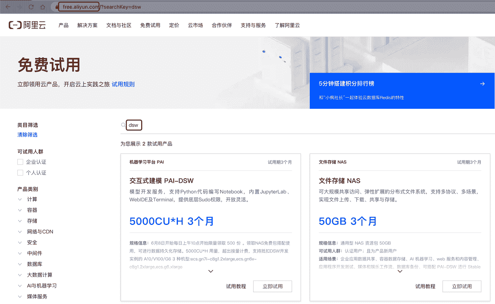

申请后到阿里云工作台的用户中心左下角的“资源实例管理”中可以看到，已经有了5000个总量递减型的机器学习资源和50GB NAS空间，有效期均为3个月。

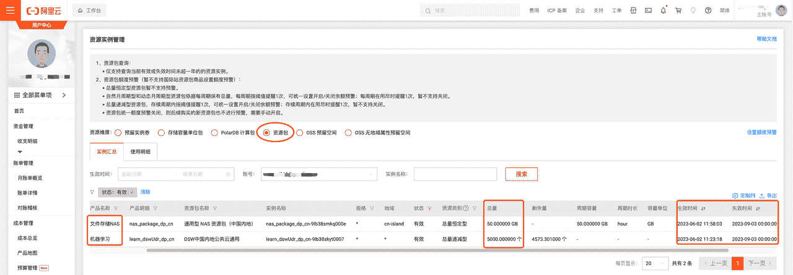

# 创建NAS空间

接下来先创建NAS空间（这里唠叨一句，没有NAS空间的话DSW也能使用，但是每次开关机都需要保存环境，否则所有你做的修改都不会保存，比如安装的StableDiffusion，下载的Model等如果不保存环境的话都会随着开关机而消失，类似以前网吧的还原精灵一样，每次关机都会恢复预置环境；而在DSW实例中保存环境的时间会随着需要保存内容增加而大大延长，所以为了避免这个麻烦，通过挂载NAS后将StableDiffusion安装到NAS空间，只要SD主程序和Models不超过50G，均可免费使用3个月）。

打开“文件存储”控制台，在文件系统列表中新建文件系统，按照说明一步一步做就行，需要注意的有如下几点：

1.  NAS空间类型应为NFS，不要申请SMB类型，只有NFS类型才能挂载到PAI-DSW实例中；

1.  如果是初次使用阿里云相关服务，系统会提示你创建“专有网络VPC”、“虚拟交换机VSW”、“权限组”和“挂载点”等，按说明做，提示少什么就按操作指引去创建什么就好了。

1.  NAS空间需要和将要申请的PAI-DSW实例在同一可用区（比如我的就都在华南1-深圳）

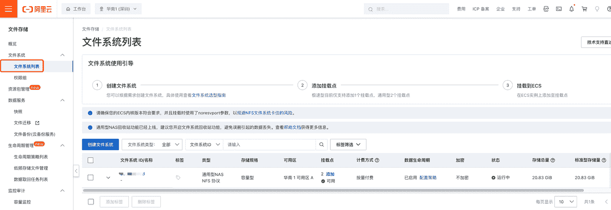

# 创建PAI-DSW实例

到https://pai.console.aliyun.com/机器学习PAI界面，选择左侧“模型开发与训练”中的“交互式建模（DSW）”，然后点击“创建实例”。

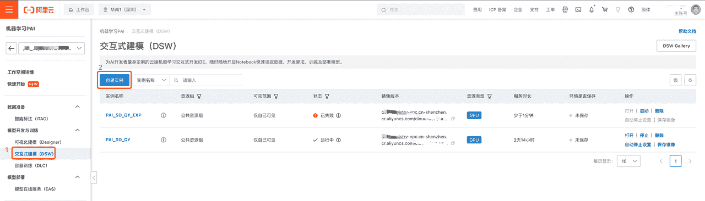

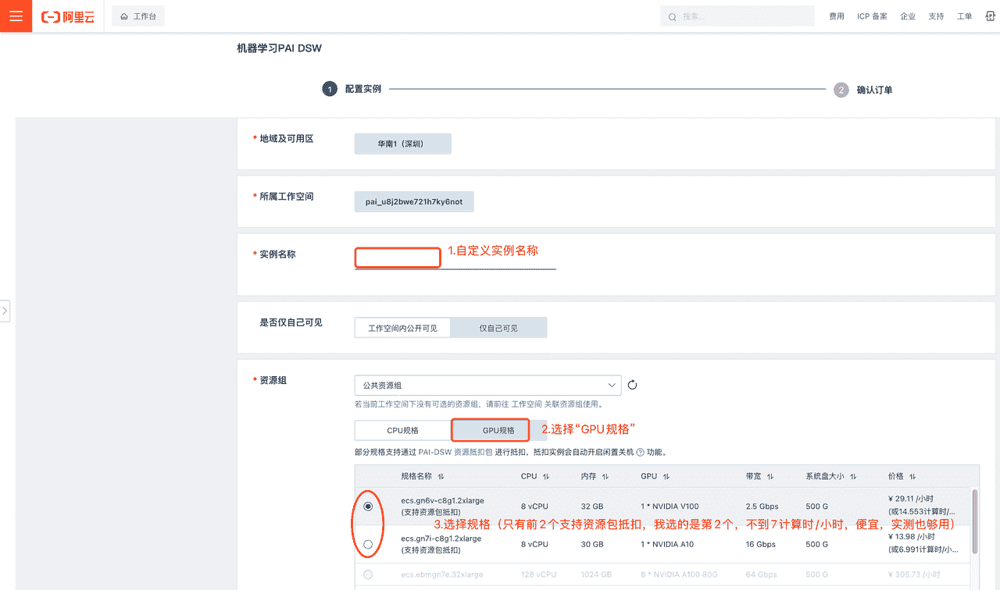

打开B站[秋葉aaaki](https://space.bilibili.com/12566101)大神的“阿里云白嫖sd-webui一键包（https://pan.quark.cn/s/12af730acb20）”，找到镜像地址后复制你的DSW所在区域的链接粘贴到镜像URL下面，然后点击“下一步”（注意，最下面的网络配置千万不要选，我在这里被坑了一个小时。。。）

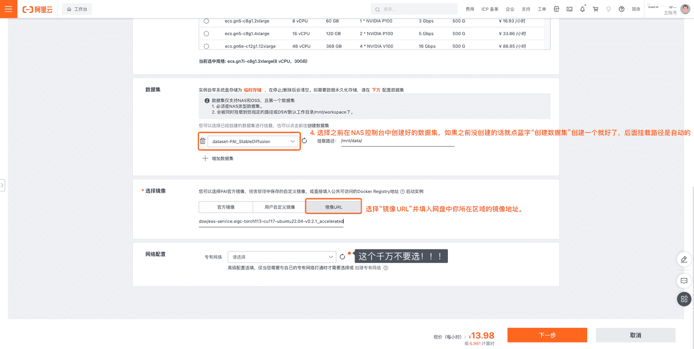

确认2个依赖项检查都通过，然后同意服务协议，并点击“创建实例”，稍等几分钟实例就创建好了。

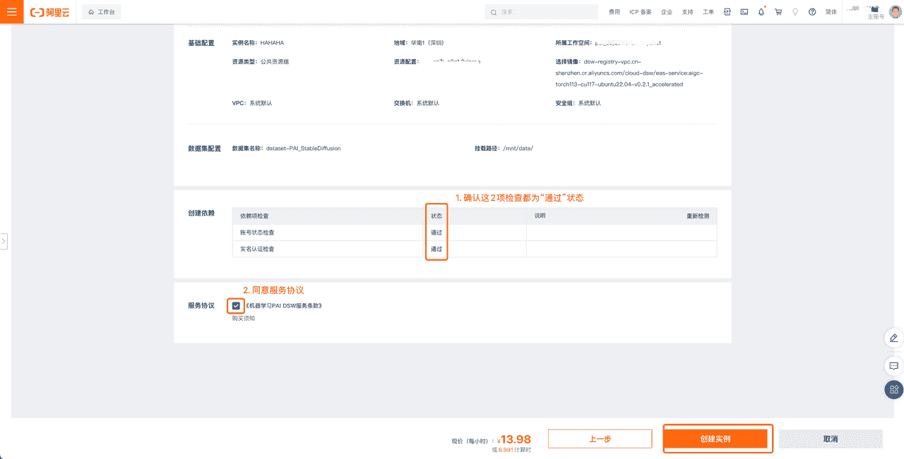

# 部署Stable Diffusion及使用

回到https://pai.console.aliyun.com/机器学习PAI界面，点击创建好的实例后面的启动，等几分钟启动好以后，前面的“打开”就会变成可点击状态，然后点击“打开”。

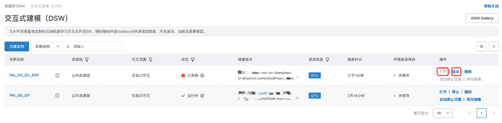

在打开的JupyterLab界面中，把上面网盘中的sd-webui-aki-aliyun-v5.ipynb文件直接拖到左侧文件树中，然后双击打开，按照说明一步一步执行就可以了

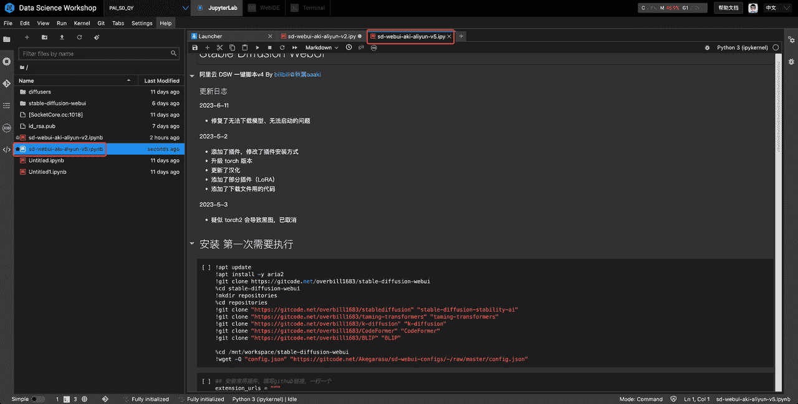

当最后脚本执行完毕后，看到下图中的提示，就代表Stable Diffusion已经启动成功，点击蓝色的网址，就可以进入SD的界面了

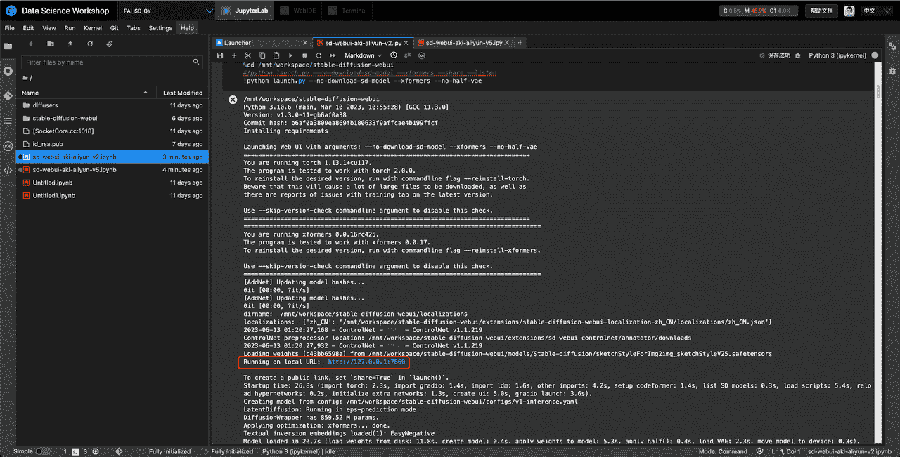

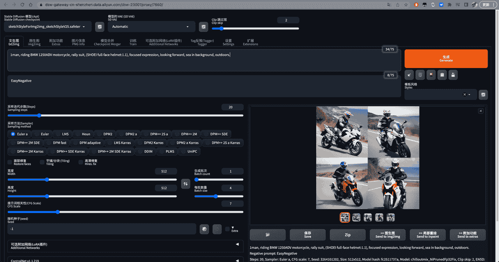

剩下的就是安装插件，下载模型（推荐在命令行Terminal面板中使用aria2c下载国内镜像站的Model，我试过在WebIDE中Upload，简直是龟速，才几百KB/s的速度，不能忍。。。）等具体使用了，有问题可参考网上其他教程。

白嫖的A10显卡出图速度几秒一张，感觉太爽了！！！

BTW：PAI-DSW实例是按使用时间收费，5000点基本可以不关机使用一个月，如果想用得久一点，不用时记得关机，不过根据我实际使用情况看，早上9到11点，晚上七八点钟左右，基本都会开机失败，原因是可用资源不足，因为这些时间段使用的人数太多，所以大家根据自己使用情况决定何时开关机吧，祝大家玩得开心！