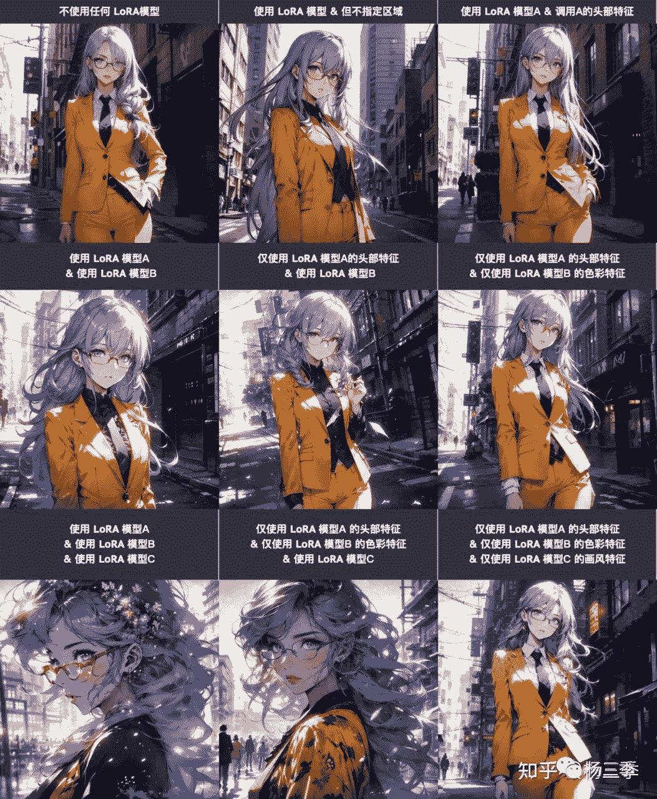
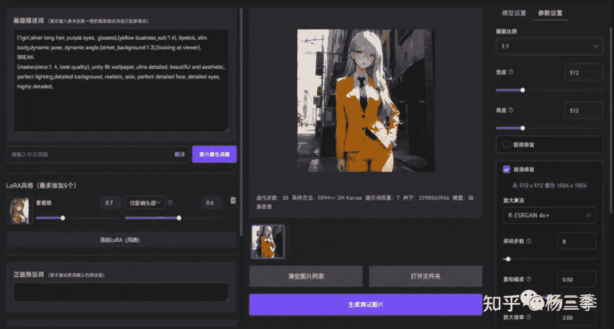
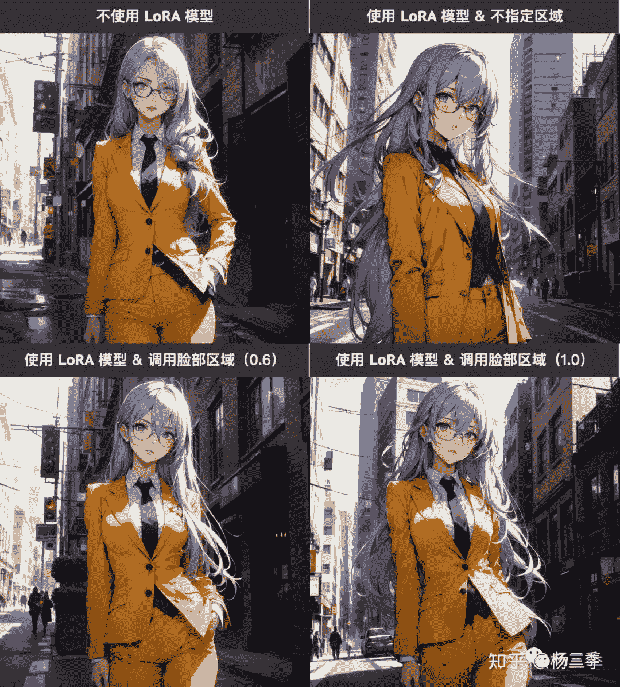
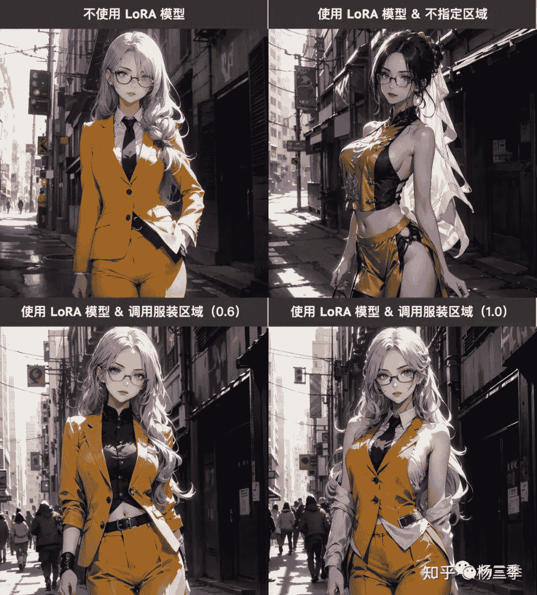
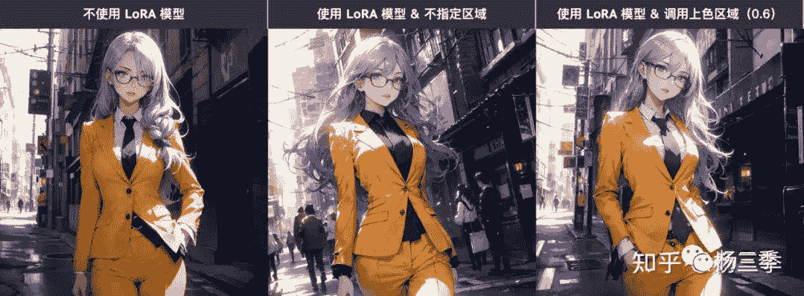
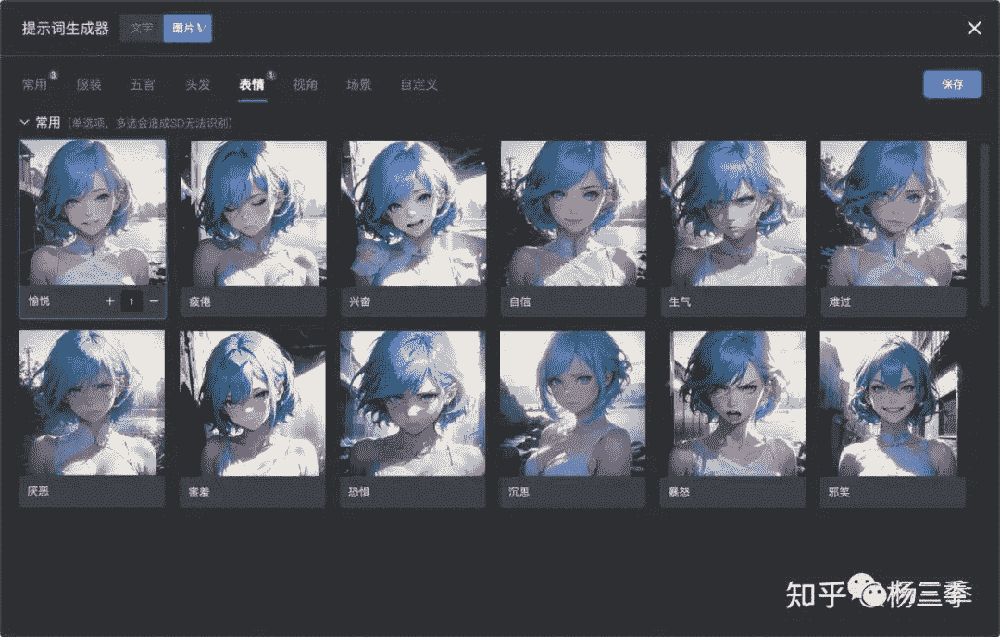

# 2023-09-01AI绘画 Stable Diffusion｜提示词高阶用法（四）LoRA指定区域

> 来源：[https://xuqiwei1986.feishu.cn/docx/BRRMdm9hwobcbUxIPOTcLiLJnHh](https://xuqiwei1986.feishu.cn/docx/BRRMdm9hwobcbUxIPOTcLiLJnHh)

> 🔗 原文链接： h[ttps://mp.weixin.q](https://mp.weixin.qq.com/s/If6w_YkKatcP_-yktRC4Xg)q.com/s/If6w_YkK...

原创 杨三季 杨三季 2023-09-01 21:56 发表于 辽宁

手机阅读


> 你可能在使用LoRA模型时，总会因为LoRA的特定风格，影响到画面原本的人物形象，导致你可能需要不停的找新的LoRA模型去实验。作者本篇将会从“LoRA模型的分层控制”来介绍，如何在使用特定的LoRA模型，也可以不影响到画面原本的人物形象。如同下图这样的案例。



“LoRA分层控制”的教程，网络上已经有各路大佬总结过一些自己的分享了，不过在作者一一细品后，感觉都非常的学术派。在本篇作者就不再继续介绍学术理论了。感兴趣的朋友可以自行在B站或GitHub上查看相关的技术分享。

作者本次分享将继续承接之前的AI漫画业务场景，介绍如何通过“  LoRA分层控制”来进行角色形象风格的调整。

在介绍实操经验前，作者先简单介绍一下“ 如何使用LoRA模型的分层控制。 ”

众所周知，LoRA模型的标准使用格式：

+

```
&lt;lora:LoRA模型的名称:LoRA权重值&gt;
```

而LoRA模型的分层控制，则是在LoRA权重值后，增加“:”，并添加的LoRA模型的17个分层的对应权重值代码。

+

```
&lt;lora:LoRA模型的名称:LoRA权重值:分层权重值代码&gt;
```

| 1 | 2 | 3 | 4 | 5 | 6 | 7 | 8 | 9 | 10 | 11 | 12 | 13 | 14 | 15 | 16 | 17 |
| --- | --- | --- | --- | --- | --- | --- | --- | --- | --- | --- | --- | --- | --- | --- | --- | --- |
| BASE | IN01 | IN02 | IN04 | IN05 | IN07 | IN08 | MID | OUT03 | OUT04 | OUT05 | OUT06 | OUT07 | OUT08 | OUT09 | OUT10 | OUT11 |

如下表所示，LoRA的17个分层中，第一层是BASE层，也可以 称 为是开关层。 代表 如果BASE层为0时，后面16层不管如何设置，LoRA的分层控制都无法使用。 网上有一些大佬，强烈建议将开关层必须写为1（额...），这个作者持保留意见。

**作者在多种LoRA模型**的多轮实践后，推荐在二次元的AI绘画中， BASE层设为0.6 ，较为稳妥。如果这个值小于0.6，那么LoRA模型的特征将被淡化接近为无，如果大于0.6，比如为1时，LoRA模型的其他并不是你想要的特征将被放大。

如下图所示，作者在使用时，将17层权重值代码分为两部分：

+

```
分层权重值（BASE层） + 分层代码（2~17层）
```



LoRA模型的应用场景

在二次元漫画的AI绘画场景中，LoRA模型主要用于让我们轻松画出特定的角色形象、场景穿搭、色彩画风。 我们可将一个人物的LoRA模型应用分下类 (人物LoRA 为例，容易理解）

**角色容貌： **主要为人物的脸型、五官等，有时候还伴有特定的表情和发型发饰。

**角色服饰： **主要为特定的服饰，比如机甲衣、汉服等；

**画面风格： **常见的画风多为仙侠风，国风，midjourney风格等；

## LoRA ｜ 角色容貌

+

+

```
分层权重值（BASE层）：0.6分层代码（2~17层）：0,0,0,0,0,0,0,1,1,1,0,0,0,0,0,0
```

案例：

**作者想生成的场景： **一个穿着职业装的长发女孩下班后，走着街道。

画面描述：

+   中文：一个女孩，银色长发，紫色眼瞳，眼镜，口红，黄色职业装，纤细的身材, 走路，街道背景，看着屏幕

+   英文：1girl, silver long hair, purple eyes, glasses, lipstick, yellow business_suit, slim body, walking, street_background, looking at viewer,

```
(1girl, silver long hair, purple eyes, glasses),(yellow business_suit:1.4), lipstick, slim body, dynamic pose, dynamic angle,(street_background:1.3), (looking at viewer),BREAK(masterpiece:1.4, best quality), unity 8k wallpaper, ultra detailed, beautiful and aesthetic, perfect lighting, detailed background, realistic, solo, perfect detailed face, detailed eyes, highly detailed,  &lt;lora:害羞脸:0.8:0.6,0,0,0,0,0,0,0,1,1,1,0,0,0,0,0,0&gt;
```



可以发现：

+   不使用LoRA的分层控制（不指定调用区域）时，LoRA模型影响了原本画面的结构（人物的姿态、发色、服装颜色等）；

+   使用LoRA的分层控制（指定调用脸部区域）后，LoRA模型仅影响了原本画面人物的脸部区域；

+   在使用LoRA的分层控制后，并将BASE层数值从 0.6 调整至 1.0 后，LoRA模型除影响了原本画面人物的脸部区域外，还影响了姿态、发色。

因此，作者建议BASE层数值的默认值设为 0.6 ，因为不同的LoRA模型的训练的拟合程度不同，所以作者建议你使用时，也不能一味照搬，还是要基于实际结果调整。

LoRA ｜ 角色服饰

+

+

```
分层权重值（BASE层）：0.6分层代码（2~17层）：1,1,1,1,0,0.2,0,0.8,1,1,0.2,0,0,0,0,0
```

案例：

延用上面的案例，作者希望女孩的服装不要太正式，时尚一点。因此此次加入了一个服装LoRA。

+

+

+

+

```
(1girl, silver long hair, purple eyes, glasses),(yellow business_suit:1.4), lipstick, slim body, dynamic pose, dynamic angle,(street_background:1.3), (looking at viewer),BREAK(masterpiece:1.4, best quality), unity 8k wallpaper, ultra detailed, beautiful and aesthetic, perfect lighting, detailed background, realistic, solo, perfect detailed face, detailed eyes, highly detailed,&lt;lora:肚兜_shidudou:0.8:0.6,1,1,1,1,0,0.2,0,0.8,1,1,0.2,0,0,0,0,0&gt;
```



可以发现：

+   不使用LoRA的分层控制（不指定调用区域）时，LoRA模型由于其训练特征，几乎影响了原本画面中的角色的全部特征（人物的姿态、发色、服装颜色等）；

+   使用LoRA的分层控制（指定调用服装区域）后，LoRA模型除影响了原本画面人物的服装的内搭区域，其他部分影响很小；

+   在使用LoRA的分层控制后，并将BASE层数值从 0.6 调整至 1.0 后，LoRA模型除影响了原本画面人物的服装的内搭区域，对服装款式影响较大；

LoRA ｜ 画面风格

```
分层权重值（BASE层）：0.6分层代码（2~17层）：0,0,0,0.1,0.2,0,0,0,0,0.1,1,1,1,1,1,1
```

案例：

沿用上面的案例，作者希望整个画面有一种春天的温暖感。因此此次加入了一个风格LoRA。

+

+

+

+

```
(1girl, silver long hair, purple eyes, glasses),(yellow business_suit:1.4), lipstick, slim body, dynamic pose, dynamic angle,(street_background:1.3), (looking at viewer),BREAK(masterpiece:1.4, best quality), unity 8k wallpaper, ultra detailed, beautiful and aesthetic, perfect lighting, detailed background, realistic, solo, perfect detailed face, detailed eyes, highly detailed,   &lt;lora:繁荣景象:0.8:0.6,0,0,0,0.1,0.2,0,0,0,0,0.1,1,1,1,1,1,1&gt;
```



可以发现：

+   不使用LoRA的分层控制（不指定调用区域）时，LoRA模型由于其训练特征，几乎影响了原本画面中的角色的全部特征（人物的姿态、发色、服装颜色等）；

+   使用LoRA的分层控制（指定调用上色层级）后，LoRA模型除对原本画面整体画风进行影响外，其他部分影响很小；

本期就介绍这三种较为通用的LoRA模型分层控制的案例，在作者的调研中，LoRA分层还可以指定特定姿态动作的调用，也可以反向调用，比如LoRA模型仅影响除头部以外的区域。但由于这几类分层代码的适用性不如以上三种的适用性高，因此作者就不在此次展开介绍了。有兴趣的朋友可以关注我的公众号 @杨三季 留言与我交流。

## 下期介绍

对于LoRA模型分层控制的实操 就先介绍到这，下一篇将会介绍如何通过 Stable Diffusion 提示词生成特定的情绪表情以及画面视角的实操技巧。

