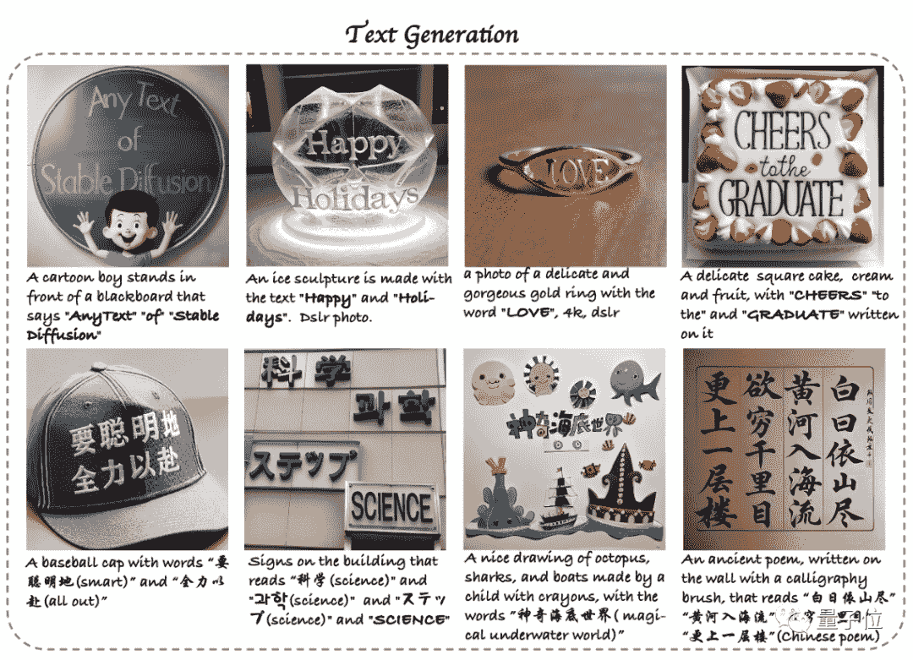
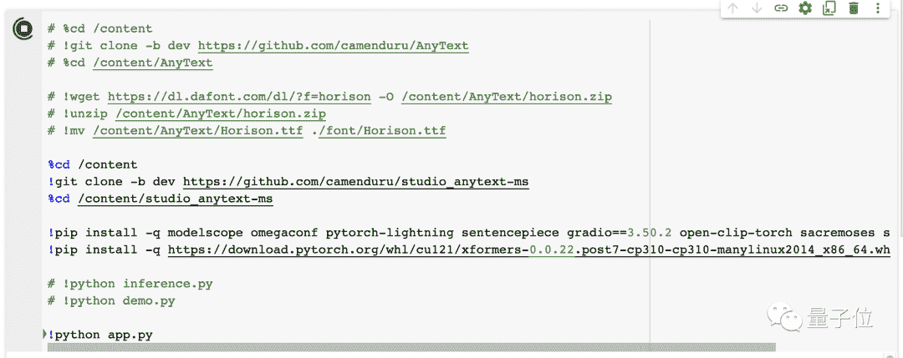
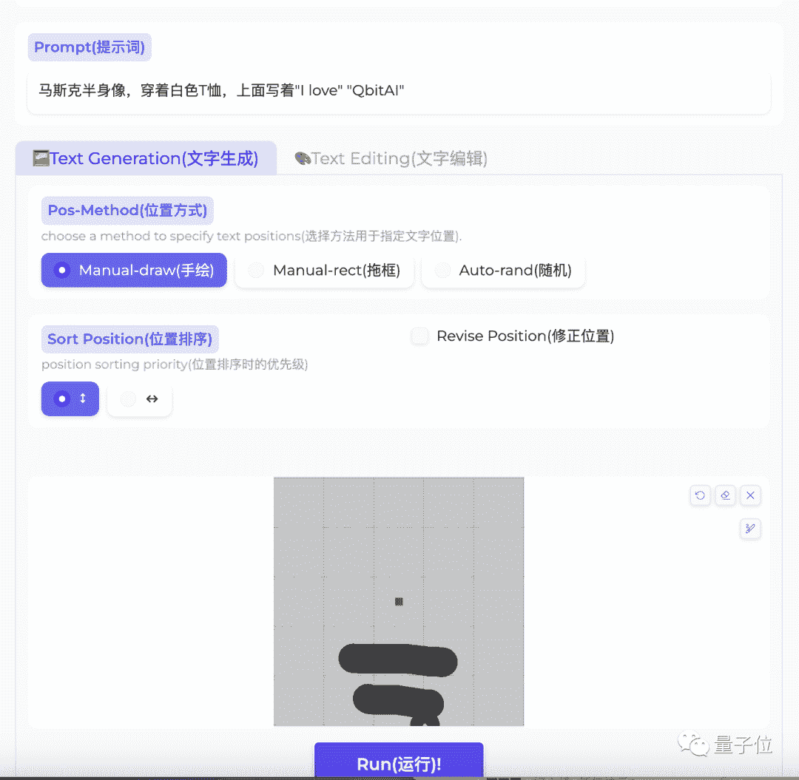
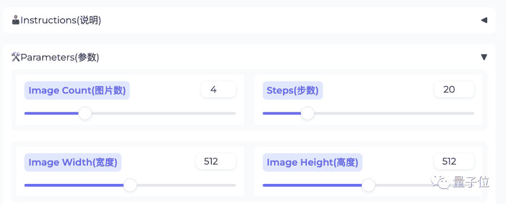
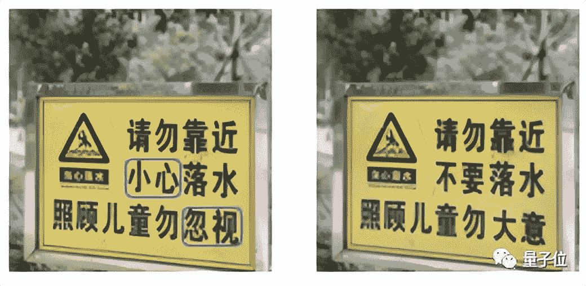
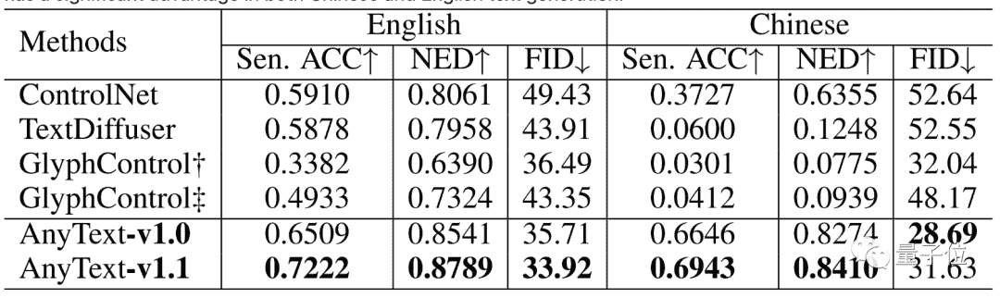
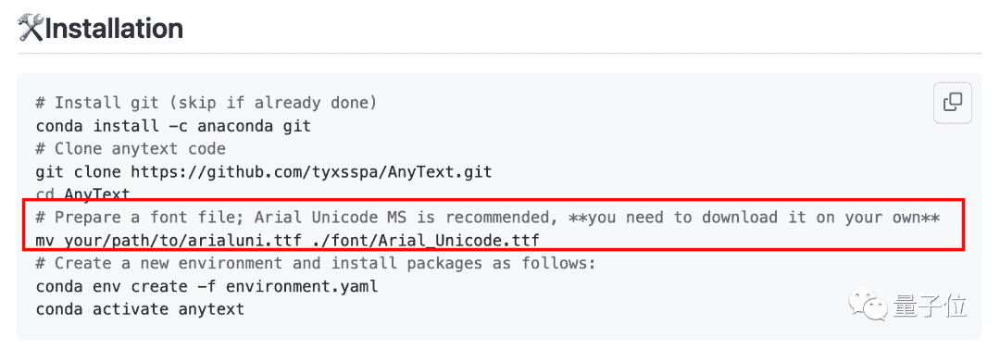
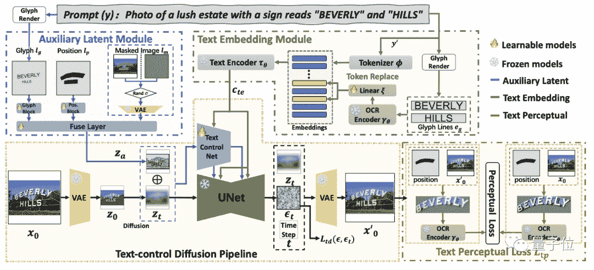
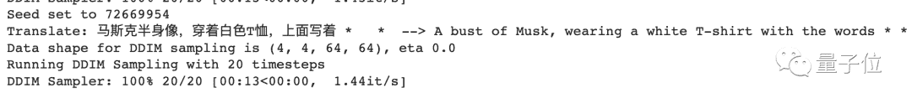

# 2024-01-01AI绘图模型不会写字的难题，被阿里破解了-今日头条

> 来源：[https://xuqiwei1986.feishu.cn/docx/KQmxdqDRoocwF7xWArCcJc6Cnkc](https://xuqiwei1986.feishu.cn/docx/KQmxdqDRoocwF7xWArCcJc6Cnkc)

> 🔗 原文链接： h[ttps://www.toutiao](https://www.toutiao.com/article/7318990797720830515/?log_from=b7b4a2908dc63_1704264447858).com/article/731...

>

# AI绘图模型不会写字的难题，被阿里破解了

2024-01-01 13:05 · 量子位

> 克雷西 发自 凹非寺

> 量子位 | 公众号 QbitAI

能准确写汉字的AI绘图工具，终于登场了！

包括中文在内一共支持四种语言，而且还能文字的位置还能任意指定。

从此，人们终于可以和AI绘图模型的“鬼画符”说再见了。

这款名为AnyText的绘图工具来自阿里巴巴，可以按照指定位置精准地向图中加入文字。

此前的绘图模型普遍无法准确地向图中添加文字，即便有也很难支持像中文这样结构复杂的文字。

而目前Anytext支持中英日韩四种语言，不仅字形准确，风格也可以与图片完美融合。

除了可以在绘制时加入文字，修改图片中已有的文字，甚至向其中加字也都不是问题。

究竟AnyText效果如何，我们也实际体验了一番。

# 各种风格轻松驾驭

官方在GitHub文档中提供了AnyText的部署教程，也可以在魔搭社区中体验。

此外还有网友制作了PyTorch笔记，可以在本地或Colab中一键部署，我们采用的也是这种方式。

AnyText支持中英文Prompt，不过从程序日志来看，中文提示词会被自动翻译成英文。

比如我们想让AnyText给马斯克换上一件白色T恤，让他来给量子位（QbitAI）打个call。

只需要输入提示词，然后设定文本的位置，然后直接运行就可以了。

如果需要调整尺寸等参数，可以将上方的菜单展开；如果不会操作，页面中还附有中英双语教程。

最终，在搭载V100的Colab上，AnyText用了10多秒绘制出了四张图片。

效果还是不错的，不论是图本身还是文字，看上去都没有什么破绽。

而且各种文字材质AnyText都能准确模仿，比如黑板上的粉笔字，甚至是传统书法……

街景中的文字，甚至是电商促销海报，都难不倒AnyText。

而且不仅是平面上各式各样的文字，立体风格同样也不在话下。

而其中的文本编辑功能，还可以修改已有图片中的文字，几乎不会留下破绽。

在测试当中，AnyText也是取得了不错的成绩——无论是中英文，准确度都显著高于ControlNet，FID误差也大幅减少。

此外，如果自行部署，还可以对字体进行自定义，只需准备好字体文件并对代码简单修改就可以了。

那么，研究人员是怎样让AnyText学会写字的呢？

# 文本渲染独立完成

AnyText是基于扩散模型开发的，主要分为两个模块，文字生成的过程是相对独立的。

这两个模块分别是 **隐空间辅助模块 **和 **文本嵌入模块 **。

其中，辅助模块对字形、文字位置和掩码这三种信息进行编码并构建隐空间特征图像，用来辅助视觉文字的生成；

文本嵌入模块则将描述词中的语义部分与待生成文本部分解耦，使用图像编码模块单独提取字形信息后，再与语义信息做融合。

在实际工作过程中，嵌入的文本输送给绘图模块时被用星号代替，在嵌入空间预留位置并用符号填充。

然后文本嵌入模块得到的字形图像被输入预训练OCR模型，提取出字形特征，然后调整其维度并替换预留位置中的符号，得到新的序列。

最后，这个序列表示被输入到CLIP的文本编码器中，形成最终指导图像生成的指令。

这种“分而治之”的方式，既有助于文字的书写精度，也有利于提升文字与背景的一致性。

此外，AnyText还支持嵌入其他扩散模型，为之提供文本生成支持。

论文地址：

https://arxiv.org/abs/2311.03054

GitHub：

https://github.com/tyxsspa/AnyText

魔搭社区：

https://modelscope.cn/models/damo/cv_anytext_text_generation_editing/summary

笔记：

https://colab.research.google.com/github/camenduru/AnyText-colab/blob/main/AnyText_colab.ipynb

— 完 —

量子位 QbitAI · 头条号签约

关注我们，第一时间获知前沿科技动态