# 2023-12-13Midjourney正式上线alpha网页版 - 用户体验的极致升华

> 来源：[https://xuqiwei1986.feishu.cn/docx/DV2ZdEZ1go7wbExoqVfcLpuDnw9](https://xuqiwei1986.feishu.cn/docx/DV2ZdEZ1go7wbExoqVfcLpuDnw9)

> 🔗 原文链接： h[ttps://mp.weixin.q](https://mp.weixin.qq.com/s/yRkTxtBB3yFCwWn0i6U-Tg)q.com/s/yRkTxtBB...

最近AI领域各大应用卷的飞起，而且不只是卷模型。

用户体验，这四个快在AI领域被人遗忘的四个大字。 随着PIKA1.0的推出，终于又回人们的视野了。

网页端的体验，真的比Discord好太多太多了。。。

我的英文和脑子其实一直都不太好，之前每次镜头移动啥的我都现翻译。。总是记不得。。。

Midjourney这玩意也是，一堆后缀参数要写，说实话，有时候脑一抽，真的忘了，而且也是真特娘的没效率，谁会没事记得那么多指令啊。。。。

盼星星盼月亮，在等了几个月的传言后，终于，在今天，看到了Midjourney网页版，正式上线的消息。

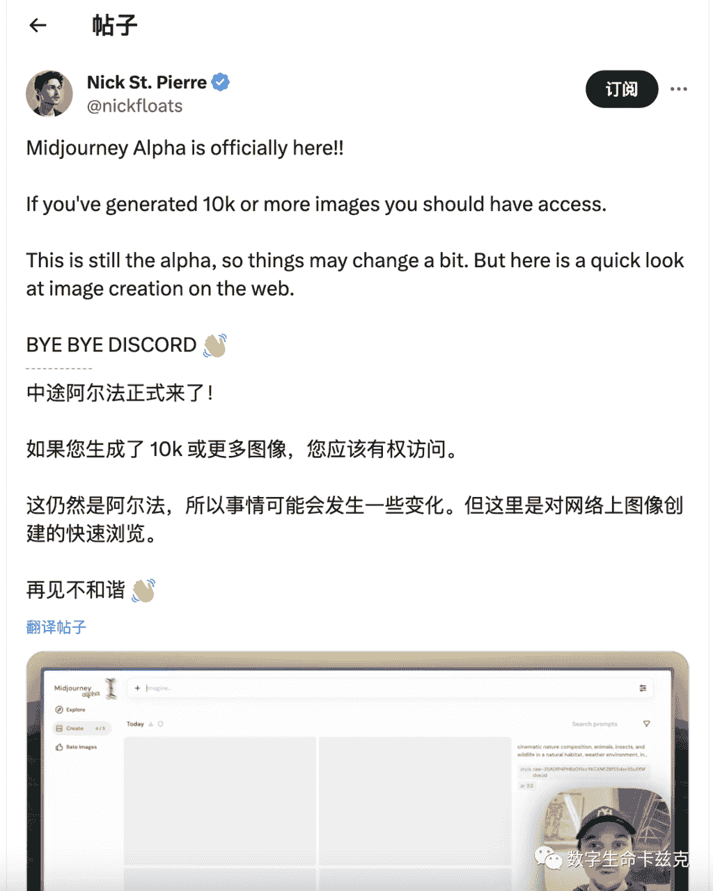

# 网页在此： alpha.midjourney.com

不过吧，能用上他们网页版的门槛是，用MJ以来，你生成超过了一万张图。

可以在Discord里输入/info，看到你生成的数量。

我本来想着，我怎么滴也够了吧。。。。结果。。。

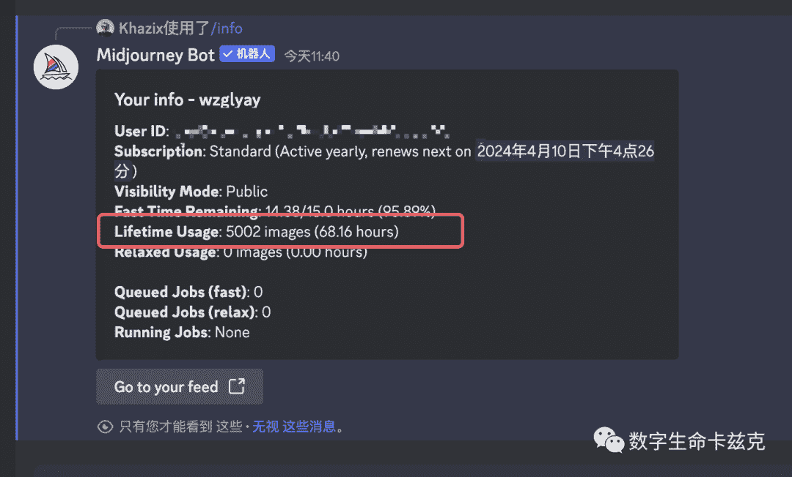

我果然还是个弟弟。。。。

但是众所周知，我是急急国王，很急很急的那种。

所以，立马去找了我的朋友，@大峰AI绘画。

他也很痛快。

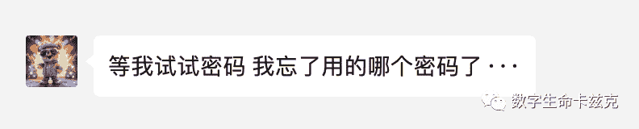

大概等了半小时以后，他终于把密码试出来了。我/info一看，22000张图，大佬果然是大佬。。。。。

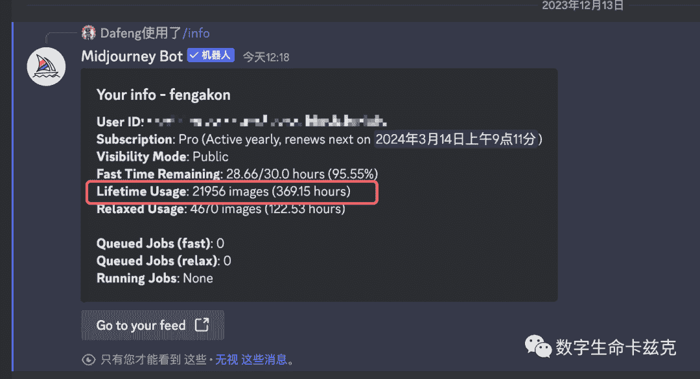

总之，我又一次借到账号了，终于可以登上Midjourney网页版了！

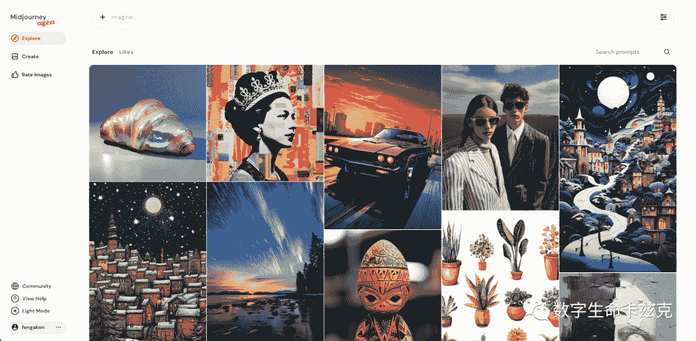

进来以后，很清爽的页面，左边三个Tab，Explore（社区），Create（你自己的图），Rate Images（给MJ当苦力帮他标注的）

在社区里面，把鼠标hover在任何一张图上，就有Use Prompt和Ues Image，简单来说就是抄人家的Prompt或者抄人家的图，点击更多也可以复制一些东西。

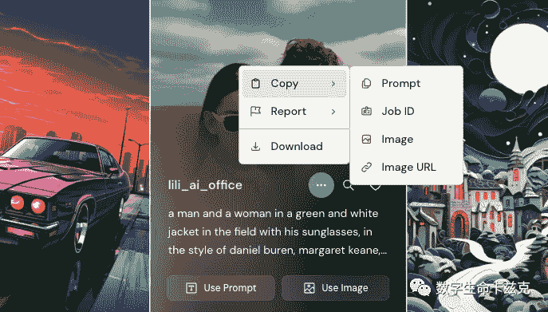

当你点了那两个Use的功能之后，这人的Prompt和图片就会放到上方的输入框里，贼特么方便快捷。

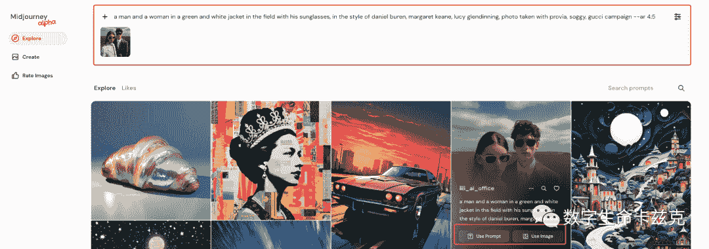

生成的图都在Create你自己的创作里。

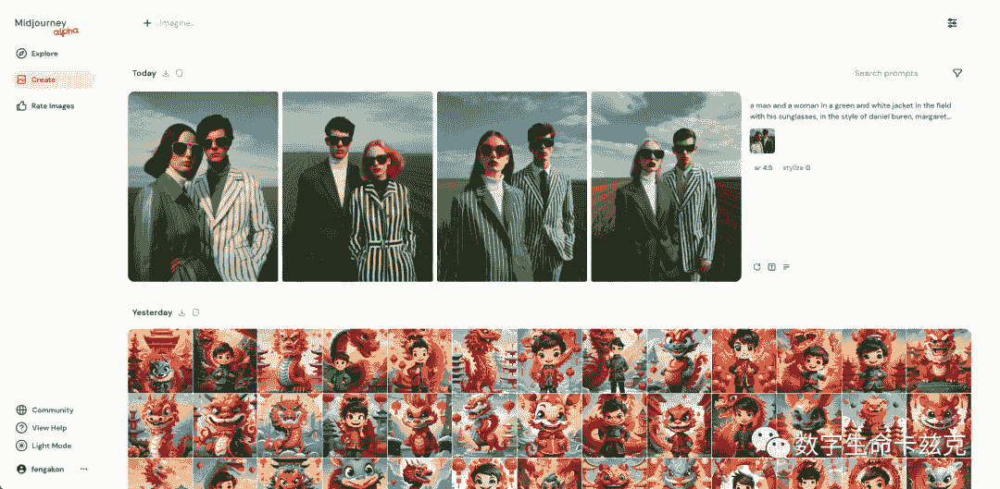

也终于，每一张都被单独拆开了，不像Discord上面那撒比的4张在一块了。。。。每次我挑某一张出来那操作感觉都跟便秘一样。。。

单独点开某一张图后，所有你熟悉的比如重roll、放大、扩图等等都在。体验极佳。

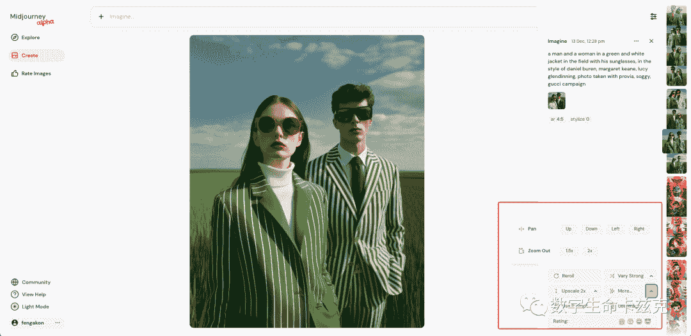

回到最核心的提示词输入模块。

Midjourney把目前有的功能划分出了3个模块，尺寸、参数、模型。

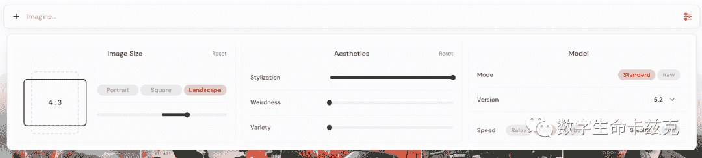

尺寸很好理解了，把常见的尺寸全部拎过来，方便大家快捷选取，这个滑块的交互也挺有意思，我录了一个屏：

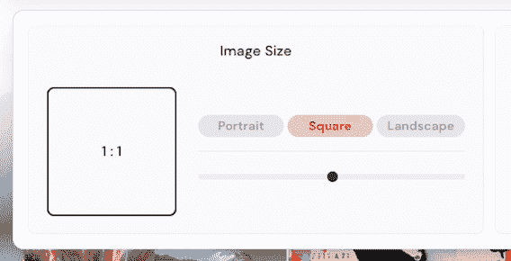

体验还是非常方便的，常见的尺寸什么16:9、2:1都封装进去了。

就很香。

# 然后是封装了3个参数，Stylization、Weirdness、Variety。

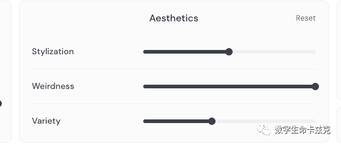

一个一个简单介绍一下，防止有萌新看不懂，老玩家也可以当复习：

1. Stylization，在Discord里也就是--stylize，常常缩写成--s，风格化程度。 低风格化值生成的图像与提示非常匹配，但艺术性较差。高风格化值生成的图像非常艺术，但与提示的联系较少。放个案例（最上面是--s 1000，最下面是--s 0），应该就很清晰了：

2. Weirdness，也就是--weird，一个小众的参数：奇怪程度，0～3000的范围。为生成的图像引入了古怪和另类的品质，从而产生独特和意想不到的结果。。我自己是用的非常少。因为确实太奇怪+不可控了。。。。

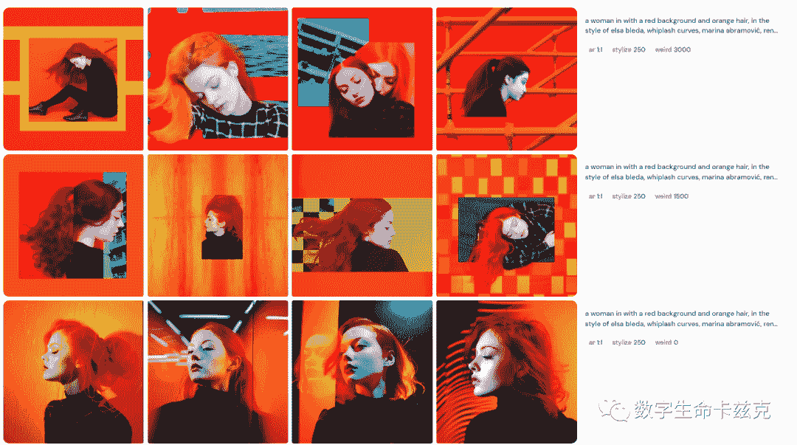

3. Variety，--chaos，也就是--c，代表混乱度或者随机性，值是0～100。Variety 参数影响初始图像网格的变化程度。高值将产生更多不寻常和意料之外的结果和成分。值越低，结果越可靠、可重复。

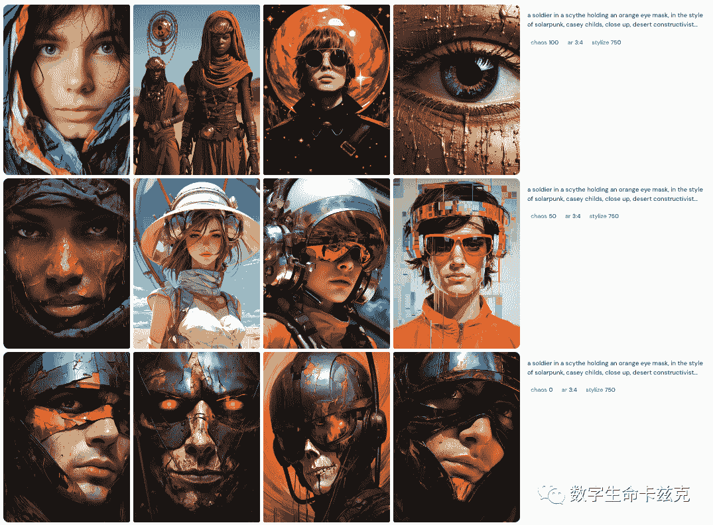

虽然MJ在这次上只封装了这3个参数，但是，以往的Discord上的各种后缀写法，还是可以写在里面的。比如--q、--iw、--no之类的。过去的经验还是可以迁移过来的。

模型那块就是一些老朋友，切模型，切速度之类的。在版本那块往下滑也可以切换Niji5。

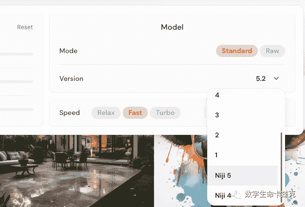

当然，M idjourney这个网页上的Alpha版本，只是个雏形，很多功能其实都还没做进来。比如经常用的/describe反推提示词，比如我很喜欢的/prefer固定提示词等等。

相比于Discord上，功能还是少了非常非常多的。

但是我觉得对于很多普通玩家来说，网页上的Alpha版本，是一个极好的降低使用门槛的机会，毕竟，可视化的操作，永远是最直接也最直观的。

可以看到，过往寄生在Discord上的应用们，都开始逐渐迁移了。

没有自己的应用，用户体验这个词，你是很难做的。

PIKA如此，Midjourney亦是如此。

AI元年，跌跌撞撞走到了年尾。

年前大家因为你新鲜，因为你刚需，因为只有你一个选择，所以你的体验再屎，依然愿意有人用。

但是现在，各种各样的技术和产品喷涌而出。

能用已经不是一个标准了。

用的爽、用的舒服，才是真正的标准。

以用户为中心，这个引流了过往30年产品设计的纲领，永远不会落幕。

PIKA和Midjourney。

**也终于举起了文艺复兴的火把。**

**开始迈向AI时代的新罗马。**

**以**上，既然看到这里了，如果觉得不错，随手点个赞、在看、转发三连吧，如果想第一时间收到推送，也可以给我个星标 ⭐～谢谢你看我的文章 。