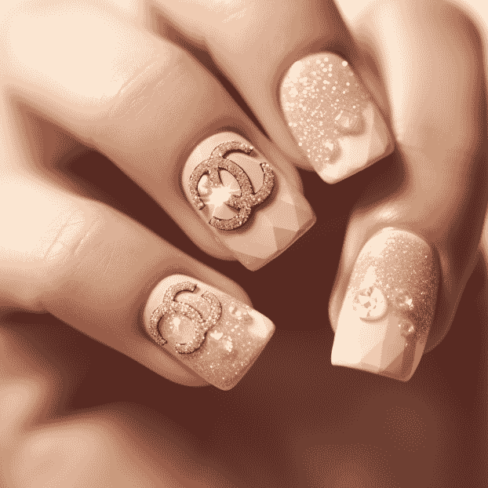
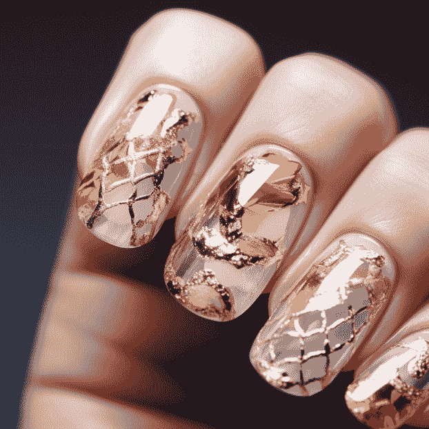
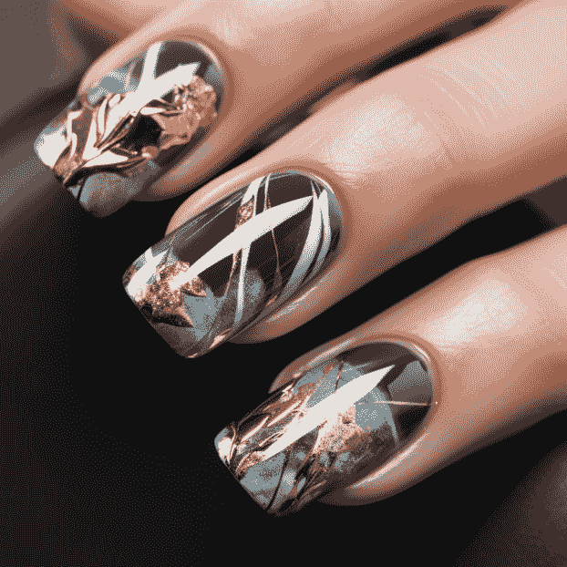
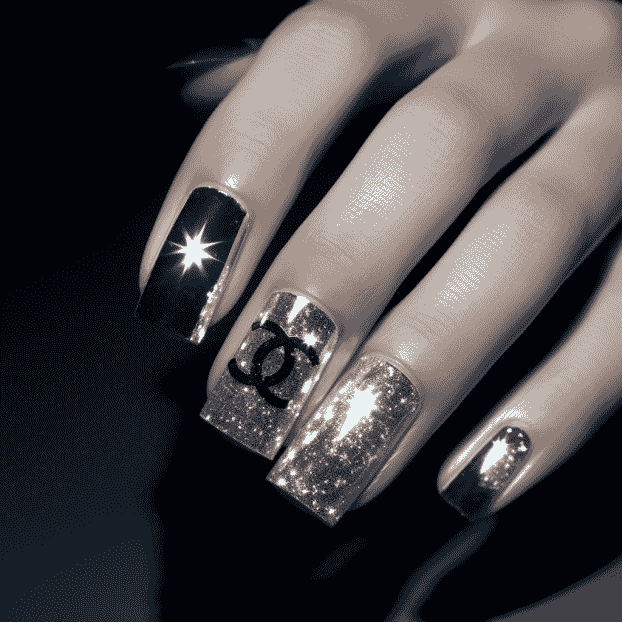
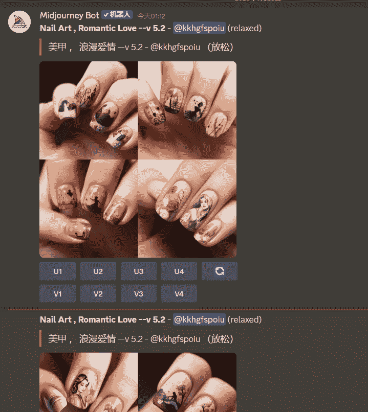
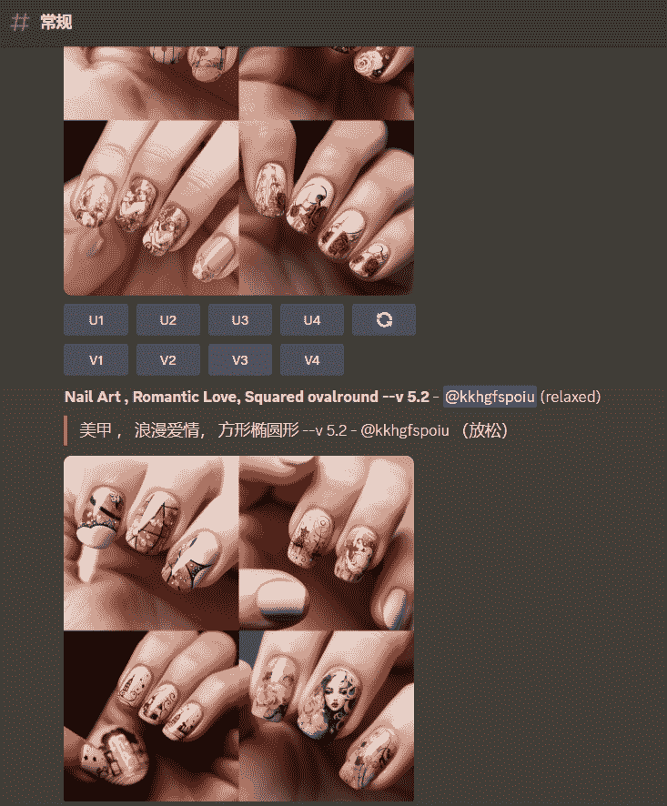
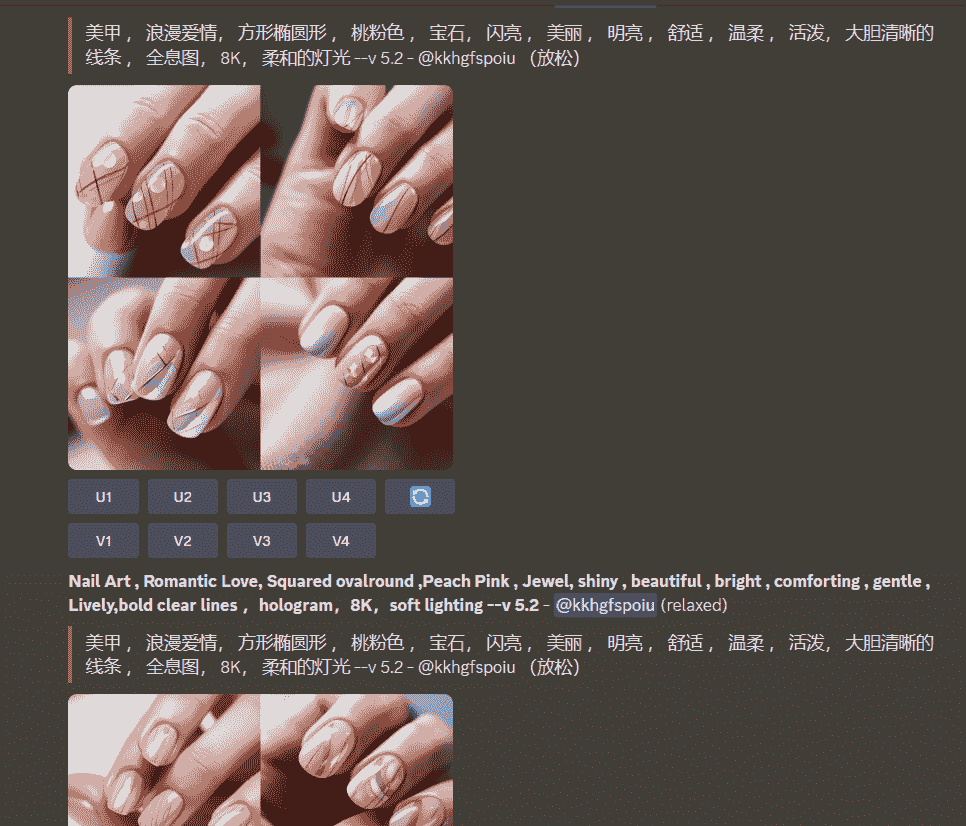
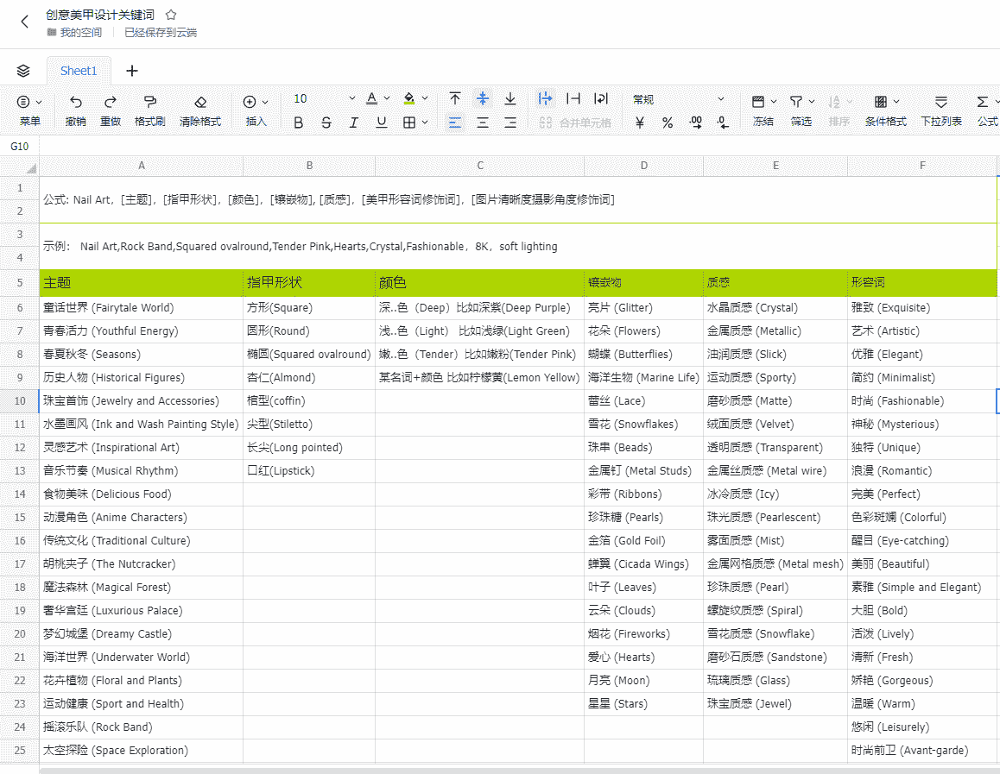

# 2023-09-26Midjourney如何做创意美甲设计？

> 来源：[https://xuqiwei1986.feishu.cn/docx/SXACdLckno1ZfGxBjsMcUSSGnRh](https://xuqiwei1986.feishu.cn/docx/SXACdLckno1ZfGxBjsMcUSSGnRh)

> 🔗 原文链接： h[ttps://articles.zs](https://articles.zsxq.com/id_c256t2qdn23v.html)xq.com/id_c256t2...

>

大家好，我是 Baoxing (宝兴)， AI 破局俱乐部初创合伙人，现为 IT 软件公司架构负责人，软件方面 10 年工作经验，科技互联网博主，AI 人工智能前沿技术，人工智能和工作流程自动化探索者，提示工程师，通过 AI 见解和内容赋能。

今天想跟大家分享的是， Midjourney 如何做创意美甲设计？

先展示成果:

如何使用 Midjourney 做美甲设计,不知道大家知不知道现实中，做一个美甲设计，需要多少米，坦白来讲，我不知道。但我知道使用 Midjourney 来设计，又快还不要钱（如果说 Midjourney 得充会员，那可不可以借一个，借一个用）。

关键词 很简单 **Nail Art**

Baoxing翻译: 美甲艺术

高端的食材,往往只需要最朴素的烹饪方式。

说到这里其实大家完全可以天马星空的发挥想象，只要在你的提示词（Prompt）中添加 Nail Art 效果都不会太差，如果较差，那我告诉我，重新去抽卡.

我们先小试一番，使用如下关键词

> Nail Art , Romantic Love --v 5.2

> Baoxing翻译: 美甲艺术，浪漫的爱

看效果

可还满意？

再来加点料

> Nail Art , Romantic Love, Squared ovalround --v 5.2

> Baoxing翻译: 美甲艺术，浪漫的爱，方形椭圆形

觉得咋样？ 哦 对了 我忘了我的审美往往是比较...

那直接 ALL IN

> Nail Art , Romantic Love, Squared ovalround ,Peach Pink , Jewel, shiny , beautiful , bright , comforting , gentle , Lively,bold clear lines ，hologram，8K，soft lighting

> Baoxing翻译: 美甲艺术，浪漫的爱，方形椭圆形，粉色，宝石，有光泽，美丽，明亮，舒适，温柔，活泼，大胆清晰的线条，全息图，8K，柔和的灯光。

展示

写在最后，送大家一个 咒语 格式

> Nail Art，[主题]，[指甲形状]，[颜色]，[镶嵌物], [质感]，[美甲形容词修饰词]，[图片清晰度摄影角度修饰词]

其中形容词中也可以添加一些品牌信息比如 香奈儿（Chanel），阿玛尼（Armani），爱马仕（Hermes）等等。

剩下的交给大家，大家只需要往上套内容，或者自由发挥均可。

这里也给大家整理了一份 主题、指甲形状、颜色、镶嵌物、质感、美甲形容词修饰词的表格，大家可以自行查看

[创意美甲设计关键词](https://baoxingai.feishu.cn/sheets/O9rbsdIvghTiY1tnGracHi6onse?from=from_copylink)

我是Baoxing，AI 人工智能前沿技术，人工智能和工作流程自动化探索者，通过 AI 见解和内容赋能。 我们下篇文章见。