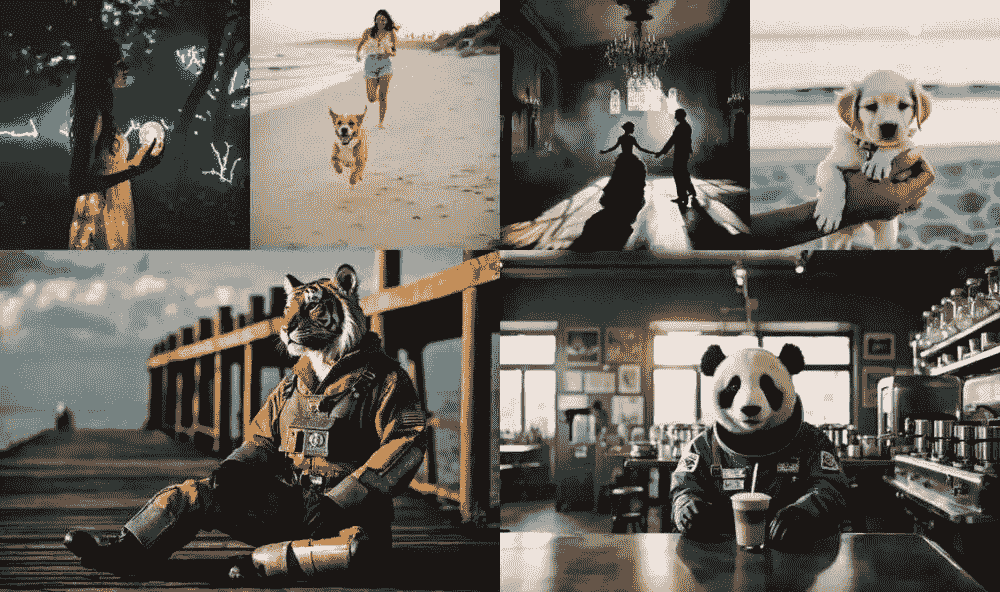
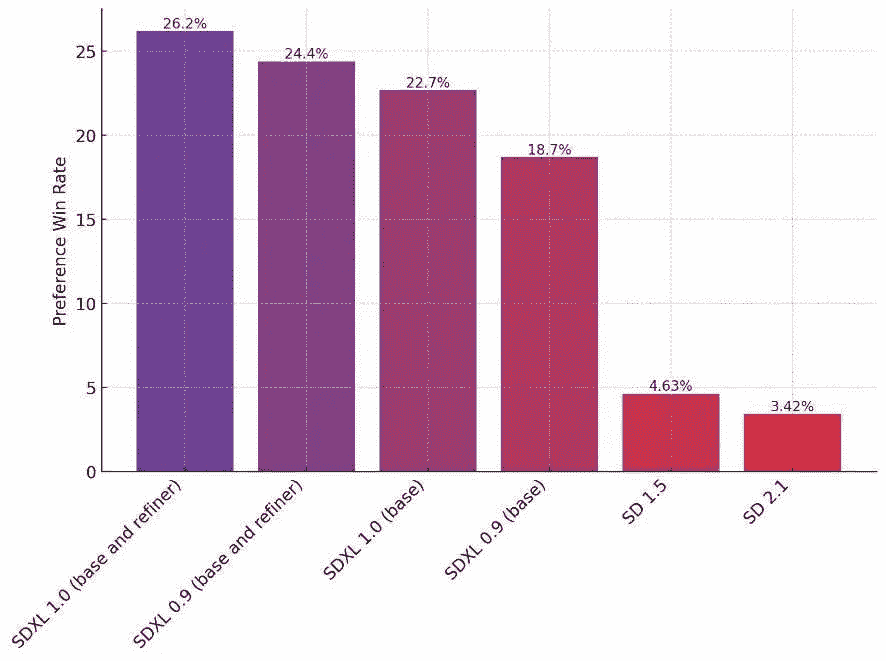
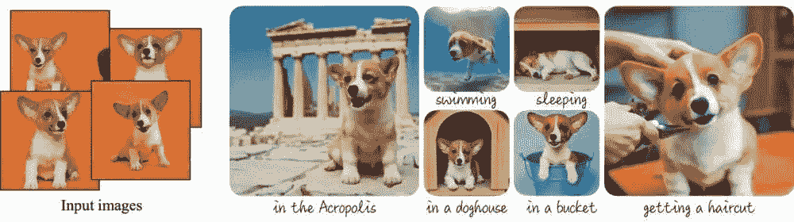
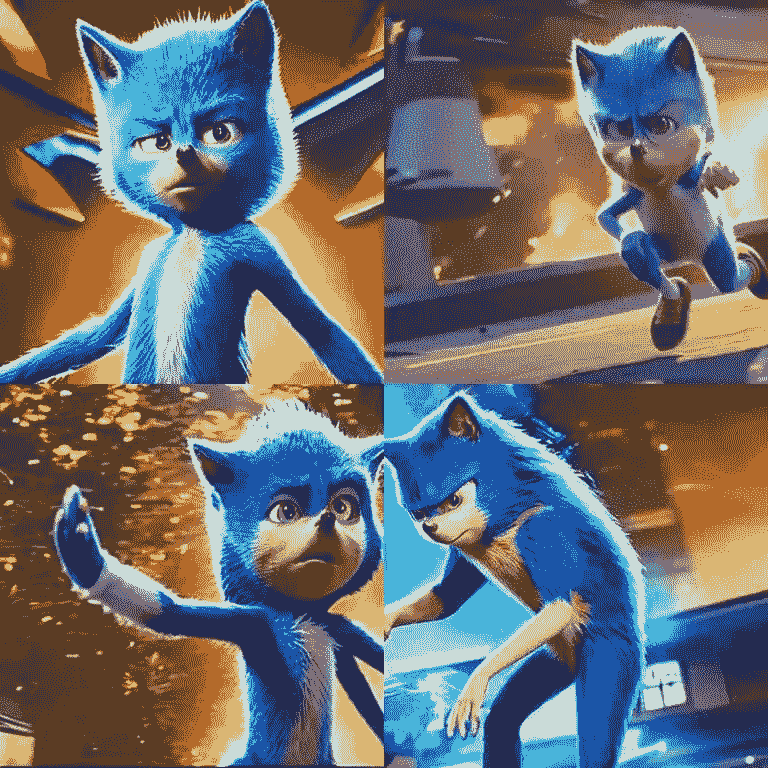
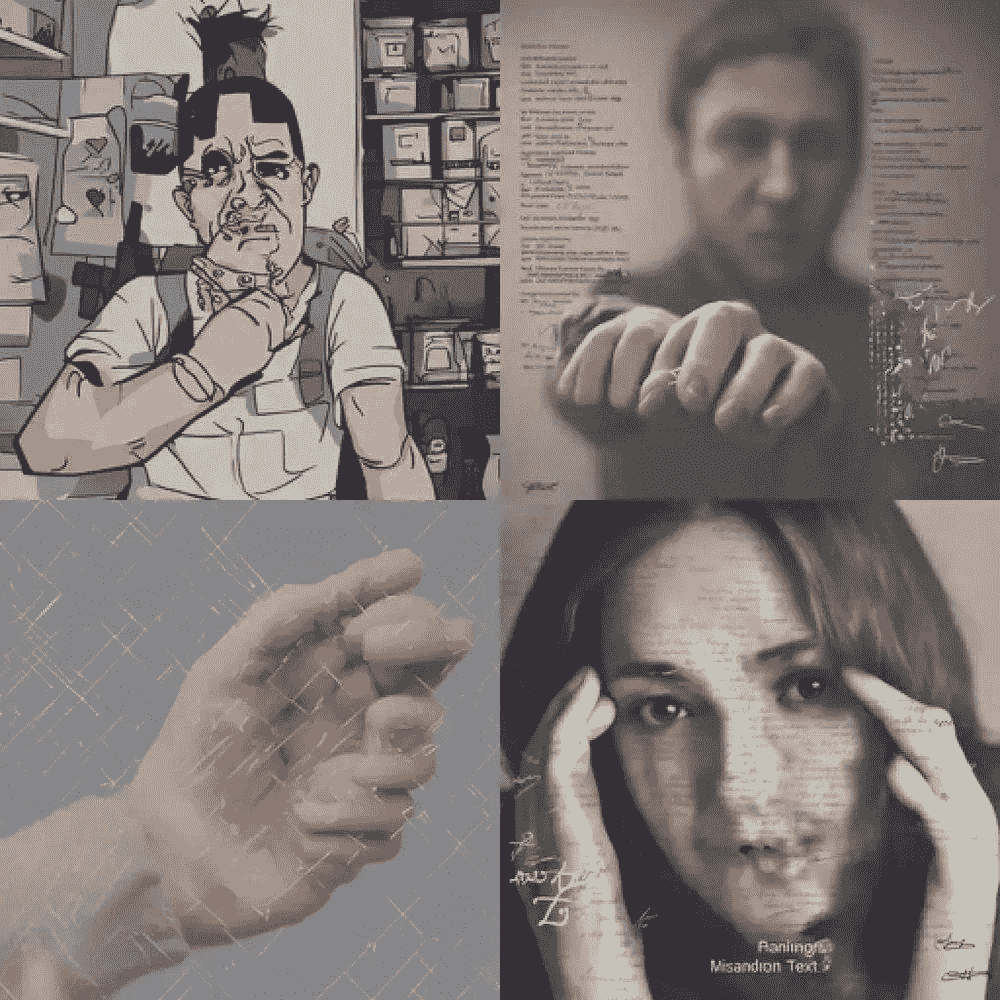
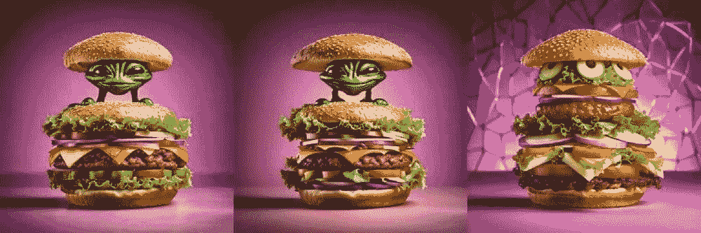
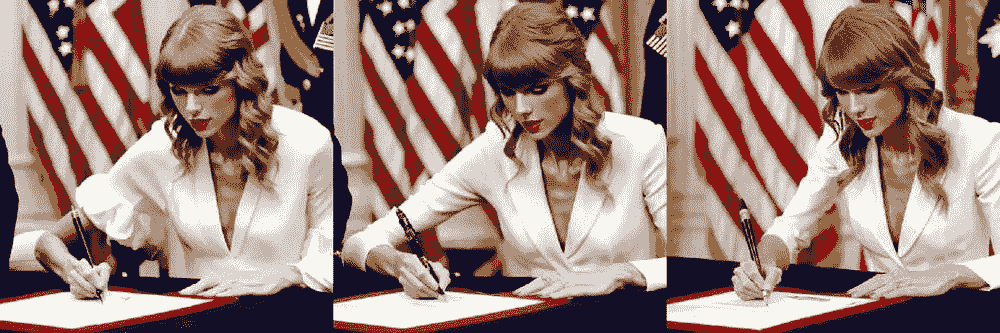
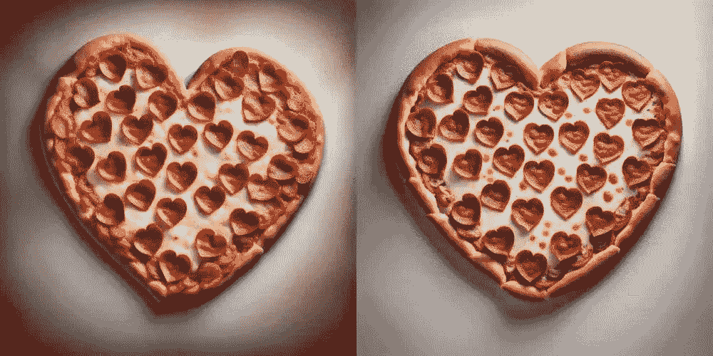

# 2023-08-24AI生成的烂图，居然可以反过来“微调模型”？

> 来源：[https://xuqiwei1986.feishu.cn/docx/ToFTdVs1coGO50xOXv4cPPu6nqe](https://xuqiwei1986.feishu.cn/docx/ToFTdVs1coGO50xOXv4cPPu6nqe)

> 🔗 原文链接： h[ttps://www.huxiu.c](https://www.huxiu.com/article/1964715.html)om/article/19647...

>

OpenAI 用来改进模型的强化学习过程，是从积极的人类交互中隐式地减少消极行为。

在本文中，作者采取了一种全新的实践方案： 用消极的人类交互来隐式地增加积极行为 。

有了 Dreambooth LoRA，基本上用不着像训练大型语言模型那样准备那么多输入数据即可达到这一目的。

不同优化程度的“外星人形状的汉堡（prompt）”

作者介绍了 Stable Diffusion XL 1.0 发布的两个核心特性： 提示词加权和 Dreambooth LoRA 训练和推理 ，并结合 Textual Inversion方法训练 Lora，使 Lora 变得更加聪明好用。

SDXL：简简单单介绍一下

上个月，Stability AI 发布了 Stable Diffusion XL 1.0 并将其开源，用户无需任何特殊权限即可访问。

SDXL 1.0 输出示例

SDXL 实际上是两个模型： **一个基本模型和一个可选的细化模型，后者**可以显著增强细节表现，并且没有速度开销。

Stable Diffusion 各版本模型之间的相对质量对比

注意使用细化模型后质量有了显著提升

SDXL 1.0 Features

值得注意的是，这个版本是第一批无需特殊手段，就能原生生成 1024x1024 分辨率图像的开源模型之一，其生成图像的细节更加丰富。

Hugging Face 的 diffusers Python 库现在已经全面支持该模型，还做了一些性能优化。

同时，diffusers 还实现了对两个新特性的支持： 提示词加权和 Dreambooth LoRA 训练和推理 。于是我打算试试看。

diffusers 的提示词加权支持利用名为 compel 的 Python 库，以更数学化的方式来加权术语。你可以向给定单词添加任意数量的 + 或 -，以增加或减少其在生成的位置文本嵌入中的“重要性”，从而影响最终输出。

同样的原理，你还可以包装短语：例如，如果你要生成“San Francisco landscape by Salvador Dali， oil on canvas”，而它却生成了逼真的旧金山照片，那么你就可以把艺术形式框起来，变成“San Francisco landscape by Salvador Dali， (oil on canvas)+++”，让 Stable Diffusion 输出预期的效果。

环境准备

我开了一个云虚拟机，配置了一个新的中档英伟达 L4 GPU，然后就开始干活了。

使用一个 L4 GPU 时，生成每张 1024x1024 图像大约需要 22 秒；并且与之前的 Stable Diffusion 模型不同，现在中档 GPU 上一次只能生成一张图像，因为它的 GPU 占用率已经拉满了，所以你得更有耐心才行。降低分辨率可以加快生成速度，但我强烈建议不要这样做，因为生成结果会非常糟糕。

一点个性化配置

在我的测试中，它修复了 Stable Diffusion 2.0 以后引入的大部分提示词问题，特别是设置了更高的无分类器指导值时出现的问题

> 本文中 LoRA 模型生成的所有示例的 guiding_scale 都是13。

入门：探索 LoRA

SDXL 1.0 最重要的更新其实是 Dreambooth LoRA 支持，它让我们得以定制 Stable Diffusion 模型。

Dreambooth 是一种基于非常小的源图像集和一个触发关键字来微调 Stable Diffusion 的技术，这样就能在给定关键字的其他上下文中使用这些图像中的“概念”。

Dreambooth 工作原理示意图

LoRA 的优势：特定领域的“小模型”

训练 Stable Diffusion 自身时，就算模型比较小，也需要许多昂贵的 GPU 花费很多小时数来训练。

这时 LoRA 就很有用了： **它训练的是视觉模型的一小部分，这样只需一个**便宜的 GPU，10 分钟就能输出结果 ，并且最终模型 + LoRA 的质量可与充分微调的模型相媲美。

训练好的 LoRA 是一个独立的小型二进制文件，可以轻松与他人分享，或传到 Civitai 等仓库上。

LoRA 的一个小缺点是一次只能激活一个：我们可以合并多个 LoRA 来兼顾它们的优势，但实际做起来没那么简单。

文本反转实战：Textual Inversion

在 Stable Diffusion LoRA 广泛流行之前有一种方法叫文本反转，它允许文本编码器学习概念，但训练需要很多小时，而且结果可能很难看。

我在之前的博客文章中训练了一个文本反转：Ugly Sonic，因为它不在 Stable Diffusion 的源数据集中，所以结果是独一无二的。生成结果如下，好坏参半。

（丑陋）索尼克，但丑得不像样

这一次，我觉得用 Ugly Sonic 来训练 LoRA 会是一个很好的测试 SDXL 潜力的案例。

正好 Hugging Face 提供了一个 train_dreambooth_lora_sdxl.py 脚本，拿它就能使用 SDXL 基本模型来训练 LoRA；这个脚本还是开箱即用的，不过我稍微调了下参数。

不夸张地说，训练好的 LoRA 在各种提示词下生成的 Ugly Sonic 图像都更好看、更有条理。

索尼克，但这次有牙了

进阶：深入Textual Inversion

这次试验成功后，我决定重做另一个之前用文本反转做的实验： 通过添加提示词 wrong 生成更好的图像 。

这次的方法是用一些严重扭曲的低质量图像训练 LoRA，给出的提示词是 wrong，希望 LoRA 可以把 wrong 视为“负面提示”并避开这种情况，生成失真没那么大的图像。

我写了一个 Jupyter Notebook，使用 SDXL 自己创建出了很多“错误”的合成图像，这次还使用了各种提示权重来生成更明显的失败图像实例，例如 blurry和 bad hands。

讽刺的是，我们需要使用 SDXL 才能生成高分辨率的失败图像。

上面是合成的 wrong 图像的一些例子里面无意融合了一些2000年代庞克摇滚专辑封面的元素

我训练了这个 LoRA 并将其加载到 Stable Diffusion XL 基础模型中（微调模型不需要 LoRA），同时编写了一个 Jupyter Notebook，对比给定提示词下的以下输出结果：

+   基础模型 + 没有 LoRA 的 pipeline。

+   没有 LoRA 的 pipeline，使用 wrong 作为负面提示

+   使用 LoRA 的 pipeline，用 wrong 作为负面提示

各个生成结果的种子都一样，因此三种输出的照片构图应该是差不多的，并且 wrong 的负面提示产生的效果和 LoRA，与基础模型 pipeline 之间的差别应该非常明显。

SDXL 0.9 测试用例

我们先用 SDXL 0.9 演示一个简单提示词开始测试：

“A wolf in Yosemite National Park， chilly nature documentary film photography”

仔细看上图，不难发现基础模型上的 wrong 提示为背景的森林增加了一些树叶和深度，但 LoRA 加的东西更多：更强大的光照和阴影、更细致的树叶，还改变了狼看相机的视角，看起来更有意思。

然后我在提示词中添加“extreme closeup”，并复用之前的种子后，在相似的照片构图下获得了狼的不同视角特写。

“An extreme close-up of a wolf in Yosemite National Park， chilly nature documentary film photography”

这时 LoRA 的纹理和清晰度都比其他模型好得多，画面也更生动。但需要注意的是，只添加一个 wrong 提示词就会改变视角。

另一个不错的测试用例是食品摄影，我用 DALL-E 2 生成的怪异食品摄影尤其合适。SDXL + wrong 的 LoRA 能否通过一些提示加权来生成看起来很怪异的非欧几何汉堡呢？

“a large delicious hamburger (in the shape of five-dimensional alien geometry)++++， professional food photography”

“一个美味的大汉堡（五维外星人几何形状）++++，专业美食摄影”

答案是它不能，就算调整了很多次提示词也不行。但输出的结果还是很有意思：基础 SDXL 似乎比我想的更字面地理解了提示中的“外星人”部分，但 LoRA 的作品更好地理解了提示的含义，做出了一个人类难以食用的“外星人”汉堡，图像风格也更加闪亮。

画人会怎样？带 wrong 的 LoRA 是否可以解决人工智能臭名昭著的不会画手的问题呢？而且我们还在 LoRA 的训练数据中加入了许多这样的例子。我们先来改一下我之前第一次尝试使用Stable Diffusion 2.0 时用的提示词，画一位泰勒·斯威夫特总统：

“USA President Taylor Swift (signing papers)++++， photo taken by the Associated Press”

“美国总统泰勒·斯威夫特（签署文件）++++，美联社拍摄”

看看泰勒的右臂：默认的 SDXL 模型输出的结果很离谱，加上 wrong 后实际上更糟糕了，但在 LoRA 中它被修复了！LoRA 的颜色分层要好得多，她的夹克变成了更显眼的白色，而不是黄白色。不过她的两只手还是不能细看：用 SDXL 1.0 绘制人物还是很麻烦，也不可靠！

现在结论很明显了，wrong + LoRA 在每种情况下的输出都比单纯加上 wrong 负面提示的输出更有趣，因此我们下面只对比基本输出与 LoRA 输出。以下是基本模型与 wrong LoRA 的对比示例：

“realistic human Shrek blogging at a computer workstation， hyperrealistic award-winning photo for vanity fair”

（逼真的人类怪物史莱克在计算机工作站上写博客，名利场的超现实获奖照片）——LoRA 的手画得更好，打光更好。服装更细致，背景更有趣。

“pepperoni pizza in the shape of a heart， hyperrealistic award-winning professional food photography”

（心形意大利辣香肠披萨，超写实，屡获殊荣的专业美食摄影）——意大利辣香肠更细致，有热泡，披萨边缘没有那么多多余的辣肠，外皮看起来更硬

带 wrong 的 LoRA 可以在这里获取，不过我无法保证它在 diffusers 之外的接口上的效果。

生成这些图像所用的所有Notebooks都在这个 GitHub 存储库里，包括一个标准 SDXL 1.0 + 微调模型 + 带 wrong 的 LoRA Colab Notebooks，你可以在免费的 T4 GPU 上跑这个Notebooks。如果你想查看本文用到的生成图像的更高分辨率版本，可以访问文章源码。

Wrong 到底是怎么回事？

带 wrong 的 LoRA 这个技巧只会提高生成图像的质量和清晰度，但 LoRA 似乎让 SDXL 表现得更聪明了，也更能反映提示词的精神。

在技术层面上，这个负面提示词设定了 diffusion 生成图片的潜在空间区域；对于使用 wrong 的基础模型和 LoRA 来说，该区域是一样的。

我的直觉是，LoRA 重塑了巨大的高维潜在空间中的这个不受欢迎的区域，使其更类似于起始区域，因此正常的生成结果命中这一区域的概率变小了，质量也就得到了改进。

用低质量图像来训练 SDXL 以改进它的水平，从技术上讲是人类反馈强化学习 的一种形式：这种方式也是 ChatGPT 成功的路径。OpenAI 用来改进模型的强化学习过程是从积极的用户交互中隐式地减少消极行为，而这里我是用消极的用户交互来隐式地增加积极行为。

但有了 Dreambooth LoRA，你基本上用不着像训练大型语言模型那样准备那么多输入数据了。

“负面 LoRA”的潜力还是很大的：我的合成数据集生成参数有很大改进空间，LoRA 也可以训练更长时间。但我对目前为止的结果非常满意，并且希望用负面 LoRA 做更多测试，例如与其他 LoRA 合并，看看它是否可以增强后者

原文链接：https://minimaxir.com/2023/08/stable-diffusion-xl-wrong/