# 「源通互动MidJourney专业版 」 Prompt （AI 绘画提示词）文档

> 来源：[https://xuqiwei1986.feishu.cn/docx/Mx4PduAN5o8kcCxWkYZcAPf4nae](https://xuqiwei1986.feishu.cn/docx/Mx4PduAN5o8kcCxWkYZcAPf4nae)

你好哇~

建立这份 Prompt （AI 绘画提示词）文档的目的，是让每个人都能使用「源通互动MidJourney专业版 」轻松创作出“让自己满意”的 AI 绘画作品，让你的创意变成现实。

文档分为两部分：

第一部分，会讲解 Prompt 写作的基本原理，以及快速提升自己 Prompt 水平的三个方法。

第二部分，是使用「源通互动MidJourney专业版 」创作的优秀案例赏析，案例附带 Prompt，方便你抄作业。

（第二部分会持续更新，要保持关注哦~）

*本文档内所有图片，都由「源通MidJourney专业版 」生成，如果作品使用了参考图，会进行备注。

> 写好 Prompt（提示词），对于 AI 绘画有多重要？

> 同样一台相机，摄影大师可以用它来服务《国家地理》，可是放在摄影小白手里，连女朋友都服务不好。

> 如果把 AI 绘画工具比作一台相机，那使用 Prompt 的水平，就决定了你是摄影大师，还是小白。

# Prompt 公式

**一组优秀的提示词 = ① 画面主体 + ② 主体**修饰 + ③ 镜头光影 + ④ 风格设定

> ① 画面主体：我们的描绘对象，通常是人；

> ② 主体修饰：人的外貌、衣着、动作，以及所处环境的细节，把人换成机器人、小动物、一个杯子，也是同理；

> ③ 镜头光影：我们需要人物的全身，还是半身，还是面部特写，镜头视角影响着画面构图；

> ④ 风格设定：画面是真人一样的写真照，还是二次元纸片人，还是油画，国风水墨画，都是风格决定的。

以下面一组（四张）图片为例，

画面主体都是“一个女孩”，风格设定是“人物CG”，风格直接在「源通MidJourney专业版 」预设的风格列表里选择即可，

第一张图，没有对女孩的外貌进行修饰，只写了她所处的环境是“玩具商店”，AI 随机生成的外貌，可能不是你原本想要的样子，

第二张图，Prompt（提示词） 修饰了女孩的发型、发色、五官、货架上的物品，这些修饰内容，都在画面中体现出来了，

所以，**提升 Prompt 水平的方法一：多写一**点“主体修饰”词，画面会更符合你的想象。

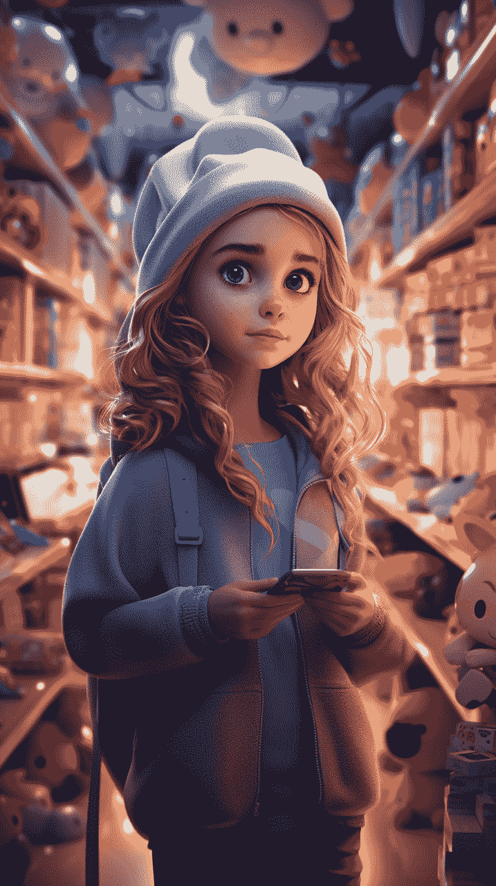

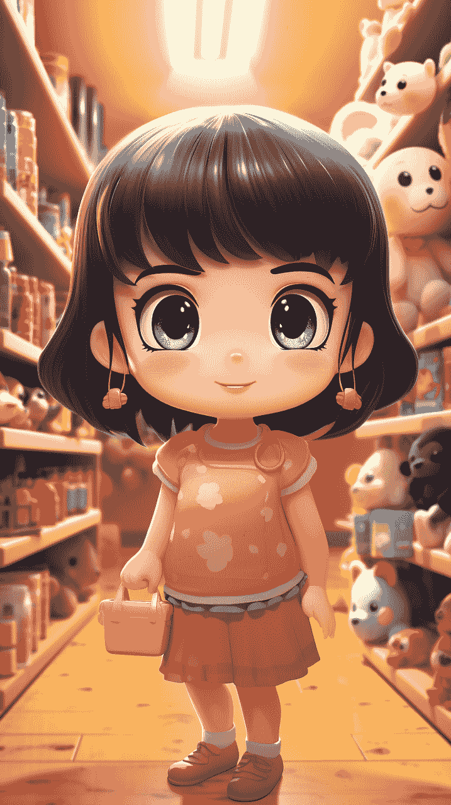

+   prompt：一个女孩站在玩具商店里

+   生成风格：人物CG

+   生成尺寸：手机壁纸

+   分辨率：1024*2048

+   prompt：一个女孩站在玩具商店里，黑色短发，精致的五官，面对观众，背后的货架上有许多毛绒玩具，大师作品，最好画质

+   生成风格：人物 CG

+   生成尺寸：手机壁纸

+   分辨率：1024*2048

下面的第**三张图，除了主体修饰词，多加了一个“鱼**眼镜头”的设定，镜头视角有点俯视的感觉，背景微微扭曲，人物更加突出，所以，提升 Prompt 水平的方法二：掌握不同“镜头视角”的效果，能增强画面表现。

第四张图，我们把风格设定从“人物 CG”改为“**美漫风格”，得到了一张画面主体和构图**基本相同，但画风完全不同的图片，所以，提升 Prompt 水平的方法三：了解不同“风格”的特点，根据需要选择画风。

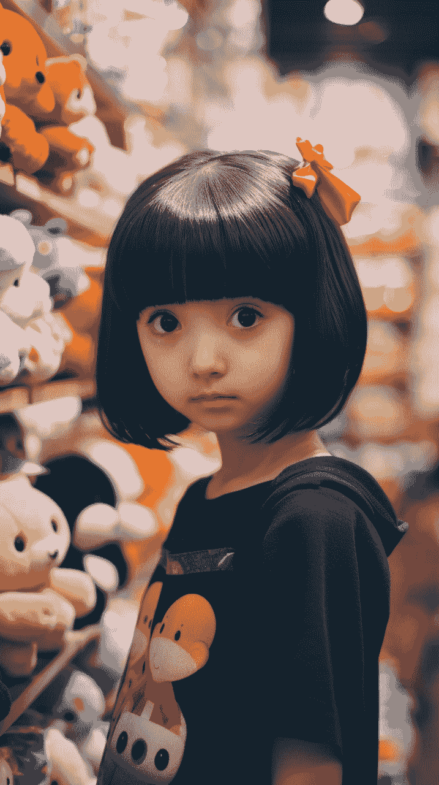

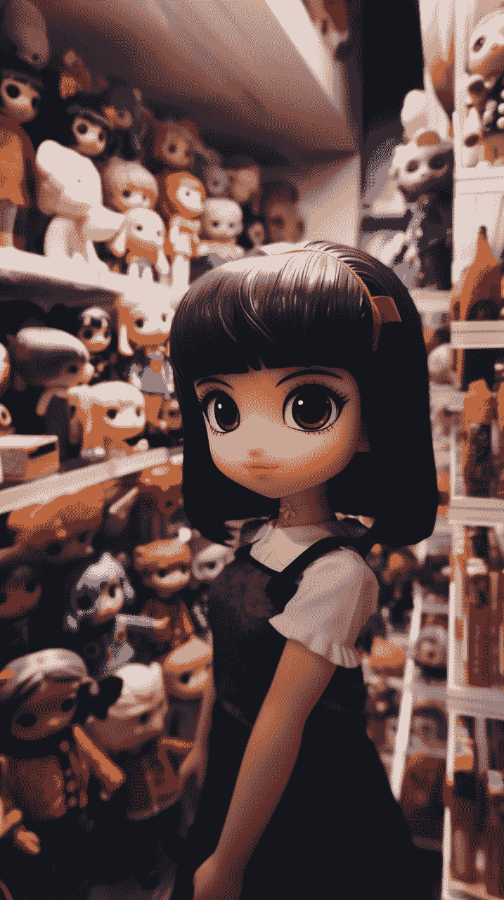

+   prompt：一个女孩站在玩具商店里，黑色短发，精致的五官，面对观众，背后的货架上有许多毛绒玩具，大师作品，最好画质，鱼眼镜头

+   生成风格：人物 CG

+   生成尺寸：手机壁纸

+   分辨率：1024*2048

+   prompt：一个女孩站在玩具商店里，黑色短发，精致的五官，面对观众，背后的货架上有许多毛绒玩具，大师作品，最好画质

+   生成风格：美漫风格

+   生成尺寸：手机壁纸

+   分辨率：1024*2048

> 下面我会通过一些具体案例，来展示不同的词语，对画面结果产生的影响。

# Prompt 自助配词表

> [Prompt（提示词）自助配词表](https://fyze31atzb.feishu.cn/sheets/ZNP9sch7UhpZa3tGyDXcs5sOnwb?from=from_copylink)于词语的类型太多，很难讲全，这里我整理了一个 ，

> 大家可以根据我介绍的方法，自由组合表里的词语，搭配出一组完整的 Prompt。

# 主体修饰：画面内容是不是符合你的想象

## 与“人”有关的词

性别、年龄、人种、特殊身份、职业、五官、表情、头发、服装、动作...

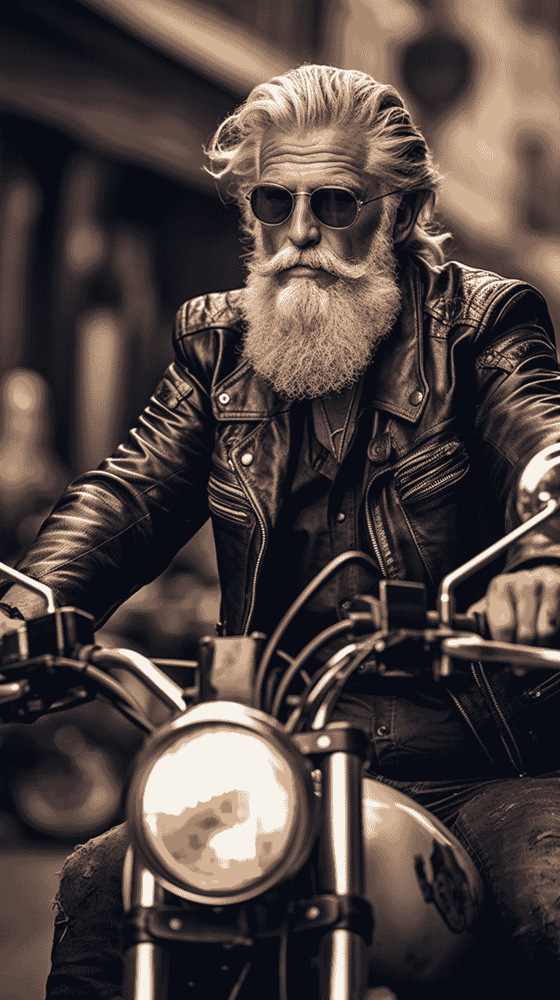

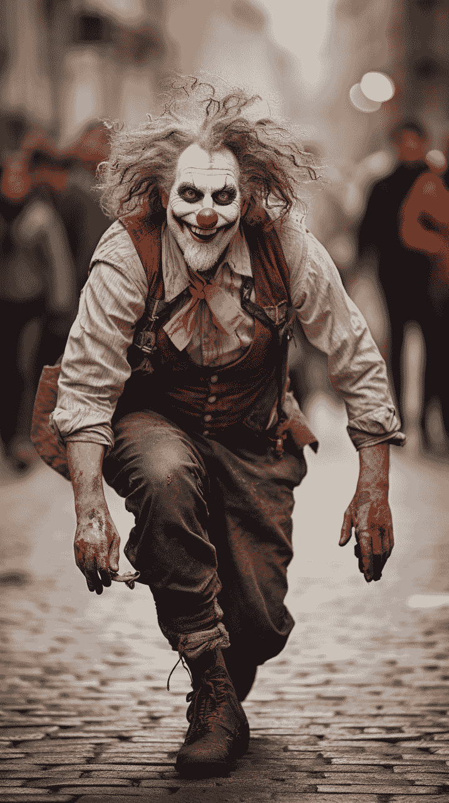

+   prompt：老年飞车党，在城市街头骑摩托车，大师作品，最好画质，高细节，超高分辨率

+   生成风格：美漫风格

+   生成尺寸：宣传海报

+   分辨率：1024*1792

+   prompt：年老的瘦弱的马戏团小丑，在城市的街边表演，大师作品，最好画质，高细节，超高分辨率

+   生成风格：美漫风格

+   生成尺寸：宣传海报

+   分辨率：1024*1792

## 与“环境”有关的词

室外：草原、森林、沙漠、湖泊、城市街道、演唱会、末日废墟、外太空...

室内：卧室、学校、办公室、天台、书店、咖啡馆、便利店、商场...

天气：晴天、阴天、乌云、下雨、小雨、暴雨、闪电、风...

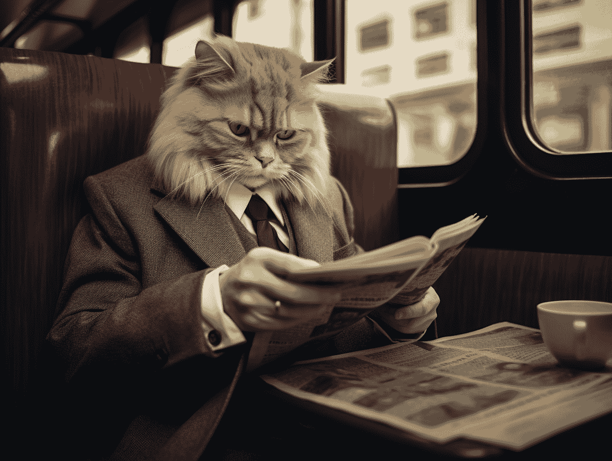

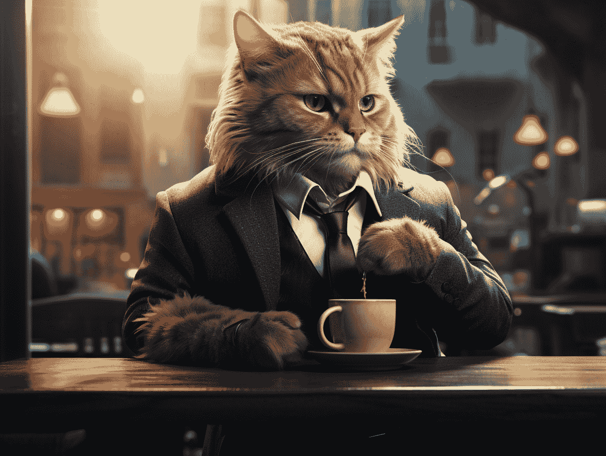

+   prompt：穿着西装的猫，在公共汽车上看报纸，大师作品，最好画质，高细节，超高分辨率

+   生成风格：人物 CG

+   生成尺寸：文章配图

+   分辨率：1536*1152

+   prompt：穿着西装的猫，在咖啡店里喝咖啡，大师作品，最好画质，高细节，超高分辨率

+   生成风格：人物 CG

+   生成尺寸：文章配图

+   分辨率：1536*1152

## 与“时间”有关的词

白天、黑夜、黎明、早晨、中午、傍晚、晚霞、太阳、月亮、星星...

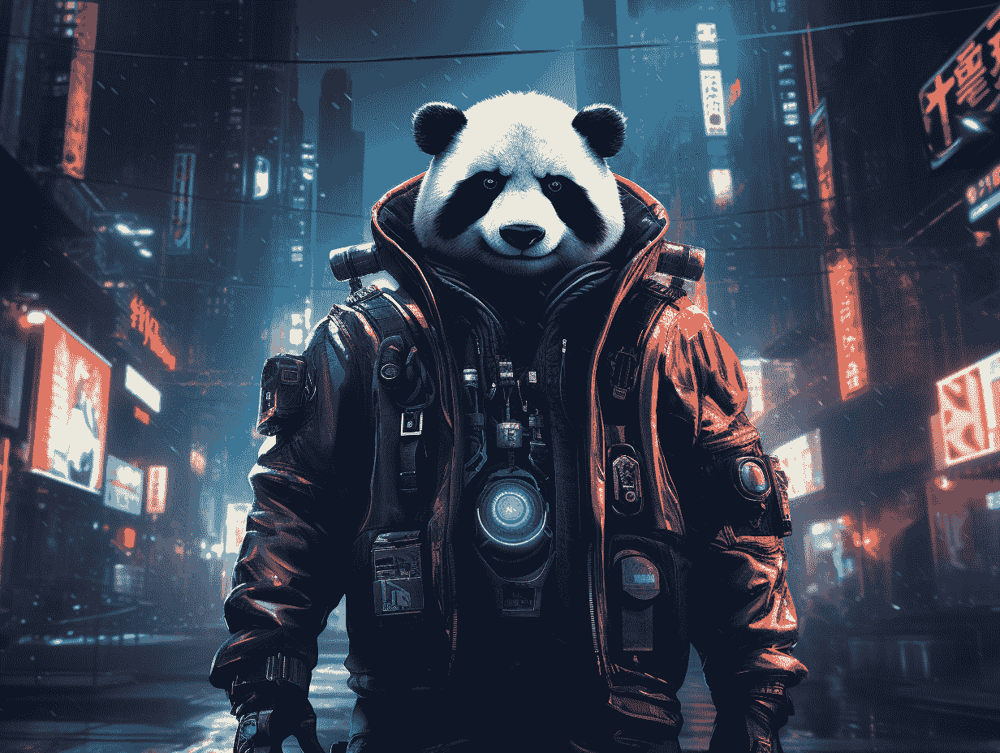

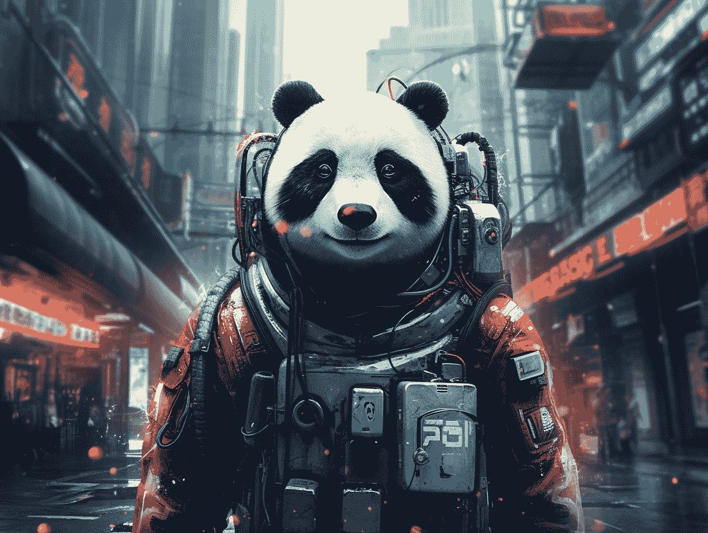

+   prompt：穿着中国宇航服的熊猫，背景是赛博朋克风格的城市街道，夜晚，大师作品，最好画质，高细节，超高分辨率

+   生成风格：人物 CG

+   生成尺寸：文章配图

+   分辨率：1536*1152

+   prompt：穿着中国宇航服的熊猫，背景是赛博朋克风格的城市街道，白天，大师作品，最好画质，高细节，超高分辨率

+   生成风格：人物 CG

+   生成尺寸：文章配图

+   分辨率：1536*1152

## 与“物品外观”有关的词

形状、颜色、材质、体积大小、光泽、纹理、装饰物...

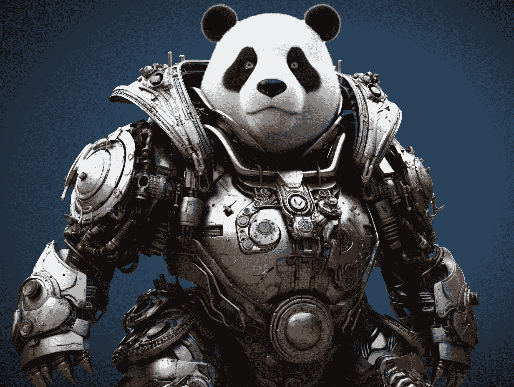

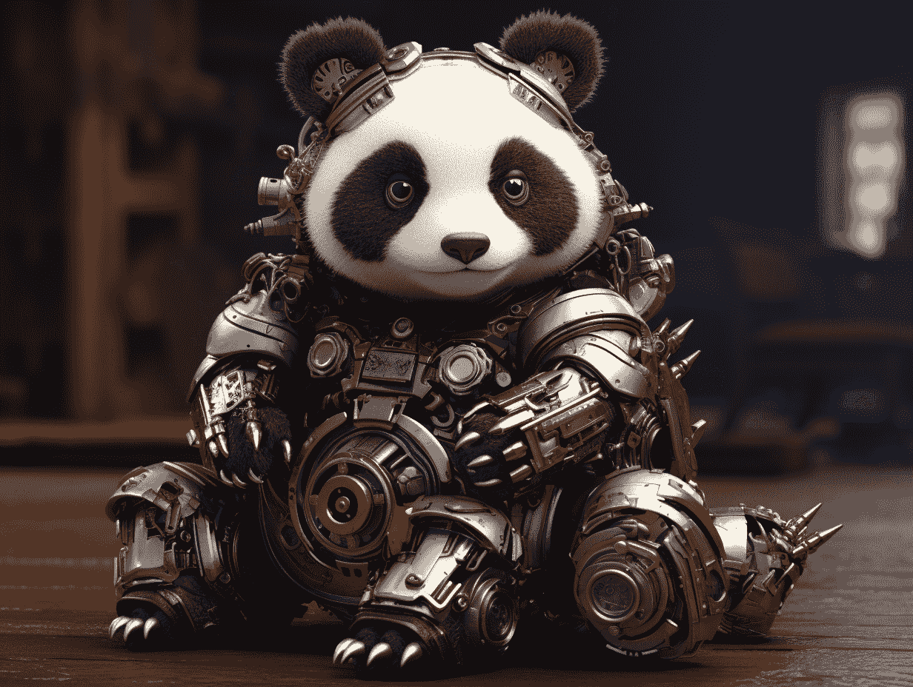

+   prompt：巨型熊猫机器人，银色，金属光泽，大量的齿轮，战损痕迹，大师作品，最好画质，高细节，超高分辨率

+   生成风格：蒸汽朋克

+   生成尺寸：文章配图

+   分辨率：1536*1152

+   prompt：小型熊猫机器人，可爱的，圆圆的，大师作品，最好画质，高细节，超高分辨率

+   生成风格：蒸汽朋克

+   生成尺寸：文章配图

+   分辨率：1536*1152

> 写细节修饰词，就像写作文时，提到一个人物，要描写外貌、衣着，要介绍时间和地点，人物在干什么，我们只需要知道有哪些方面的词可以加，对于一些不常用的描述词，可以临时去查...

# 镜头光影：影响画面构图、氛围和呈现质量

## 与“镜头视角”有关的词

景深、全景、长焦镜头、微距镜头、全身镜头、中景镜头、七分身镜头、半身像、第一人称视角、鱼眼镜头、部分水下拍摄...

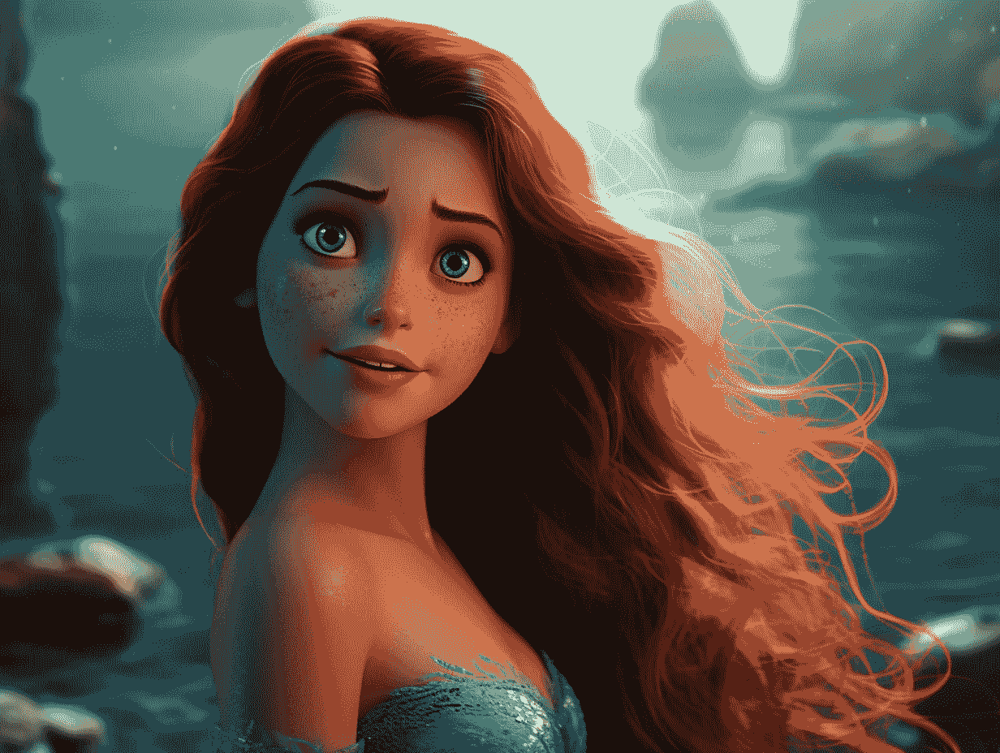

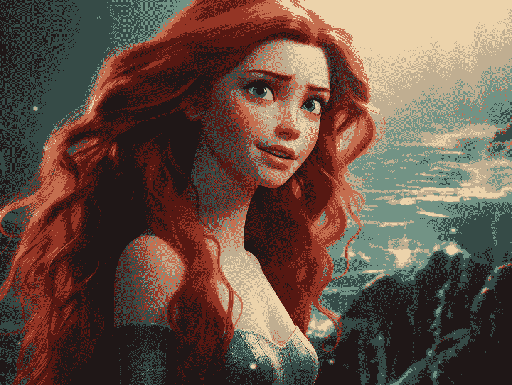

+   prompt：小美人鱼，精致的五官，完美的脸，大师作品，最好画质，高细节，超高分辨率梦幻，景深

+   生成风格：人物 CG

+   生成尺寸：文章配图

+   分辨率：1536*1152

+   prompt：小美人鱼，精致的五官，完美的脸，大师作品，最好画质，高细节，超高分辨率梦幻，部分水下拍摄

+   生成风格：人物 CG

+   生成尺寸：文章配图

+   分辨率：1536*1152

> 景深效果，让被拍摄对象的后方，产生明显的背景模糊效果。

> 部分水下拍摄，画面上方会出现水平面，拍摄对象有处于水中的感觉

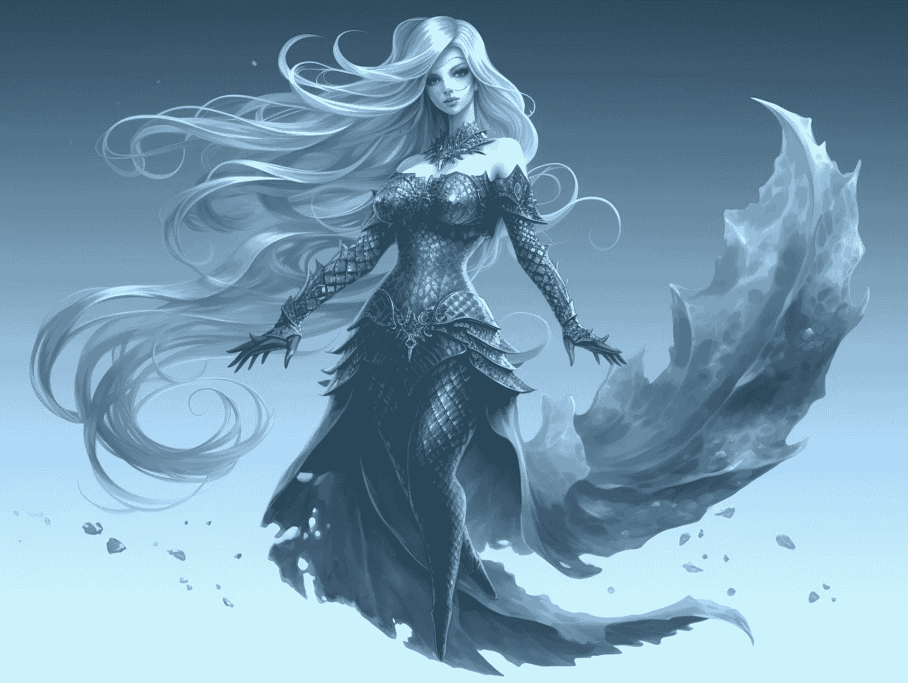

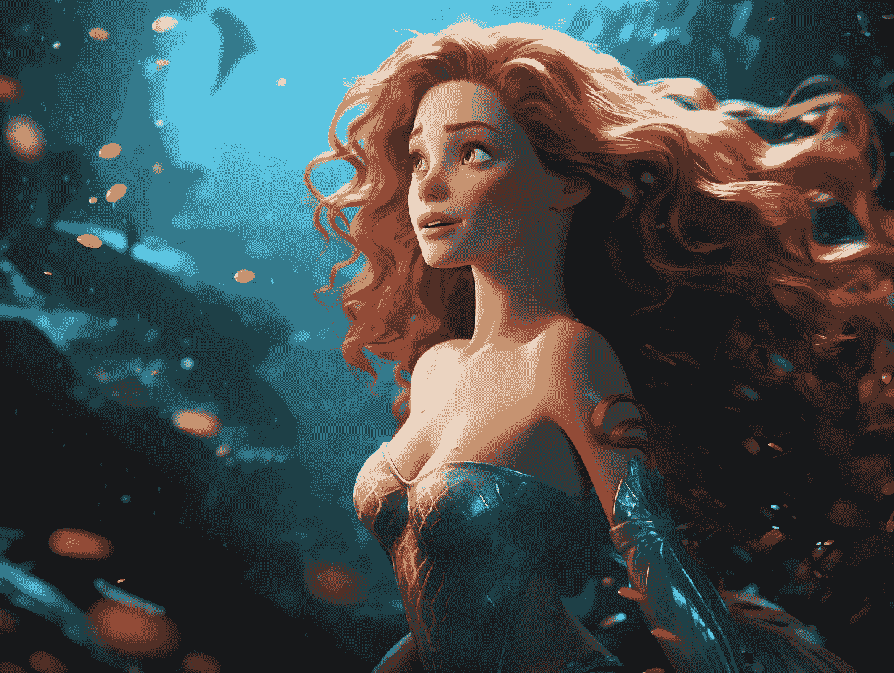

+   prompt：小美人鱼，精致的五官，完美的脸，大师作品，最好画质，高细节，超高分辨率梦幻，全身镜头

+   生成风格：人物 CG

+   生成尺寸：文章配图

+   分辨率：1536*1152

+   prompt：小美人鱼，精致的五官，完美的脸，大师作品，最好画质，高细节，超高分辨率梦幻，半身像

+   生成风格：人物 CG

+   生成尺寸：文章配图

+   分辨率：1536*1152

> 全身镜头，是指整个人从头到脚都出现在画面中。

> 半身像，一个人半身的肖像

## 与“光线照明”有关的词

轮廓光、体积光、镜头光晕、氛围光照、丁达尔效应、漏光光效、背景光、自然光、霓虹灯、电影级光照...

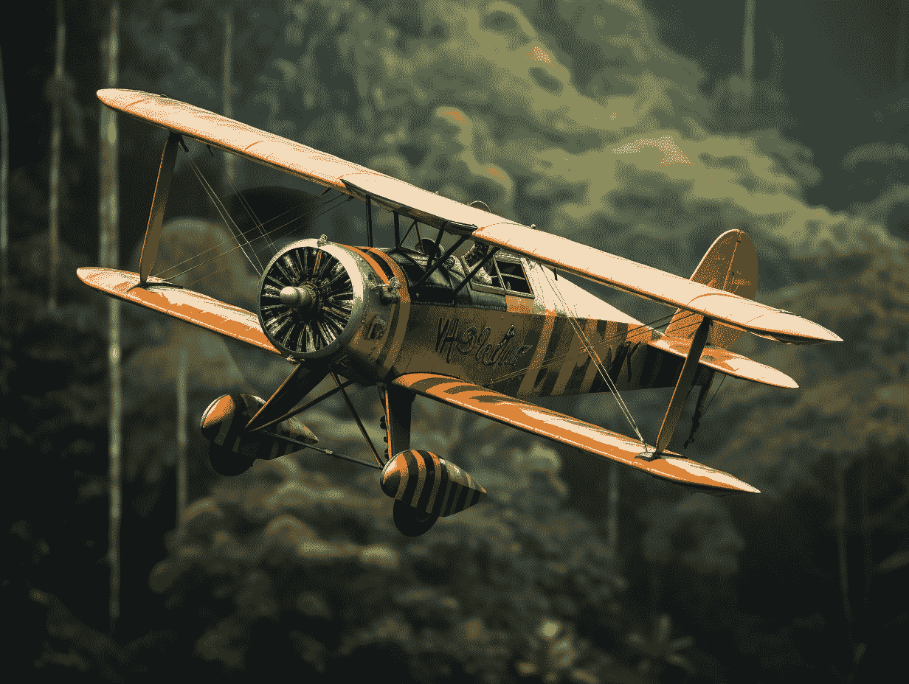

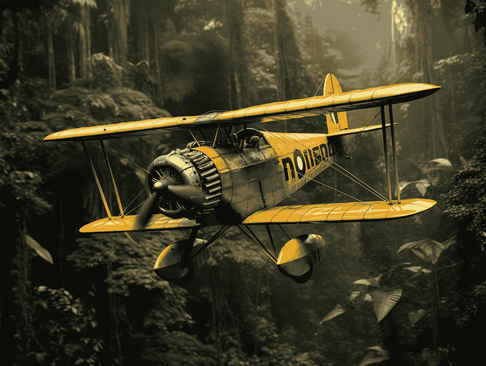

+   prompt：一架老式双翼飞机，迫降在丛林里，高大的树木，更高质量，高细节，超高分辨率，8k分辨率，最好画质，大师作品，轮廓光，背景光

+   生成风格：美漫风格

+   生成尺寸：文章配图

+   分辨率：1536*1152

+   prompt：一架老式双翼飞机，迫降在丛林里，高大的树木，更高质量，高细节，超高分辨率，8k分辨率，最好画质，大师作品，体积光，镜头光晕

+   生成风格：美漫风格

+   生成尺寸：文章配图

+   分辨率：1536*1152

> 轮廓光，出现在被拍摄对象的边缘，把拍摄对象与背景区分开来，让拍摄对象有一种自带光芒的效果。

> 背景光，用来照亮前景以及环境的光，主要用来渲染气氛、美化画面，可以增加画面立体感和纵深感。

> 体积光，在现实世界中也叫丁达尔光线，跟丁达尔效应一样，能看出明显的成条状或片状的光，在室内摄影中的应用比较明显，比如在黑暗背景中，用光形成一个明显的区域。

> 镜头光晕，强光源进入镜头时，产生的散射现象，通常是圆形光斑，带有一定的扩散光线。

## 与“画面质量”有关的词

大师作品、最好画质、更高质量、高细节、超高分辨率、8K 分辨率...

> 与画面质量有关的词，是通用的，不妨多加几个，与镜头、光照、艺术类型有关的词，是跟美术专业有关的，靠日常积累，多看多尝试生成，前期可以先记住几个最常用的。

# 风格设定：决定了我们想去往哪个世界

> 下面，让我们看看使用同一组 Prompt，只更换风格，生成的图片会有什么不同。

## 拟真系列

拟真通用、人物拟真、场景拟真、科幻写实...

> 拟真系列，模拟真实世界，制造类似照片的感觉。

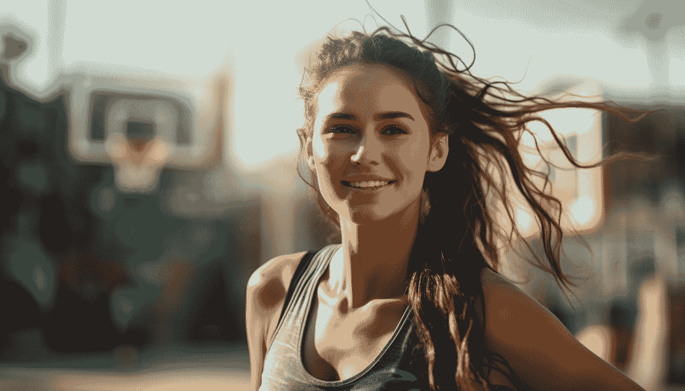

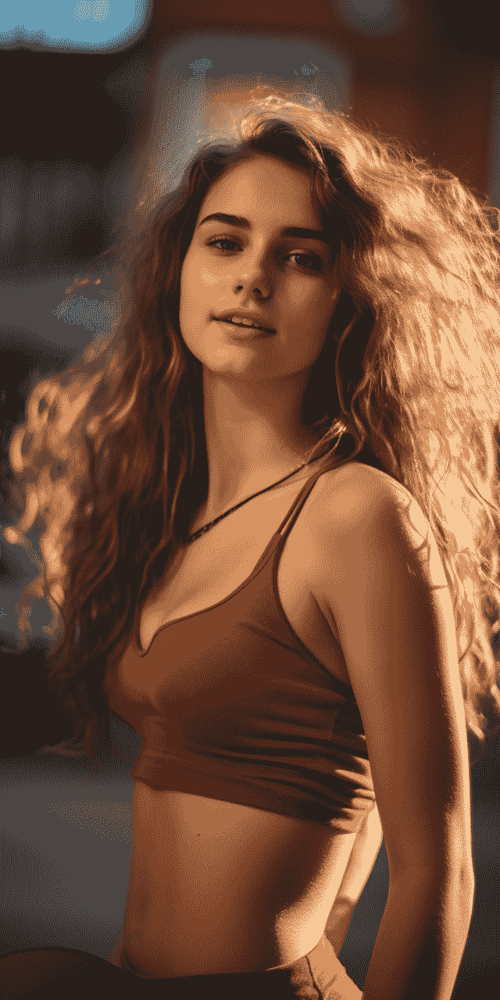

+   prompt：在街头篮球场，打篮球的女孩，长发，微笑，景深，中景镜头，自然光，大师作品，最好画质，更高质量，高细节，8k分辨率，

+   生成风格：拟真人物

+   生成尺寸：电脑壁纸、分辨率：1792*1024  /  生成尺寸：手机壁纸、分辨率：1024*2048

## 动漫系列

动漫人物、动漫场景、少女立绘、漫画线稿...

> 动漫系列，以日漫的平涂风格为主，线条流畅明显，明暗关系明确，色彩鲜艳。

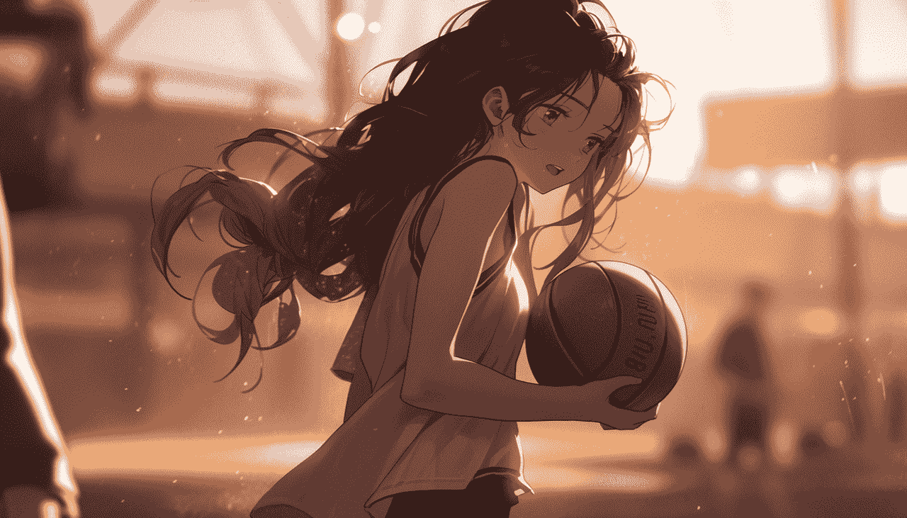

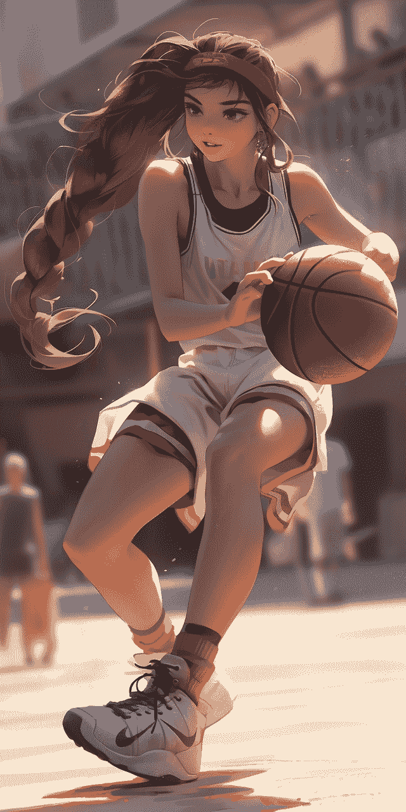

+   prompt：在街头篮球场，打篮球的女孩，长发，微笑，景深，中景镜头，自然光，大师作品，最好画质，更高质量，高细节，8k分辨率，

+   生成风格：动漫人物

+   生成尺寸：电脑壁纸、分辨率：1792*1024  /  生成尺寸：手机壁纸、分辨率：1024*2048

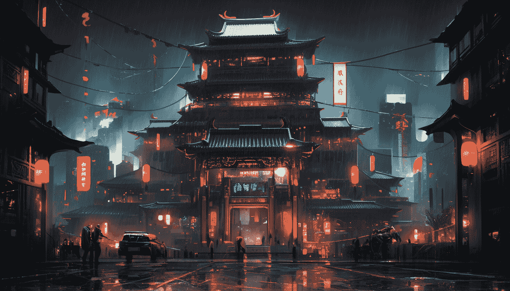

+   prompt：赛博朋克风格的城市街头，有一座巨大的中式宫殿建筑，壮丽的景色，很多霓虹灯，深度，夜晚，大师作品，最好画质，更高质量，高细节，8k分辨率，景深，全景

+   生成风格：二次元场景

+   生成尺寸：电脑壁纸

+   分辨率 1792*1024

## CG 艺术系列

CG 默认、人物 CG、蒸汽朋克

> CG，Computer Graphics “计算机图形学”，CG 艺术指用电脑、平面设计软件等创作的数字视觉技术作品，既能表现华丽的幻想世界，又有极高的拟真度。

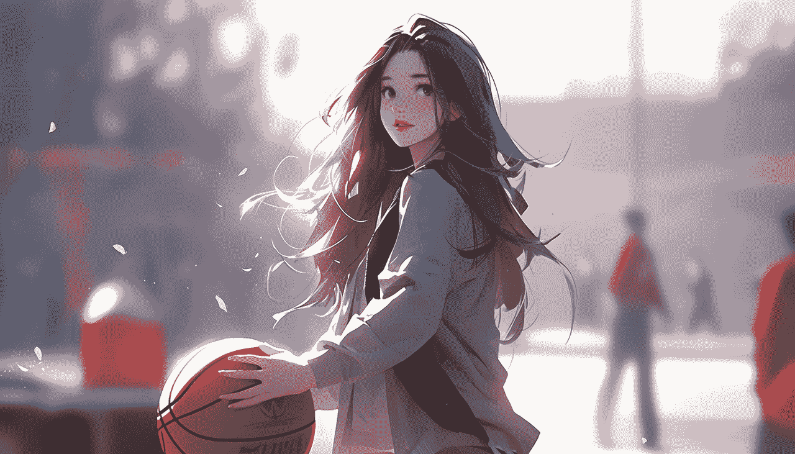

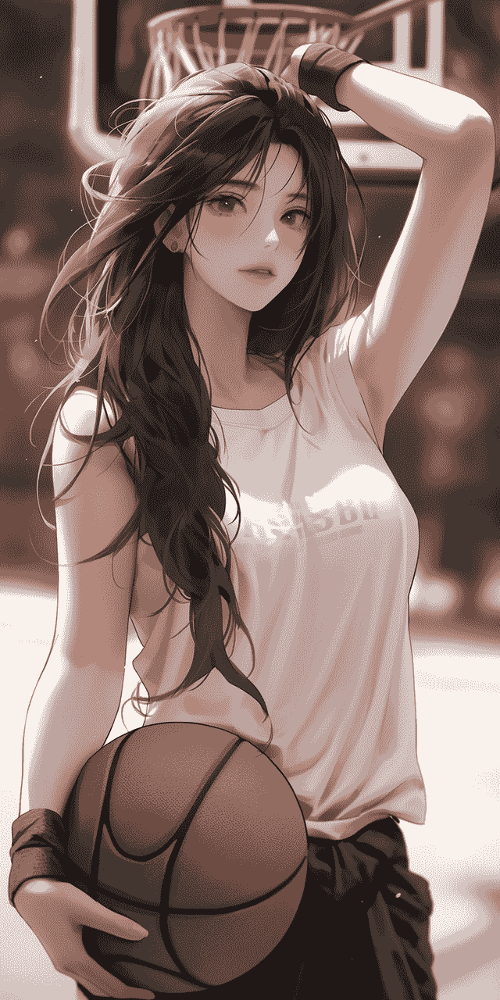

+   prompt：在街头篮球场，打篮球的东方女孩，长发，微笑，景深，中景镜头，自然光，大师作品，最好画质，更高质量，高细节，8k分辨率，

+   生成风格：人物 CG

+   生成尺寸：电脑壁纸、分辨率：1792*1024  /  生成尺寸：手机壁纸、分辨率：1024*2048

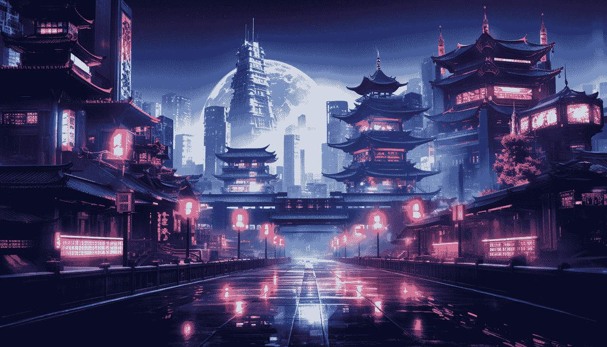

+   rompt：赛博朋克风格的城市街头，有一座巨大的中式宫殿建筑，壮丽的景色，很多霓虹灯，深度，夜晚，大师作品，最好画质，更高质量，高细节，8k分辨率，景深，全景

+   生成风格：CG 默认

+   生成尺寸：电脑壁纸

+   分辨率 1792*1024

<参考图> 以前面动漫风格的图片为参

## 格艺术系列

美漫风格、泼墨风格、传统水墨

> 美漫风格，特点是画风粗放，造型以写实为基础，兼具夸张的风格。

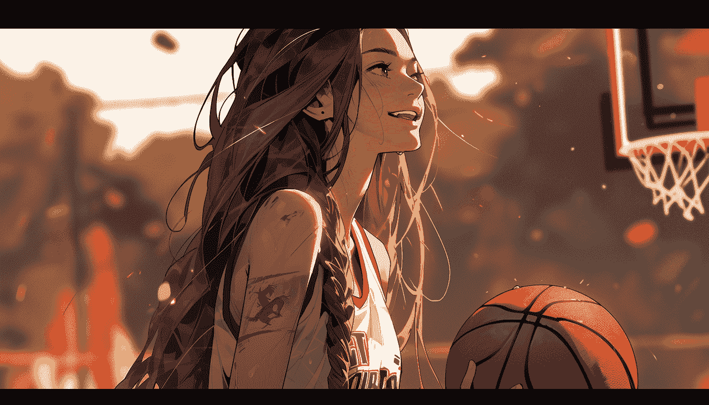

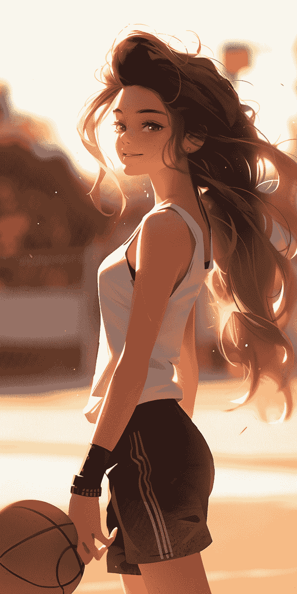

+   prompt：在街头篮球场，打篮球的女孩，长发，微笑，景深，中景镜头，自然光，大师作品，最好画质，更高质量，高细节，8k分辨率，

+   生成风格：美漫风格

+   生成尺寸：电脑壁纸、分辨率：1792*1024  /  生成尺寸：手机壁纸、分辨率：1024*2048

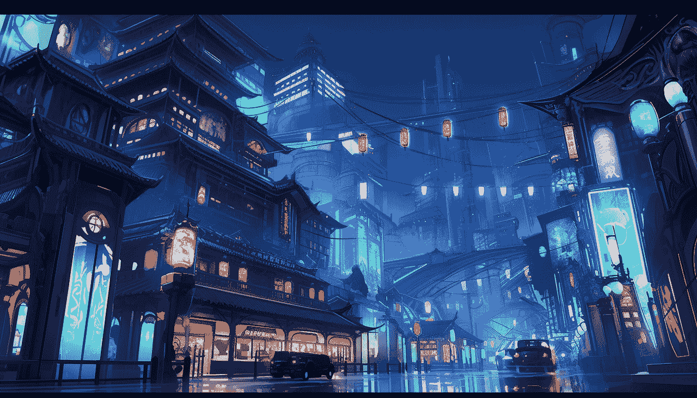

+   prompt：赛博朋克风格的城市街头，有一座巨大的中式宫殿建筑，壮丽的景色，很多霓虹灯，深度，夜晚，大师作品，最好画质，更高质量，高细节，8k分辨率，景深，全景

+   生成风格：美漫风格

+   生成尺寸：电脑壁纸

+   分辨率：1792*1024

<参考图> 以前面 CG 风格的图片为参考

> 我们不能让姚明去踢足球，也不能让梅西去打篮球。

> 每种风格（模型）都有自己擅长和不擅长的内容，根据我们对每种风格的了解，去匹配不同的主题，也很重要，未来，「源通互动MidJourney专业版」会为大家提供更多的风格（模型）选择，就像漫画风格之下，会有更细分的国漫、美漫、日漫，日漫之下也会有更细分的宫崎骏、鸟山明、青山刚昌、富坚义博...

> 未来的「源通互动MidJourney专业版」会是越来越简单好用，越来越丰富多彩的~

# 源通互动MidJourney专业版」优秀案例赏析

> 以下作品若来自源通互动MidJourney专业版「 AI 艺术馆」，会标注作者，如果作品使用了参考图，也会进行备注。

## 人物写真

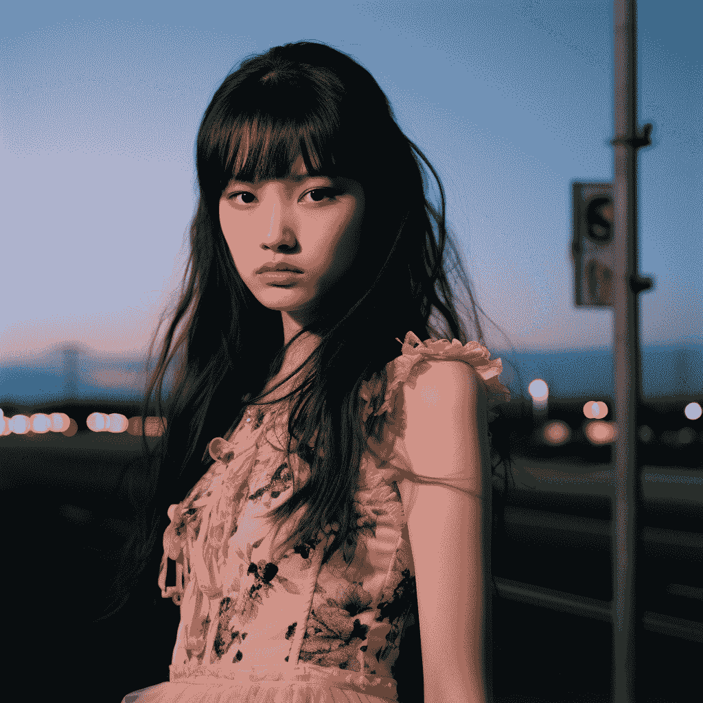

**《心里的那个女孩》**

+   prompt：黑色头发穿着粉色碎花裙的22岁的女孩，在公路围栏旁开心的回头看我，披着长发，夜晚，天上有月亮和星星

+   生成风格：人物拟真

+   生成尺寸：头像

+   分辨率：1024*1024

## 人物 CG

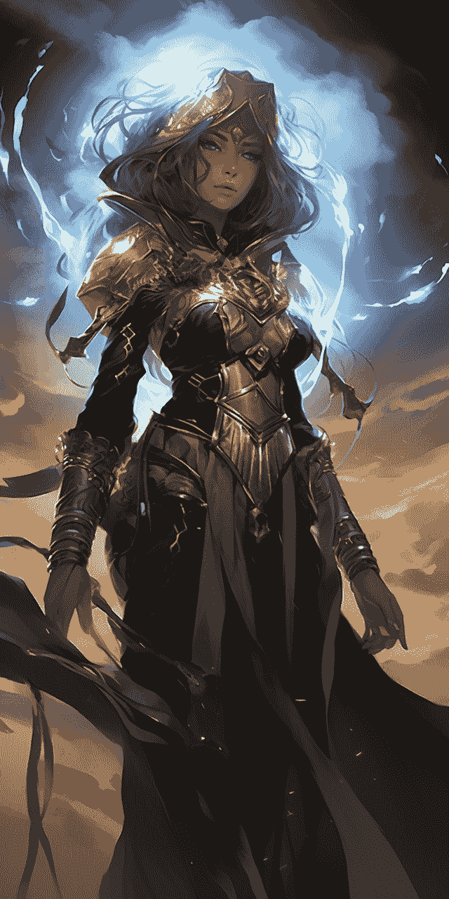

**《法老》 **

+   prompt：雷电，大量的流光，沙漠，一个身着金色斗篷和黑色星空长袍的少女被闪电缠绕着快速奔跑，法老头冠，法师长袍，远方的金字塔，巨石碑和花环，金色的发光眼睛，眼睛发光，正确的身体细节，五根手指，正确的身体部位，中午，星空，云朵，大师作品，复杂的花纹，散落的鲜花，最好画质，更高质量，高细节，8k分辨率，全景，远景，全身，闪电侠，数字艺术，轮廓光，体积光，电影级光照，氛围光照，丁达尔效应，环境光遮蔽，好莱坞电影，概念原画，插画，精致的五官，完美的脸，发光皮肤，漏光光效，透镜光晕，金属光泽

+   生成风格：人物 CG

+   生成尺寸：手机壁纸

+   分辨率：1024*2048

## 二次元人物

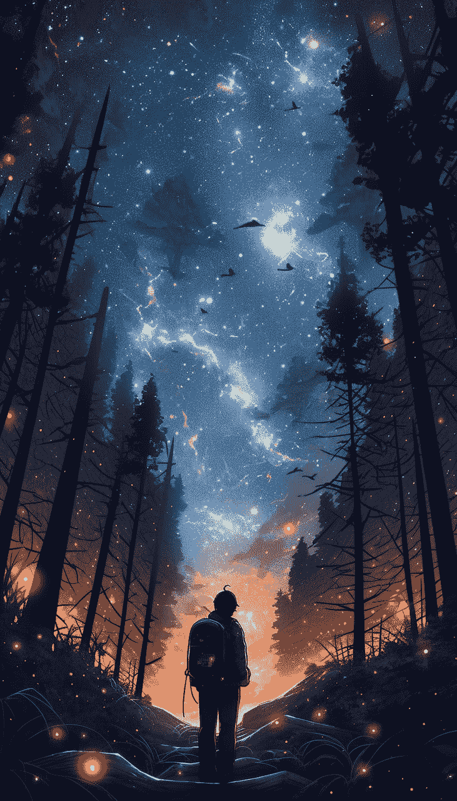

**《意外走入特罗姆瑟的森林》 **

+   prompt：巨大的森林通向夜晚的天空，天空中有深邃、高对比度的明亮恒星。空气中流动着光。背着背包的女孩站在最外侧。背对着我们。深蓝色，银色。冷光灯。电影

+   生成风格：二次元人物

+   生成尺寸：宣传海报、分辨率：1024*1792

## 动物

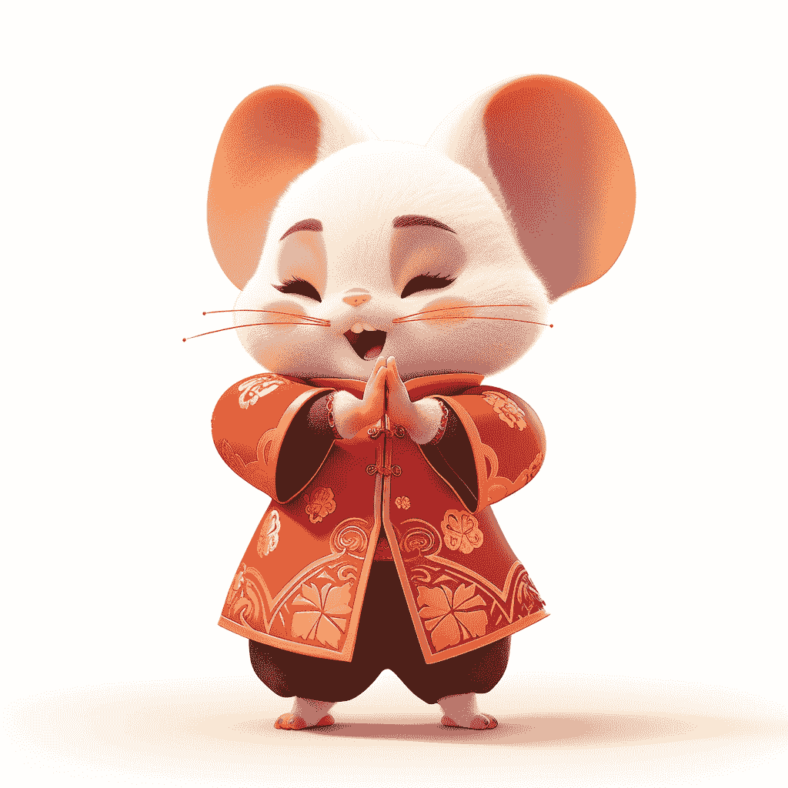

**《鼠》****  **

+   prompt：中国十二生肖，老鼠，拟人，中国古代服装，站立，可爱，3D，白色背景，干净背景，8k分辨率， 皮克斯动画， 自然光

+   生成风格：人物 CG

+   生成尺寸：头像

+   分辨率：1024*1024

## 物品

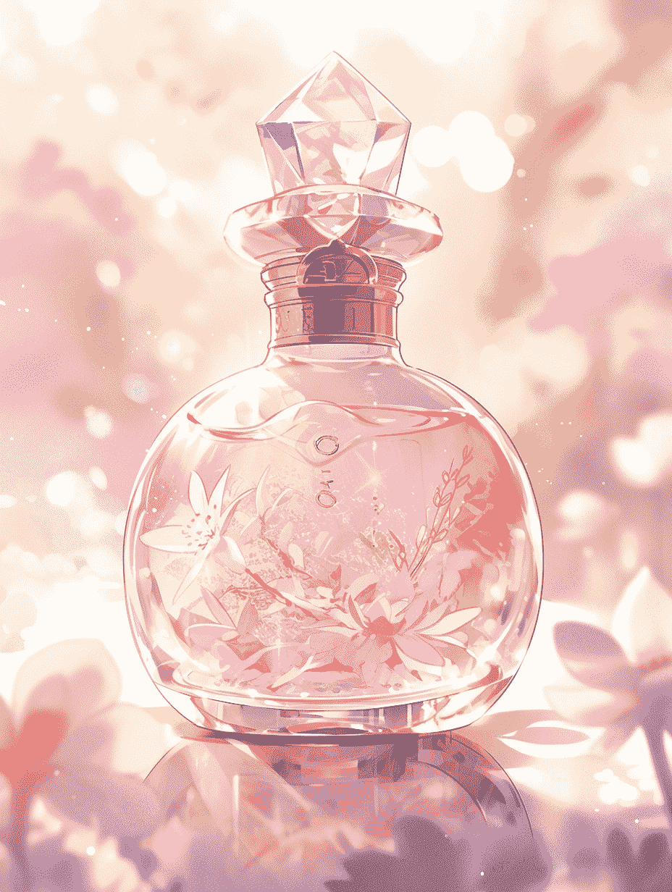

**《香水瓶电商产品图》**** **

+   prompt：一瓶精致的香水，景深， 大师作品， 背景光

+   生成风格：CG 默认

+   生成尺寸：社交媒体

+   分辨率：1152*1536

## 场景概念设计

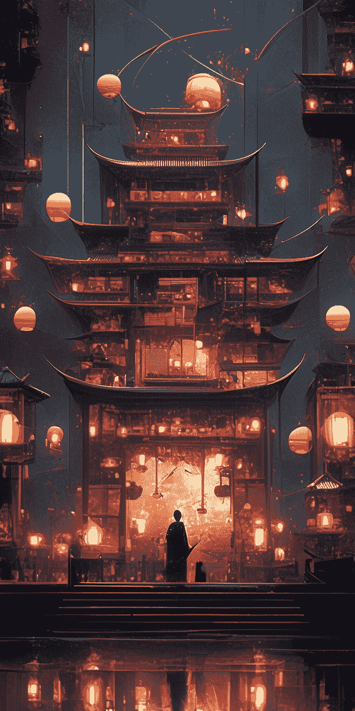

**《壮丽复杂的霓虹灯健壮》**

+   prompt：拍摄壮丽而复杂非常华丽，聪明的全身坐着神秘，雄伟，雄伟，复杂的细节，黑暗的背景，摄影，3D Kon Satoshi霓虹灯，史诗合成虚幻引擎，电影，色彩渐变，高清，自然光

+   生成风格：二次元场景

+   生成尺寸：手机壁纸

+   分辨率：1024*2048

## 人物立绘

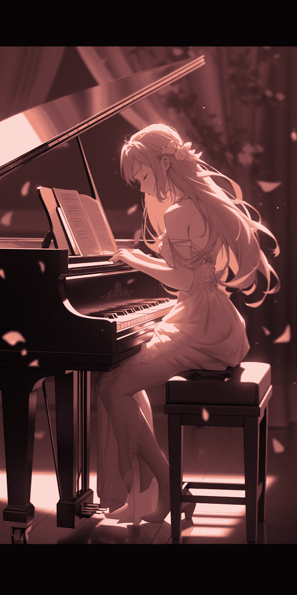

**《弹钢琴的女孩》 **

+   prompt：弹钢琴的少女 全身镜头， 氛围光照

+   生成风格：少女立绘

+   生成尺寸：手机壁纸

+   分辨率：1024*2048

## IP 创作

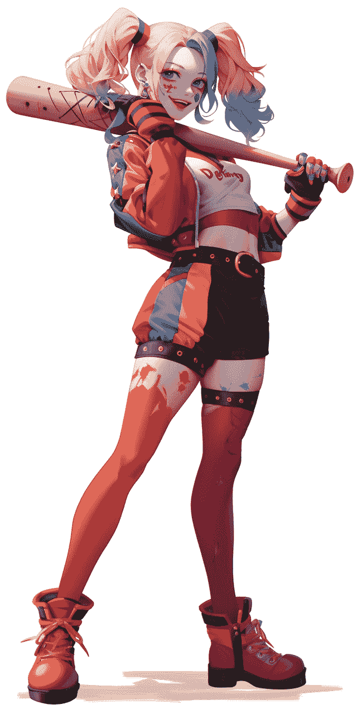

**《哥谭市女魔头》**

+   prompt：哈莉奎茵手上拿着棒球棍，大师作品，高细节，超高分辨率

+   生成风格：人物 CG

+   生成尺寸：手机壁纸

+   分辨率：1024*2048

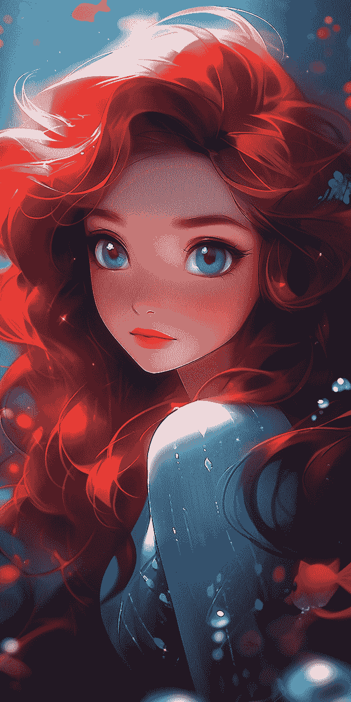

**《美人鱼》 **

+   prompt：小美人鱼，穿着蓝色的外套，海底下，深情的眼睛，双眼皮，长睫毛，红嘴唇，可爱的脸蛋，，红色头发。大师作品，最好画质，更高质量，高细节，超高分辨率，8k分辨率，

+   生成风格：人物 CG

+   生成尺寸：手机壁纸

+   分辨率：1024*2048

<参考图>

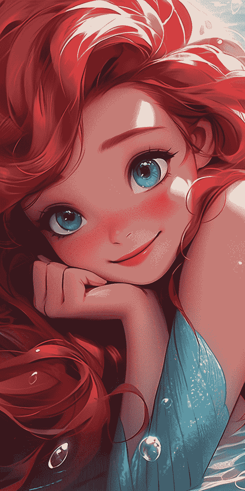

## 头像专题

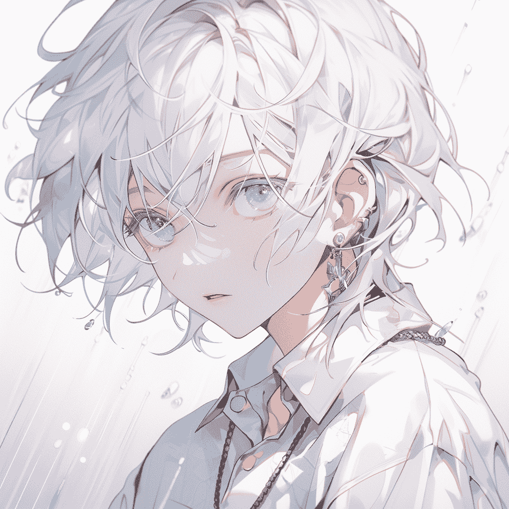

**《短白发蓝眸》**

+   prompt：可爱男生，白色头发，白衬衫，大师作品，高细节，超高分辨率，8K

+   生成风格：二次元通用

+   生成尺寸：头像

+   分辨率：1024*1024

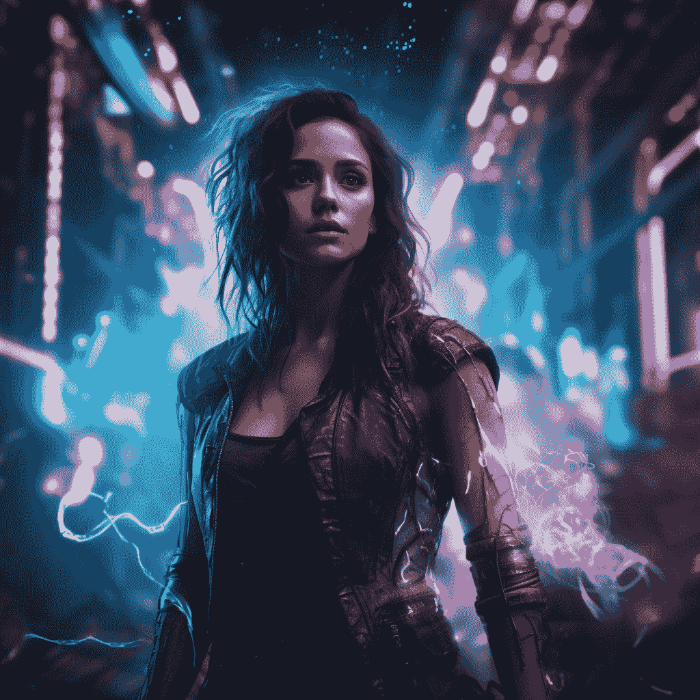

**《44》**

+   prompt：最好画质，8k分辨率，全身镜头，发光皮肤，迪士尼电影，柴油朋克，轮廓光，背景光

+   生成风格：人物 CG

+   生成尺寸：头像

+   分辨率：1024*1024