# 【宝宝四维图预测】最适合普通人的AI项目

> 来源：[https://xuqiwei1986.feishu.cn/docx/PIdxdzt5no7BGXxoHEBcH4pVnUL](https://xuqiwei1986.feishu.cn/docx/PIdxdzt5no7BGXxoHEBcH4pVnUL)

**《宝宝四维图预测》**

这是我前段时间在小红书上做的AI相关的能成功变现的项目，对于小白来说特别友好，今天就让我一步一步的教会你，从如何做图，到发布小红书，再到有流量，之后引流到微信，最终变现的宝宝四维图预测全流程玩法！

# **如何利用midjourey作图**

## **第一步**：百度搜索宝宝四维图，找到对应的照片截图保存

（PS：记得截图成只有宝宝四维图的那种，不然图片就难做内容）

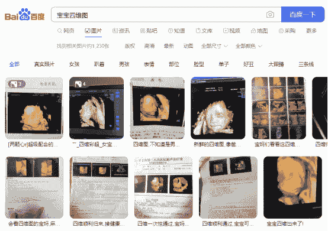

## **第二步**：打开midjourney，选择频道点加号上传文件图片

（PS：如果你不会midjourney，建议搜索b站莱森LysonOber免费学习）

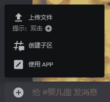

## **第三步**：导入那张裁剪好的宝宝四维图，最好是和我这样的

（PS：裁剪的话手机用美图秀秀，电脑用PS就差不多可以做到）

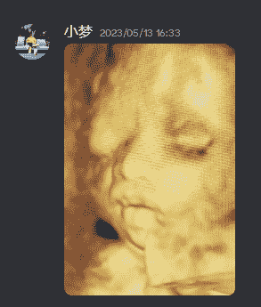

## **第四步**：鼠标右键点击这张图，选择复制消息链接点击一下

（PS：如果是鼠标左键点击的话，就是点图片再右键点击选择复制图片链接）

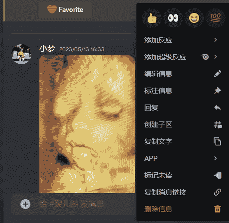

## **第五步**：在底下加号边上的输入栏输入/imagine，点击白色小帆船

（PS：我是因为有niji所以有绿色小帆船，正常情况下是只有mj的白色小帆船）

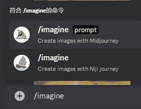

## **第六步**：粘贴刚才复制的宝宝四维图的链接，空一格加上我给你的关键词即可

（PS：关键词如下【 A newborn baby who has just been born is sleeping peacefully. The photo is realistic and captured through photography with a simple background. There are numerous authentic details in the photo, including the pores on the baby's skin, realistic hair, and the use of natural lighting or artificial lighting through a daylight-simulating bulb, highlighting the baby's features. The photo has no black borders, providing a full view of the baby and its surroundings】）

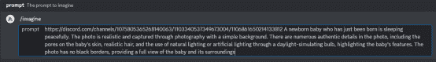

## **第七步**：点击发送即可，然后就是等待一会就有图片出来了

（PS：比如这样就是图片出来了，然后选择自己满意的再进行下一步操作）

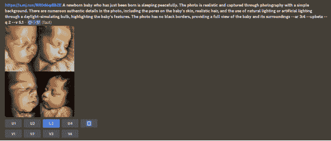

## **第八步**：U1代表第一张图放大，V1代表第一张图重做

（PS：U1\U2\U3\U4放大某张图，V1\V2\V3\V4重做某张图）

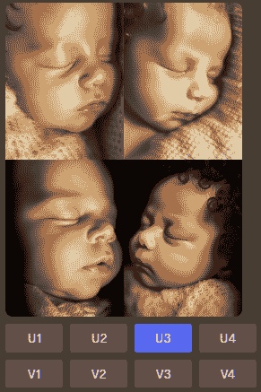

## **第九步**：输出的内容就是这样的图片，放大这四张图的其中一张

（PS：这样的话，就可以让这张图片看起来更加高清好看有助于发布）

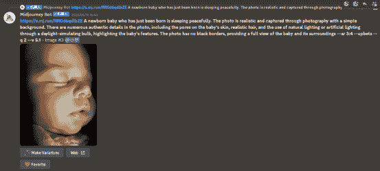

## **第十步**：鼠标左键点击图片，然后选择在浏览器中打开

（PS：这样去保存的话，他的图片就会是最高请的版本）

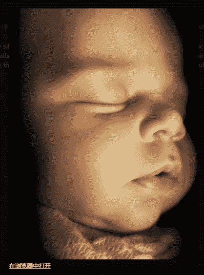

## **第十一步**：点击图片另存为，保存到桌面就可以了

（PS：记得是保存到桌面，别乱七八糟的地方等一下找不到）

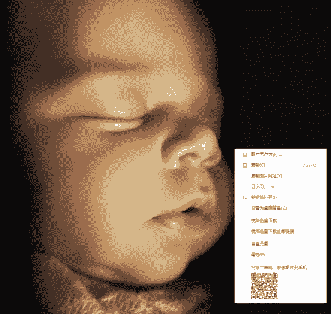

## **第十二步**：这是宝宝四维图的最重要一步，做出第一张宝宝四维的成图

（PS：如果会调色的话最好，如果不会的话也没事）

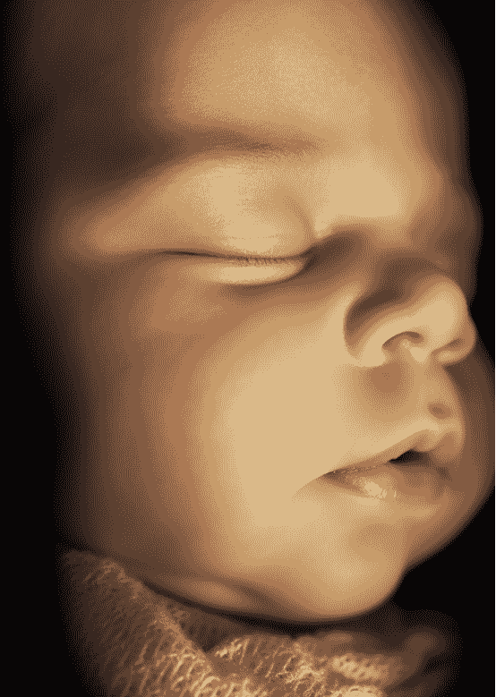

# **如何利用chatGPT写标题**

## **第十三步**：主要是利用chatGPT，写出几个关于宝宝四维的标题

（PS：如果你不会chatGPT，一样可以去b站搜索相关内容学习

我准备在写标题，帮我模仿一下“AI居然这么强大？只有我不知道嘛？”这段这出5个类似的标题，建议是比较新奇的，准宝妈宝爸一看见就感兴趣的标题内容，可以加入表情包等元素，让标题更加丰富多彩）

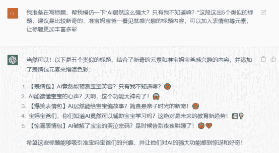

## **第十四步**：输入内容，然后让chatGPT输出类似的内容即可

（PS：我准备在写内容，帮我模仿一下“宝妈宝爸们，想提前看见自己宝宝的快来呀！”这段这出5个类似的内容，建议是比较新奇的，准宝妈宝爸一看见就感兴趣的内容，可以加入表情包等元素，让内容更加丰富多彩）

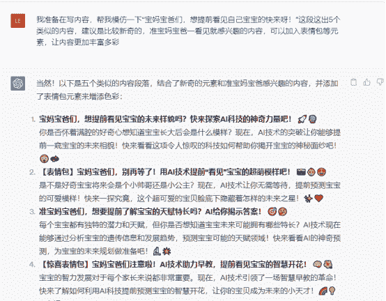

# **如何发小红书**

## **第十五步**：打开小红书，选择最中间的红色的加号发小红书

（PS：大部分情况下，发小红书都是这样操作的，如果你不懂的话）

## **第十六步**：选择你做好的宝宝四维图，最好是有对比的

（PS：对比的话，电脑端PS可以做，手机端美图秀秀可以做）

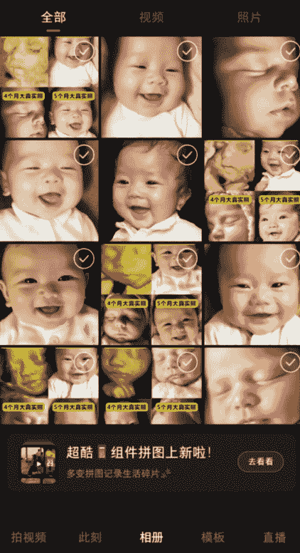

## **第十七步**：把chatGPT给的标题和内容加入，然后#话题发布即可

（PS：话题一定要加，尤其是新号加个笔记灵感增加流量的）

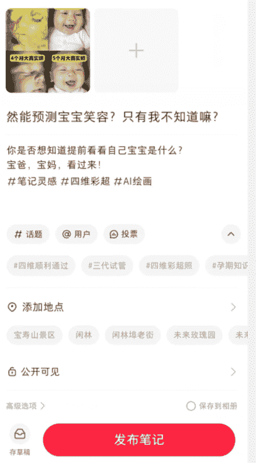

# **如何引流微信**

## **第十八步**：选择小红书右上角的群聊功能，点击创建群聊

（PS：引流的话这一步是最关键的，群聊是很方便的引流方式）

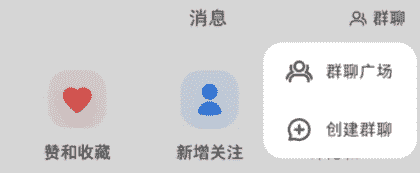

## **第十九步**：名字改成自己满意的即可，公开展示开关看自己

（PS：因为新建的群聊，进群是需要你同意的，所以没关系的）

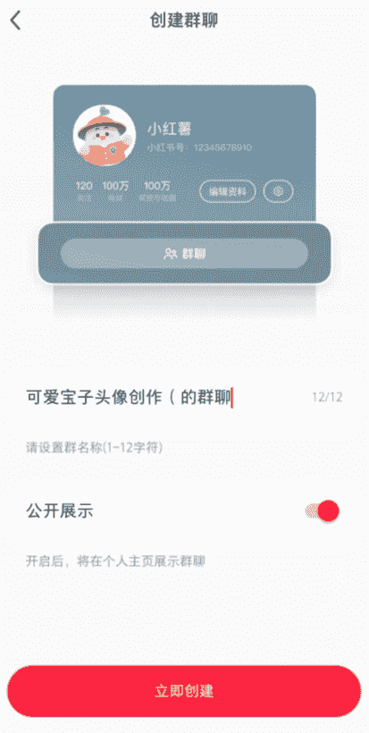

## **第二十步**：如果有人问你怎么交付或者付款，你直接发她你的群聊

（PS：这样让她申请进群，在群聊回复她是比较安全的引流方式）

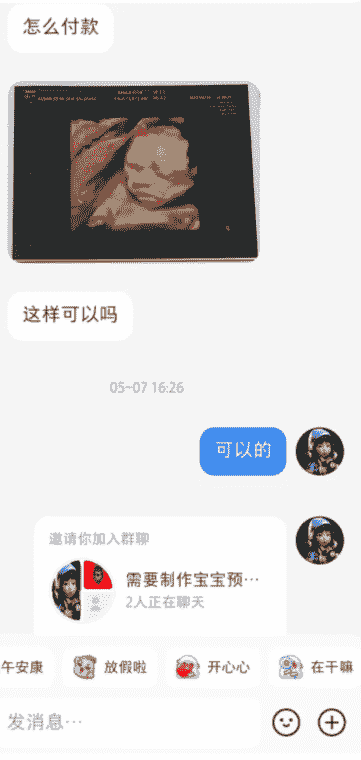

## **第二十一步**：等她进群了，艾特@一下她，然后用小号发你的微信号

（PS：建议是用小号发，这样大号出问题的概率就会降低不少）

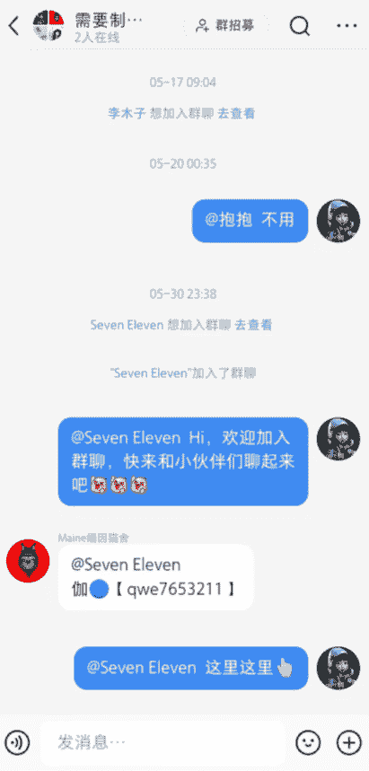

# **如何成交变现**

## **第二十二步**：加了微信之后，就差不多是成交变现环节

（PS：因为对方加你就是有强需求的，所以这种很容易成交）

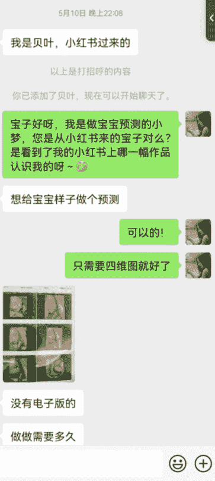

## **第二十三步**：差不多就是这样，然后就付款成交，最后交付即可

（PS：然后你按照我教你的方法，做宝宝四维图给她交付即可）

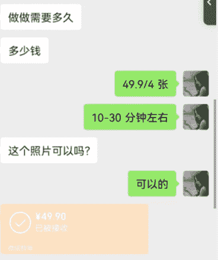

如果想了解更多Ai项目，直接关注我的公众号【小梦Ai玩家】~

公众号回复“3”即可，找到本人微信，链接本人探索更多可能性！