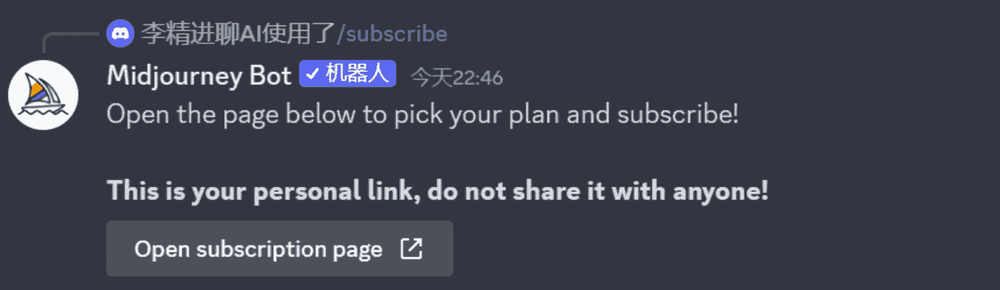
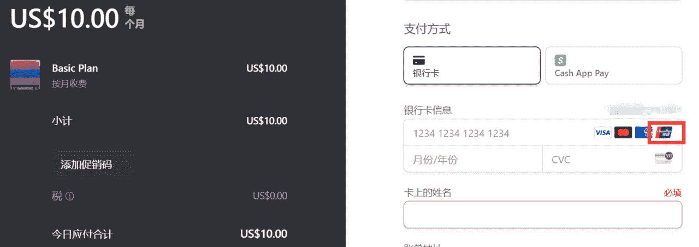
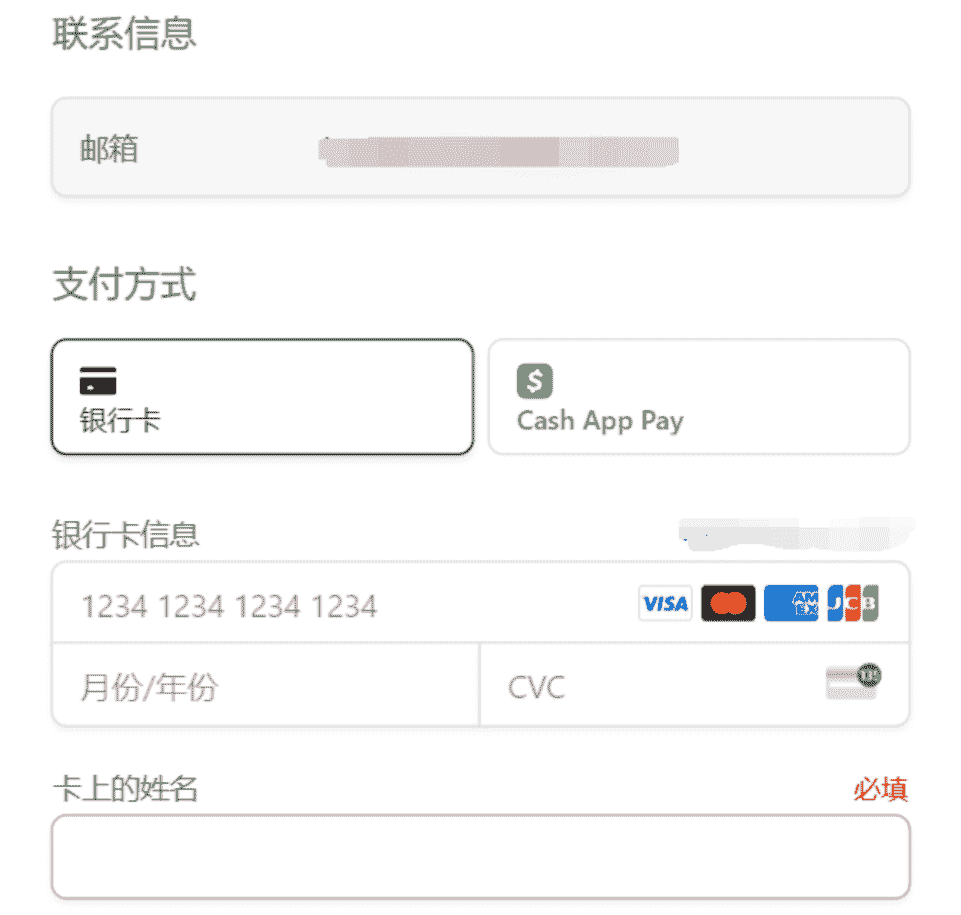
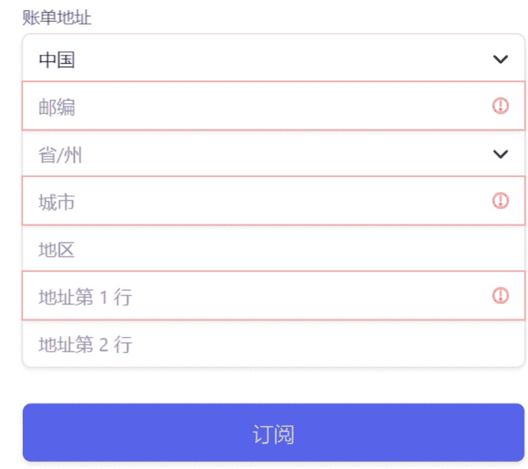

# 2023-06-26Midjourney自己充值全流程

> 来源：[https://xuqiwei1986.feishu.cn/docx/MG28duYCJoyVluxkJyHcfSfRnYd](https://xuqiwei1986.feishu.cn/docx/MG28duYCJoyVluxkJyHcfSfRnYd)

> 🔗 原文链接： h[ttps://articles.zs](https://articles.zsxq.com/id_plut5dx3szok.html)xq.com/id_plut5d...

>

自从Midjourney时不时风控账号，过去帮人代充的个人和机构，都表示不能再提供服务了。作为AI绘画发烧友，怎么能因为充值这件小事，放弃使用Midjourney呢？

在亲身实践后，我用国内银联卡充值成功啦。今天把具体操作步骤，详细分享出来，希望帮助到同样喜欢AI绘画的你。

**1、打开充值页面**

在Midjourney输入/subscribe，获取个人充值网址。点击网址，选择月度支付的套餐类型，进入到绑卡界面。

**2、准备银联信用卡**

国内的银联信用卡就能充值，不用visa等国际卡。Midjourney已经明确告诉我们银联能用啦，不信的话，你看填写支付方式的图标里已经说明了。

我用的招商银行信用卡，需要注意两点，一是实体卡已经激活，二是需要信用卡，储蓄卡据说不太好用。如果你有其他银行的信用卡，也可以试着充值。

**3、填写卡片信息**

邮箱填写自己的，国内的qq、163邮箱都能用。如果之前找人代充过，别人的邮箱短期不能换，建议注册一个新账号。

支付方式选银行卡，依次填写账号、有效期月份/年份，CVC（卡背面后三位数字）

填写个人姓名和账单地址，地址红框处是必填项，可以不用真实的。

填完之后，点击订阅，即可完成充值。

**4、取消连续订阅**

如果你不想每个月被扣款，在管理订阅界面，记得勾选“取消订阅计划”。

看完了，有没有觉得自己充值也很简单？你看，所有问题都有解决方案，只要肯用心。