# 2023-04-14玩王者不如玩Midjourney, 二次元宅男要all in了

> 来源：[https://xuqiwei1986.feishu.cn/docx/Mw0ldD2w7o6ECExzJPOc5uzvnPe](https://xuqiwei1986.feishu.cn/docx/Mw0ldD2w7o6ECExzJPOc5uzvnPe)

> 🔗 原文链接： h[ttps://articles.zs](https://articles.zsxq.com/id_7mcfo8k8tcqh.html)xq.com/id_7mcfo8...

>

最近看球友们都在玩AI绘图，各种精彩作品看得我心里也痒痒的，所以也打算来玩一下，感受AI绘图的魅力。

说干就干，首先去Discord注册了个账号，然后按照流程把midjourney功能添加进去。为什么需要去discord注册呢？没有玩过的球友可能不知道，我简单解释下。

Discord其实是一个聊天软件，类似于🛰️，可以添加各种小程序在上面。midjourney没有自己的客户端，他是在Discord上的一个bot。我们需要在Discord注册账号后，再将midjourney的bot添加到我们自己的工作区。我们操作midjourney时候都是通过命令行的方式，就像下面图片的样子。红框标出来的一个是常用的命令，另外一个是命令输入行。

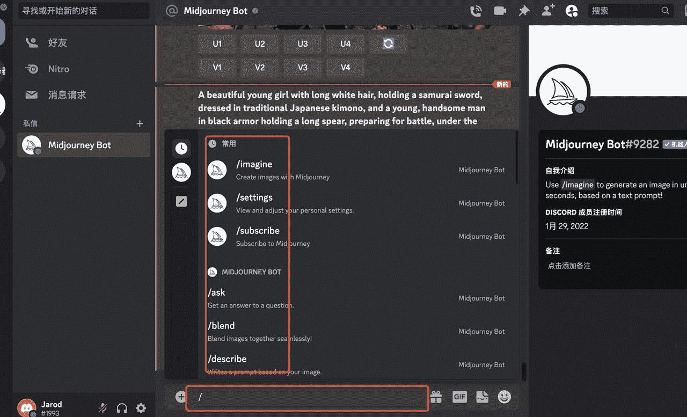

因为现在midjourney不能白嫖了，所以忍痛氪金30$买了一个月的服务(据说可以去淘宝买共享账号)。

如何付费呢？直接输入 /subscribe，就会弹出付费链接，付费了就行了

交了钱后，就可以正常使用了。绘图的基本命令是imagine。第一次使用，我随便画一个图试试看。

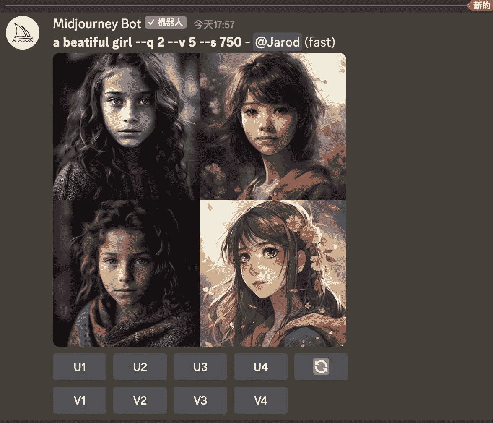

挺不错，生成的girl确实挺可爱，挺漂亮的。不过只有头像，背景太简单了些。找了其他大佬的Prompt教程，一般是按照 【画面主体】+【画面环境】+【镜头视角】+【风格参考】+【渲染方式】 这个进行mj的prompt。开始发挥想象力了。

首先是画面主体，想像一个漂亮可爱的girl是什么样子的：

然后是画面环境, 想像下什么环境下是最romatic的：

最后是镜头描述：

其他几个先用默认参数

最后的prompt就是

白色长头发漂亮的大眼睛少女，樱花树下，湖边，小木屋，夕阳西下，全身照

来看看生成效果如何

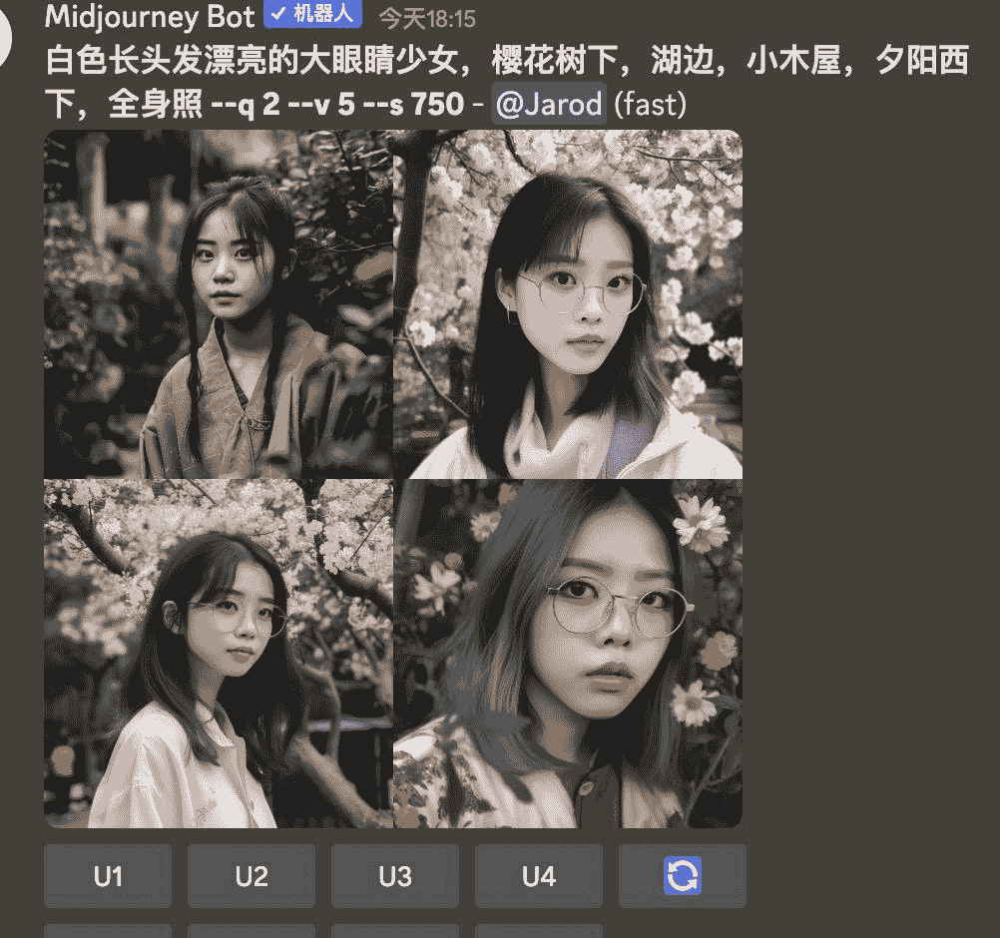

看起来也很好看。。。但二次元宅男表示不喜欢。而且也不太对，头发不是白色的，也没有夕阳，没有小木屋。。。

会不会是中文描述的mj识别不了呢？我用chatgpt换成英文看看

A beautiful young girl with long white hair and big pretty eyes, under the cherry blossom tree, by the lake, near a small wooden cabin, with the sunset, full-body shot.

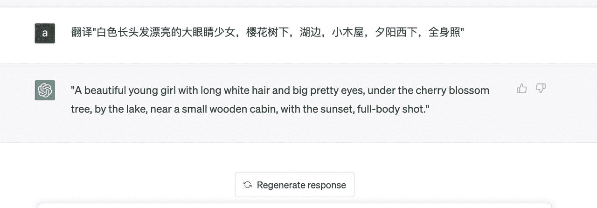

这就用英文的试试看。

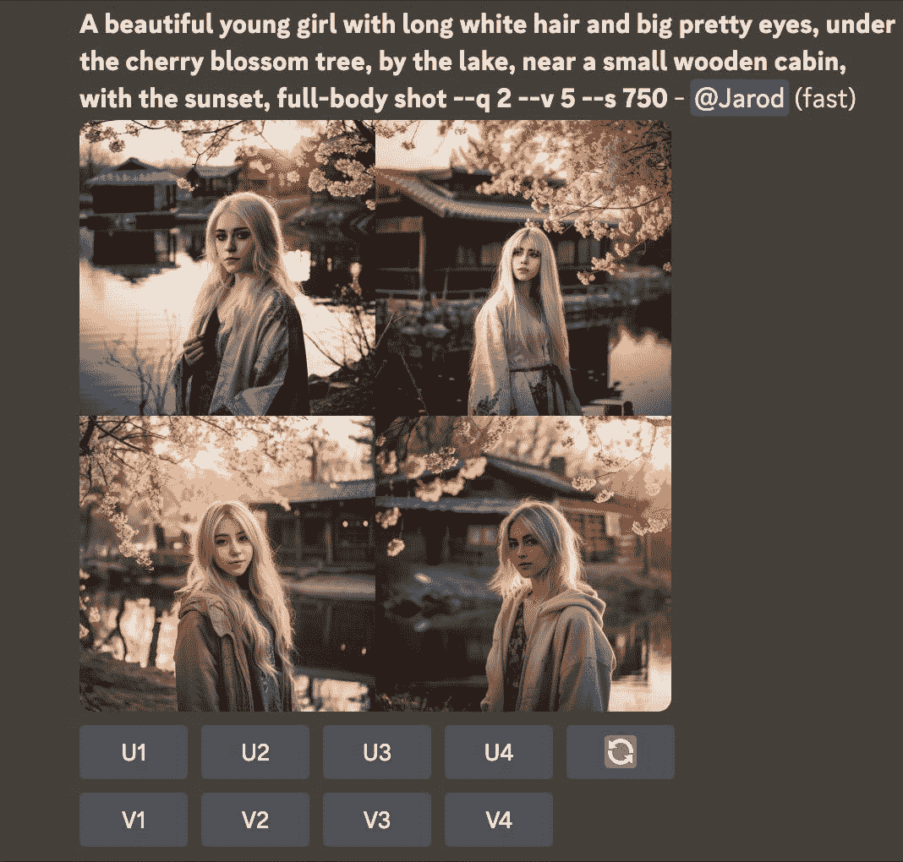

这个不错，有点对我胃口了，该要的场景要素都有了。

再发会下想象力，一个漂亮的少女在湖边干嘛？是不是等人呢？我在加上一个英俊的小伙子进我们的花里面。

只需要改改画面主体就可以了

白色长头发漂亮的大眼睛少女，英俊的青年，樱花树下，湖边，小木屋，夕阳西下，全身照

还是用chatgpt翻译成英文

A beautiful young girl with long white hair and big pretty eyes, a handsome young man, under the cherry blossom tree, by the lake, near a small wooden cabin, with the sunset, full-body shot.

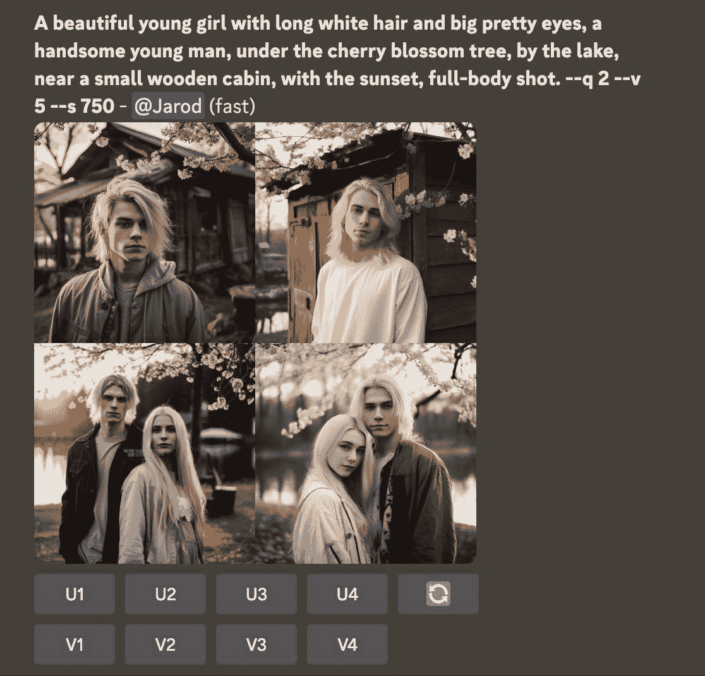

第3和第四幅画该有的元素都有了，但看起来不是我想象的那样。上面这幅画看起来是欧美风，我所想象的是那种二次元动漫风格的，和想象有很大的差距。

再发挥下想象力，既然有樱花，那么肯定是穿着和服比较应景，如果再加上手拿武士刀的话，在这种平静的环境下多了一份肃杀的感觉，那应该不错。

白色长头发漂亮的大眼睛少女手持武士刀穿着和服，英俊的青年手持武士刀，樱花树下，湖边，小木屋，夕阳西下，全身照

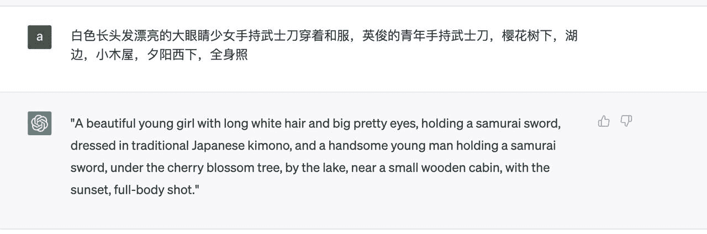

来看看效果

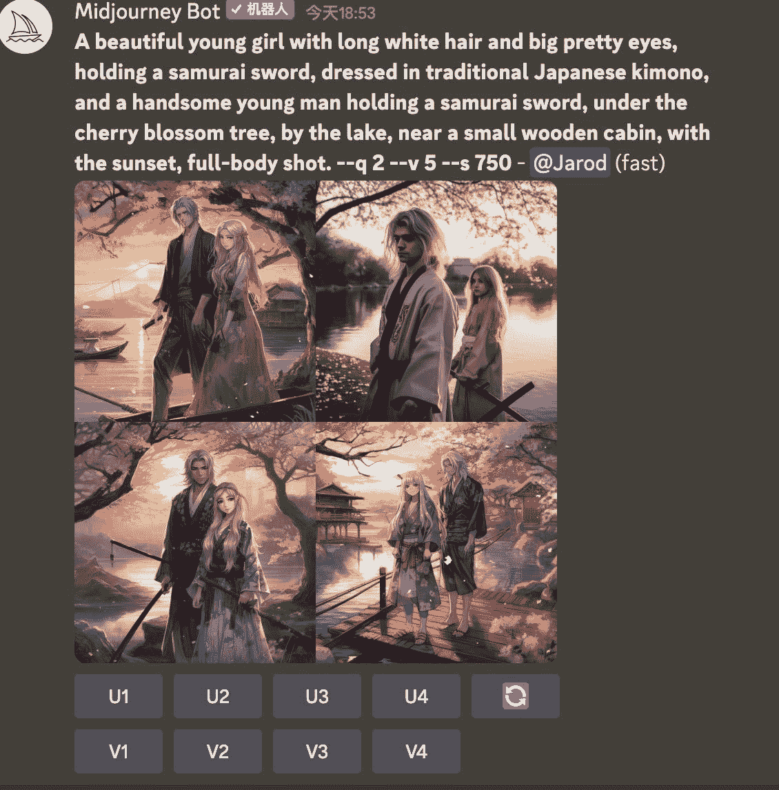

这画风完全符合我的预期了！！！开心

再来甜一点的画风，少女的武士刀不要了，少年和少女拥抱在一起。

白色长头发漂亮的大眼睛少女手穿着和服，英俊的少年手持武士刀比武，樱花树下拥抱，湖边，小木屋，夕阳西下，全身照

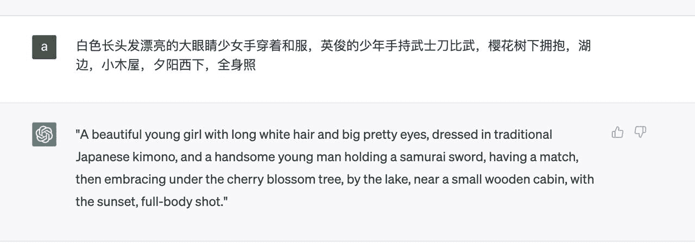

来看看效果如何。第一图看起来效果非常好，刚好满足我的想象。保存下来！

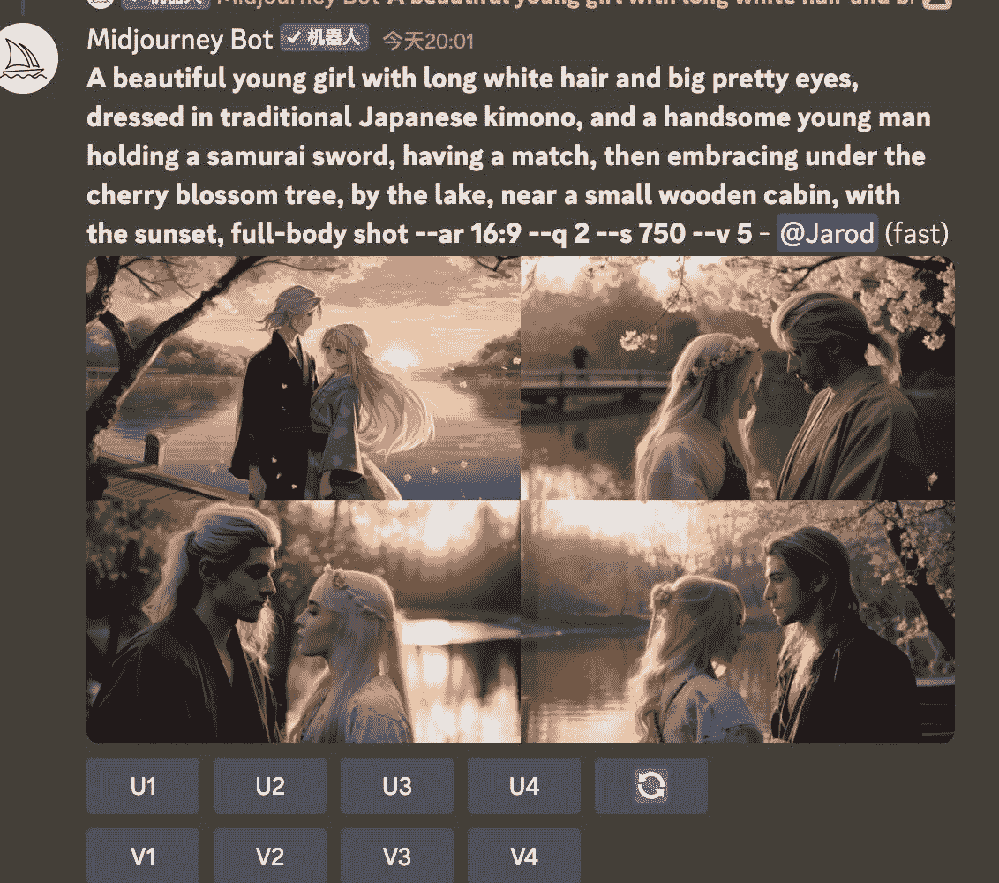

在画的下面，有U1...U4这4个按钮，指的是第几副画，需要第一幅画，我们选U1即可

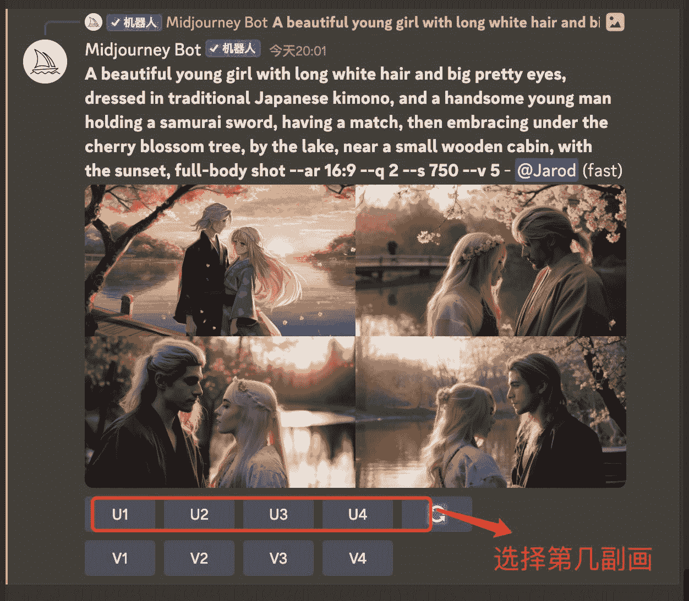

最后，mj会把第一幅画返回给我们，点击进去保存就可以了

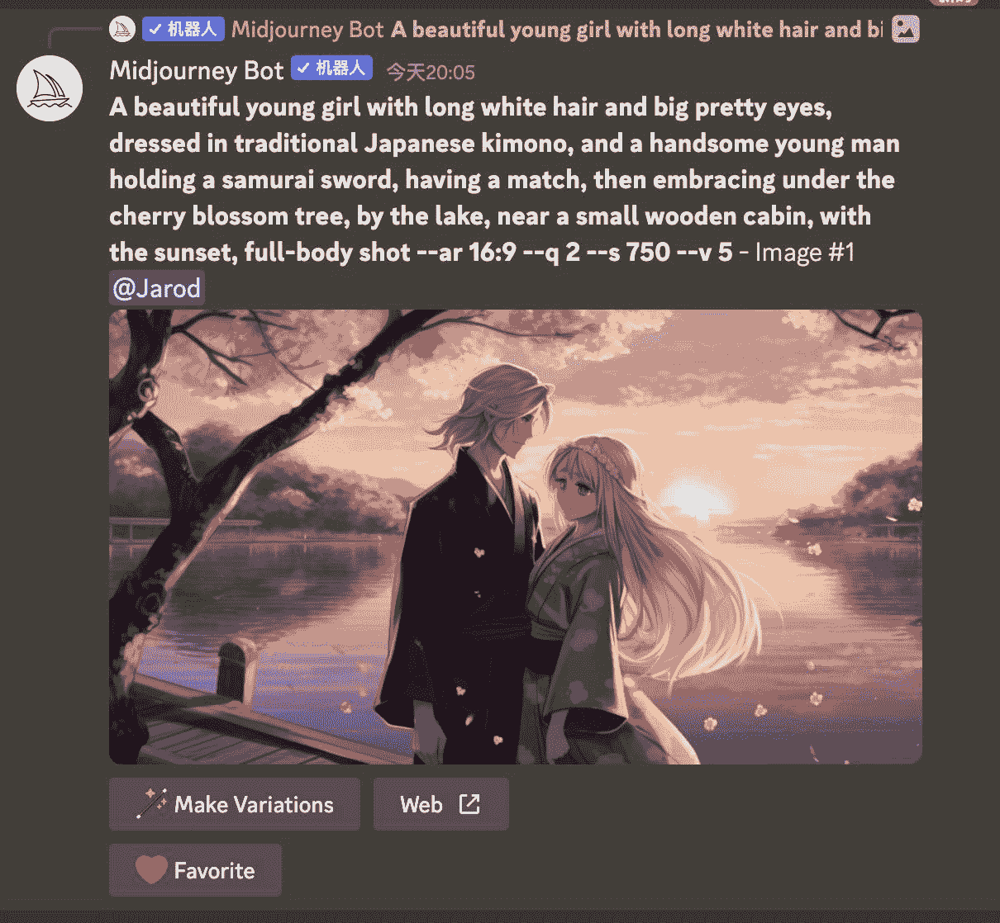

最终，我的画作是这样的。mj就是那么好玩的东西，我们只要发回自己想象力，想想画面有什么，mj会帮我们画出来。有了mj，我们不需要美工，也不需要学习画画，只需要丰富的想象力就足够了!

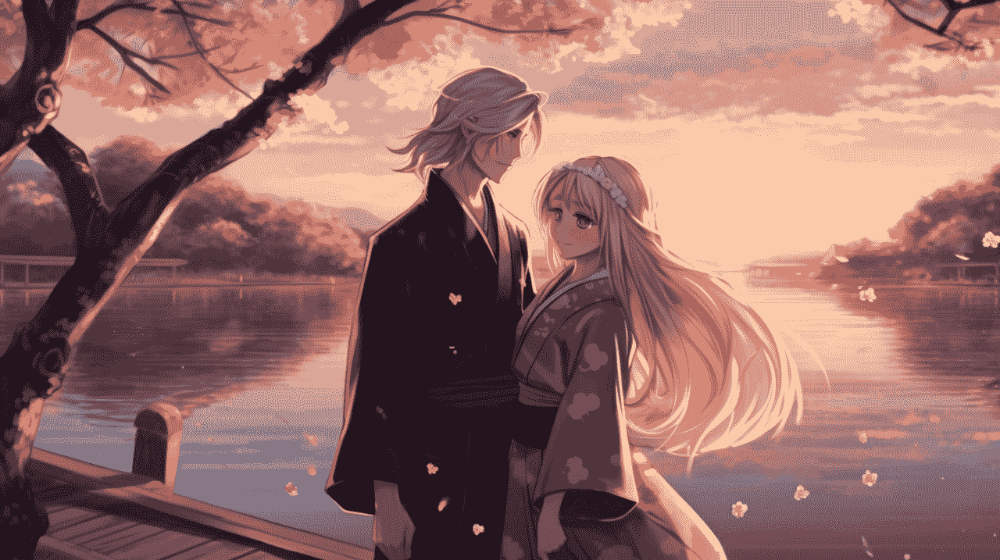

扫码加入星球

查看更多优质内容

https://wx.zsxq.com/mweb/views/joingroup/join_group.html?group_id=15552545485212