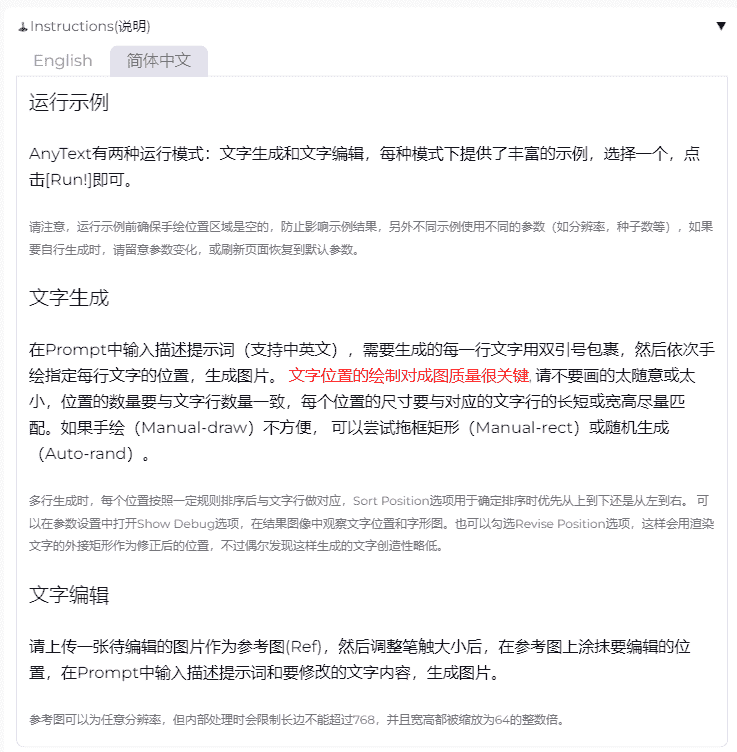
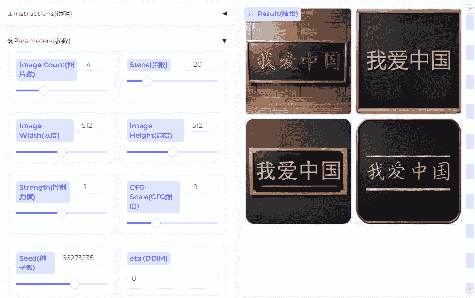
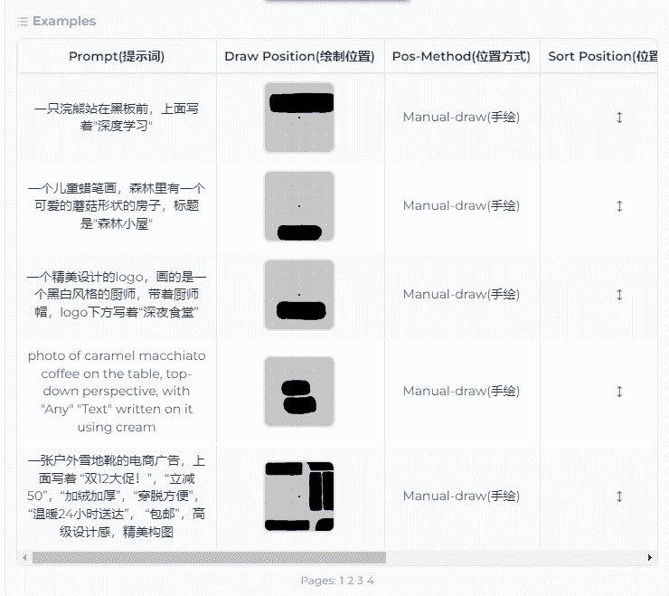
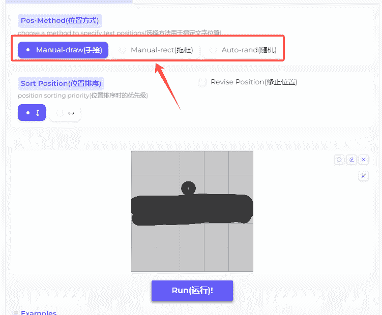
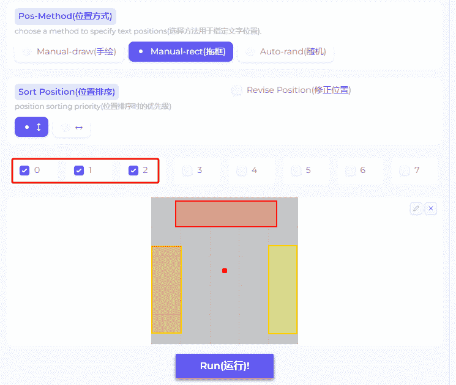
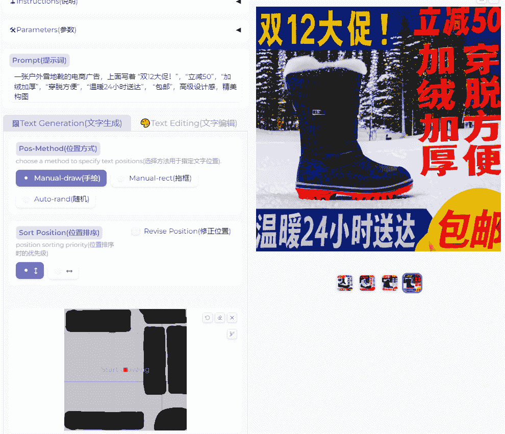
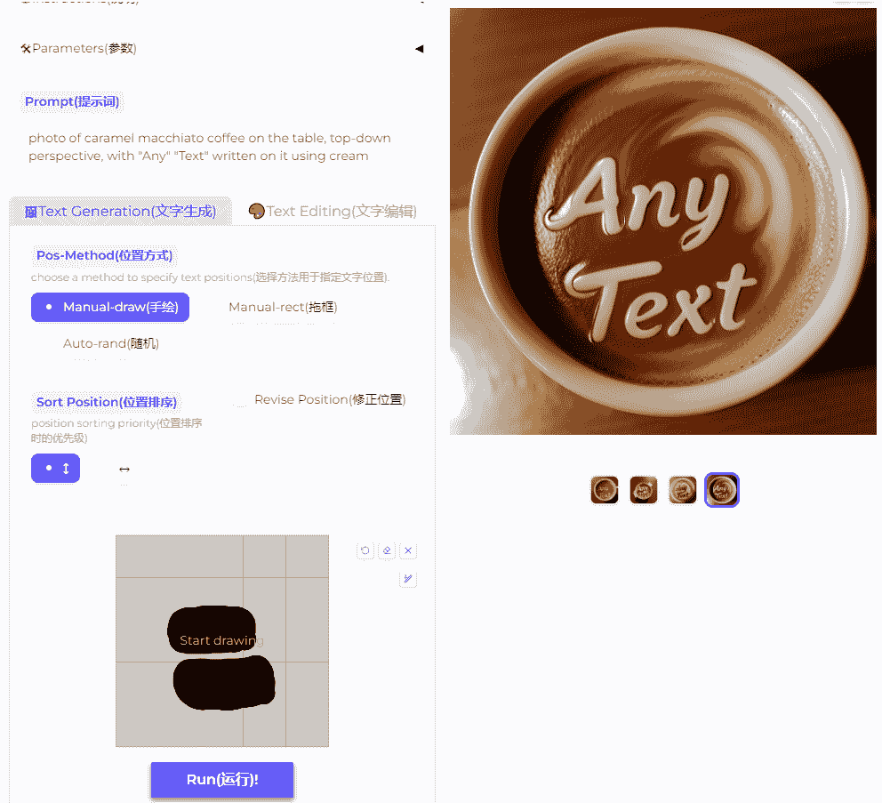
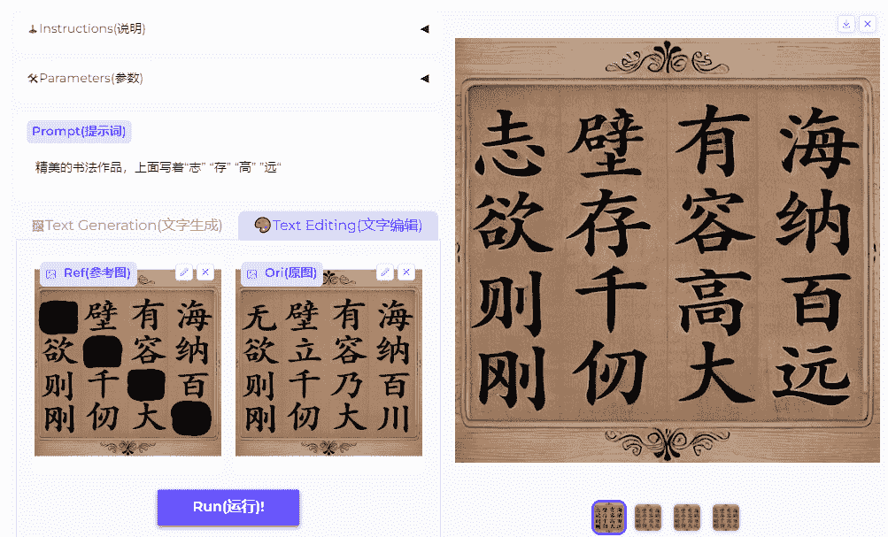

# 会写汉字的 AI 绘画模型，它来了！

> 来源：[https://xuqiwei1986.feishu.cn/docx/Wdk2dZXSHotH5Ux6JPochnpSnxf](https://xuqiwei1986.feishu.cn/docx/Wdk2dZXSHotH5Ux6JPochnpSnxf)

AI 绘画其实在很早之前就可以生成文字了，听雨了解的第一款可以通过提示词在图片中生成文字的 AI 绘图工具还是 Ideogram，不过也只能生成英文，后续很多 AI 绘画软件都支持了文字生成功能，可惜一直没有支持汉字的 AI 绘画软件出现。

不过听雨相信这个是迟早的事情，毕竟我们自家的大模型也在发力嘛！支持汉字还得靠自家的大模型。

这不，阿里达摩院最新的 AnyText多语言视觉文字生成与编辑模型 就是实现了这一功能，终于可以愉快的直接生成带有汉字的图片了，开心~

---

> 在线体验地址：[h](https://modelscope.cn/studios/damo/studio_anytext/summary/)ttps://modelscope.cn/studios/damo/studio_anytext/summary/

> 官方模型介绍：[https://modelscope.cn/models/damo/cv](https://modelscope.cn/models/damo/cv_anytext_text_generation_editing/summary)_anytext_text_generation_editing/summary

进来以后官方有简单的说明，都是中文，操作也蛮简单的。

参数里边就一些关于绘图的设置。

图片数：每次生成的图片数，默认是 4 张。

步数：迭代步数越高，图片质量越高，相应的生成时间更久。

宽度和高度没啥好讲的。

控制力度：提示词和文字生成的精度，控制力度越高，生成的画面和字体的准确性越高。

CFG强度：和提示词的匹配程度，这个默认就好了。

种子数：每张图片的唯一编号。

eta：不知道这个参数干啥的，默认就好。大于 1，出图就是黑图了。

底部还有用例，点击对应的用例就会自动填入提示词以及绘制位置，直接点击运行就可以等待图片的生成了。

主要是提示词和绘制位置，提示词主要就是我们想要生成画面的描述。

比如下图中的例子「一只浣熊站在黑板前」这个就是我们想要生成的画面，「"深度学习"」就是我们想要在黑板上生成的文字，「""」双引号则代表需要生成的文字，有几个「""」，就会生成几段文字。

指定文字的位置有三种方式，一种是手绘，就是我们自己用画笔工具涂抹一片区域用来生成文字。

第二种拖框，我们勾选几个拖框就会出来几个正方形的拖框，拖框可以移动，可以上下左右拉伸。

第三种随机就很好理解了，如果我们有三段文字需要生成，就会随机放置在三个位置。

官方的例子很不错，我们就直接上官方的示例了。

这里需要注意一下，你有几个「""」，在绘制位置上就要绘制几个位置用来生成文字。要不然会报错哦！或者生成的图片会比较乱，无法达到我们想要的效果。

看下图这个效果，以后电商图片不愁了呀，自己就能做。

不仅支持中文，也支持英文。

以上是文字生成的功能，还有第二个功能是文字编辑的功能。可以在原来的图片上修改文字。官方也有很多示例，小伙伴们可以对照着看。

好了，今天的分享就到这里了，感兴趣的小伙伴快去试试吧！