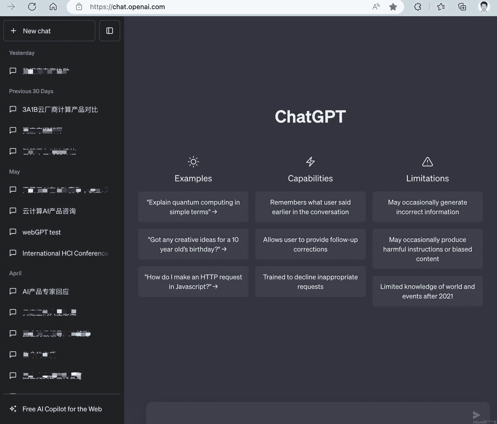
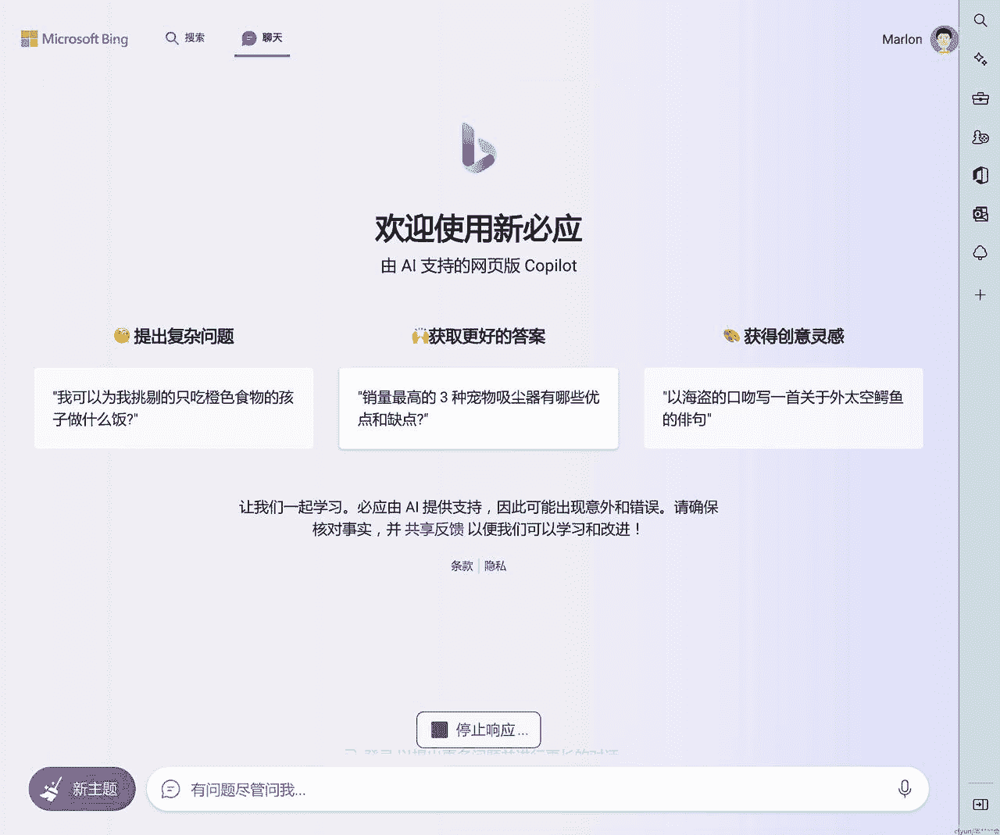
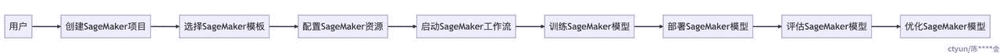
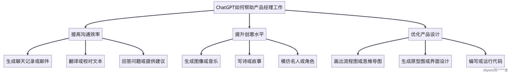
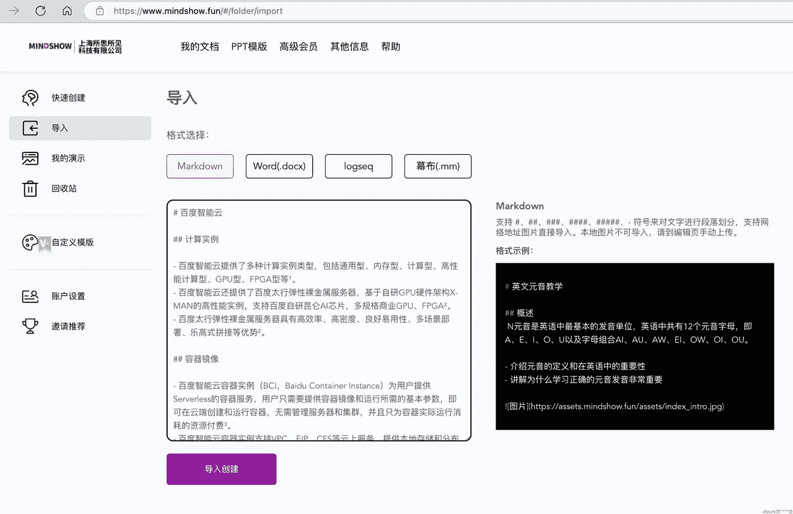
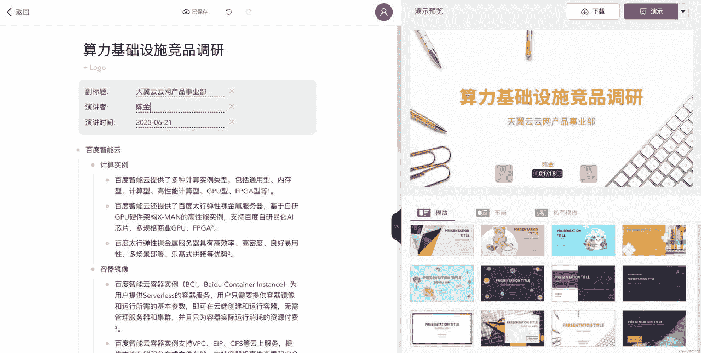

# 2023-07-20 ChatGPT如何帮助产品经理工作？

> 来源：[https://xuqiwei1986.feishu.cn/docx/TUrJdAZKYoHNNYx780PcGMrKnSe](https://xuqiwei1986.feishu.cn/docx/TUrJdAZKYoHNNYx780PcGMrKnSe)

> 🔗 原文链接：https://www.ctyun.cn/developer/article/430450145386565


## 1. 引言

ChatGPT是一个人工智能聊天机器人，由美国的OpenAI公司开发。它使用了GPT-3.5或GPT-4这样的先进的自然语言生成模型，可以与用户进行对话，回答问题，提供建议，生成文本或图像等。它的对话格式使得它可以根据上下文进行互动，承认错误，挑战错误的前提，拒绝不合适的请求等。它是一个有趣而强大的工具，可以用于创意、学习、工作、娱乐等多种场景。

GPT-3.5和GPT-4是OpenAI公司开发的两代先进的自然语言生成模型，它们都可以用于生成各种类型的文本和图像，但也有一些重要的差异。OpenAI公司于2022年11月推出了GPT-3.5模型，它是基于GPT-3模型的改进版，拥有1750亿个参数。GPT-3.5模型在一些任务上表现得更好，比如写作、翻译、对话等，但也有一些局限性，比如容易产生错误或无意义的输出，对上下文的理解不够深入，对一些敏感或复杂的话题处理不够合理等。GPT-3.5模型目前可以通过OpenAI的API或Playground来使用，但需要申请权限和支付费用。

GPT-4是2023年3月推出的最新一代自然语言生成模型，它是基于GPT-3.5模型的进一步升级，拥有5000亿个参数。GPT-4模型在很多方面都超越了GPT-3.5模型，比如创造力、协作性、逻辑性、准确性等，它可以与用户进行更深入、更灵活、更友好的对话，回答更复杂、更细致、更有挑战性的问题，生成更高质量、更多样化、更有趣味的文本和图像等。GPT-4模型目前只能通过ChatGPT Plus来使用，这是一个专门为聊天而设计的服务，需要开通订阅并支付20美元每月的费用。如果有具有API权限的应用，官方对于GPT-4的定价大约是GPT-3.5的22.5倍起。

## 2. ChatGPT的访问方式

### 方法一

使用VPN软件（建议切换到英国），访问ChatGPT的官方网站 `https://chat.openai.com/` ，注册并登录OpenAI账号，然后使用ChatGPT的功能。目前免费的账号只能使用GPT3.5。



### 方法二

通过New Bing的聊天功能使用GPT-4模型

国内使用还需要修改 `Hosts` 文件，增加如下内容：

```
# New Bing Chat 
20.196.210.19 bing.com 
20.196.210.19 www.bing.com 
20.196.210.19 r.bing.com 
20.196.210.19 cn.bing.com 
20.196.210.19 edgeservices.bing.com    

# New Bing Login 
40.126.35.80 login.microsoftonline.com 
20.190.163.18 login.live.com 
13.107.253.59 logincdn.msauth.net 
13.107.253.59 acctcdn.msauth.net 
13.107.253.59 acctcdn.msftauth.net 
13.107.253.59 lgincdnvzeuno.azureedge.net
```



### 说明

可以点击地址栏左侧的锁图标清理cookie，目前每次清理cookie后可以发起5次提问。登录地区为美国的账户后一次会话可以问30个问题。

## 3. 产品经理使用ChatGPT的几种姿势

### 3.1 画图

#### 流程图

```
prompt：画一个用户使用AWS SageMaker的流程图，请用mermaid语言描述
```

```
您好，这是Bing。很高兴为您提供帮助。😊

根据网络搜索结果，我为您生成了一个用户使用AWS SageMaker的流程图，请用mermaid语言描述如下：

graph LR
A[用户] --&gt; B[创建SageMaker项目]
B --&gt; C[选择SageMaker模板]
C --&gt; D[配置SageMaker资源]
D --&gt; E[启动SageMaker工作流]
E --&gt; F[训练SageMaker模型]
F --&gt; G[部署SageMaker模型]
G --&gt; H[评估SageMaker模型]
H --&gt; I[优化SageMaker模型]
```



#### 思维导图

```
prompt：画一个“ChatGPT如何帮助产品经理工作”的思维导图，请用mermaid语言描述
```

```
graph TD
A[ChatGPT如何帮助产品经理工作]
A --&gt; B[提高沟通效率]
A --&gt; C[提升创意水平]
A --&gt; D[优化产品设计]
B --&gt; E[生成聊天记录或邮件]
B --&gt; F[翻译或校对文本]
B --&gt; G[回答问题或提供建议]
C --&gt; H[生成图像或音乐]
C --&gt; I[写诗或故事]
C --&gt; J[模仿名人或角色]
D --&gt; K[画出流程图或思维导图]
D --&gt; L[生成原型图或界面设计]
D --&gt; M[编写或运行代码]
```



#### 产品原型图

```
prompt：画一个用户登录注册的HTML原型图，要求包含样式。主按钮色号请使用#df0629 ，文案使用中文，字体使用微软雅黑。
```

```
&lt;html&gt;
&lt;head&gt;
  &lt;style&gt;
    body {
      font-family: 微软雅黑, sans-serif; /* 修改字体 */
    }

    h1 {
      font-size: 24px;
      font-weight: bold;
      text-align: center;
    }

    form {
      width: 300px;
      margin: 0 auto;
    }

    label {
      font-size: 16px;
      font-weight: normal;
      display: block;
      margin-top: 10px;
    }

    input {
      font-size: 16px;
      font-weight: normal;
      display: block;
      width: 100%;
      height: 40px;
      border: solid gray;
      border-radius: 4px;
      padding: 8px;
    }

    button {
      font-size: 16px;
      font-weight: bold;
      display: block;
      width: 100%;
      height: 40px;
      background-color: #df0629; /* 主按钮颜色 */
      color: white; 
      border: none; 
      border-radius: 4px; 
      margin-top: 20px; 
    }

    a {
      font-size: 16px;
      font-weight: normal;
      display: block;
      text-align: center;
      color: dodgerblue; /* 链接颜色 */
      margin-top: 10px; 
    }
  &lt;/style&gt;
&lt;/head&gt;
&lt;body&gt;
  &lt;h1&gt;欢迎使用我们的网站&lt;/h1&gt;
  &lt;form&gt;
    &lt;label for=&quot;username&quot;&gt;用户名&lt;/label&gt;
    &lt;input id=&quot;username&quot; type=&quot;text&quot; placeholder=&quot;请输入您的用户名&quot;&gt;
    &lt;label for=&quot;password&quot;&gt;密码&lt;/label&gt;
    &lt;input id=&quot;password&quot; type=&quot;password&quot; placeholder=&quot;&quot;&gt;
    &lt;button type=&quot;submit&quot;&gt;登录&lt;/button&gt;
    &lt;a href=&quot;#&quot;&gt;没有账号？注册&lt;/a&gt; &lt;!-- 用户注册的链接 --&gt;
  &lt;/form&gt;
&lt;/body&gt;
&lt;/html&gt;
```

把这段HTML保存为 `任意名称.html` 文件，用浏览器打开可以得到原型图，如下所示：


### 3.2 写PRD

上面说了如何使用ChatGPT帮我们画图，这些图是PRD的重要组成部分，下面我再通过一个实例来展示如何利用ChatGPT辅助编写PRD。

```
Prompt: 请编写一个用户注册登录功能的PRD
```

```
好的，这是一个简单的用户注册登录功能的PRD：

# 用户注册登录功能PRD

## 一、背景

为了提供更好的用户体验，我们需要开发一个用户注册登录功能。

## 二、目标

- 提供用户注册功能，让用户可以创建账号。
- 提供用户登录功能，让用户可以使用账号登录。

## 三、需求

### 1. 用户注册

- 用户可以在注册页面输入用户名、密码和邮箱地址进行注册。
- 系统需要验证用户名、密码和邮箱地址的有效性。
- 注册成功后，系统会发送一封验证邮件到用户的邮箱地址。
- 用户需要点击验证邮件中的链接完成注册。

### 2. 用户登录

- 用户可以在登录页面输入用户名和密码进行登录。
- 系统需要验证用户名和密码的正确性。
- 登录成功后，用户可以进入系统。

## 四、验收标准

- 用户可以成功注册并登录系统。
- 系统能够正确验证用户名、密码和邮箱地址的有效性。

希望这个简单的PRD能够帮助您。您还有其他问题吗？
```

```
Prompt: 请从产品leader，技术leader，测试leader的角度评估一下刚才给出的产品PRD，给出优化建议并优化之前的PRD。
```

```
从产品leader、技术leader和测试leader的角度给出一些建议：

产品leader：可以考虑增加第三方登录功能，让用户可以使用微信、QQ等账号快速登录。同时，也可以增加找回密码功能，方便用户在忘记密码时能够快速找回。
技术leader：需要考虑安全性问题，如防止SQL注入攻击、密码加密存储等。同时，也需要考虑系统的可扩展性和可维护性。
测试leader：需要编写详细的测试用例，确保用户注册登录功能的正确性和稳定性。同时，也需要进行压力测试，确保系统在高并发情况下仍能正常运行。
根据上述建议，我们可以对之前的PRD进行优化：

用户注册登录功能PRD
一、背景
为了提供更好的用户体验，我们需要开发一个用户注册登录功能。
二、目标
提供用户注册功能，让用户可以创建账号。
提供用户登录功能，让用户可以使用账号登录。
提供第三方登录功能，让用户可以使用微信、QQ等账号快速登录。
提供找回密码功能，方便用户在忘记密码时能够快速找回。
三、需求
1. 用户注册
用户可以在注册页面输入用户名、密码和邮箱地址进行注册。
系统需要验证用户名、密码和邮箱地址的有效性。
注册成功后，系统会发送一封验证邮件到用户的邮箱地址。
用户需要点击验证邮件中的链接完成注册。
2. 用户登录
用户可以在登录页面输入用户名和密码进行登录。
系统需要验证用户名和密码的正确性。
登录成功后，用户可以进入系统。
3. 第三方登录
用户可以在登录页面选择使用微信、QQ等账号进行快速登录。
系统需要调用第三方接口完成登录验证。
登录成功后，用户可以进入系统。
4. 找回密码
用户可以在找回密码页面输入注册时使用的邮箱地址进行找回。
系统会发送一封包含重置密码链接的邮件到用户的邮箱地址。
用户需要点击重置密码链接并设置新密码完成找回。
四、测试需求
1. 功能测试
验证用户注册功能是否正常工作。
验证用户登录功能是否正常工作。
验证第三方登录功能是否正常工作。
验证找回密码功能是否正常工作。
2. 性能测试
验证系统在高并发情况下是否能够正常运行。
五、验收标准
用户可以成功注册并登录系统。
系统能够正确验证用户名、密码和邮箱地址的有效性。
用户可以使用第三方账号快速登录系统。
用户可以通过找回密码功能重置密码。

希望这个优化后的PRD能够满足您的需求。您还有其他问题吗？
```

结合前面我们让ChatGPT生成的产品原型图，我们就轻松完成了用户注册登录功能的PRD编写 ：）

### 3.3 写PPT

ChatGPT可以通过生成文本内容来帮助产品经理写汇报PPT。例如，产品经理可以告诉ChatGPT需要汇报的主题和内容，然后ChatGPT可以根据这些信息生成相关的文本内容，帮助产品经理快速完成PPT的撰写。下面是一个例子：

```
Prompt: 请帮我写三页关于云计算厂商的计算实例或容器镜像，高性能计算集群等算力基础设施的竞品调研PPT，其中一页写百度智能云，一页写微软Azure云，最后一页写AWS，请使用markdown代码呈现。
```


```
以下是我为您生成的一份三页的PPT草稿，使用markdown代码呈现。每一页分别介绍了百度智能云、微软Azure云和AWS的相关产品和特点。您可以根据需要调整格式和内容。

# 百度智能云

## 计算实例

- 百度智能云提供了多种计算实例类型，包括通用型、内存型、计算型、高性能计算型、GPU型、FPGA型等¹。
- 百度智能云还提供了百度太行弹性裸金属服务器，基于自研GPU硬件架构X-MAN的高性能实例，支持百度自研昆仑AI芯片，多规格商业GPU、FPGA²。
- 百度太行弹性裸金属服务器具有高效率、高密度、良好易用性、多场景部署、乐高式拼接等优势²。

## 容器镜像

- 百度智能云容器实例（BCI，Baidu Container Instance）为用户提供Serverless的容器服务，用户只需要提供容器镜像和运行所需的基本参数，即可在云端创建和运行容器，无需管理服务器和集群，并且只为容器实际运行消耗的资源付费³。
- 百度智能云容器实例支持VPC、EIP、CFS等云上服务，提供本地存储和分布式文件存储，支持容器组事件查看和安全组配置³。
- 百度智能云容器实例适用于流量突增型业务、数据批处理任务等场景³。

## 高性能计算集群

- 百度百舸·AI异构计算平台，包含AI计算、AI存储、AI加速、AI容器四大核心套件，具有高性能、高弹性、高速互联、高性价比等特性⁴。
- 百度百舸·AI异构计算平台充分汲取了百度异构计算平台多年的技术积累，深度融合推荐、无人驾驶、生命科学、NLP等场景的实践经验，能为AI场景提供软硬一体解决方案，加速AI工程化落地⁴。
- 百度百舸·AI异构计算平台支持开发人员、工程师、科学家和研究人员通过Azure HPC在其各自领域取得新的突破⁴。

# 微软Azure云

## 计算实例

- 微软Azure云提供了多种计算实例类型，包括通用型、内存优化型、计算优化型、存储优化型、GPU型、高性能计算型等⁵。
- 微软Azure云还提供了Azure 虚拟机规模集，可以根据需求自动扩展或缩减虚拟机数量，提高应用程序的可用性和可靠性⁶。
- 微软Azure云的计算实例具有高性能、高可扩展性、高灵活性、高安全性等优势⁵。

## 容器镜像

- 微软Azure云提供了多种容器服务，包括Azure 容器实例、Azure 容器注册表、Azure Kubernetes 服务等⁷。
- Azure 容器实例是一种轻量级的无服务器计算服务，可以在容器中运行应用程序，无需管理虚拟机或集群⁷。
- Azure 容器实例支持Linux和Windows容器，支持VNet网络，支持挂载Azure 文件共享存储，支持使用GPU资源⁸。

## 高性能计算集群

- 微软Azure云提供了专为全球规模构建并配备专门针对HPC工作负载的服务的云平台，获取海量计算资源⁹。
- 微软Azure云还提供了完全托管的单一租户Cray超级计算机，具有高性能存储且无需移动数据⁹。
- 微软Azure云的HPC平台服务包括网络、计算、存储和应用程序服务，支持多种行业和应用场景，如汽车、金融、能源、医疗、制造等⁹。

# AWS

## 计算实例

- AWS提供了多种计算实例类型，包括通用型、计算优化型、内存优化型、加速计算型、存储优化型等。
- AWS还提供了AWS Outposts，一种混合云解决方案，可以在本地部署AWS基础设施和服务，以满足低延迟或本地数据处理需求。
- AWS的计算实例具有高可靠性、高可扩展性、高成本效益、高安全性等优势。

## 容器镜像

- AWS提供了多种容器服务，包括Amazon Elastic Container Service (ECS)、Amazon Elastic Kubernetes Service (EKS)、AWS Fargate等。
- Amazon ECS是一种完全托管的容器编排服务，可以在AWS上轻松运行和扩展容器化应用程序。
- Amazon ECS支持使用GPU的工作负载，提供经GPU优化的AMI，支持多种基于GPU的Amazon EC2实例类型。

## 高性能计算集群

- AWS提供了专为HPC工作负载设计的基础设施和服务，包括网络、计算、存储和分析等。
- AWS还提供了AWS ParallelCluster，一种支持多种调度程序的开源集群管理工具，可以快速部署和管理HPC集群。
- AWS的HPC解决方案支持多种行业和应用场景，如生命科学、金融服务、制造业、天气预报等。
```



[复制ChatGPT](https://www.ctyun.cn/portal/link.html?target=https%3A%2F%2Fwww.mindshow.fun%2F%23%2Ffolder%2Fimport)生成`markdown`内容，导入到`MindShow`的我的文档中[2]。点击导入创建，微调内容并修改模板和布局，点击右侧顶部下载，就可以获得一份高质量PPT了，如下图所示：



此外，ChatGPT还可以帮助产品经理优化PPT中的文本内容，使其更加清晰、简洁和易懂。例如，产品经理可以将PPT中的文本内容输入到ChatGPT中，然后ChatGPT会根据其语言模型对文本内容进行优化，并给出修改建议。

## 4 对话式用户界面设计

CUI（Conversational User Interface）是一种新兴的用户界面设计，它通过自然语言对话实现用户与系统的交互，为数字产品设计带来了新的可能性。CUI的发展将影响数字产品设计的交互方式、信息架构、流程设计等方方面面。ChatGPT就是CUI的典型应用，也可以称之为Chat Based UI（基于聊天的用户界面）。

CUI是一种混合式用户界面，它可以通过多种方式和用户交互，比如聊天、语音以及其他的带有视觉元素的自然交互方式。CUI有以下几个优势：

- 提高用户注意力：CUI可以根据用户的指令和需求逐步提供信息，避免了用户被无关的信息干扰，提高了用户的参与感和体验。

- 减少用户的挫败感：CUI可以通过提供有限的选项或提示，降低用户的思考成本和系统错误率，避免了用户操作失败的挫败感。

- 更好的投入产出比：CUI可以通过使用成熟的对话平台来打造与用户互动的对话体验，降低了使用成本，并且可以根据商业逻辑及应用情况随时调整对话设计。

作为产品经理，你可以考虑利用CUI提升产品的竞争力。例如飞书利用CUI打造了一种全新的交互方式，用户通过对话与AI进行交互，打开自己想要的功能模块，实现自己想要完成的任务[1]。又如阿里云利用CUI打造了一款领先的智能客服产品，可以通过语音或文本与客户进行对话，提供智能问答、智能转接、智能外呼等功能。邦大夫利用CUI打造了一款预问诊AI助手，可以通过对话采集患者信息、识别症状、生成电子病历等功能，节省了就诊时间[3]。

## 总结

本文面向产品经理介绍了ChatGPT在工作中的一些实际的使用方式，包括画流程图，思维导图和产品原型图。并演示了如何通过ChatGPT辅助产品经理写PRD文档，以及如何基于ChatGPT+MindShow高效编写PPT。最后本文探讨了对话式用户界面设计的优势以及给产品设计带来的启发。

我是陈金(🛰️号：qinkin), 一个做过全栈开发懂AI算法的产品经理，专注于基于云计算的AI相关产品设计。

## 参考文献

[1] 智能对话时代来临：GUI正在向CUI快速演变 https://zhuanlan.zhihu.com/p/623244635

[2] ChatGPT + MindShow 三分钟搞定PPT制作 https://zhuanlan.zhihu.com/p/619159578

[3] 聊天机器人的3个趋势，及CUI的优势分析 https://www.woshipm.com/ai/1921157.html
