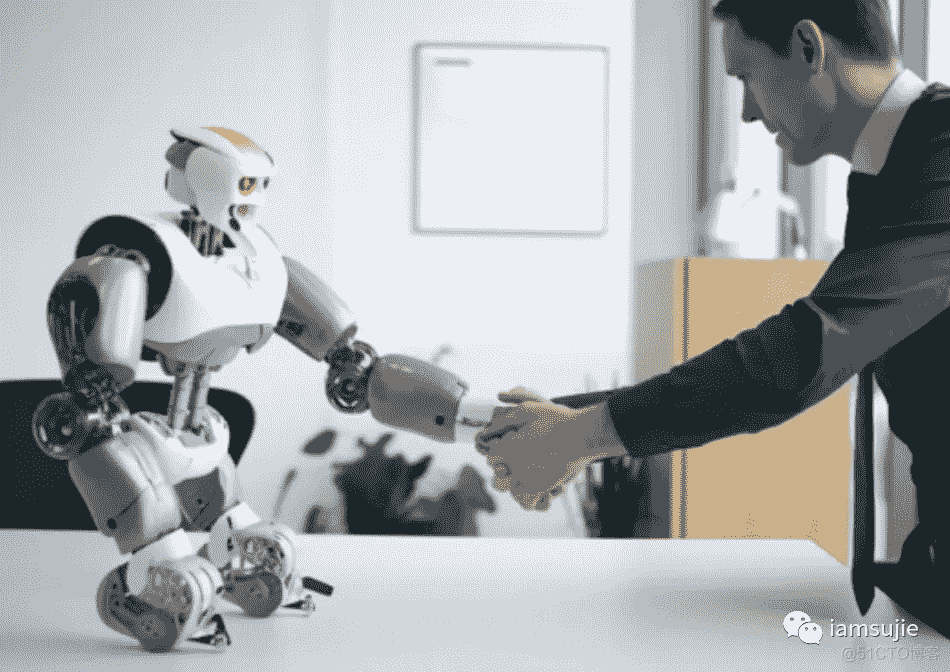
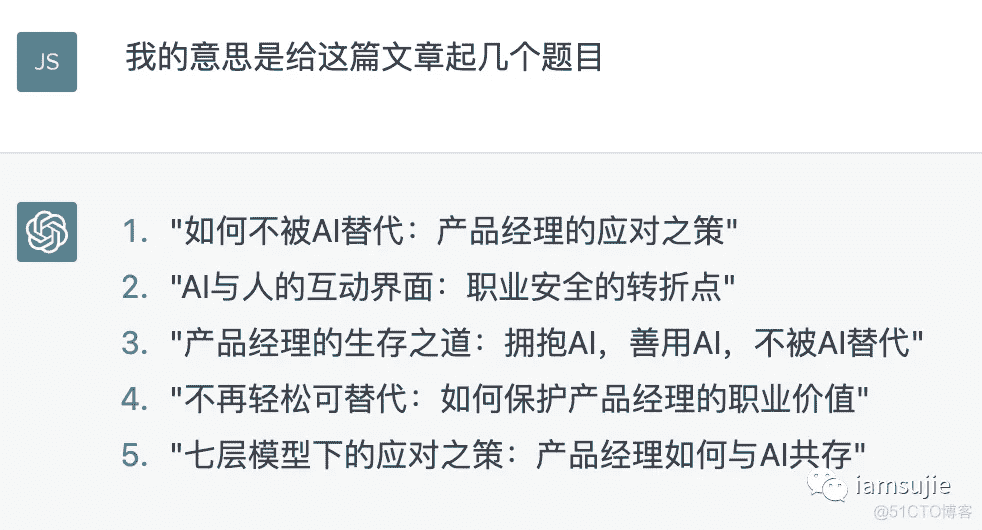
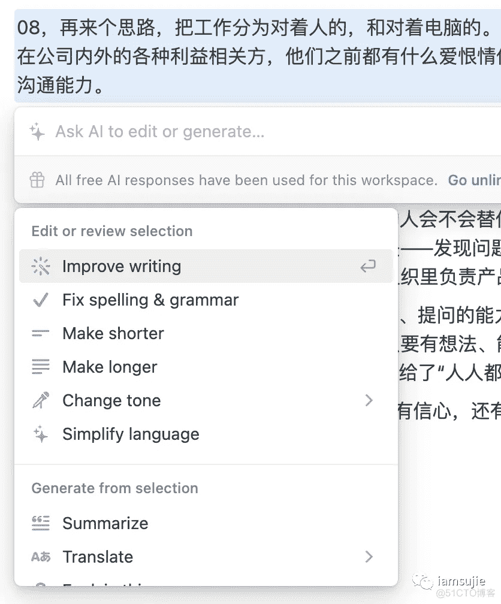
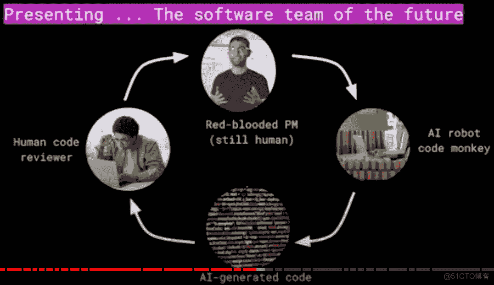
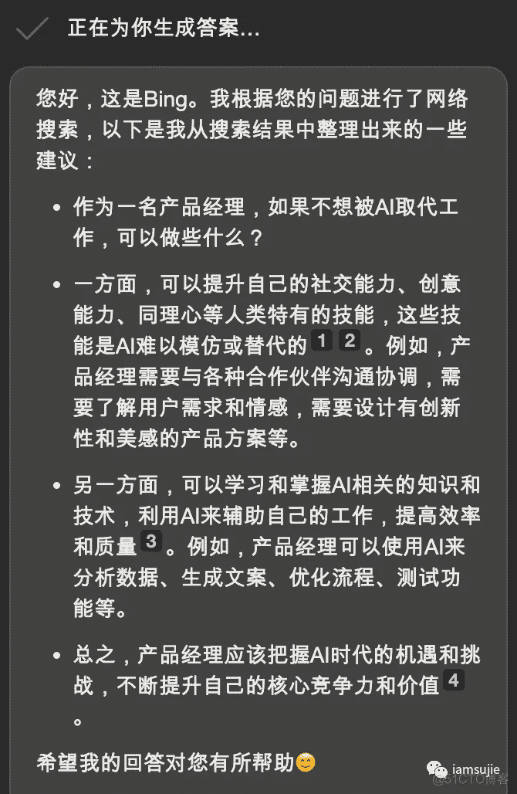
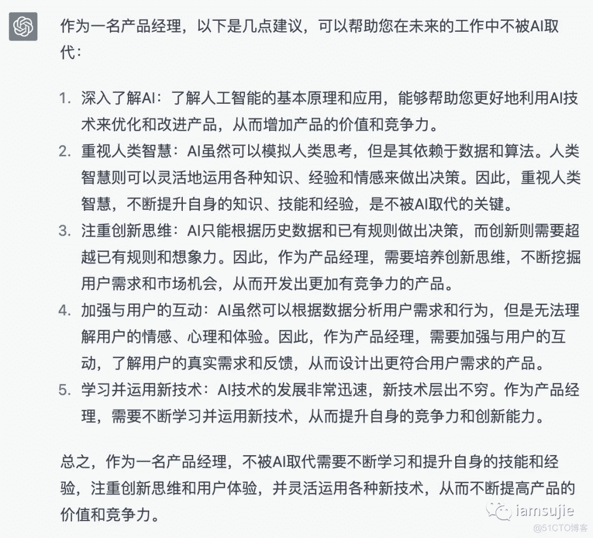

# 2023-05-12如何不被Al替代：产品经理的应对之策

> 来源：[https://xuqiwei1986.feishu.cn/docx/LYxMd7I1JotscgxThLPcEIsanFg](https://xuqiwei1986.feishu.cn/docx/LYxMd7I1JotscgxThLPcEIsanFg)

> 🔗 原文链接： h[ttps://blog.51cto.](https://blog.51cto.com/u_16109367/6271173)com/u_16109367/6...

"本文是一个多重AI工具工作流的尝试，用New Bing启发了思路，靠ChatGPT起了标题，让Midjourney画了几张配图，拿Notion AI优化了文字"

上周，经过密集的AI产品发布会的冲击，我觉得可以专门说说“职业安全”的话题了，即“如何不被AI替代”，以产品经理为例。

我们先想象一条线，线的一端是人，另一端是机器（AI），工作中绝大多数任务都是人机配合一起完成的，而人机交互的界面就是这条线上的某个点，随着时代的发展，显然，这个点从机器端逐渐向人这一端移动，从打孔纸带的机器语言，到汇编，高级语言，准自然语言……而这个互动界面更接近哪一端，就说明另一端更强，可以承担任务中更多的事务，而这一端，则更轻松。

这图和题图都有点一言难尽

主要责任在我，不在Midjourney

轻松，换句话说，也就是可被替代，从生产力意义上价值不高。

类比一下，就好像产品经理工作中和工程师配合一样，如果工程师懂一点产品，那产品经理就轻松一些，如果产品经理懂一点技术，则工程师就轻松一些。

所以，只要技术的进步趋势还在，则产品经理有越来越多的任务可以转交给AI，或者说可被AI替代。

那怎么办，趋势不可抵抗，不要试图和AI抢活，但应对之策还是有的。

01，从心态上，我们应以关注、拥抱、参与的态度迎接人工智能，千万别漠视甚至敌视。各种工具，我们应先以用户的身份试试。我自己不算是一个紧跟潮流的人，但也已经开始尝试。比如本文，用New Bing启发了思路，让ChatGPT起了标题，用Midjourney画了几张配图，拿Notion AI优化了文字。如果打不过就加入，成为一个带路党……

ChatGPT给本文起的题目

02，设法让 AI 赋能自己的工作流，提升效率。"AI 不会取代你，善用 AI 的人会取代你"。因此，先要分析自己的工作流，找出其中 AI 可以提效的环节。例如，在撰写各种文档时，AI 可以出一个框架初稿。养成一个习惯，凡事开始做之前先问自己一下——能用 AI 吗？

03，稍微延伸一下，重新梳理工作流这件事，是每个人需要做的。站在企业的视角，HR和老板更应该做，我已经有创业的朋友因此省了很多人工支出，而作为员工个体，被企业把这件事做在前面就更被动了。

04，盘点自己的技能点，思考一下每项技能被AI替代的可能性，把更多的时间精力放在不可替代的技能上。一个简单的逻辑是要往事情的上游走。如果我们以Why-What-How的方式抽象公司做产品的过程，那么如果你能帮助公司选择产品方向、决定模块的优先级，那么你就相对安全了。至少，AI暂时还不能替代人类做背锅侠。

05，用开篇的比喻来说，就是作为人，要把这根线向机器的反方向延长，给自己腾出更多的余地。要做好这个延长出来的部分，需要的是人之所以为人的——使命感、目标感、价值观、好奇心……

06，换个说法解释一下，我们可以把产品经理的工作分为两类：面向问题的（Problem Space，做正确的事），和面向解决方案的（Solution Space，正确地做事）。前者诸如发现需求、分析需求、对需求做取舍……而后者则包括生成产品需求文档、Demo、设计稿等，旨在解决前者提出的问题。分析一下你在工作中这两类任务的比例，后者更容易被替代。

07，于是，按照我的“产品经理七层模型”，如果你全然在第一层“需求细化与项目跟进”，那确实很危险，因为这类工作是被动执行，就算没有AI，你也很容易被替代，比如被更便宜的新员工、希望转型的工程师等替代。

08，再来个思路，把工作分为对着人的，和对着电脑的。很显然，前者AI更难替代，比如一个产品在公司内外的各种利益相关方，他们之前都有什么爱恨情仇，这种人际关系AI很难处理，需要高超的沟通能力。

Notion AI处理文字

09，如果未来所有的基层工作都被AI做了，那大量的高级产品经理都将没有基层实践的机会，或者说，所有的新人一上来就是今天的高级产品经理，基本功不牢靠会不会影响好产品的诞生？这个问题我也没想透，但回顾历史上历次工具的革新，似乎还是不断诞生了越来越棒的产品。

10，还有个问题，有了AI的加持，其他岗位的人会不会替代产品经理？我们可以假设一下，如果有人替代了产品经理，那他们在做什么？无非还是——发现问题、分析问题、解决问题……这样的人，岗位抬头叫不叫产品经理还重要么？他们就是组织里负责产品创新的人。

11，至少，有大神认为更需要担心自己被替代的人是程序员，将来团队里只需要产品经理把需求提给AI即可，嗨，这不就是最近老听到的Prompt Engineer么。

未来软件团队的工作模式

12，因此，发现问题的好奇心，对问题的理解、提问的能力，价值会越来越高于对解决方案的理解、解题的能力。也许，以后做产品的模式，是只要有想法、能提出正确的问题就行了，剩下的都交给AI，这个看似人人都能做产品的模式，好像又给了“人人都是产品经理”一层新的解读。

13，换句话说，我提出的产品思维六字真言——“用心听，不照做”，可以解读为未来的分工模式：人类用心听问题，AI不照做任务。

14，最后的One More Tips，如果你对自己很有信心，还有一条光明大道——做AI产品经理，去设计你自己的AI产品。

以上。

最后我们看看AI怎么回答这个问题吧，当然，我从各种角度翻来覆去问了New Bing、ChatGPT很多次，以下仅为示意，再次感谢（疯狂地向AI示好）。

_________

苏杰（iamsujie），产品创新顾问，《人人都是产品经理》系列4本书的作者，前阿里8年产品经理，集团产品大学负责人，良仓孵化器创始合伙人。