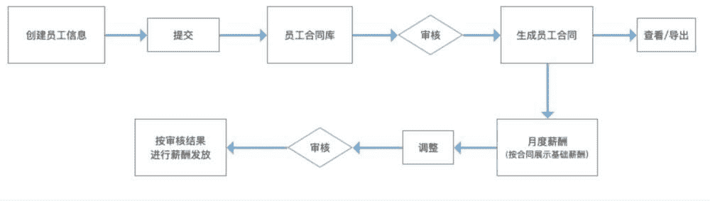
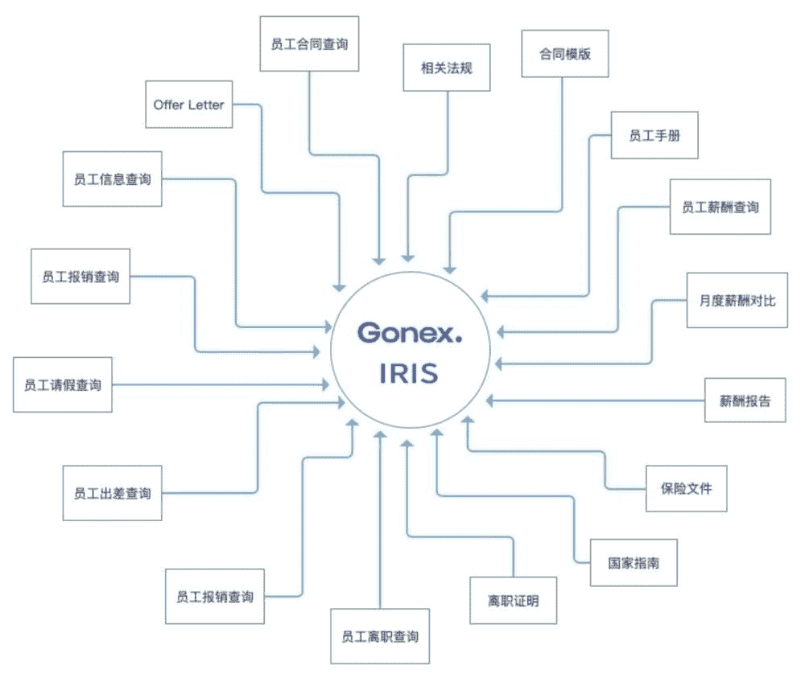
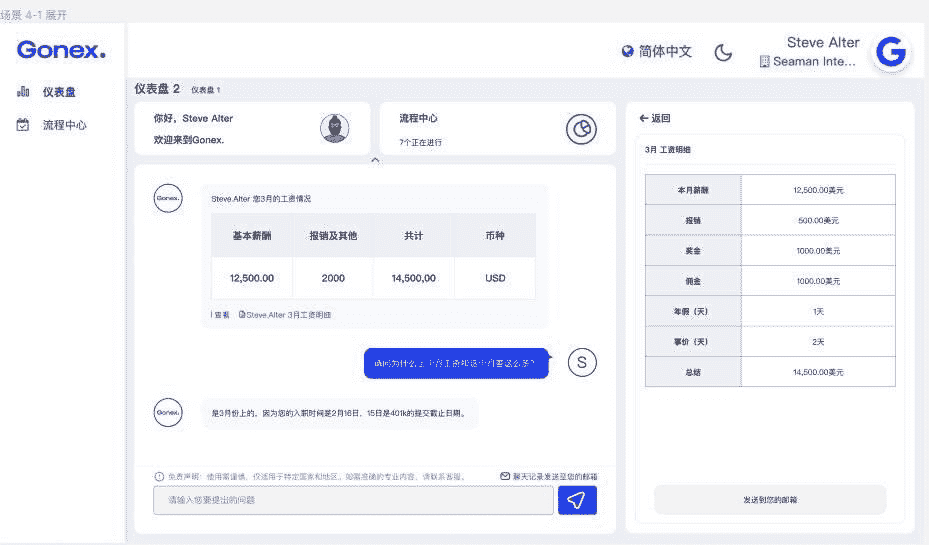
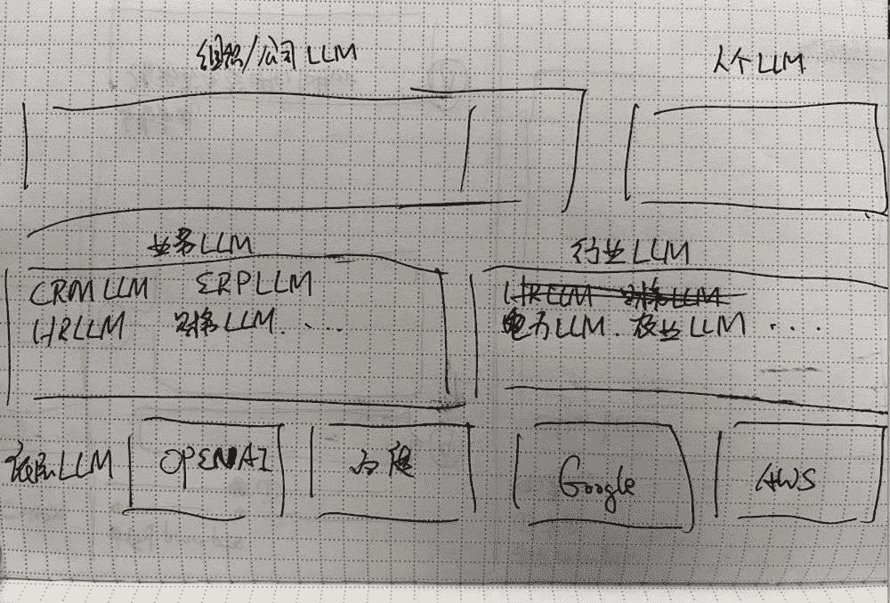
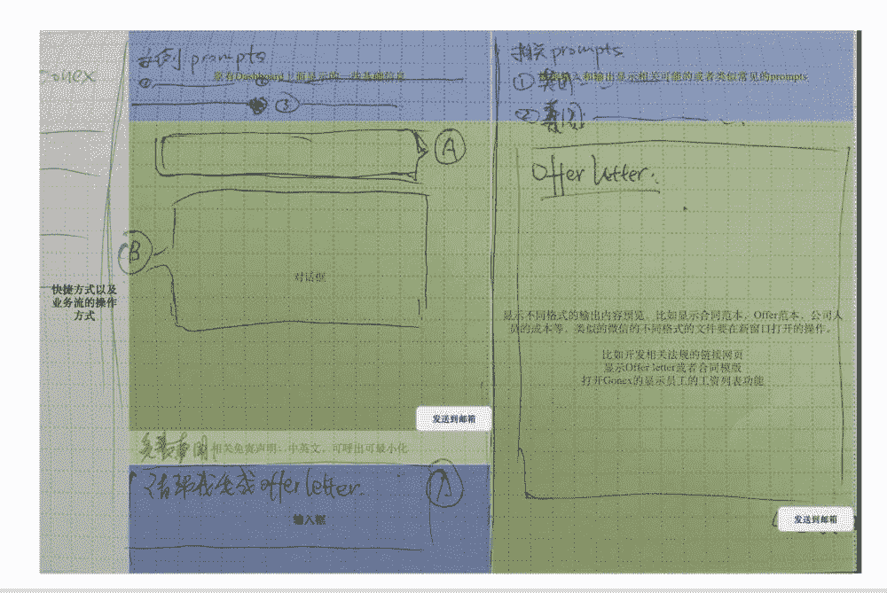
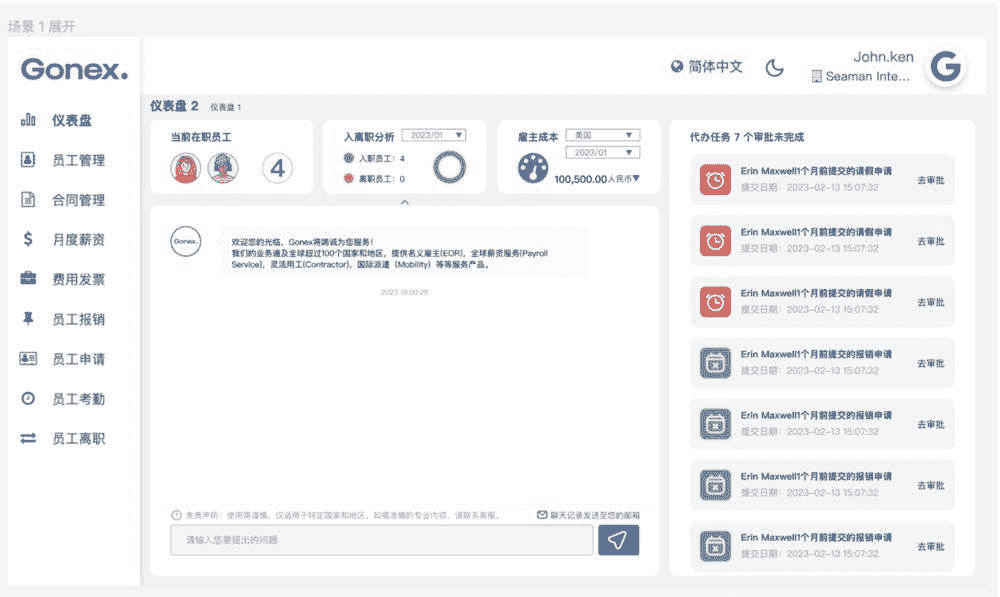
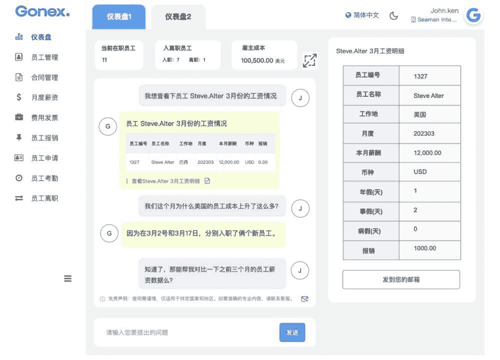

# 2023-04-24一个AI产品经理对类ChatGPT产品形态的思考

> 来源：[https://xuqiwei1986.feishu.cn/docx/FL3ed2hK3orPb6xVwTdczBoPnyf](https://xuqiwei1986.feishu.cn/docx/FL3ed2hK3orPb6xVwTdczBoPnyf)

> 🔗 原文链接： h[ttps://www.huxiu.c](https://www.huxiu.com/article/1301809.html)om/article/13018...

最近大家都很兴奋，ChatGPT的出现带火了知识博主，增加了变现机会。很多人都在讨论LLM和AI infra，如何写诗如何画画，真正讨论应用的很少，讨论行业应用的就更少了。

但**是**看了YC去年的List后，我觉得AI-Native应用的前景已经非常明朗了，AI已经深入寻常百姓家。 这个普世的转变， 对产品经理来说更是一个设计产品范式的根本性转变 ，而这个转变带来的软件设计模式都会发生根本性的变化。

结论：

经过在自己研发的产品上几个月的试错和调整，我们也形成了行业软件/SaaS对LLM能力的应用的“Best” practice。我们将从以下几个角度来探讨。

+   **产品/软件设计的转变 **，在这一部分我们要探讨如何利用LLM的特性来改造我们原有的古典软件行业，我们哪些要LLM化，哪些要坚守古典的结构化思维。

+   **交互范式的转变 **，在这个部分我们要一起探讨交互和用户体验的大幅变化，如何利用LLM来大幅度降低使用成本，并大幅度提高使用体验，古典和LLM怎样融合，CUI是最终的交互形态么？或者说CUI的最终交互形态是什么？

+   **产品的PMF范式的转变 **，这个部分我们会把我们对LLM会从产品落地到用户需求匹配，门槛降低带来的竞争格局的变化，以及LLM会促进什么样的PMF，会打破什么样的PMF。

让我们首先来看一下LLM的能力和特性。

从 PC 到移动设备，智能手机的新特性带来了重大机遇，LBS 带来了美团和滴滴，通讯录带来了🛰️，Camera 带来抖音和快手，语音带来全民K歌，刷屏动作带来今日头条。

与手机相比，🛰️的新特性是扩大了通讯录，使通讯录中的联系人数量增加了百倍，更能够进行面对面的沟通。正是这种能力的增强才使得拼团、分销、砍价成为可能，其中最大的应用是拼多多。

那么，现在新一代的AI又带来了哪些新属性呢？我想到了一些，也欢迎大家补充。

**首先是语言 language，自**然语言的交互方式，很底层的人类交互手段。

**其次是生成式的交互方式 **generative，它能够以人类易于理解的方式进行实时生成。从生成文本和代码，到图像、声音和视频，甚至未来会生成机器人的动作。

**第三是多模态 **，输入input/输出output 变得极为丰富，但丰富也意味着极为不可控。

从工程角度来看，实际上是对一些专业概念进行了对应，以便于产品经理和研发人员的理解。

+   **输入request **，现在系统可以理解直接的对话了，你说什么它都能理解，或者装作理解。这样系统的输入方式和形式以及效率都会得到大幅度的提升。但是系统逻辑不一定是最优的，或者效率最高的。

+   **输出response **，输出的内容产生了极大的不确定性，虽然可能是更好的输出，但是不可控性增强，原来返回的数据都是预设的，根据返回值要调用函数的，现在要用新的办法来解决，我预判未来在这部分会产生很多的中间件产品，可能以开源的为主。

+   数据格式data format ，数据格式可以是各种媒体格式，就算是文本也可能是组织好的表格，同样增加了显示层的设计和实现的难度，这块我就不展开了，但是后续还会基于这部分内容延展出更加有意思的思考和话题。

基于以上内容，我来抛个砖，4个月前开始考虑LLM对于我们的影响以及如何拥抱并形成或扩大自身产品的差异和壁垒。经过这4个多月的时间，很多原来的工作习惯被迭代，很多原来的认知被重置，很多原来的范式被改变。不夸张地说，这可能是，或者至少是科技行业的“人类的群星闪耀时”，而且后续也将影响更多行业和从业者。下面我们从三个维度来具体分析一下。

产品/软件设计的范式转变

基于以上的特性，SaaS/软件行业对AI的垂直integration，我预想大概是可以分成三步，每一步都比上一步更深入，对AI模型能力的使用也更充分。

第一步是知识库类功能的整合，训练或者fine-tune自己的模型 ，用一些内部或者行业的knowhow，可以用开源模型，也可以用商业化模型，这个其实不重要，重要的是内部结构化数据和行业knowhow以及best practice的提炼和抽象。

比如Gonex的AI全球HR合规引擎IRIS，HR可以每天基于对全球HR法律法规以及全球各行各业HR最佳实践进行检索，并对自己的任务进行分解和实现。

就目前而言，AI 更适用于一些需要或者近似于阅读理解类的预期结果，而已经被结构化的事实类内容**在现在已经被索引过，使用传统的方法可以**实现高效率，并且对算力的要求也低得多。但 并不是所有的任务都适合使用 AI，因为有些任务用 AI 完成的效率并不一定高 ，比如查询中国的最低年假。在这种情况下，直接从本地数据库检索可能更加高效，对算力的要求也更低。因此，在选择使用 AI 还是传统方法完成任务时，我们需要具体考虑任务类型和预期结果，避免浪费。

第二步是利用AI的识别和推断进行任务和功能的调度。

利用AI都予以理解和上下文能力，实现更流畅的用户体验，逐步替换掉传统的线性多级的工作流，实现一步到位的功能或者任务的调度。

比如我要查一下自己的工资，我到登录系统，点开我的, 查看工资单，选择某一个月或者当月，然后显示自己的工资单，这些步骤是传统的线性工作流。AI可以替代这些工作流，直接问一下我的工资，返回具体的工资数据。如果需要更多交互，可以打开完整功能。

很多流程会从线性的变成星形的。

线性流程配图

星型流程配图

大多数功能都可以用类似的方式完成调度，只有极少数需求需要权限和分组等功能在授权的时候需要一些传统的验证和流程，其他的应该都可以满足需求。这个就需要对功能做基于语意和上下文分析的mapping，相当于做配置文件以及对prompts的管理，需要把语意的分析抽象到具体的功能。而业务逻辑依然依靠现有的系统来完成。

个人觉得替代工作流更像一个trade off是兼容之前的古典软件设计范式，而不是新的范式，新的范式是下面的第三步，完全的业务逻辑AI化。

第三步是利用AI来整合业务逻辑 ，而不仅是进行功能和数据的调度。

LLM会逐步的部分或者全部替代掉SaaS的业务逻辑，但是传统的业务逻辑是不是更高效这点需要针对不同的业务逻辑单独的比较和验证。

而且很多业务逻辑用自然语言描述和用数学函数描述效率并不一样，因为自然语言对复杂功能的描述其实不如直接抽象出来的逻辑和算法更高效，而且自然语言本身也需要被转换成机器能理解的逻辑和算法才可以被机器识别和运行。

不过有一些传统业务功能的局限却可以用自然语言的形式来实现，比如输入基础考勤和税务信息根据每个国家工资的算法进行月度工资的计算是非常复杂的逻辑和算法，用自然语言是不容易实现的，但是基于这个算薪结果进行比较又是用传统的逻辑和算法无法完成的，而一般都需要人为的查询和比较，并解释。

例如：请问为什么上个月工资和这个月差这么多？

产品原型图截图

这个功能如果用传统的方式是无法实现的，但是用LLM似乎是可以实现的，但是需要把现有系统的数据和算法给到模型并训练才有可能。

**基本上做到了第三步才是真正的用AI/**LLM来定义和实现完整的软件功能和逻辑 ，而不仅是交互方面的调度，我觉得可能在相当长的一段时间内都是用第二步和第三步之间的方式来实现软件/SaaS的AI/LLM化，而不是Native AI/LLM软件/SaaS。

**关于LLM：**

除了大家现在比较关心的基础LLM外，未来可能会有很多的LLM：

从业务场景的角度会有，比如完成电商业务的模型，完成ERP业务的模型，完成CRM业务的模型等。

从知识的专业性角度可能会有，比如HR行业模型，财务行业模型，法务行业模型等。

从数据私有性的角度，可能还有各个公司/组织自己的LLM，当然也可以基于开源LLM来搭建。甚至也会由于数据合规性的考虑会出现个人LLM。

每个模型都抽象了很多的业务逻辑，而这些业务逻辑是依靠LLM来完成功能的实现的，针对这些业务逻辑都需要对模型进行单独的训练，而不是简单地用一个超大泛化模型可以实现的。

**未来的LLM可能的分层形态：**

交互范式的转变

交互方式的改变，从抽象流程到自然语言 ，conversational user interface。

实际上人类日常的最自然的交互方式就是肢体语言，表情和对话，而古典软件都是靠业务流程抽象化来完成目标任务的，而LLM的方式可以从更贴近于人类习惯的方式使用软件功能，因此极大地降低了学习成本，未来的AI Native行业软件大概率是类似的这样的三段式 three stages CUI.

+   左侧是传统的抽象流程的快捷方式。

+   中间是对话功能框，未来很多的工作流都是基于对话和上下文在对话框里直接完成的。

+   右侧是功能调用，限制于对话框的大小不容易完成的操作可能还是要有一个地方呼出并实现操作。

+   左侧和右侧会随着LLM的进化逐步弱化或者消失。

+   中间的对话框的下一代 conversational user interface会随着多模态的发展，或许更多的输入格式，比如摄像头来收集body language，表情等更底层的交流，麦克风来收集不仅是对话，还有环境音。

因此我认为未来可能会爆发的移动设备并且可以一定程度替代掉手机的，就是具有边缘计算能力的LLM，耳机，现在的耳机已经可以透明收声，如果耳机具有一定的LLM能力，《Her》的电影场景就可以实现了，基于语音的交互是最自然的对话。关于耳机的畅想我们可以后面进一步讨论。

我们现在用简单的示例来解释一下以上ChatGPT在软件工程以及CUI设计上的一些基础逻辑：

首先为什么是three stages，三段式设计，不光是PC，其实在移动设备上也是一样，因为如果只不过根据屏幕大小很多内容是折叠起来的，但是大概率都要有这三段：

+   快捷方式，用古典的方式可以找到古典的逻辑，主要为了帮助用户适配古典逻辑，但是古典逻辑会存在多久，这个不好说，也可能要很久。毕竟也有很多时候自然语言不一定是效率最高的方式。

+   中间是CUI，主要的交互和任务都在这里完成。

+   右侧的部分是一些无法在对话框里完成的任务或者目标，比如显示的不全，比如需要单独的视图等。

比如在GONEX-IRIS这个工资查询的场景下，用户需要调用一些本地数据，而对话框只能显示一部分，如果回答太长，用户容易miss掉上下文，因此需要有个地方单独呼出，右侧就是一个比较理想的方式。当然也不一定是左右的形态，也可以是下上，或者上下的形态。

1. 中间的对话框不只是一个传统软件的rich text area，这里包含的很多的元素，其实类似的🛰️对话框里不同的format，比如一个网页，一个文件，一个小程序，其实企业🛰️和叮叮也都有类似的设计，只不过通讯/协同软件更多的还是人和人对话， 现在的对话框不再是或者不仅限于人和人了，更多的是人和LLM ，对话框里要可以显示和处理更多的格式，比如🛰️不支持markdown，现在需要支持更多的文本格式，因为用户不仅是要在对话框里完成对话，更重要的是要在对话框里完成任务，完成指令，而不只是把对话框当作信息的传递，具体的任务要跳出对话。比如，我要查steve的工资，LLM会返回给我工资的具体内容，比如我问LLM有什么需要审批的工作，LLM直接给我返回5个审批列表，我可以直接在对话框里审批。比如我要LLM帮我请假，但是一些具体请假原因和流程都要在对话框里完成。

2. 对于CUI，我认为 未来的交互可能不仅仅是typing，还有声音，图像/视频等输入形式 。人类科技最大目标就是模仿人类自己，机器总要加个“人”在后面，是为机器人。而AI的目标是最大限度地让用户感觉坐在对面跟你对话的是人，而不是机器。因此我们应该不仅限于打字，因为打字本身是有PC了以后才有的形式，几千年的人类沟通方式是语音。因此我自己做的是行业软件，但我依然认为未来最大机会是更自然的沟通方式是voice，因此在UI和工程领域如何更快地把rich text area这个component变成 rich voice area component是更底层的更有意思的机会，甚至可以支持手势，表情等，更多的输入形式从而变成rich communication area component，这也是我思考了很久的领域，现在已经有了结论，不过我们就不在这里展开了。

**这**里我依然要老生常谈的一个点是， 古典软件工程更重要的是基于任务和流程的抽象，而LLM的产品要基于对话，对话不仅是文字也可以是很多其他的模态或者格式 。因此这个是产品设计范式的转变。iPhone的早期，很多人吐槽当点iPhone上的app都很PC，直到有的app用手势gesture来做交互才逐渐有了现在的样子。AI-Native的软件也是一样，都要有这个过程，这个过程不会很久，正在发生。

PMF范式的转变

从蒸汽机开始替代一些体力劳动者开始，社会的演进就变成了人要操作机器，因此人要受教育，学更多的知识，然后用这些知识去操作效率更高的机器。机器取代了一些初级的劳动者，而大家踊跃通过教育变成高级的劳动者去操作和管理机器，这样就形成了一个正向的循环。

突然之间，ChatGPT的出现，让大家对这个社会秩序迭代的公式产生了动摇。但是如果大家看过那段资本主义萌芽的历史就知道，当时的人们其实也找不到这个现在大家公认的路径，大量的工人失业，社会甚至还造成了某种程度的动荡。但是后续的故事我们都已经知道。所以大家一定要动态地看问题，焦虑往往是人类对未知的恐惧形成的潜意识，静态的思维方式和常规的套用往往会加速这种潜意识的形成。

因此用所谓动态地站在历史的角度出发的思考，AGI确实会取代一些初级的脑力劳动，但是用新的教育方式来产生创造性的思维，就可以指挥或者操作AI来提升效率，我们的教育体系也会从知识灌输变成思考方式和创造潜力的涌现，教育出来的这些四有新人再去创造更高维的AGI。

就好像没有蒸汽机就没有机械工，没有电脑就没有程序员，那么出现了AGI会不会就出现了新的职业呢？

讨论完以上的论述，再看看哪些特性适合你现有的用户场景。

如前所述， **操**作系统的机会只有少数人，但是应用的机会是给大多数人的，而对于LLM而言，上层的应用形态是多样的，但是不是所有形态都是适合应用层的。

现在看来，不论2B和2C：

+   只要你的数据是公开的，泛行业的，你的替代性就越高。

+   只要你的value只是线上薄薄的一层，哪怕再高的知识密度，你的可替代性也不会很低。

这里说的可替代性就是被LLM的进化替代。 当然LLM自身的竞争不在考虑范围内。

因此2C/2B级别的应用，如果你的交付是纯信息的形式，开放形式的，泛知识类的，那么长期看大概率都是有风险的。如果你的交付不是纯信息类的，是封闭的，是专有知识类的，那么长期看是非常有价值的，不仅没有风险，而且LLM会大幅度地提高你的生产效率。

基于以上的场景和分析：

从模型的角度

除了大家现在比较关心的基础通用型LLM外，未来可能会有很多的行业/场景型LLM。

从业务场景的角度会有，比如完成电商业务的模型，完成ERP业务的模型，完成CRM业务的模型等。

从知识的专业性角度可能会有，比如HR行业模型，财务行业模型，法务行业模型等。

从数据私有性的角度，可能还有各个公司/组织自己的LLM，当然也可以基于开源LLM来搭建。甚至也会由于数据合规性的考虑会出现个人LLM和边缘LLM。

**每个模型都抽象了很多的业务逻辑，而这些业务逻辑是依靠LLM来完成功能的实现的 ，针对这**些业务逻辑都需要对模型进行单独的训练，而不是简单地用一个超大泛化模型可以实现的 。

跟AI 1.0的状态差不多，可能有很多垂类模型，也有很多行业模型，当然也有可能出现AI四小龙或者N小龙的情况，因为很多数据，比如银行数据，火车数据，民航数据，都不可能被放到公有LLM上，还是要在自己的私有LLM才可行。

从平台的角度

LLM还解决不了线下交付的问题，理论上只要不是专有数据，LLM的用户体验可能会产生一些虹吸效应，让用户更多的访问LLM而不是传统的平台，平台当然可以自己做LLM，但是投入和效果上不一定比类似的百度的或者泛化LLM更有优势。

个人感觉如果百度未来的搜索结果可以放更多的软广，在上下文中，让用户更加接受，而不是现在的搜索广告形式。但是传统的对话方式的🛰️可能可以更软，毕竟它可以直接做个人助理，助理就是个人的推荐引擎。

当然比如对于专业的订票，旅游，吃饭类的平台可能就是比较负面的例子了，因为平台只需要或者只能做交付，平台的议价空间就更少了，但是不拥抱共有LLM也不行。现在在百度上只是做广告买流量，后面百度通过文心一言的小程序或者Plugin直接就把前置的所有事情都干了，只需要下单API。不过这个完全是个人脑暴，毕竟旅游行业的供应链管理是相当复杂和高壁垒的，我们有相当长的时间可以观察，思考和应对。

总体上讲，LLM对未来的或现存的平台类应用是比较负面的。原因是 如果出现超级LLM，那LLM本身就是平台 ，对现有平台产品来说可能会损失品牌，躲到LLM后面，沦为工具，但不管怎么样，平台还是应该拥抱LLM，利用好LLM的能力，也可能走出一条不一样的路。

对初创公司反而是有利的，降低的竞争门槛，增加了市场的活力，流量的获取更加的容易，而初创公司可以专注在专业范畴内。

所以符合私有数据和线下交付中的一项的LLM应用已经很有生命力了，符合两项的又有专有数据又有线下交付的应用肯定是极大的利好，线下交付的能力不是短时间可以培养出来的。其实很多应用会产生大量的专有数据，比如购物网站产生的用户购买行为和偏好，比如社交应用产生的用户行为和交互的偏好，这些其实都有很大的价值，LLM其实是反向逼迫大家来审视自己的数据资产，以及如何更好地利用它。

从交互的角度

尽管我之前提到了交互式用户界面，这种界面最自然的表现形式仍然是对话）。如果这样想的话，🛰️可能会成为下一个时代的王者，甚至可以取代百度，因为人们可以在🛰️上解决所有问题，包括像对话一样自然的搜索，而不需要切换功能和场景。

然而，如果只考虑到这一点，那么你对于使用场景的了解可能还不够深入。因为最大的差异是，🛰️是与人进行交流，而新的交互方式是与语言模型进行对话。在这种对话场景中，聊天和表达情感只是场景的一部分，更多的场景涉及任务下达、目标达成、情况分析和模式识别等工作，这些任务的业务逻辑比传统的聊天要复杂和抽象得多。因此，解决这些问题需要依靠对话式用户界面的发展，我相信很快就会出现AI的类似于iPhone诞生后的Gesture时刻。

从个人的角度，我觉得CUI的可见模式还是会长期存在的，毕竟很多的场景都是需要操作的，但是我更进一步地认为LLM的Gesture时刻可能不是在可见的部分，而是源于人类更底层更自然的沟通方式，conversation最初的方式并不是typing，而是声音，用嘴发声，用耳朵收声。我觉得未来会有一波重大的突破在耳机上，耳机可能会取代或者部分替代现有的手机，而且手机也是可移动的设备，比手机还自然的携带体验，具备各种传感器的能力，手机能有的传感器，耳机都可以有。耳机不再只有降噪这个卖点，而是交互的终端，是conversation的承载，是任务指令的下达。现在的耳机已经可以透明收声，如果耳机具有一定的边缘LLM能力，《Her》的电影场景就可以实现了，基于语音的交互是最自然的对话。

主动与被动

其实大家日常使用的AGI应用无论2B还是2C，几乎所有的场景下的应用都是被动呼出的，也就是说用户提出问题，LLM被动回答。用户是initiator，这就造成了使用场景相对单一。但是反过来想一下日常的对话都是自己发起的么？显然不是，实际生活中不同的场景，很多都是用户是被动应答的。🛰️之所以使用时间长，并不是因为比抖音有更牛的沉浸式推荐算法，而是因为你的主动是对方的被动，对方的主动是你的被动，通讯录联系人互相成为对方的initiator。

因此AGI的出现，就可以根据设备的感知能力主动发起对话，比如中午，可以问用户吃了么，没吃赶紧吃，想吃啥附近直接找到，并导航到餐馆。主动发起对用户体验来说是一个很大的飞跃，尤其是情感领域，被动和主动区别很大，大多数国人在现代社会中都是社交被动型的，社牛太少了。很多传统的社交软件也都在利用数据来降低社交成本，比如点个赞，比如用手滑照片。如果能通过耳机+各种sensors，还有环境音的透明收声，则可以有更多的应用场景被挖掘出来。而不仅是任务型或者事务性的应用场景。

写在最后

以上都是我几个月以来的思考在当下这个时间点的总结，未来会发生什么，也很可能会推翻现有的结论甚至思考框架，未来一定是薛定谔的猫，LLM这个变量将让很多人的思考框架发生了巨大的变化。在这个Sternstunden der Menschheit，我们可能有的只是时间。

浪潮中，有些人追求宏大的叙事，有些人忙于性感的故事，有些人挥起锋利的镰刀。面对诱惑大多数人都会放弃坚守，但我还是希望大家在设计产品时问自己一个问题，我的产品能不能带来10倍体验提升，能不能带来10倍成本的降低，普通人只能点滴的改变。Make a better life for all people and their families.