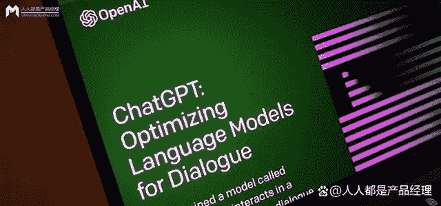
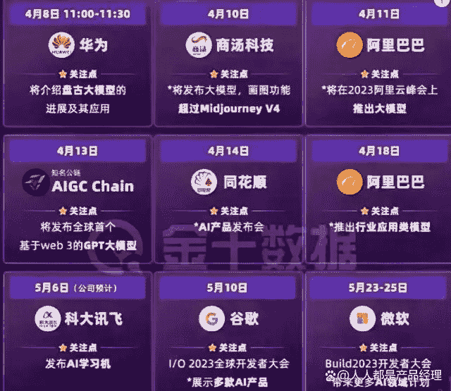

# 2023-04-21ChatGPT来了，产品经理如何克服焦虑？

> 来源：[https://xuqiwei1986.feishu.cn/docx/Hl0Bd8t1fojcukxIBveccfIcnig](https://xuqiwei1986.feishu.cn/docx/Hl0Bd8t1fojcukxIBveccfIcnig)

> 🔗 原文链接： h[ttps://baijiahao.b](https://baijiahao.baidu.com/s?id=1763770164920098858&wfr=spider&for=pc)aidu.com/s?id=17...

ChatGPT来了，产品经理如何克服焦虑？

随着ChatGPT的到来，各行各业、各大社交媒体都在传播该内容，让一部分人嗅到了商机，但同时也让很多人产生了焦虑。本文总结了三点焦虑，希望能够帮助你缓解情绪。

2022 年 11 月 30 日，当卡塔尔世界杯还在如火如荼的进行中时，大洋彼岸一家叫openAI的公司发布了一款名为ChatGPT的聊天产品，略显单调的聊天界面背后蕴藏的是极其强大的生成式大语言模型（LLM），它强大的语言理解、内容生成能力迅速火遍了全球，自发布以来，5 天注册用户超 100 万，月活破亿用 时仅 2 个多月，被称为“史上用户增长最快的消费者应用”。

一时间，社交媒体、长短视频上各种普天盖地的内容袭来，从原理解析、团队背景、应用探索等方面，都争先恐后抓住这一热点狠做文章。

嗅觉灵敏的人甚至发觉到了第一波商机，开始把GPT套壳推出一些应用，美其名曰「中国版GPT」，有的甚至开发课程来割韭菜，比如「教你如何用GPT挣钱」。

国内的各AI公司以及互联网大厂「如梦方醒」，惊呼「还是老美会玩」，有钱有能力的马不停蹄的推出自己的大模型产品，而没钱没资源的即便过过嘴瘾也要硬撑着说「我们已有相关技术」，仿佛ChatGPT没有什么技术门槛，短时间就能突破；而作为普通人的我们，可能空前的感受到了AI带给我们的冲击……

不知道有没有人和我一样，在惊叹AI技术进步神速的同时，却也产生了很多的焦虑。

焦虑1：职业被取代焦虑

「35岁失业」的焦虑还没消散，「被人工智能取代」的焦虑就来了；以前大家可能普遍认可人工智能只能取代一些偏体力劳动、劳动密集型的工种，但是现在，知识型工种也面临着被取代的风险。

各种基于GPT以及相关AIGC的应用层出不穷，比如：AI写文案、AI做PPT、AI作图、AI修图、AI写代码、AI写剧本、AI做CAD……一些职业赖以生存的技术壁垒似乎一夜之间消失殆尽，而且不得不承认，有些东西AI确实比人做的好，这逼人们不得不重新审视自己的不可替代性。而更绝望的是很多刚入行不久的年轻人，可能还没等到职业跃升的机会，却等到了比自己廉价，效率更高的AI。

举一个我身边的例子，一个朋友做跨境电商的，曾经雇佣了一个学年轻人来做助理，主要负责写商品的本地化文案、制作商品宣传视频。GPT出现之后，他发现GPT写的本地化文案几乎已经到了拿来即用的程度，同样可以根据要求生成不同规格、不同风格的宣传视频脚本，于是内心已经在纠结是否解雇小助理。

产品经理会被取代么？能取代，但是不完全取代。通常而言，产品经理的日常工作可以分成这么几大类：

1. 需求挖掘、分析、抽象；

2、产品设计、规划；

3、产品运营分析；

4、 用户、竞品、市场研究和分析；

5、产品GTM

上述几类工作实际上再有足够的输入的情况下，我相信AI都能输出一些信息，所以一定程度都是能被取代的。

所以，核心点是输入，所以说以后产品经理的工作方式可能会发生很多调整，我们也会变成「Prompt工程师」，即我们很可能要把更多的精力来收集足够多的信息，加工成提示词输入给AI ，由AI帮我们形成具体的方案，然后我们从中挑选可用的来完成终稿。

比如需求挖掘，我们很可能需要把用户访谈、问卷调查等用户研究的素材做好调查和收集，输入给AI，AI最终可能能够输出一些分析的结论。相比起AI介入前，我们可能要熟悉各种需求分析模型，有了AI之后，我们可能要把更多精力用在如何洞察用户需求，如何收集用户原始需求，以及如何对AI输出的需求进行决策上。

焦虑2：信息过载的焦虑

作为互联网或者AI产品经理的你，不知道你最近有没有被各种社群、社区、公众号、研讨会、论坛、网课给轰炸了；自从ChatGPT以及AIGC出现之后，各种层出不穷的名词、科普、探讨如洪水猛兽一样袭来。

似乎跟不上潮流就要落伍了，于是乎你开始添加各种微信群、加入各种社区、报名了各种网课或者研讨会、收藏了很多文章，你想拼命的抓住各种信息，学习GPT和AIGC，体验一下站在浪潮之巅的感觉。但是，时间和注意力是有限的，信息的产出速度远大于你的吸收速度，甚至GPT3.5还没弄明白，GPT4.0、文心一言、通义千问又来了。在职业被取代的焦虑下，学习能力的焦虑也产生了。

对于产品经理的我们，要学习，但不是盲目的学习。推荐购买一些书籍进行系统性了解，在此基础上自己实地体验，同时可以参与几个微信群或者知识星球的讨论即可。太多的信息源，反倒是容易适得其反。

平时工作中一些需要创作的场景，也可以尝试中利用ChatGPT来做一下辅助，慢慢的和他「和平」共处。

焦虑3：人类安全的焦虑

每一次AI技术的进度都会伴随着「AI是否会毁灭人类」的问题出现。从技术来说，GPT模型的是依靠大量的数据进行训练实现的，其所具有的思维能力仍然是一个谜，就好像突然涌现出来一样的。并且，其对话理解、内容生成的能力具有不可解释性，这无疑增加了人类的恐惧，觉得它会不会像科幻小说中的AI一样，动了毁灭人类的念头。

这不，美国非营利组织未来生命研究所（Future of Life Institute）就在3月末发布了一封名为“暂停巨型AI实验”的公开信。有上千名人工智能专家和行业高管在信中呼吁，暂停对更强大的人工智能系统的开发和训练。

至少，暂停半年。好多我们熟知的名人也加入其中，包括“人工智能教父”杰弗里·辛顿、特斯拉和推特CEO埃隆·马斯克、图灵奖得主约书亚·本希奥等。尽管可能有哗众取宠的嫌疑，但是至少说明了AI确实对社会和人类有潜在风险。

相比起毁灭人类，有一些更现实的问题也放在了人眼前，比如版权、安全问题。先说版权，大模型的训练语料可以理解成来自人类现有的知识，比如AI为什么能做图，是因为他学习了非常巨量的人类画作，在此基础上才能够实现二次创作。

那对于原生的内容创作者来说，是否公平？AI使用了他们的作品，但是他们却收不到相应的补偿，你想起诉AI吧，关键甚至可能都说不清楚到底AI使用了你的哪个作品。最扎心的，AI用了你的作品训练了模型，最后还可能抢了你的饭碗，这找谁说理去。而对于安全，试想一下，当AI普及了之后，一些人不免对AI产生了依赖，如果AI出错了怎么办？特别是一些专业领域的错误，可能非常难以察觉，岂不被带偏了？

本文并不是专业的科普文，只是站在一个普通人的角度，谈了以下GPT带给我的焦虑。作为一名产品经理，我深刻意识到GPT的出现将会带来一大波的应用场景，同时很可能对很多行业的工作方式打来极大的变更，所以比起焦虑，更多的还是期待。而我也加入到了GPT的学习大军中，希望能参与到时代的浪潮中。

本文由 @奔跑的蜗牛 原创发布于人人都是产品经理，未经许可，禁止转载。

题图来自 Unsplash，基于CC0协议。

该文观点仅代表作者本人，人人都是产品经理平台仅提供信息存储空间服务。

举报/反馈

大家都在搜

[gpst产品经理 ](https://baidu.com/s?word=gpst%E4%BA%A7%E5%93%81%E7%BB%8F%E7%90%86&rsv_dl=feed_landingpage_rs&from=1020853i&rsf=)[产品经理交流 ](https://baidu.com/s?word=%E4%BA%A7%E5%93%81%E7%BB%8F%E7%90%86%E4%BA%A4%E6%B5%81&rsv_dl=feed_landingpage_rs&from=1020853i&rsf=)[工作pua ](https://baidu.com/s?word=%E5%B7%A5%E4%BD%9Cpua&rsv_dl=feed_landingpage_rs&from=1020853i&rsf=)[工作中的pua ](https://baidu.com/s?word=%E5%B7%A5%E4%BD%9C%E4%B8%AD%E7%9A%84pua&rsv_dl=feed_landingpage_rs&from=1020853i&rsf=)[职场中的pua ](https://baidu.com/s?word=%E8%81%8C%E5%9C%BA%E4%B8%AD%E7%9A%84pua&rsv_dl=feed_landingpage_rs&from=1020853i&rsf=)[bat产品经理](https://baidu.com/s?word=bat%E4%BA%A7%E5%93%81%E7%BB%8F%E7%90%86&rsv_dl=feed_landingpage_rs&from=1020853i&rsf=)