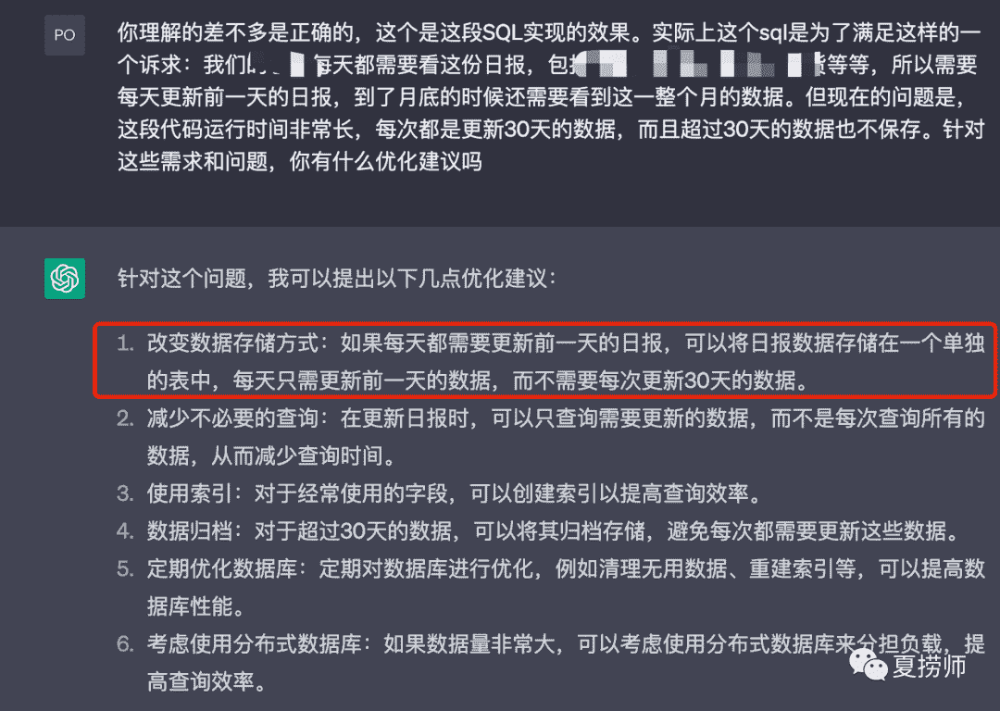
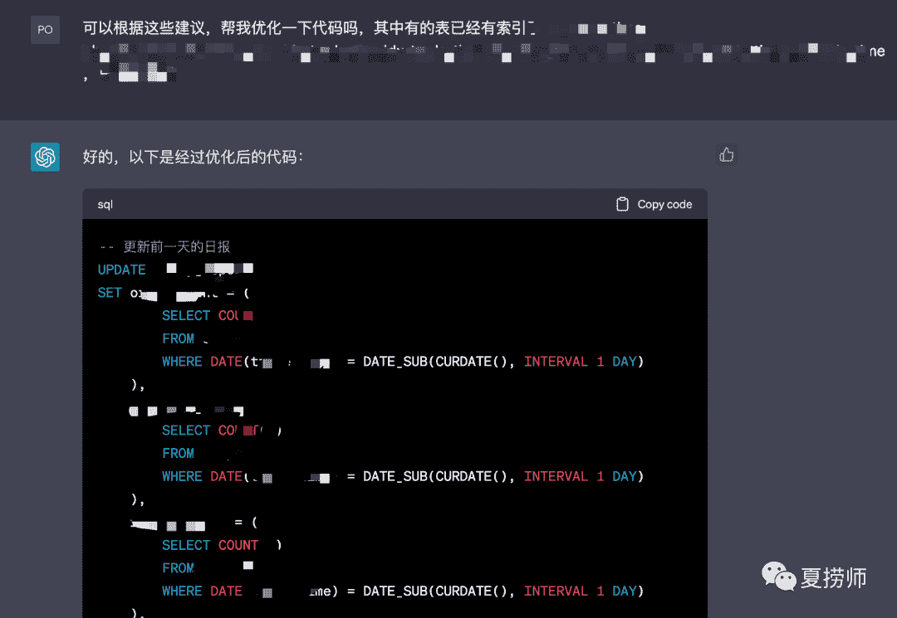

# 2023-04-14产品经理如何用ChatGPT提效520倍

> 来源：[https://xuqiwei1986.feishu.cn/docx/ZoA0dwsAXouRfhx47KMcoQdNnld](https://xuqiwei1986.feishu.cn/docx/ZoA0dwsAXouRfhx47KMcoQdNnld)

> 🔗 原文链接： h[ttps://www.sohu.co](https://www.sohu.com/a/666619970_114819)m/a/666619970_11...

> 随着ChatGPT的发展，各行各业都受到了其的影响，有人因为它被取代，有人通过利用它来提高效率。本文作者通过用ChatGPT写代码的方式，阐述其是如何提高效率的，一起来看看吧。

当产品经理开始用ChatGPT写代码了，会发生什么？

在过去的几个月里，随着ChatGPT、Midjourney、Stable Diffusion等国外产品的快速迭代，以及国内百度、阿里、飞书、网易等大厂发布的大模型，一些设计、研发、自媒体从业者开始感到自危，仿佛他们的工作在AI的洪流中瞬间会被取代。那人人都能做的产品经理（bushi），在这次的AI革命中能做什么？

我在第一时间接受和学习了ChatGPT，并在实际工作中进行了一次代码优化的测试。作为产品经理，我选择尝试使用GPT优化代码的原因有两个：首先，我对新技术非常感兴趣，对于GPT模型也非常好奇。

其次，企业越来越需要复合型人才，而GPT能够帮助我快速学习和成长。因此，我决定让GPT介入我的实际工作，以提高我的工作效率和技能水平。

我选取的CASE是一段SQL查询代码，对应的业务需求是一个使用频次较高的日报。旧代码行数有近1900行，每天更新一次，每次的运行时长在一个多小时，而且只能查询最近一个月的日报数据，业务没法做历史数据的同环比分析。而我作为一个产品经理，缺乏读写和优化这种超长SQL的能力，因此我决定使用GPT，解决性能差和历史数据存档的问题。

结果非常的完美，最终的SQL执行时间从4200秒缩短到8秒，效率提升了520倍，复杂度降低了6倍，同时还能保存所有的历史数据，报表可以秒开。

我将这个案例分享到社区后，还得到了一位清华大学计算机系数据库组成员的邀请，将本次的优化过程分享给了他们，作为他们研究实际场景的应用case。

令人惊奇的是，GPT的优化不仅仅局限于原代码结构，而且还能根据真实的业务需求提出与原代码不同的解决思路。下面详细介绍一下我的整个优化过程：

背景前提：

我不是专业的BI工程师，所以对数据治理、SQL优化思路等不太了解，只能跟着GPT的提示以及查询资料来一步步进行。我相信如果是专业的BI工程师，这些问题可能都只是小儿科，GPT提出的优化思路在专业人士看来可能也比较初级。但本次分享的主题是打工人如何利用强大的GPT，来帮助自己解决不擅长领域的问题以及快速学习成长。

由于充值的问题没有解决，所以本次只用到了免费的ChatGPT-3.5版本，但也足够了。而且写文章写到一半的时候账号登录不上了，提示访问被拒，所以暂时无法截图还原完整的对话过程…

**以下是完整的使用过程：**

在开始前，我对GPT的认知是：它是一个知识储备无比丰富的助理，但需要一个清晰、准确的prompt，它才会给出一个符合需求的输出。所以我先整理了我要和GPT交互的基本思路以及步骤：

旧代码输入>需求及现状问题输入>调试优化>结果输出验证

接下来开始实操：

Step1：旧代码输入

首先，将需要优化的旧代码输入到ChatGPT模型中，旧代码有1900行，GPT直接提示too long，所以我做了分次输入。

直接粘贴提示报错。

分段输入，再进行联合。

这一步的作用是让GPT理解旧代码实现的效果以及熟悉查询表和字段，方便后续GPT生成优化代码时可以直接复制粘贴到数据库中运行。

原SQL的主要逻辑就是统计近30天内每一天的业务数据日报，把近30个结果指标，按照天和地区进行分组汇总，需要查询多张表几百万条数据。这里GPT的理解基本正确，甚至在我没有提需求的情况下，就提出了一些优化建议。

Step2：需求及现状问题输入

在完成第一步的原SQL输入后，GPT已经对需求有了初步的理解，这里我再将真实的业务需求场景以及现在的问题输入给GPT：

这一步的作用是帮助GPT更好的理解旧代码背后的真实业务需求，同时结合旧代码运行的问题，让GPT能进一步给出针对性的优化建议，输出更符合需求的代码。

这里其实有好几轮的输入输出（可以理解为讨论），不断的强化GPT对真实需求的认知。

注：SQL查询代码本身不包含涉密信息，可以放心在ChatGPT中使用。

Step3：根据优化结果不断调试

在输入完旧代码、需求和问题之后，GPT模型给出了一些新的代码。我需要不断地根据GPT的结果进行调试和优化，直到生成满足需求的新代码，这一步比较繁琐，但惊喜也是在这一步发现的。

按照原SQL的思路，是每天更新近30天的数据，并存储到一个结果表，由于指标很多且数据量大，所以耗时很长，但其实大部分的语句都是反复的读同一个表，资源浪费比较严重。

所以在跟GPT反复沟通多次后，GPT提出了3点比较重要的优化建议：

1.  每次更新1天而不是30天的数据；

1.  不直接统计全量指标数据，而是创建一个中间结果表，将所有非二次计算的数据存储到该表，需要二次计算的指标直接通过该表再查询（例如：中间结果表统计了昨日总数和今日总数，变化值、环比等则通过中间表再进行二次查询统计）；

1.  利用CASE WHEN合并查询约束条件基本相同的指标，这个方式大大减少了重复读表的次数，也极大的精简了SQL代码内容。

前两点是GPT直接提出的，第三点是我从GPT给出的优化代码中发现的，基于这三个核心优化思路，结合我的半吊子SQL水平，花费了半天多的时间将完整的代码优化完成，并分模块在系统中测试了一下，结果完全一致。

当然整个过程还是比较繁琐的，包括查资料、报错、纠正GPT、不断补充需求细节等等，需要有一定的耐心。

Step4：实测新代码的正确性和效果

完成前面的分模块测试后，我把所有的代码整合到一起，发现整个SQL语句由原先的1900行精简到了300行；接着拖到系统中进行运行，原先需要运行4200秒的项目，现在8秒钟就完成了，而且结果一致。

整整520倍的效率提升，一个对SQL代码一知半解的产品经理，仅用一个下午就完成了。

整个过程就好像我在和一个专业的数据开发工程师在沟通需求，我不断的提出、明确、细化我的需求和问题，它不断的更新解决方案，直到令人满意，没有battle、不用排期、没有delay。

而这还是只ChatGPT-3.5。

GPT优化代码的意义和价值在于提高代码的效率和质量。在传统的编码过程中，研发人员往往需要耗费大量的时间和精力来编写、测试和维护代码。而GPT可以帮助自动生成代码和测试用例，从而减少这些繁琐的工作，提高工作效率。此外，GPT还可以自动化文档生成和代码注释，帮助开发人员更好地理解和维护代码，提高代码的质量。

所以在个人看来，ChatGPT在编程中的应用前景非常广泛。无论是根据需求自动生成新的代码，还是用来用来改进代码的可读性和可维护性，甚至是自动化测试等，甚至是根据线框图直接创建应用、网页等，这对传统的IT工程师特别是入门级，将是一次巨大的挑战。

除了编程应用，ChatGPT还有很多其他的应用场景，后续我也会继续分享零基础使用AI的经历，包括Midjourney、StableDiffusion等。

作为产品经理，我们应该保持对新技术的敏感度和开放性，尝试利用人工智能技术来提高自己的技能和能力。复合型人才的需求越来越大，而GPT能够帮助我们快速学习和成长，提高自己的竞争力，毕竟未来连产品经理可能都不存在了。

最后，ChatGPT，或者说所有的AI产品，将会对基础的文字、设计、研发从业者产生颠覆性的影响。我们每个人能做的事情，就是在这股洪流中，迅速的转变自己的航向，站在风口上，努力让自己飞起来。

本文由 @夏捞师 原创发布于人人都是产品经理，未经作者许可，禁止转载。

[题图来自Unspla](https://www.sohu.com/?strategyid=00001&spm=smpc.content.content.2.16992635726912HzfSI1)sh，基于CC0协议。  返回搜狐，查看更多

责任编辑：