# 2023-04-11✅1个Prompt框架+4个公式，讲清产品经理如何用ChatGPT让工作效率翻倍

> 来源：[https://xuqiwei1986.feishu.cn/docx/DKOcduzTkonaLUxk4NacAmCjn2e](https://xuqiwei1986.feishu.cn/docx/DKOcduzTkonaLUxk4NacAmCjn2e)

> 🔗 原文链接： h[ttps://www.woshipm](https://www.woshipm.com/pmd/5802132.html).com/pmd/5802132...

>

> ChatGPT的出现，有些人感觉害怕，觉得科技会代替人力；而有些人觉得兴奋，想要AI帮助提升人类的工作效率。作为产品经理，ChatGPT能够帮助我们做什么？本文作者用1个Prompt框架和4个公式，讲述ChatGPT是如何帮助产品经理提高工作效率的。

现在 ChatGPT 太火了，网上关于它的用法，真是五花八门，有人把它当搜索引擎，有人用它写文章写周报，有人用它写代码，有人用它做翻译。

作为在移动互联网浪潮成长起来的产品经理，我能感受到， 未来几年 ChatGPT 和各种 AI 工具将改变我们的工作方式 。

因此，我最近在探索如何用 ChatGPT 来提高工作效率，提升竞争力。经过一系列的尝试和实践后，我总结出两点用好 ChatGPT 的体会：

+   **学会提出好问题 **：了解 ChatGPT 的特性，写出清晰明确的 Prompts（提示词），可以获取高质量的回答；

+   根据具体的工作流程和场景，明确目标与问题： 做产品涉及很多环节，需要针对具体的工作场景和问题，有针对性地设计 Prompts ，能帮我们提高工作效率。

下面，我将围绕这两点，介绍如何写好 Prompts ，再分享 4 个产品经理可借助 ChatGPT 提高效率的场景与用法。

## 一、如何写好Prompts

**伴**随 AI 工具的流行，也产生了一个新的概念： Prompts（提示词）——我们与 AI 进行对话时，输入的问题或内容。它可以是一个问题，或一段文字描述。

想要获得高质量的回答，很大程度上取决于你所提供的 Prompts。

**要写好 Prompts，就像产品经理向程序员**提需求一样， 既要对工作目标、内容和流程有清晰的认识，知道要解决的具体问题，才能提出明确的问题。 还要了解“程序员”的风格，才能做好沟通。

网上关于如何写好 Prompts 有许多方法和模板。其中 Elvis Saravia 总结的框架较为实用，他指出一个 Prompt 应包含以下几个元素：

+   **指令： **希望模型执行的特定任务或指令。

+   **上下文： **提供背景信息，包含外部信息或额外的上下文信息，有助于引导模型更好地响应。

+   **输入数据： **告知模型需要处理的数据。

+   **输出指示： **指定模型要输出的类型或格式。

当然， 并非所有任务都需要以上所有要素，具体取决于你希望模型完成的任务类型 。

光看这些元素，你可能还不知道怎么用，下面我们结合产品经理的实际工作场景，看看具体如何使用。

## 二、撰写文案文档

产品经理的日常工作有大量内容和文档需要输出，比如写产品说明、推广文案、用户手册、项目申报材料、市场调研报告、竞品分析报告、PRD文档等等，这些都要花费非常多的时间。

**作为一个大型的自然语言处理模型， Cha**tGPT 特别擅长文本的生成与编辑，用它来帮我们写文案、写文档，效率极高。

结合上述框架，我总结一个写文案/文档的 Prompt 参考公式：

> 【 **背景 **：产品/项目介绍】+【 **指令 ****：撰写/修****改 + 文**案/文档类型】+【 输入数据 ：模仿对象内容/修改内容（可选）】+【 输出指示 ：关于主题/产品的要点 + 结构/字数等】

以写产品说明文档为例，假设要做一个在线教育平台，可以这么提问：

> 我要做一个在线教育平台（背景），请写一篇产品说明文档（指令），核心功能包括在线课程、实时答疑、学习社群，按照介绍、功能、优势三个部分组织内容，不超过1000字（输出指示）。

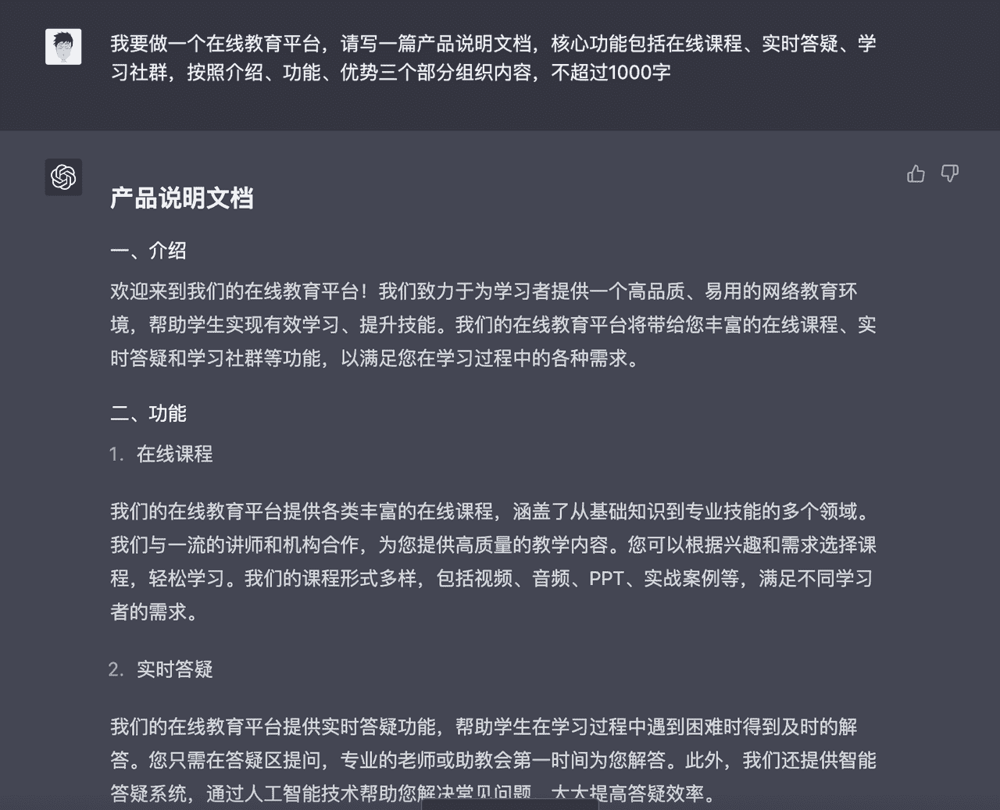

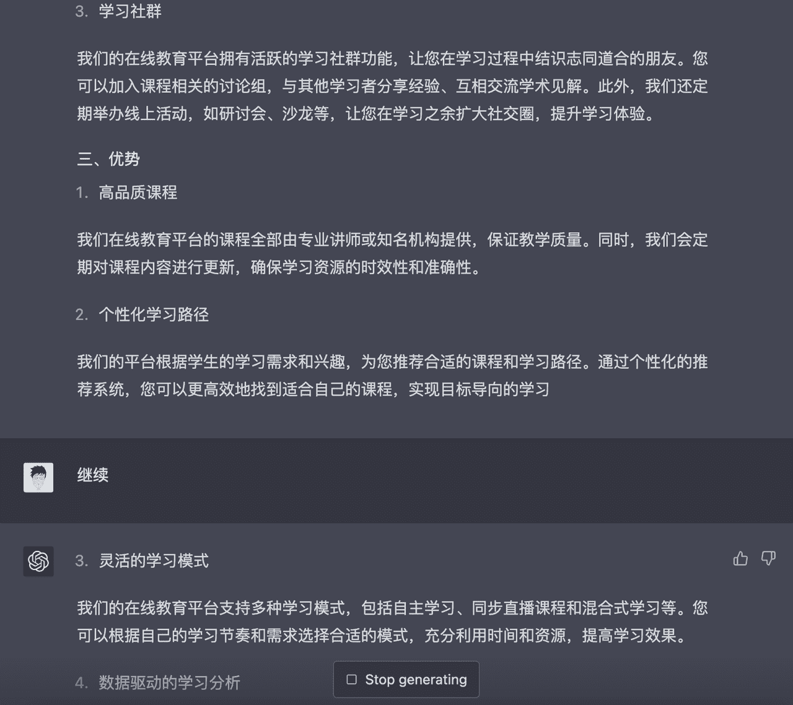

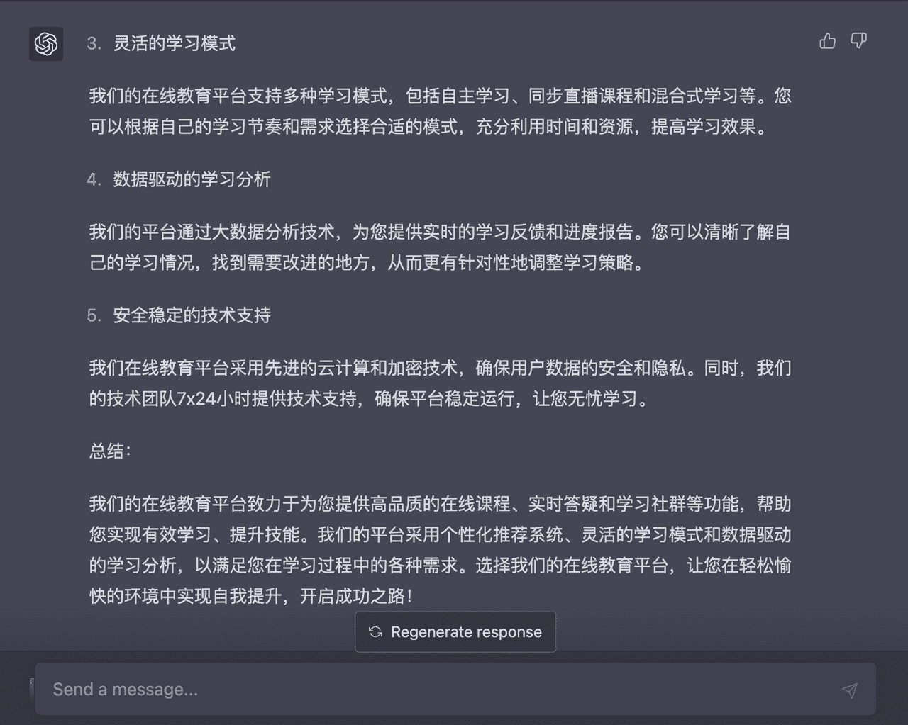

有这样的框架，可以帮我们快速写出比较全面的 Prompt ，然后我们再结合实际情况，修改 ChatGPT 的回复，得到我们需要的内容。

## 三、协助竞品分析

**竞品分析是产品经理工作中的重要环节。** 通过深入研究竞争对手，我们可以洞察市场趋势、发现用户痛点，从而改进自家产品。

做竞品分析，要先找竞品，收集竞品信息，进行分析，最后得出报告。这每个环节，都可以用 ChatGPT 来协助我们，先提供一个 Prompt 的参考公式：

> 【 **背景 **：竞品领域/行业】+【 **指令 ****：进行竞品****分析/提供**竞品列表/分析报告】+【 输入数据 ：提供参考大纲结构/产品内容（可选）】+【 输出指示 ：分析类型/关注点 + 格式要求（表格/列表/段落）等】

### 1. 快速获取竞品列表

以往收集竞品的方法费时间，还可能遗漏重要竞品，而 ChatGPT 能快速列出比较全的竞品清单。

以知识付费产品为例，可以这么问：

> 我们准备进入知识付费行业（背景），列出目前市场上的知识付费产品（指令），提供产品名称和简要介绍的列表（输出指示）

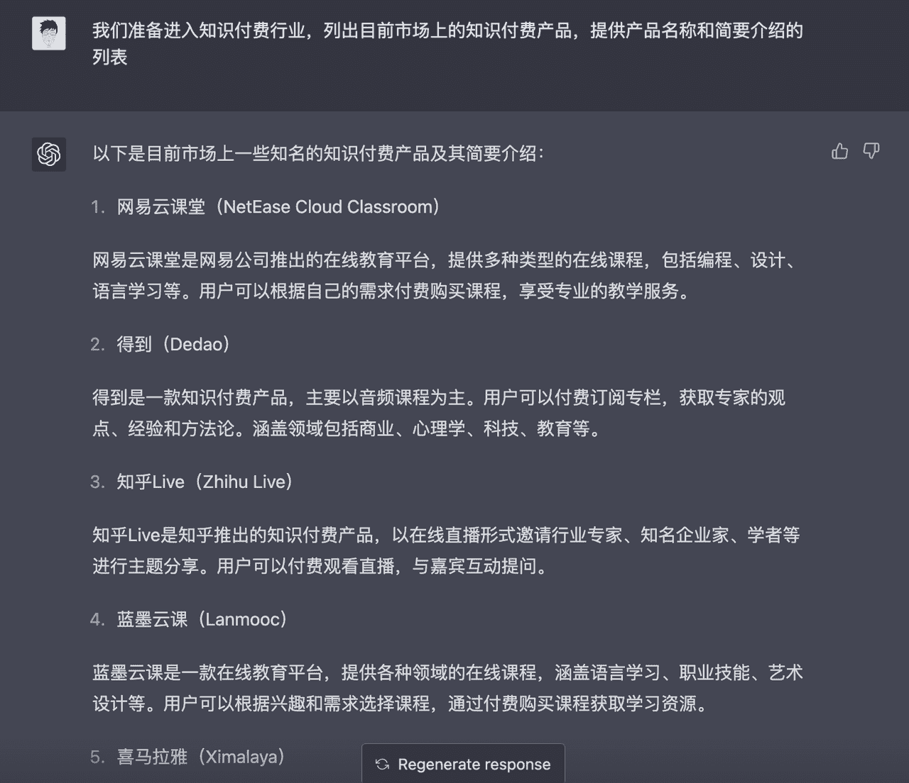

它可以做到秒出竞品清单，还提供竞品介绍。这让我们在短时间内获取大量有价值的信息，节省查资料的时间（当然要小心它瞎编，需要检查核实）。

### 2. 明确分析思路，深入研究竞品

明确目标竞品后，我们让 ChatGPT 输出一份竞品分析的大纲。我们即可参考这些维度自己分析，也可以逐一向它提问。比如，进一步问：“某竞品的优势和不足是什么？”、“某竞品的用户评价如何？”等等。

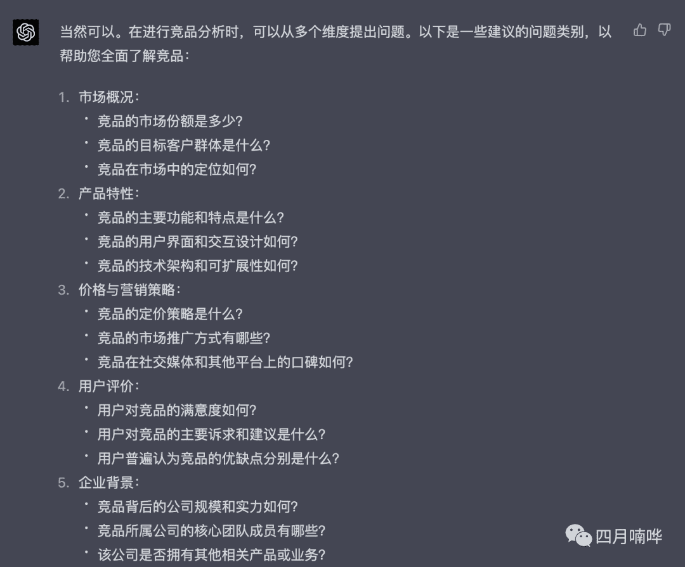

现在指定竞品进行分析，可以这么问：

> 我正在研究在线教育行业中的竞争对手（背景），（指令）请对（输入数据）得到APP、极客时间、樊登读书、喜马拉雅进行竞品分析，分析各竞品的竞品定位与核心价值、产品特点与功能、用户评价与反馈（输出指示）

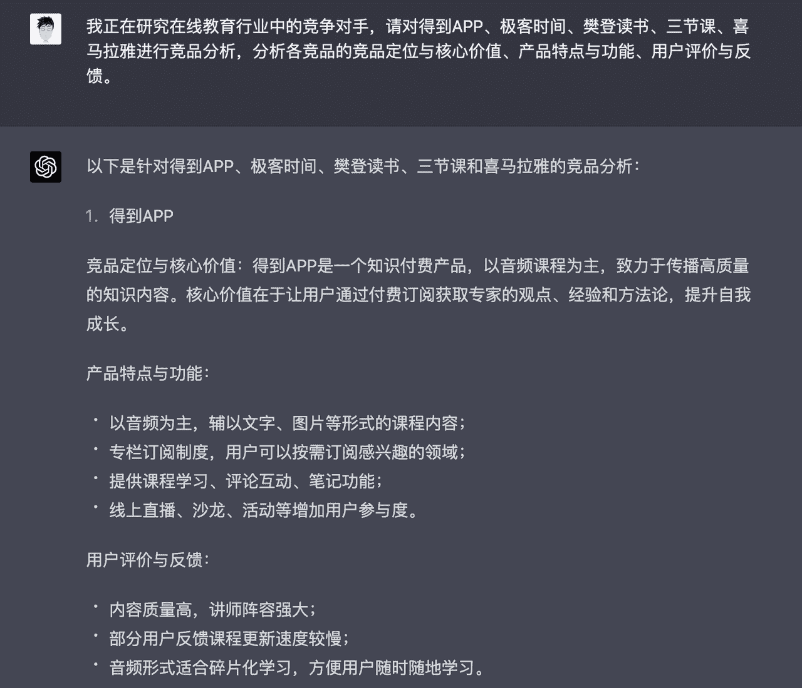

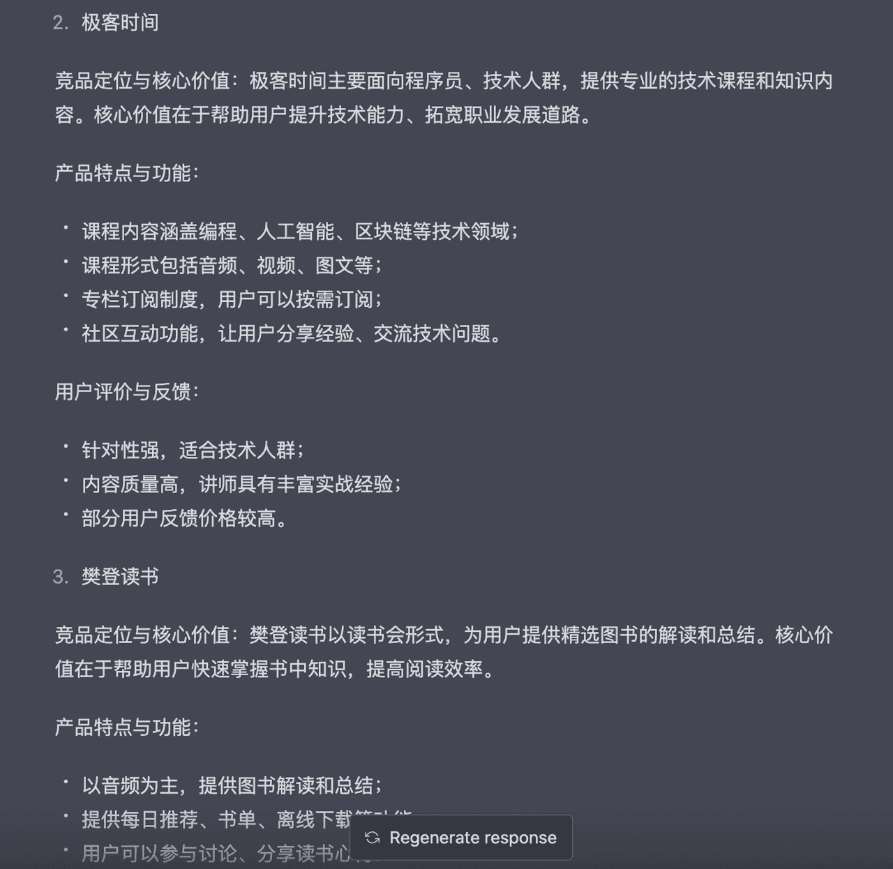

通过这些问题，我们可以更全面地了解竞品的特点，为制定产品策略提供参考，最后还能让它完整输出分析报告。

需要注意的是，虽然 ChatGPT 可以帮我们快速**找**到竞品信息，理清分析思路，但我们还是 要亲自体验竞品，与竞品的用户交流，思考竞品「为什么这样做」、「为什么不那样做」等问题，以获得第一手信息与深度思考 。

**在获取 ChatGPT 的分析结果后，我们**再 结合自己的实际经验和思考，对其进行核实、调整与整合，确保竞品分析的准确性与实用性。

## 四、协助产品设计

**产品功能设计是产品经理的核心工作之一。 这**个阶段，我们需要准确地捕捉用户需求，将其转化为具体的产品功能，去解决用户的问题。

### 1. 获取设计建议与参考案例

在设计产品时，有的人很快就想出产品方案，有的人想了很久依然没头绪。为啥呢？

我的体会是， 这取决于您了解和掌握了多少不同的产品方案。

看过的产品多，脑海中有大量的方案可以选择，并且理解它们的设计原理和优劣，遇到需要解决的问题，即可快速搜索你的「方案库」，结合实际情况进行调整和设计。

ChatGPT 拥有海量的数据资源，其中包含了大量的产品功能设计案例，这些案例远比我们接触过的要多得多，能为我们提供丰富的创意来源。

所以， 在设计中遇到困难、缺乏灵感，赶紧请它提供建议和参考案例。

### 2. 检查与优化设计方案

在完成产品功能设计后，我们可以 利用 ChatGPT 来检查设计方案的合理性，并提出优化建议。

同样，献上产品设计的 Prompt 的参考公式：

> 【 **背景 **：产品类型/现状】+【 **指令 ****：获取设计****建议/优化**方案】+【 输入数据 ：参考案例辅助说明等（可选）】+【 输出指示 ：设计元素/参考案例 + 格式要求（图文/列表/段落）等】

现在假设要做一个在线教育平台的用户积分体系，尝试写提问：

> 我们在做一个在线教育平台（背景），希望增加用户参与度和活跃度，（指令）请为在线教育平台提供用户积分体系的设计建议，列出积分体系的关键要素和激励措施（输出指示）

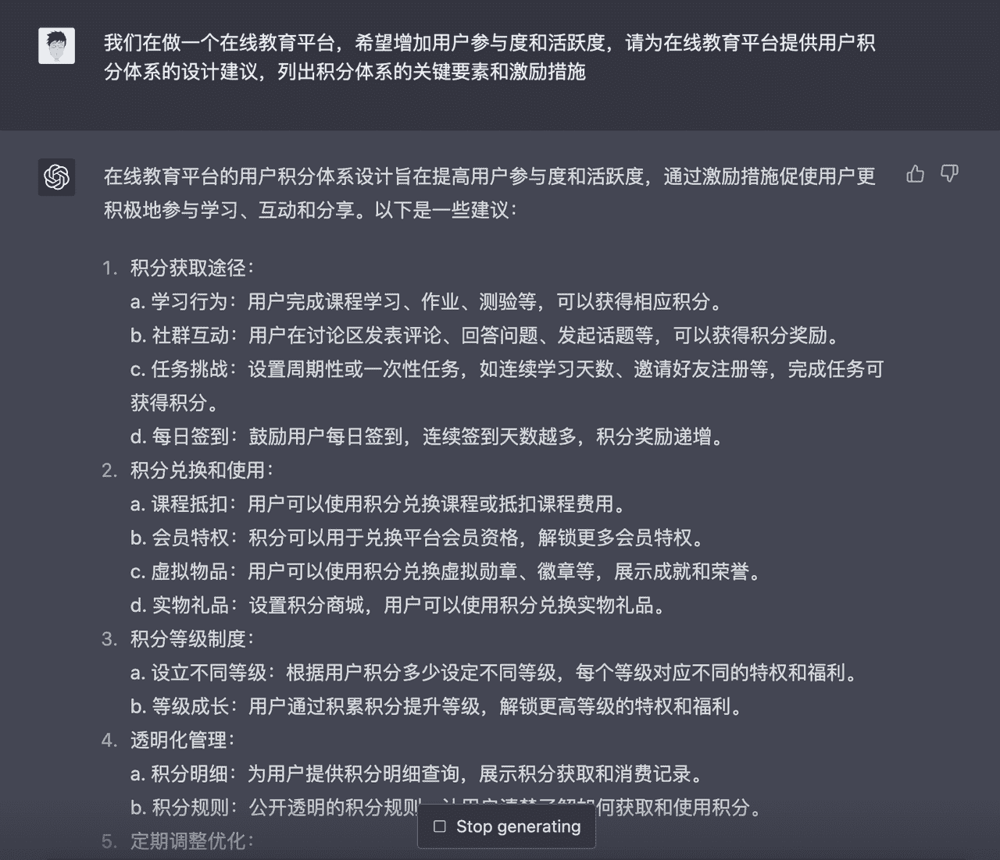

你看， 用好 ChatGPT，即可帮我们启发思路，还能避免盲区，完善设计方案。

此外，跟开发团队沟通时，也能把产品设计思路讲得更加透彻，提升沟通质量，确保研发效果。

## 五、协助数据分析

数据分析对产品经理非常重要。 **通过分析用户数据，我们可以更好地了解用户**行为、发现问题、挖掘需求，进而优化产品。

我们工作中有大量的数据需要分析，每天看产品数据，及时发现产品是否有问题，研究用户的行为特征，发现产品可优化的地方。一旦数据出现问题，我们还要尽快找出原因，解决问题。

**C**hatGPT 有强大的计算能力，用它来分析数据，可以帮我们快速发现潜在问题、提高数据分析效率与准确性。

照例，先上数据分析的 Prompt 参考公式：

> 【 **背景 **：数据类型/业务场景】+【 **指令 ****：发现原因**/趋势/优化建议】+【** 输入数据** ：要分析的数据】+【 输出指示 ：问题/现象描述 + 格式要求（图表/列表/段落）等】

举个例子，产品日活数据下跌，让它帮忙分析，我先把简单的日活数据发给它：

> 我正在做一款知识付费产品（背景），近期发现产品的日活数据下降，（指令）请帮我分析下这些数据，看是否正常，有没有问题？（输出指示）列出数据特点，如有问题，分析可能的原因，并提供优化建议；（输入数据）以下是具体的日活数据：日期 日活

刚开始，它给的分析原因和建议还比较泛，然后我再补发渠道的日活数据，它便提供更具体的分析与建议。

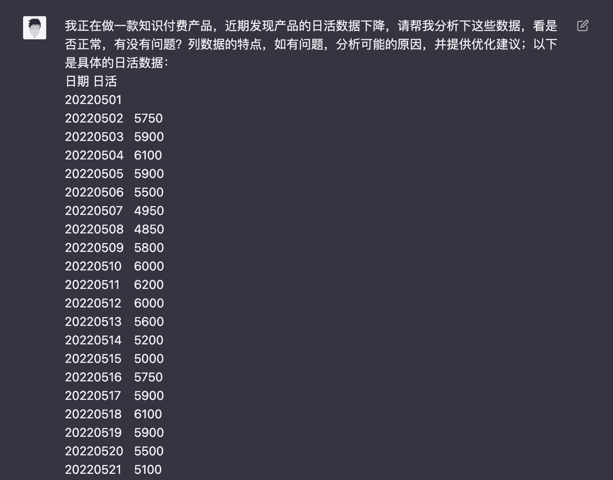

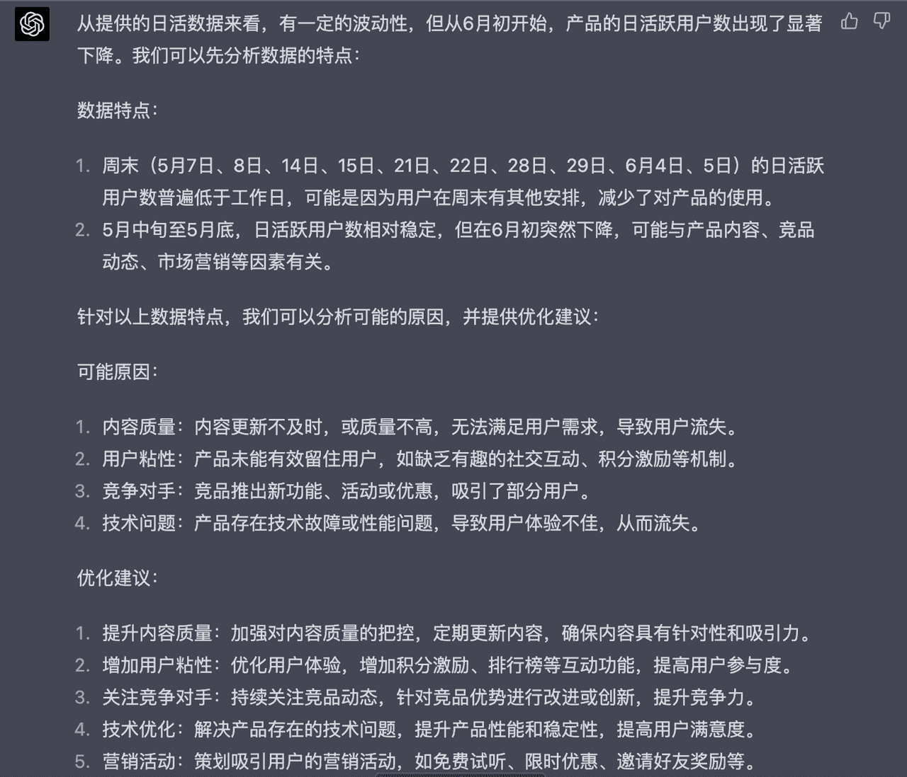

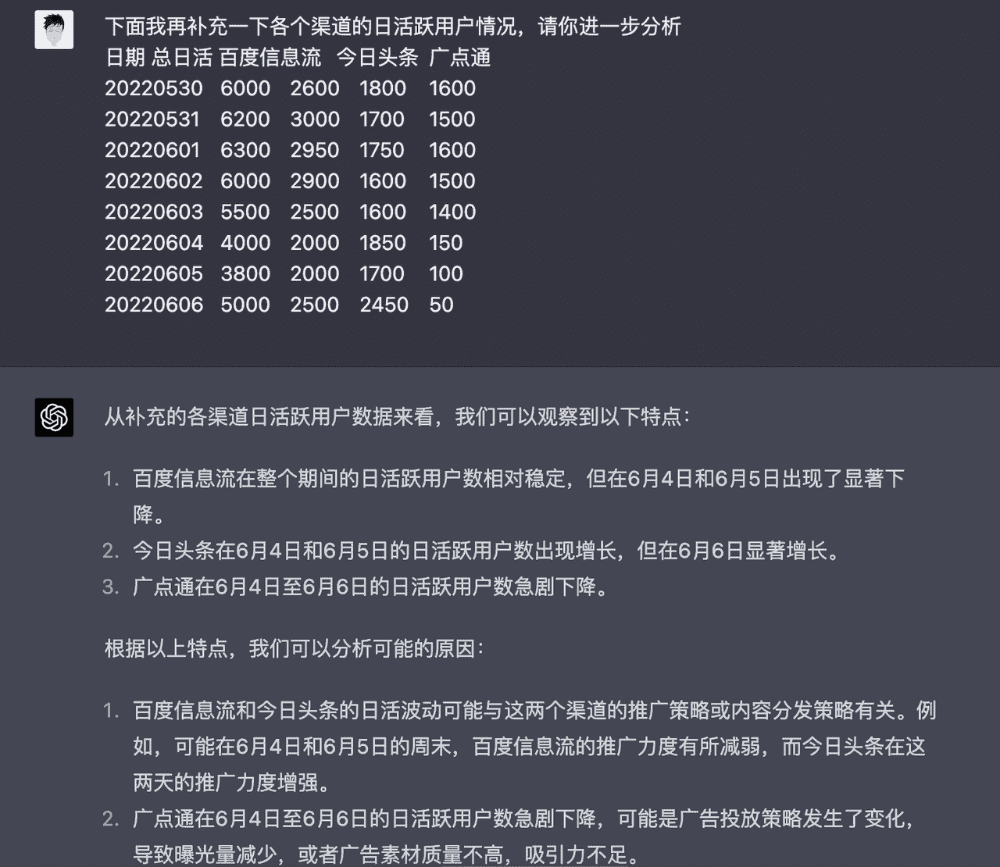

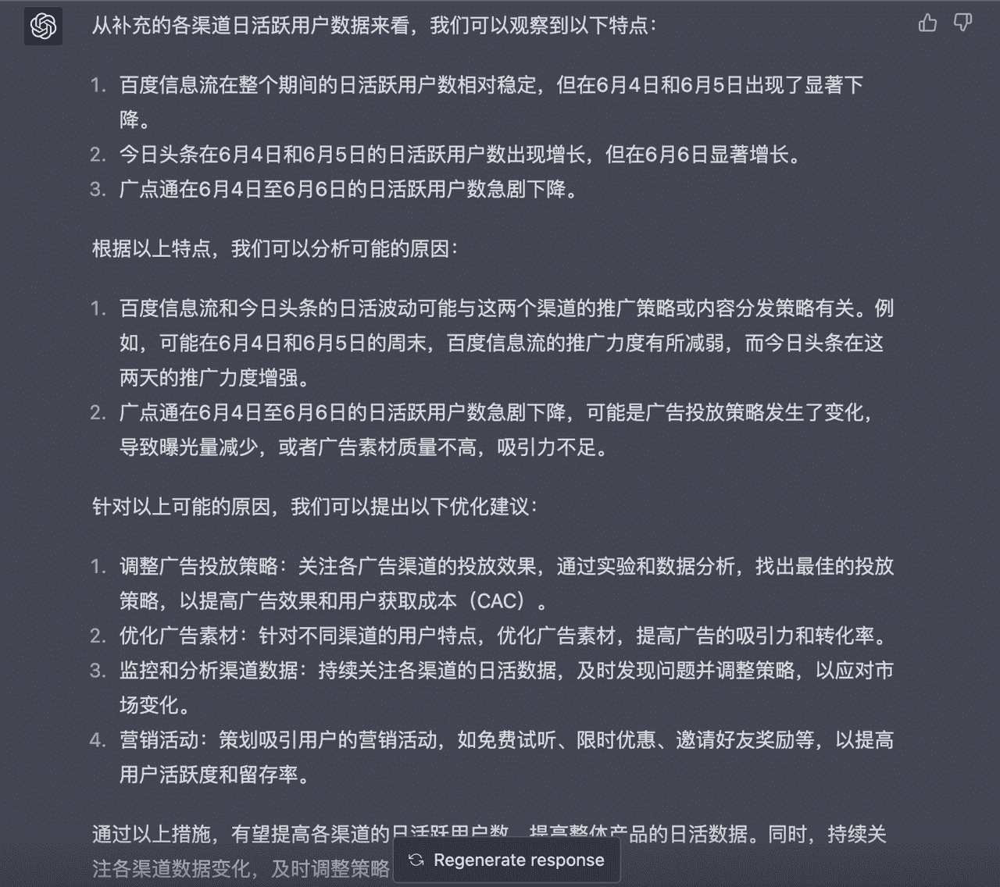

**你看，这比我们自己人肉研究要快太**多了，尤其 在大数据量和规律特点不明显的情况下，借助它可以大大提高分析效率和准确性。

需要说明的是， **由**于产品数据涉及到公司的商业机密，如果要用 ChatGPT 做数据分析，要得到公司的许可，并且把数据中一些敏感的信息隐去。

最后，特别提醒一下，这些公式与案例只是提供一个参考，方便你更快上手实践，写出有效的 Prompts，实际提问时还需要根据具体情况进行调整。

## 六、总结

文章末尾，照例总结一下。

**产品经理想利用 ChatGPT 高效工作，需要学会写好 Prompts ，结合产品具体的工作和**场景，如从写文案文档、竞品分析、产品设计及数据分析等方面，提高工作的效率与质量。

通过这些案例，相信你也能感受到 ChatGPT 的强大，它就像一位资深产品经理可以随时给我们指导、解答疑问，又像一位得力助手能帮我们完成耗时、重复性的工作，使得我们在高效完成工作的同时，还能学到东西。

当然，想让 ChatGPT 更好地为我们服务，除了写好 Prompts，还要多给它一些数据，对它进行训练，这涉及如何调教 ChatGPT ，由于文章重点不同、篇幅有限，这里先不展开，以后有机会再专门分享。

最后，需要注意，ChatGPT 虽然很强，但 它并不能完全取代人的判断和实际经验。

**在**使用 ChatGPT 时，我们应结合自己的知识和经验对其提供的建议进行判断、交叉验证和完善，以确保最终的工作成果的准确性和实用性。

总之，作为产品经理，结合自身经验并充分利用 ChatGPT ，一定可以帮我们在工作中取得更好的成绩，提升个人的竞争力，升职加薪。

赶紧试试看吧。

作者：四月，10年产品经理，👸号：四月喃哗

本文由 @四月 原创发布于人人都是产品经理，未经许可，禁止转载

题图来自 Unsplash，基于 CC0 协议

该文观点仅代表作者本人，人人都是产品经理平台仅提供信息存储空间服务。