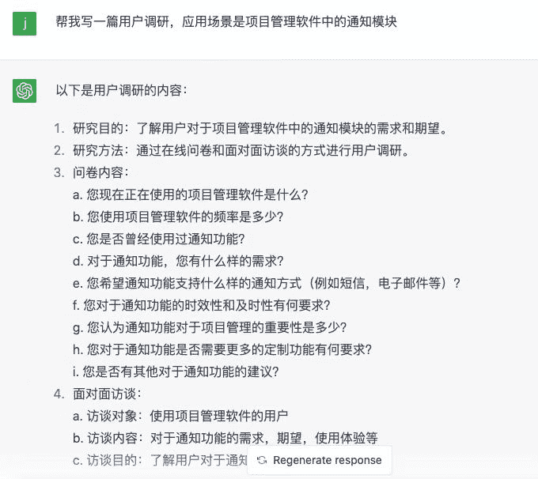

# 2023-03-27产品经理被`ChatGPT`/`GPT-4`取代？想多了，它自己都说我没那么大本事！

> 来源：`https://xuqiwei1986.feishu.cn/docx/GWtudWv6HoqW1jxjLTNcSqzCnsd`

> 🔗 原文链接：`http://www.chinapm.com.cn/index.php/post/335.html`

在`ChatGPT`刚刚出来的时候，就有朋友和我说，能不能谈谈`ChatGPT`会给产品经理带来啥影响？

我这人吧，是这样的，在没搞清楚一件事之前，一般不敢说些什么，可是当我还在琢磨`ChatGPT`的时候，`GPT-4`又来了，好吧，在`GPT5`没来之前，我就硬着头皮胡诌几句。

先来回答一下很多朋友关心的问题：`ChatGPT`/`GPT-4`会不会取代产品经理？

我较为肯定的答案是：不会！

## 原因1：`ChatGPT`/`GPT-4`很难实现产品管理的价值？

产品管理的价值是什么？

咱们再背诵一次：产品管理的价值就是把现状投射到未来！

翻译成大白话就是：产品经理的所有工作都是基于现状去为企业、业务、产品找到未来的一条康庄大道。

看起来似乎就那么回事，好，各位，先暂停阅读本文，看着你的手机或电脑，你能否说出未来五年后手机和电脑是什么样子的？

有朋友会说了，`ChatGPT`/`GPT-4`也可以告诉我们啊，没毛病，我也相信`ChatGPT`/`GPT-4`会给你一个答案，但是，一个更为艰难的问题出现了：从2023年开始，到2027年，手机或电脑会以一种什么样的状态发展呢？

或许`ChatGPT`/`GPT-4`也会告诉你，但是，一个更更艰难的问题出现了：在五年的变化发展中，手机/电脑每年都会以什么样的情况发生变化？

这个我相信`ChatGPT`/`GPT-4`就不大说上来了，因为人类所有对此的答案都是一种推测，也就是“假设”。

`ChatGPT`/`GPT-4`即使告诉你了，那也仅仅是重复这种“假设”而已。

产品经理虽然需要从假设开始工作，但你每个阶段的工作，每个工作本质上都是为了验证假设，也就是确定“不确定性”。

这也就是我常说的，产品经理工作不好做，就是因为有太多的“不确定性”。

这也就是所谓的“把现状投射到未来”。

### 总结

> `ChatGPT`/`GPT-4`可以告诉你现在是什么情况，并基于现状数据给你一个无法脱离现状而重构的结果，但是它没有办法告诉产品经理，从“假设”如何才能走到“确定”。

## 原因2：`ChatGPT`/`GPT-4`很难给予产品经理有现实意义的工作支持！

产品经理的工作很多，很繁杂，有朋友担心，这些工作会不会被`ChatGPT`/`GPT-4`所替代？

我们先来看一张图：

好吧，这就是`ChatGPT`/`GPT-4`给我们的答案，看起来是一个很标准的问卷方案模板，但是，咱们仔细看，这个模板其实对大部分的产品经理毫无价值，仅仅对没做过此类模板的新人有一定参考价值。

比方说，在面对面访谈中，访谈对象是”使用项目管理软件的用户”，难道这不是一句有用的废话吗？

这是面对面访谈，类似与焦点小组，要做这种类型的调研，首要一条就是必须明确访谈的用户到底是哪些。

再来看访谈内容，“对于通知功能的需求，期望，使用体验等”，说实话，这基本又是一句废话，面对面访谈的玩法太多了，针对不同的目标就需要设计不同的玩法，比方说“焦点小组”+`Buy-A-Feature`的结合使用，目的就是为了通过用户产生假设，并通过用户发现“不确定性”，是一种完全以用户为主的玩法。（这个以后有机会我再讲一下）

再来看`ChatGPT`/`GPT-4`提供的问卷内容的回答，全是开放式问题，这种问卷设计几乎是失败的，因为问卷分四种类型：选择式；回想式；评估式；观点式。这种全开放的问卷属于观点式，这个没毛病，但问题是`ChatGPT`/`GPT-4`不觉得九个问题太多了吗？

一个选择式的都没有，好吧，我相信`ChatGPT`/`GPT-4`也能整出选择式的，但是选项设置呢？二选一，三选一，四选一？

有朋友会说了，我可以向`ChatGPT`/`GPT-4`不断明确我的需求啊？

哥，如果你都如此明确问卷怎么做了？你早就把问卷做出来了，至于再花时间让`ChatGPT`/`GPT-4`给你答案吗？怎么地，就喜欢“喂食”啊？

这还仅仅是在产品管理中一个不算大的工作，`RPM`定义了34项工作呢，有些工作比市调的工作麻烦很多，也难很多的。

### 总结

> 对于`ChatGPT`/`GPT-4`而言，在产品管理的工作上，它仅仅能够提供一些建议性的工作说明（有用的废话），但是针对产品经理具体性的工作任务，它就有点心有余而力不足了，毕竟一家企业一个样，一个产品一个样，脱离了具体目标的车轱辘话或模板式的答案只会害了产品经理。

## 原因3：产品管理工作的特殊性

`AI`发展的三大要素：算力，算法，数据。算力靠“钱”，算法靠“脑”，数据靠“喂”。

从目前`ChatGPT`/`GPT-4`的表现看，我们发现，它给予我们的答案基本都是开放性的数据整合，也就是说，它比人强是因为强大的算力和算法（`ChatGPT`/`GPT-4`应该是`LLM`？）（我个人还是不太认为算法是`AI`的强项，毕竟在没有彻底研究透人的大脑是怎么学习和思考（巨多模态？）的情况下，`ChatGPT`/`GPT-4`还是无法完全模仿人的学习和思维的，想想看你在和老婆，或女朋友吵架的时候，她们的思维模式会让你彻底疯掉，^_^），至于数据，这就需要不断的“投喂”了。

但一个关键的问题来了，产品经理拿到的都是企业内非常重要的机密数据，你愿意去拿这些数据“训练”`ChatGPT`/`GPT-4`吗？

比方说，你给`ChatGPT`/`GPT-4` 24个月的销量数据，让它预测第25个月的销量，暂且不说用哪种预测方法，我相信它一定能够预测出来，但是，前提是你愿意拿你的销量数据去训练它吗？

就连咱联盟提供的`PMManager`软件，好多朋友问我的第一个问题就是“数据存在哪儿？”，我说是存在本地，人家才放心的下载使用。

可见很多朋友对这些数据的安全性和隐私性的关心是放在第一位的。

由此延伸开来，当商业，业务，产品数据训练量不够的时候，那么，`ChatGPT`/`GPT-4`在这个上面又能给产品经理多少有价值的帮助呢？

有朋友会说，你看`GPT-4`都能自动写出代码了？

和我一起念，`Github`，`Gitee`，`Github`，`Gitee`，`Github`，`Gitee`，现在有几个程序员完全原创代码？对吧！

明白我的意思了吧，产品经理很多的东西都是高度原创的，全世界就你那一份。

### 总结

> `ChatGPT`/`GPT-4`依赖的商业数据的训练，恰恰是企业和产品经理最为重视的，也是最没有可能喂食的，除非你相信一台机器比你还了解你的业务和产品。

就说这三点吧，技术啥的，我也不懂，肯定没法从这个方面说，其实说的意义也不大，毕竟咱们是产品经理，只能从产品管理的业务角度来扯两句，到不到的，大家凑合着看就行了。

总之，`ChatGPT`/`GPT-4`在帮助产品经理用更少的时间处理已知的数据上是有力的（部分扮演产品经理的双手），而这恰恰是对产品经理的一种鞭策，因为这就需要产品经理花费更多的时间在战略上，换句话说，就是它要想扮演产品经理的大脑就够呛了，毕竟我们的脑子里应该始终着眼于“如何把想象中的未来变成现实”。

或者这么理解，有了`ChatGPT`/`GPT-4`，也就等于给每个产品经理配备了一名产品助理。

`ChatGPT`/`GPT-4`目前的作用，也就到这儿了！

其实与其担心`ChatGPT`/`GPT-4`会取代产品经理，不如担心一下更牛X的产品经理会不会取代你吧，我觉得这个更现实一点！

那么，如何印证我的观点呢？

自说自话没意思，咱们还是交给`ChatGPT`来回答吧！

以下是一个国外同行向`ChatGPT`提的一个问题以及它的回复。

---

> **问：** `Please give me 10 examples of how ChatGPT is helping product managers. Make each example descriptive, with the problem it solves. Include sample prompts for each example and sample responses. At the end of the 10 examples, summarize your opinion of how the relationship with ChatGPT and product managers is evolving.`

> 请举10个例子说明`ChatGPT`是如何帮助产品经理的。让每个例子都具有描述性，以及它所解决的问题。为每个示例和示例响应包含示例提示。在这10个例子的最后，总结你与`ChatGPT`和产品经理之间的关系是如何发展的。

`ChatGPT Response`

> 当然，以下是`ChatGPT`如何帮助产品经理的10个例子:

### Idea generation

`ChatGPT` can help product managers generate new product ideas by providing prompts and suggestions. For example, a product manager might ask, "What are some innovative product ideas for the fitness industry?" and `ChatGPT` could respond with suggestions like "A wearable device that tracks your posture during yoga" or "A fitness app that creates custom workout plans based on your DNA."

> **创意生成：** `ChatGPT`可以通过提供提示和建议来帮助产品经理产生新的产品创意。例如，产品经理可能会问：“健身行业有什么创新的产品想法？”`ChatGPT`可能会给出这样的建议：“一种可以在瑜伽时跟踪你姿势的可穿戴设备”或“一种根据你的DNA创建定制锻炼计划的健身应用程序”。

### Customer feedback analysis

`ChatGPT` can help product managers analyze customer feedback to identify common pain points or feature requests. For example, a product manager might ask, "What are customers saying about our new product launch?" and `ChatGPT` could analyze customer reviews, social media mentions, and support tickets to identify common themes.

> **客户反馈分析：** `ChatGPT`可以帮助产品经理分析客户反馈，以确定常见的痛点或功能要求。例如，产品经理可能会问：“客户对我们的新产品发布有什么看法？”`ChatGPT`可以分析客户评论、社交媒体提及，并确定共同主题。

### Competitive analysis

`ChatGPT` can help product managers stay on top of the competition by analyzing competitor products, pricing, and marketing strategies. For example, a product manager might ask, "What are our competitors doing differently in the mobile gaming space?" and `ChatGPT` could analyze industry reports, news articles, and social media activity to provide insights.

> **竞争分析：** `ChatGPT`可以通过分析竞争对手的产品、定价和营销策略，帮助产品经理保持竞争优势。例如，产品经理可能会问：“我们的竞争对手在手机游戏领域有什么不同之处？”`ChatGPT`可以分析行业报告、新闻文章和社交媒体活动来提供见解。

### Market research

`ChatGPT` can help product managers conduct market research by analyzing consumer trends and demographics. For example, a product manager might ask, "What are the key trends in the beauty industry?" and `ChatGPT` could analyze industry reports and social media activity to identify trends like natural and sustainable beauty.

> **市场研究：** `ChatGPT`可以通过分析消费者趋势和人口统计数据来帮助产品经理进行市场调研。例如，产品经理可能会问：“美容行业的主要趋势是什么？”`ChatGPT`可以分析行业报告和社交媒体活动，以确定自然和可持续美容等趋势。

### Pricing strategy

`ChatGPT` can help product managers develop a pricing strategy that is competitive and profitable. For example, a product manager might ask, "What is the optimal price point for our new product?" and `ChatGPT` could analyze industry benchmarks, customer willingness to pay, and production costs to provide recommendations.

> **定价策略：** `ChatGPT`可以帮助产品经理制定有竞争力和有利可图的定价策略。例如，产品经理可能会问：“我们新产品的最佳价格点是多少？”`ChatGPT`可以分析行业基准、客户支付意愿和生产成本，从而提供建议。

### Marketing copy

`ChatGPT` can help product managers write effective marketing copy for their products. For example, a product manager might ask, "Can you help me write a tagline for our new product?" and `ChatGPT` could provide suggestions like "Experience the power of natural ingredients with our new skincare line."

> **营销文案：** `ChatGPT`可以帮助产品经理为他们的产品撰写有效的营销文案。例如，一位产品经理可能会问：“你能帮我为我们的新产品写一篇宣传语吗？”`ChatGPT`可以提供这样的建议：“用我们的新护肤品系列来体验天然成分的力量。”

### Product roadmap planning

`ChatGPT` can help product managers plan their product roadmap by analyzing customer needs and market trends. For example, a product manager might ask, "What features should we prioritize for our next product release?" and `ChatGPT` could analyze customer feedback and industry reports to provide recommendations.

> **产品路线图规划：** `ChatGPT`可以帮助产品经理通过分析客户需求和市场趋势来规划他们的产品路线图。例如，产品经理可能会问：“我们应该优先考虑下一个产品发布的哪些功能？”`ChatGPT`可以分析客户反馈和行业报告来提供建议。

### Sales forecasting

`ChatGPT` can help product managers forecast sales based on historical data and market trends. For example, a product manager might ask, "What are our projected sales for Q4?" and `ChatGPT` could analyze historical sales data, industry trends, and seasonality to provide a sales forecast.

> **销售预测：** `ChatGPT`可以帮助产品经理根据历史数据和市场趋势预测销售。例如，产品经理可能会问：“我们第四季度的预计销售额是多少？”`ChatGPT`可以分析历史销售数据、行业趋势和季节性来提供销售预测。

# ChatGPT 与产品经理

## Risk assessment

ChatGPT can help product managers assess the potential risks associated with a new product launch. For example, a product manager might ask, "What are the potential risks of launching a new product in a new market?" and ChatGPT could analyze market entry barriers, regulatory requirements, and competitive landscape to provide insights.

> **风险评估：** ChatGPT可以帮助产品经理评估与新产品发布相关的潜在风险。例如，产品经理可能会问，“在新市场推出新产品的潜在风险是什么？”ChatGPT可以分析市场进入壁垒、监管要求和竞争格局，以提供见解。

## Collaboration and communication

ChatGPT can help product managers collaborate with cross-functional teams and communicate with stakeholders. For example, a product manager might ask, "Can you help me draft an email to our CEO about our new product launch?" and ChatGPT could provide suggestions for the email content and tone.

> **协作和沟通：** ChatGPT可以帮助产品经理与跨职能团队协作，并与利益相关者沟通。例如，一个产品经理可能会问，“你能帮我起草一封关于我们新产品发布的电子邮件给我们的CEO吗？”ChatGPT可以为电子邮件的内容和语气提供建议。

## Overall assessment

Overall, I think the relationship between ChatGPT and product managers is evolving in a positive direction. As AI and natural language processing technology continues to advance, ChatGPT will become even more sophisticated in its ability to provide valuable insights and recommendations to product managers. Product managers will be able to spend less time on manual data analysis and more time on strategic decision-making, ultimately leading to better product outcomes.

> **总的来说，** 我认为ChatGPT和产品经理之间的关系正在朝着积极的方向发展。随着人工智能和自然语言处理技术的不断发展，ChatGPT在为产品经理提供有价值的见解和建议方面将变得更加成熟。产品经理将能够在人工数据分析上花费更少的时间，而在战略决策上花费更多的时间，最终导致更好的产品结果。

## 数据处理与公私数据

仔细看ChatGPT能够帮助产品经理的，几乎都是和数据处理方面有关的，而这些数据可以大致分为两类，一类是公有的，比方说行业分析报告，客户反馈，社交媒体评论，竞争对手的产品价格，监管要求，一类是私有的，比方说你的产品的生产成本，销售数据，客户意愿，竞争格局，市场趋势等，但正如我说的，如果仅仅是前者，那么，ChatGPT解决的就是效率问题，而如果是后者，那么，你愿意喂食吗？

## 战略决策与产品经理角色

总之，**按照ChatGPT的答案，** 产品经理将越来越倾向于战略决策层面的工作，当然，这样的产品经理也会越来越像一名真正的产品经理。

## 何时能取代产品经理？

当然，回到开篇那个问题：那到底什么时候ChatGPT有希望取代产品经理呢？

我想，当它能够100%预测双色球号码的时候吧！

顺便说一句，ChatGPT答案的行文规范真好，几乎是完美！
