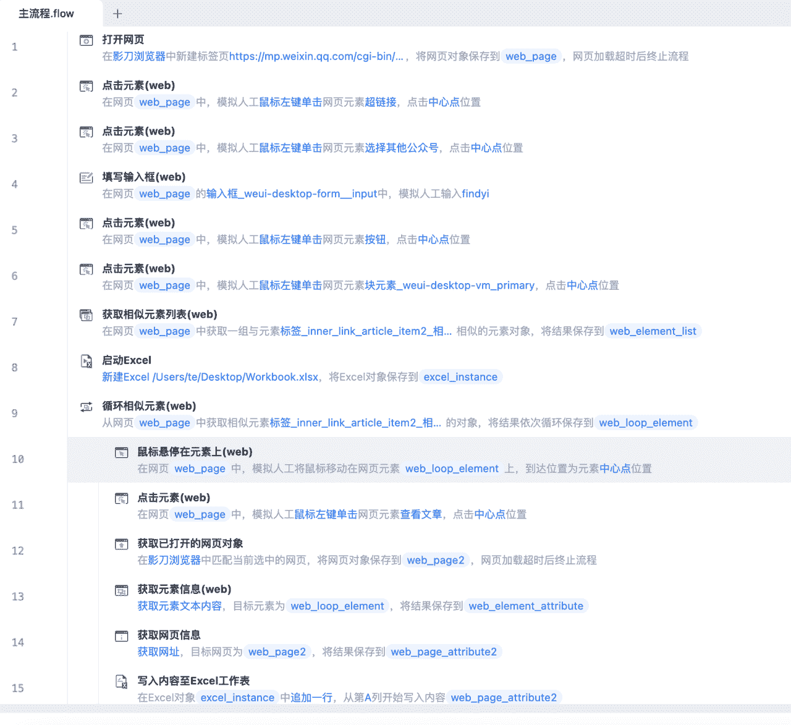
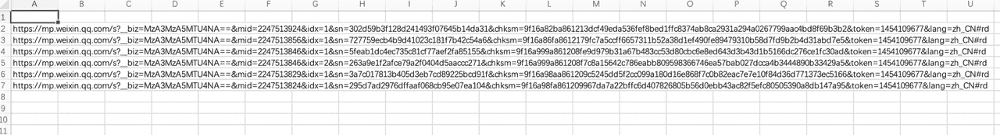

# 2023-10-31如何使用RPA自动收集素材？

> 来源：[https://xuqiwei1986.feishu.cn/docx/KLH4dXGdLo8OKSxQ8J8cRchtnIc](https://xuqiwei1986.feishu.cn/docx/KLH4dXGdLo8OKSxQ8J8cRchtnIc)

> 🔗 原文链接： h[ttps://articles.zs](https://articles.zsxq.com/id_bcwf8tdqkpt5.html)xq.com/id_bcwf8t...

# 日更30篇公众号是怎么做到的？

想问下小伙伴们，你们写一篇公众号要多久？

1个小时？

## 2个小时？

### 一周？

除了洋哥这种大牛外，大部份人写一篇大概也需要2个小时以上。

30篇就要60个小时！日更30篇？！怎么可能？逗我呢！

日更30篇真的能做到！

在我收集《AI超级个体: ChatGPT & AIGC实战指南》案例的时，台风哥和我说过，有个大佬有30个公众号，每天更新文章，收益到了6位数以上。

当时我认为他肯定是写了个程序，用程序调用GPT接口，批量洗稿发文。这程序我感觉不难，但我没有写类似的教程。因为考虑到写程序对于我们星球的小伙伴来说门槛可能有点高，很多小伙伴没办法上手，所以我一直没有深究他们是怎么做到的。

直到前段时间，我才知道了他们日更30篇公众号的秘密---影刀RPA。

影刀RPA是啥？为什么它能帮助我们日更30篇公众号? 它又怎么用的呢？

接下来我会和大家详细讲解。

# 认识自动化神器-影刀RPA

影刀是个软件，下载到我们电脑上后，我们可以给他指定一个流程，它就可以按照我们的流程操作我们的电脑。比如自动得打开我们的公众号后台，然后自动写文章。。。

关于影刀RPA在这里我就不太啰嗦了，它的官网上有相关的教程，建议大家都去学习一下。

影刀官方地址: https://www.yingdao.com/

影刀学院地址: https://college.yingdao.com/

接下来我会讲解一个实际应用的例子--用影刀RPA收集写作素材。这里的写作素材是对标账号的文章，用这个简单的例子，让大家感受下做懒人的爽感。

# 用影刀RPA自动收集素材

这个过程很简单，下面是我的一个简单的Demo。我用这个Demo演示了如何收集洋哥的文章(洋哥的铁粉，他的文章必须收藏)。

在这个Demo中，我将洋哥文章部分的地址获取到写入了Excel中

这个知识一个简单的展示，获取文章URL的方式我们可以写爬虫，但是写爬虫对于很多小伙伴来说门槛是在是太高了。用RPA的门槛低不少

最后我们来看看运行的效果是咋样的

[运行效果展示](https://t.zsxq.com/13g4sV0bz)

当然了，我们用这个RPA不仅仅是爬一下文章这么简单而已，结合ChatGPT，我们可以批量的写文章。

我希望通过RPA的方式，可以帮我一键发布文章到所有平台、一键排版、一键收集全平台热点、一键写文章。。。等等。

我希望大家也能投入到RPA的学习，感受懒人的快乐～

扫码加入星球

查看更多优质内容

https://wx.zsxq.com/mweb/views/joingroup/join_group.html?group_id=15552545485212