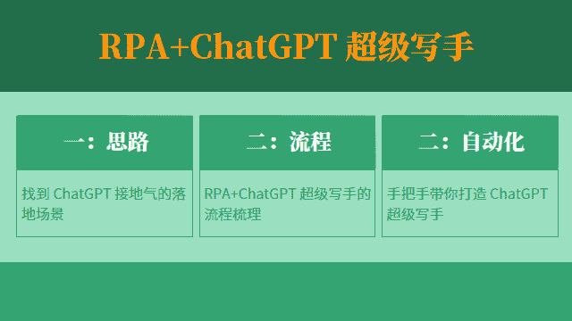
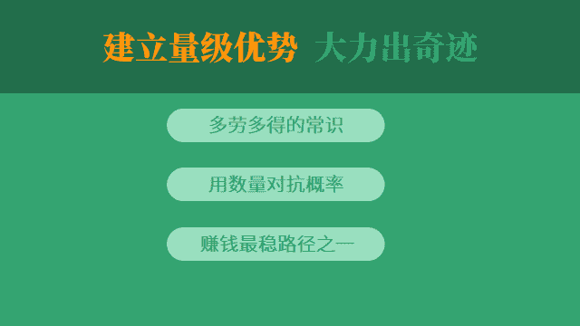
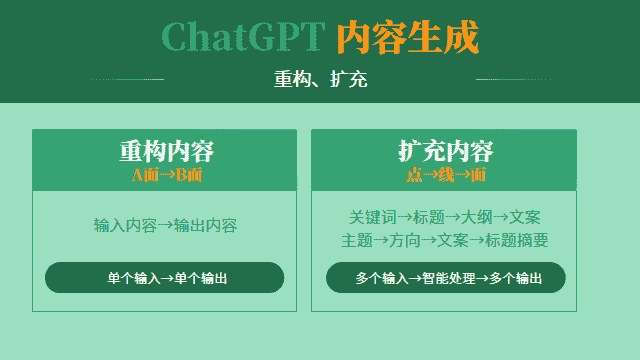
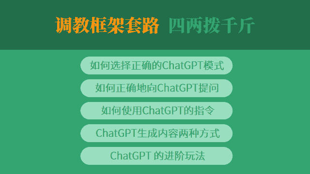
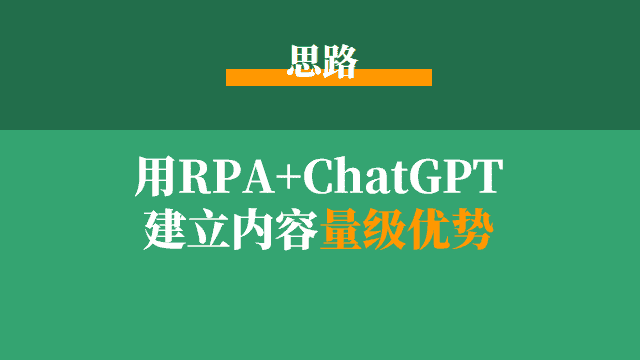
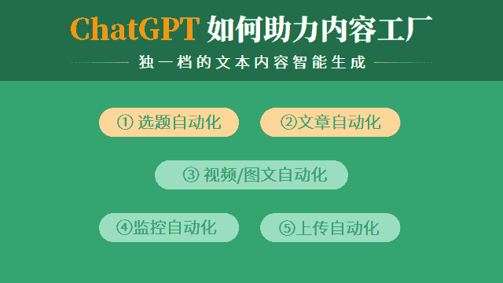
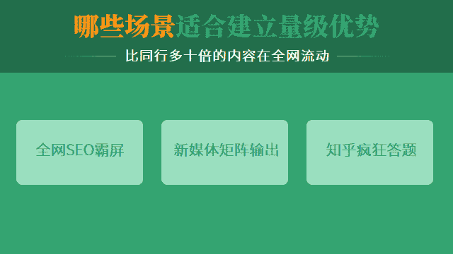

# 2023-05-22ChatGPT 航海启动当天，我开启 RPA+ChatGPT 的项目，一周创收 7W

> 来源：[https://xuqiwei1986.feishu.cn/docx/Le54dlOnDoTFQix9ozbc4JcInKc](https://xuqiwei1986.feishu.cn/docx/Le54dlOnDoTFQix9ozbc4JcInKc)

> 🔗 原文链接： h[ttps://articles.zs](https://articles.zsxq.com/id_qg5k0x9wx1t1.html)xq.com/id_qg5k0x...

>

赚钱圈友们，大家好，我是阿愚呱呱， 是 2020 年 10 月份加入龙哥盟，时长两年半的练习生。从龙哥盟得到的启发和圈友的帮助，现在在做一个 RPA（机器人流程自动化）社群。

ChatGPT 现在大火，如何用好 ChatGPT？我认为主要是两个方向发力：

1、生成好的内容

2、生成更多的好内容

如何把内容质量搞好？2 月 ChatGPT 航海的学习，刚好帮我补充了这部分的知识。

ChatGPT 生成的内容质量非常好，但接下来大家有了更进阶的需求，就是如何多快好省地生成大量的内容。而我非常擅长把流程自动化，所以就用 RPA 来驱动 ChatGPT 自动化生成内容，再次提高了效率，这也满足了一部分用户的需求。

所以我今天想跟大家分享的经验是：我是如何推出 RPA + ChatGPT 训练营并实现一周创收 7W+ 的。

## 一、基本情况介绍

先跟大家再次简单汇报一下相关数据情况。

#### 1.1 产品服务内容

就是提供一种解决方案，帮助用户在用好 ChatGPT 的基础上，提升 10 倍效率的内容生产。

#### 1.2 营收基本数据

变现金额：7 万

新会员：35 人

客单价：1980 元/人（有两人以 2980 元插队加入）

#### 1.3 推出 RPA+ChatGPT 训练营时间线

在 3 月份的龙哥盟 ChatGPT 航海期间，我第一时间推出了《 RPA+ChatGPT 训练营》。

ChatGPT 航海是在 3 月 3 日起航，我也是从 3 月 3 发👸号推文宣布我即将推出《RPA+ChatGPT 训练营》，报名截止日期为 3 月 8 日。

共计有 63 人报名参加，有两个新人是 3 月 9 号之后插队进来的。这次新会员 35 人。老会员是交押金参加，不算做收入。

#### 1.4 如何引流获客

我的团队就我一个人，在推广上往往是心有余而力不足。虽然我自己就是搞自动化骚操作的，但很多事情不是自动化就能搞定的。

这次我并没有对外推广，应该没啥拉新。就是原来的私域（朋友圈将近 1 万人）+半公域（👸号 900 多关注）流量变现。虽然👸号粉丝很少，但这次带来了起码超过 20 个新会员。另外知乎（400 多个关注）同步了我的👸号文章，也带来了 3 个成交。其他的就是朋友圈的转化了。

我是比较注重把用户加到🛰️上的。我的两个🛰️主号，有将近一万的🛰️好友。这个数量，跟私域大佬没法比，但比大多数人的好友要多一些的。这一周发文推广，激活了十来个好友成为新会员。

##

## 二、我是如何把 ChatGPT 与 RPA 结合起来的

主要经历以下阶段，从（1）发现 ChatGPT 、（2）体验 ChatGPT、（3）挖掘 ChatGPT、（4）动手做了个 ChatGPT 工具、（5）参加 ChatGPT 航海、（6）推出 RPA+ChatGPT 训练营

#### 2.1 无意中发现 ChatGPT

我是在去年 12 月，在龙哥盟知识星球不经意发现了关于 ChatGPT。

但是当时并没有第一时间意识到 ChatGPT 可能产生的影响。不过，你在龙哥盟这个圈子，就算你把耳朵堵住了，眼睛蒙住了，你还是能感受到风吹草动。

#### 2.2 对 ChatGPT 充满好奇并体验

被龙哥盟的 ChatGPT 氛围感染，我体验过 ChatGPT 之后，觉得非常好用。这时候我对 ChatGPT 就有了进一步挖掘潜力的想法。

#### 2.3 进一步挖掘 ChatGPT 的价值

我本人常年玩自动化，虽然不懂编程技术，但经常用 RPA 来搞自动化。自动化可以帮助建立内容量级优势，实现大力出奇迹。

ChatGPT 生成的内容的是绝对的独一档，非常值得用 RPA 自动化将其威力扩大。

实际上，把生成流程梳理好之后，就可以借助 RPA 来实现内容的自动输入和内容的自动抓取保存。

当然， RPA 机器人还具备多个智能判断功能。比如生成的内容不完整，那么就会自动对这种情况发出「续写」的指令。

别看要实现的功能很简单，但确实能够极大提升效率。人工手动去操作，一天搞个 100 篇，就会把人搞的毛躁了。

手动操作没啥技术含量，这种重复操作的事情应该交给 RPA 机器人，而你去验收生成的内容。你应该去做做更有价值的事情。

#### 2.4 做了一个 RPA 驱动 ChatGPT 的机器人

有了思路，我就马上动手做个可用的产品。

大概在去年 12 月中旬，我做个了用 RPA 驱动 ChatGPT 自动化生产内容的工具，给了一个客户去使用。他的反馈是非常不错。

后面又有学员也用到了这个工具，她还录了个运行效果视频分享到别的群里。虽然那时候的版本非常简单粗暴，但在群里引起了不小的轰动。甚至不少人直接找到了我，表示非常有需要这款机器人

这给我了一个很好的正反馈。

#### 2.5 参加龙哥盟 ChatGPT 航海

这次的 ChatGPT 航海对我非常及时。可以说，通过参加航海，RPA+ChatGPT 训练营得以更快启动（在龙哥盟小航起航当天我就发推文招生了），并且也极大完善了交付内容。

我对 ChatGPT 这座金山了解还是非常的少，绝大部分知识都是从这次 ChatGPT 航海实战中学到的。

航海有个特别优秀的地方，就是一开始有一个航海资料库。我快速地把资料库过了一遍，形成自己知识库，然后形成解决方案融入到我的训练营中。

如下图。如果没有这部分内容，我认为这个训练营是不完整的。

#### 2.6 推出 RPA+ChatGPT 训练营

在 3 月 3 号，也就是小航海启动仪式那一天，我在👸号和朋友圈发文，开启 RPA+ChatGPT 训练营报名。

推出的 RPA+ChatGPT 训练营，给出解决方案而非信息差。

我结合我的实战经验，给出了一些应用场景。这些场景，很多用户能够有代入感，因为很多人本身就在做这个事情。

而参加 RPA+ChatGPT 训练营的人员，基本上都是奔着解决方案来的，而非是关于 ChatGPT 的信息差。所以我把参与门槛定价到 1980，这个价格应该算不低了，但仍然一周时间新增了 35 名会员。

##

## 三、我的思考总结

据说我是这次参加 ChatGPT 小航海中变现还算不错的一个。以下是我的一些思考总结：

#### 3.1 敢于推出产品，敢于收钱

如果说我做对了一些什么，那么敢于推出产品，敢于收钱，这是最值得肯定的。

收钱的前提就是你得有交付的东西，也就是你的产品。这个产品可以是一个社群、一门课程、一个训练营、一个工具、一次指导等等

很多人就卡在这一步。他有一个又一个的想法，然后一个又一个的否掉。原因千奇百怪，比如自我觉得没有技术含量、还不够成熟、应该没有人会买等，甚至还害怕别人说这是割韭菜。最后就是想法仅仅是想法，并没有可以拿出来交付的产品

我的这次 RPA+ChatGPT 训练营，只讲三节课，收费 1980/人。由于只在朋友圈和👸号发文，推广曝光不多，更没有动不动就几百人的购买。但好在客单价还行，黄小刀说这是她目前见过最高的 ChatGPT 变现客单价（现在肯定不是了），所以一周创收七八万，我还是很满意的。

如果定价是 199/人，虽然不能重走一遍，但我估计收入会缩水 80%

#### 3.2 给产品讲出一个性感的故事

交付内容不能是一个机器人。机器人本身不太值钱，值钱的是一整套玩法。我比较喜欢讲的打通「思路×流程×自动化」，机器人只是自动化的载体。如果能把思路、流程也做成交付内容，形成一个整体，那么价值就大大提升了。

这是我给「RPA+ChatGPT」讲的一个故事。

#### 3.3 借势热点，动作要快

我可能是全网第一个推出 RPA+ChatGPT 交付产品的人。

这次我并没有对外推广，只是在自己朋友圈和👸号发文。但这次借势还算不错，在流量不大的情况下，转化情况我还是非常满意的。

借 ChatGPT 的势。我的主业是做 RPA 社群，通过 RPA + 各种应用场景带着大家落地自动化。这次 ChatGPT 火出了天际，果断直接拿出 RPA+ChatGPT 自动化方案

借龙哥盟 ChatGPT 航海的势。在航海启动当天，推出这次训练营，估计有将近一半的新会员是赚钱圈友。

####

#### 3.4 「A+X」搞钱术

A 是比较稳定的主线，X 是各个嫁接对象。比如 ChatGPT+📕、ChatGPT+金融、ChatGPT+编程等等

我的 A 是 RPA，嫁接的对象是 ChatGPT，所以是 RPA+ChatGPT。

从龙哥盟得到的启发和圈友的帮助，现在在做一个 RPA 社群。不同于 RPA 技术导向，我几乎很少谈 RPA 本身怎么学，往往关注 RPA 怎么用到各个场景中。

我这里把各个场景叫做 X，这套玩法就叫「RPA+X」。我加入龙哥盟的第三天还是第四天，就赚回了两倍门票。给一位圈友做了一个机器人，收了 4K。然后第二个月就赚了小几十倍的门票吧。

无论是赚到两倍门票还是赚到小几十倍门票，变现的产品本质都是「RPA+X」。包括我推出的《RPA+ChatGPT 训练营》，仍然是属于 RPA+X 这个套路。

#### 3.5 从龙哥盟中找到各个 X

2020 年，龙哥老板在👸号上写了篇文章《聊聊普通人如何在抖音上赚钱》，这是一篇对我影响巨大的文章。里面包含了很多的商业机会，我呢，从中挖掘了其中一点点的商业机会。

我用 RPA 打通了找资源（比如抖音号主🛰️）、加好友（智能添加、记录管理）这两大核心环节，并在龙哥盟知识星球分享了 RPA 知识以及 RPA+加好友经验贴。

有一点没想到，我一不小心成了龙哥盟第一个发 RPA 贴子的人。

我在 2020 年 10 月加入龙哥盟，加入龙哥盟后一个月，也就是在 11 月份，我做了 RPA+加好友训练营。第一期的 RPA+加好友训练营，价格是 1999 元/人，半个小时报名人数超过了 60 人，咱们的龙哥盟圈友占比超过 70%。

历史总是惊人的相似，RPA+ChatGPT 训练营和 RPA+加好友训练营有共通的路径。

「RPA+加好友」是从龙哥盟得到启发，「RPA+ChatGPT」也是从龙哥盟发现的。

实际上不止于此，比如抖音自动化引流、📕笔记批量排版、视频批量生成、视频批量上传等，都是从龙哥盟社群发现的机会。

甚至，我还又再推出了一个「AI 航海社」社群，到当前为止刚好十天，创收了 5 万多一点。收入跟那些流弊的社群没得比，但于我而言，还是比较满意了

最后，感谢龙哥盟。别人问我对龙哥盟怎么评价，我往往第一句话就是「我从加入后每年都续费」。还有，今年给龙哥盟拉新了32人。