# AI 让郭老师讲英文相声了？是怎么做到的

> 来源：[https://xuqiwei1986.feishu.cn/docx/AJTbdd0YUorEYhxr8zzcuUaInae](https://xuqiwei1986.feishu.cn/docx/AJTbdd0YUorEYhxr8zzcuUaInae)

大家好，我是元峰，13 颗 AI 之心持有者。最近有点沉迷于数字人无法自拔，主要可玩的东西太多了。

最近几天，郭德纲老师英文说相声， Taylor Swift 说地道流利的中文等这类语言翻译的视频很火，到处都能见到。与其说他们学会了新的语言技能，不如说背后的 AI 技术给了我们一个巨大的惊喜。

话不多说，先看看我做的这段视频。

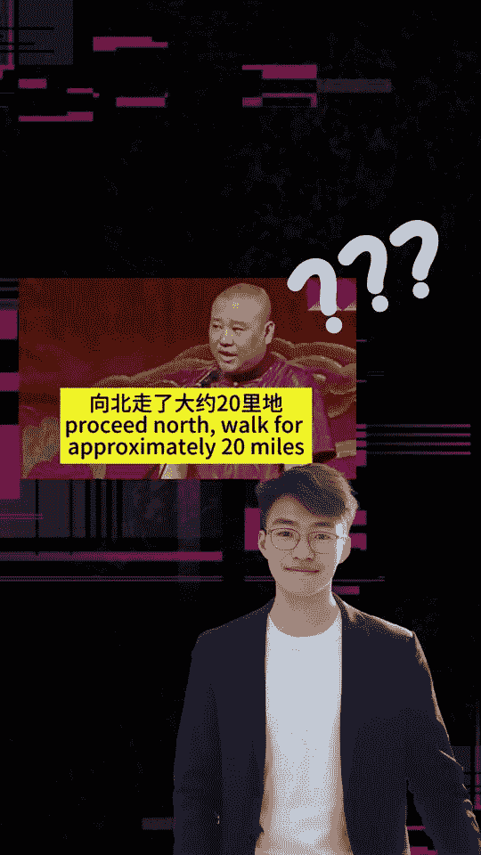

[郭老师讲英文相声可画.mp4](https://internal-api-drive-stream.feishu.cn/space/api/box/stream/download/all/KmQNbUpLHod9d1xuIQAcNViTnFf)

## AI 技术：改变我们看世界的方式

当然，能有这么炸裂效果背后的功臣就是 AI 技术，它让一切变得有趣且不可思议。

这种逼真的翻译与模仿技术的出现，意味着我们已经进入了一个全新的 AI 时代。在这个时代，不仅仅是语言的翻译得到了革命性的提升，人的声音、音调、乃至嘴型的动作都可以被完美复制和再现。这种技术的应用范围非常广泛，从娱乐、电影、到教育、商业领域，都有巨大的潜力。

但同时，这也带来了一系列的伦理、版权等问题。当 AI 可以如此轻松地复制并模仿人的声音和嘴型，我们如何区分真实与虚构？如何保护原创者的权益？如何确保这项技术不被用于不正当的目的？

接下来，我将为大家揭示这类视频翻译背后的神秘面纱，详细对比几个实现此效果的方法。而且在文章的结尾部分，我也会分享一下今天这段视频的制作过程。

# 方法一：翻译+克隆语音+换嘴型

来自“没有译制片腔调的翻译“原作者的评论，要达到如此逼真的效果，需满足以下三个关键条件：

1.  **地道的口语翻译**：这意味着内容不仅仅是单纯的翻译，更需要注意到句子的连贯性、文化背景、以及句子之间的逻辑关系，确保翻译内容听起来自然流畅。

1.  **完美克隆说话者的声音**：这要求 AI 技术能够分析、学习并复制说话者的声音特点和音调，以再现出与原说话者相近或几乎一样的音色。

1.  **精准匹配嘴型动作**：为了达到画面和声音的同步，AI 还需要能够分析视频中的嘴型动作，并将翻译后的内容与之完美匹配。

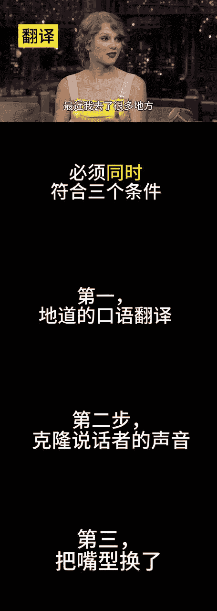

## 方案1：Whisper + tortoise-tts + wav2lip

+   **语音识别**：使用Whisper技术进行精准转录。

+   **声音克隆**：首先提取原声音的特征，接着利用tortoise-tts技术合成接近原始说话者音色的语音。

+   **嘴型同步**：采用wav2lip技术，实现声音与嘴型的完美匹配。

分析：这个方案相当繁琐，涉及多个步骤。需要大量的算力，虽然实时转换还不容易，但未来随着技术进步和算力提升，实时转换和降低成本都将成为可能。不过，这样的技术也可能带来潜在的风险，如电诈、制造假消息等。

## 方案2：whisper + so-vits-svc + GeneFace++

+   **语音转录**：采用whisper技术。

+   **文字翻译和声音合成**：首先通过GPT技术翻译文本，然后使用so-vits-svc克隆声音并生成音频。

Github：[https://github.com/svc-deve](https://github.com/svc-develop-team/so-vits-svc)lop-team/so-vits-svc

+   **视频同步**：使用 GeneFace++ 技术生成与音频匹配的嘴型视频。

（++版本还没发代码，GeneFace 的 Github：https://github.com/yerfor/GeneFace）

这两个方案我自己没有尝试，一个是测试成本太高，另外因为后面有更方便的方法。

# 方法二：Rask AI

下面为大家介绍的是一个名为 Rask AI 的在线平台。相比于方法一中需要自己动手搭建环境、配置工具的方法，Rask AI 简直太友好了！

操作步骤简单到爆：

1.  登录 https://app.rask.ai/

1.  上传你想要翻译的视频文件。

1.  选择视频中的讲话人数。

1.  选择原视频的语言。

1.  选择你想要的目标语言。

1.  点击“翻译”按钮。

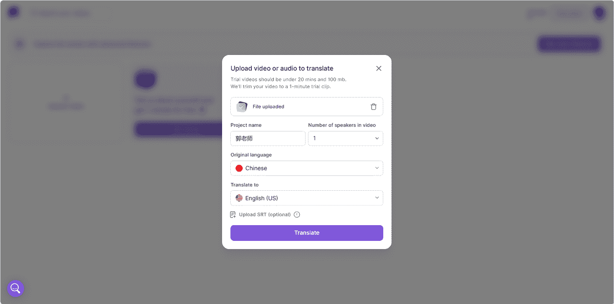

**等待时间短**：上传完视频后，大概只需要 3-4 分钟的时间，翻译就完成了！

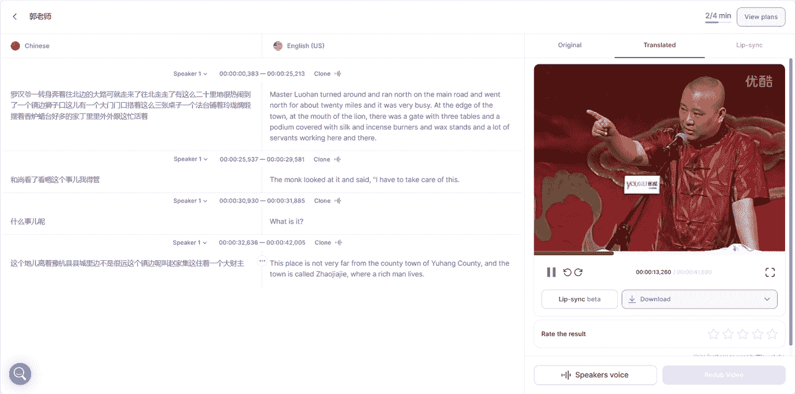

## 翻译后的文字

> 罗汉爷一转身奔着往北边的大路可就走来了往北走走了有这么二十里地很热闹到了一个镇边狮子口这儿有一个大门门口搭着这么三张桌子一个法台铺着玲珑绸缎摆着香炉蜡台好多的家丁里里外外跟这忙活着。

> Master Luohan turned around and ran north on the main road and went north for about twenty miles and it was very busy. At the edge of the town, at the mouth of the lion, there was a gate with three tables and a podium covered with silk and incense burners and wax stands and a lot of servants working here and there.

>

> 和尚（原文应该是和珅）看了看嗯这个事儿我得管。

> The monk looked at it and said, "I have to take care of this.

>

> 什么事儿呢

> What is it?

>

> 这个地儿离着豫杭县县城里边不是很远这个镇边呢叫赵家集这住着一个大财主。

> This place is not very far from the county town of Yuhang County, and the town is called Zhaojiajie, where a rich man lives.

## 我们来听听视频效果

[郭老师_translated_video_rask.mp4](https://internal-api-drive-stream.feishu.cn/space/api/box/stream/download/all/JPGLbKsAwoy9CMxqLmdcFiy0nkg)

郭老师讲相声视频 Rask AI 翻译结果

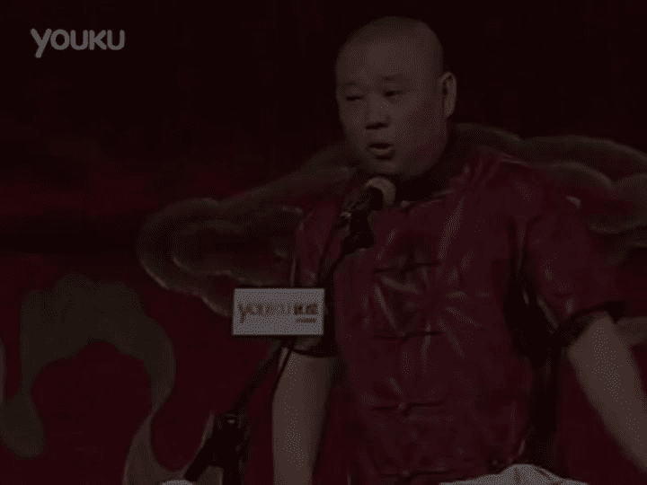

[郭老师讲相声.mp4](https://internal-api-drive-stream.feishu.cn/space/api/box/stream/download/all/OrFBbVVONo8QSQxP1gtcbbXqnWf)

郭老师讲相声原视频

通过对比就会发现，虽然翻译的声音是没问题的，但嘴型却完全不匹配。这意味着它的翻译服务更侧重于声音的准确性和自然流畅，而不是视频的视觉同步。

# 方法三：ElevenLabs

https://elevenlabs.io/dubbing

1.  进入“Dubbing”标签，新建 Dubs。

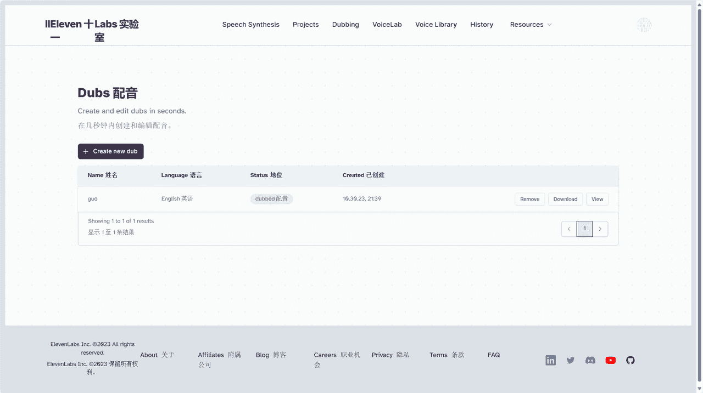

1.  上传文件，选择原视频语言，选择目标语言，单击创建按钮。

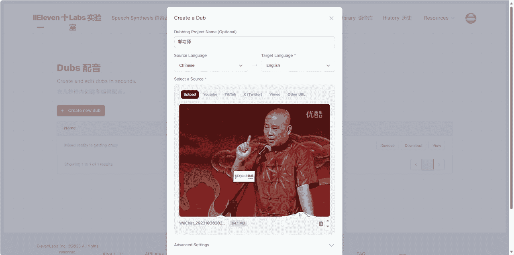

## 翻译结果

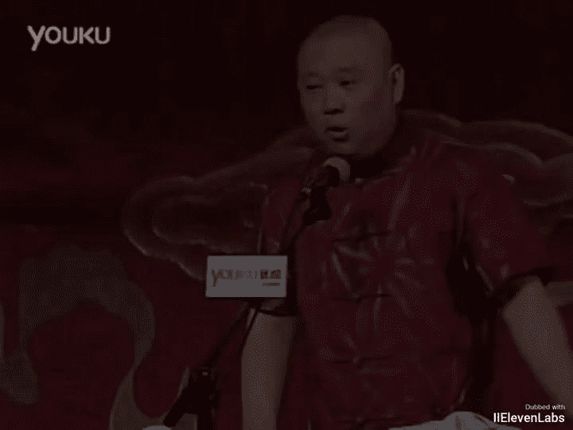

[guo_elevenlabs.mp4](https://internal-api-drive-stream.feishu.cn/space/api/box/stream/download/all/ArfNbEdAfomKgixKsmgcCvUvnLd)

郭老师讲相声视频 ElevenLabs 翻译结果

仔细观察发现，ElevenLabs 也是只翻译了声音，嘴型匹配不上。

# 方法四：HeyGen 实验室

[HeyGen 实验室的视频翻译功能，地](https://t.co/GuuqKGnLCd)址：https://labs.heygen.com/video-translate

使用方法依旧很简单。

上传视频，选择目标翻译语言，点击确定，等待结果。

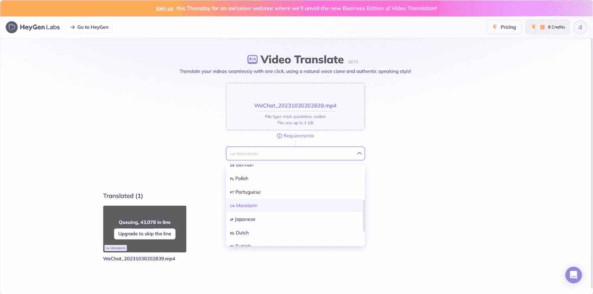

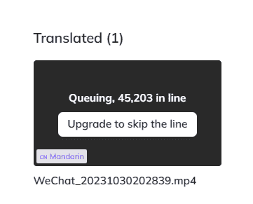

但是呢，免费用户只有经历过漫长的等待之后才能获得视频，我这次前面排队人数 4.5 万人，看的我整个人都麻了。（排队了两天之后。。。）

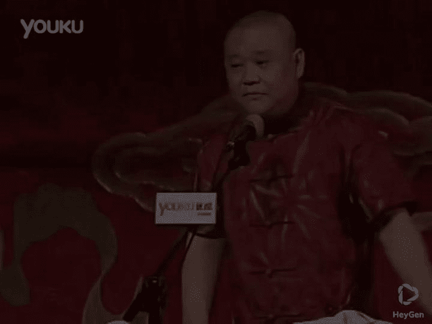

[郭老师_translated_video_Heygen.mp4](https://internal-api-drive-stream.feishu.cn/space/api/box/stream/download/all/N50dbvj1Fo0X8BxNT87ck91fn1f)

郭老师讲相声视频 Heygen Lab 翻译结果

我看到有网友在排队了 7000 个视频之后，终于完成了翻译，效果绝对目前最好，没有之一。 口型完美，卡点和嘴型都对的上。 尽管声音克隆还有些许不足，但考虑到 HeyGen 仅通过 40 秒的视频就完成了这么高水准的声音克隆，已经算是很牛了。

但是，每个产品都有它的短板，HeyGen 的情感还原度确实稍有些欠缺。如果你是个细节控，对比原视频可能会发现这一点。

[泰勒·斯威夫特Heygen翻译.mp4](https://internal-api-drive-stream.feishu.cn/space/api/box/stream/download/all/ZA6ObhH3DoXj0pxiMOwcZO9In4e)

泰勒·斯威夫特Heygen视频翻译

[泰勒·斯威夫特原视频.mp4](https://internal-api-drive-stream.feishu.cn/space/api/box/stream/download/all/A6YhbObpoo5jrxxIVEtciflsnNh)

泰勒·斯威夫特原视频

看完这些翻译的结果，应该是可以破案了，声音和嘴型都完美匹配。目前对比下来我认为，使用最方便，效果最好的还是 Heygen 实验室的视频翻译功能。

# 数字人口播视频玩法

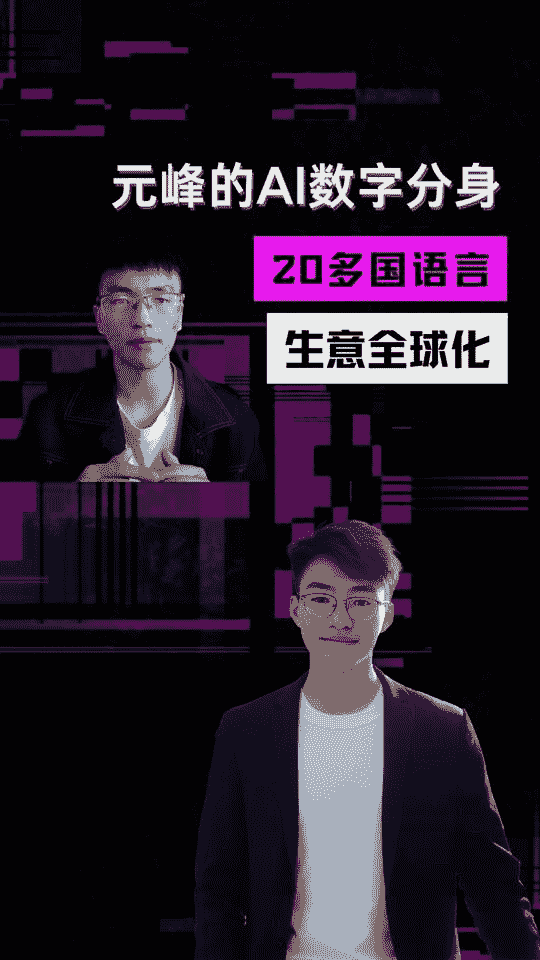

[元峰的AI数字分身可画.mp4](https://internal-api-drive-stream.feishu.cn/space/api/box/stream/download/all/NdwJbTClko924LxiB9ocz4DpnUe)

昨天我在星球分享了上面这个视频：视频中的我，其实并不是真的我。那是一个克隆的数字人元峰。通过这样的方式，我们不仅可以大大节省内容创作的时间，还可以在视频编辑上花费更多的精力，打造更高品质的作品。

下面拆解一下这些数字人视频的制作步骤：

1.  **数字人克隆**，是咱们星球合伙人 Kevin|林文冠帮我做的。

过程很简单，我们只需录制一段日常的口播视频，之后 AI 就会开始学习并克隆。目前的效果已经相当出色，无论是动作还是口型，都能达到90%的还原度。关键在于：想要AI表现得更好，我们需要提供高质量的样本。

1.  **准备文案，**当拥有了自己的数字人之后，只需要为它准备好文案。数字人就妥妥变为你的“打工人“，默默无闻，任劳任怨为你读出这些文案，随后，就可以拿到导出的这段视频。

1.  **视频剪辑**，这一步无疑是最为关键的。虽然数字人能够为我们节省大量的录制时间，但视频的后期制作仍然需要我们的细心打磨。例如，我分享的那段关于郭老师的视频，就融入了各种不同的素材，包括 Taylor Swift 的原视频和其他相关片段。

当然，这个步骤可以根据个人喜好和需要进行调整。有些朋友可能只需要简单添加字幕，而我则选择增添了一些音效和动态贴纸，为视频增色不少。

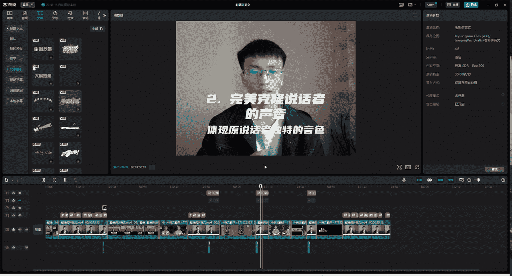

1.  **设计封面和边框模板**，你可以为视频设计封面和边框模板，并加上结尾。我通常使用可画，不过 PPT，创可贴，稿定设计都行。

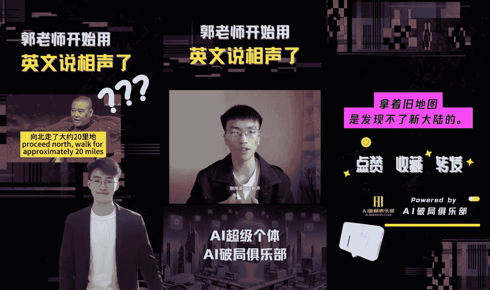

1.  **发布视频，**最后一步，当然是将作品分享出去！

至于效果如何？看图吧，这几天的数据表现还不错。

好啦，今天的分享就到这里。如果你觉得有所收获，欢迎点个赞！希望大家也把数字人玩起来，帮助你创作出更多有趣、更有料的内容！

参考链接：https://x.com/dotey/status/1715186194294706511?s=20