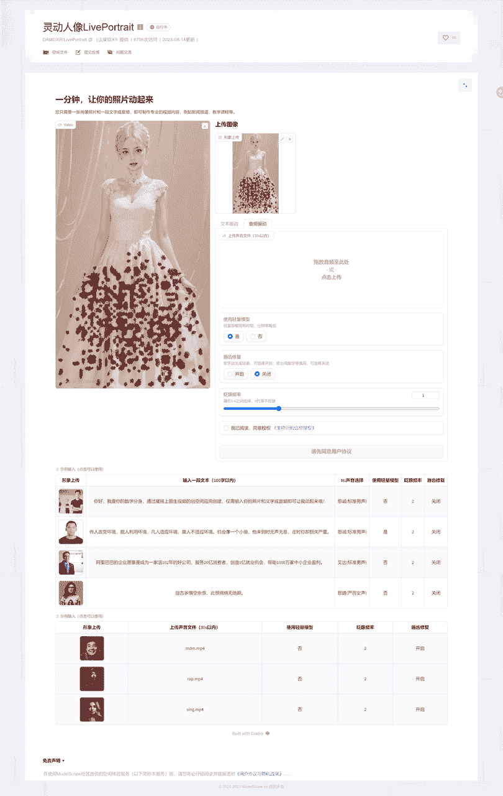
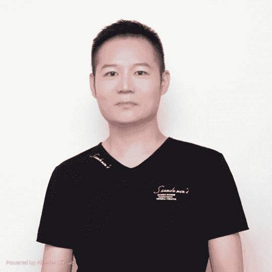
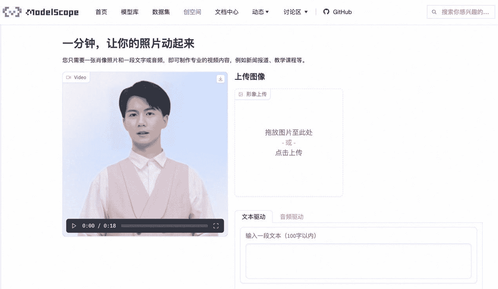

# 2023-08-16魔搭社区上线 AI 视频生成工具 Live Portait，可一键让照片开口说话

> 来源：[https://xuqiwei1986.feishu.cn/docx/Gd4Sddud8o7llzxiZe8c8OkEnyg](https://xuqiwei1986.feishu.cn/docx/Gd4Sddud8o7llzxiZe8c8OkEnyg)

> 🔗 原文链接： h[ttps://www.ithom](https://www.ithome.com/0/712/732.htm)e.com/0/712/732.htm

>

阿里云在生成式 AI 领域又有新进展。8 月 16 日消息，阿里云推出数字人视频生成工具 Live Portait，上传一张照片和一段文本或语音即可生成一段开口说话的数字人视频，可应用于视频直播、聊天机器人、企业营销等场景。目前，该工具已在魔搭社区创空间开放体验。

# 体验demo

https://modelscope.cn/studios/DAMOXR/LivePortrait/summary

[out.mp4](https://internal-api-drive-stream.feishu.cn/space/api/box/stream/download/all/G1v9bkA2GoUhPXxtZGbcu8kunsg)

自对话大模型和 AI 绘画模型相继火热后，业界对生成式 AI 的研究逐步朝更多模态的方向演进，AI 视频生成便是热门技术之一。该技术可将文本或音频等信息转换为面部运动信息，进而驱动生成照片人物形象的动画，能有效降低视频拍摄和制作门槛。

此次上线的 Live Portait 工具由运动模块和生成模块组成，其采用阿里云自研的口型预测算法，生成的口型准确度相比传统方法大幅提高；在训练阶段，增加了姿态的显式控制，无需底板视频也可以生成任意动作的视频，大幅提升数字人说话的真实感；此外，通过眼神主动控制技术，Live Portait 可以为眼球增加一些自然运动，使得生成结果在观感上更接近真人效果。据介绍，Live Portait 相关技术已被 CVPR、ICCV 等国际 AI 顶会收录。

根据魔搭社区上的信息显示，在 Live Portait 上传照片后，用户可选择文本驱动和音频驱动两种方式，文本驱动模式下，该工具提供了普通话、英语、粤语、童声等 28 种声音。此外，Live Portait 还提供了轻量模型选择，帮助用户更快速生成视频。

该工具算法负责人张邦表示：“ Live Portait 集成了团队多项自研创新技术，例如仅需单张图片就能生成逼真的面部动画，突破了传统对抗生成网络的局限。随着技术的进一步迭代，图生视频有巨大的应用空间，有望成为企业降本增效的生产工具。”

据悉，该团队研究方向涵盖数字人、3D 模型 AI 生成、高真实感渲染、自然人机交互等领域，目前已发表 50 多篇国际顶会论文。

广告声明：文内含有的对外跳转链接（包括不限于超链接、二维码、口令等形式），用于传递更多信息，节省甄选时间，结果仅供参考，IT之家所有文章均包含本声明。