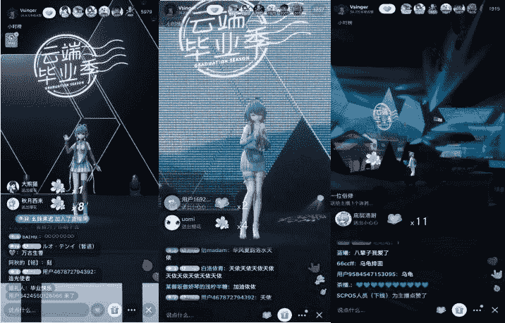
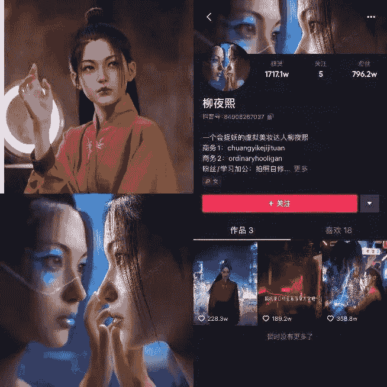
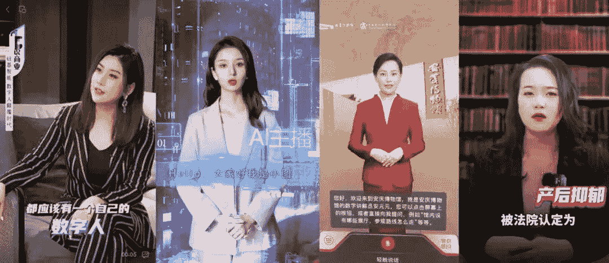

# 2023-08-28骗局还是机遇？揭秘数字人直播的真相-36氪

> 来源：[https://xuqiwei1986.feishu.cn/docx/GjoJdOfNFofaLrxHRrUcyv4ynZb](https://xuqiwei1986.feishu.cn/docx/GjoJdOfNFofaLrxHRrUcyv4ynZb)

> 🔗 原文链接： https://36kr.com/p/2404565582439168

>

最近一年，“数字人直播”的概念很火。

AI+数字人是大势所趋，目前在多个领域的实现了应用。特别是在直播/短视频领域，数字人虚拟主播以低投入、高产出、续航久的直播模式，极大地提升了企业的效率。

**据数据统计，**仅2022年一年，数字人相关企业注册数量就高达948家， 增速68%。

而数字人直播的成效也十分诱人：

**传统直播需要雇佣主播、**购买设备、搭建场地，光是一个标准直播间的 成本投入就高达几十万。

**而数字人直播，只需一台电**脑，最多加一个运营即可开播， 成本可以控制在一万左右。

此外，想象一下，有了数字人技术，你就可以在24小时内，多账号不间断地进行直播，最大化地利用碎片时间赚取收益。

**那么，什么是数字人直播？它是否真的像传言的**那么好用？如果是的话，企业又该如何利用？

## **什么是数字人？企业要不要入局？**

所谓数字人，简单来说就是 运用数字技术创造出来的，与人类形象接近的数字化人物形象。

数字人的创建是一项极为复杂的工作，需要经过建模、动画制作、渲染三个步骤。通过高级计算机程序实现。

最终数字人能还原真人80%以上的样子，无论是外观、动作还是声音，都能像现实世界里一样自然。

目前数字人直播已在游戏、科技等多个领域得到了广泛运营。当然它运用最多的领域还是零食美妆领域。

据报道，抖音锋味派意面直播间在使用AI数字人后，其直播的日均成交金额约16.31万元，对比真人主播15.15万元的日成交额显然更加出色。

而在拼多多的特步直播间里，数字人主播日均GMV约为4.1万元，并且登上了运动品牌的小时榜，实力不容小觑。

面对汹涌的“数字人直播”浪潮， 近期就有粉丝问我，企业要不要入局数字人？

我认为，要入局。 而且，现在就是企业入局数字人最好的时机。

不过，这也取决于企业的行业和规模。就现阶段的数字人直播而言，或许并不适合所有企业。

**哪些企业适合入局？**

**1、游戏行业： **游戏行业是数字人直播最早应用的领域之一，因为游戏的品牌形象和虚拟内容的特性完美契合数字人直播的特点。

**2、美妆行业： **美妆化妆品是一个与女性关联度较高的领域，数字人直播可以通过虚拟形象、美容技巧等方式帮助品牌建立更好的形象。

**3、电商行业： **电商平台可以利用数字人直播为商品宣传、展示产品特性，从而提高曝光和销售量。

**4、食品行业： **食品行业具有多品类，客单价低的特点，非常适合数字人进行直播销售。

**5、科技行业： **数字人直播可以帮助科技公司展示其创新成果，增强品牌知名度和市场份额。

**哪些企业目前还有局限性？**

**1、服装行业： **不同于一般行业，服装类产品在网上售卖，通常需要主播上身效果。现阶段数字人技术还不够成熟，暂时无法做到灵活更换衣服。

但这并不代表未来不行，最近几年投入和研发数字人技术的企业不在少数，相信假以时日，数字人技术也能支持服装行业的需求。

**2、知识付费： **此外那些极具个人特质的达人主播，比如东方甄选的董宇辉。表面上他是在直播间卖货，实际上董宇辉卖的是一种“文化”。

像这类兼具知识储备与个人魅力的主播，恐怕短期内数字人还无法做到完全替代。

## 数字人直播，解决了企业哪些痛点？

企业投资是一项理性的商业行为，讲究投入产出比。如果投入无法为企业带来可观的收益，那么这样的投资显然是不值得的。 那么，数字人直播可以为企业带来哪些价值？

首先，数字人直播解决了企业招主播难的问题。 真人直播需要配备主播、场控、运营等一系列直播相关方面的人才，但是很多中小企业却面临：公司吸引力有限、人才薪金要价过高、薪金要价低的又缺乏经验能力这样的困境。

而数字人直播仅仅需要一名运营参与真人驱动，对于企业来说，大大解决了招工难的问题。

其次，数字人直播解决了企业养主播贵的问题。 一位采用数字人直播的企业负责人提到：“数字人的一大优势在于大大降低了企业的人力成本。

目前，市面上单个主播的平均月薪高达两万元，也就是说即便不算直播团队，企业一年光招一个主播花销就高达24万元。

而数字主播的建模费大致在1万元左右，加上系统使用费在内的各项费用，一年也不过10万元。如果企业规模较大，同时拥有20个主播的话，采用数字人替代真人主播，一年就可以为企业省下200万元的支出。

再者，数字人直播解决了企业留主播难的问题。 对企业来说，培养主播是一项辛苦活。一个新人主播从入行到轻车熟路，企业需要在他身上花费大量的时间与金钱。

即便最终，企业真的打造出了一款现象级的IP，真人主播对于企业的不确定性还是太大了，随时有可能出现疲劳生病、情绪低迷，乃至离职这样的问题。

而对比真人，数字人的表现则十分稳定，不生病，不离职，极大的降低了人们的管理成本。

此外，数字人的另一大优势，在于「闲时流量」。

目前许多商家的直播间，均采用了真人和数字人组合的形式。傍晚的黄金时段，由真人主播出镜带货。

华莱士就采用了真人+数字人结合的方式

而到深夜，或是白天一些流量较差的时段，则用数字人去填补闲时流量，抢占更多真人主播难以覆盖到的用户，增加企业收益。

## **数字人直播，要花多少钱？**

数字人的本质是一条由技术驱动的赛道。从最初几乎没有对话能力，卡通化的纸片人，发展到今天具有多种人像风格，可以24小时与用户对话的阶段，数字人技术经历了多个版本的发展与迭代。

时至今日，市面上有多个版本，不同价位不同功能的数字人模型，可供品牌商家们挑选。

最近我们团队也走访了多家研发数字人技术的企业，根据我们了解到的信息，目前市面上应用的数字人技术共3档，我整理了它们对应的价格和效果供你参考。

**第1档： **虚拟数字人的制作以人物形象+ Vocaloid语音合成为主，生成具有美丽外表的虚拟数字人，如洛天依；

> 参考价：无建模费，1000元/月

> 效果：录播、动作僵硬、场景单一，有被平台封号的风险。

**第2档： **虚拟数字人的核心技术是2D/3D建模+实时动作捕捉+真人配音，如虚拟数字歌手聆秋、沐汐，美妆达人柳夜熙；

> 参考价：建模费1万元左右，之后5000-10000元/月

> 效果：动作自然、场景真实，但仍需要一位真人驱动

**第3档， **虚拟数字人不但可以预测嘴唇的动作，还可以用文字合成语音来表达，整个虚拟数字人的面容、身体、声音、动作生成均由AI实现，具有真人质感、辨识度高、互动性强的特点，是更接近人形的“超写实虚拟数字人”。

> 参考价：建模费2万元左右，之后10000元/月

> 效果：动作自然、场景真实，高度贴近模版本身，互动性强。

从价位来看，目前中小型企业想要入局“数字人直播”领域，前期需要一定的固定成本投入，比如建模，训练，后期数字人建模和训练稳定了，成本相对就少很多。

因此，目前市面上一种流行的玩法，是企业在初期，找服务商购买数字人服务，降低运营成本。等到测试结果数字人直播的确适合自己，且达到理想的投入产出比后，再考虑搭建全套的数字人配套设施。

不过，在此需要提醒各位企业， **数字人直播本质只是一种工具，它能解**决效率问题，但并不能很好地解决流量问题。

所以千万不要想着一本万利，购买数字人直播后就撒手，”让数字人24小时无人播“。这样不仅无法达到企业想要拥有的效果，反而存在一定警告封号的风险。

所以在数字人应用的初期。企业仍需安排1-2名运营人员，在后台对直播进行流量监控和真人驱动，等到数据稳定后再逐渐转向无人直播。

## **写在最后**

今天你对新鲜事物的理解，就决定了未来的竞争力。 行业数字化是大势所趋，而数字人直播则是数字化进程中的重要组成部分。

面对汹涌而来的“数字人浪潮”，我们如果不能以更快的方式拥抱变化，至少要做到学习了解。

如同此前大火的GPT，数字人技术的出现，最终淘汰的不是人类本身，而是那些不会（拒绝）使用新技术的人。

本文来自🛰️👸号 “晏涛三寿”（ID：yantao-219） ，作者：晏涛，36氪经授权发布。