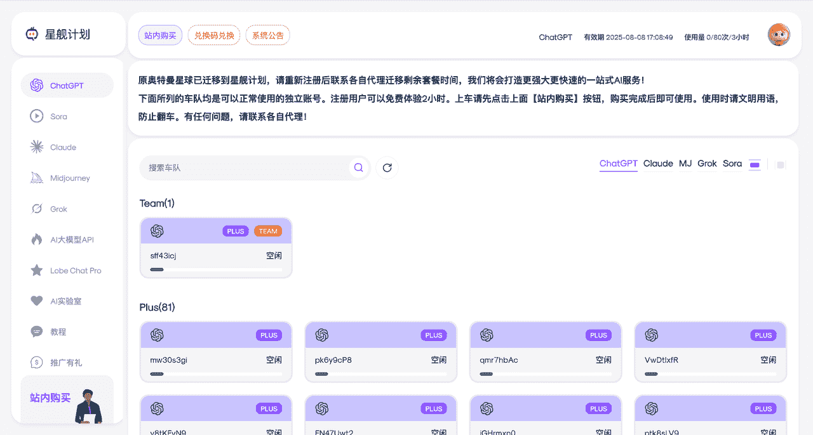
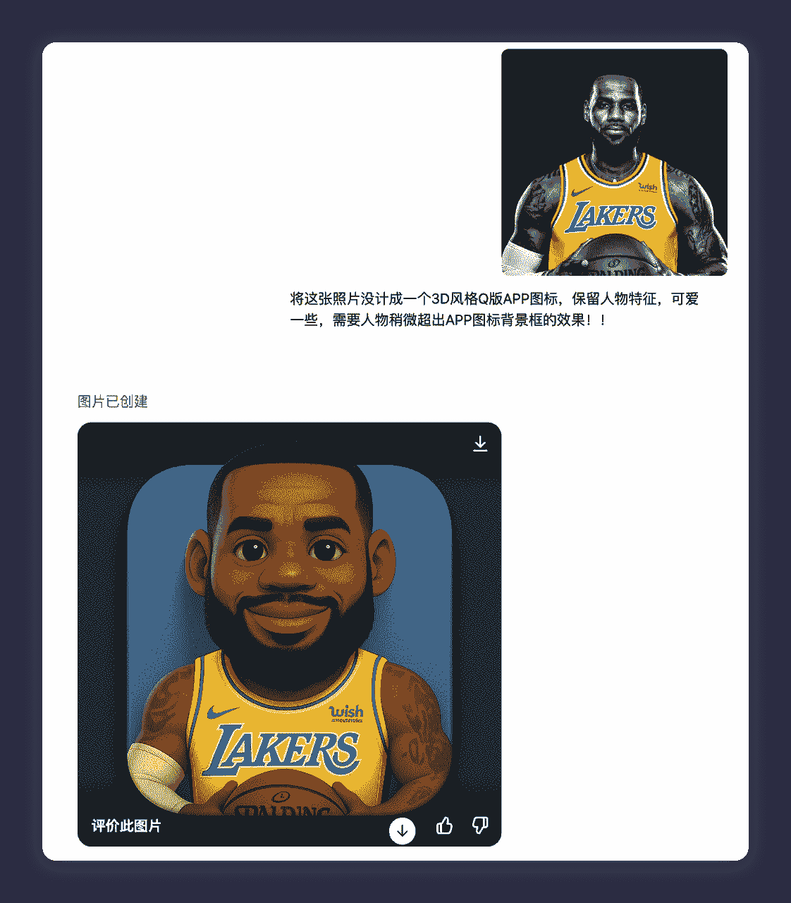
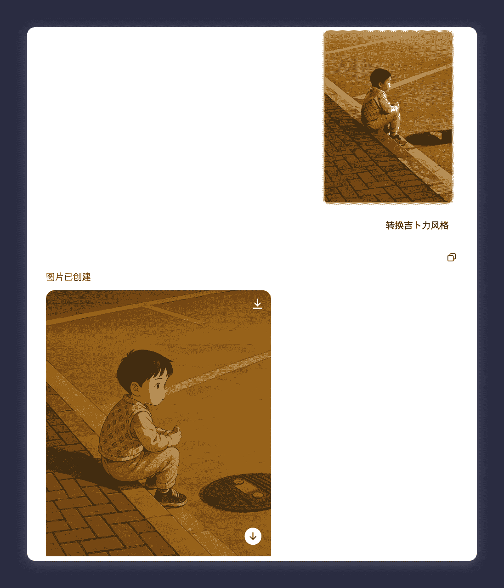
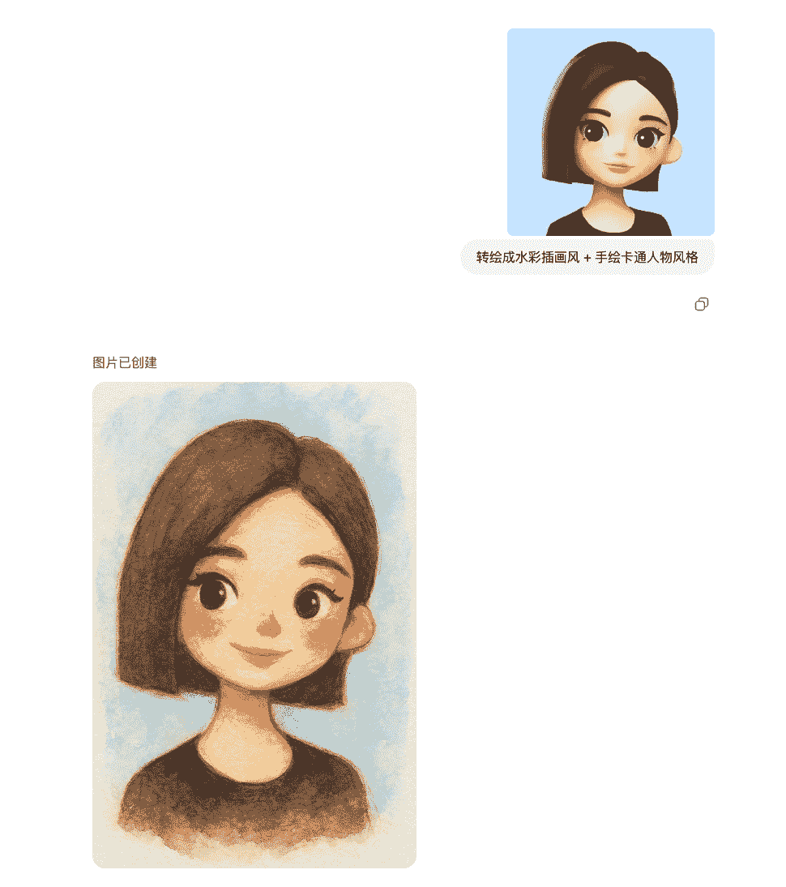
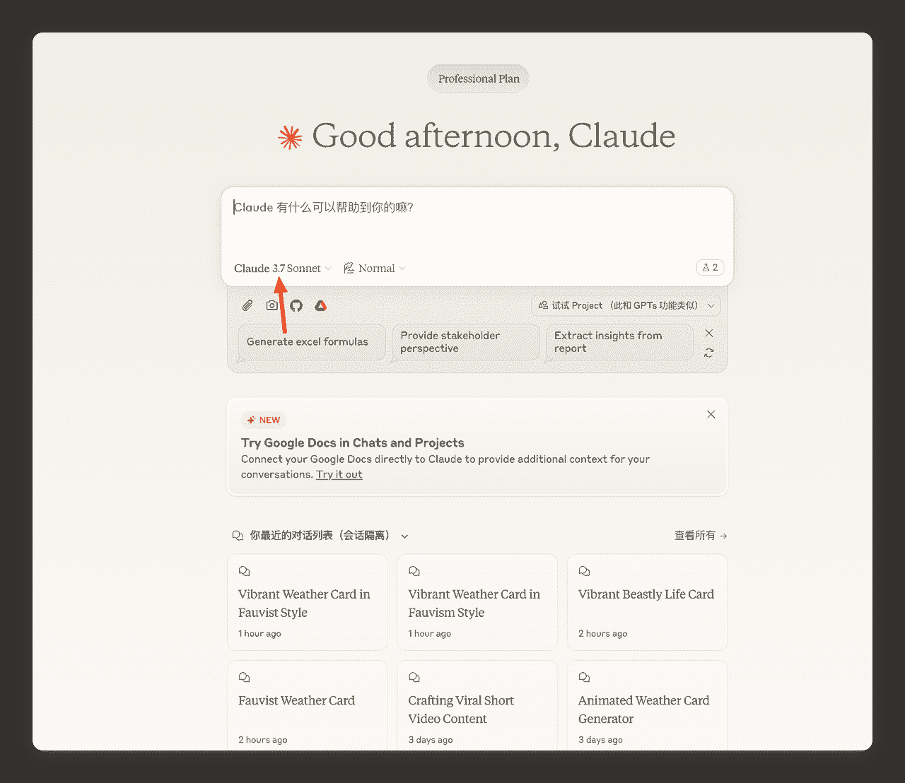
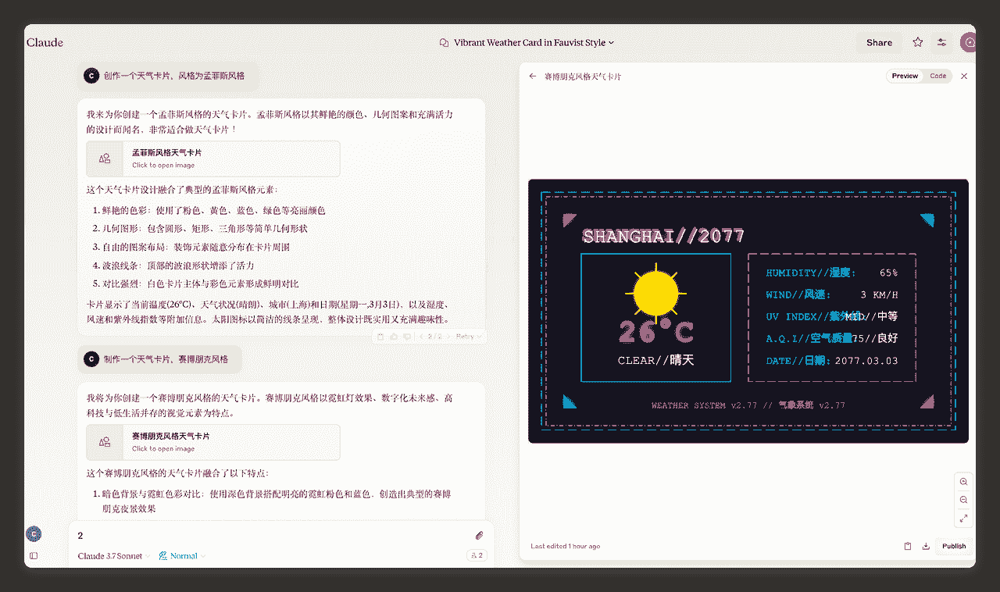

# 🥇「AI 知识库」 首页

> 来源：[https://xuqiwei1986.feishu.cn/docx/MpN6dklYQoVgjOx26E6cG0BKnXf](https://xuqiwei1986.feishu.cn/docx/MpN6dklYQoVgjOx26E6cG0BKnXf)

# **“****AI** 不能取代我们，不会用 AI 的人才会被取代”

> **人工智能从未停下脚步，而我们选择在浪潮中——记录、思考、整理。自2023年4月**11日起，本AI知识库已被使用超过100万人次。这不是终点，只是硅基生命的开始。

永久免费更新   欢迎转发分享   共同学习进步

请务必点击这里收藏主页 永不失联

> **推荐【电脑】查看**

> 【手机用户】请点击左上角三条杠按钮或下面的内容大纲查看目录

# AI 实验室主页

# **这是什么？**

> **「****AI**** 知识库****」是隶属于「AI **实验室」的一个专注于 AI 领域分享的 Wiki 知识体系免费产品

>

> **如果你需要系统全面的学习 ****AI** 知识和提升技能，这里将是你的首选平台！

# 这有什么用？

> **了解 ****AI**** 行业动态：**轻松获取最新、最全面的 AI 信息

> **掌握 AI 实用工具：**了解并掌握各种工具和技巧，提升自己的实战能力

> **沉淀 ****AI**** 知识技能：**借鉴他人丰富的经验，开拓自己的思路

> **探索 AI 致富之路：**从实战角度探究 AI 如何更好地变现

# 我该如何学习？

> **点击查看**[🔝「AI 知识库」使用手册](https://ssw9noe1h6.feishu.cn/wiki/wikcnuCVQB9PQ8BxUygJ6WXo0xc)** ，快速掌握学习路径！**

> **目前知识库包括以下内容大纲**，覆盖内容如下（点击蓝色标题可跳转目录）

> **一、**[🎖️  ChatGPT 系列](https://ssw9noe1h6.feishu.cn/wiki/wikcnqRzHluvTRJkbpKf19Jckwe)[** **](https://ssw9noe1h6.feishu.cn/wiki/wikcnqRzHluvTRJkbpKf19Jckwe)

> 二、[💰 AI 变现思路收集](https://ssw9noe1h6.feishu.cn/wiki/wikcnVTPIJR1Ry09EDfCo3hd1Mf)** **

> **三****、**[🎨 AI 绘画系列](https://ssw9noe1h6.feishu.cn/wiki/wikcnb8AmNjeT2fuYeF6gmJIiqh)[** **](https://ssw9noe1h6.feishu.cn/wiki/wikcnb8AmNjeT2fuYeF6gmJIiqh)

> **四****、**[💎 AI 工具教程/实用技巧](https://ssw9noe1h6.feishu.cn/wiki/wikcngoWUteNBYy5QdXMz2Eadhb)** **

> **五****、**[🔧 AI 实用工具分享](https://ssw9noe1h6.feishu.cn/wiki/wikcnSq0IogwDL0URn8Sp51e0ve)[** **](https://ssw9noe1h6.feishu.cn/wiki/wikcnSq0IogwDL0URn8Sp51e0ve)

> **六、**[📃 AI 应用场景](https://ssw9noe1h6.feishu.cn/wiki/wikcncgpTO4v7gHoDqLCoxD30ig)** **

> **七****、**[📕 AI 研报资料库（PDF）](https://ssw9noe1h6.feishu.cn/wiki/wikcnISy3lFPKd4oXZGIEzHgKwd)** **

> **八****、**[🤝AI 产品合作推广](https://ssw9noe1h6.feishu.cn/wiki/wikcner134N3vSXsetF6qpsaERg)

# 如何贡献一份你的力量

> 如果可以的话，不妨将本**「****AI**** 知识库」**分享给其他人，感谢～

> 在阅读**「****AI**** 知识库」**的时候，遇到错别字、句子不通顺或者内容有错误，

> 欢迎[**点击这里**](https://wenjuan.feishu.cn/m?t=s5KwvGGed5Mi-kafl)[**进行反**](https://ssw9noe1h6.feishu.cn/wiki/wikcnVPM0ph10ctdhfiLD7iYzVb)馈，一**经**采纳会将你的名字罗列在感谢墙板块中。

# 我想参与「AI 知识库」的建设

> 如果你觉得**「****AI**** 知识库」**对你的学习之路有帮助，并且也想通过 Wiki 的方式沉淀自己的知识，

> 同时也认可老于的分享理念，不妨[**点击这里**](https://wenjuan.feishu.cn/m?t=sJs2IE4Ci2Mi-15le)进入知识库投稿，一起参与**「AI 知识库」**的内容建设，

> 一起做大做强！

> 也欢迎大家多多**点赞留言**，让我知道你们的需求，分享更多实用的干货！

# 如何鉴别「AI 知识库」真伪

> 如果您看到有模仿我们的同类**「****AI**** 知识库」**，请用飞书客户端在页面右上角菜单打开查看文档信息，

> 对比日期和浏览量一看便知，**严禁以任何形式出售本知识库**

> **本知识空间部分内容根据公开资料和网友投**稿，仅供学习交流使用，如有侵权请联系删除

# 近 30 日更新情况：

+   **Doubao seedream4**.0 模型更新案例（豆包，即梦用法大全）

[豆包・图像创作模型4.0案例](https://iv6eoyisrlu.feishu.cn/wiki/ZSehw9Rkniu21ekd31XcMdkJn8f)

[即梦・图像创作模型4.0案例](https://iv6eoyisrlu.feishu.cn/wiki/J4tRwH6YNikoSzkYSOhc3QDOn1f)

+   [星舰计划 - GPT、Claude、Grok、MJ、Sora](https://ssw9noe1h6.feishu.cn/wiki/AXOXwzvDyi44d4keAlVcv2MlnOb?from=from_copylink)舰计划ChatGPT已更新agent 代理功能，使用地址：

+   **全新发布一站式使用新产品：**[星舰计划 - GPT、Claude、Grok、MJ、Sora](https://ssw9noe1h6.feishu.cn/wiki/AXOXwzvDyi44d4keAlVcv2MlnOb?from=from_copylink)

+   奥特曼星球最新接入 GPT4o画图模型，国内即可使用体验

> [奥特曼星球 - 国内原生界面 1:1 可使用 GPTs](https://ssw9noe1h6.feishu.cn/wiki/Iv5gwRwuDiTlv8kx4rtczdebn6g)

> **克劳德星球最新接入 Claude****3.7so**[克劳德星球 - 国内原生界面 1:1 可使用新版本](https://ssw9noe1h6.feishu.cn/wiki/L6Nkwc9iCiUrUdkdPkQcLGJjnKh)net模型，国内即可使用体验

> 使用地址：

[奥特曼星球 - 国内原生界面 1:1 可使用 GPTs](https://ssw9noe1h6.feishu.cn/wiki/Iv5gwRwuDiTlv8kx4rtczdebn6g#share-HznUdbRkGo98Vtxg3jecZBrknSf)

> 1.奥特曼星球已全面适配手机,同时修复会话列表查询异常

> 2.奥特曼星球新增实时语音功能

> 3.奥特曼星球已更新支持o1 pro，国内直连，让您无需开通200刀(1500元)套餐即可使用，节省成本高达95%

+   [📕 AI 研报资料库](https://ssw9noe1h6.feishu.cn/wiki/wikcnISy3lFPKd4oXZGIEzHgKwd)  更新多篇前沿最新文档报告（ 11.19 日）

+   [💰 AI 变现思路收集](https://ssw9noe1h6.feishu.cn/wiki/wikcnVTPIJR1Ry09EDfCo3hd1Mf) 收集更新多篇文档

+   [📕 AI 研报资料库](https://ssw9noe1h6.feishu.cn/wiki/wikcnISy3lFPKd4oXZGIEzHgKwd) 10.15日更新

> 2024大模型驱动的数字员工3.0建设应用白皮书

> 2024年AI与可持续发展展望（中文版）

> 2024年自身智能产业发展研究报告：大模型赋能

> 2024年营销AI报告（中英双语）- Salesloft-35页

> 2024年中国金融大模型产业发展洞察报告 - 艾瑞

> 2024年互联网及AI GC渠道流量报告

> 人类模型创业格局报告【量子位智库】

> AI大模型系列报告二：OpenAI发布GPT-01, …

> AI智能助手产品分析报告【量子位智库】

> GIO白皮书：AI赋能工业创新（2024） - 73页

> 面向教师的人工智能能力框架（中英双语）- UN

+   [【AI副业解析】手机壁纸📕](https://ssw9noe1h6.feishu.cn/wiki/S3yxwJRZHiG4g8km5xhc8BEgnvj)

+   [AI生成表情包保姆级教程](https://ssw9noe1h6.feishu.cn/wiki/NuBVwdVW2iL8mQk7s02cfzynnoe)

+   [阿里｜10分钟掌握AI绘画](https://ssw9noe1h6.feishu.cn/wiki/DNyxw7DF0iIIYekgE8Wc7UKen9g)

+   [ChatGPT Prompt 编写指南](https://ssw9noe1h6.feishu.cn/wiki/NLMzwPfJ1iNPS2krGcNc2z0CnSf)

+   [本地代码解释器运行教程](https://ssw9noe1h6.feishu.cn/wiki/OP1twjgC5i5xhskzkAucShheni4)

+   [ChatGPT Code Interpreter 高级指南 - 重创数据分析市场，中文词云，PDF、Excel文件处理，歌曲分析、MTV制作，生成视频、二维码，绘制分形艺术](https://ssw9noe1h6.feishu.cn/wiki/BO6KwMzgiiT8qRkhxHBcAlmknZb)

+   [ChatGPT 神器 Code Interpreter 开放（附保姆级教程）](https://ssw9noe1h6.feishu.cn/wiki/YbcPwrLdOiuxfekO0Rrca79InxU)

+   [Midjourney 更新，搞怪风格【weird】指令让你的图片更加独特](https://ssw9noe1h6.feishu.cn/wiki/Wjyxwdhwji4fcMky1Fzcigt8nJf)

+   [📕 AI 绘画爆款提示词拆解](https://ssw9noe1h6.feishu.cn/wiki/Mcf9wGCr6iZg30kGXaHczYoLnIc)

+   [Midjourney 不同模型和参数生成结果对比](https://ssw9noe1h6.feishu.cn/wiki/UMDYwl9wBiF1jLkS4DucCFrmnMd)

+   [【AI 绘画案例】MJ 中画出梵高风格的图](https://ssw9noe1h6.feishu.cn/wiki/QZwvwK33wiZNfKkrK2Cc26pdnGg)

+   [使用Midjourney绘制乐高模型教程](https://ssw9noe1h6.feishu.cn/wiki/NOezwhWCxiO6rmkmQFfcdIFEnFe)

# 更新路线图** Roadmap**

# 友情链接

> 排名不分先后

[秋葉 aaaki](https://security.feishu.cn/link/safety?target=https%3A%2F%2Fspace.bilibili.com%2F12566101%2F&scene=ccm&logParams=%7B%22location%22%3A%22ccm_default%22%7D&lang=zh-CN)

B 站的秋叶大神

AI 绘画喂饭区 UP 主

[GenJi 是真想教会你](https://space.bilibili.com/49746395?spm_id_from=333.337.0.0)

生产力工具教学

全网最全 包教包会

[Web3 天空之城](https://space.bilibili.com/351754674)

高质量 AI

内容原创者

[INDIGO TALK](https://www.xiaoyuzhoufm.com/podcast/62bbe7a66bad6a3c0c6222d3)

数字镜像播客

逻辑严谨、思考深入

AI 前线

面向 AI 爱好者

提供 Al 领域资讯

[量子位](https://mp.weixin.qq.com/mp/profile_ext?action=home&__biz=MzIzNjc1NzUzMw==&scene=124#wechat_redirect)

追踪人工智能新趋势

关注科技行业新突破

[新智元](https://mp.weixin.qq.com/mp/profile_ext?action=home&__biz=MzI3MTA0MTk1MA==&scene=124#wechat_redirect)

优秀👸号

人工智能，机器人

[水木AI知识库](https://smaireport.com/)

清华系初创团队

高质量资料人脉链接

[GitHubDaily](https://mp.weixin.qq.com/mp/profile_ext?action=home&__biz=MzAxOTcxNTIwNQ==&scene=124#wechat_redirect)

GitHub 项目洞察者

发掘好玩新项目

[Szhans](https://web.okjike.com/u/B81A1705-9A6F-48C6-BF15-678405047F87)

百姓网 CEO

高质量的 AI 作者

[林粒粒呀](https://space.bilibili.com/523995133?spm_id_from=333.337.0.0)

B站AI领域优质UP

AI领域生产力教学