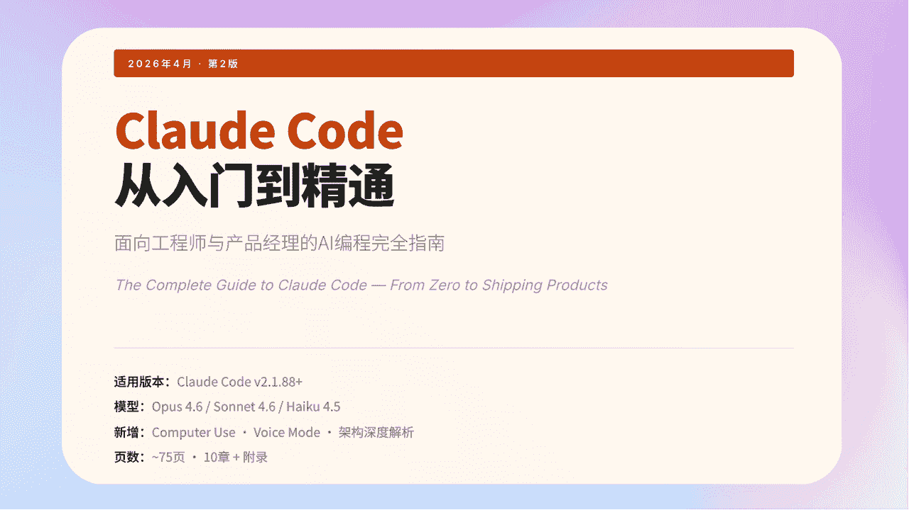
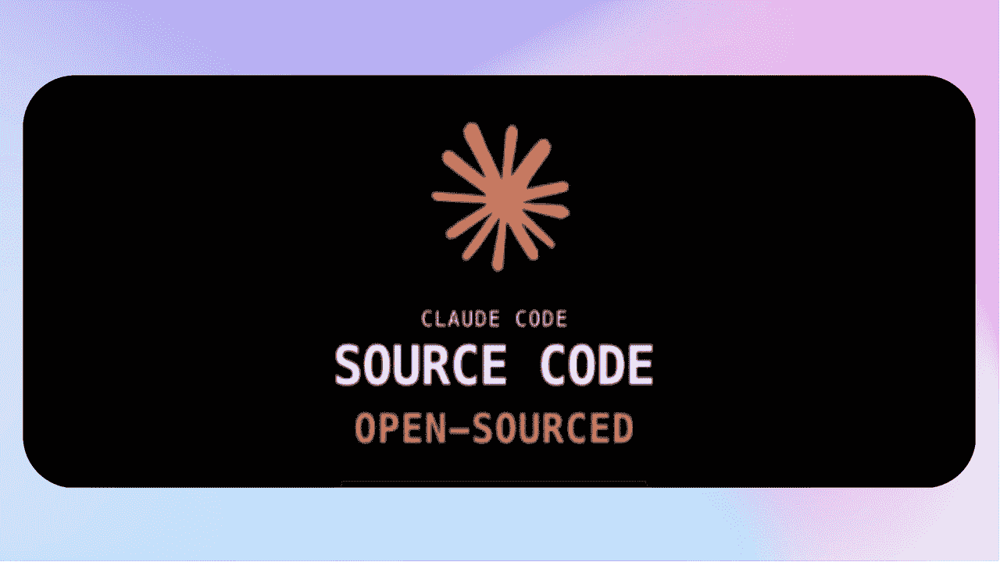
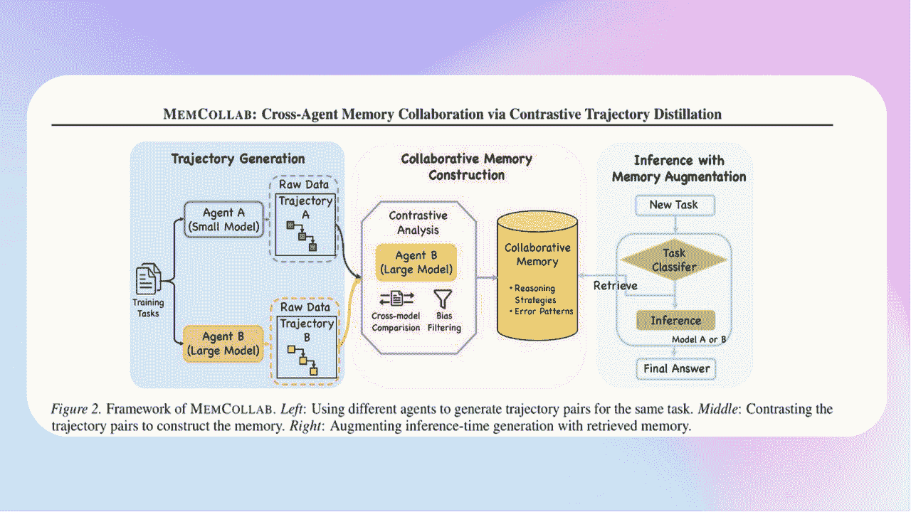
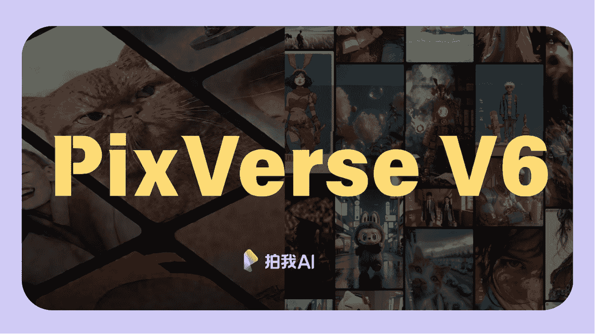
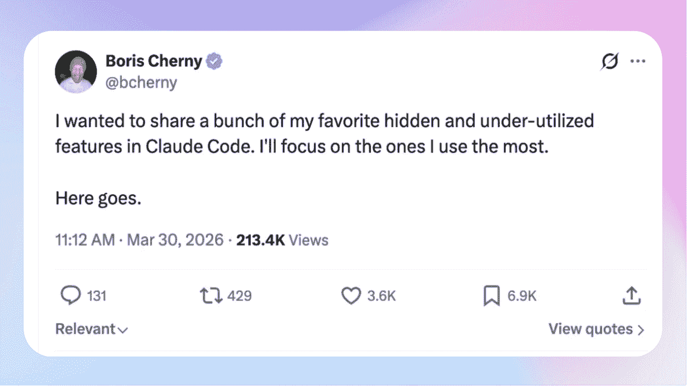
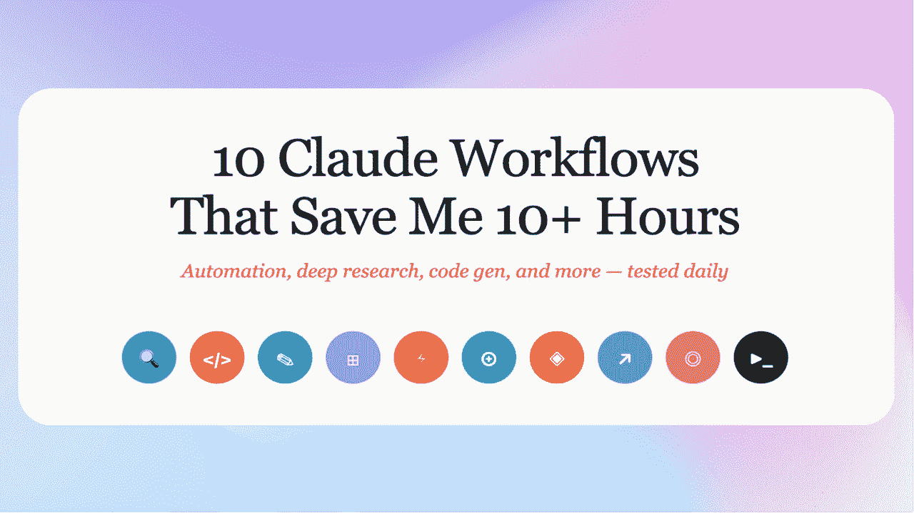
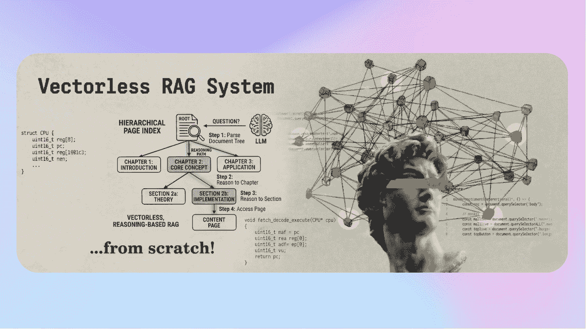
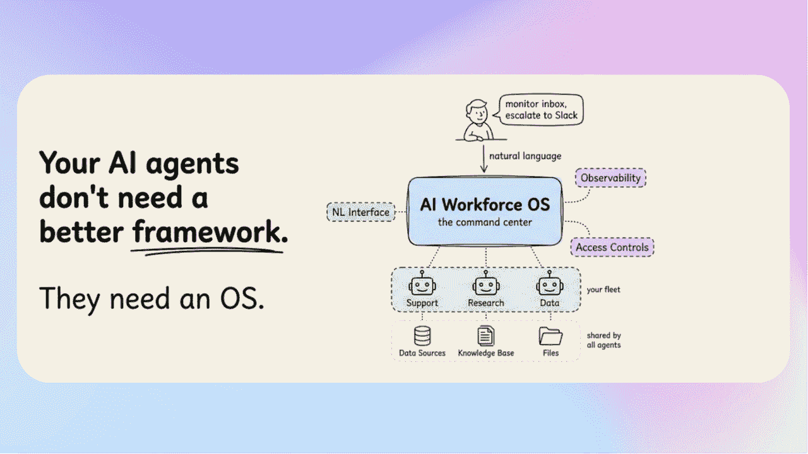

# 通往AGI之路

> 来源：[https://xuqiwei1986.feishu.cn/docx/NDsAdX4spozsglxgqm7caJqdnVf](https://xuqiwei1986.feishu.cn/docx/NDsAdX4spozsglxgqm7caJqdnVf)

# 🎯  愿景和目标

> 要实现通用人工智能（AGI）也许有很长的路要走，

> 我们的目标是让每个人的学习过程少走弯路，让更多的人因 AI 而强大。

# 🔖  简介  |  W[aytoAGI.com](http://waytoAGI.com)

欢迎来到通往 AGI 之路 / WaytoAGI社区是致力于人工智能学习的知识库与社区平台，提供系统全面的 AI 学习路径，整合资源、组织实践活动。覆盖近 900 万学习者，知识库访问量超 8000 万次，联动 180 所高校及 100 + 企业，举办 500 + 场活动。

[知识库介绍说明](https://waytoagi.feishu.cn/wiki/BE57wlWV2iDkOvkbYIockX11nTC)｜[通往AGI之路社区 业务](https://waytoagi.feishu.cn/wiki/PhZwwGR7jinzLVkqohOc7oofnzf)｜[WaytoAGI 品牌 VI ](https://waytoagi.feishu.cn/wiki/Cvu8wBkLXiATBckEwl7c6eSvncf)

👸号：通往 AGI 之路

[Bilibili](https://space.bilibili.com/259768893)｜[📕](https://www.xiaohongshu.com/user/profile/6457d2e4000000001f030dbe)｜[Twitter](https://twitter.com/WaytoAGI)

## **🥳加入飞书知识问答**

WaytoAGI知识库内10000+篇内容，现在一句话即可出现精准答案加原文链接！

[📌 提问入口（](https://ask.feishu.cn/shared-space/7226178700923011075?referrer=agi_zsk)[需先点击「](https://waytoagi.feishu.cn/wiki/KKF6wrrHBiXvJzkxP0wcD8dyn5f)[加入知识](https://waytoagi.feishu.cn/wiki/KKF6wrrHBiXvJzkxP0wcD8dyn5f)库」再提问）👉飞书客户端操作路径

## 🚗加入社区三部曲

» 1️⃣ 开源免费知识库，包含所有资料，最新动态和日常活动

解锁每月线下 AI 切磋大会、各类 AIGC 赛事...

资料地址（首页每日资讯+左上角目录可展开）

» [通往AGI之路](https://waytoagi.feishu.cn/wiki/QPe5w5g7UisbEkkow8XcDmOpn8e)

» 2️⃣ 日常共学：每天晚 8 点共学直播（必订！）：

一键订阅直播日历，每天上新知识不漏看！

或关注 #通往AGI之路视频号

»  [订阅日程](https://www.feishu.cn/calendar/share?token=e2b16267282604efa375f8829e3d2cc7)

» 3️⃣ 加入群聊：获取最新动态，参与交流共建

» [立即加入](https://waytoagi.feishu.cn/wiki/QPe5w5g7UisbEkkow8XcDmOpn8e#GjhAd91P5o988vxjOYwcdLPRn3c)

## 📝 欢迎投稿

**不错的教程见解等欢迎投稿：**

🔬 AI技术探讨与分析

💡 实践经验与案例分享

🚀 行业动态与趋势观察

💻 开发心得与技术教程

**投稿要求：                          **                    ✅ 原创、严谨、有深度

📊 配图说明更佳

🎯 观点明确，结构清晰

📏 建议字数1500-5000字

**审核流程：**

📬 提交后2-3工作日反馈

✍ 必要时沟通修改建议

»»»[立即投稿](https://waytoagi.feishu.cn/share/base/form/shrcndlVeIpGvhhWvnsVfMhuFbf?iframeFrom=docx&ccm_open=iframe)

## 🫐社区最新栏目：

### OpenClaw训练营报名中

[第五期：OpenClaw训练营](https://waytoagi.feishu.cn/wiki/WewVwPVkyipyaCka7twcwPZMnJf) 🔗 立[即报名 ](https://waytoagi.feishu.cn/share/base/form/shrcnbc5x1Aq9IKMdPWJ4uMDb7c)

[详解：OpenClaw/Moltbot/Clawdbot](https://waytoagi.feishu.cn/wiki/CCR4wl3upi6dF9kVE5YcAcGcnlU)点击查看各类部署教程&实战案例：

我们3月份的课程将带领学员从零到一部署 Openclaw 框架，打通云端环境，结合热门场景（如新媒体图文、内容自动化等）手搓高价值的 AI 智能体应用。

### 📺直播共学

所有历史直播回放看这里👇👇👇

[共学数据库（历史）](https://waytoagi.feishu.cn/wiki/UKqNw8Un0iaCsXkECfCcNkl0nGc?table=tbliNls1Wi1mV6bY&view=vewcZAYD0u)

3月31日[ 直播回](https://waytoagi.feishu.cn/minutes/obcnq81flll15oq7rr21tzig)放

3月30[日 直播](https://waytoagi.feishu.cn/minutes/obcnqjg7m1zbf4258divc3k1)回放

3月2[9日 直](https://waytoagi.feishu.cn/minutes/obcnpu7236ip3u7788bia65s)播回放

3月[28日 ](https://waytoagi.feishu.cn/minutes/obcno6anw1st7lpu2nr4f816)直播回放

# 🎡近期活动

[WaytoAGI近期活动](https://waytoagi.feishu.cn/wiki/So9cwfj9yiuZJ8kSfLZce7a8nrf)鼓励大家以赛代练，多参加活动，和社区小伙伴一起动手实操

# 🎏 近 7 日更新日志

查看所有更新日志：[4.3 历史更新](https://waytoagi.feishu.cn/wiki/FjiOwWp2giA7hRk6jjfcPioCnAc)

###  4 月 1 日

+   《[26年3月开源模型汇总！Agent很火，但模型貌似没跟上~](https://waytoagi.feishu.cn/wiki/GZFWwI4pGinY4FkTbxScNblJnud?from=from_copylink)》3月份，是OpenClaw制霸的一个月，各家主要以推出各种Claw为主，大模型这一块，超大尺寸的模型，基本上各家都是发布，但没更新，比如， 智谱的GLM5-Turbo模型 、 千问的Qwen3.5-Omni-Plus模型 、MiniMax的M2.7模型、 小米的MiMo-V2-Pro模型 等等。不过盘点下来，还是开源了不少模型，Qwen开源了3.5系列的小模型、美团开源了全模态和定理模型、腾讯开源了视觉&音频模型、📕开源了OCR&图像编辑模型。

+   《[Claude Code CLI 源码分析 : 从 Prompt 架构到工业级 AI Agent缓存黑科技+自我进化+多Agent协作+遥测监控](https://waytoagi.feishu.cn/wiki/EWgZw2kq3i8ZrIkFTIRcCn2vnKe?from=from_copylink)》Anthropic 这种量级的公司，他们会怎么设计 AI Agent？看完源码才发现，这不是“Prompt 工程”那么简单，而是 缓存架构 + 自我进化记忆 + 多模式编排 的完整基础设施。

+   《[Claude Code 泄露代码隐藏的87个未发布功能 暴露其野心...](https://waytoagi.feishu.cn/wiki/PeSYwZR0kiiZmHkU6lccu1xAnZ0?from=from_copylink)》Claude Code 的完整源码泄漏后 有人说"44个隐藏feature flag"。小互翻完源码的实际数字是87个。让我们来一同看看这背后隐藏了哪些未上线的功能！

+   《[一文讲透如何构建Harness——六大组件全解析](https://waytoagi.feishu.cn/wiki/BgldwwYM4iOZTHkaSWBcxc2dnrd?from=from_copylink)》Agent = Model + Harness。 模型提供智能，Harness 让智能变得有用。这不是一个新概念，但它正在成为 2026 年 AI 工程领域最核心的共识。本文将从"裸模型的四个硬伤"出发，逐一拆解 Harness 的六大组件——文件系统、Bash + 沙箱、记忆（AGENTS.md）、Web Search + MCP、上下文工程、编排 + Hooks——带你看清 AI Agent 真正的竞争壁垒，不在模型层，而在 Harness 层。

+   《[真开源！Claude Code75页橙皮书，带你从入门到精通](https://waytoagi.feishu.cn/wiki/Xc4gwuYxqio1vYkQArLc1rT8noe?from=from_copylink)》这份手册是作者和Claude Code一起写的。对，用CC写CC教程，它自己教你怎么用它。信息来源主要是Anthropic官方文档、Claude Code之父Boris Cherny的分享、吴恩达的Claude Code课程，再加上我自己用CC做了十几个产品踩过的坑。我用CC大半年了，每个月给Anthropic付200多美金（含税），烧过数十亿tokens，该踩的坑基本都踩了一遍。

###  3 月 31 日

+   《[Claude Code 源码泄漏，全部细节与始末](https://waytoagi.feishu.cn/wiki/UWVBw4XS6iF8JQkEfTlcN35xnQe?from=from_copylink)》3月31日，安全研究员Chaofan Shou发现 Anthropic 的 Claude Code 全部源码通过npm包里的一个source map文件暴露在了公网上。其中1,900 个 TypeScript 源文件， 512,000 行代码，从工具系统到权限模型到未发布功能，全部以未混淆的原始形态公开可下载。几个小时之内，源码被多人备份到 GitHub。其中最大的一个备份仓库 一个小时内涨到11,300star 和 17,300fork，568个issue，让我们来一起探究事件的始末！

+   《[山音超级编剧大师 - 全格式影视编剧 Skill ](https://waytoagi.feishu.cn/wiki/REOTwDoQ7ilAslk3WX2c4BbSn0e?from=from_copylink)》山音超级编剧大师 - 全格式影视编剧 Skill 是由 @山音 设计的自然语言驱动编剧 Agent Skill 覆盖 1-3 分钟概念超短片→90 分钟电影长片→多集剧集的全流程剧本创作，一站式搞定人物、大纲、场景、剧本全链路，快来上手试试！

+   《[阿兰：第一周优秀笔记投稿](https://waytoagi.feishu.cn/wiki/ZWmxwGR1HiDtUQkwW2zcP9l9nGh?from=from_copylink)》WaytoAGI第五期「Openclaw小龙虾训练营」的课程已经进行了一半啦，在过去一周（2026年3月11日——2026年3月20日）我们收到了许多同学的作业投稿，经过层层筛选，最终精选出6位同学共11篇笔记分享给大家，希望大家有所收获，同时也感谢这几位同学的认真撰写。如果大家有好的想法想要投稿，记得通过下方二维码「作业投稿」和大家分享你的优秀作业笔记！

+   《[一文了解 Anthropic 的 Claude Code 源码：为什么它就是比别人好用？](https://waytoagi.feishu.cn/wiki/JG4LwaNIDiQI4akhU2kca9Urnwg?from=from_copylink)》Claude Code的完整TypeScript源码，51.2万行，1903个文件，就这样暴露在了公网上。Claude Code和其他AI编程工具到底有什么本质区别？为什么它写代码的"手感"就是比别人好？51万行代码里，到底藏着什么？快来一探究竟！

+   《[3.23-3.29｜本周顶级AI论文速览](https://waytoagi.feishu.cn/wiki/NhVsw5l8TiVBhQkrssUcBWF9nqd?from=from_copylink)》本周AI领域TOP论文覆盖自我进化、智能大爆发、模型架构与安全等核心方向。Hyperagents实现元认知自我优化，谷歌提出智能爆发来自社会式组合智能，ARC-AGI-3凸显人机推理差距。Claudini让AI自主发现更强对抗攻击，MemCollab实现跨模型记忆共享，多项技术在代码、强化学习、多智能体协作上大幅提升性能。快来一探究竟！

+   《[Nicholas Carlini：当 AI 比所有人都更擅长找漏洞，安全行业还剩几个月？](https://waytoagi.feishu.cn/wiki/OGI1wssooiDdxpk1iMMc7OU4nFf?from=from_copylink)》Anthropic 研究科学家 Nicholas Carlini 在 [un]prompted 2026 安全会议上用不到 25 分钟演示了一件事： 语言模型现在可以自主找到并利用零日漏洞 ，目标包括 Linux 内核这种被人类安全专家审计了几十年的软件。

+   《[PixVerse V6使用手册｜拍我AI上新！让 AI 视频拥有「生命感」](https://waytoagi.feishu.cn/wiki/K0sfw5w7NiDL04kXvjMc8Gh3nze?from=from_copylink)》万众期待的 PixVerse V6 终于上线啦！🎉社区专属福利：200份7天Pro会员兑换码，点击文档直接领取，手慢无！

###  3 月 30 日

+   《[AI音乐周刊 W.A 021](https://waytoagi.feishu.cn/wiki/VDXtwIozvigGqGklpULccKwbnfg?from=from_copylink)》本周AI音乐赛道迎来密集升级，从创作、剪辑到音频处理全面突破。谷歌Lyria 3 Pro实现长音频结构化生成，Suno v5.5主打声音克隆与个性化创作，Mureka新增视频配乐能力，工具实用性大幅提升。LALAL.AI分轨效率与音质同步优化，Neural frames、Tunee则让MV与虚拟艺人制作更简单。而且多篇前沿论文发布，覆盖长音频生成、音乐质量评估、深度伪造检测等关键方向。

+   《[最近很火的 Harness-Engineering 到底是什么？](https://waytoagi.feishu.cn/wiki/Dtfmw3bmBiAqtqk1eVmczuMbnWc?from=from_copylink)》Harness 到底是什么？放到AI的语境里，Harness就是你给AI搭的整套工作环境：告诉它什么能做什么不能做的规则文件，自动检查它有没有犯错的校验脚本，帮它记住重要信息的上下文管理，出了问题能回滚的安全机制。

+   《[Claude Cowork产品技术负责人：AI同事、本地优先Agent以及知识工作的未来 丨Latent Space](https://waytoagi.feishu.cn/wiki/SaXhwfd03iQ5pokZMSIc6JhcnYb?from=from_copylink)》Claude Cowork产品技术负责人Felix 从产品设计的第一原则出发，解释了 Anthropic 为何在"云优先"的浪潮中，执意把 AI agent 留在你的本地电脑——以及虚拟机、Skills、零执行成本这套组合拳，究竟在改变哪些根本性的东西。如果你关心 AI agent的产品逻辑、知识工作的自动化路径、或者 Anthropic 内部的工程文化，这期值得细读。

+   《[回顾去年 AI 出海 6 问 + SEO 实战 7 答](https://waytoagi.feishu.cn/wiki/OslMwa2fpiofXsk5GYMcKyFdnuf?from=from_copylink)》AI出海正进入精细化增长阶段，OpenClaw、A2A支付等方向热度攀升。流量成本走高，GEO与传统SEO成为了关键入口。本篇文章带你揭秘不同区域市场的付费差异与选择逻辑，给出0-1阶段定ICP、跑通渠道、讲清价值的核心步骤，更有SEO页面优化、外链、小语种布局等实战方案。对AI出海创业者而言，能直接避开常见误区，快速搭建可落地的增长打法。

+   《[Claude Code创始人分享了他最新的15条CC使用技巧！](https://waytoagi.feishu.cn/wiki/Jq99wfZJEi1JWckvohFcjR8dn5b?from=from_copylink)》Claude Code创始人Boris Cherny分享了他最新的15条使用技巧，让我们一同来一探究竟！

+   《[深度｜马斯克万字访谈豪言：明年实现AGI，人形机器人数量将十倍于人类，我们将迎来全民高收入时代](https://waytoagi.feishu.cn/wiki/XtlowsQwPihfjGk8N9Gc9hPGndf?from=from_copylink)》Tesla、SpaceX、xAI等多家前沿科技公司的创始人兼CEO  Elon Musk和XPRIZE 基金会创始人兼执行主席 Peter Diamandis两人围绕 xAI 、 Grok 进展、 Optimus 机器人量产、 AGI 明确的时间表以及后稀缺时代 “ 全民高收入 ” 的经济形态展开了深入而极具前瞻性的对话。

###  3 月 29 日

+   《[使用Claude Code两个月以来学到的一切](https://waytoagi.feishu.cn/wiki/ZsckwE66givJsxkWlRscbmuSnXd?from=from_copylink)》过去两个月，作者一直在深度使用Claude Code，不是随便玩玩，而是每天都在实战一线深耕。他完成了相关课程，考取了认证，用它搭建项目，搞砸过功能，再逐一修复，接着开发更多功能。这篇文章是他全部的实战心得：那些鲜有人提及的功能、真正高效可用的工作流、让他耗费数小时才踩完的坑，以及帮他节省数天时间的技巧。

+   《[一个从执行到记忆的完整 Agent Harness: gstack + Compound Engineering：](https://waytoagi.feishu.cn/wiki/QYdew4W0eivvsJk4aWccwl4enYM?from=from_copylink)》Compound Engineering凭借更先进的架构，成为了超越热门Superpowers的AI开发工作流。它贴合Anthropic的Harness设计，在规划、审查环节深度更强，还独创了知识沉淀机制，让AI不再每次从零开始。搭配gstack使用，可以覆盖决策、规划、执行、审核全链路，让AI开发更可靠、更具长期价值，对长期迭代项目的开发者极具实用意义。

+   《[从零开始两天构建一个 Claude Code：带你拆解 AI CLI 的每一层](https://waytoagi.feishu.cn/wiki/JyQjwf9JziRzv5klJB1cXSIxnDd?from=from_copylink)》一个生产级的 agentic CLI 到底需要哪些组件？每一层的具体怎么实现？SSE 缓冲区怎么管理、system prompt 怎么分段、工具权限怎么拦截、上下文满了怎么压缩。这些问题靠读文档回答不了，靠逆向混淆代码效率极低。作者以 Claude Code 为参照系，从零重建了一个功能等价的实现——纯 TypeScript，零框架，唯一的依赖是 fast-glob，得到了46 个文件，一万行 TypeScript。这篇文章记录的是这个过程中每一层的技术决策和实现细节。

+   《[我用9个AI Agent管理工作和家庭，省出来的时间你想象不到丨Lenny's Podcast](https://waytoagi.feishu.cn/wiki/MY9uwvYUPi0kTtkeX3kcIrNGnyf?from=from_copylink)》Claire Vo曾三度担任首席产品官，也是ChatPRD 的创始人。她几乎用过市面上所有AI产品。她第一次安装OpenClaw花了整整八个小时，换来的结果是——家庭日历被清空。然而半年后，她在家里摆了三台 Mac Mini，运行着九个专属 AI 智能体。克莱尔完整复盘了她从怀疑者到深度用户的全程，以及她如何用 OpenClaw 同时打理工作、播客、课程和三个孩子的日常。

+   《[对谈Gamma创始人Grant：如何让7,000万用户爱上视觉创作｜Linkloud Talk](https://waytoagi.feishu.cn/wiki/IO0WwCUHOi2zK4kpDLBct45Pnc6?from=from_copylink)》Linkloud Talk本期邀请到Gamma的创始人Grant Lee。Gamma最早从“革命”Powerpoint 切入，在上线至今3年多的时间里，以极高的人效在去年突破1亿美金的ARR，用户突破 7000万，并且完成了a16z领投的6800万美金的融资，估值高达21亿美金。Grant 分享了创业以来的公司治理理念、以及在高速发展阶段如何保持竞争力，营销与增长上的挑战和最佳实践！

###  3 月 28 日

+   《[52天74个发布！Anthropic打造出了AI时代最疯狂的团队！](https://waytoagi.feishu.cn/wiki/VoTmwGeiSi1rgfkT2gnc8RGPnWx?from=from_copylink)》有人统计了Anthropic从2月1号到3月24号的产品发布记录，做了一张shipping calendar。数了一下： 52天，74次发布 。两个全新模型、一个桌面级Agent平台、一个手机远程控制系统、一个企业应用市场、一个代码安全扫描器、二十多个Claude Code的功能更新，以及十几个第三方连接器。让我们一同一探究竟！

+   《[我们如何为Deep Agents构建评估体系](https://waytoagi.feishu.cn/wiki/GY8OwGeYWiB3RZkBj7QcGkmUnnc?from=from_copylink)》最优质的智能体评估方法会直接衡量我们所关注的智能体行为。本文将介绍我们如何采集数据、构建评估指标，并持续开展范围明确、目标精准的实验，从而让智能体更加精准可靠。

+   《[10个Claude工作流，每周为我节省10多个小时。](https://waytoagi.feishu.cn/wiki/OD5Ewi7nOiIEywkzopfczGrznJe?from=from_copylink)》作者连续两周记录自己使用Claude的情况，包括时间戳、处理任务，以及相较于手动操作节省的时间。每周可节省11.4小时。仅通过浏览器标签页里的10个工作流程，每月就能为你夺回45小时以上，也就是整整两天的时间。

+   《[Cognition联合创始人：AI Agents如何创造 12 倍的生产力提升丨Joe Lonsdale](https://waytoagi.feishu.cn/wiki/VcpWwLHWOi1HeckR9WXc30E6nac?from=from_copylink)》Cognition 的联合创始人 Scott Wu 和 Russell Kaplan 正领导着一家发展迅猛、人才济济的人工智能公司。他们的使命是：让专业的软件工程无处不在。软件资源丰富的世界会是什么样子？Cognition 是如何帮助一些最大的公司和组织大幅提升生产力的？人工智能最终能否让价值 1000 亿美元的政府 IT 系统摆脱困境？Scott 和 Russell 探讨了这些以及其他热门话题。

+   《[Notion 联合创始人 Simon Last：我从去年夏天起就没写过一行代码了](https://waytoagi.feishu.cn/wiki/ToCawqcTjiqUYCkpVx3cY95tnci?from=from_copylink)》Simon Last 是 Notion 的联合创始人，也是 Notion AI 背后的核心推动者。他和另一位联合创始人 Ivan Zhao 在 2013 年创办 Notion，目前平台用户超过 1 亿。在这期访谈中，Simon 讲了 Notion AI 从 2022 年墨西哥全员大会上的 GPT-4 初体验开始，经历写作助手、语义搜索、通用 Agent 三四次失败，到最近发布 Custom Agent 的完整历程。他还分享了自己怎么用编码 Agent 工作以及 Notion 的使命如何从“帮人做事的工具”变成“帮人管理 Agent 的工具”。

+   《[从Prompt到Context到Harness：AI工程的三次范式转移，第三次正在发生](https://waytoagi.feishu.cn/wiki/JT4PwNxiAi76TKkOGaBc8Y7fnae?from=from_copylink)》2026年初，Anthropic 和 OpenAI 几乎同一周发了各自关于 Harness Engineering 的实践文章。加上两篇关于 Agent 记忆基础设施的学术论文，以及关于三代工程范式演进的讨论。

###  3 月 27 日

+   《[在中国 AI 生态圈摸底了两周，我学到了什么【译】](https://waytoagi.feishu.cn/wiki/Ol0GwhoBAi24wlkSFEhcbMcAnid?from=from_copylink)》José Maria Macedo（若泽·马里亚·马塞多），Delphi Ventures 创始合伙人、Delphi Labs 创始人兼 CEO。最近，他在中国待了两个星期，拜访了 AI 生态圈里的各位创始人、风险投资人（VC）以及上市公司的 CEO。本文正是 Macedo 在中国进行 AI 生态实地考察后写的观察总结。

+   《[构建无向量RAG系统（无需嵌入向量，无需向量数据库）](https://waytoagi.feishu.cn/wiki/Fj5UwmoRKiEP9mkRL3ccCEPvnLg?from=from_copylink)》本文中，作者借助分层页面索引技术，构建了一套无需向量数据库、基于推理模型的RAG系统。这个系统会把文档转化为树形结构，再由大语言模型（LLM）通过推理遍历这个树形结构来获取答案，全程都不需要嵌入向量，也不需要相似度检索。

+   《[万字复盘｜社区首部AI贺岁片：全流程实操手册](https://waytoagi.feishu.cn/wiki/Eyl4wOTm6i4kW2ktmVvcVIwLnXb?from=from_copylink)》本篇文章是基于贺岁片《老马的AI囧途》项目经验整理，覆盖从选题到宣发的完整链路。有一定AI视频工具基础，想系统做AI影视项目的创作者一定不容错过！

+   《[对谈海外增长“老兵”Iris与Kostja：出奇制胜，如何打出AI产品的增长组合拳｜Linkloud Talk](https://waytoagi.feishu.cn/wiki/PhUBwaF9Ei1fddkgWQ7cMdDVnwf?from=from_copylink)》Linkloud Talk 本期聊了一个过去一年被无数 AI 创业者反复提起、但又始终没有标准答案的话题：在产品高度同质化、推广成本持续上升的今天，一个产品到底是如何找到 PMF，又是如何完成冷启动与可持续增长。

+   《[我用OpenClaw构建了一个AI记忆系统：从线性笔记到分层大脑](https://waytoagi.feishu.cn/wiki/HBKCwdP9Eig91NkhcTUc3QEhnXg?from=from_copylink)》大多数AI助手的记忆存储方式是 线性JSONL文件 ——就像把所有笔记按时间顺序塞进一个抽屉，没有分类，没有索引，没有优先级。作者基于OpenClaw构建了一个 高级Memory系统，很好地解决了这一问题！

###  3 月 26 日

+   《[Dan Koe 最新长文：怎样把创造力提升到一种近乎离谱的程度](https://waytoagi.feishu.cn/wiki/MQbBworoYi9qtkkf1GMc3w7NnUf?from=from_copylink)》最近作者的也遇到了长文的创作瓶颈，正好看到了 Dan Koe的这篇深度长文，读完之后深有感触，于是他将原文进行编译分享给各位。如果你也苦恼于如何提升创作力，请花10分钟认真读完这篇文章，你一定不会后悔。

+   《[Claude Code进阶指南：装这9个Skill才算真正上手](https://waytoagi.feishu.cn/wiki/CnfKwM4PzisrshkGH1Ycg3mYnAd?from=from_copylink)》Claude Code生态发展很快，头部项目已经有10万star了。作者整理了9个值得关注的开源项目，从技能框架到记忆系统到工作流自动化，基本覆盖了当前热门的方向。

+   《[00 后双非电商专业毕业，每周 4 场 AI 沙龙，我的能力从何而来？](https://waytoagi.feishu.cn/wiki/HYwpw5F4ciV8KVkxgCAc4xDhnmf?from=from_copylink)》作者有一套流水线，可以在三个小时以内摸透一个领域最核心的东西。 去年靠这套方法，录制了gxb AI 智能体证书的课程，搭建了长沙某集团整套的矩阵运营系统。今天他把这套方法论完整公开。 看完之后，或许你也能搭建属于你自己的内容变现流水线。

+   《[我说了一句话，飞书多维表格AI直接搭出了一套能交付的业务系统](https://waytoagi.feishu.cn/wiki/Q3O5wz6Jpi9yFlkeIufczdGunvb?from=from_copylink)》作者用多维表格AI从最简单的 搭个活动报名系统 一路用到 搭一套完整的培训机构管理系统 ，把能做什么、做不了什么全部记下来。让我们来一探究竟！

+   《[林俊旸离职后首发长文：从「想得更久」到「为行动而想」](https://waytoagi.feishu.cn/wiki/KHVGwZLd4iYUAVkeJTvchW3QnCe?from=from_copylink)》3月4日凌晨发出那句「me stepping down. bye my beloved qwen」之后，林俊旸在社交媒体上沉默了三周。今天，他在 X（Twitter）上发布了离职以来的 第一篇长文。在这篇文章里，他没有谈离职原因，没有回应去向传闻。全文只做了一件事：写下他对 AI 下一阶段方向的判断。

+   《[一次设置，永久生效：Claude Skills 从入门到精通！玩转小龙虾直接原地起飞！](https://waytoagi.feishu.cn/wiki/A4mMwDtq9ijiP4kmt52cOnL4nLb?from=from_copylink)》这篇文章带你一同了解Skills 是什么、怎么建 、怎么建好以及Anthropic 在 2026 年 3 月刚推出的三个重要升级。

+   《[2026 年初科技产品岗位市场全景：数据告诉我们的真相【译】](https://waytoagi.feishu.cn/wiki/UvKkwHFioiAD97kRd0RcLrq9nIh?from=from_copylink)》裁员新闻铺天盖地，AI 要抢走饭碗的焦虑四处蔓延——但如果暂时放下这些头条，认真看看数据，会发现一个截然不同的故事。科技行业的招聘正在呈现许多令人鼓舞的信号，同时也浮现了一些值得关注的新趋势！

+   《[Claude Code auto mode 解析：如何用 AI 分类器替代人工审批](https://waytoagi.feishu.cn/wiki/Kg00wiLqOi8sFnkWyUCcs300nBc?from=from_copylink)》用 Claude Code 写代码的人都熟悉一个场景：Claude 每执行一个命令、每改一个文件，都要你点一次“同意”。Anthropic 的数据显示， 用户 93% 的操作都会批准 。也就是说，这个“安全审批”环节，绝大多数时候只是一个条件反射。Anthropic 刚发布了 Claude Code 的 auto mode（自动模式），试图解决这个问题。他们写了一篇工程博文详细解释了原理，里面有不少有意思的工程设计。

###  3 月 25 日

+   《[一句话搞定👸号排版、封面生成、发布](https://waytoagi.feishu.cn/wiki/Ze6mw90iLi6x5ikEV4GcN1kgnBd?from=from_copylink)》最近小互一直研究 Claude Code 工作流，自动化搜集素材、处理素材、写文章、自动配图、自动排版、自动同步到各个平台。从今天开始他将陆续公布最近研究和实战的结果，帮助大家学习 Claude Code 工作流，如何实现各种复杂工作的自动化...

+   《[Sora 死了，OpenAI 正在变成另一家公司](https://waytoagi.feishu.cn/wiki/J5YHwOwFsio6XZkvkI5cnlhwneb?from=from_copylink)》就在昨天，OpenAI 官方账号发布了一则简短的告别声明：“我们要和 Sora 说再见了。”不仅 App 关停、API 下线，就连原本计划接入 ChatGPT 的视频功能也一并搁置。这背后，究竟藏着怎样不为人知的深层原因？

+   《[如何为你的AI员工构建操作系统](https://waytoagi.feishu.cn/wiki/UPy3wghU6iEMCBkNaefczPkxn8b?from=from_copylink)》本篇文章带你一起从第一性原理出发，探讨为何管理AI智能体集群需要的是一个OS层，而非更好的框架，以及该层实际需要承担的任务。

+   《[按头学习| 让 AI 真正做好复杂任务，需要一套什么样的系统？（Anthropic官方指南）](https://waytoagi.feishu.cn/wiki/PkHwwaW5LiWEkZkAW2ecMJHenLh?from=from_copylink)》这篇文章是Anthropic工程师在实战中搞清楚的一件事： 要让 AI 真正做好长时间、复杂的任务，光靠一个聪明的模型是不够的。你需要设计一套系统。让我们一起来一探究竟！

+   《[喝点VC｜a16z合伙人：真正的问题在于，你究竟是在依附别人的模型，还是在它之上搭建了有意义的东西](https://waytoagi.feishu.cn/wiki/OgTuwWVYKigxZWk90ejcD7BcnmZ?from=from_copylink)》在这场对谈中， 围绕a16z如何判断成长阶段公司的 “ 第二增长曲线 ” 展开系统阐述，重点谈到 Waymo 、 ElevenLabs 、 Kalshi 、 Coinbase 、 Robinhood 、 Stripe 、 Revolut 等公司的投资逻辑，以及私募与公开市场的增长断层、 AI 时代毛利率与留存指标的重新定义、预测市场的监管路径和金融科技平台的长期演化方向。

###

阅读更多：[4.4 历史更新](https://waytoagi.feishu.cn/wiki/FjiOwWp2giA7hRk6jjfcPioCnAc)

---

#   💬 飞书 & 🛰️交流群

#### **说明：**

1.  请填写下面问卷进群，群内会分享最新 AI 信息、社区活动；

1.  加入群后，欢迎大家积极分享，我们也会吸收进知识库，因为有你的参与才让知识库更加完善；

1.  飞书群内置 AI 智能机器人，可以回复任何与 AI 相关的问题，欢迎加入。

# 🏠加入WaytoAGI-填写后加入飞书/🛰️群

<https://waytoagi.feishu.cn/share/base/form/shrcnlIVMcuAn2jFHfJ2Bez7RWe?iframeFrom=docx&ccm_open=iframe>

---

# 🙏 友情推荐

1.  如果您对「飞书」这款效率工具感兴趣，或者您希望结交各行各业志同道合的朋友和他们交流企业/个人效率的提升，诚邀您访问「飞书官方社区——飞行社」

<https://www.feishu.cn/community?from=AGIknowledge>

1.  如需下载研究报告，我们[诚邀您加入知识星球](https://t.zsxq.com/18DnZxlrl)：

+   数百份涵盖 AI 各个方面的报告，并提供内容概要

+   自 2023 年上半年建立以来，保持长期活跃更新

+   扫码右侧二维码，加入知识星球

更多 [合作与咨询](https://waytoagi.feishu.cn/wiki/Wj77wBWjbi0yUAkyJWdc2TKFnmd)

# 👬 社区好朋友

[AIGC 周刊](https://quail.ink/op7418/)

歸臧整理的 AIGC 周刊

关注 AI 的朋友每周必读

[万能的小七姐](https://vxc3hj17dym.feishu.cn/wiki/RxnSw84QIiC63KkBrofc2altnuf?from=from_copylink)

连续创业者

Prompt 版块共建者

[硬地骇客](https://hardhacker.com/)

三位 10 年+创业者

[podwise 开发者](https://podwise.ai/)

[小互](https://weibo.com/u/1627825392)

「互联网的那点事」

🧣互联网观察家

ZHO

建筑师｜ComfyUI设计师

[野菩萨](https://www.xiaohongshu.com/user/profile/5513fe8ed39ea24fec6cf63b)

AIGC 社区野神殿创始人

[AI 艺术探索者](https://mp.weixin.qq.com/s/V7qEudwKzZy1-vqiKz3xDg)

赛博禅心

最新最快的 AI 资讯

作者大聪明

张蔚

华兴资本经理

架构和投资版块共建者

[向阳乔木](https://www.qiaomu.pro/)

热爱分享，永远好奇

AI 高质量社群组织者

汗青

产品经理｜AI设计师

[麦橘](https://www.xiaohongshu.com/user/profile/61d141f100000000210230d1)

麦乐园 MAILAND

𝐦𝐚𝐣𝐢𝐜𝐌𝐈𝐗模型的作者

[orange](https://twitter.com/oran_ge)

AI 领域产品经理

充满好奇心

[Web3 天空之城](https://space.bilibili.com/351754674)

推荐 B 站与🛰️👸号

高质量 AI 内容原创者

[Ragnar 瑞哥那](https://a135e91cro.feishu.cn/docx/JGWRdRlCNoa2yTxFSIMciotwnqe?from=from_copylink)

Base 上海 AI 商业社群

TEDx AI 演讲嘉宾

海辛

AI艺术家

[三思](https://www.xiaohongshu.com/user/profile/5cfd0e600000000016029764)

AI 数字艺术家

视觉设计师

[INDIGO TALK](https://www.xiaoyuzhoufm.com/podcast/62bbe7a66bad6a3c0c6222d3)

INDIGO 数字镜像播客

逻辑严谨、思考深入

[云中江树](http://feishu.langgpt.ai/)

AI 算法工程师

LangGPT 项目作者

陈财猫

Prompt Engineer

《进阶提示工程入门》

阿文

AI艺术家

[白马少年](https://mp.weixin.qq.com/s/UrMoEdntEX_Be3b5rhNPlw)

AI视觉设计师

Mr. 喜

ComfyUI设计师

汤团猪

ComfyUI设计师

[锐童学](https://waytoagi.feishu.cn/wiki/Tg24wLMX0iKwnik4prjcP6hKnVe)

AI艺术家

[唐百万](https://www.xiaohongshu.com/user/profile/5bb4de8459b9bf0001947966)

AI数字艺术家广告创意人

Snap

ComfyUI设计师

guahunyo

ComfyUI设计师

科林

ComfyUI开发设计师

OU椰🥥冬

ComfyUI设计师

🌱郭佑萌

ComfyUI设计师

Rui

ComfyUI设计师

trance

ComfyUI设计师

电子酒

AI春晚导演

---

# 😊 我应该从哪里开始？

### 推荐布鲁姆分类法学习路径

1.  **记忆**：先从[ AI 的历史](https://ywh1bkansf.feishu.cn/wiki/PFXnwBTsEiGwGGk2🐧FcdTWrnlb?table=tbl1tOC3ZKbrcHVn&view=vewTtypUZc)、[基本术语](https://ywh1bkansf.feishu.cn/wiki/PFXnwBTsEiGwGGk2🐧FcdTWrnlb?table=tbltvr7KExCt7Jpw&view=vewjxk9tDu)、[重要人物](https://ywh1bkansf.feishu.cn/wiki/PFXnwBTsEiGwGGk2🐧FcdTWrnlb?table=tblLtN12KuvP5reO&view=vewuvGBXhd)、[方法和原理](https://ywh1bkansf.feishu.cn/wiki/PFXnwBTsEiGwGGk2🐧FcdTWrnlb?table=tblolGx2mprs1EQz&view=vewx5ROYtl)等开始了解，看看[入门课程](https://waytoagi.feishu.cn/wiki/ZYtkwJQSJiLa5rkMF5scEN4Onhd?table=tblWqPFOvA24Jv6X&view=veweFm2l9w)

1.  **理解**：进一步了解 AI 领域的[主要思想和概念](https://ywh1bkansf.feishu.cn/wiki/PFXnwBTsEiGwGGk2🐧FcdTWrnlb?table=tblC69kVi8xZMQ4B&view=vewFgR7hhS)，将[精选 AI 网站](https://ywh1bkansf.feishu.cn/wiki/BVmWwpSJGioFyJkfAI3crXWTnyb?table=tblrU3QwceYkyu5Y&view=vewhpVxSzR)和[ APP 产品](https://ywh1bkansf.feishu.cn/wiki/BVmWwpSJGioFyJkfAI3crXWTnyb?table=tblLFKWXaBNu2RC8&view=vewDRCDZJH)都试一试

1.  **应用**：深入[了解 Prompt](https://ywh1bkansf.feishu.cn/wiki/Q5mXww4rriujFFkFQOzc8uIsnah?table=tbldSgFt2xNUDNAz&view=vewo2g2ktO)，选择适合自己的[ AI 对话](https://ywh1bkansf.feishu.cn/wiki/QddLw0teKi7nUCkDRIecskn3nuc)、[绘画](https://ywh1bkansf.feishu.cn/wiki/Q5ddwxfkMiVUZBkQXN7cgXf4nOb)和[语音](https://ywh1bkansf.feishu.cn/wiki/ZXPiw2OuLi2YsxkkmaLcPTyInrc)产品，每天都用它，并使用[它们来解决实际问题或提升效率](https://waytoagi.feishu.cn/wiki/A0Y0wpBOcig7HLkSFNcceTA6nwb)

1.  **分析**：大量阅读[各类文章](https://ywh1bkansf.feishu.cn/wiki/YjJgwbKnriZBZ0kVn6Kc1gSKnsf?table=tblsQKR3a22uFqsp)、[视频](https://ywh1bkansf.feishu.cn/wiki/LEnvwwEy0iufT3k4kfVc8Ehenvf?table=tbllpoPWJn6MNOR6&view=vew68BlUHo)以及[行业报告](https://ywh1bkansf.feishu.cn/wiki/FnXcwGrwSimQxnkNo1kcJzPYn7f)，理解各知识之间的关系

1.  **评价**：通过[各类课程](https://waytoagi.feishu.cn/wiki/ZYtkwJQSJiLa5rkMF5scEN4Onhd?table=tblWqPFOvA24Jv6X&view=veweFm2l9w)与[书籍](https://ywh1bkansf.feishu.cn/wiki/PFXnwBTsEiGwGGk2🐧FcdTWrnlb?table=tbl2sA7TLn8L4uYp&view=vewjfsOgyJ)更深入学习，判断信息的价值、提出自己的观点和论证

1.  **创造**：积极参与[社区共创项目](https://waytoagi.feishu.cn/wiki/KexVwLKhYiHm7bk2IL9cym0WnTb)，创造你自己的新想法或产品

---

# 🧭 快速导航

### 0. 起点

💾 人[工智能简史 ](https://ywh1bkansf.feishu.cn/wiki/PFXnwBTsEiGwGGk2🐧FcdTWrnlb?table=tbl1tOC3ZKbrcHVn&view=vewTtypUZc)& A[I 绘画简史](https://ywh1bkansf.feishu.cn/wiki/PFXnwBTsEiGwGGk2🐧FcdTWrnlb?table=tblbBhy4ig3JTr5z&view=vewTtypUZc)

📝 10 篇从 0 到 1 的文章

🤔 1[0 篇深度文章](https://ywh1bkansf.feishu.cn/wiki/PFXnwBTsEiGwGGk2🐧FcdTWrnlb?table=tblC69kVi8xZMQ4B&view=vewFgR7hhS)

🧑‍🏫 10[ 个重要人物 &](https://ywh1bkansf.feishu.cn/wiki/PFXnwBTsEiGwGGk2🐧FcdTWrnlb?table=tblLtN12KuvP5reO&view=vewuvGBXhd) 10[0 位领军人物](https://waytoagi.feishu.cn/wiki/PFXnwBTsEiGwGGk2🐧FcdTWrnlb?table=tblPSIB8sJSwq8bb&view=vewuvGBXhd)

👄 言[之有物 | 金句引用](https://ywh1bkansf.feishu.cn/wiki/PFXnwBTsEiGwGGk2🐧FcdTWrnlb?table=tblnGZ55rkjJxQKJ&view=vewa05IP7l)

🗃 8[0+名词解释](https://ywh1bkansf.feishu.cn/wiki/PFXnwBTsEiGwGGk2🐧FcdTWrnlb?table=tbltvr7KExCt7Jpw&view=vewjxk9tDu)

📚 2[0 本 AI 中文书籍](https://ywh1bkansf.feishu.cn/wiki/PFXnwBTsEiGwGGk2🐧FcdTWrnlb?table=tbl2sA7TLn8L4uYp&view=vewjfsOgyJ)

📖 豆[瓣 9 分以上的英文书籍](https://ywh1bkansf.feishu.cn/wiki/PFXnwBTsEiGwGGk2🐧FcdTWrnlb?table=tblgNFDO4ySr9ks7&view=vewjfsOgyJ)

🎬 豆[瓣 8 分以上的 AI 电影](https://ywh1bkansf.feishu.cn/wiki/PFXnwBTsEiGwGGk2🐧FcdTWrnlb?table=tblB56vIgfZImxP2&view=vewUunvDn1)

🖼 一[图胜千言 | AI 好图分享 ](https://ywh1bkansf.feishu.cn/wiki/PFXnwBTsEiGwGGk2🐧FcdTWrnlb?table=tblyh76bHrCi4PXq&view=vewUunvDn1)

### 1. AI 入门系列

> 陆奇：未来，唯一有价值的是你有多大见解

🛣 A[I 学习路径推荐](https://ywh1bkansf.feishu.cn/wiki/RJofwtPcci6YMJkzBP2cRFFOnIR)

🗄 a16z 整理的 AI 典藏文章

💬 P[rompt 最佳实践](https://waytoagi.feishu.cn/wiki/NbqXwHXrkiYWKVkFTbmcwxQqntb)

🔥 G[PTs：构建你的 AI 助理](https://waytoagi.feishu.cn/wiki/IawKwd3IgiHbezkB1KrcAFPRnbf)

[💬 ChatGPT 入门](https://ywh1bkansf.feishu.cn/wiki/QddLw0teKi7nUCkDRIecskn3nuc)

[🧭 ChatGPT 官方指南](https://ywh1bkansf.feishu.cn/wiki/As6FwBSktiDMDGkTKOXcqq6snKc)

🎨 A[I 绘画入门 ](https://ywh1bkansf.feishu.cn/wiki/Q5ddwxfkMiVUZBkQXN7cgXf4nOb)& 必[须关注的博主](https://waytoagi.feishu.cn/wiki/NuRCwmGfyig1QWk4VNmcH0NcnUc)

🎵 A[I 语音与数字人初探](https://waytoagi.feishu.cn/wiki/IOO6wQKDKiMrmzk1oDxcGFpFnFh)

### 2. AI 精选系列

> 不要让 AI 代替你思考，而是让 AI 激发你思考

[🌐 AI 网站精选 ](https://ywh1bkansf.feishu.cn/wiki/BVmWwpSJGioFyJkfAI3crXWTnyb?table=tbl9F9lhTKPbNhRR&view=vew9VrzWWo)

📺 A[I 视频精选](https://ywh1bkansf.feishu.cn/wiki/LEnvwwEy0iufT3k4kfVc8Ehenvf?table=tbllpoPWJn6MNOR6&view=vew68BlUHo)

📻 A[I 播客精选](https://ywh1bkansf.feishu.cn/wiki/LEnvwwEy0iufT3k4kfVc8Ehenvf?table=tblj6NXbS3ftRrCM&view=vew1fNFZic)

⚖ [全球 AI 法规手册](https://waytoagi.feishu.cn/wiki/ZvMawDHnUik6TIk10HXccVpdnac)

📃 A[I 资讯与论文精选](https://waytoagi.feishu.cn/wiki/YjJgwbKnriZBZ0kVn6Kc1gSKnsf?table=tbltxLmczQ0fdHaN&view=vewuqMbDMU)

📔 A[I 研究报告精选](https://waytoagi.feishu.cn/wiki/WvhZwk16WiEnSvk8AcpcdZetnMe?table=ldxthSdnltXbtSvg)

[🎓 教程与学习手册精选](https://waytoagi.feishu.cn/wiki/ZYtkwJQSJiLa5rkMF5scEN4Onhd?table=tblenNiaJkoTiQDQ&view=vewZ12GaXz)

🛠 资[源与项目精选](https://waytoagi.feishu.cn/wiki/YjJgwbKnriZBZ0kVn6Kc1gSKnsf?table=tblMw78mOVBQs22X&view=vewU1XdpuK)

### 3. AI 应用与前沿

> Sam Altman：不要小打小闹，要干就干大事，满怀希望地去行动

🛠 AI 实际应用的案例（工作/学习/生活...)

🧰 辅[助学习工具精选](https://waytoagi.feishu.cn/wiki/FVGfwjMtriTDUvkwqvwcYisongh?table=tblp81WDObH3I20H&view=vewM2PB3Iu)

🤩 小[互每日观察动态](https://waytoagi.feishu.cn/wiki/T2fUwmHBSiHU6Ukq9Imcu7n7nMh)

🤹 A[I Agents 入门文章 ](https://waytoagi.feishu.cn/wiki/XGEzwjiJTiAr83kbHlgceRHxnwc?table=tbl3t7DVsBk7zOxV&view=vewBk3R2Jb)& 精[选项目](https://waytoagi.feishu.cn/wiki/KdN2wM9fSiw6RBkTcyWcFrfJnOf?table=tblMk8RPhVaSzmSF&view=vewrtQbBai)

[🤖 A](https://waytoagi.feishu.cn/wiki/XGEzwjiJTiAr83kbHlgceRHxnwc?table=tbl3t7DVsBk7zOxV&view=vewBk3R2Jb)[I 与机器人相关文章](https://waytoagi.feishu.cn/wiki/HvinwkBD3ii0rkkUazVcfaGqnZc?table=tblADfqTsdQoEpel&view=vewBQjDoAv)

💰 中[国 AI 生态投资地图](https://waytoagi.feishu.cn/wiki/ZcRRwwkXvia2TPk29PGcO5cEnkf)

---

# 📅 周刊与兴趣小组

[WaytoAGI.com 网站](http://www.waytoagi.com)

内置知识库 AI 助手

[B 站｜Bilibili](https://space.bilibili.com/259768893)

以视频普及 AI 知识

[📕](https://www.xiaohongshu.com/user/profile/6457d2e4000000001f030dbe)

AI 消息及时传递

[ X ｜ Twitter](https://twitter.com/WaytoAGI)

知识库精选内容同步

有小伙伴说：WaytoAGI 像个大学城，各个群就是兴趣社团，都是小伙伴们即兴发起的，也欢迎你来参与和发起。

|  | 要求 | 进群方式 | 备注 |
| --- | --- | --- | --- |
| 🌈 AI 音乐之路 | 热爱音乐 |  | 添加左侧🛰️ |
| 🌈 关键词学社 | AI 绘画群：一起根据群中的每天给出的关键词，通过出图测试关键词效果，有 Midjourney 账号，喜欢 AI 绘画即可。进群请加 大狐，把你拉进群 |  | 添加左侧飞书群  备注：关键词学社 |
| 🌈 SD 学社 | 学习 Stable diffusion 的相关操作和每周两个案例实操，申请链接 |  | 添加左侧飞书群  备注：SD 学社 |
| 🌈 AI 视频学社 | 至少参加一次活动或出图（其实很简单，都有教程，可以尝试动手一下出一张图就可以进群 pk） |  | 添加左侧🛰️  备注：视频学社 |
| 🌈 🛰️机器人搭建 | [熊猫大侠：基于COW框架的ChatBot实现步骤](https://waytoagi.feishu.cn/wiki/YNNuwEqCXiSj2akS5mlcjpZgnrb) |  | 添加左侧🛰️  备注：机器人 |
| 🌈  AI编程 | [2.0 AI 开发](https://waytoagi.feishu.cn/wiki/Pxj8wsMmOii7ZSkN0mYc8xdtnHb) |  | 添加左侧🛰️  备注：编程 |

<https://www.feishu.cn/community/articles/wiki?from=AGIknowledge>

---

[🤖入门AI学习路径](https://waytoagi.feishu.cn/wiki/RJofwtPcci6YMJkzBP2cRFFOnIR)

[💬Prompt（提示词）](https://waytoagi.feishu.cn/wiki/Q5mXww4rriujFFkFQOzc8uIsnah?table=tbldSgFt2xNUDNAz&view=vewo2g2ktO)

🧠A[I Agents（智能体）](https://waytoagi.feishu.cn/wiki/GFS0wJB78izVBmk3LVgcCn2MnCh)

[🎨AI 绘画](https://waytoagi.feishu.cn/wiki/Q5ddwxfkMiVUZBkQXN7cgXf4nOb)

[🎬AI 视频](https://waytoagi.feishu.cn/wiki/SPXQwl5TXiau0mkKb1zcqHxVnEm)

[🎶AI 音乐](https://waytoagi.feishu.cn/wiki/P7N8wwy0tirs79klAgJc6FlCn0d)

[🎙️AI数字人+语音合成](https://waytoagi.feishu.cn/wiki/IOO6wQKDKiMrmzk1oDxcGFpFnFh)

[🏗️AI 3D](https://waytoagi.feishu.cn/wiki/TRJEwdbQEiJjvykq8nJc6juvn6g)

[🔄ComfyUI工作流](https://waytoagi.feishu.cn/wiki/AxZPwElC6iZ0aqk2hjOcI3Y9nFg)

[👩‍💻AI开发](https://waytoagi.feishu.cn/wiki/Pxj8wsMmOii7ZSkN0mYc8xdtnHb)

[📅社区共学日历](https://waytoagi.feishu.cn/wiki/UET1wIVi7i8DhSkriNBcIHEKnmc?table=tblHgpm6a5ric3KB&view=vewxxF51yJ)

[🐻社区共创项目](https://waytoagi.feishu.cn/wiki/KexVwLKhYiHm7bk2IL9cym0WnTb?table=tblHgpm6a5ric3KB&view=vewxxF51yJ)

# 🎯  愿景和目标

> 要实现通用人工智能（AGI）也许有很长的路要走，

> 我们的目标是让每个人的学习过程少走弯路，让更多的人因 AI 而强大。

# [🌈  去官网 ](https://www.waytoagi.com/zh)

# [📖  返回知识库 ](https://waytoagi.feishu.cn/wiki/QPe5w5g7UisbEkkow8XcDmOpn8e)