# 👨🏻‍💻 刘海的个人说明书 👨🏻‍💻

> 来源：[https://xuqiwei1986.feishu.cn/docx/S3BadE1mio71MuxYxqIcFx2sn3g](https://xuqiwei1986.feishu.cn/docx/S3BadE1mio71MuxYxqIcFx2sn3g)

### [首页](https://nanfangshaonian.feishu.cn/wiki/WkKAwJ90uidtzVkM9IecSZB5nbg)  |  [我的文章](https://nanfangshaonian.feishu.cn/wiki/Yrd5w5S8tiNkVZkERjicjefanme)  |  [我的博客](http://haipro.vip/)  |  [个人作品](https://nanfangshaonian.feishu.cn/wiki/G8oYw4BkMiqTgrkjHcdcMFW6neh)  |  [关于我](https://nanfangshaonian.feishu.cn/docx/S3BadE1mio71MuxYxqIcFx2sn3g#VC3NdwhoVo1SLTxLF07c8nfxnLh)

> 关于我，我的名字叫**刘海**（𝐇𝐚𝐢𝐏𝐫𝐨），七年全栈编程开发经验，鉴于对自己的认知和兴趣，目前定位自己是 AI 提示词工程师，正在往成为一名前沿 AI 独立开发者的路上努力。目前 Base 上海。

> 🏷 我**的标签：A**I 应用全栈工程师  |  七年全栈编程开发经验  |  00后  |  月更作者  |  ENFP-T

# 📝  我的最新个人文章  📝

---

+   2025.3 月 - [2025 年，用 GPT-4o 绘图打造自己的品牌](https://nanfangshaonian.feishu.cn/wiki/Wox2wGwVGiFtulkHZ7NcXuTwnAe?from=from_copylink)

> > OpenAI GPT-4o 的绘图能力，让设计更加低门槛，自定义，为此我通过打造品牌的方式探索一种思路。

+   2023.9 月 - [[23.09] Prompt 纵向研究的最新成果：伪代码提示词](https://nanfangshaonian.feishu.cn/wiki/YhNdws9LCi1JxGkpJ8dcXB3Gnih)

> > 鼓励更多人参与到提示词框架的深入研究，并推出我的阶段性成果：Mixcode 伪代码提示词

+   2023.8 月 - [[23.08] 网上疯传的「AI 提示词工程师」到底是什么？](https://nanfangshaonian.feishu.cn/wiki/CkIowVcTjiL3EdkJjzzcaeJPnfh)

> > 人生第一份实习工作就是 AI 提示词工程师，讲讲我的面试技巧和对未来的看法。

+   2023.7 月 - [[23.07] 如何使用思维链 COT 巧妙提升 LLM 输出效果](https://nanfangshaonian.feishu.cn/wiki/V7xvwXg7OiuxzzkOqTxcEe1dnCf)

> > 忙里偷闲写了一份我在实践中领悟的一个提示词优化技巧，记录起来，很多人喜欢，开启我的写作之路…

+   拓展文章 - [AIGC Embedding 相关应用 - 马原 Killer](https://nanfangshaonian.feishu.cn/wiki/TWdJwodEuia3ookRvqPccMdCn8O)

> > 在校的时候写的一个用到 embedding 相关知识的工具，最佳实践例子，写成了文章记录…

# 🏫  大学经历 / 实习经历  🏫

---

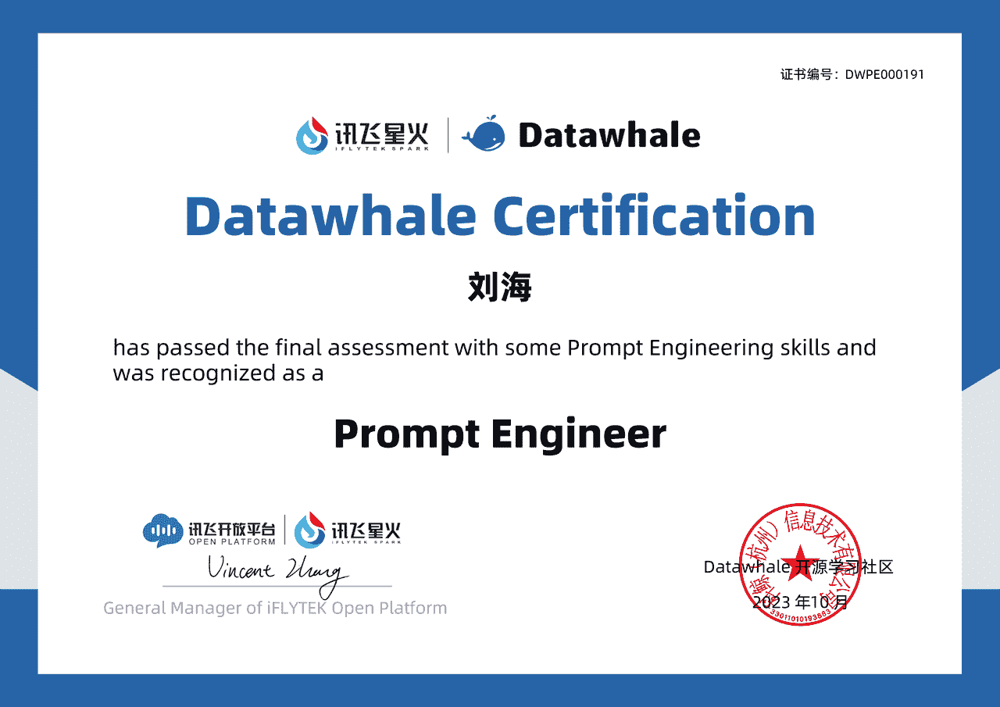

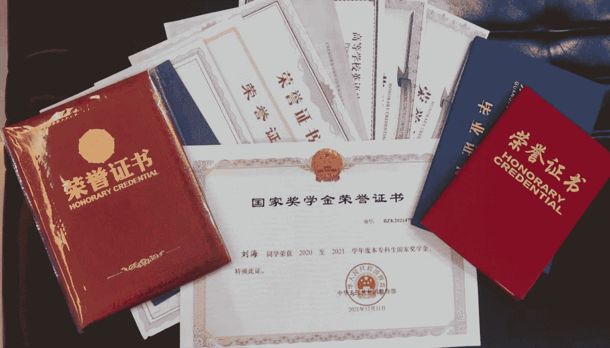

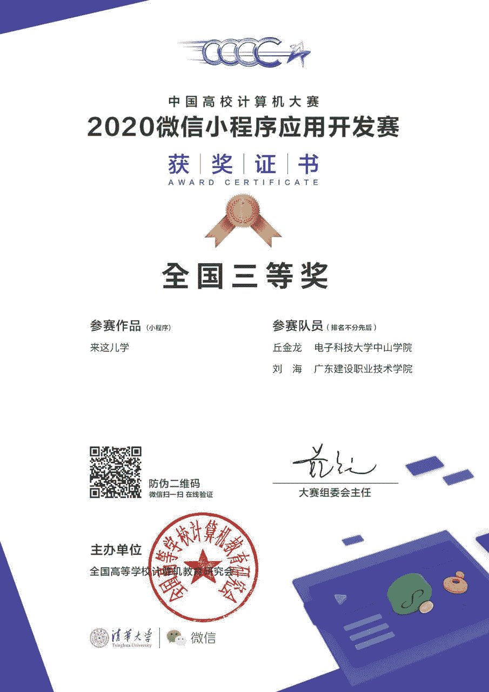

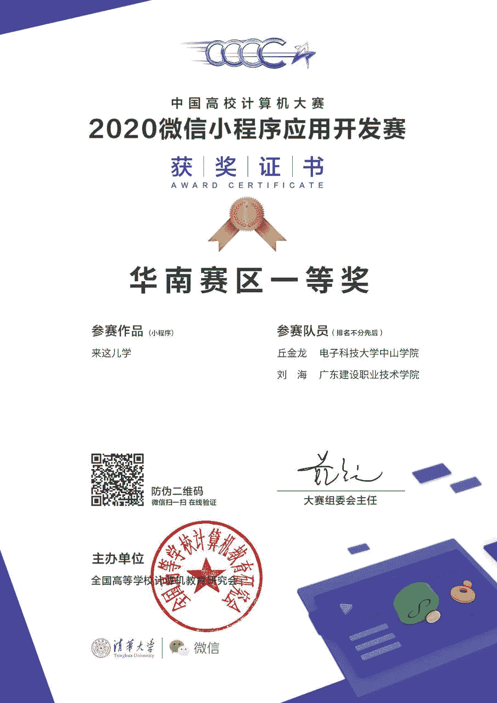

> 不是一个爱读书的孩子，没有耀眼的学历和学科背景，但不影响我热爱我的专业，不影响我输出我的思考洞见，我也愿意分享我的真实经历，不需要包装，希望每一个出身平凡、学历一般的孩子都能坚定地追求自己所热爱的。

# 💡  我的兴趣爱好  💡

---

> **台球****：**对台球有种相见恨晚的感觉，和朋友玩的时候会很开心（哪怕我们都很菜哈哈），工作生活压力大的时候也会一个人偷偷安静的练习放松，一边练一边理清烦恼，欢迎朋友们来找我约球！

> **尤克里里 ****/ ****吉他****：**从 2018 年开始玩尤克里里，喜欢弹唱，心情愉悦就喜欢拿起乐器弹唱，后来觉得尤克里里的音域不够广，也买了吉他，主动找一些教程来学习弹奏，有尤克里里基础，上手较快，我很喜欢弹唱，指弹我玩不来哈哈哈哈。

> **篮球：**相信大部分男孩子的球类运动第一个就是篮球，也打了几年篮球了，工作原因慢慢放下了，希望有球友能够跟我约周末打打球。

# 🔮  联系方式 / 公众号  🔮

---

> QQ：1711323390  |  邮箱：haipromail@163.com  |  微信：HaiPro_2025

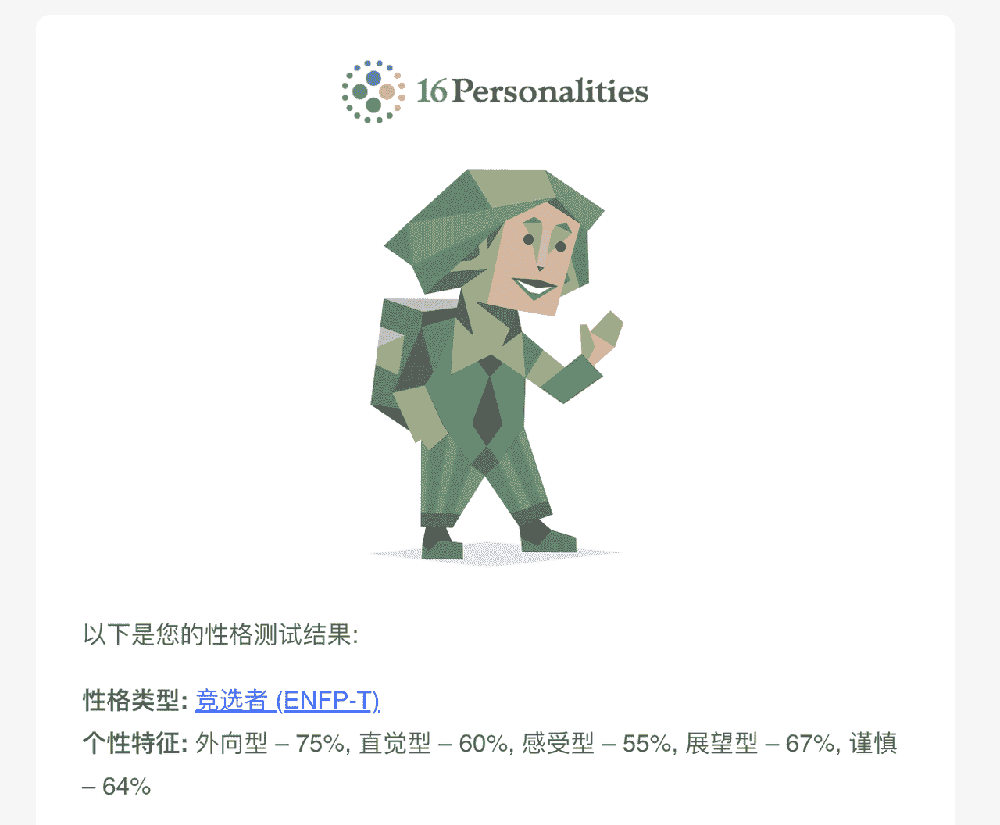

刚注册的即刻号：[刘海 HaiPro](https://web.okjike.com/u/cb70fed1-b601-465e-a070-b801fec89551)

# ❤️  友情链接  ❤️

---

> 排名不分前后，如果可以，我想把所有链接都放在第一行 ❤️。

+   **我的好朋友～ 超级优秀的****卡卡****（商业化人才）：**[🌎 卡卡 Claire 使用说明书](https://xvegm7a3zvg.feishu.cn/wiki/G8hRwT9oPiHeRukRcztcdryInbc)** **

+   **跟我做了很久 ****AIGC**** 项目的****前端全栈开发****学妹：**[🐽 Pricilla's 杂货铺](https://nanfangshaonian.feishu.cn/wiki/ZINMwWKlNiXwstkeWGvc5k9gnXf)** **

+   **同人工智能实验室****AI方向****优秀学弟****李林桂****：**[Cy1oong的澡堂🛁](https://nanfangshaonian.feishu.cn/wiki/TfvAwVY0giKObOkG5VaczrSwnvj)** **

+   **同人工智能实验室前负责人****刘伟锋**[👨🏻‍💻AtnibamAitay の 空间](https://nanfangshaonian.feishu.cn/wiki/QCaQwWrDjiZoImkVhXkckWYTndc?from=from_copylink)**优**秀的 AIGC 产品/项目经理）：

+   [**「知了阅读」**](https://read.thinkwx.com/about)[**「ChatSum」**](https://chatsum.ai)[**「OpenSum」**](https://open.chatsum.ai)**作者：idoubi**

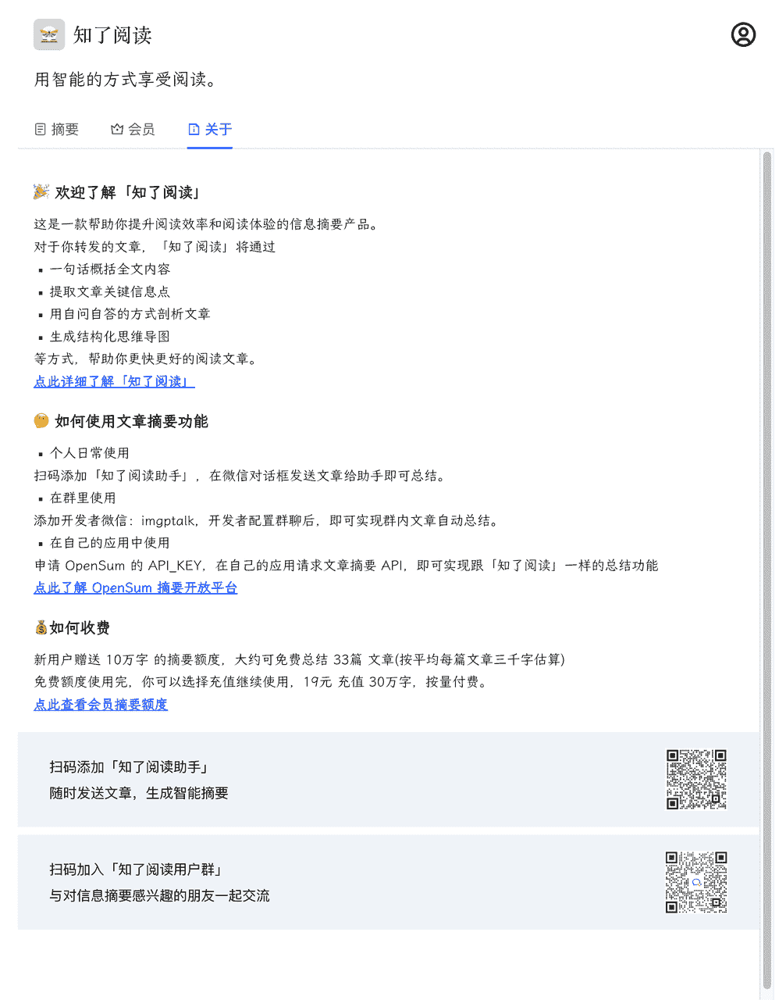

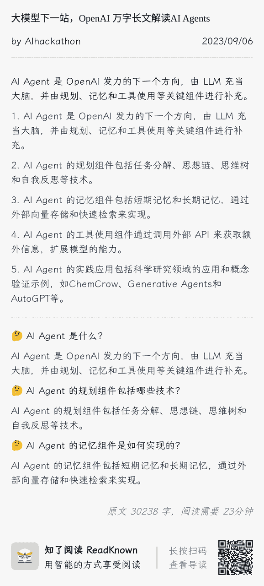

+   [李继刚（Arthur）](https://web.okjike.com/u/752D3103-1107-43A0-BA49-20EC29D09E36)：Prompt 圈内无人不知、无人不晓的 Prompt 达人，很有耐心的刚哥～

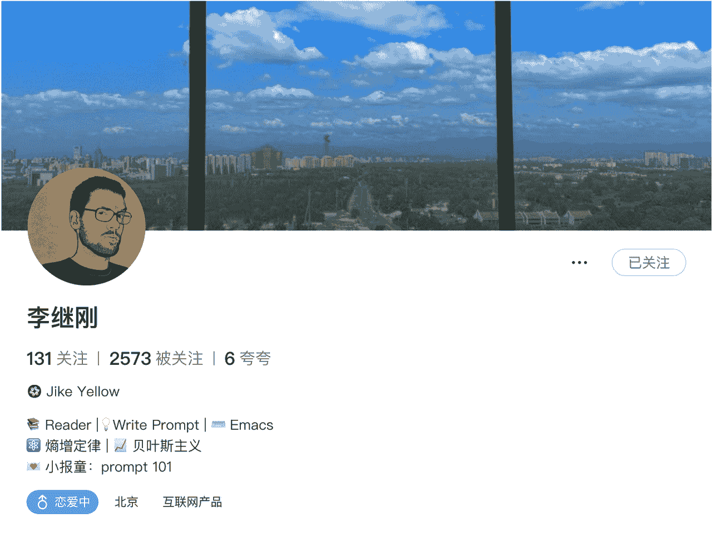

+   [陈财猫](https://web.okjike.com/u/C6E7D2EC-CCBB-49ED-81BC-B52D4A3D3E1E)：《ChatGPT 进阶：提示工程入门》作者 / AI 产品经理 / 提示词工程师

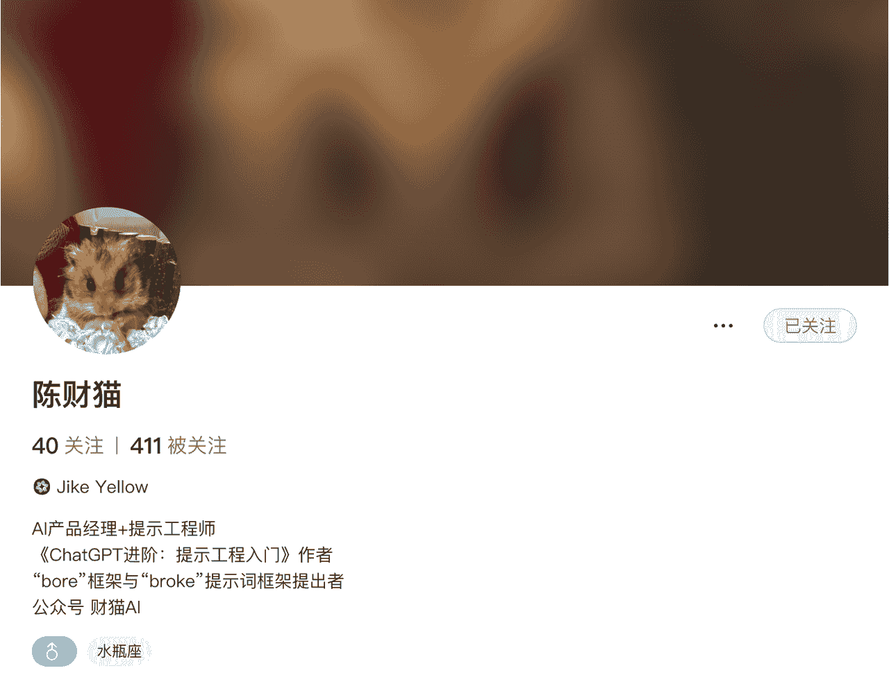

+   推荐 [🌈 通往 AGI 之路 ](https://waytoagi.feishu.cn/wiki/QPe5w5g7UisbEkkow8XcDmOpn8e) 社区：内容共建者之一

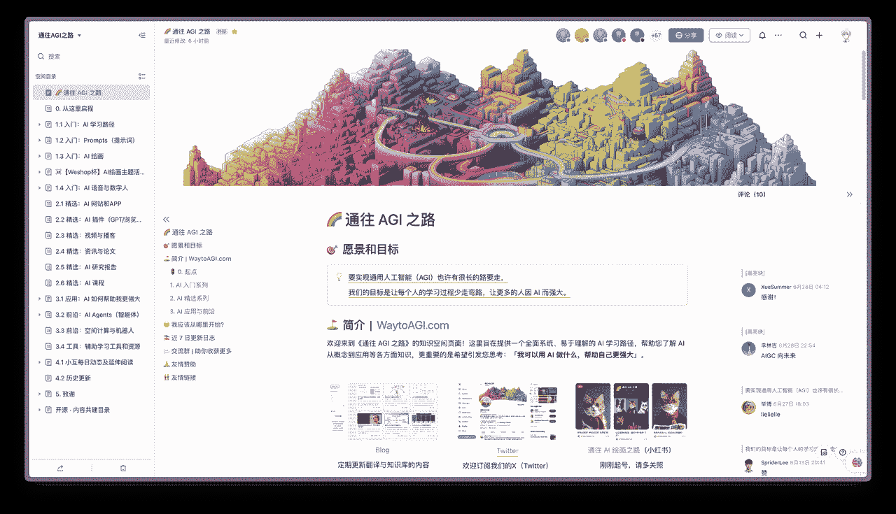

+   推荐知识星球[「AI 破局俱乐部」](https://wx.zsxq.com/dweb2/index/group/15552545485212) ：内容共建者、AI 之心持有者、两个精华文章。

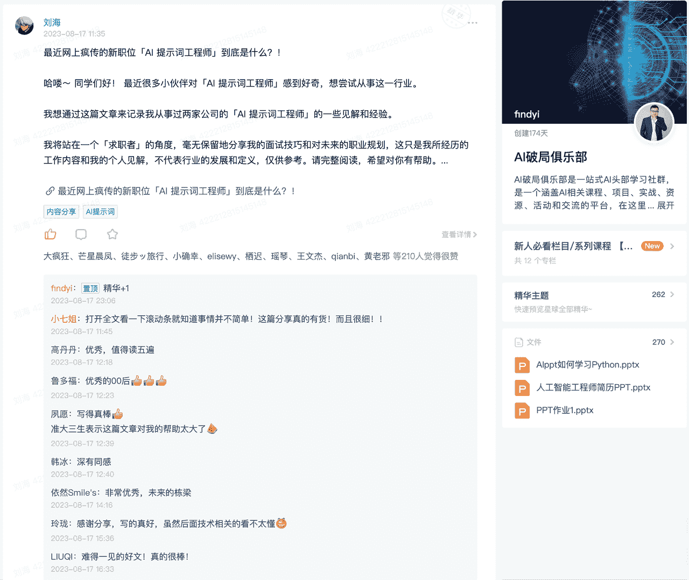

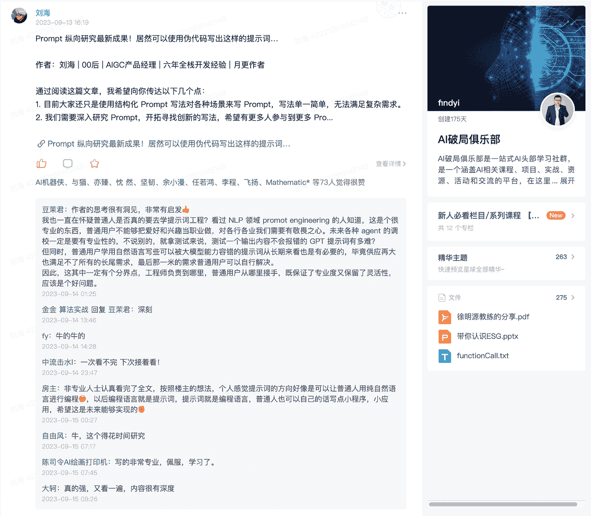