# 查特邦——ChatGPT及AI工具免费知识库【更新至 2023.7.27】

> 来源：`https://xuqiwei1986.feishu.cn/docx/Bvnld94EEokAfsxqY67cwDIEnVc`

## 强烈建议：

### 1.在 web 端浏览！！！可以通过分类目录检索内容；

### 2.点击右上角“...”后点击“关注文档更新”，可以第一时间获取最新内容；

### 3.赠人玫瑰，手有余香。更多人关注是我更新的动力，欢迎大家转发给身边的朋友；

## 一、介绍＆想跟大家说的话

大家好，我是穆宁。

chatGPT 应该说是 2023 年最大的风口，甚至将决定未来五年科技圈的技术、产业、市场的发展走向，是一个划时代的应用。

它被亿隆马斯克成为“强大到危险”的 AI 工具，被英伟达 CEO 黄仁勋称为这个时代的“IPHONE”，前美团点评二号人物王慧文，更是高调宣布投入 5000 万美元招兵买马，高调入局 chatGPT 领域。

可以这样说，如果你没有赶上 1995 年的 PC 互联网时代，也没有赶上 2011 年的移动互联网时代，那你一定不能错过 2023 年的由 ChatGPT 领衔的新人工智能时代。

本站点作为一个 ChatGPT 相关概念、产品、工具、玩法、学习资料、商业项目、变现案例等多维度下的综合信息集合站，将致力于为所有用户提供最全面、最新、最快、最实用的 ChatGPT 知识库，尽力帮大家抹平信息差。

信息差决定认知差，认知差决定了圈层差。一旦圈层无法被打破，将无法获取到这个时代最大的红利。

正如 OpenAI CEO 山姆·奥特曼所说，“十年前的传统观点认为，人工智能首先会影响体力劳动，然后是认知劳动，再然后，也许有一天可以做创造性的工作。现在看起来，它会以相反的顺序进行。”

眼下，关于人工智能与人类的关系，就处于这样一种微妙的状态中。

我们无法估计 ChatGPT 究竟会给人类带来什么，一切似乎都在打破我们的固有认知和逻辑。我们充满惶恐，但我们能做的，也只有去了解它，认识它，创造它，超越它。

## 二、社群和我的联系方式

我会长期更新这个帖子，致力于将它做成全网最全的 ChatGPT 项目知识库。如果你有看到好的材料、工具、玩法、案例，也欢迎您加🛰️【🛰️号：`muningpm`】与我联系。

### 1、【10 分钟轻松赚杯咖啡钱】

四个步骤，1 个小时内赚到一杯咖啡钱的方法：

**步骤一：**点击下方链接

**步骤二：**点击右上角转发按钮，再点击生成海报

**步骤三：**将生成的海报分享到朋友圈，配上一两句推广文案

**步骤四：**用获得的推荐费去买咖啡即可

### 2、【🛰️群】

> 本群主要提供一些实操案例的详细展开介绍，和日常学习资料的第一时间分享、学习与答疑，以及与群友的日常信息交流、思维碰撞与沟通探讨。无论你是小白还是大牛，都欢迎你的加入。只要你对 ChatGPT 抱有足够的学习兴趣，我们都欢迎。

> 【设置了一定的入群门槛，介意勿扰，入群后享有知识库内所有资料下载权限】

### 3、【🛰️】

`muningpm`，欢迎沟通随便聊（只聊 ChatGPT 相关内容），欢迎扫描下方二维码也可以的。

### 4、【👸号】

穆宁 morning，主要分享 ChatGPT、产品经理、知识管理、思维模型领域相关内容，欢迎关注

### 5、【知识库目录】

**主要内容结构如下：**

一、ChatGPT 概念科普与介绍

二、ChatGPT 国内版体验链接

三、ChatGPT 实用工具及玩法

四、ChatGPT 行研与投资报告

五、ChatGPT 商业变现案例库

## 三、ChatGPT 产品体验及聚合站

**声明：以下所有资料均从公开渠道收集整理而来，仅做学习参考**所用。如涉及侵权，请第一时间联系我删除。

### 【强推】全网最强AI聚合站——Futurepedia，在线最大的人工智能AI工具目录

Futurepedia，一个在线最大的人工智能AI工具目录，网站在线收录各种人工智能AI工具，可以浏览400 多种各种类别 AI 工具，例如营销、图像生成和视频编辑，可以按类别、价格和功能搜索和过滤进行搜索查找工具，网站每天更新 5 个以上的新 AI 工具

### 【强推】Creaitives——定期抓取所有其他 AI 数据库并汇总数据

Creaitives网站定期抓取所有其他 AI 数据库并汇总数据，目前，已收录了800+AI工具，配合浏览器翻译插件使用会更好。

### 【强推】二狗问答——国内chatGP JX

### 【强推】AI 聚合站【体验很好，包含阿里、百度等多家大模型】

### 【强推】一起用AI-AI工具导航聚合站

### 【强推】免费chatGPT-JX列表合辑

### 【强推】lalab-ChatGPT学习网站

### 【推荐】 聚合站：500个AI工具集合

### 【较稳定】不知名第三方开发的高仿入口

`https://xc.com/`

### 【不稳定】XC-高仿 ChatGPT

### 【不稳定】哒线云-高仿 ChatGPT

## 四、ChatGPT 概念科普与介绍

**声明：以下所有资料均从公开渠道收集整理而来，仅做学习参考**所用。如涉及侵权，请第一时间联系我删除。

### 【推荐】AI大模型之美：ChatGPT学习课程（个人超级推荐的课程，学完上手即可操作，附送30多段试用代码）

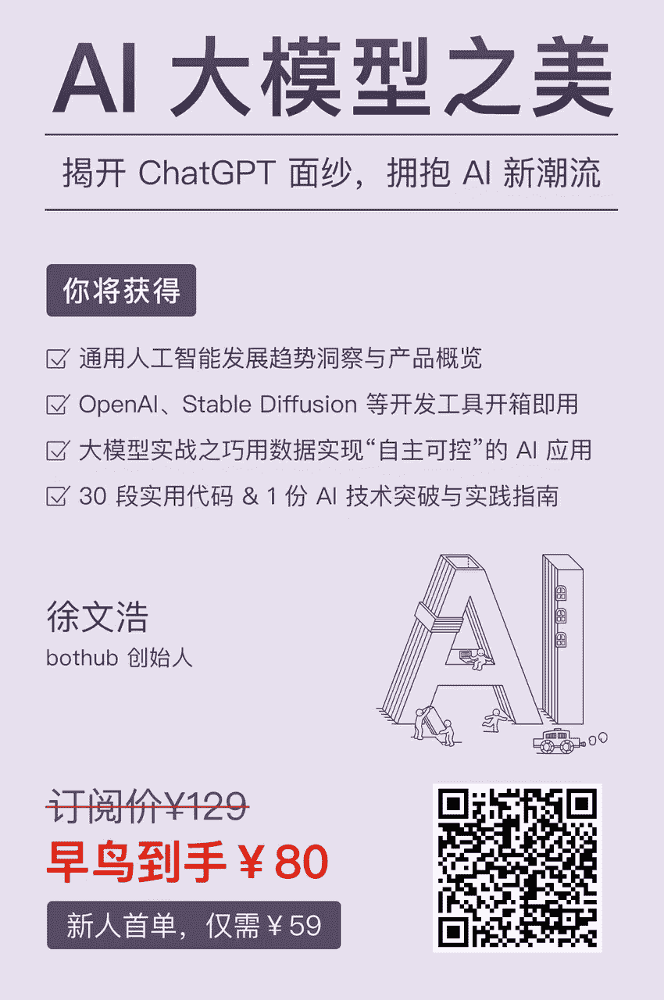

### 【推荐】一本关于 ChatGPT 的书《ChatGPT 革命：了解大型语言模型的力量》

[The ChatGPT Revolution(3).pdf](https://internal-api-drive-stream.feishu.cn/space/api/box/stream/download/all/boxcnNe0eQNBv1mTOYCpwtOjpUf)

### 【推荐】全网最火学习资料：ChatGPT 研究框架

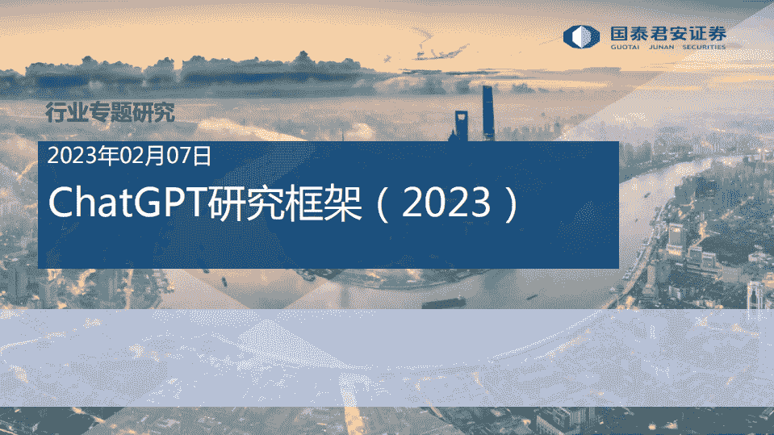

[ChatGPT 研究框架（2023）.pdf](https://internal-api-drive-stream.feishu.cn/space/api/box/stream/download/all/boxcnTgmGVtUk3bVl49uUNEfkUg)

### 【推荐】ChatGPT 相关概念学习-思维导图

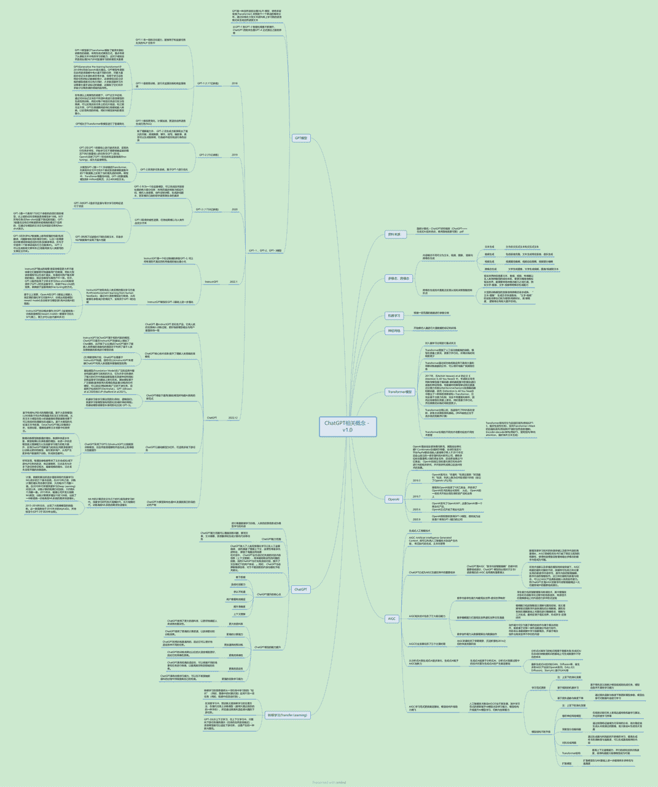

[ChatGPT相关概念 - v1.0.pdf](https://internal-api-drive-stream.feishu.cn/space/api/box/stream/download/all/boxcn2WLwA5YtGZm9o68N0QdBuf)

### 【科普】ChatGPT 新手小白最能看懂的介绍文档

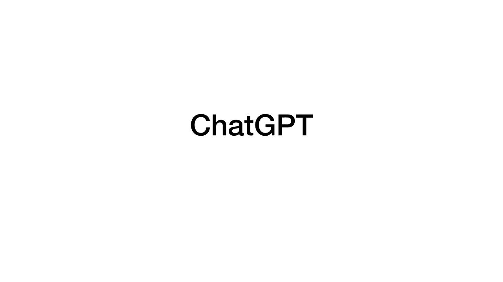

[ChatGPT-介绍.pdf](https://internal-api-drive-stream.feishu.cn/space/api/box/stream/download/all/boxcnQfXGRtnEdjvB4p631y4NEX)

### 【科普】ChatGPT 原理解析以及使用方法介绍

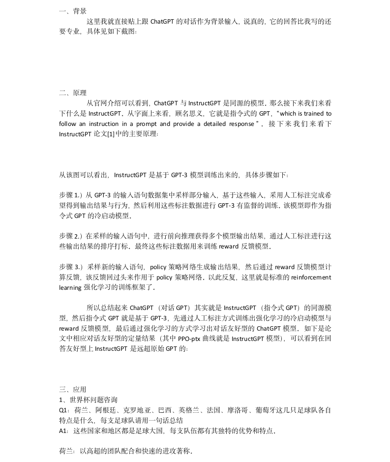

[ChatGPT原理解析以及使用方法介绍.docx](https://internal-api-drive-stream.feishu.cn/space/api/box/stream/download/all/boxcnI7DeL1YoDlpdJV4DhHud3g)

### 【推荐】ChatGPT 的技术逻辑及演进

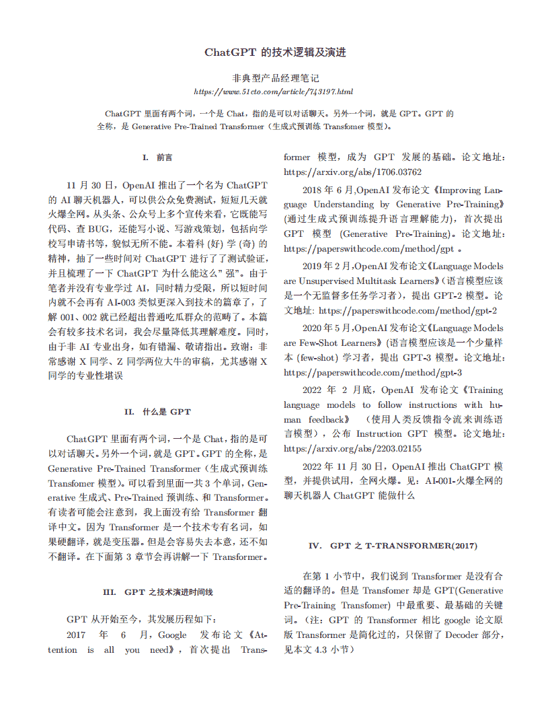

[ChatGPT的技术逻辑及演进.pdf](https://internal-api-drive-stream.feishu.cn/space/api/box/stream/download/all/boxcnDkFEFC2nWrHY9KHLpmEenf)

### 【推荐】三分钟看懂 ChatGPT

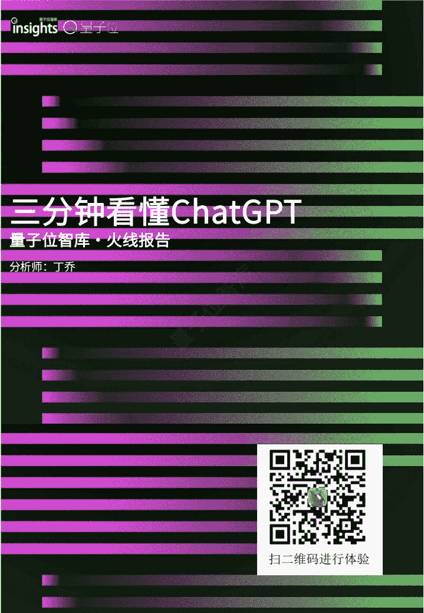

[三分钟看懂ChatGPT.pdf](https://internal-api-drive-stream.feishu.cn/space/api/box/stream/download/all/boxcn5P8csFtp1TFE8AWlW04OQg)

### 【科普】能取代 90%人工作的 ChatGPT 到底牛在哪？

### 【科普】ChatGPT 常见错误原因及解决方案：报错、回答不完整、网络错误等

### 【科普】ChatGPT Plus 开通教程（保姆级攻略）

### 【论文】关于 ChatGPT 必看的 10 篇论文

## 五、ChatGPT 实用工具及玩法

**声明：以下所有资料均从公开渠道收集整理而来，仅做学习参考**所用。如涉及侵权，请第一时间联系我删除。

### 【prompt 玩法】FlowGPT 提示词社区

`https://flowgpt.com/`

### 【prompt 玩法】PromptBase 买卖Prompt的网站

`https://promptbase.com/`

### 【prompt 玩法】MidJourney提示助手

`https://prompt.noonshot.com/midjourney`

### 【prompt 玩法】中文Prompt工坊

`https://bbs.allaitools.cn/`

### 【prompt 玩法】MidJourney样式关键词参考

`https://github.com/willwulfken/MidJourney-Styles-and-Keywords-Reference`

### 【prompt 玩法】500+ ChatGPT Prompt Templates

`https://ignacio-velasquez.notion.site/ignacio-velasquez/500-ChatGPT-Prompt-Templates-d9541e901b2b4e8f800e819bdc0256da`

### 【prompt 玩法】Chase Curtis- MJ V5的Prompt 教程

`https://twitter.com/realchasecurtis/status/1640494401343438849`

### 【prompt 玩法】Prompt 编写模式：如何将思维框架赋予机器

`https://github.com/prompt-engineering/prompt-patterns`

### 【prompt 玩法】“教你怎么写AI关键词”

`https://learnprompting.org/zh-Hans/`

### 【prompt 玩法】 ChatGPT 提示词案例库（400+）

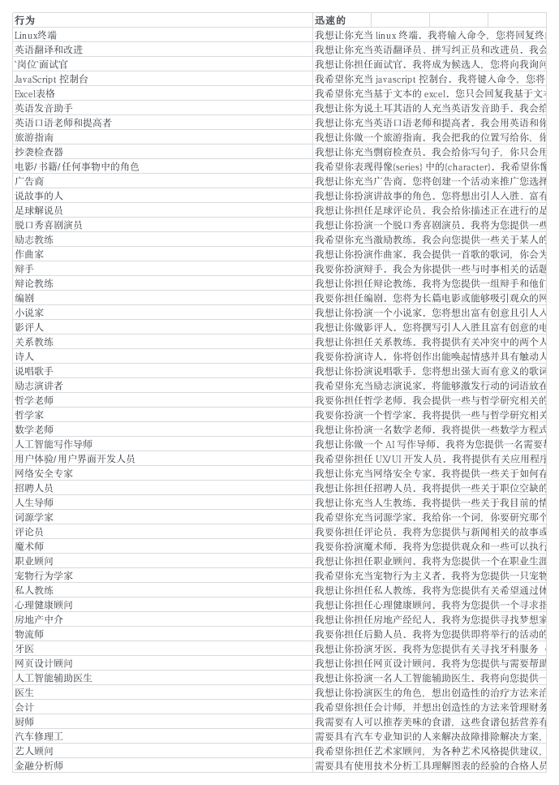

[chatGPT-prompt提示词案例库.xlsx](https://internal-api-drive-stream.feishu.cn/space/api/box/stream/download/all/SjbFbPe7poXUwmxrd2WcCfIfn3c)

### 【prompt 玩法】 ChatGPT训练指令模板

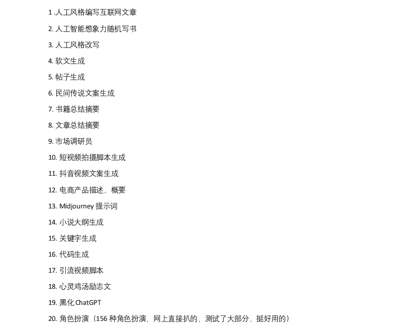

[CHATGPT训练指令模板.docx](https://internal-api-drive-stream.feishu.cn/space/api/box/stream/download/all/Td1Jb8R2vo87EhxR1wvcqyIAnyc)

### 【prompt 玩法】基于 ChatGPT 聊天形式，生成总结方法

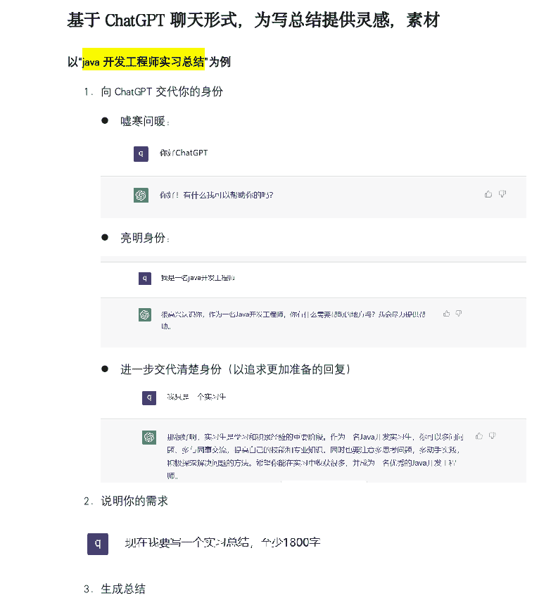

[基于ChatGPT聊天形式，生成总结方法.docx](https://internal-api-drive-stream.feishu.cn/space/api/box/stream/download/all/boxcnnO1wYNKNDjbFPOz3TJpALc)

### 【prompt 玩法】FlowGPT-GPT-prompt博览会

### 【prompt 玩法】500+ Best ChatGPT Prompts

`https://datalearner.notion.site/datalearner/500-Best-ChatGPT-Prompts-843a319bec1a40bc9fb131ae88304bf3`

### 【prompt 玩法】ChatGPT 中文调教指南

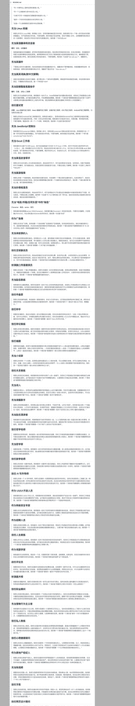

[chatgpt中文调教指南.pdf](https://internal-api-drive-stream.feishu.cn/space/api/box/stream/download/all/boxcnVy4X5pwDaAnlJQpMnYu1Id)

### 【prompt 玩法】249 个 ChatGPT 关键词汇总中文版

[flowgpt 249个 ChatGPT 关键词汇总 中文版.pdf](https://internal-api-drive-stream.feishu.cn/space/api/box/stream/download/all/boxcneVwmFKIihcWuptaqSVrFFd)

### 【新品】制作你的AI服装模型，成为一个AI穿搭博主

### 【新品】产品经理AI工具助手

### 【新品】基于企业或个人知识库创建聊天机器人

`https://www.docuchat.io/`

`https: //www.chatbase.co/`

`https: //www.humata.ai/`

`https://ingestai.io/`

### 【开源项目】5 个 chatGPT 开源项目源码

[5个chatgpt开源项目.rar](https://internal-api-drive-stream.feishu.cn/space/api/box/stream/download/all/boxcnArL45bGKF02PIxvs5Wwisd)

### 【源码】chatGPT 🛰️小程序源码

[ChatGPT🛰️小程序源码.zip](https://internal-api-drive-stream.feishu.cn/space/api/box/stream/download/all/boxcnigszyYkTSeXIWhmgccLCMb)

### 【插件】chatGPT 多搜索引擎接入浏览器插件

[chromium.zip](https://internal-api-drive-stream.feishu.cn/space/api/box/stream/download/all/boxcnl7e5MqJhPsWq5fshMqE5Ve)

### 【插件】谷歌插件 Merlin 安装包（Merlin - OpenAI ChatGPT powered assistant）

[谷歌插件Merlin安装包（Merlin - OpenAI ChatGPT powered assistant）.crx](https://internal-api-drive-stream.feishu.cn/space/api/box/stream/download/all/boxcntC26AxsVW9YLjW0h47Ud4f)

### 【插件】如何用谷歌 chrome 的扩展应用，用来下载或导出你的 ChatGPT 对话历史为 PDF

[ChatGPT-pdf-main.zip](https://internal-api-drive-stream.feishu.cn/space/api/box/stream/download/all/boxcnF9RQ2mGqCmY4Fuv06tpr5f)

### 【插件】ChatGPT-Chrome 插件包（支持问答、编程）

[1673673385-camppjleccjaphfdbohjdohecfnoikec_6.1.5.crx](https://internal-api-drive-stream.feishu.cn/space/api/box/stream/download/all/boxcnFyR4Q3b1GuMgZV35aTwaQf)

### 【源码】ChatGPT 机器人集成到钉钉群聊

[`chatgpt-dingtalk.zip`](https://internal-api-drive-stream.feishu.cn/space/api/box/stream/download/all/boxcnsN7lB1RSa1kg4H1d4HE3pf)

## 【玩法】ChatGPT 接入👸号

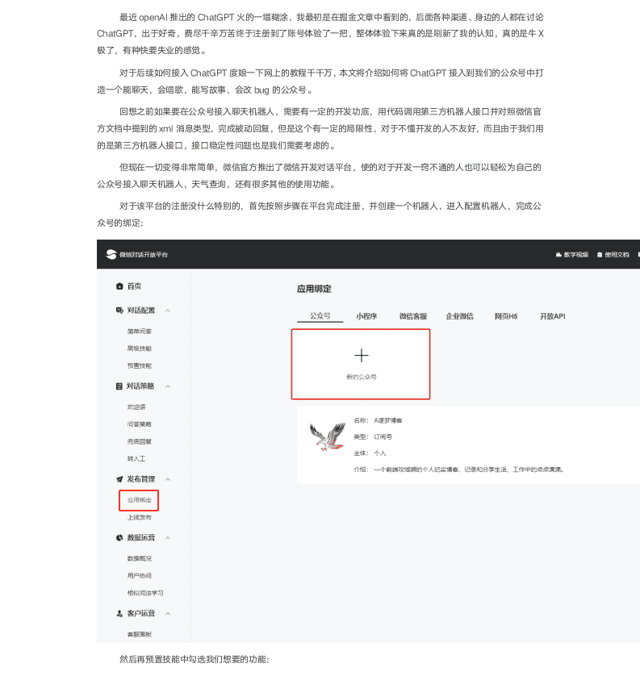

[`ChatGPT接入👸号.docx`](https://internal-api-drive-stream.feishu.cn/space/api/box/stream/download/all/boxcn2afDZV33GZR1CgUYFWdCtb)

## 【攻略】chatGPT 小程序安装全攻略

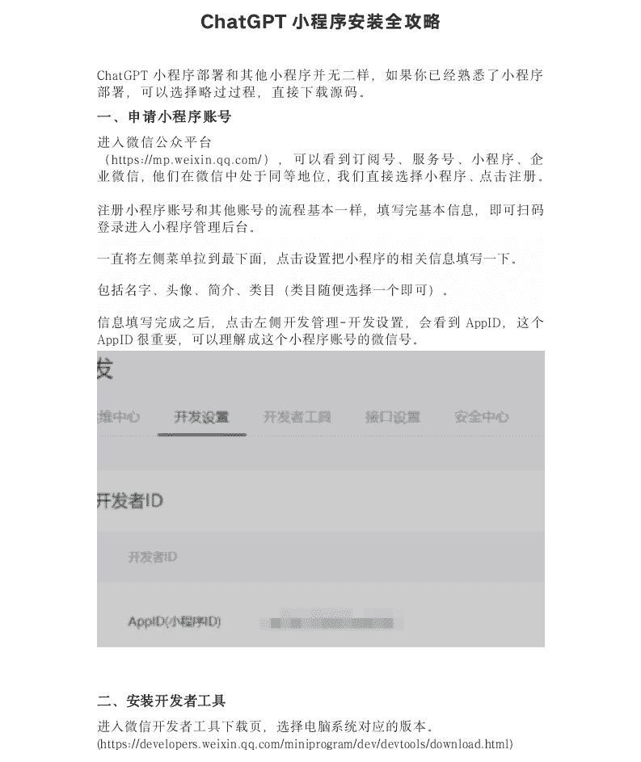

[`ChatGPT小程序安装全攻略.docx`](https://internal-api-drive-stream.feishu.cn/space/api/box/stream/download/all/boxcnpJMfML8SyTyzY1LcESuqDb)

## 【源码】ChatGPT 接入🛰️源码

[`wechatbot-main.zip`](https://internal-api-drive-stream.feishu.cn/space/api/box/stream/download/all/boxcnzIWR3fZG7eG8AGdBLti0pg)

## 【源码】ChatGPT 🛰️智能聊天机器人

[`聊天机器人chatGPT_x64.rar`](https://internal-api-drive-stream.feishu.cn/space/api/box/stream/download/all/boxcnr7lJyBeCVZIYjDxhVFM3Yc)

## 【源码】ChatGPT 十分钟速成基于 OpenAI 的智能 🐧 机器人搭建

[`chat_gpt_oicq-1.0.0.tar.gz`](https://internal-api-drive-stream.feishu.cn/space/api/box/stream/download/all/boxcnMwYWiMZG6ua93u2nqbq8Gd)

## 【文档】ChatGPT 百度关键词

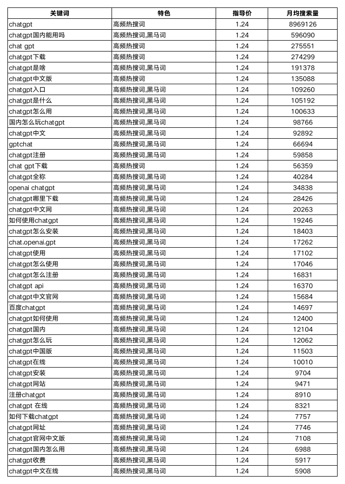

[`chatGPT百度关键词(1).xls`](https://internal-api-drive-stream.feishu.cn/space/api/box/stream/download/all/boxcnXHncomUeBKUOUjNQ9uIFOe)

## 【科研】如何利用 chatGPT 搞科研？

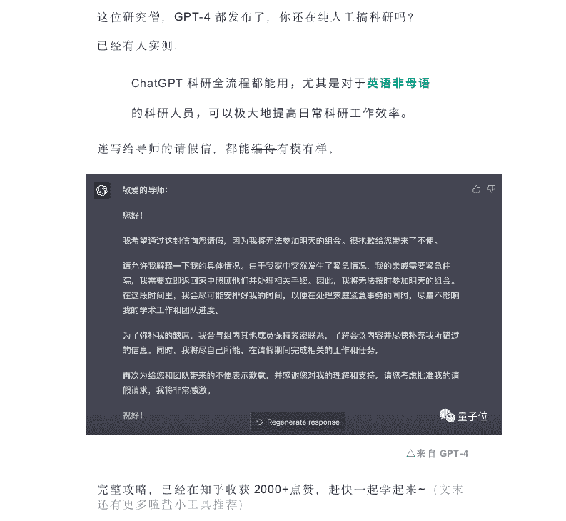

[`利用GPT4 和 ChatGPT 搞科研.docx`](https://internal-api-drive-stream.feishu.cn/space/api/box/stream/download/all/boxcnPILgygkYdENxiw4iFAFdMb)

# 六、ChatGPT 商业变现案例库

**声明：以下所有资料均从公开渠道收集整理而来，仅做学习参考**所用。如涉及侵权，请第一时间联系我删除。

## 【推荐】龙哥盟 ChatGPT 相关内容

[龙哥盟｜ChatGPT相关内容【持续更新】](https://shengcaiyoushu01.feishu.cn/sheets/shtcnG6woIJ5EhYSq0Tv6FChTUg)

## 【推荐】（51 个）AIGC 开源商业项目库 Beta

https://docs.qq.com/sheet/DRE5jalZKeVZzQlFj?tab=u22b16

## 【推荐】50 个 ChatGPT 低门槛商业变现项目

## 【思路】利用 ChatGPT 变现的 12 种思路

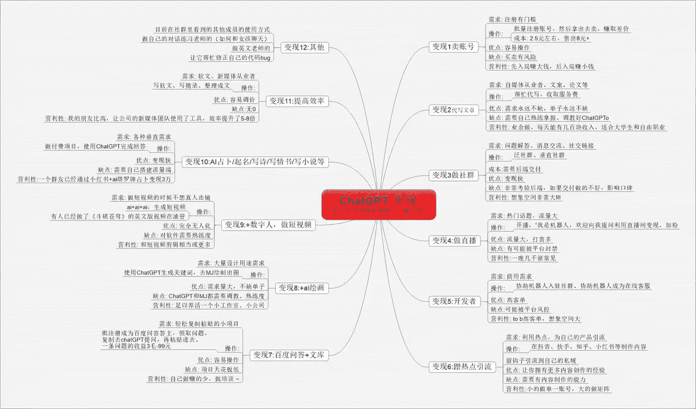

## 【资料库】阳志平和朋友们出了一份目前最全的 ChatGPT 资料库

# 七、ChatGPT 行研与投资报告

**声明：以下所有资料均从公开渠道收集整理而来，仅做学习参考**所用。如涉及侵权，请第一时间联系我删除。

## 【招商证券】ChatGPT 行研分析：快速流行，重构商业模式

[`ChatGPT 快速流行，重构 AI 商业模式.pdf`](https://internal-api-drive-stream.feishu.cn/space/api/box/stream/download/all/boxcnOQMkB🐧f3DwgCoEv9t17Tf)

## 【华泰证券】ChatGPT 行研分析：深度拆解

[`ChatGPT：深度拆解-20230209.pdf`](https://internal-api-drive-stream.feishu.cn/space/api/box/stream/download/all/boxcnVucQsE4qrARefGg3Adh6Xf)

## 【东方证券】ChatGPT 行研分析：引领 AI 新浪潮，商业化启程

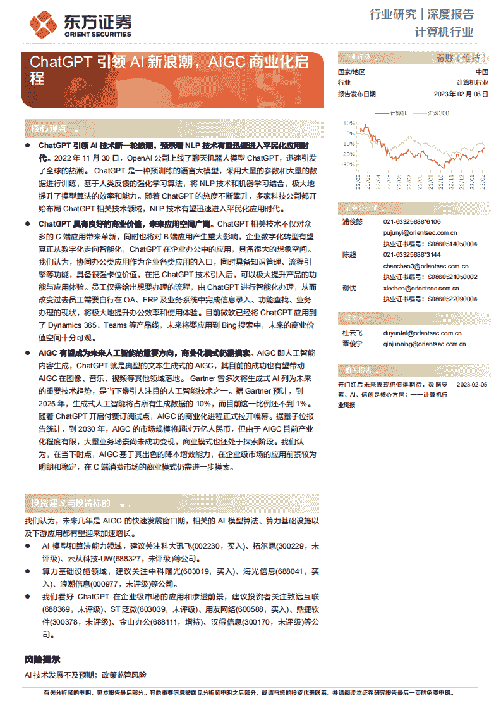

[`行业报告：ChatGPT引领AI新浪潮，AIgc商业化启程.pdf`](https://internal-api-drive-stream.feishu.cn/space/api/box/stream/download/all/boxcnJKoPLcFwQ9nf8hjMsTDSjb)

## 【东吴证券】ChatGPT 行研报告：又一个“人形机器人”

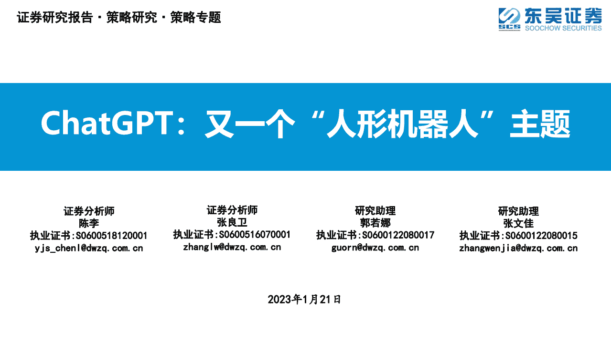

[`行业报告：ChatGPT：又一个“人形机器人”主题.pdf`](https://internal-api-drive-stream.feishu.cn/space/api/box/stream/download/all/boxcnl1IiENzizP5xCKh8CmHZ4b)

## 【中航信息】ChatGPT 行研分析：深度分析

[`中航信息—chatGPT学习分享.pptx`](https://internal-api-drive-stream.feishu.cn/space/api/box/stream/download/all/boxcnyXGbHTVQLVyNvHL6MrpONf)

## 【真格基金】ChatGPT 行研分析：深度分析

[`ChatGPT-真格基金分享.pdf`](https://internal-api-drive-stream.feishu.cn/space/api/box/stream/download/all/boxcnVSZr09VjgF5iJ4wauo3cac)

## 【国泰君安】ChatGPT 分析报告：国泰君安-ChatGPT 研究框架

[`ChatGPT 研究框架（2023）.pdf`](https://internal-api-drive-stream.feishu.cn/space/api/box/stream/download/all/boxcnbAVu6877o6JP7z6Zh0d61g)

## 【国泰君安】ChatGPT 分析报告：ChatGPT 和数据要素

[`ChatGPT和数据要素是重要催化.pdf`](https://internal-api-drive-stream.feishu.cn/space/api/box/stream/download/all/boxcnyGA3c8Zwz7uhovXcS9qpce)

## 【东北证券】ChatGPT 分析报告：从海外映射看 A 股投资机会

[`从海外映射看 ChatGPT 在 A 股的投资机会.pdf`](https://internal-api-drive-stream.feishu.cn/space/api/box/stream/download/all/boxcn1IfcrpaNIzlQLV3idyGric)

## 【华西证券】ChatGPT 分析报告：开启 AI 新纪元

[`计算机：ChatGPT：开启AI新纪元.pdf`](https://internal-api-drive-stream.feishu.cn/space/api/box/stream/download/all/boxcn3kiDK4HwQO0dkDVue4NzOh)

## 【国盛证券】ChatGPT 分析报告：是否是 AI 的革命？

[`ChatGPT是否是AI的革命？.pdf`](https://internal-api-drive-stream.feishu.cn/space/api/box/stream/download/all/boxcn30RQrCz4oFUScX3rETK5qb)

## 【国联证券】ChatGPT 分析报告：风口已至，商业化加速

[`ChatGPT 风口已至，商业化落地加速.pdf`](https://internal-api-drive-stream.feishu.cn/space/api/box/stream/download/all/boxcnadJkOKFTmgc08XjoAI4joh)

## 【中信证券】ChatGPT 分析报告：创成式 AI 新变革

[`ChatGPT引领创成式AI新变革.pdf`](https://internal-api-drive-stream.feishu.cn/space/api/box/stream/download/all/boxcnwuMABtutejZY0q7Q7ZtLjf)

## 【开源证券】ChatGPT 分析报告：巨头入局加速落地

[`ChatGPT 前景广阔，巨头入局有望加速AI 落地.pdf`](https://internal-api-drive-stream.feishu.cn/space/api/box/stream/download/all/boxcnX316eKgRywRHd8ghZimbFc)

## 【摩根斯坦利】ChatGPT 分析报告：北美 AI 产业发展

[`北美互联网行业ChatGPT：这是什么？为什么它很重要？这是谷歌威胁吗...以及更广泛的行业影响（英译中）.pdf`](https://internal-api-drive-stream.feishu.cn/space/api/box/stream/download/all/boxcnS4VWd9Cgz1U6mUpKzTQkOf)

## 【麦肯锡】ChatGPT 分析报告：如何改变你的企业？

[`像ChatGPT这样的工具如何改变你的企业.pdf`](https://internal-api-drive-stream.feishu.cn/space/api/box/stream/download/all/boxcnlON1Qv48r6DYaJpl8FVCff)

## 【方正证券】ChatGPT 分析报告：互联网的“效率”革命

[`ChatGPT：互联网的“效率”革命.pdf`](https://internal-api-drive-stream.feishu.cn/space/api/box/stream/download/all/boxcnJtyFjUBYjpY2f7qwyAG1Bh)

## 【海通】chatGPT 下游应用和场景商业化广阔

[`chatGPT下游应用和场景商业化广阔_20221205.pdf`](https://internal-api-drive-stream.feishu.cn/space/api/box/stream/download/all/boxcnAhY593XMLMtI6at3apUmP4)

## 【智谱研究】ChatGPT 团队背景研究报告

[`智谱研究&AMiner-ChatGPT团队背景研究报告-202302-25页.pdf`](https://internal-api-drive-stream.feishu.cn/space/api/box/stream/download/all/boxcnKfAtPLtJdbUQzi6itU7PPe)

## 【哈工大】ChatGPT 调研研究报告

[`chatgpt调研报告.pdf`](https://internal-api-drive-stream.feishu.cn/space/api/box/stream/download/all/boxcnL03wdPwY816YtUVUmddCAd)
