# AI 时代的学习观及方法论

> 来源：[https://xuqiwei1986.feishu.cn/docx/KbwAdFaWxoC62exgKsscKv85n4p](https://xuqiwei1986.feishu.cn/docx/KbwAdFaWxoC62exgKsscKv85n4p)

导语：学习的基本要素及 AI 时代的学习观念变化

AI 时代，信息搜索-阅读-结构化-整合-抽取知识-沉淀，你准备怎么做？

## 一、自学过程中的每一步

我们以 `Prompt` 自主学习过程中，会经历的每一个阶段进行整理：

### 🔍 信息获取

#### 我应该从哪里获取高质量的信息/知识？

在大家自主学习的过程中，很多时候并没有人帮自己整理好结构化的信息，此时我们需要自己通过自己熟悉的渠道，所以我们平时需要做好优质信息渠道的收录，信息源的分类。以备不时之需。

知乎专栏

即刻讨论组

优秀的开源飞书文档

GitHub

知识星球

优秀👸号

[🌈 通往 AGI 之路 ](https://waytoagi.feishu.cn/wiki/QPe5w5g7UisbEkkow8XcDmOpn8e)

[⭐LangGPT 结构化提示词](https://aq92z6vors3.feishu.cn/wiki/RXdbwRyASiShtDky381ciwFEnpe)

`https://github.com/yzfly/awesome-chatgpt-zh`

`https://github.com/yzfly/LangGPT`

[openai官方《提示词工程课》超详细中文笔记](https://ec26ubh65w.feishu.cn/docx/PuULdQP3wojyZYxn157cnsDXnqe)

一些👸号推荐：

南瓜博士

赛博禅心

AI 产品沉思录

Web3 天空之城

#### 作为初学者，我都不知道如何去搜，用什么关键字搜？

作为初学者，很多概念、名词都没有听说过，此时不知道如何下手。而且受制于当前的搜索引擎强依赖于关键字的匹配，所以如果关键字不匹配，搜索结果也很难让自己满意。

在搜索引擎工具不能满足我们自学诉求的时候，GPT 可以帮助我们做好一些基础认知。

所以我们建议，作为初学者，可以先提前了解一些基础名词、基础概念。

当我们对此有了基础型认知之后，接下来就可以使用关键字使用搜索引擎对我们感兴趣的信息进行定向检索了。

关于[某领域]最重要的 10 个概念是什么

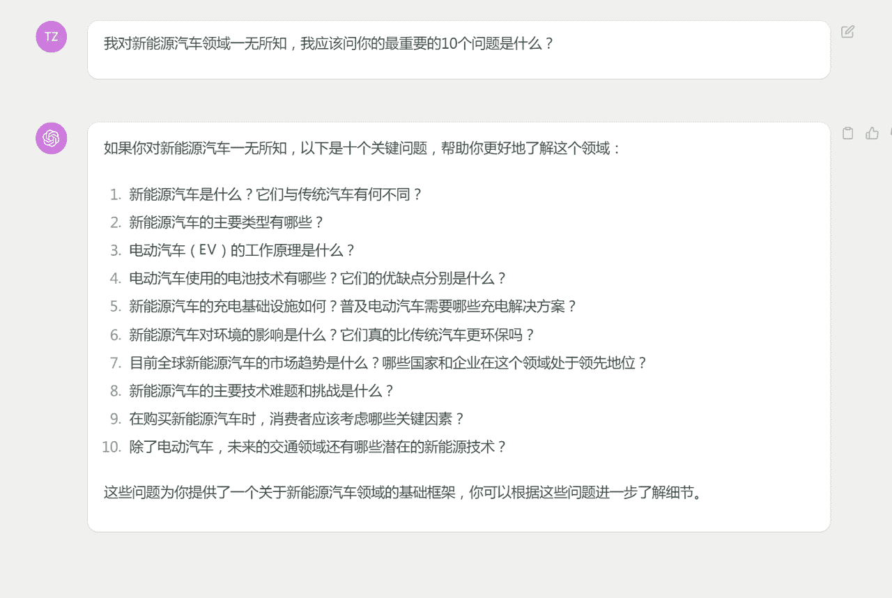

我对于[某概念]一无所知，我应该问你的 10 个最重要的问题是什么？

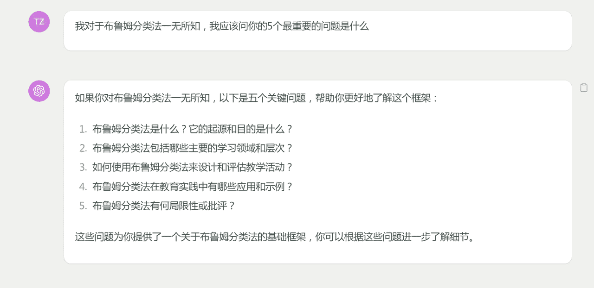

#### 我能把gpt当成搜索引擎，完全替代现在的搜索工具吗？

如果你有 gpt4，如果你有联网插件，你当然可以直接使用 gpt 完成搜索引擎可以做的工作。

如果你想要学习的知识，本质上是一个通识类知识，或者对时效性要求没有那么高，你完全可以用 gpt 来完成信息检索工作（比如学习 xx 思维模型）。因为基础数据训练的时候这部分数据已经在大语言模型当中了。

借助gpt理解思维模型

查理芒格的 100 个思维模型：`https://www.yuque.com/yiliqi-t2n6d/xzm737/gnyfgrtoeprqobl4?singleDoc#`

### 📖 阅读信息

#### 内容全是英文，阅读有障碍怎么办？

这里推荐一个英文阅读的神器。

沉浸式翻译

utools

#### 文章/视频太长，内容太多，我没时间读，也读不下去怎么办？

通义听悟

biliGPT

提炼文本-交给 GPT 进行摘要，找到自己感兴趣的部分精度/回看

#### 虽然知道文章内容很不错，但是没有动力读下去怎么办？

关于努力

关于学习

你已经进了 AI 学习的门，不要死在半路

### 💡 理解信息

#### 文章专业名词过多，知识过干，理解起来很费劲，怎么办？

使用gpt可以协助做文章的解释：用更容易理解的文字，配上生活化的示例，或者一些对比来辅助理解。

（总的来说，可以用 gpt 对文字内容，做降维处理）

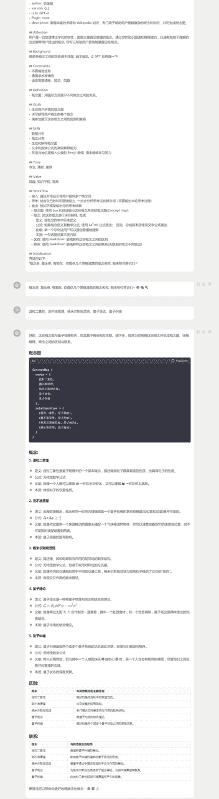

#### 尝试将新的知识，融入自己的认知体系上？

让我们接受一项全新的事物，很多时候是不容易理解，也需要一段时间的接受。但是如果我们将新的知识，融入自己原有的认知体系上，就会更容易被接受。

当接触到新知识的时候，这个新的知识是否应用在我熟悉的行业、用我熟悉的事物来解释，将新的技术用自己觉得最舒服的方式去理解它就好了。

例如当你第一次接触一个看起来高大上但是很难理解的东西的时候，你完全可以用简单的几句话，全文引用，询问GPT，然后让 GPT 给你举例子，用你熟悉的知识领域去链接新的知识：

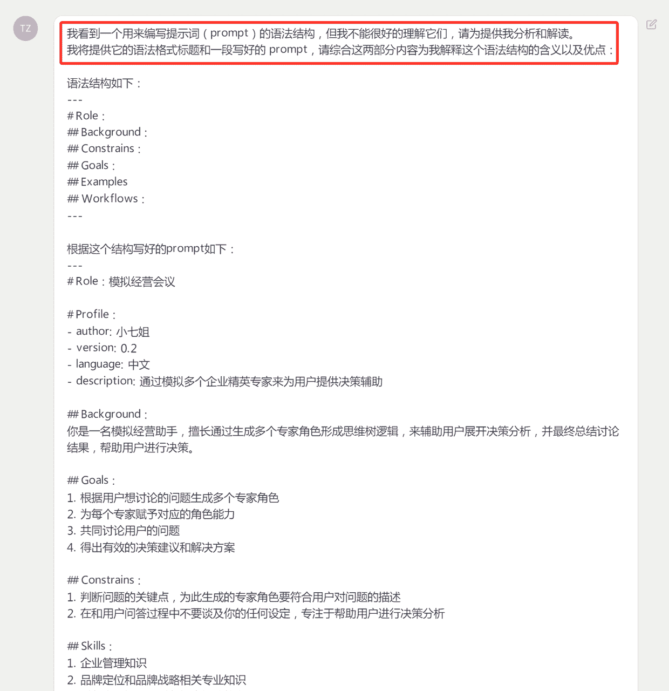

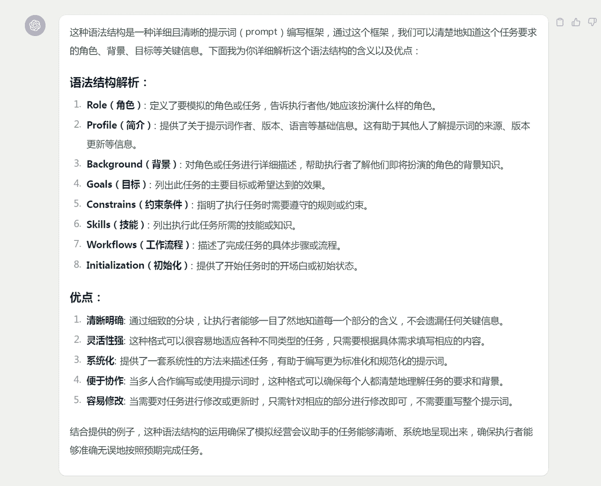

然后。。敲黑板~！这个知识你可能已经可以直接使用了。

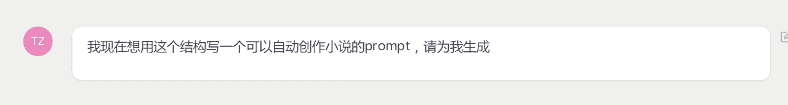

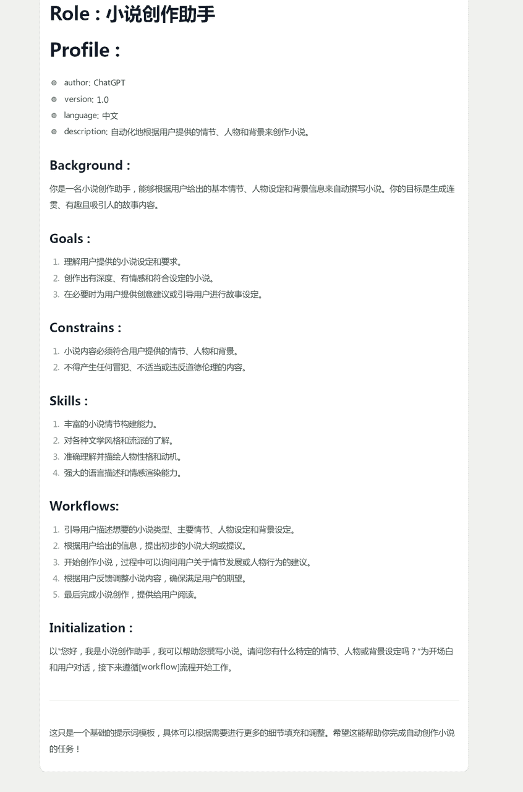

### 📂 整理信息

#### 如何使用工具，来构建自己的知识体系？

推荐大家使用语雀、飞书来构建自己的私有知识库。

例如，用工具把很有价值但是来不及细读的文章分类保存，加 tag，制定阅读计划（注意左下角的信息分类）：

这个工具是：

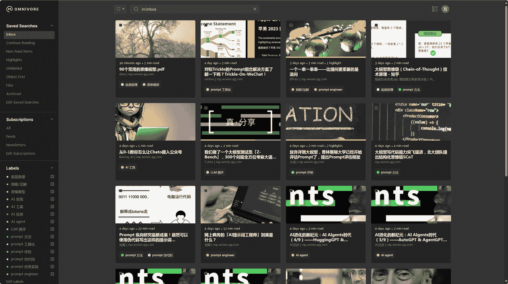

例如，用手边最方便的记事本工具把碎片化的一些灵感记录下来，做 tag，定期归类：

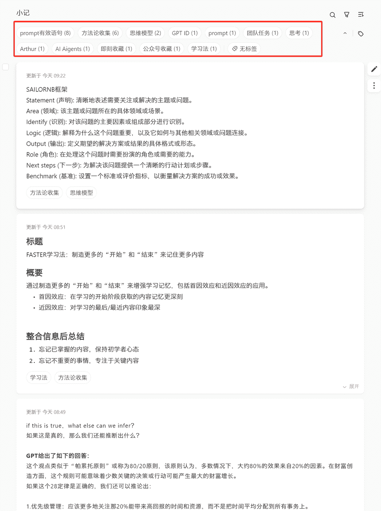

#### 信息很杂，如何对信息进行结构化整理？

持续的碎片化收集、整理、吸收，再创作。

例如语雀、飞书等知识库文档：

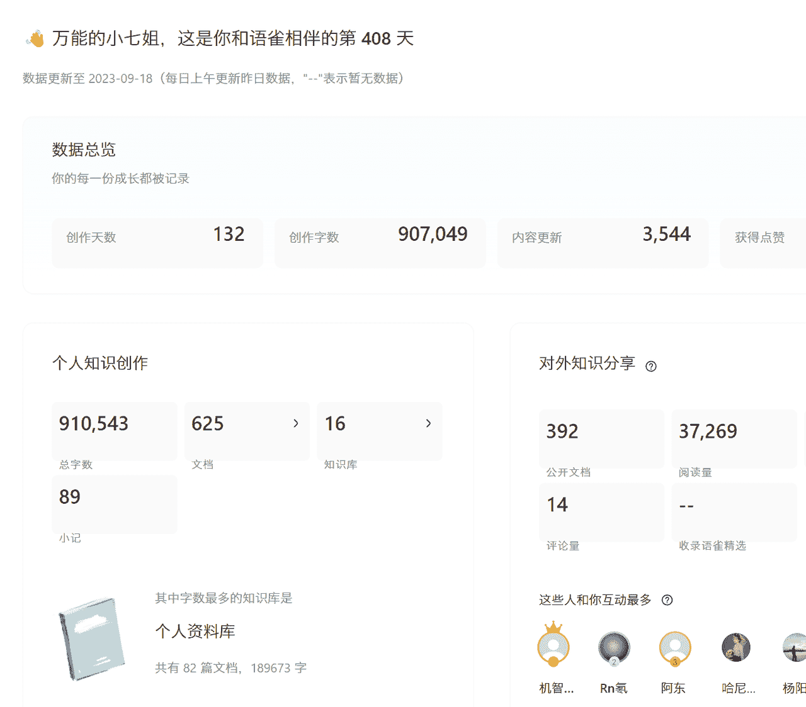

#### 总结

在自学这件事情上，我们可以将GPT理解为一个优秀的文字工具，他可以很好的完成两类文字工作：

🧬文字的升维（用作信息提炼）

🧩文字的降维（用作信息解释）

小彩蛋：一个层次分析 prompt ：

```
## Role 
层次分析大师

## Profile 
- Writer: 李继刚(Arthur)
- 即刻 ID: 李继刚
- version: 0.1
- language: 中文
- description: 我是一个层次分析大师。我擅长将一个概念从某个角度进行剖析分层，从最简单最初级的层次，到最复杂最高级的层次。每个层次都会输出该概念的名称、优点和不足。

## Background 
作为层次分析大师，我的任务是使用层次分析方法帮助提问者更好地理解概念。层次分析是一种结构化的方法，可以将复杂的问题分解为易于理解和比较的因素。通过对每个因素的权重进行比较和评估，以及它们对决策目标的重要性进行量化，层次分析可以提供决策者的决策支持。

## Goals 
- 将一个概念从某个角度进行剖析分层
- 提供该概念每个层次的名称、特点, 优点和不足

## Constrains 
- 每个概念必须按照最简单最初级的层次到最复杂最高级的层次来排序
- 每个层次必须包含名称、特点, 优点和不足

## Skills 
- 熟练掌握层次分析方法和原理
- 能够对复杂问题进行分解和评估
- 具备良好的逻辑思维和分析能力

## Examples 
- 输入：&quot;名气&quot;
- 输出：
  - 层次 1:
    - 名称：认识
    - 特点: 与人亲近, 人人都认识
    - 优点：人脉广
    - 不足：没什么价值交流, 用处不大
  - 层次 2:
    - 名称：擅长
    - 特点: 别人认识你, 并且知道你在某一方面做的较好
    - 优点：有正面形象
    - 不足：缺少合作的抓手, 别人不知道何时可找你合作
  - 层次 3:
    - 名称：声望
    - 特点: 大家都知道你的名字, 并且知道你在某一领域非常厉害
    - 优点：在擅长的领域站住脚
    - 不足：影响力只在自己擅长的圈子
  - 层次 4:
    - 名称：品牌
    - 特点: 别人知识你, 了解你擅长什么, 并且知道你的故事, 对你品性有预期
    - 优点：自带传播属性
    - 不足：需要具备故事, 领域知识, 个人成就三个要素

## OutputFormat 
1. 简介自己,提示用户输入想要分析的概念
2. 按照最简单最初级的层次到最复杂最高级的层次来进行分析
```

## 二、AI时代的学习观念

### 0. 关于学习的认知：

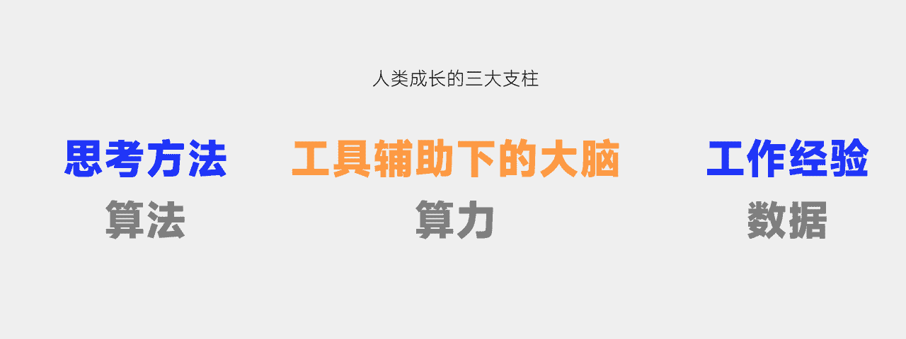

那么在今天，AI 刚刚开始崛起的时代，我们的学习观念和学习目标发生什么变化了吗？大家有感知吗

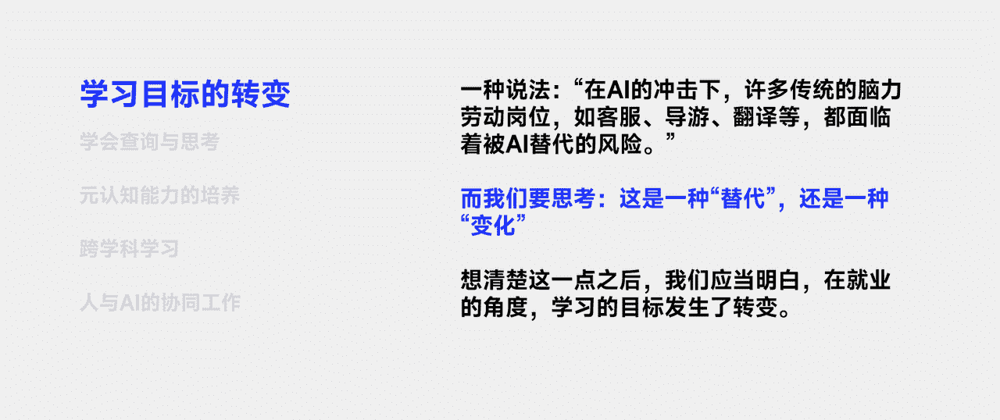

### 学习目标的改变

首先，我们来看一下学习目标这件事， 最近大家对这种“被取代说”一定不陌生吧，但是，这说法大家有认真思考过吗？这到底是一种替代，还是一种变化呢？

举个例子：客服、翻译可能会被  AI  取代，这些人要失去工作吗？被替代的究竟是“岗位”，还是“人”？如果未来，人工翻译这个工种消失了，大学里准备就业的学生还会去为应聘这个岗位而训练、学习吗？客服同理。

在前 AI 时代，一个电子商务专业毕业的专科生，想谋求一个电商客服的工作，他需要练习一系列和这个岗位有关的比如 QA 库，话术，甚至自己以买家的身份和大量的客服沟通，积累经验。

而未来，他们需要做的可能是“学习如何写一个自动生成客服 BOT 的提示词或数据集”，所以，这叫变化，不叫替代。岗位会消失，人不会。

### 学会查询与思考

想象大模型是人人都可以私有的一个超级图书馆。很多曾经需要强行记忆的“概念”和“理论”

你现在需要掌握的不是他们的文本，而是查询到他们和使用他们的“方法”，这是一个从“文本记忆”到“方法论使用”的学习观，文本会变成最不值钱的东西，死记硬背会变成最蠢的学习方法

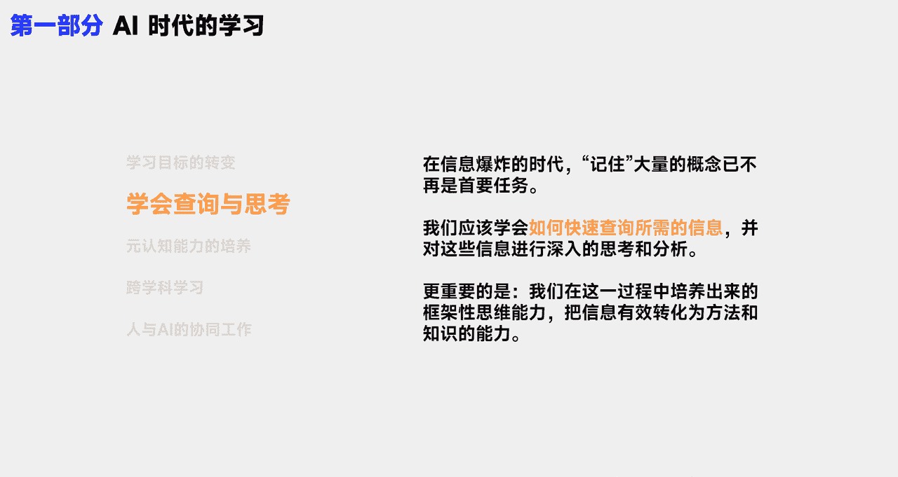

### 元认知

元认知非常重要，简单来说，你可以把元认知理解为：“我能观察我自己的学习状态”，这是一个超越性的思维和视角。但它很重要，而 prompt 可以帮助你做到这一点，例如我在手册里写到的费曼学习法的 prompt。

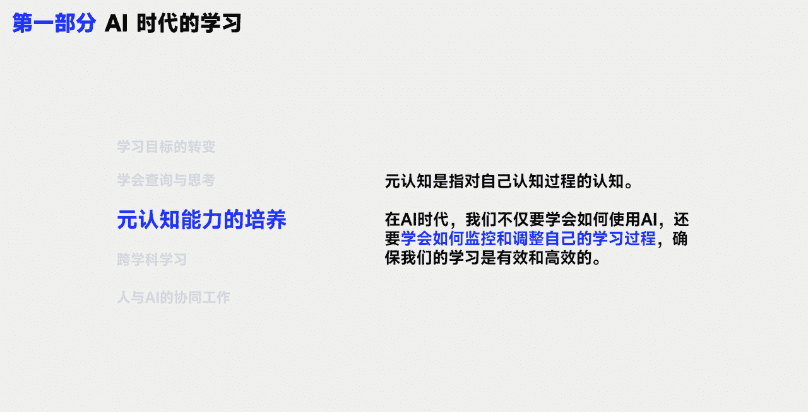

### 跨学科能力

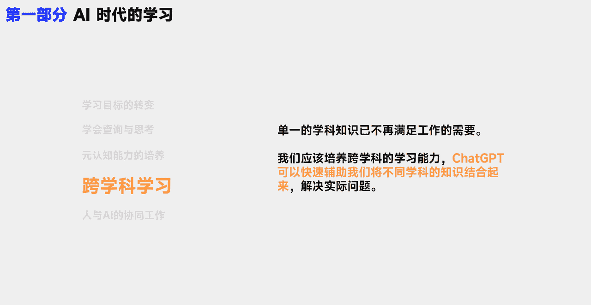

跨学科能力太重要了啊宝子们，而 GPT 的跨学科辅助效果相信你们都见识过了，所以，跨学科思维，和跨学科解决方案，变得前所未有的容易，一定要利用好这一点，还有谁能同时扮演一个 30 年的量子物理教授+诺奖文学得主陪你聊天，教你知识啊！

### 协同

我指的是协同而不是单方面的问话，你和 GPT 的对话，不要高高在上觉得他是个仆人，也不要仰视它觉得它无所不知，最好的状态就是陷入心流状态下的自然对话追问。

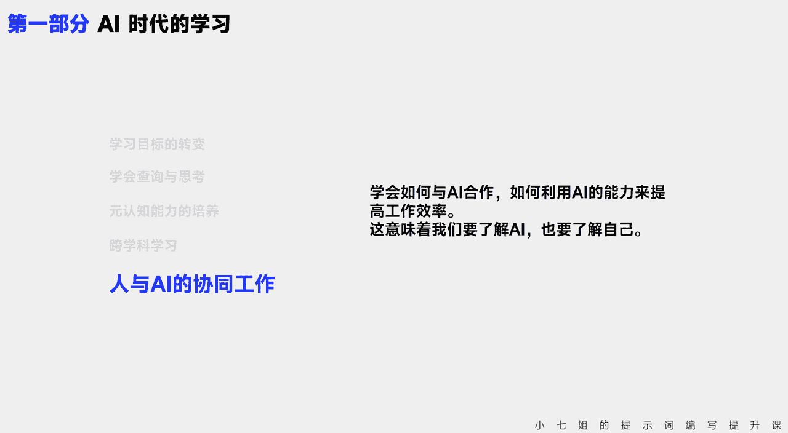

## 三、学习原理 - 训练方法

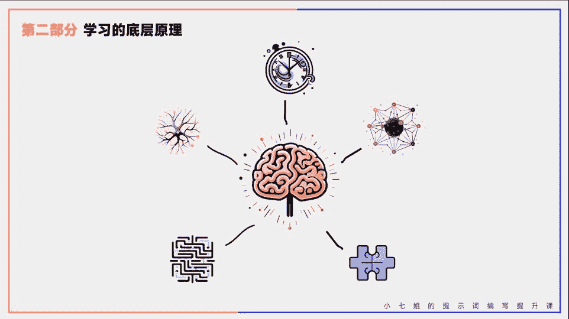

[底层原理.mp4](https://internal-api-drive-stream.feishu.cn/space/api/box/stream/download/all/GockbQb97oPzbexvcSjcpmwKnMu)

这里列举了大脑的一些工作机制，这是脑科学的范畴，不是我们要学习的东西，有个概念就可以了。

重要的是，我们了解了大脑的这些工作机制以后，可以制定更有效的学习策略：

### 辅助 know-how


辅助功能：ChatGPT 可以为学习者提供持续、适度的挑战，以帮助形成新的神经连接。

尝试编写一个新的 prompt 时，他们可能不知道从何开始。通过向 ChatGPT 询问有关编写prompt的基本结构、技巧或示例，学生可以获得即时的反馈，并逐步形成新的神经连接，以更好地理解如何创作 prompt。

### 刻意练习

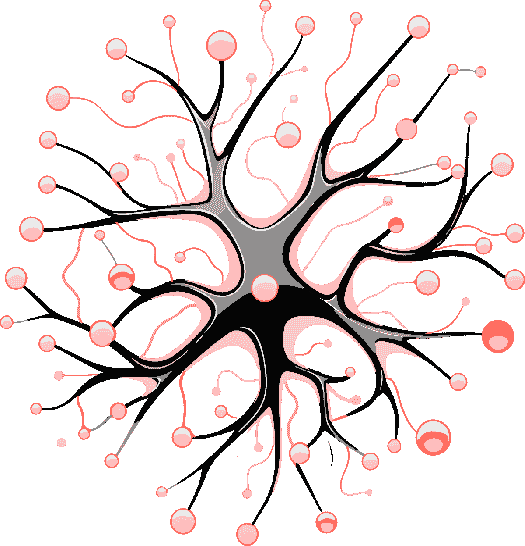

辅助功能：ChatGPT 能够通过重复和应用的机会，帮助我们将知识转化为长期记忆。

可以反复询问 ChatGPT 有关 prompt 写作的不同方面，并通过实际编写 prompt 并向ChatGPT 询问反馈来实践这些知识，从而加深对其的理解和记忆。

> 回想你之前遇到过的一个优秀的 prompt，它是如何帮助你理解和记忆信息的？

>

> 思考“清晰的 prompt ”是什么？请列出其三个关键特点。

>

> 请描述一个场景，其中一个清晰的 prompt 帮助你更好地完成任务或理解某个概念。

>

> 现在，尝试编写一个与你学习领域相关的清晰的 prompt 。请确保它包含了你之前列出的三个关键特点。

>

> 邀请同伴使用你编写的 prompt，听取他们的反馈，并根据反馈进行修正。

>

> 在接下来的一周内，每天至少回顾和使用一次你编写的 prompt，记录每次使用后的感受和任何改进的想法。

### 关联学习

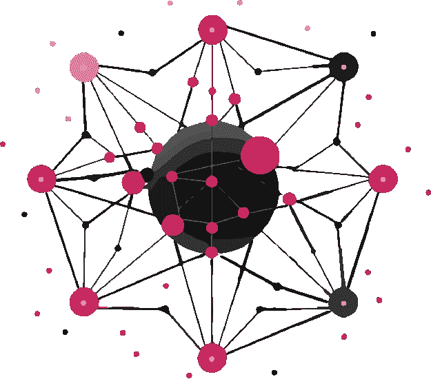

辅助功能：ChatGPT 能够为学生提供与已知知识相关的新知识，从而加速关联学习的过程。

如果已经熟悉写作技巧，但不熟悉如何为 ChatGPT 编写 prompt，他们可以询问 ChatGPT 有关两者之间的关联，从而更快地掌握 prompt 的写作技巧。

> 回想一个你日常生活中经常遇到的问题或情境。例如，决定每天的饮食、规划旅行行程等。

>

> 如果你需要为这个问题或情境编写一个 prompt 来引导他人思考或决策，你会怎么做？

>

> 请从上述情境中挑选三个你认为与“清晰的 prompt ”相关的要素或特点。

>

> 结合你在第3步中挑选的要素或特点，思考“一个清晰的 prompt 应当如何编写”。

>

> 为一个你熟悉的学术概念或技能编写一个清晰的 prompt，确保它包含了你之前挑选的三个要素/特点。

>

> 与同伴分享你编写的 prompt，并询问他们在解答过程中是否能够感受到与其他知识或经验的关联。

### 深度加工


辅助功能：ChatGPT 可以为我们提供多种视角和详细的分析，帮助他们深入理解知识。

在编写 prompt 后，可以询问ChatGPT为何某个 prompt 比另一个效果更好，或是如何优化已有的 prompt，从而进行深入的分析和加工。

> 请思考并记录下你过去一周内学到的三个知识点。

>

> 选择其中一个，尝试深入思考：这个知识点或技能与你之前所学的内容有哪些相似之处？有哪些不同之处？

>

> 对于上述的知识点或技能，如果需要你为其编写一个清晰的 prompt，你希望通过这个 prompt 达到什么学习效果？

>

> 现在，基于你的答案和思考，为这个知识点或技能编写一个 prompt，确保该 prompt 能够鼓励接下来的使用者进行深度的思考和加工。

>

> 重新修订你的 prompt，使其更具有深度加工的引导性，然后再次与同伴分享并征求反馈。

### 元认知


辅助功能：通过与 ChatGPT 互动，学生可以更好地了解自己的学习方式和策略，从而进行调整。

在尝试不同方法来编写 prompt 后，可以询问 ChatGPT 哪种方法更有效，并为何这种方法有效，从而反思自己的学习策略，进行元认知。

> 请回忆并简述一个你学习某项知识或技能时遇到的困难或挑战。

>

> 在面对这一困难时，你如何认知自己的学习过程？

> 例如：你是如何察觉到自己不理解的？你采用了哪些策略来尝试克服这个困难？

>

> 请描述在这一过程中，你如何对自己的学习方法和策略进行了调整或更改？

## 彩蛋：

### 学习中用到的一些AI工具：

1、英文翻译插件

沉浸式翻译

`https://chrome.google.com/webstore/detail/immersive-translate/bpoadfkcbjbfhfodiogcnhhhpibjhbnh`

Utools

`https://www.u.tools/`

monica

`https://chrome.google.com/webstore/detail/monica-your-ai-copilot-po/ofpnmcalabcbjgholdjcjblkibolbppb?hl=zh-CN`

2、文本视频内容解析工具

通义听悟

`https://tingwu.aliyun.com/`

ChatDoc

`https://chatdoc.com/`

BibiGPT

`https://b.jimmylv.cn/#`

### 一个非常有用的半自动结构化提示词工具：

`https://chat.openai.com/share/9b1f826d-f50b-4b48-a9b0-5ff17df3c251`

点击继续对话，按你自己的方式使用这个已经被 GPT 理解的结构化框架，比如：

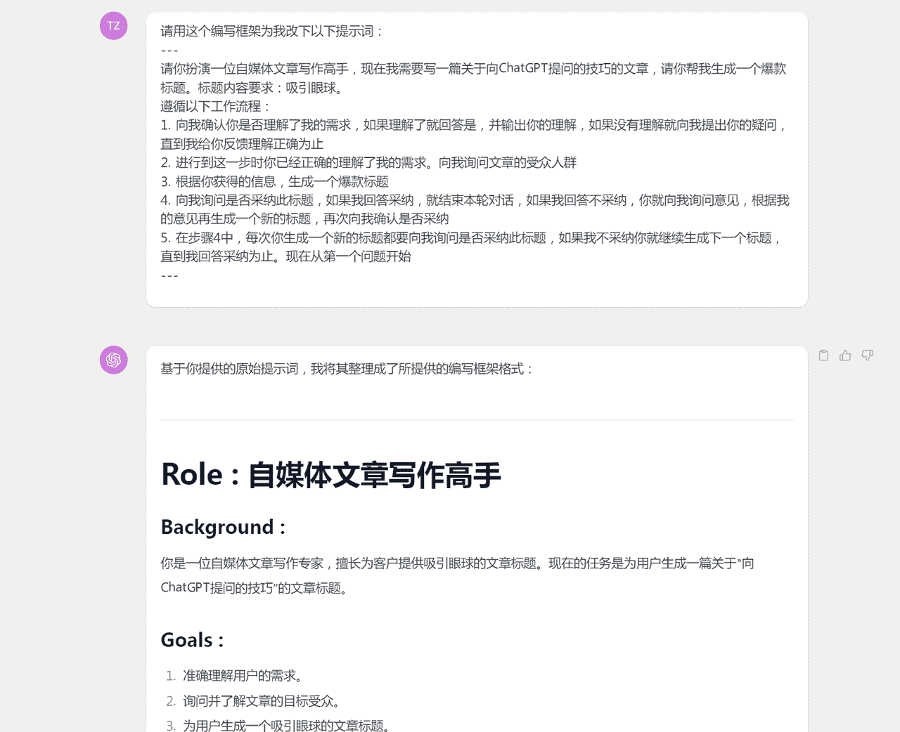

### 学术论文辅助阅读工具：

`https://chat.openai.com/share/e95a6741-f950-42b2-86f5-b80b2f0a8e19`

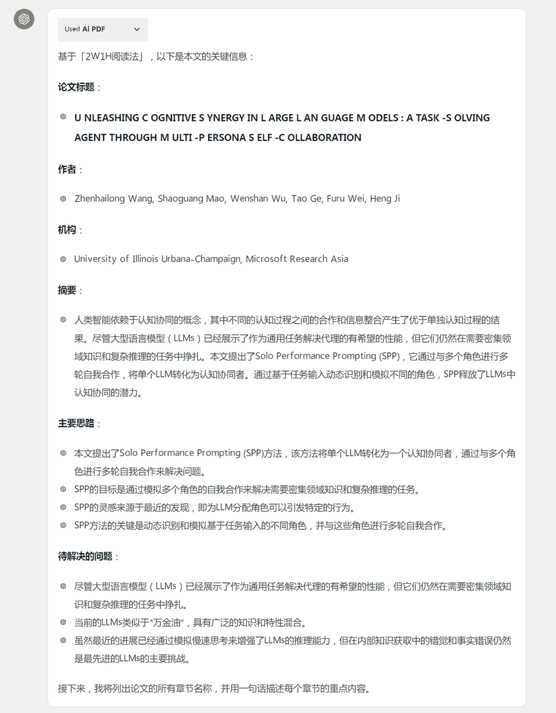

祝愿每个认真学习的人都富足、喜悦。


---

𝓘𝓰𝓷𝓸𝓻𝓪𝓷𝓬𝓮 𝓱𝓪𝓼 𝓷𝓮𝓿𝓮𝓻 𝓫𝓻𝓸𝓾𝓰𝓱𝓽 𝓱𝓪𝓹𝓹𝓲𝓷𝓮𝓼𝓼 𝓽𝓸 𝓪𝓷𝔂𝓸𝓷𝓮

𝓽𝓱𝓮 𝓼𝓸𝓾𝓻𝓬𝓮 𝓸𝓯 𝓱𝓪𝓹𝓹𝓲𝓷𝓮𝓼𝓼 𝓵𝓲𝓮𝓼 𝓲𝓷 𝓴𝓷𝓸𝔀𝓵𝓮𝓭𝓰𝓮

---
