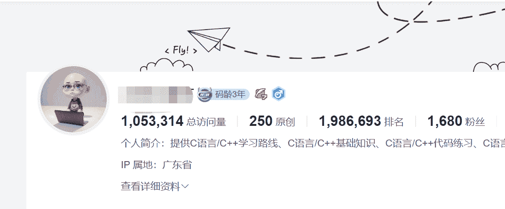
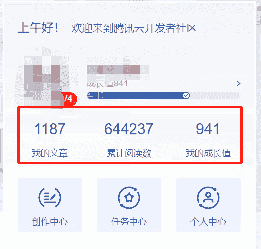

# 2023-06-24公众号10 万粉运营心得 | AI 如何切入内容

> 来源：[https://xuqiwei1986.feishu.cn/docx/FltKdWwxKoQ7WFxgTAXcQYJCnkd](https://xuqiwei1986.feishu.cn/docx/FltKdWwxKoQ7WFxgTAXcQYJCnkd)

> 🔗 原文链接： h[ttps://articles.zs](https://articles.zsxq.com/id_3i15nxgx3vc1.html)xq.com/id_3i15nx...

>

大家好，我是小林，第一颗 AI 之心持有者，端午前在 AI 初创合伙人群里和大佬们聊天，发现不少大佬对公众号挺有需求的。

别的领域咱不擅长，公众号可谓我的老本行了，今天结合我在公众号布局的 AI 内容，以及我过去这些年运营公众号的心得，简单分享一下，文章分为以下三部分：

公众号的第一桶金

AI 如何切入内容

我的四次失败经历

#### 一、公众号的第一桶金

小林16年入学就接触公众号了，当时小林参与学校一个大创项目，指导教师给小林分配的技术运营，就是写公众号推文，正是有了大一、大二的积累，让我对公众号有了初步的认知，但这个时候的小林还不知道公众号可以赚钱。

#### 一）为什么决定写自己的公众号？

18年的时候，在朋友圈看到一位Java大神，晒他公众号广告收入，一篇文章2000元，当时就刺激到小林了，我在饭店兼职，一个月也就2000，所以脑袋一热就决定自己也做公众号。

感谢年轻气盛的小林，正是因为有这股冲劲，赶上了公众号红海末班车。

#### 二）为什么选择C/C++领域？

实际上小林刚开始选择的只有C语言，因为我只会C语言，小林本科院校是医学院，就大一学过一些C语言，选择其他领域我也不会，后面的C++、Java以及我现在工作用的vue都是自学的。

#### 三）公众号如何冷启动？

刚**做公众号的时**候小林和大家一样，既不是大V，也没钱推广，天天很愁怎么引流，突然有天晚上，想到了一个点子， 「QQ群」 ，小林一辈子也忘不了，当天一晚上没睡觉，激动啊，想马上去尝试，但因为大晚上，室友都在睡觉，小林没法起来搞，怕吓着他们。

第二天白天，开始加QQ群，弄了好几个小号，疯狂的加编程有关的群，大概加了2 300个群吧，然后搜集对应编程领域的资料，写成文章以「关键词回复」的模式发，发了几次立马被踢了。

**通过不断琢磨，我发现半夜2点发效果最好，群主和管理员基本上都休息了，而且**早上刚起来，很容易有人点开看，这个方法引流效果很不错，但是有点损，各位自行斟酌。

#### 四）公众号如何持续产出内容？

这些年做自媒体，小林总结出了一套屡试不爽的玩法，不论公众号、视频号、知乎都是这种玩法，今天把老底分享给球友。

1、确定好系列，比如基础知识系列

2、从入门开始讲解，比如开发工具使用

3、搭配着简易的demo，比如每日一练

4、按照由浅到深持续输出，

按照这个步骤，不论编程类、ppt、剪辑类，至少可以输出100篇文章，等写上100篇，写文思路只会越来越广。

#### 五）中期阶段公众号我是如何优化的？

**1、减法优化**

一款产品，到底要加多少功能才能变成垃圾产品 ，我是被这句话启迪的，因此后面公众号就只放C语言/C++相关的文章，其他编程资料，全部改成资源引流。

**2、SEO优化**

SEO没点互联网积累，是想不到这个词的，小林刚开始根本没有搜到这个词，搜索的都是运营相关的内容。

直到2020年的某天，我发现有个C语言公众号排名突然很靠前，我就疑惑了，这个如何实现的，通过各种搜索，最后找到了一个关键词「快排」，也检索到了「SEO」，我就去公众号搜索SEO。

历经2年积累终于具象化问题了，小林想学习的不是运营，而是SEO优化，就这样，当晚激动的睡不着，通宵学习SEO知识。

关于SEO优化，实际上在公众号不是很难，将公众号名称、简介、菜单栏都带上关键词，文章标题和内容也布局关键词，随着时间的积累，量变终将引起质变。

第一次通宵是想起通过QQ群引流，这是第二次通宵。

#### 六）公众号如何快速增粉？

找同类型的号互推，比如我是做C语言的，我找过很多号互推，不断总结发现，只有C语言领域的公众号互推效果比较好，其他的很一般，因此后面我就只和C语言的互推，尽可能的少打扰用户。

#### 七）公众号如何变现？

小林变现的方式一共有7种，前4个大家应该都能看懂就不细讲了，我重点讲一下后三种。

1、公众号流量主

2、付费QQ群

3、付费微信群

4、接广告

5、微信小程序流量主

6、QQ小程序流量主

7、卖源码

第5种 **「微信小程序」 **，小林虽然不会前端，但不知道是不是运气好，注册小程序的时候发现C语言这个关键词没人注册，就这样这个关键词被我注册。

然后去网上搜免费小程序，找来找去，发现一家叫凡科的公司，有免费小程序的，但是免费的是一个月只能有100访客，再多就无法使用了（可以访问），我就注册了一下，搭建了简易的样式，放了几篇文章， 没想到没几个月独立访客超过1000了，流量主居然就这样开通了 。

后来看到别人 **「激励式视频」 **蛮赚钱的，就自学了html、css、js，开发了一个只有前台的小程序，后面突然某天注意到了腾讯云开发，官网有demo，小林拿来修修改改，弄了第二个小程序，到今天两个小程序的访客也有近2万，差不多一天也能赚1元。

也正是这里的自学，为我今年转前端开发埋下了基础。

第6种 **「QQ小程序」 **，这**个估计很多人都没有听**过，QQ也是有小程序的，而且QQ小程序流量主开通没有任何要求，微信小程序的源码同样适合QQ小程序，小林搬运微信小程序源码，弄了个QQ小程序，现在访客也有5100， 应该也是C语言榜一 ，只不过这个流量主钱很少。

第7种 **「卖源码」 **，在运营公众号的过程中，小林发现很多新生不会写代码，而且不少人有付费代写代码的意愿，因此就搜集了大概300道常见的C语言题目，自己编程实现，写上详细的注释，一个源码刚开始卖1毛，50个起售，后面涨到3毛一个。

写好之后公众号编写一个软文来卖，说实话根本没想到能卖出去，出奇的是效果还不错，一个月能卖1000多，这个业务进行了大概半年，微信收款总是异常，后面索性就停了，直接当作福利嵌套在每篇文章中了。

**就这样随着时间的积累，在大四没毕业的时候**，手里的存款就超过了大一定的赚5万目标。

大学的学费我是贷款的，生活费大一下学期就没找家里要了，毕业后自己还了一部分生源地贷款，期间还去了广州、南京、北京、长春、长沙、沈阳、延吉很多地方游玩涨见识，都是自费。

**我身边很多人在刚开始都不看好我，赚个1元、2元的能干什么，小林想说的**是「合抱之木，生于毫末，赚钱亦如此，正是1元钱的量变积累塑造了质变的月入过万」。

**八）可复制的引流玩法**

QQ群引流我上面介绍过了，这里重点说一下其他可复制的6种玩法。

#### 1）CSDN

1、前段时间CSDN有这么一个活动，开通原力计划后，官方有流量扶持，而且开通条件非常低。

账号类型【个人】

参与内容为投稿者原创、不得洗稿抄袭

字数超过2000字【含代码及图片】

2、充会员，在CSDN有两种方式可以直接在主页放置两个二维码，直接引流给公众号，一种是开通博客专家；一种是冲会员，博客专家开通要20万阅读。

3、想办法加上CSDN运营小编，多和运营沟通，真的，大多数小编不懂技术，只要你文章写的够长，内容差不多，在官方活动的大力支持下，很容易爆。

4、每周一次的群发功能一定要利用起来，如果你粉丝足够多，利用好这点，引流效果吓人。

5、目前CSDN也在转型视频，如果你本身有技术视频存货，可以申请开通视频内测，官方扶持流量非常大，我发了几条视频，播放都是好几千。

6、CSDN文章中间是可以插入超链接的，而且公众号的链接也可以，学会合理插入超链接。

CSDN的粉丝有多精准，相信不用我说，就是技术人才会看的博客，不像知乎，什么类型的都有，如果你是公众号号主，不清楚怎么引流，可以去CSDN试试，尤其是视频，抢占先机，早就是优势。

#### 2）技术社区

比较出名的有腾讯云加社区、华为云社区、开源中国、掘金、简书，这些社区都有同步公众号文章的功能，完全可以注册一下，然后同步文章。

这块引流可能不是很好，但是如何你入驻的早，内容足够优质，一旦成为头部，引流效果燃炸，比如我在腾讯云加社区文章有64万曝光。

**二、AI 如何切入内容**

这块我已经在星球多次分享了，公众号就是文字为主，圈友多看看我之前分享的 ChatGPT 辅助写作就行。

今天我再提供一个信息增量：

公众号原创文章的流量主比非原创的高，对于普通人，赚流量主的可能性非常大，500 粉丝就能开通流量主。

我给圈友的建议是，让 ChatGPT 帮你写那种纯知识型的内容，哪怕你写的是蹭热点，你完全可以再让 GPT 帮你总结一下你的热点，输出几百字内容。

你写的+ChatGPT 总结的，一篇文章如果有 1000 字以上，文章里面就可以嵌两个广告，普通人每天赚个几块钱真的不难。

**三、我做公众号的失败经历**

去年我做了个编程没有什么关系的新 IP，主打分享我的认知思考，就这个号经历了多次失败，我给圈友分享一下我的失败经历：

**一 ）第一次失败**

这个公众号是2020年注册的，当时就是想写一些随笔，记录生活中的点点滴滴，想走文艺风，但是一直没怎么写过文章。

而且发现自己写文艺风的能力也不够，于是第一次喜提失败。

在去年年初的时候小林接触了搜索引擎优化SEO，发现对SEO很感兴趣，于是便有了第二次定位。

**二）第二次失败**

初期我转载了几篇SEO前辈的文章，定位就是流量增长，也可说是自媒体SEO。

后来由于工作原因搁浅了公众号，就这样第二次定位也算是失败了。

**三）第三次失败**

去年年中的时候，组局督促身边的朋友写文章，拿到了一些结果，就自以为是的觉得写作很牛逼，于是定位分享写作技巧。

但写着写着，发现没啥可写了，写作技巧就那些，没有足够多的技巧支撑我输出内容，而且这个领域太细分了，文章几乎没什么人看。

**四）第四次失败**

基于上述三次失败的教训，我觉得做公众号还是要结合自己的主业，做主业的延申，小林虽然主业是程序员，但是深耕自媒体已经快6年了。

而且在各个自媒体平台都有一些结果，于是重构了自己的定位，分享自己做自媒体的经验，中间穿插着分享写作技巧。

但这个领域和写作一样，写着写着没啥可写了，真正的精华来回就那点内容，我不想车轱辘话来回说，就也放弃了。

**五）第五次摸到定位**

只一直在牌桌上，总还是有机会的，经历了 4 次失败，终于迎来了定位清晰，这个 IP 我要以我的认知思考为主，更新我对道和术的理解。

到今天算是把这个定位捋清楚了，新 IP 用了 1 年，目前快 2 万订阅，基本上就是自然增长。

你看，我应该要比大多数圈友要有经验，但还是经历了多次失败，所以说如果圈友刚开始找不到定位很正常，我的定位也是从实战中找到的。

知行合一，只知道不够呀，还是需要通过行动来验证【知道】，最后才能合一。

以上，就是今天的分享，有启发欢迎点个赞呀~