# 2023-08-10神仙接私活神器，牛到不行，绝了！

> 来源：[https://xuqiwei1986.feishu.cn/docx/TlkndvSqlodHwixhjUPcsslnnod](https://xuqiwei1986.feishu.cn/docx/TlkndvSqlodHwixhjUPcsslnnod)

> 🔗 原文链接： h[ttps://mp.weixin.q](https://mp.weixin.qq.com/s/T9UXL1ujD5JKHewzQ_spoA)q.com/s/T9UXL1uj...

>

iOS开发 2023-08-10 16:12 发表于 河南

推荐一个后台管理系统。 功能完整，代码结构清晰。 值得推荐。

### **项目介绍**

本项目系统是一款基于 SpringBoot + Bootstrap 的极速后台开发框架，可以用于所有的 Web 应用程序，易读易懂。RuoYi 支持集群，支持多数据源，支持分布式事务，拥有完善的权限管理。页面美观，完全响应式布局让你无论是电脑、平板还是手机等，都可随意使用。

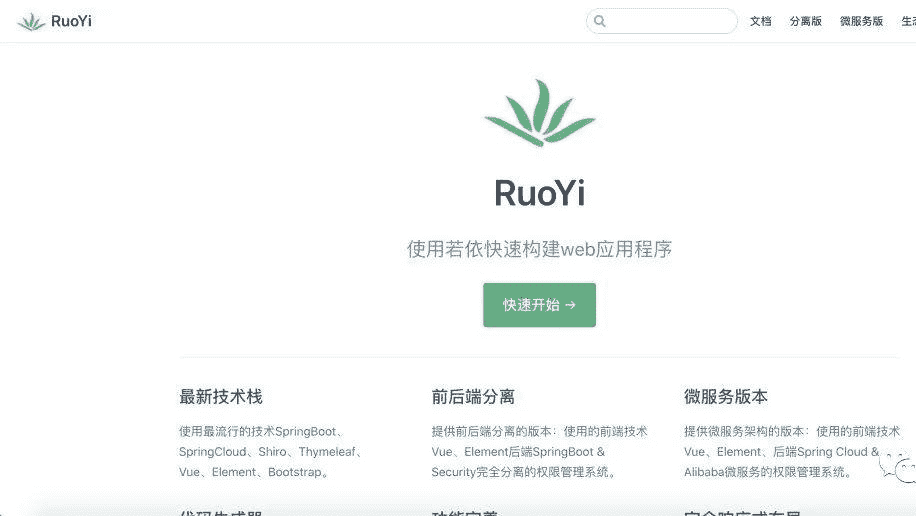

### **运行系统**

1.  首先我们将项目下载到本地，在 Gitee 下载页面下载解压到工作目录。

1.  导入到 Eclipse ，菜单 File -> Import ，然后选择 Maven -> Existing Maven Projects ，点击 Next > 按钮，选择工作目录，然后点击 Finish 按钮，即可成功导入。

1.  创建数据库 ry 并导入数据脚本 ry_2021xxxx.sql ， quartz.sql 。

1.  打开项目运行 com.ruoyi.RuoYiApplication.java ，出现如下图表示启动成功。

1.

(♥◠‿◠)ﾉﾞ 若依启动成功 ლ(´ڡ`ლ)ﾞ

.-------. ____ __

| _ _ \ \ \ / /

| ( ' ) | \ _. / '

|(_ o _) / _( )_ .'

| (_,_).' __ ___(_ o _)'

| |\ \ | || |(_,_)'

| | \ `' /| `-' /

| | \ / \ /

''-' `'-' `-..-'

1.  最后打开浏览器，输入：(http://localhost:80 (opens new window)) （默认账户/密码： admin/admin123 ）若能正常登陆即说明搭建成功。

### **内置功能**

本项目系统内置了多种后台管理的功能，包含系统管理、系统监控、系统工具。

#### **系统管理**

+   用户管理：用户是系统操作者，该功能主要完成系统用户配置。

+   角色管理：角色菜单权限分配、设置角色按机构进行数据范围权限划分。

+   菜单管理：配置系统菜单，操作权限，按钮权限标识等。

+   部门管理：配置系统组织机构（公司、部门、小组），树结构展现支持数据权限。

+   岗位管理：配置系统用户所属担任职务。

+   字典管理：对系统中经常使用的一些较为固定的数据进行维护。

+   参数管理：对系统动态配置常用参数。

+   通知公告：系统通知公告信息发布维护。

+   操作日志：系统正常操作日志记录和查询；系统异常信息日志记录和查询。

+   登录日志：系统登录日志记录查询包含登录异常。

#### **系统监控**

+   在线用户：当前系统中活跃用户状态监控。

+   定时任务：在线（添加、修改、删除)任务调度包含执行结果日志。

+   服务监控：监视当前系统 CPU、内存、磁盘、堆栈等相关信息。

+   缓存监控：对系统的缓存查询，查看、清理等操作。

#### **系统工具**

+   表单构建：拖动表单元素生成相应的HTML代码。

+   代码生成：前后端代码的生成（java、html、xml、sql)支持 CRUD 下载 。

+   系统接口：根据业务代码自动生成相关的 api 接口文档。

### **项目介绍**

相信大家很多人都被公司领导要求过，说让大家来开发一个🛰️👸号的后台系统吧，大家是不是对🛰️这个各种繁琐的条件弄得非常头疼，今天给大家分享出一块源代码，大家以后如果有需要的，可以直接拿过来复制一下使用呦。

本项目系统是一个支持👸号管理系统，支持多👸号接入。本项目提供👸号菜单、自动回复、👸号素材、简易CMS、等管理功能，请注意本项目仅为管理后台界面，需配合后端程序wx-api一起使用。

## 项目简介

本项目系统是一个🛰️👸号管理系统，目前主要实现了如下功能：

● 👸号菜单管理

● 消息自动回复

● 素材管理

● 模板消息

● 粉丝管理

同时它提供了如下跟👸号无关的功能

● CMS文章管理

● 对象存储

● 权限管理（管理后台菜单权限、接口权限、角色权限）

## 技术选型

+   核心框架：Spring Boot

+   安全框架：Apache Shiro

+   持久层框架：MyBatis-Plus

+   👸号开发框架：WxJava

+   后端脚手架：renren-fast

+   页面交互：Vue2.x

+   UI框架：ElementUI

+   管理后台界面模板：renren-fast-vue

+   富文本编辑器：tinymce5

## 功能演示

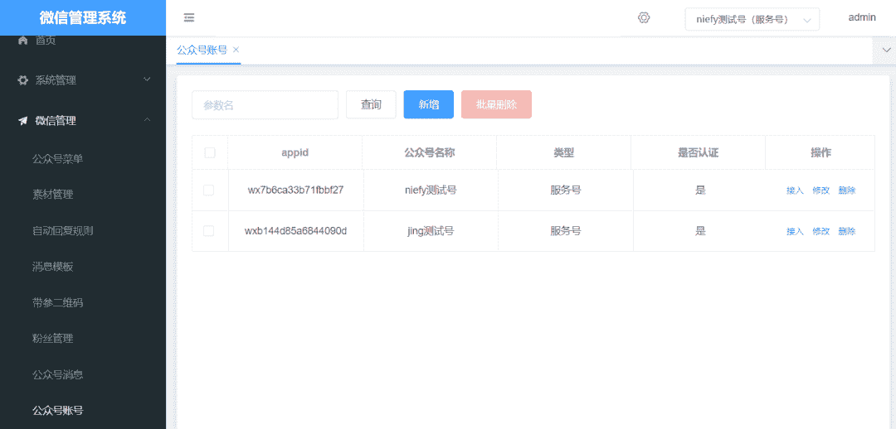

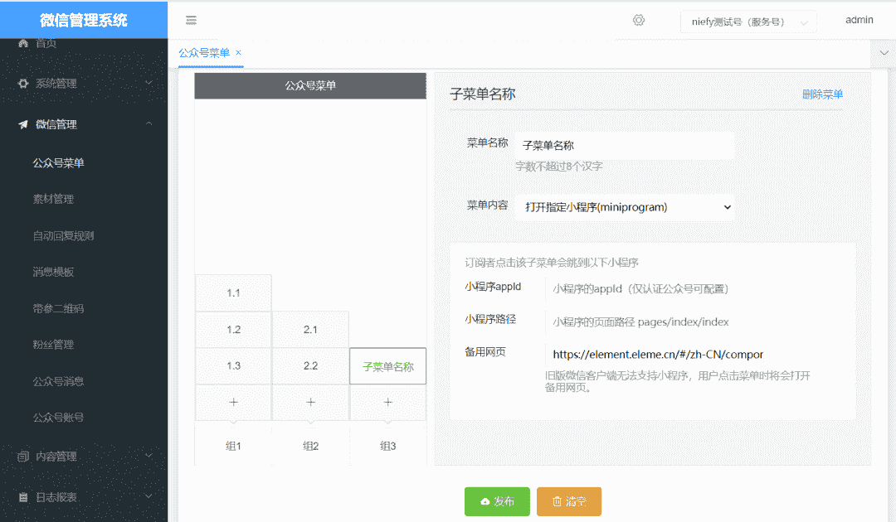

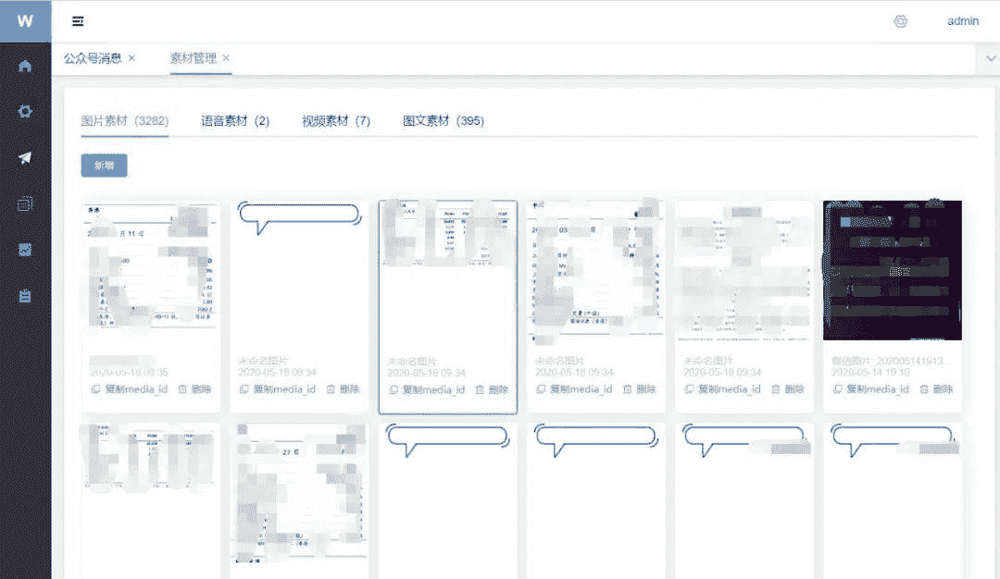

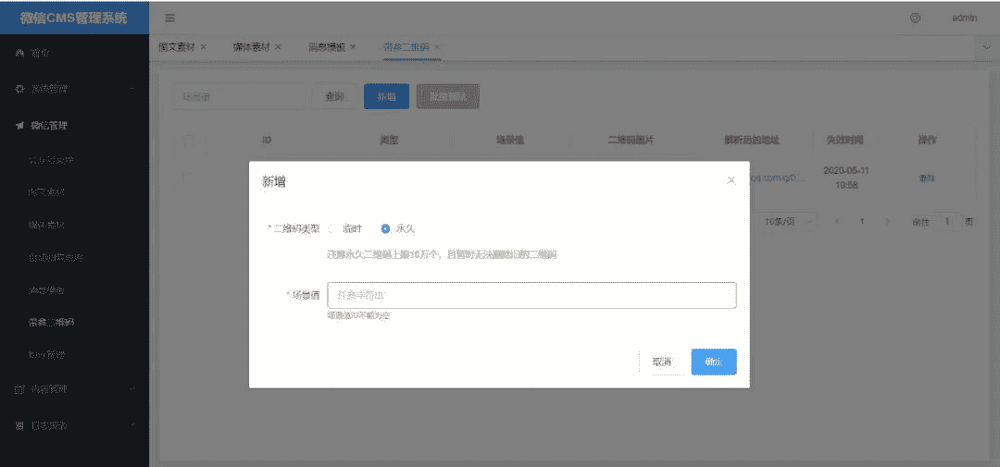

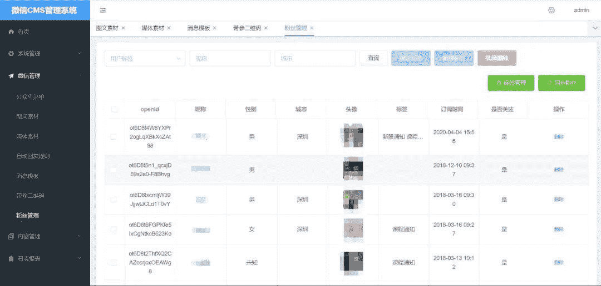

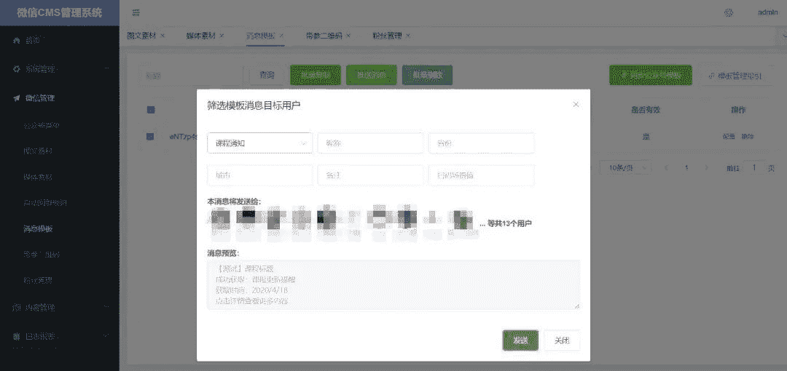

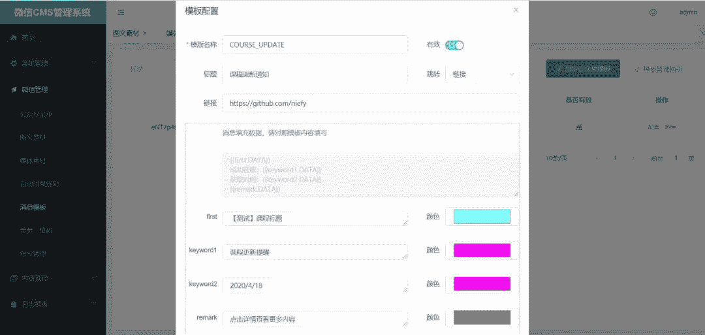

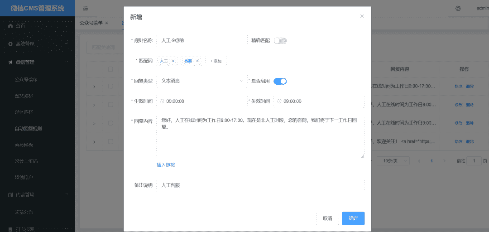

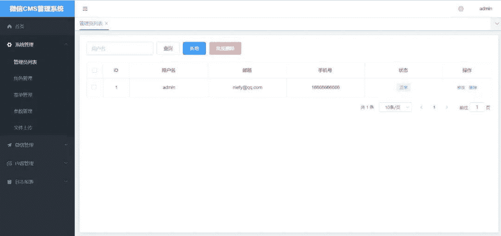

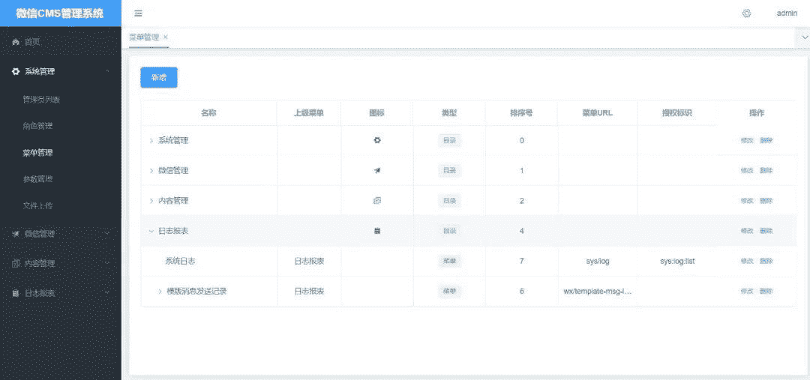

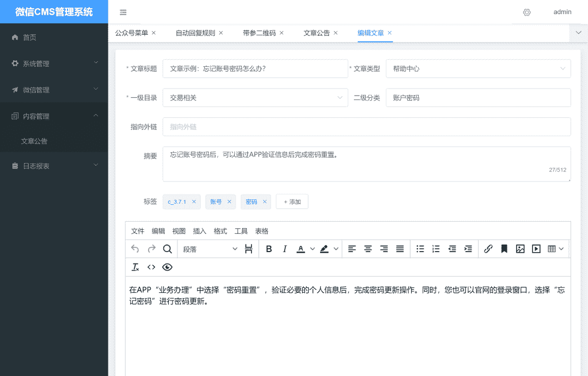

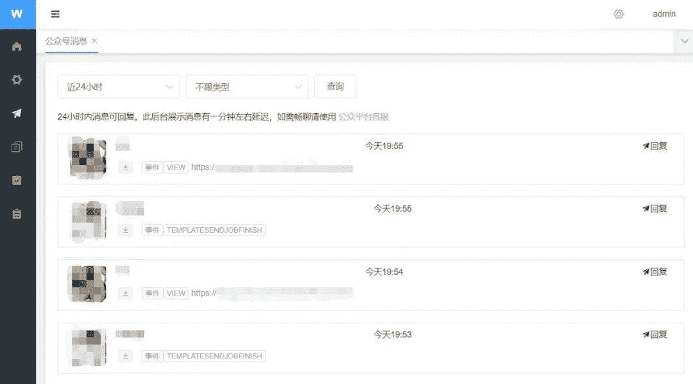

源码地址获取：gitee.com/niefy/wx-manage

开发部署文档参考：yuque.com/nifury/wx/guobb7

---END---