# 2023-08-12其实，你可以不用“读”那么多书

> 来源：[https://xuqiwei1986.feishu.cn/docx/B99edMEqQos2JcxfoSIcDpwyncx](https://xuqiwei1986.feishu.cn/docx/B99edMEqQos2JcxfoSIcDpwyncx)

> 🔗 原文链接： h[ttps://mp.weixin.q](https://mp.weixin.qq.com/s/JQIxe6-XUg4T6sdWYcllYA)q.com/s/JQIxe6-X...

>

刘润 2023-08-12 11:08 发表于 上海

以下文章来源于进化岛 ，作者刘润

**进化岛 **.

刘润老师付费问答社群，汇聚了1.4万名热爱商业的创业者伙伴。1天1块钱，一年进一阶。从管理小白到优秀管理者，从业务骨干到创业操盘手，成为更懂人才的老板，更懂老板的高管。一个人可以走得很快，一群人可以走得很远。我们岛上见。

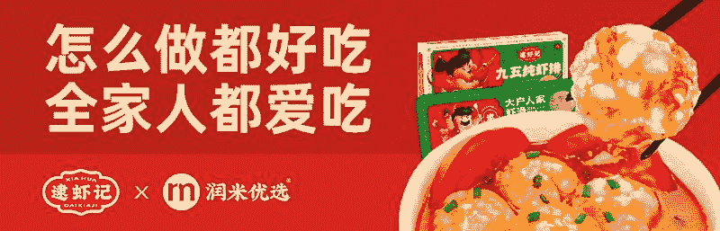

观点 / 刘润 主笔 / Neko 责编 / 黄静

这是 **刘润👸号 **的第 **1977 **篇原创文章

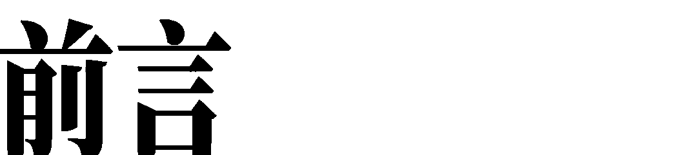

这两年，有句话很火，读书破万“卷”，掀起了一股求知的热潮。

结果是，收藏夹里攒了一堆课，书架上叠了一堆书，就是没时间学。

只好自我调侃，买了就是读了，收藏了就是学会了。

新书到手第一天，翻开读了前几页，一个月后翻开，还在前几页，因为之前读过的又忘了，只好再从头开始读。

好不容易读完，合上书。下次再看到的时候，特别眼熟：这本书我曾读过的。

做了一堆思维导图，却依然没有形成自己的知识体系。

懂得很多道理，也过不好这一生。

更焦虑了。

怎么突破？

其实，你可以不用“读”那么多书。

什么意思？

先从读书的6大误区说起吧。

---

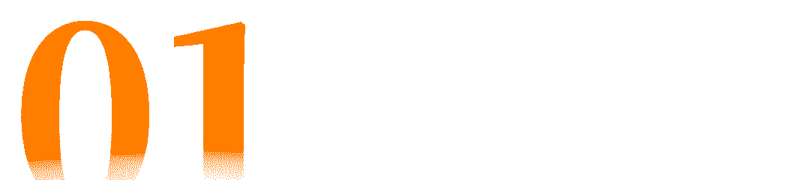

# **误区一：把书神圣化**

很多人拿起一本书的时候，都觉得非常神圣，尤其是知名作家的书，带着一种膜拜的心态，一个字一个句子拜读，就差没有沐浴焚香了。

粗略计算，我也写过二十多本书了，也有幸成为过畅销书。从作者的角度，我会感谢你对我的知识体系的尊重，但是， 大可不必因为一个人写了书，就觉得他很厉害。

他写书前怎么样，写书后还是怎么样，并不会因为写了书，就突然变厉害了。

也不用因为作者本身很厉害，就对他的书顶礼膜拜。

**因为，他不一定会写书。**

大多数非虚构类（Nonfiction）的书籍（基于一定的事实和信息来写的书，通常指非小说类），作者都不是作家。

也就意味着，他不以写书为生。所以，作者不会写书，太正常了。

一些作者，可能一辈子就写这一两本书，囊括了他的毕生所学。他会把知识框架梳理得很完备，但是，他根本不会去学习如何写好一本书。

“那是最好的时代，那是最坏的时代”，像《双城记》这样的小说的开篇是作家精心设计的。

但大多数非虚构类的作者，不会去专门研究，如何遣词造句，才能让你更容易理解，更不会去琢磨怎样写一个开篇，才能让你更愿意读下去。

相信我，通常开篇第一句话，他也不知道该怎么写。

所以，读书首先要祛魅，非但不要把书神圣化，还要反过来多给作者一些包容。

你可能会说，写得那么差，读不下去，凭什么还要我包容呀？

因为，不会写，不代表他的研究就不厉害。如果因为写得不好就不看下去，其实损失的，是我们自己。

当然， 书籍，只是知识的载体。要了解作者的知识体系，其实并不一定要通过读书。

比如说，也可以和作者进行一次交谈。

经常有一些作者，来找我给他的书写推荐序，但我不一定有时间看他的书，怎么办呢？

我会和作者约一个时间交谈，听他讲一讲，为什么写这本书，书上讲的啥？

**如**果满分是5分的话，大多数作者在书中的表达，可能只有3分，但是通过写书，他把毕生研究整理成了体系框架，所以书籍的知识完备程度是5分。

那**么和作者交谈对话，他的表达就会**提升到5分 。因为人练习说话的时间，远远大于练习写作的时间，你还可以通过提问让他讲解不清楚的地方。当然，交谈相对是松散的， 知识完备性可能就会下降到3分。

我猜你会说，润总，你这就是何不食肉糜了，你能和作者交谈，不代表我也有机会和作者交谈啊。

别急，别急。

还有下一种。

听作者分享。

一些作者，可能会去一些高校讲座分享，或者，他本来就是讲课的教授。

就像我们刘润视频号的每周4场读书会直播，也会请到作者来给我们就书中的内容进行分享。

光分享还不够，我们还给作者提了一个“无理”的要求，他还需要做PPT。

有PPT，作者在讲的时候，就会按照逻辑框架，不容易散，对知识完备性有了一个保障。

这样的分享，就能做到，表达是4分，知识完备性也是4分。

如果你听完了作者全程的分享，回去也不一定需要再马上完整读一遍。 买的书，先作为书架上的装饰也好，送几本给朋友也好，都能显得很有价值。

听一场分享，就是认识了一个老师。等后面需要这个知识点，就能马上想起来这位老师讲过，再去翻看查找也很方便。

书中的目录框架，也能帮你更系统化地理解和掌握这个知识体系。

**读**书，是取其精华，弃其糟粕，带着对作者写得不一定那么好的包容之心，去带走他的知识结构和思维方式，才能让自己受益最大。

有些人只盯着作者写得不好的地方挑刺，那就是专挑糟粕读，既花了时间读，又没带走精华。

对书籍祛魅之后，接下来，就进入了读书的第二个误区。

---

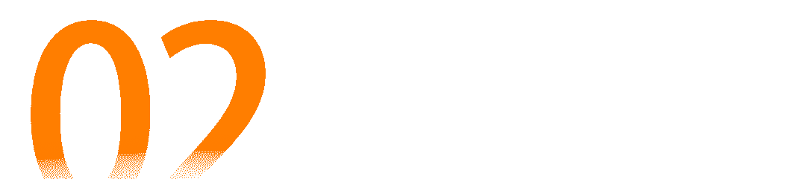

# **误区二：想在书中找答案**

你为什么会翻开一本书？

可能确实有部分人，读书就是消遣，没有目的，读完也不一定要留下什么。

但是非虚构类的书，通常还是因为你遇到一个问题，才会来看这本书。

也就造成了，很多人带着一个强烈的目的，读完会很迫切地想找到一个解决方案。

可能他今天遇到了一个管理问题，就连忙到处“摇人”问：“万能的朋友圈，有没有讲管理的好书推荐？”

然后在一众推荐下，满怀期待地翻开了《卓有成效的管理者》。

结果，看了大半本，也没有找到解决方案。

就开始说，不行啊，这些学者，天天搞学术，讲的都是空中楼阁，一点也不落地。

管理学大师，彼得·德鲁克，也不懂管理嘛，根本解决不了我的问题。

这就陷入读书的第二个误区：想在书中找答案。

很遗憾，你是不可能从书里找到答案的。

哪怕是有标准答案的高考数学题，你从一年级翻到高三的课本，也不可能找到答案。

因为，题目中的条件是不一样的。更何况人生，根本没有标准答案。

读书的目的，不是带走答案，而是让自己成为那个解题思路。

你是为了带走老师的知识完备性，获得老师的思考能力，而不是请老师帮你思考你的问题。

就像小时候，你学自行车的目的，不是为了明天去学校，而是为了未来能去任何地方。

真正的读书，是学习作者的思维模式，和思考能力。

**是为了拥有作者的认知，然后你才能用这个已经成为你的一部分**的认知，去举一反三，解决各种相关的问题。

而不是带走作者思考结构的结论，更不是“套上公式”让这个结论成为你问题的答案。

如果一本书，只有答案，没有思考过程，反而是有害的，根本不用读。

---

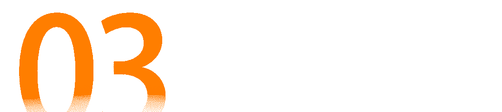

# 误区三：懂得很多道理，也过不好这一生

不少人读书有划线的习惯，看到金句，核心观点，就会圈出来，甚至做摘抄，方便之后更容易找到。

一年也读了很多书，看起来收获了很多金句和道理。

但是，却能轻易被一句互联网上很火的话戳中：懂得很多道理，依然过不好这一生。

特别扎心，感觉否定了我学习的意义，但又不得不赞同，看的很多知识真的只是停留在理论。

知道，却做不到。

真的是这样吗？

明朝著名的思想家、哲学家王阳明说过一句话，被他的弟子记载在《传习录》中：

**知者行之始，行者知之成。**

知道，是行动的开端，而行动，则是知道的完成。这就是，知行合一。

**知和行是同一件事，如果你做不到，并不是因**为你的行动力很差，而是因为你根本不知道。

你觉得你知道了，实际上只是因为觉得这个逻辑无法反驳。

很多时候，人都需要亲身经历，悟出这个道理，才是真正的知道。

就像我们都听过身体健康最重要，但是行动上总觉得自己还年轻，如果不能吃好吃的、玩好玩的，我要活这么久干什么？

直到生一次病，住一次院，或者到中年感觉自己体力大不如前，大吃一顿就肚子疼，才真正开始锻炼身体，控制饮食。

所以我们会发现，大病一场幸存的人，好像突然就和从前判若两人，他这时候，才是终于知道了健康的重要性。

但总有些人，会通过快速行动和实践，去让自己拥有这个从前没有的体验，从而知道这个道理。

**不论是被动行动，还是主动践行，** 行动起来，才是真正知道的时刻。

**表面上知道的道理，一到行动就会忘，**而真正理解体会过的知识，是不需要记住的。

---

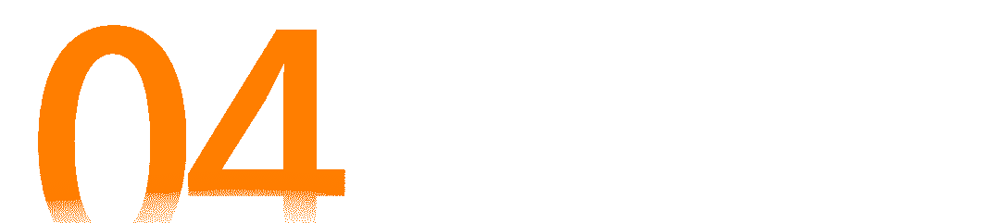

# 误区四：我可以快速把不知道的知识补上

那如果说，我真的很努力学了，但就是学不会，记不住，无法真正理解呢？

可能还有一个原因，就是你还没有建立自己的认知之树，就像家里没有可供物品收纳的柜子，新的知识来了，就不知道该往哪里放。

而 认知树的建立，不是一蹴而就的。 如果你没有在小学到高中的数学课上学好算术、方程、求导等基础，也就无法在大学学好微积分。

很多人存在一个幻想，就是我可以快速把不知道的知识给补上，就能解决新的问题了。

有一年，我课上的一些企业家在业务发展的过程中遇到了一些问题，其实是因为缺乏一些基础的商业认知。

他们问我，怎么样才能快速补上这一块认知？

**我**花了一个春节的时间，给他们开了一张“养生处方”，里面是35本商业认知书单，需要他们花3年时间看完去建立基础认知。

他们收到后说，润总，要3年这么久吗？我现在已经很着急了，有没有办法快速解决这个问题呢？

很抱歉，不能。

**如**果你没有这些基础认知，商业地基就不稳，想快速解决问题，只能通过一些奇技淫巧，一时管用，但，地基不稳，楼建得越高，就越危险。

3年能读完，已经很快了。读个本科，需要4年的全日制，一本专业经典课本啃半年。

每个学科都要在最早的时候去建立认知之树，这类经典书籍，你永远没法通过跟人聊天，或者听书，来获得认知。

假设你现在只有小学的数学水平，找全世界最好的大学数学教授来跟你聊半天微积分，也没用。

必须像准备高考一样去读。一个一个字啃，一道题一道题练，这就是大多数人想建立学科认知之树的必经道路。

那么，到底什么样的书，能称得上是经典书籍呢？这就要说到书的四大分类了。

**1、 **第一类书，不可能靠听来理解，凿壁偷光也要读完。

**2、 **第二类书，适合放在书架上，常读常新。

**3、 **第三类书，听听就行。作者确实有一个很有洞见的观点，但你花时间去读完，就会发现整本书都是扩写，只要看这一个观点就行。这类书，直接去听书软件听人讲一讲，看看书评，就足够了。有很多书，都属于这个范畴，听听就行了。

**4、 **最后一类，不值一看。这类书，用浅显的方式讲了不一定正确的道理。有的甚至可能会有害，因为观点就有问题。这个类型，还包括一些，没有推理思考、全是结论的书，读完你也不知道这个结论要在什么条件使用，也无法学到作者的思维方式。

经典书籍，是必须认认真真坐下来“读”的书。

我给企业家开的35本商业认知书单，就属于第一类，凿壁偷光也要读完。

必须花3年时间，每天2小时，踏踏实实啃完，3年读不完，就花5年，全部读完，才可能建立起自己在商业领域的认知之树。

之后再看新的商业知识，就可以分门别类地挂在树枝上，留存下来了。

---

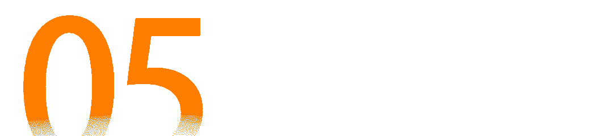

# **误区五：必须要用整块时间学习**

除了经典类书籍，还有很多书也是值得一看的。比如说，常读常新的书，不同时期读都能有不同的感悟。

但是，怎么才能把这些书给筛选出来呢？

大量涉猎，读多了，自然就知道好坏。

我会使用一个学习方式：须鲸学习。

怎么学呢？我自己的做法是，抓紧一切可利用的碎片时间，听书。

到这里就涉及了读书的第五个误区。

碎片化学习，感觉学了很多，但是记不住，好像读完都浪费了，效率很低。

**因此一些人觉得，必须要用大块的时间，端正坐下来**，专心致志记笔记，一旦漏听了，就很可惜。

然而，碎片化学习，就是会有大量浪费的。

须鲸的体型很大，捕食的时候，一张嘴，这片水域所有东西都流进去了，然后它把有用的消化了，没用的就排出去了。

排出去的量大，也没关系呀，张开大嘴，大量地摄入，总有一些东西是会被消化吸收的。

做好知识就是会被消化、损耗和浪费的准备。 大量地涉猎不同领域，本来就有很多知识是对你没用的。

**大**块时间，本可以用来做更重要的事。花一整块时间，集中精力去听这些用碎片时间就可以学习过滤的知识，才是真的浪费。

我的一年，可能有半年时间在路上出差，非常忙。

但是，我在得到APP上，还能保持每天听一本书，每年加起来听书的时间，超过1000小时。

而且，我开的还是2倍速，所以，实际上学习的内容，超过2000小时。 折算下来，平均每天碎片化学习6小时。

如何做到？

这需要搭配一些能让我“张开大嘴摄入”的工具。

**比如说，我有四类听书的设备。**

骑车上班的时候，需要听到外界的声音，我就用骨传导耳机。

洗澡的时候，就用浴室的防水蓝牙音箱。

出差坐飞机，必须得提早到。路上的这些时间，我会用降噪蓝牙耳机。

到了酒店，不影响他人了，就会用桌面蓝牙音箱外放。

时间上，我会利用一切耳朵闲着的时间。

日常工作，7:30起床，9点上班。中间的时间段，手上也没闲着，可能在锻炼、吃早饭，等等。

但是，耳朵闲着呀，那就可以用来听书。这就有1.5小时了。

出差的时候，打车去机场2小时，在飞机上2小时，落地后出机场可能还要1小时，也可以用来听书。这就5个小时了。

相信，你一定也能挖掘出大量可利用的碎片时间。

在听的书籍选择上，我关闭了算法的个性化推荐，然后，系统推荐什么听什么，这样就能 避免只听到我喜欢的内容，不让自己陷入信息茧房。

有时候，很多领域看似不相关，却也会发现神奇的联系，从而得到启发。

好了，各类前期准备到这里就都完成了。

那么， 在须鲸学习的过程中，如何才能筛选出对自己有用的信息？

**我自己有这样几个判断依据。**

如果这本书一听就知道，那么就是前面说的第三类书，全书围绕着一个观点拓展，听听就行，不用找来看了。

有的书一听，觉得讲书的人没讲清楚，可能他也不一定读懂了这本书，就可以找来看看。

在这个过程中，你会发现一些自己听完还想找来看的、常读常新的书。

碎片时间听的时候，你可能中途会被打断、被各种声音突然掩盖，都没关系。随缘过滤，没必要回过头来听漏掉的这段。

你会发现，这种方法不仅适合读书，也适合快速学习各类知识。

听刘润读书会的作者分享，多看世界，多认识人，听他们分享，都是“张开大嘴”的须鲸式学习。

---

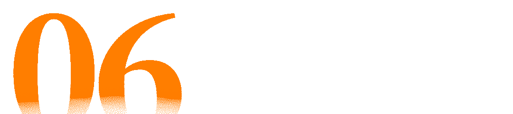

# **误区六：从第一章开始读**

呼，说了那么多，终于到了读书环节了，我总该可以拿起书开始读第一章了吧？

恭喜你，掉入第六个误区：从第一章开始读。

前面说的，摆正心态、调整认知、建立习惯，都是读书的道，能帮你精准筛选，确保你翻开的书，都是值得一读的精华，并且能提升你的吸收率。

到了真正拿起一本书，就涉及读书的术了。掌握好这些技术，也能让你事半功倍。

**首先，要读多本书。**

一个作者，对一件事的理解，可能是片面的，不一定正确。

如果，你想快速了解一个领域，那么，可以参照京东、豆瓣等各类排行榜。

把这个领域里最有名的作者们写的前10-20本大家都推荐的书都摊开到目录页，看完这些书的目录，就能快速得到业内共识。

比如说，人工智能领域排名前列的书籍，每个作者都说到联结主义和符号主义，那就一定是比较重要的概念。

**先共性，再个性。看完相同的部分，再快速扫一扫每个作者不同**部分的见解，就对这个行业有了基本概念了。

**其次，看书先看目录和自序。**

书是作者知识体系的结构化体现。可以说，写书的难点，就在目录。

目录就像书上的枝干，看过目录，你才会建立起这本书的结构感，知道里面的知识“树叶”要挂在哪里。

除了目录，自序也很重要，会告诉你作者写书的初衷、如何读这本书、可以解决什么问题，等等。

推荐序大多是背书，认真看过目录，也可以不读。

**如果拿起书就翻到第一章，跳过目录和自序，很可能读着读着**就不知道作者要讲什么，自然就很难读下去。

而看过目录之后，你甚至不需要从第一章开始读，可以直接跳到你感兴趣的章节，有看不明白的，再去前面溯源，带着兴趣和问题，才更容易读下去。

**第三，看书评。**

看书的同时，可以去豆瓣、得到、🛰️读书等各类渠道，看看这本书的书评。

书评，是读者的理解和输出。

每个人的理解和别人不同。也许同一句话，别人看着是另一个意思。借鉴不同的观点，能帮你更全方位地思考和理解书中知识的适用范围。

甚至，一些听听就行的书，只读书评就行，别人已经帮你理好重点了。

**第四，多划线、电子化。**

过去上学时候，看到好词、金句，可能会用手抄一遍，更容易记住，方便自己理解，或者写作的时候使用。

但是，现在是信息爆炸的互联网时代，抄下来的内容，最大的问题，就是很难再次检索，本子也有可能丢。

所以，我会偏向于使用电子书，可全文搜索，划线内容也很容易找到。

如果你是纸质书爱好者，那么，也可以配合一些工具。

比如说，用扫描笔划线，一扫就会保存到关联的电子文档变成笔记，再次搜索就方便很多，而且云端同步，不容易丢。

**最后，读作者。**

一开始的时候，我们说了，书籍是作者知识的载体。 读书的目的，是认识一位作者，获得他的思考能力和思维结构。

所以，如果你发现一位作者写得很不错，那么，可以把他的书都找来读完。

一个作者有多本书，还能写得很好，多半是因为，一本书表达不全他的知识体系。

所以，看完他的书，就能更深入地认识这位作者，学到他的整个思考框架和知识体系，也会让你的认知更完备。

**优质的作者值得跟随。**

---

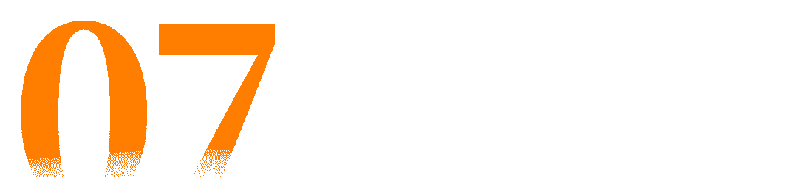

# **陪你更好地读书这个商业模式**

#

前面我们说到，刘润读书会会请来作者本人分享，围绕PPT，保证分享结构的完备性能到4分。

并且，我们还提供半价包邮的作者亲笔签名书，让读者收益最大化。

可能有人会问，这能持久吗？作者愿意来，是看在润总你的面子上吗？

先不用说，我的面子还没有这么大，很多作者并不知道我。

一些其他领域厉害的作者，我过去也并没有机会认识，都是出版社邀请来的。

一个商业模式，需要让所有人受益。

我们能长期这么做，只是因为，去年开封菜直播期间，受罗振宇老师的启发，我们发现了一个潜在的需求。

一些厉害的作者，本来很少出面，但是一旦写了书，就会有强烈的传播渴望。

是因为想多卖点书赚钱吗？

一本书的版税，大概在8到10个点，也就是一本70块钱的书，他只能赚7块钱，哪怕卖到5万、10万册，已经成了畅销书，作者拿到也就是几十万。

这些作者，他真的缺这些钱吗？显然不是。

因为， 传播自己的理念、建立更大的影响力，是很多作者真正想要的价值。

著书立说后，他的“武功秘籍”，能被几十万、上百万的人看到。

我们抓住了作者的这种强烈的渴望。

这些人很忙，他们的时间，也都很贵。

但在出完书之后，我们把作者请来直播间，亲自分享2小时，我们帮他卖几百、上千册书，有不少作者是愿意的。

这可能比做一次线下签售会效率高很多。

而分享之前，签上千本书，这是一个近乎苛刻的要求。

吴士宏老师说，她一次签完几千本，几天手都写不了字，再也不想签了。

所以，很有可能，那天在我们直播间卖出的2000多本，就是属于吴老师最后一批次的签名书。

足够稀缺。

作者来了，那半价包邮这么便宜，出版社有什么好处？

的确便宜。一本书，作者想亲自拿，最低也要6折。

半价，虽然利润少一点，但是直播一次，能快速走量，薄利多销。并且，播完就下架了，也不影响其他价格体系。

于是，越来越多的读者知道，刘润读书会可以半价包邮买到喜欢的作者签名书，还可以听到作者亲自分享。

一年52周，每周4场，如果每场都听下来，就算不买书读，也能收获208个不同作者讲的各个领域的精华。

对于作者，可能卖了1000本书，但是通过我们的直播间，他也传播了自己的理念，被进进出出的几万人看到。

低价，亲笔签名，亲自分享，做PPT。

我说出来了，你可能也不一定能做，这就是有壁垒的稀缺价值。

而对我们来说，就要不断要求自己，做厚资产，提升场观，做好售后，吸引更多的人进来看到，用心服务好每一位读者。

如果有一天，作者签了很多书，发现我们也卖不掉，读者买了书，发现售后体验态度很差，那么，慢慢我们就会无法再在这个市场立足了。

所以，拼命做好直播，拼命服务好读者，是刘润读书会的立身之本。

希望你能在直播间听得开心，收获稀缺价值。自己读书时，也能避开误区。

给书祛魅，摆正目的，知行合一，建立认知之树，须鲸学习，掌握读书技术，让读书的收益最大化。

所以，其实你不需要“读”那么多书。通过这些读书的心法和技术，最终精挑细选出来的书，才值得好好读。

——————

在读书会播完之后，我们还会把一些作者请到我唯一的商业付费社群进化岛上，进行更进一步的读书打卡或知识分享。

比如说，我曾经给大家介绍过田雪老师的211饮食法，并且请她帮我诊断了饮食结构，开始践行健康饮食。

前段时间，我们把田雪老师请到了进化岛上，本月，岛上就在进行《吃饭是个正经事》读书实践打卡，她也会全程陪伴答疑。

我们根据书中内容，拆解出了简单易操作的最小行动，帮助你迅速实践、知行合一。

本月，恰逢润米注册十周年，希望十年后，我们都还能保持思想和身体的年轻健康，出走半生，依然是少年的模样。

[推荐阅读：](https://mp.weixin.qq.com/s?__biz=MjM5NjM5MjQ4MQ==&mid=2651714204&idx=2&sn=60f6e468e0b8bf921e89fdc37ae27298&chksm=bd10a9d28a6720c4c5d9b96972e1ce4e52d08757e7f32c55ab9e241601459fa7aa1e2c2317af&token=89561450&lang=zh_CN&scene=21#wechat_redirect)

[《 谈业务，要有逻辑、有结构》](https://mp.weixin.qq.com/s?__biz=MjM5NjM5MjQ4MQ==&mid=2651714204&idx=2&sn=60f6e468e0b8bf921e89fdc37ae27298&chksm=bd10a9d28a6720c4c5d9b96972e1ce4e52d08757e7f32c55ab9e241601459fa7aa1e2c2317af&token=89561450&lang=zh_CN&scene=21#wechat_redirect)

---

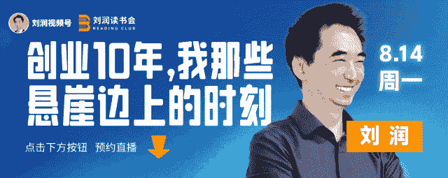

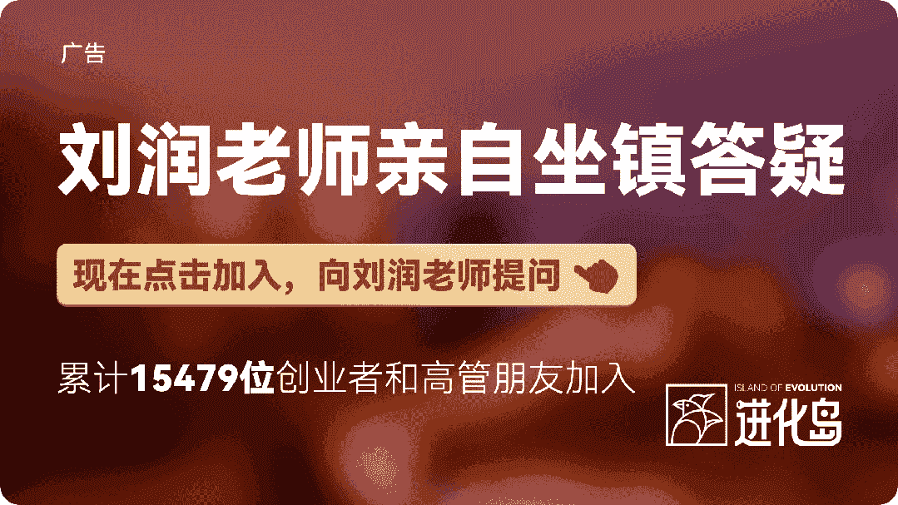

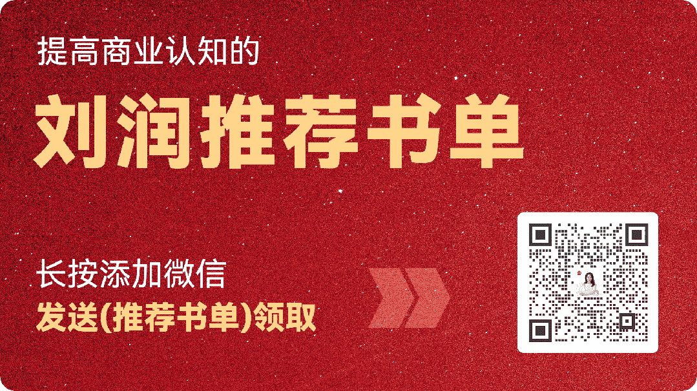

**品牌推广 **| **培训合作 **| 商业咨询 | 润米商城 | 转载开白

请在👸号后台回复 **合作**