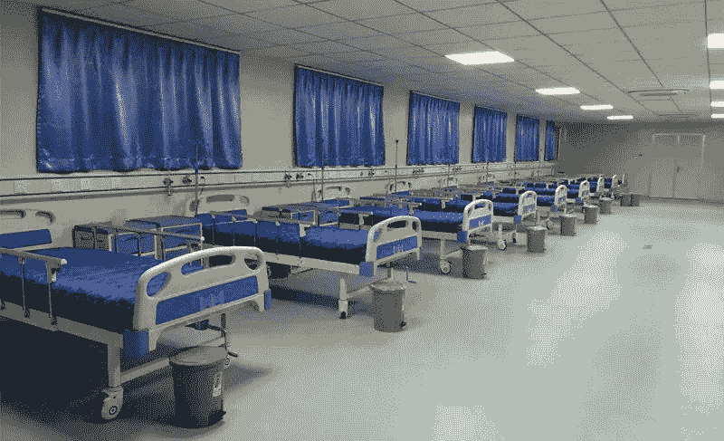
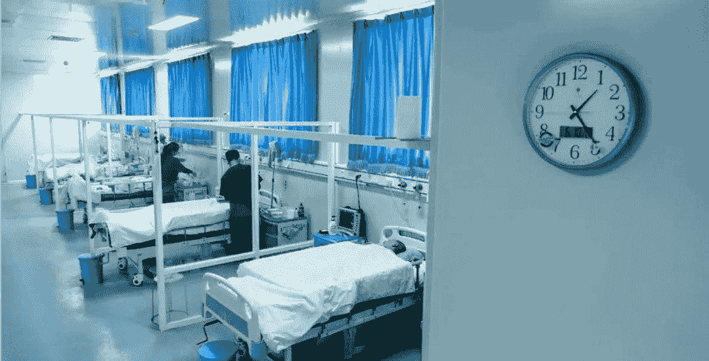

# 2023-06-29延生安养｜安宁疗护｜临终关怀｜收费标准｜公益慈善｜

> 来源：[https://xuqiwei1986.feishu.cn/docx/HT8zd3FEHondXqxBJEwcT93Pn6d](https://xuqiwei1986.feishu.cn/docx/HT8zd3FEHondXqxBJEwcT93Pn6d)

> 🔗 原文链接： h[ttps://mp.weixin.q](https://mp.weixin.qq.com/s/CyPYAsA6o2slX0-ZjG4esg)q.com/s/CyPYAsA6...

>

原创 相久大 延生托养 2023-06-29 08:20 发表于 北京

只要你还是活着的人

就是被家人深爱的人

沉寂的生命也有尊严

**图 **：基础病房 （ 1 6 床/空间， 虚以待位）

**机构简介 **：北京延生托养中心是针对植物人 （完全失能人员） 及疾病终末期（比如癌症晚期），进行全日制护理的机构。作为医院的医疗延伸服务，我们依从托养者和/或家属的意愿， 以淡化治疗效果，给予基本康复、标准护理，达到延续生命的目的 ，让托养者无痛苦有尊严的度过余生。

---

**延生安养 ****：**顾名思义，就是延续生命安宁调养。  安养在佛教语境里指的是极乐世界，谓众生生此世界，可以安心养身， 摆脱人间烦恼的乐土 。延生安养也是我们在国家知识产权局注册 的 商标，可查询第24838899号。

---

**图 **：标准病房（12床/空间）

**收住人群 **：符合 完全失能人员 （ 植物人为代表 ）特征，均可来我机构进行托养。

这个群体有的人可能还有压疮，甚至身上带有多种管路（气管切开、鼻饲、尿管、引流、胃造瘘、膀胱造瘘、深静脉穿刺等）。

**收费标准 **：我们设置了3种 病房 ，供家属选择（如图所示）。

**1、基础病房 **：6000元/月（32张床，针对低收入或需要帮扶家庭设置）

**2、标准病房 **：8000元/月（24张 床，一区西和二区西 ）

**2、加强病房 **：1.2万元/月（16张床，一区东和二区东）

**收费方式 **：1、入住后两周内直接打款到机构账户；2、每次收取3个月费用（评估较重的可按月收取）；3、托养者出院时按天退费。

---

**图 **：加强病房（每人具有相对独立的空间）

**新增服务 **：自2023年7月底开始提供。

**安宁疗护 **：收住疾病终末期（比如癌症晚期）病人，需要自带1名人员陪护；

**临终关怀： **预计≤7天死亡的，提供基本医疗、家属陪伴、最后告别等服务。

**1、安宁疗护 **：24张床， 1万/月/间 。

**2、临终关怀 **：6张床， ≤1周1000元/天 ，>7天后500元/天，且≤1.5万/月（费用封顶）。

---

**安养理念 **：我们结合国情提出在安养过程中，提倡四个理念，需要家属提前了解。

**1、无创操作： **不再做破坏病人机体造成损伤的检查和治疗；

**2、基本医疗： **不再用贵重药品，也不再做昂贵检查。只提供基本用药，注重护理（ 部分药品需要家属提供 ）；

**3、人文关怀： **尽量让安养者看起来舒服干净；家属根据情况自由探视；义工爱心服务如读报、助念、演唱等；

**4、自然死亡： **对于死亡过程不做过分抢救，不再心肺复苏，不再呼吸机辅助呼吸。

**重要提示 ****： ****1、 凡是 接受四个安养理念的符合条件人员的家属，需提前来参观我们机构的病房条件及当面交流一次**，自愿决定入住。2、第三方（非家属）付费的，在原收费基础上，增加1-3仟元不等。

---

**公益慈善 **：1、面向青少年学生，推出一周义工和生命课堂活动。2、提供扶贫济困的场所，弘扬传统文化和慈善文化（详见公众号相关文章）。

**地址导航 **：北京市密云区河南寨镇圣东路98号，导航北京延生托养中心或北京南山滑雪场。距离京哈高铁密云站1公里，京承高速密云出口2公里。

**联系微信 **：liangyaokukou26、 bjysty、 xiaxintong520、qq-1570491520，每个微信均可。

---

———————END————————

**北京密云延生残疾人托养扶助中心**

延生安养::::::安宁疗护 ::::: : 临终关怀

**安养一个植物人就是安抚一个家庭**

编辑校对：小翾，影像提供：小汐

—————————————————