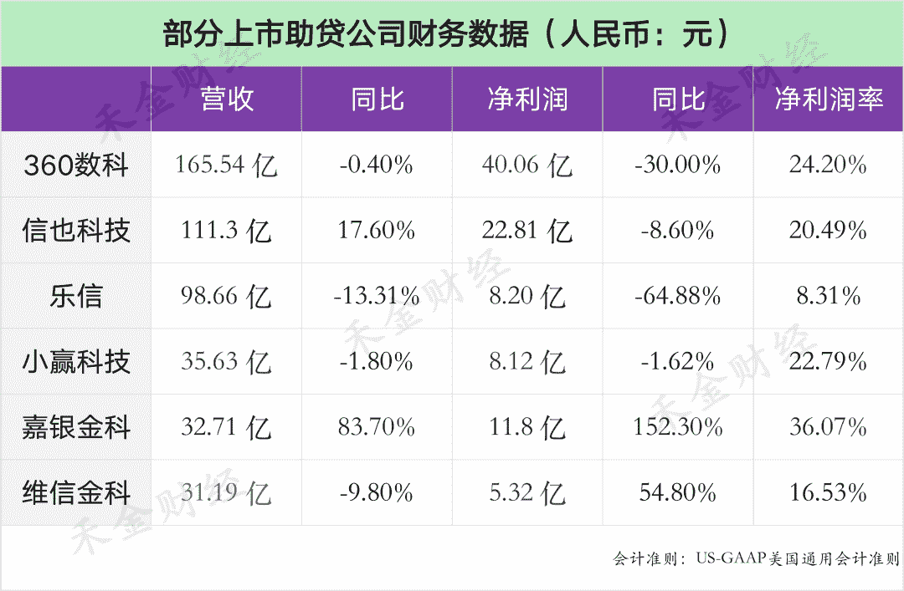
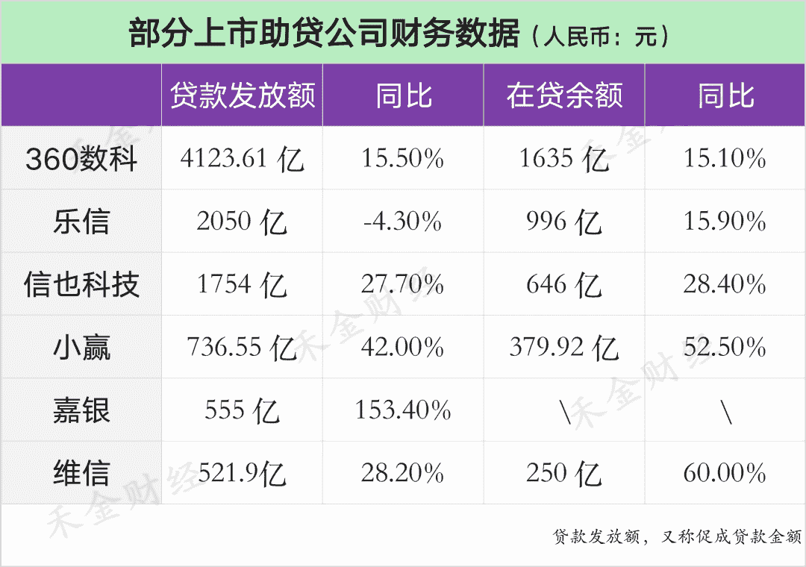
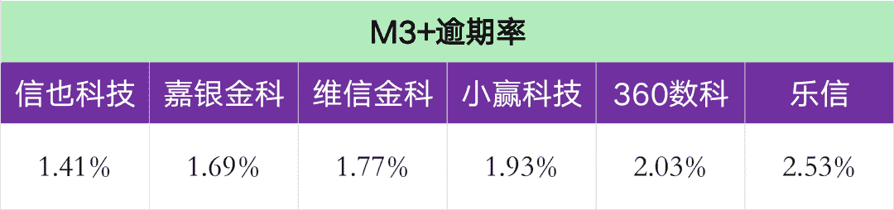

# 2023-04-03--6家助贷上市公司对比：这家公司太会赚钱了！

> 来源：[https://xuqiwei1986.feishu.cn/docx/ZuXBdIpVMo0R50xm3iVc5npYn8f](https://xuqiwei1986.feishu.cn/docx/ZuXBdIpVMo0R50xm3iVc5npYn8f)

> 🔗 原文链接： h[ttps://mp.weixin.q](https://mp.weixin.qq.com/s/W48yrd7y19qn-zuiumUxGA)q.com/s/W48yrd7y...

>

原创 薇梵 禾金财经

2023-04-03 18:31:08

精确发文时间由壹伴提供

2023-04-03 18:31 发表于 北京

手机阅读

收录于合集

#业绩 28 个

#禾金财经只写消金 35 个

#上市公司 16 个

文 ：薇梵

编辑：6 婆

日前 ， 头部助贷上市公司的 2022 年财报已经披露 。

禾金财经将乐 信 、 360 数科 、 信也科技 、 维信金科 、 嘉银金科 、 小赢科技等公司的主要数据进行整理 。

营收方面， 小赢科技 、 维信金科 、 嘉银金科三家营收几乎是在同一水平线 ， 均在 30-35 亿之间 ； 乐信和信也科技在 100-110 亿左右 ， 360 数科的营收明显遥遥领先于其他公司 。 按营收来看 ， 其他几家公司的营收额大多有所下滑 ， 而嘉银金科却同比上涨最多 。

从盈利角度分析，嘉银金科的利润率最高，2022年收获净利润11.8亿元，同比增长1.5倍，同时也是唯一一家营收、净利双增长的公司，可谓一枝独秀； 乐信的盈利能力相对较弱，净利润率为8.31%。另外几家公司的利润率均在15%-25%之间。

此外，可以看出，即便360数科和拍拍贷的营收基本保持平稳或上涨的状态，净利润同比却均有所下降，或是受行业压降利率影响。

一致的是，上述公司的在贷余额相比2021年都获得了不同程度的增长。 在保证风控的情况下 ， 在贷余额是助贷公司持续发展的基石 ， 也是其价值和生命力的体现 。

360 数科 进一步 突破 了 1 6 00 亿元大关， 如此之大的在贷 规模 之下 ， 依然能保持超过 15% 的增速 。 维信金科和小赢科技的增幅明显，分别为 60% 和 50% 。

从放贷规模来看，360数科傲视群雄，高达4123.61亿，同比增长15.5%，其 中助贷放款量为2311.31亿元。 360数科平均单季度撮合交易规模超过千亿元，且明显在下半年发力。

第二梯队是乐信和拍拍贷，放款规模接近2000亿左右，第三梯队是小赢科技、嘉银金科、维信金科，放款量级在500-1000亿之间。 其中嘉银金科同比增长155%，一举赶超了维信金科。

逾期率方面，从各家均披露的 M3+逾期率来看，信也科技仅为1.41%最低，乐信和360数科均超过2%相对较高。

值得一提的是，多家助贷公司的 国际业务也日渐成熟 ，越来越多的助贷企业把目光放到海外。

信也科技 财报提到 ， 海外现金贷的在贷余额为 8 亿元 ， 同比增长 166.7%。 海外业务以印尼为主， 在 印尼 业务中 ， 由当地金融机构融资的交易额占比已从去年同期的 10%上升至2022年第四季度的63% 。

据禾金财经了解 ， 信也科技在印尼现金贷产品的放贷规模已位居行业第二 ，是国内助贷企业出海的头部玩家之一 。 嘉银金科、维信金科等均在海外多国有所布局。

