# 2022-03-25解读360数科财报：关键数据、趋势、侧重、获客与指标全局分析

> 来源：[https://xuqiwei1986.feishu.cn/docx/RJPwdtZzIoVQvmxCLMbcHEY3nnd](https://xuqiwei1986.feishu.cn/docx/RJPwdtZzIoVQvmxCLMbcHEY3nnd)

> 🔗 原文链接： h[ttps://mp.weixin.q](https://mp.weixin.qq.com/s/YuITx6adwPQsbsIxEisttA)q.com/s/YuITx6ad...

>

原创 消费金融频道 消费金融频道

2022-03-25 13:17:52

精确发文时间由壹伴提供

2022-03-25 13:17 发表于

手机阅读

收录于合集 #财报分析 21个

##### **作者 ****｜ **阿伦 **出品 ****| **消费金融频道

应读者们的解读要求，我们把助贷龙头360数科英文版财报（只有英文版才是最准确的）从头到脚仔细扒了几遍，发现了很多亮点，如果大家有需要，我们也会对信也科技、小赢卡贷的财报进一步做数据解读。

我们从财务经营分析、放款增长、风控水平、营销获客、特别关注、今年规划六个方面做了对应分析。

360数科2021年四季度与全年未经审计财报总览：

第四季度营收44.221亿元，同比增长32.5％；净利润13.053亿元，同比增长8.4％，累计用户达到 3850万 同比增长24.6％，发放贷款总额 969.1亿 元，同比增长40.4％。

2021年全年营收 166.356亿 元，同比增长22.6％，净利润 57.645亿 元，同比增长64.9％。

经营、流动良好，增长放缓，继续分红

从财务方面看，财务状况、经营成果和流动性表现良好，增长放缓。

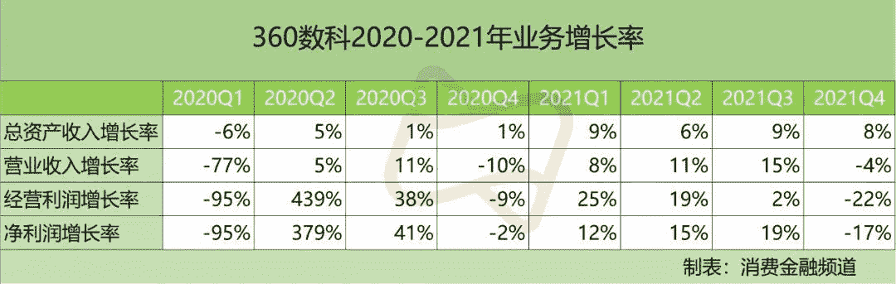

360数科平台整体资本实力较强，流动性充足，实际杠杆倍数持续下降，并且保持较低水平（4-5倍），拨备水平中等，短期和长期偿债能力良好。四季度营收和利润规模开始环比下降，利润率随定价略有下降，但净现比维持1以上。

相比2021年前三个季度，四季度营收和利润规模开始环比下降，营业收入增长率 -4.1% ，经营利润增长率 -21.8% ，净利润增长率 -16.5% ，对客利率下降和风险上升是主要因素。

此外，四季度盈利指标也开始环比下降。净资产收益率ROE 8.9%，总资产收益率ROA 4.1%，营业利率33.5%，净利率 29.5% 。

需要说明的是股东分红策略（季度税后利润的15-20%）。

360数科的分红策略是从21年三季度开始的。去年三季度上公司董事会已批准派发每股0.14美元的股息或每ADS 0.28美元的股息。预计2022年1月18日向截至2021年12月15日登记的股东支付。

四季度公司董事会已批准每股0.13美元的股息或每ADS 0.26美元的股息。预计2022年5月13日向截至2022年4月6日登记的股东支付。预计现金股利金额 2-3亿人民币 ，约占当季度净利的 15-20% 。

2021年我们发现360数科 现金储备过高 ，非受限货币资金过高而表内在贷下降。现在问题基本明朗，360数科对多余的资金一是用于支付现金股利（季度），二是21年底增资360小贷至50亿，三是扩大表内贷款余额。

四季度收缩放款，有实力让大盘继续增长

四季度放款规模正在收缩，并且轻资产模式放款占比略有下降。当前杠杆水平保持适当水平，自有资本和流动性充裕可支持大盘规模继续增长。

轻资产模式是指银行承担主要风控与放贷审核职责以及所有的助贷资金投放，360数科则只提供获客导流、部分风控等服务。

2021年全年360数科平台放款 总额3571亿 元，同比增长约 45% 。其中约 54% 贷款是轻资产模式。2021年末大盘余额 1419.87亿 元，其中约 54.4% 贷款是轻资本模式。

（1）轻资产模式Q4放款环比下降36.1亿元。

轻资产模式Q4放款占比53.5%，放款额环比下降了6.5%，高于大盘放款额环比下降比例 -0.7% 。

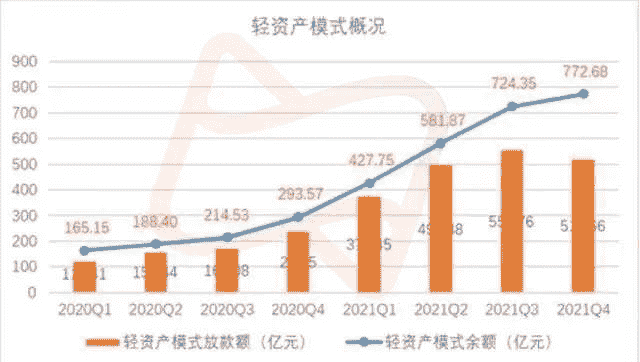

（2）大盘放款额增幅放缓，Q4放款额环比下降比例0.7%。

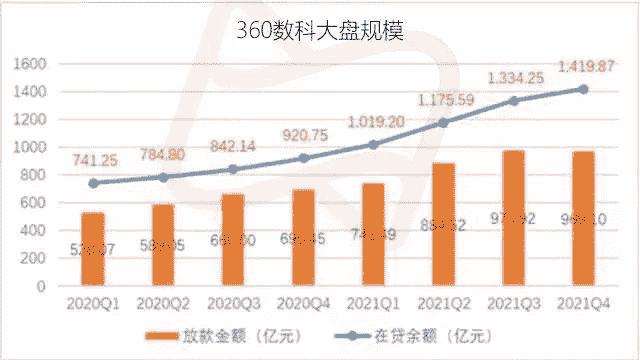

虽然轻资产模式在四季度有所回落，但2021年同比2020年整体得到迅速增长，同比2020年四季度翻了一倍多，由于轻资产模式对风控要求相对宽松，预计今年增长会带动大盘进一步持续走高。

**风险有上升趋势，今年改善**

风险控制方面从数据上看整体风险呈上升趋势，具体从入催率、回款和逾期和年化风险几个方面得来。

一是在主要领先指标中，2021年四季度入催率约 5.4% ，与此同时，M1 30天回款率约 87%。由此我们估算其年化风险约 8.4% 。

截至2021年12月31日，平台合作金融机构的90天+逾期贷款率为 1.54% 。

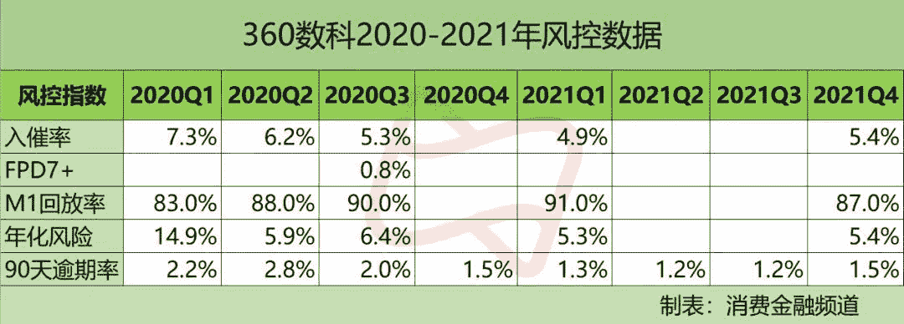

二是拨备新计提比例4.2%连续上升，推算 年化风险升至1 0.3% 左右，略高于基于入催回款推算的年化风险8.4%。

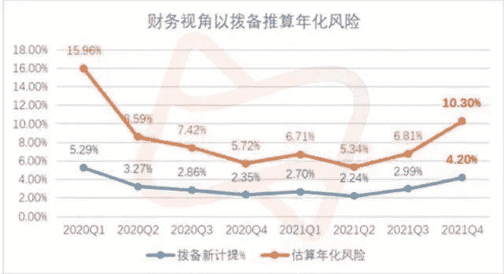

对此， 360数科 CRO郑彦表示：我们实现了2021年的风险管理目标，特别是在21年上半年达到了多个关键风险管理指标的历史最好记录。尽管在Q4季度看到了资产质量的一些波动，但我们认为这种波动主要原因是靠近年底的周期性资金面收紧。预计在2022年全年的整体风险表现将会明显改善，尤其是在下半年。

客户营销更积极，增速放缓，致力大额客户获取

尽管营销费用在2021年连续4个季度增长，但是拉新促活边际效果也在持续衰减。整体注册、授信、用信客户规模增速放缓，趋于稳定并略有下降。

2021四季度销售和营销费用为 6.28亿 元，同比2020年同期仅为 3.16亿 元。相比2020和2021年连续4个季度的增长主要原因是更积极的客户获取策略，尤其是与获取高客单价客户有关。

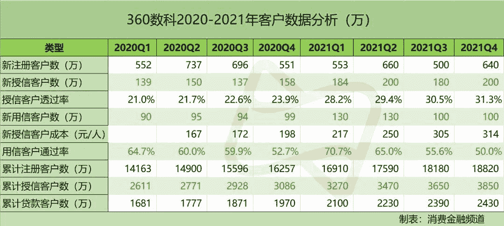

(1) 2021年连续4个季度的营销费用快速增长，四季度高达 6.28亿 元，但新注册用户数放缓。

(2) 新授信用户数与新用信客户数的背离，新用信客户增长放缓并略有下降。

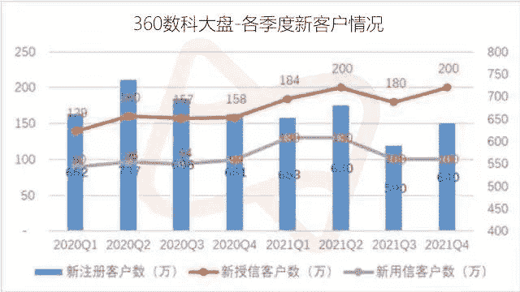

总体来看，营销费用拉新促活的边际效应衰减，新授信客户成本继续攀升。新授信用户数与新用信客户数的背离，新用信客户增长放缓并略有下降。

**复借率略有下降，维持较高水平**

虽然从2021年四季度看复借率略有下降，但还是高于一季度数据，整体维持较高水平，同比2020年四季度相差不大。

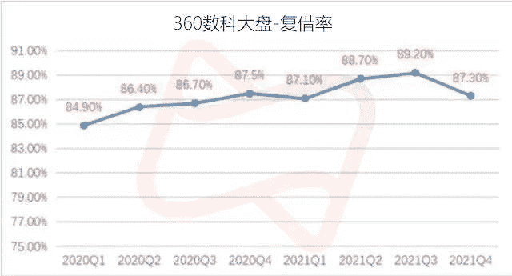

从另一个方面来看回落，说明复借率在今年已基本达到峰值，未来也将会在四季度水平上徘徊。

**财报其他特别关注**

1、表内贷款余额、表内融资业务收入快速增长，旗下网络小贷增资至50亿。

2021年融资业务收入为 7.16亿 元人民币(合1124万美元)，与2020年同期的 4.15亿 元人民币相比快速增长，2021年连续4个季度的增长主要是由于表内贷款余额快速增长。

2021年末运营主体福州三六零网络小贷有限公司，注册资本由10亿，增资至 50亿 （2022年1月5日工商变更），达到跨省经营的标准。

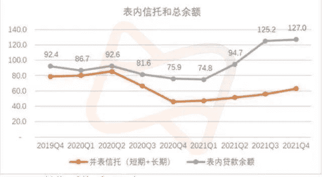

2、四季度新增土地使用权 10.19亿 元。

可能要自建总部大楼了，你们猜是在上海、北京还是福州？

3、小微业务2021年取得突破

2021年中小企业市场取得了重大进展。21年末小微企业贷款余额约 184.6亿 元，约占大盘约的 13% 。

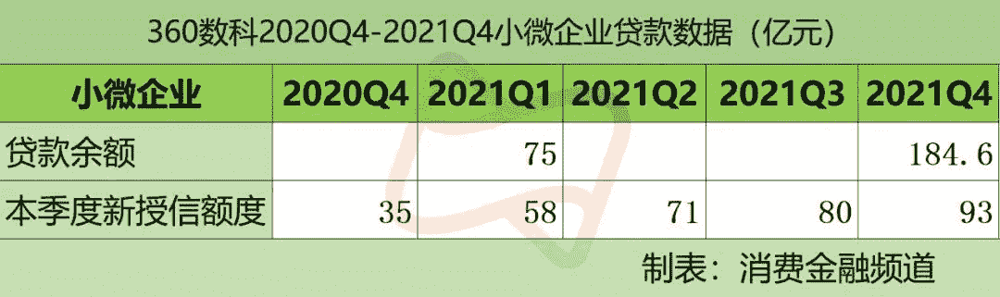

2021年Q1小微新授信额度58亿人民币，相比前一季度35亿元增长 67% 。

2021年Q4小微新授信额度93亿人民币，相比前一季度80亿元增长 16.3% 。

业务目标：2022年放款4100-4500亿元

360数科 2021Q1季报预计2021年Q2放款额将在850亿元至870亿元之间，增长15%至17%。

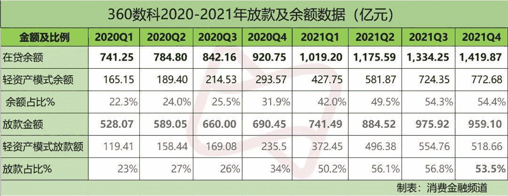

与此同时，360数科将2021年全年放款规模目标保持在 3100亿元至3300亿元之间，同比增长26%至34% 。

实际2021年放款金额是 3571亿元，同比增长约45% ，超过目标区间。

2022年3月上市公司在2021Q4季报预计，2022年的贷款发放总额将达到 4100-4500亿元 人民币，同比增长 15-26% 。

总体来看，目标区间相对2021年更加保守，不知是受到业务增长放缓和获客乏力牵制还是管理层在业务战略层面改为稳中求进的转变。不过，360数科从实力角度出发将会在2022年继续领跑助贷赛道，与乐信、信也、小赢卡贷等追赶者仍然保持较大差距，不容小觑。

合作/客服🛰️：baike2555

进群加🛰️：baike2666

**点击下方卡片关注消费金融频道**